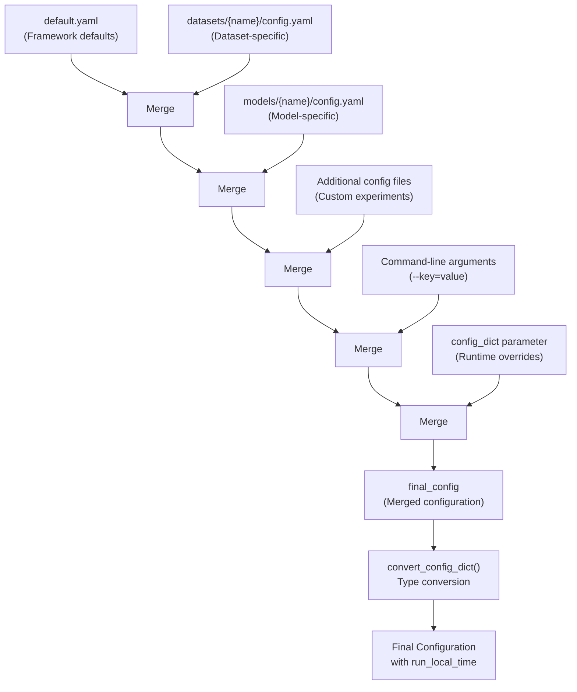
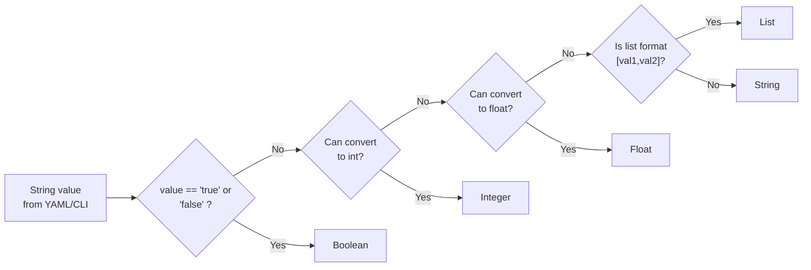
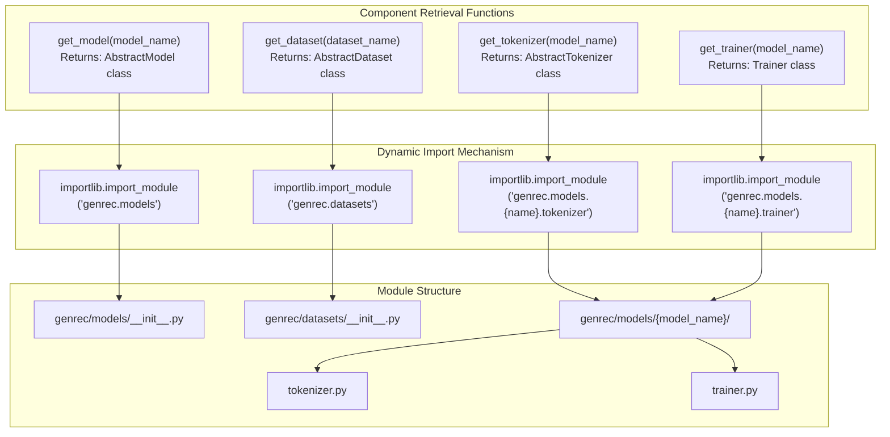
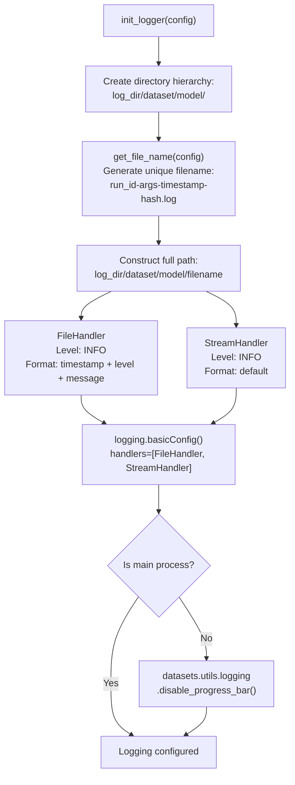
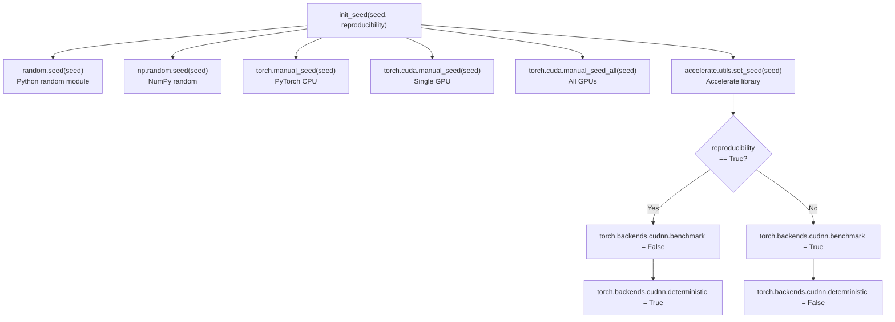

<!-- source: DeepWiki mcp.deepwiki.com · repo google-deepmind/action_piece · page 4.4 Utility Functions & Logging · fetched 2026-10-26 -->

# Utility Functions & Logging

<details>
<summary>Relevant source files</summary>

The following files were used as context for generating this wiki page:

- [genrec/default.yaml](genrec/default.yaml)
- [genrec/utils.py](genrec/utils.py)

</details>


## Purpose & Scope

This document describes the utility functions and logging infrastructure provided by the GenRec framework. These utilities support the ActionPiece system's configuration management, component initialization, reproducibility guarantees, and comprehensive logging capabilities. The utilities are primarily implemented in [genrec/utils.py]() and configured through [genrec/default.yaml]().

For information about the overall Pipeline orchestration that uses these utilities, see [Pipeline Orchestration](#4.1). For configuration parameter reference, see [Configuration Reference](#8).

---

## Configuration System

### Configuration Loading & Merging

The GenRec framework implements a hierarchical configuration system that merges settings from multiple sources with a well-defined precedence order.

**Configuration Precedence Hierarchy** (highest to lowest priority):

| Priority | Source | Purpose |
|----------|--------|---------|
| 1 (Highest) | `config_dict` parameter | Runtime overrides from code |
| 2 | Command-line arguments | User-specified CLI overrides |
| 3 | Additional config files | Custom experiment configs |
| 4 | Model config.yaml | Model-specific defaults |
| 5 | Dataset config.yaml | Dataset-specific defaults |
| 6 (Lowest) | default.yaml | Framework-wide defaults |



**Sources**: [genrec/utils.py:324-413]()

The `get_config()` function orchestrates this merging process:

```python
def get_config(
    model_name: Union[str, AbstractModel],
    dataset_name: Union[str, AbstractDataset],
    config_file: Union[str, list[str], None],
    config_dict: Optional[dict[str, Any]],
) -> dict[str, Any]
```

The function performs the following steps:

1. Loads `genrec/default.yaml` as the base configuration
2. If `dataset_name` is a string, loads `genrec/datasets/{dataset_name}/config.yaml`
3. If `model_name` is a string, loads `genrec/models/{model_name}/config.yaml`
4. Loads any additional config files specified in `config_file` parameter
5. Applies overrides from `config_dict` parameter
6. Adds `run_local_time` timestamp to the configuration
7. Converts string values to appropriate types using `convert_config_dict()`

**Sources**: [genrec/utils.py:324-413]()

### Type Conversion

Configuration values loaded from YAML files are initially strings. The framework provides automatic type conversion to appropriate Python types.



**Sources**: [genrec/utils.py:276-321]()

The `_convert_value()` function handles conversion logic:

| Input String | Output Type | Output Value |
|--------------|-------------|--------------|
| `"true"` or `"True"` | `bool` | `True` |
| `"false"` or `"False"` | `bool` | `False` |
| `"42"` | `int` | `42` |
| `"3.14"` | `float` | `3.14` |
| `"[5,10,20,50]"` | `list` | `[5, 10, 20, 50]` |
| `"hello"` | `str` | `"hello"` |

**Sources**: [genrec/utils.py:276-301]()

### Command-Line Argument Parsing

The framework provides `parse_command_line_args()` to parse command-line arguments in the format `--key=value`. This function applies the same type conversion logic as configuration file loading.

```python
# Example usage
args = parse_command_line_args(['--lr=0.001', '--epochs=100', '--reproducibility=True'])
# Returns: {'lr': 0.001, 'epochs': 100, 'reproducibility': True}
```

**Sources**: [genrec/utils.py:416-445]()

---

## Component Initialization

The framework uses dynamic module loading to instantiate components based on string names. This enables flexible configuration-driven component selection.



**Sources**: [genrec/utils.py:169-256]()

### Model Retrieval: `get_model()`

The `get_model()` function retrieves model classes from the `genrec.models` package:

```python
def get_model(model_name: Union[str, AbstractModel]) -> AbstractModel:
    """Retrieves the model class based on the provided model name."""
    if isinstance(model_name, AbstractModel):
        return model_name  # Already instantiated
    
    try:
        model_class = getattr(importlib.import_module('genrec.models'), model_name)
    except Exception as exc:
        raise ValueError(f'Model "{model_name}" not found.') from exc
    return model_class
```

**Example**: Calling `get_model('ActionPiece')` imports `genrec.models.ActionPiece` class.

**Sources**: [genrec/utils.py:190-210]()

### Dataset Retrieval: `get_dataset()`

The `get_dataset()` function retrieves dataset classes from the `genrec.datasets` package:

```python
def get_dataset(dataset_name: Union[str, AbstractDataset]) -> AbstractDataset:
    """Get the dataset object based on the dataset name."""
    if isinstance(dataset_name, AbstractDataset):
        return dataset_name  # Already instantiated
    
    try:
        dataset_class = getattr(
            importlib.import_module('genrec.datasets'), dataset_name
        )
    except Exception as exc:
        raise ValueError(f'Dataset "{dataset_name}" not found.') from exc
    return dataset_class
```

**Example**: Calling `get_dataset('AmazonReviews2014')` imports `genrec.datasets.AmazonReviews2014` class.

**Sources**: [genrec/utils.py:213-235]()

### Tokenizer Retrieval: `get_tokenizer()`

The `get_tokenizer()` function retrieves tokenizer classes from model-specific subdirectories:

```python
def get_tokenizer(model_name: str):
    """Retrieves the tokenizer for a given model name."""
    module_name = f'genrec.models.{model_name}.tokenizer'
    try:
        module = importlib.import_module(module_name)
        getattr(module, f'{model_name}Tokenizer')
    except Exception as exc:
        raise ValueError(f'Tokenizer for model "{model_name}" not found.') from exc
```

**Example**: For `model_name='ActionPiece'`, imports `genrec.models.ActionPiece.tokenizer.ActionPieceTokenizer`.

**Sources**: [genrec/utils.py:169-187]()

### Trainer Retrieval: `get_trainer()`

The `get_trainer()` function retrieves trainer classes, with fallback to the default `Trainer`:

```python
def get_trainer(model_name: Union[str, AbstractModel]):
    """Returns the trainer class based on the given model name."""
    if isinstance(model_name, str):
        trainer_class = getattr(
            importlib.import_module(f'genrec.models.{model_name}.trainer'),
            f'{model_name}Trainer',
        )
        return trainer_class
    
    return Trainer  # Default trainer for custom models
```

**Example**: For `model_name='ActionPiece'`, imports `genrec.models.ActionPiece.trainer.ActionPieceTrainer`.

**Sources**: [genrec/utils.py:238-256]()

---

## Logging Infrastructure

The GenRec framework provides comprehensive logging to both files and console, with support for distributed training and TensorBoard integration.

### Logger Initialization Flow



**Sources**: [genrec/utils.py:119-149]()

### Directory Structure

The logging system creates a hierarchical directory structure:

```
{log_dir}/
├── {dataset_name}/
│   └── {model_name}/
│       ├── {run_id}-{args}-{timestamp}-{hash}.log
│       └── ...
├── ...
```

Default directories from [genrec/default.yaml:17-20]():

| Configuration Key | Default Value | Purpose |
|-------------------|---------------|---------|
| `log_dir` | `logs/` | Root directory for log files |
| `tensorboard_log_dir` | `tensorboard/` | TensorBoard event files |
| `ckpt_dir` | `ckpt/` | Model checkpoints |
| `cache_dir` | `cache/` | Data and tokenizer cache |

**Sources**: [genrec/default.yaml:17-20](), [genrec/utils.py:122-127]()

### Log File Naming

The `get_file_name()` function generates unique log filenames by combining:

1. **run_id**: User-specified run identifier
2. **Command-line arguments**: Filtered and sanitized CLI args
3. **Timestamp**: Local time in format `%b-%d-%Y_%H-%M-%S`
4. **Hash**: MD5 hash (6 characters) of config for uniqueness

**Filename Format**:
```
{run_id}-{filtered_args}-{timestamp}-{hash}-{suffix}
```

**Command-line Argument Filtering**:

The `get_command_line_args_str()` function filters out certain flags to keep filenames manageable:

- Excluded: `--model`, `--dataset`, `--category`, `--my_log_dir`, `--tensorboard_log_dir`, `--ckpt_dir`
- Special handling: `--cache_dir` shows only basename, not full path
- Path separators (`/`) are replaced with `|` for filename safety

**Sources**: [genrec/utils.py:73-116]()

### Distributed Training Support

The `log()` function provides process-aware logging for distributed training:

```python
def log(message, accelerator, logger, level='info'):
    """Logs a message to the logger."""
    if accelerator.is_main_process:
        try:
            level = logging.getLevelNamesMapping()[level.upper()]
        except KeyError as exc:
            raise ValueError(f'Invalid log level: {level}') from exc
        
        logger.log(level, message)
```

This ensures that in distributed training scenarios, only the main process writes log messages, preventing duplicate logging from multiple workers.

**Sources**: [genrec/utils.py:151-166]()

### TensorBoard Integration

While the logging infrastructure is configured in `utils.py`, TensorBoard logging is handled by the `Trainer` class (see [Trainer & Training Loop](#7.1)). The directory is specified via the `tensorboard_log_dir` configuration parameter.

**Sources**: [genrec/default.yaml:19]()

---

## Reproducibility & Device Setup

### Random Seed Initialization

The `init_seed()` function ensures reproducibility by setting random seeds across all relevant libraries:



**Sources**: [genrec/utils.py:40-59]()

**CuDNN Behavior**:

| Mode | `reproducibility=True` | `reproducibility=False` |
|------|----------------------|------------------------|
| `cudnn.benchmark` | `False` (slower, deterministic) | `True` (faster, non-deterministic) |
| `cudnn.deterministic` | `True` (reproducible results) | `False` (optimized performance) |

**Default Configuration** from [genrec/default.yaml:22-23]():

```yaml
rand_seed: 2024
reproducibility: True
```

**Sources**: [genrec/utils.py:40-59](), [genrec/default.yaml:22-23]()

### Device Detection & Distributed Training

The `init_device()` function detects available hardware and distributed training setup:

```python
def init_device():
    """Set the visible devices for training. Supports multiple GPUs."""
    use_ddp = (
        True if os.environ.get('WORLD_SIZE') else False
    )  # Check if DDP is enabled
    if torch.cuda.is_available():
        return torch.device('cuda'), use_ddp
    else:
        return torch.device('cpu'), use_ddp
```

**Return Values**:

| Hardware Available | DDP Environment | Returns |
|-------------------|----------------|---------|
| CUDA available | `WORLD_SIZE` set | `(torch.device('cuda'), True)` |
| CUDA available | `WORLD_SIZE` not set | `(torch.device('cuda'), False)` |
| CUDA not available | Any | `(torch.device('cpu'), False)` |

**Sources**: [genrec/utils.py:503-515]()

---

## Utility Functions

### Text Processing

The framework provides text cleaning utilities for processing item metadata:

**`clean_text()` Function**:

```python
def clean_text(raw_text: str) -> str:
    """Cleans the raw text by removing HTML tags, special characters, and extra spaces."""
    text = list_to_str(raw_text)
    text = html.unescape(text)
    text = text.strip()
    text = re.sub(r'<[^>]+>', '', text)       # Remove HTML tags
    text = re.sub(r'[\n\t]', ' ', text)       # Replace newlines/tabs with spaces
    text = re.sub(r' +', ' ', text)           # Collapse multiple spaces
    text = re.sub(r'[^\x00-\x7F]', ' ', text) # Remove non-ASCII characters
    return text
```

**Processing Steps**:

1. Convert lists to strings using `list_to_str()`
2. Unescape HTML entities (e.g., `&amp;` → `&`)
3. Strip leading/trailing whitespace
4. Remove HTML tags (e.g., `<br>`, `<div>`)
5. Replace newlines and tabs with spaces
6. Collapse multiple consecutive spaces
7. Remove non-ASCII characters

**Sources**: [genrec/utils.py:484-500]()

### File Operations

**`download_file()` Function**:

Downloads files from URLs with logging:

```python
def download_file(url: str, path: str) -> None:
    """Downloads a file from the given URL and saves it to the specified path."""
    logger = logging.getLogger()
    response = requests.get(url)
    if response.status_code == 200:
        with open(path, 'wb') as f:
            f.write(response.content)
        logger.info('Downloaded %s', os.path.basename(path))
    else:
        logger.error('Failed to download %s', os.path.basename(path))
```

Used by dataset classes to automatically download required data files (see [AmazonReviews2014 Dataset](#5.2)).

**Sources**: [genrec/utils.py:448-462]()

### Training Helper Functions

**`get_total_steps()` Function**:

Calculates the total number of training steps:

```python
def get_total_steps(config, train_dataloader):
    """Calculate the total number of steps for training."""
    if config['steps'] is not None:
        return config['steps']
    else:
        return len(train_dataloader) * config['epochs']
```

**Logic**:
- If `steps` is specified in config, use that value directly
- Otherwise, multiply dataloader length by number of epochs

**Sources**: [genrec/utils.py:259-273]()

**`config_for_log()` Function**:

Prepares configuration dictionary for logging by removing device objects and converting lists to strings:

```python
def config_for_log(config: dict[str, Any]) -> dict[str, Any]:
    """Prepares the configuration dictionary for logging."""
    config = config.copy()
    config.pop('device', None)
    config.pop('accelerator', None)
    for k, v in config.items():
        if isinstance(v, list):
            config[k] = str(v)
    return config
```

This ensures configuration can be serialized to TensorBoard or saved to files without serialization errors.

**Sources**: [genrec/utils.py:518-533]()

### Timestamp Utility

**`get_local_time()` Function**:

Returns formatted timestamp for filenames and logging:

```python
def get_local_time():
    """Get current time."""
    cur = datetime.datetime.now()
    cur = cur.strftime('%b-%d-%Y_%H-%M-%S')
    return cur
```

**Format**: `{Month}-{Day}-{Year}_{Hour}-{Minute}-{Second}`

**Example**: `Jan-15-2024_14-30-45`

**Sources**: [genrec/utils.py:62-70]()

---

## Summary

The utilities in `genrec/utils.py` provide essential infrastructure for the ActionPiece system:

| Category | Key Functions | Purpose |
|----------|---------------|---------|
| **Configuration** | `get_config()`, `convert_config_dict()`, `parse_command_line_args()` | Hierarchical config merging with type conversion |
| **Component Loading** | `get_model()`, `get_dataset()`, `get_tokenizer()`, `get_trainer()` | Dynamic module import for flexible component selection |
| **Logging** | `init_logger()`, `log()`, `get_file_name()` | Structured logging with distributed training support |
| **Reproducibility** | `init_seed()` | Cross-library random seed initialization |
| **Device Setup** | `init_device()` | Hardware detection and DDP configuration |
| **Text Processing** | `clean_text()` | HTML and special character cleaning |
| **File Operations** | `download_file()` | Automatic data downloading |
| **Training Helpers** | `get_total_steps()`, `config_for_log()` | Training loop utilities |

These utilities are used throughout the GenRec framework to ensure consistent behavior, reproducible experiments, and comprehensive logging across all components.

**Sources**: [genrec/utils.py:1-534](), [genrec/default.yaml:1-39]()

---

