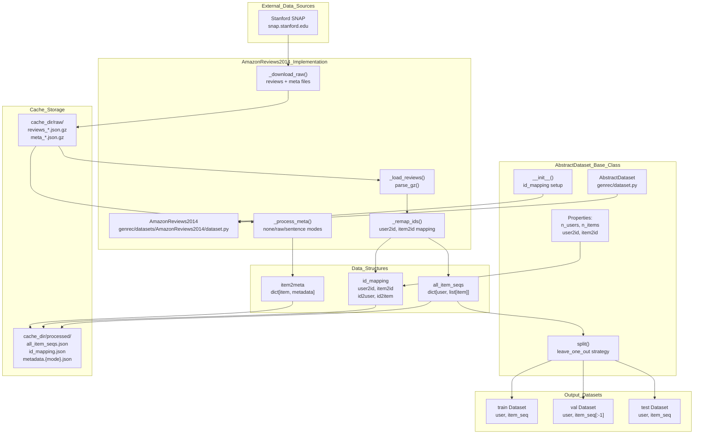
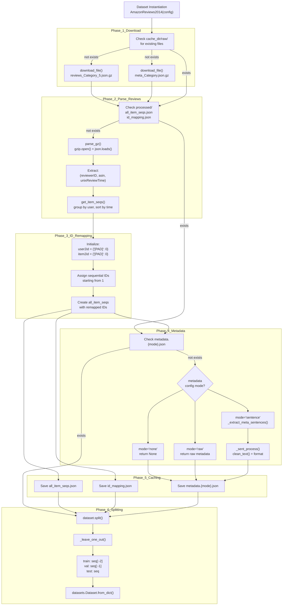
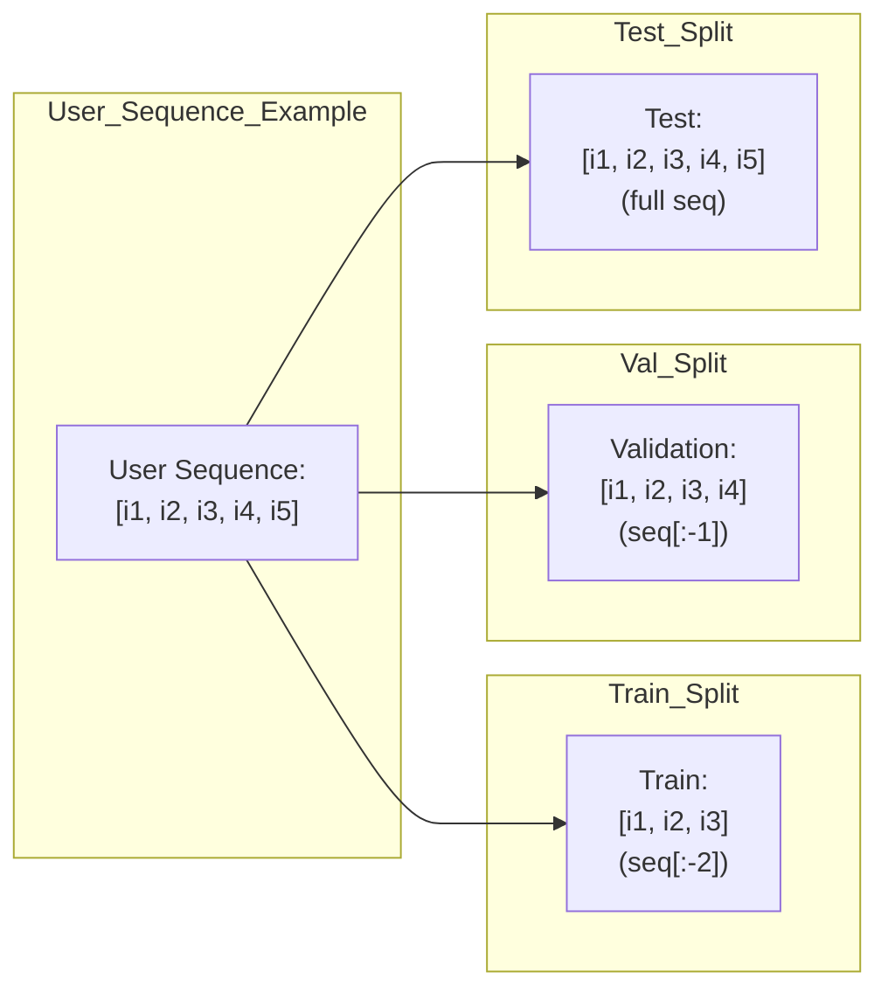
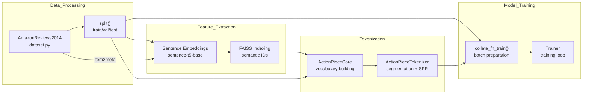

<!-- source: DeepWiki mcp.deepwiki.com · repo google-deepmind/action_piece · page 5 Data Processing Pipeline · fetched 2026-10-26 -->

# Data Processing Pipeline

<details>
<summary>Relevant source files</summary>

The following files were used as context for generating this wiki page:

- [genrec/dataset.py](genrec/dataset.py)
- [genrec/datasets/AmazonReviews2014/config.yaml](genrec/datasets/AmazonReviews2014/config.yaml)
- [genrec/datasets/AmazonReviews2014/dataset.py](genrec/datasets/AmazonReviews2014/dataset.py)

</details>


The data processing pipeline handles loading, preprocessing, and preparing datasets for training and evaluation in the ActionPiece system. This includes downloading raw data, parsing user-item interactions, remapping identifiers, processing item metadata, and splitting data into train/validation/test sets.

This page provides an overview of the complete data processing pipeline. For details on specific components:
- For the abstract interface and data splitting strategies, see [AbstractDataset Interface](#5.1)
- For Amazon Reviews 2014 implementation specifics, see [AmazonReviews2014 Dataset](#5.2)  
- For feature extraction (sentence embeddings, FAISS indexing), see [Feature Extraction & Processing](#5.3)
- For tokenization after data processing, see [ActionPiece Tokenization System](#3)

## Purpose and Scope

The data processing pipeline transforms raw datasets into structured formats suitable for generative recommendation. The pipeline:

1. **Downloads** raw data from external sources (e.g., Stanford SNAP)
2. **Parses** compressed data files (`.json.gz` format)
3. **Remaps** user and item identifiers to sequential integers
4. **Processes** item metadata in multiple modes (none/raw/sentence)
5. **Splits** data into train/validation/test sets using leave-one-out strategy
6. **Caches** processed results to avoid redundant computation

This pipeline operates independently of the tokenization system ([ActionPiece Tokenization System](#3)) and model architecture ([ActionPiece Model Architecture](#6)).

Sources: [genrec/dataset.py:1-163](), [genrec/datasets/AmazonReviews2014/dataset.py:1-413]()

## Pipeline Architecture

The following diagram shows the complete data processing architecture, mapping natural language concepts to code entities:



Sources: [genrec/dataset.py:25-163](), [genrec/datasets/AmazonReviews2014/dataset.py:113-413]()

## Data Processing Lifecycle

The following diagram shows the detailed processing flow with method calls and data transformations:



Sources: [genrec/datasets/AmazonReviews2014/dataset.py:381-413](), [genrec/dataset.py:116-156]()

## Key Components

### AbstractDataset Base Class

The `AbstractDataset` class [genrec/dataset.py:25-163]() defines the interface and common functionality for all datasets:

| Component | Type | Description |
|-----------|------|-------------|
| `config` | `dict[str, Any]` | Configuration parameters including split strategy, cache directory |
| `all_item_seqs` | `dict[str, list]` | User-to-item-sequence mapping after ID remapping |
| `id_mapping` | `dict[str, dict]` | Bidirectional mappings: `user2id`, `item2id`, `id2user`, `id2item` |
| `item2meta` | `dict` | Optional item metadata (depends on processing mode) |
| `split_data` | `dict` | Train/val/test splits as HuggingFace `Dataset` objects |

**Key Methods:**

- `_download_and_process_raw()` [genrec/dataset.py:107-114](): Abstract method for downloading and processing (implemented by subclasses)
- `_leave_one_out()` [genrec/dataset.py:116-140](): Creates train/val/test splits using leave-one-out strategy
- `split()` [genrec/dataset.py:142-156](): Entry point for data splitting

**Properties:**

- `n_users` [genrec/dataset.py:78-80](): Count of unique users
- `n_items` [genrec/dataset.py:83-85](): Count of unique items  
- `n_interactions` [genrec/dataset.py:88-90](): Total number of user-item interactions
- `avg_item_seq_len` [genrec/dataset.py:93-95](): Average sequence length per user

Sources: [genrec/dataset.py:25-163]()

### AmazonReviews2014 Implementation

The `AmazonReviews2014` class [genrec/datasets/AmazonReviews2014/dataset.py:113-413]() implements the complete pipeline for Amazon Reviews 2014 datasets:

**Constructor Parameters:**
```python
config: dict[str, Any]
# Required config keys:
#   - category: str (e.g., "Sports_and_Outdoors")
#   - metadata: str ("none" | "raw" | "sentence")
#   - cache_dir: str (base cache directory)
#   - split: str ("leave_one_out")
```

**Core Methods:**

| Method | Lines | Purpose |
|--------|-------|---------|
| `_download_raw()` | [145-163]() | Downloads `.json.gz` files from SNAP |
| `_load_reviews()` | [165-182]() | Parses reviews: `(reviewerID, asin, unixReviewTime)` |
| `_remap_ids()` | [184-220]() | Creates sequential integer IDs starting from 1 |
| `_process_reviews()` | [222-259]() | Orchestrates review processing with caching |
| `_load_metadata()` | [261-281]() | Loads metadata for items in the dataset |
| `_sent_process()` | [283-308]() | Converts metadata fields to sentences |
| `_extract_meta_sentences()` | [310-337]() | Combines metadata into natural language sentences |
| `_process_meta()` | [339-379]() | Processes metadata according to configured mode |

Sources: [genrec/datasets/AmazonReviews2014/dataset.py:113-413]()

## Data Structures

### ID Mapping Structure

The `id_mapping` dictionary maintains bidirectional mappings between raw and remapped identifiers:

```python
id_mapping = {
    'user2id': {
        '[PAD]': 0,          # Reserved padding token
        'raw_user_1': 1,      # Sequential IDs from 1
        'raw_user_2': 2,
        # ...
    },
    'item2id': {
        '[PAD]': 0,          # Reserved padding token
        'raw_item_1': 1,      # Sequential IDs from 1
        'raw_item_2': 2,
        # ...
    },
    'id2user': [
        '[PAD]',             # Index 0
        'raw_user_1',        # Index 1
        'raw_user_2',        # Index 2
        # ...
    ],
    'id2item': [
        '[PAD]',             # Index 0
        'raw_item_1',        # Index 1
        'raw_item_2',        # Index 2
        # ...
    ]
}
```

Sources: [genrec/dataset.py:54-59](), [genrec/datasets/AmazonReviews2014/dataset.py:184-220]()

### Item Sequences Structure

The `all_item_seqs` dictionary maps users to their chronologically ordered item sequences:

```python
all_item_seqs = {
    'user_raw_id_1': ['item_1', 'item_2', 'item_3', ...],  # Sorted by timestamp
    'user_raw_id_2': ['item_5', 'item_1', ...],
    # ...
}
```

Sequences are sorted by `unixReviewTime` in ascending order [genrec/datasets/AmazonReviews2014/dataset.py:106-108]().

Sources: [genrec/datasets/AmazonReviews2014/dataset.py:87-110]()

## Metadata Processing Modes

The dataset supports three metadata processing modes configured via `metadata` parameter in [genrec/datasets/AmazonReviews2014/config.yaml:17]():

### Mode: `none`

No metadata is processed. `item2meta` is set to `None` [genrec/datasets/AmazonReviews2014/dataset.py:363-365]().

**Use case:** When item features will be derived solely from interaction patterns.

### Mode: `raw`

Raw metadata is loaded directly from the `.json.gz` file without processing [genrec/datasets/AmazonReviews2014/dataset.py:369-370]().

**Structure:**
```python
item2meta = {
    'item_asin': {
        'title': 'Product Title',
        'price': 29.99,
        'brand': 'Brand Name',
        'categories': [['Sports', 'Outdoors', 'Camping']],
        'description': 'Product description text',
        'feature': ['Feature 1', 'Feature 2'],
        # ... additional fields
    },
    # ...
}
```

### Mode: `sentence`

Metadata fields are concatenated into natural language sentences [genrec/datasets/AmazonReviews2014/dataset.py:371-373]().

**Processing:** The `_extract_meta_sentences()` method [genrec/datasets/AmazonReviews2014/dataset.py:310-337]() extracts these fields in order:
1. `title`
2. `price`
3. `brand`
4. `feature`
5. `categories`
6. `description`

**Output Structure:**
```python
item2meta = {
    'item_asin': 'Product Title. 29.99. Brand Name. Feature 1. Feature 2. Sports, Outdoors, Camping. Product description text. ',
    # ...
}
```

The `_sent_process()` method [genrec/datasets/AmazonReviews2014/dataset.py:283-308]() handles different data types:
- `float`: Converted to string with trailing period
- Nested lists: Flattened with comma separation
- Lists: Concatenated with `clean_text()`
- Strings: Processed with `clean_text()`

Sources: [genrec/datasets/AmazonReviews2014/dataset.py:339-379](), [genrec/datasets/AmazonReviews2014/config.yaml:17]()

## Data Splitting Strategy

### Leave-One-Out Split

The `_leave_one_out()` method [genrec/dataset.py:116-140]() implements the splitting strategy:



**Rules:**
- **Test set:** All users with their complete sequences
- **Validation set:** Users with `len(sequence) > 1`, using `sequence[:-1]`
- **Training set:** Users with `len(sequence) > 2`, using `sequence[:-2]`

**Output Format:** Each split is a HuggingFace `Dataset` object with schema:
```python
{
    'user': list[str],      # List of user identifiers
    'item_seq': list[list[str]]  # List of item sequences
}
```

Sources: [genrec/dataset.py:116-140]()

## Caching System

The pipeline implements multi-level caching to avoid redundant computation:

### Cache Directory Structure

```
cache_dir/
└── AmazonReviews2014/
    └── {category}/
        ├── raw/
        │   ├── reviews_{category}_5.json.gz
        │   └── meta_{category}.json.gz
        └── processed/
            ├── all_item_seqs.json
            ├── id_mapping.json
            └── metadata.{mode}.json
```

### Cache Check Logic

Each processing method checks for cached results before executing:

| Method | Cache File | Check Location |
|--------|-----------|----------------|
| `_process_reviews()` | `all_item_seqs.json`, `id_mapping.json` | [222-244]() |
| `_process_meta()` | `metadata.{mode}.json` | [354-359]() |

**Distributed Training Handling:** The download phase uses `accelerator.main_process_first()` [genrec/datasets/AmazonReviews2014/dataset.py:394]() to ensure only one process downloads files during distributed training.

Sources: [genrec/datasets/AmazonReviews2014/dataset.py:140-143](), [genrec/datasets/AmazonReviews2014/dataset.py:381-413]()

## Configuration

The dataset configuration is specified in [genrec/datasets/AmazonReviews2014/config.yaml]():

| Parameter | Type | Options | Description |
|-----------|------|---------|-------------|
| `category` | `str` | 24 categories | Amazon product category (see below) |
| `metadata` | `str` | `none`, `raw`, `sentence` | Metadata processing mode |
| `split` | `str` | `leave_one_out` | Data splitting strategy |

### Available Categories

The `check_available_category()` function [genrec/datasets/AmazonReviews2014/dataset.py:31-69]() validates against 24 categories:

- Books
- Electronics
- Movies_and_TV
- CDs_and_Vinyl
- Clothing_Shoes_and_Jewelry
- Home_and_Kitchen
- Kindle_Store
- Sports_and_Outdoors
- Cell_Phones_and_Accessories
- Health_and_Personal_Care
- Toys_and_Games
- Video_Games
- Tools_and_Home_Improvement
- Beauty
- Apps_for_Android
- Office_Products
- Pet_Supplies
- Automotive
- Grocery_and_Gourmet_Food
- Patio_Lawn_and_Garden
- Baby
- Digital_Music
- Musical_Instruments
- Amazon_Instant_Video

Sources: [genrec/datasets/AmazonReviews2014/config.yaml:16-18](), [genrec/datasets/AmazonReviews2014/dataset.py:31-69]()

## Integration with Pipeline

The processed dataset integrates with the broader system as follows:



**Data Flow:**
1. `AmazonReviews2014` produces split datasets and `item2meta`
2. `item2meta` sentences are embedded using `sentence-t5-base` (see [Feature Extraction & Processing](#5.3))
3. Embeddings are indexed with FAISS for semantic ID assignment
4. `ActionPieceCore` builds vocabulary using semantic IDs and item sequences (see [Vocabulary Construction](#3.2))
5. `ActionPieceTokenizer` tokenizes sequences during batch collation (see [Sequence Segmentation & SPR](#3.3))
6. `Trainer` consumes batched data for model training (see [Trainer & Training Loop](#7.1))

Sources: [genrec/dataset.py:1-163](), [genrec/datasets/AmazonReviews2014/dataset.py:1-413]()

---

