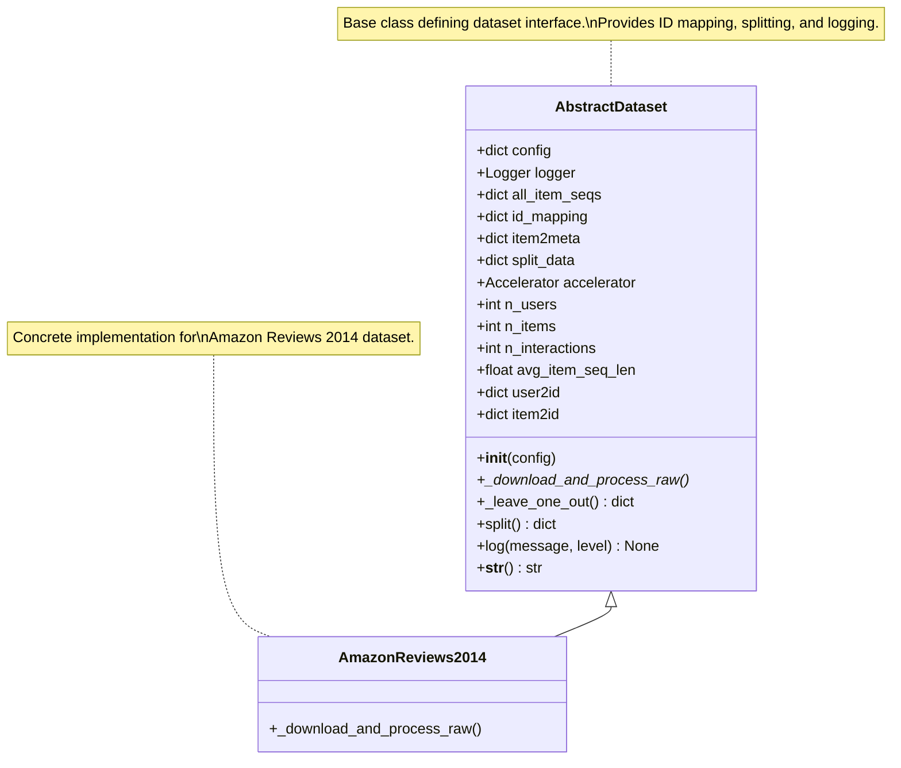
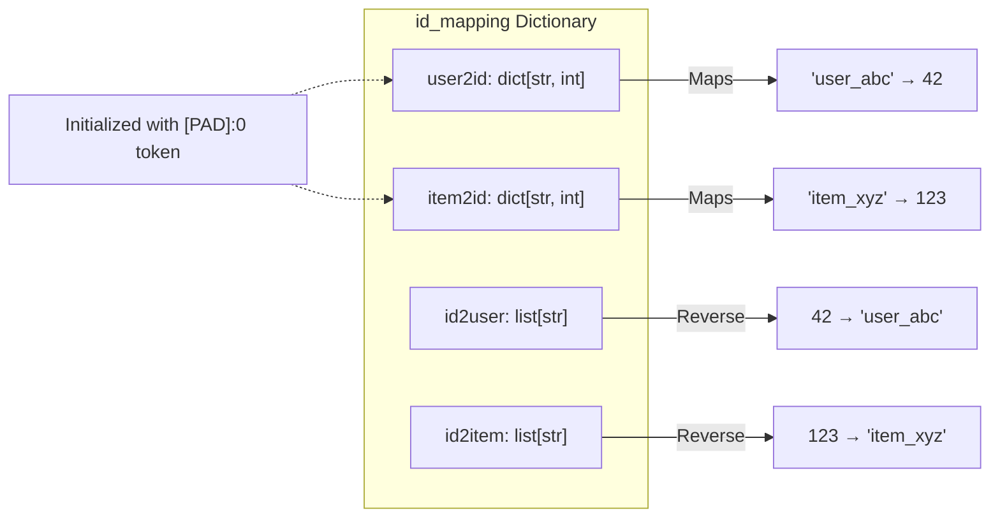
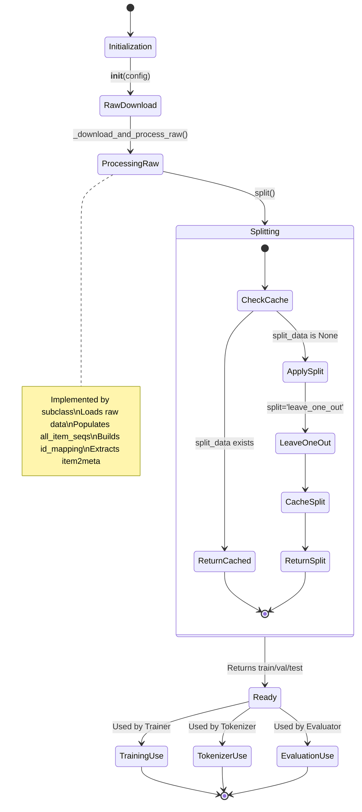
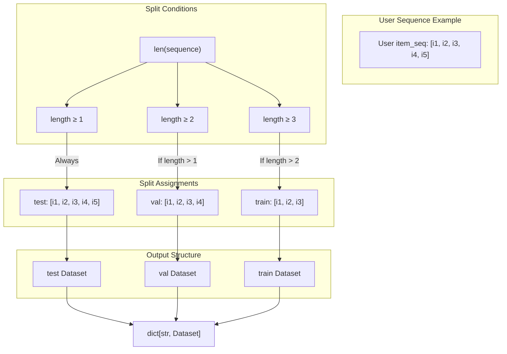
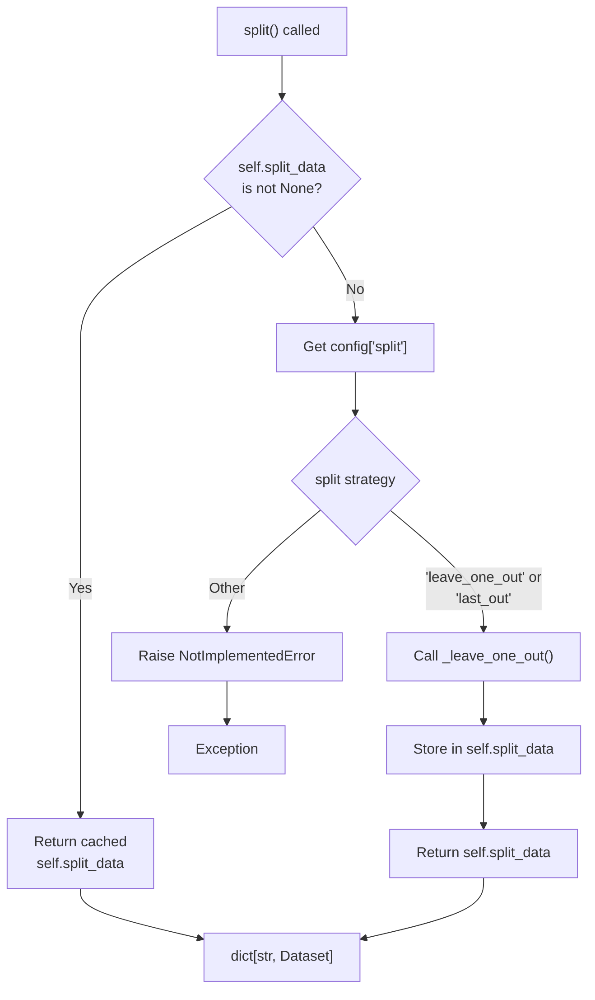
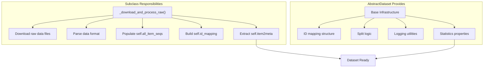
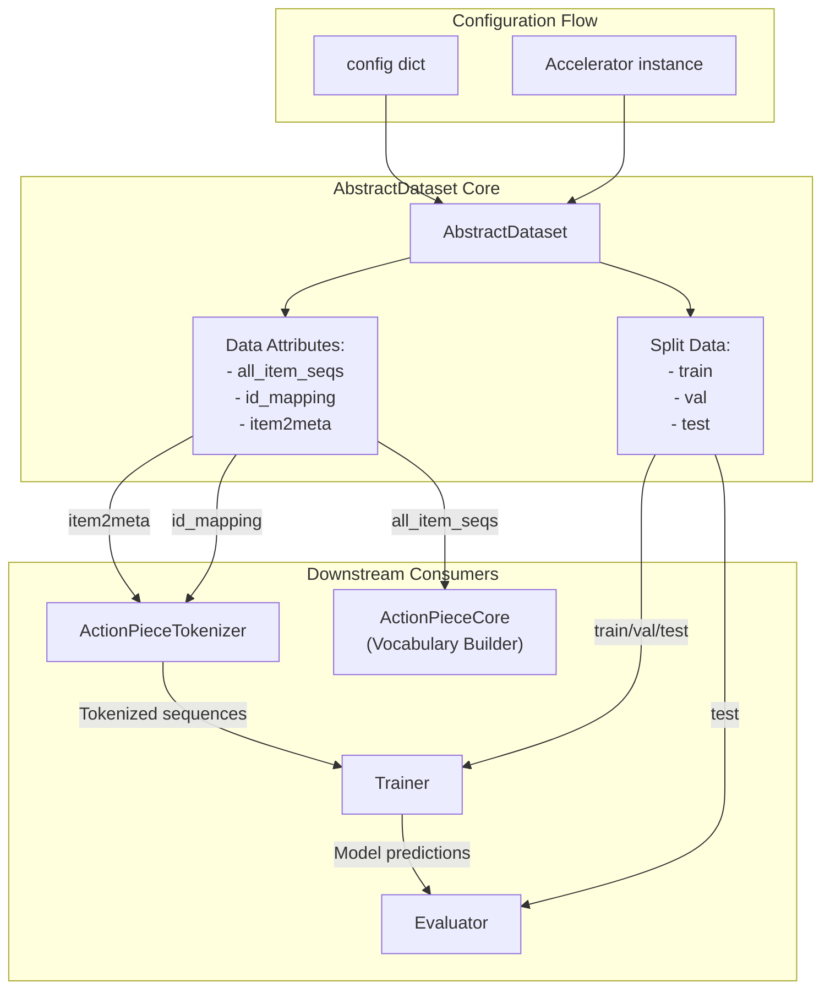

<!-- source: DeepWiki mcp.deepwiki.com · repo google-deepmind/action_piece · page 5.1 AbstractDataset Interface · fetched 2026-10-26 -->

# AbstractDataset Interface

<details>
<summary>Relevant source files</summary>

The following files were used as context for generating this wiki page:

- [README.md](README.md)
- [genrec/dataset.py](genrec/dataset.py)

</details>


## Purpose and Scope

This page documents the `AbstractDataset` base class, which defines the interface and core functionality for all datasets in the ActionPiece system. The `AbstractDataset` class provides standard data structures for user-item interaction sequences, ID mappings, metadata storage, and data splitting strategies. 

For information about the concrete Amazon Reviews dataset implementation, see [AmazonReviews2014 Dataset](#5.2). For details on how item features and metadata are extracted from datasets, see [Feature Extraction & Processing](#5.3).

**Sources:** [genrec/dataset.py:1-163]()

---

## Class Architecture

The `AbstractDataset` class serves as the foundation for dataset implementations in the GenRec framework. It establishes a contract that concrete dataset classes must fulfill while providing reusable infrastructure for common dataset operations.



**Diagram: AbstractDataset Class Structure and Inheritance Pattern**

**Sources:** [genrec/dataset.py:25-163]()

---

## Core Attributes and Data Structures

The `AbstractDataset` class maintains several key data structures that are essential for dataset management:

| Attribute | Type | Purpose | Initialization |
|-----------|------|---------|----------------|
| `config` | `dict[str, Any]` | Configuration parameters for dataset operations | Passed to `__init__` |
| `logger` | `logging.Logger` | Standard Python logger for dataset operations | Created in `__init__` |
| `all_item_seqs` | `dict` | Maps user IDs to their complete item interaction sequences | Empty dict in `__init__` |
| `id_mapping` | `dict` | Four mappings: `user2id`, `item2id`, `id2user`, `id2item` | Initialized with `[PAD]` tokens |
| `item2meta` | `dict` | Stores metadata for each item (category, features, etc.) | Set to `None` initially |
| `split_data` | `dict` | Cached train/validation/test splits | Set to `None` until `split()` called |

### ID Mapping Structure

The `id_mapping` dictionary provides bidirectional mappings between user/item identifiers and integer IDs:



**Diagram: ID Mapping Bidirectional Structure**

The ID mapping is initialized with placeholder `[PAD]` tokens at index 0:

```python
self.id_mapping = {
    'user2id': {'[PAD]': 0},
    'item2id': {'[PAD]': 0},
    'id2user': ['[PAD]'],
    'id2item': ['[PAD]'],
}
```

**Sources:** [genrec/dataset.py:49-62]()

---

## Properties and Computed Attributes

The `AbstractDataset` class exposes several computed properties that derive statistics from the underlying data:

| Property | Return Type | Computation | Location |
|----------|-------------|-------------|----------|
| `n_users` | `int` | `len(self.user2id)` | [genrec/dataset.py:78-80]() |
| `n_items` | `int` | `len(self.item2id)` | [genrec/dataset.py:83-85]() |
| `n_interactions` | `int` | `sum(len(seq) for seq in self.all_item_seqs.values())` | [genrec/dataset.py:88-90]() |
| `avg_item_seq_len` | `float` | `self.n_interactions / self.n_users` | [genrec/dataset.py:93-95]() |
| `user2id` | `dict[str, int]` | `self.id_mapping['user2id']` | [genrec/dataset.py:98-100]() |
| `item2id` | `dict[str, int]` | `self.id_mapping['item2id']` | [genrec/dataset.py:103-105]() |
| `accelerator` | `Any` | `self.config['accelerator']` | [genrec/dataset.py:73-75]() |

These properties enable clean access to dataset statistics and are used throughout the system for logging, validation, and model configuration.

**Sources:** [genrec/dataset.py:72-105]()

---

## Dataset Lifecycle

The typical lifecycle of an `AbstractDataset` instance follows this pattern:



**Diagram: Dataset Lifecycle State Machine**

**Sources:** [genrec/dataset.py:25-163]()

---

## Leave-One-Out Split Strategy

The `_leave_one_out()` method implements the primary data splitting strategy used in ActionPiece experiments. This strategy creates three splits from each user's interaction sequence:

- **Test set**: Uses the complete sequence (all interactions)
- **Validation set**: Uses sequence up to the second-to-last item (sequence[:-1])
- **Training set**: Uses sequence up to the third-to-last item (sequence[:-2])

### Split Logic Visualization



**Diagram: Leave-One-Out Split Strategy Logic**

### Implementation Details

The `_leave_one_out()` method creates three dictionaries with parallel lists:

| Split | User List | Item Sequence List | Condition |
|-------|-----------|-------------------|-----------|
| `test` | All users | Complete sequences | Always included |
| `val` | Users with len(seq) > 1 | Sequence[:-1] | Excludes last item |
| `train` | Users with len(seq) > 2 | Sequence[:-2] | Excludes last two items |

The method returns a dictionary of `datasets_lib.Dataset` objects, created from these parallel lists using `Dataset.from_dict()`:

```python
datasets = {
    'train': {'user': [], 'item_seq': []},
    'val': {'user': [], 'item_seq': []},
    'test': {'user': [], 'item_seq': []},
}
for user, sequence in self.all_item_seqs.items():
    datasets['test']['user'].append(user)
    datasets['test']['item_seq'].append(sequence)
    if len(sequence) > 1:
        datasets['val']['user'].append(user)
        datasets['val']['item_seq'].append(sequence[:-1])
    if len(sequence) > 2:
        datasets['train']['user'].append(user)
        datasets['train']['item_seq'].append(sequence[:-2])
return {k: datasets_lib.Dataset.from_dict(v) for k, v in datasets.items()}
```

**Sources:** [genrec/dataset.py:116-140]()

---

## Public Methods

### split()

The `split()` method is the primary interface for obtaining train/validation/test splits:



**Diagram: split() Method Control Flow**

The method implements caching to avoid redundant splitting operations. Once `split()` is called, subsequent calls return the cached `split_data` without recomputing.

**Sources:** [genrec/dataset.py:142-156]()

### log()

The `log()` method provides a wrapper around the logging infrastructure that integrates with the accelerator for distributed training:

```python
def log(self, message: str, level: str = 'info') -> None:
    """Logs a message with the specified level."""
    return log_lib(
        message, self.config['accelerator'], self.logger, level=level
    )
```

This method delegates to `log_lib` utility, which handles conditional logging based on the process rank in distributed settings (only main process logs to avoid duplicate messages).

**Sources:** [genrec/dataset.py:158-162]()

---

## Extension Pattern for Concrete Datasets

Concrete dataset implementations must subclass `AbstractDataset` and implement the `_download_and_process_raw()` method. This method is responsible for:



**Diagram: Responsibilities Split Between AbstractDataset and Subclasses**

### Abstract Method Contract

The `_download_and_process_raw()` method is marked as requiring implementation in subclasses:

```python
def _download_and_process_raw(self):
    """This method should be implemented in the subclass.
    
    It is responsible for downloading and processing the raw data.
    """
    raise NotImplementedError(
        'This method should be implemented in the subclass'
    )
```

When implementing this method, subclasses should:

1. **Download or load raw data** from source
2. **Parse the data format** (JSON, CSV, etc.)
3. **Build user-item interaction sequences** and populate `self.all_item_seqs` as `dict[user_id, list[item_id]]`
4. **Create bidirectional ID mappings** in `self.id_mapping` for both users and items
5. **Extract and store item metadata** in `self.item2meta` (if applicable)

**Sources:** [genrec/dataset.py:107-114]()

---

## String Representation

The `AbstractDataset` class provides a formatted string representation for logging and debugging:

```python
def __str__(self) -> str:
    return (
        f'[Dataset] {self.__class__.__name__}\n'
        f'\tNumber of users: {self.n_users}\n'
        f'\tNumber of items: {self.n_items}\n'
        f'\tNumber of interactions: {self.n_interactions}\n'
        f'\tAverage item sequence length: {self.avg_item_seq_len}'
    )
```

This produces output like:
```
[Dataset] AmazonReviews2014
    Number of users: 35598
    Number of items: 18357
    Number of interactions: 296337
    Average item sequence length: 8.33
```

**Sources:** [genrec/dataset.py:63-70]()

---

## Integration with System Components

The `AbstractDataset` interfaces with multiple system components:



**Diagram: AbstractDataset Integration with System Components**

**Sources:** [genrec/dataset.py:25-163]()

---

## Summary

The `AbstractDataset` class provides:

- **Standard data structures** for user-item sequences, ID mappings, and metadata
- **Leave-one-out splitting strategy** for train/val/test set creation
- **Property-based statistics** (n_users, n_items, n_interactions, avg_item_seq_len)
- **Caching mechanism** for split data to avoid redundant computation
- **Logging integration** compatible with distributed training via Accelerate
- **Extension contract** through `_download_and_process_raw()` abstract method

Concrete implementations like `AmazonReviews2014` extend this base class and provide dataset-specific download and processing logic while inheriting all the infrastructure for splitting, logging, and statistics computation.

**Sources:** [genrec/dataset.py:1-163]()

---

