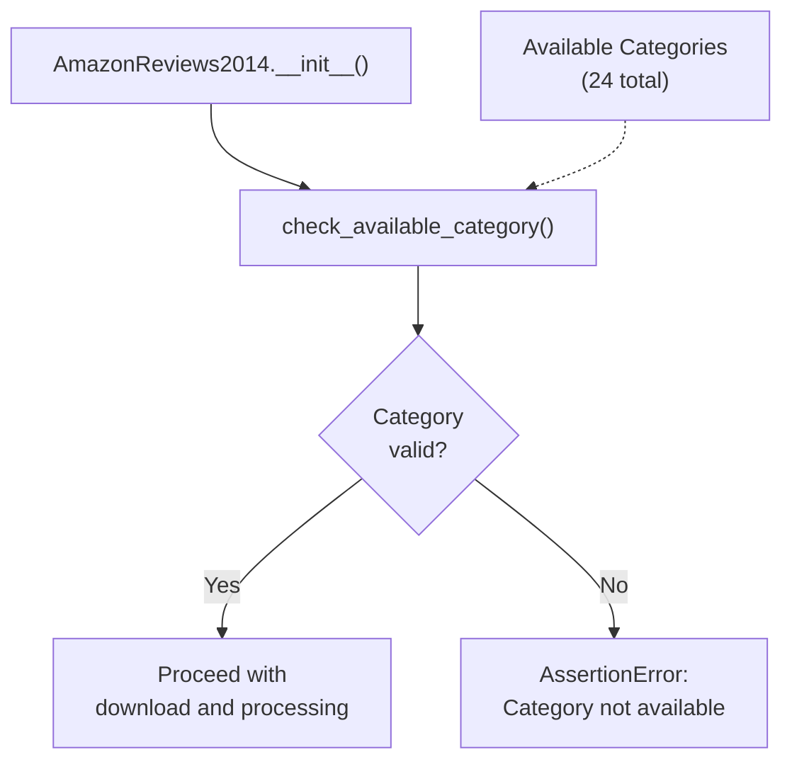
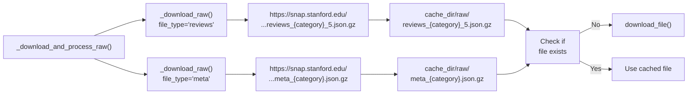
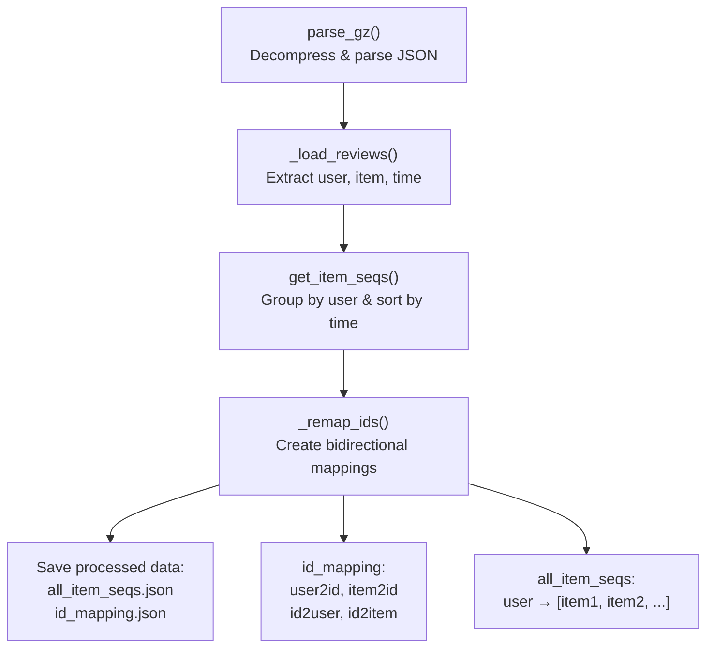
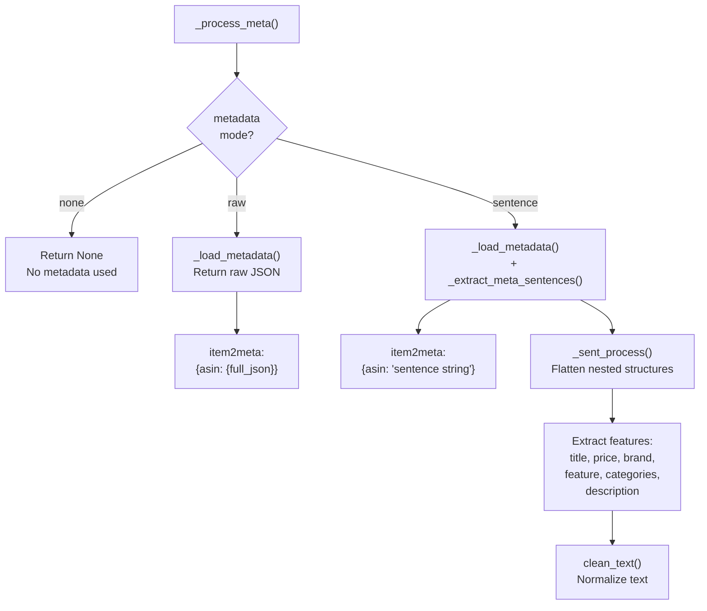
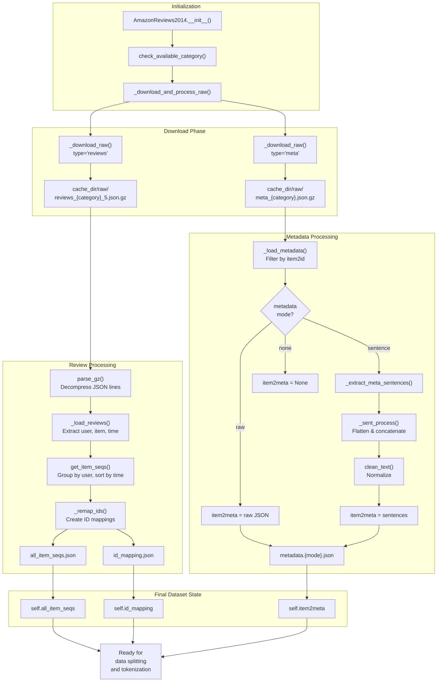
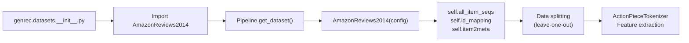

<!-- source: DeepWiki mcp.deepwiki.com · repo google-deepmind/action_piece · page 5.2 AmazonReviews2014 Dataset · fetched 2026-10-26 -->

# AmazonReviews2014 Dataset

<details>
<summary>Relevant source files</summary>

The following files were used as context for generating this wiki page:

- [genrec/datasets/AmazonReviews2014/config.yaml](genrec/datasets/AmazonReviews2014/config.yaml)
- [genrec/datasets/AmazonReviews2014/dataset.py](genrec/datasets/AmazonReviews2014/dataset.py)
- [genrec/datasets/__init__.py](genrec/datasets/__init__.py)

</details>


This document details the `AmazonReviews2014` dataset implementation, which provides user-item interaction data from the Amazon Reviews 2014 dataset hosted at Stanford SNAP. This implementation handles automatic downloading, parsing, ID remapping, and metadata processing for any of the 24 available product categories.

For information about the abstract dataset interface that this class implements, see [AbstractDataset Interface](#5.1). For details on feature extraction from metadata, see [Feature Extraction & Processing](#5.3).

---

## Dataset Class Overview

The `AmazonReviews2014` class extends `AbstractDataset` and provides a complete pipeline for loading, processing, and preparing Amazon review data for recommendation model training.

**Key Class Attributes:**

| Attribute | Type | Description |
|-----------|------|-------------|
| `category` | `str` | Product category (e.g., "Sports_and_Outdoors") |
| `cache_dir` | `str` | Directory path for cached processed data |
| `all_item_seqs` | `dict[str, list[str]]` | User-item interaction sequences with remapped IDs |
| `id_mapping` | `dict[str, Any]` | Bidirectional mappings: `user2id`, `item2id`, `id2user`, `id2item` |
| `item2meta` | `dict[str, Any]` | Item metadata (structure depends on processing mode) |

**Sources:** [genrec/datasets/AmazonReviews2014/dataset.py:113-125]()

---

## Available Categories

The dataset supports 24 product categories from Amazon. The category must be specified in the configuration and is validated at initialization.



**Supported Categories:**

| Category Name | Category Name | Category Name |
|---------------|---------------|---------------|
| Books | Electronics | Movies_and_TV |
| CDs_and_Vinyl | Clothing_Shoes_and_Jewelry | Home_and_Kitchen |
| Kindle_Store | Sports_and_Outdoors | Cell_Phones_and_Accessories |
| Health_and_Personal_Care | Toys_and_Games | Video_Games |
| Tools_and_Home_Improvement | Beauty | Apps_for_Android |
| Office_Products | Pet_Supplies | Automotive |
| Grocery_and_Gourmet_Food | Patio_Lawn_and_Garden | Baby |
| Digital_Music | Musical_Instruments | Amazon_Instant_Video |

**Sources:** [genrec/datasets/AmazonReviews2014/dataset.py:31-69]()

---

## Data Acquisition and Caching

The dataset automatically downloads raw data files from Stanford SNAP using the `_download_raw()` method. Files are cached locally to avoid redundant downloads in subsequent runs.



**Download Logic:**

The `_download_raw()` method constructs URLs dynamically based on the category and file type:

- **Reviews URL:** `https://snap.stanford.edu/data/amazon/productGraph/categoryFiles/reviews_{category}_5.json.gz`
- **Metadata URL:** `https://snap.stanford.edu/data/amazon/productGraph/categoryFiles/meta_{category}.json.gz`

Downloaded files are stored in `{cache_dir}/AmazonReviews2014/{category}/raw/`.

**Sources:** [genrec/datasets/AmazonReviews2014/dataset.py:145-163](), [genrec/datasets/AmazonReviews2014/dataset.py:381-412]()

---

## Review Processing Pipeline

The review processing pipeline transforms raw gzipped JSON data into structured user-item sequences with remapped IDs. This process ensures efficient storage and consistent indexing.



### Parsing Gzipped Files

The `parse_gz()` function reads gzipped JSON files line-by-line, converting boolean strings to Python format:

```python
# Example data flow:
# Raw JSON line: {"reviewerID": "A123", "asin": "B456", "unixReviewTime": 1234567890, ...}
# Parsed tuple: ("A123", "B456", 1234567890)
```

**Sources:** [genrec/datasets/AmazonReviews2014/dataset.py:72-84](), [genrec/datasets/AmazonReviews2014/dataset.py:165-182]()

### Grouping and Sorting

The `get_item_seqs()` function groups reviews by user and sorts items chronologically:

```python
# Input: [("user1", "item_a", 1000), ("user1", "item_b", 2000), ("user2", "item_c", 1500)]
# Output: {"user1": ["item_a", "item_b"], "user2": ["item_c"]}
```

**Sources:** [genrec/datasets/AmazonReviews2014/dataset.py:87-110]()

### ID Remapping

The `_remap_ids()` method creates dense integer IDs for users and items, starting from 1 (ID 0 is reserved for `[PAD]`).

**ID Mapping Structure:**

| Component | Type | Description |
|-----------|------|-------------|
| `user2id` | `dict[str, int]` | Raw user ID → integer ID |
| `item2id` | `dict[str, int]` | Raw item ID (ASIN) → integer ID |
| `id2user` | `list[str]` | Integer ID → raw user ID (inverse mapping) |
| `id2item` | `list[str]` | Integer ID → raw item ID (inverse mapping) |

**Sources:** [genrec/datasets/AmazonReviews2014/dataset.py:184-220]()

### Processed Data Persistence

The `_process_reviews()` method saves two JSON files:

- **`all_item_seqs.json`**: Maps users to their chronologically ordered item sequences
- **`id_mapping.json`**: Contains all four ID mapping dictionaries/lists

These files are cached in `{cache_dir}/AmazonReviews2014/{category}/processed/` and reused on subsequent runs.

**Sources:** [genrec/datasets/AmazonReviews2014/dataset.py:222-259]()

---

## Metadata Processing

The dataset supports three metadata processing modes, controlled by the `metadata` configuration parameter. Each mode extracts different levels of information from item metadata.



### Mode: `none`

No metadata is loaded or processed. Returns `None`. Use this mode when metadata is not required for the model.

### Mode: `raw`

Loads metadata as-is from the gzipped JSON file. Each item maps to its complete metadata dictionary containing all available fields (title, price, brand, description, categories, etc.).

**Structure:**
```python
item2meta = {
    "B00123ABC": {
        "asin": "B00123ABC",
        "title": "...",
        "price": 29.99,
        "brand": "...",
        "categories": [["Electronics", "Cameras"]],
        ...
    }
}
```

### Mode: `sentence`

Processes metadata into natural language sentences suitable for semantic embedding. The `_extract_meta_sentences()` method concatenates specific fields into a single sentence per item.

**Extracted Fields (in order):**
1. `title` - Product title
2. `price` - Price value
3. `brand` - Brand name
4. `feature` - Product features list
5. `categories` - Category hierarchy
6. `description` - Product description

**Processing Logic (`_sent_process()`):**

| Input Type | Processing | Example Output |
|------------|------------|----------------|
| `float` | Convert to string + period | `"29.99."` |
| `list[list]` | Flatten nested lists, comma-separate | `"item1, item2, item3."` |
| `list` | Process each element | `"item1. item2."` |
| `str` | Clean and add space | `"cleaned text "` |

The `clean_text()` utility function normalizes whitespace and removes special characters.

**Example Output:**
```python
item2meta = {
    "B00123ABC": "Canon EOS Rebel T6 DSLR Camera. 549.99. Canon. 18 Megapixel CMOS sensor, Full HD video, Built-in Wi-Fi. Electronics, Cameras, Digital SLR Cameras. Professional DSLR camera with advanced features..."
}
```

**Sources:** [genrec/datasets/AmazonReviews2014/dataset.py:261-282](), [genrec/datasets/AmazonReviews2014/dataset.py:283-308](), [genrec/datasets/AmazonReviews2014/dataset.py:310-337](), [genrec/datasets/AmazonReviews2014/dataset.py:339-379]()

---

## Configuration Parameters

The dataset is configured via `genrec/datasets/AmazonReviews2014/config.yaml`:

| Parameter | Type | Default | Description |
|-----------|------|---------|-------------|
| `category` | `str` | `"Sports_and_Outdoors"` | Product category from the 24 available options |
| `metadata` | `str` | `"sentence"` | Metadata processing mode: `none`, `raw`, or `sentence` |
| `split` | `str` | `"leave_one_out"` | Data splitting strategy (only `leave_one_out` supported) |

**Example Configuration:**
```yaml
category: Sports_and_Outdoors
metadata: sentence  # none / raw / sentence
split: leave_one_out
```

**Sources:** [genrec/datasets/AmazonReviews2014/config.yaml:1-19]()

---

## Complete Data Flow

The following diagram illustrates the complete data flow from raw downloads to processed dataset ready for tokenization:



**Key Points:**

1. **Parallel Processing**: Reviews and metadata are downloaded and processed in parallel workflows
2. **Caching Strategy**: All processed files are cached; subsequent runs skip processing if cache exists
3. **ID Consistency**: The `id_mapping` ensures consistent integer IDs across all data structures
4. **Metadata Flexibility**: Three processing modes support different feature extraction strategies
5. **Main Process Locking**: During distributed training, only the main process downloads files (via `accelerator.main_process_first()`)

**Sources:** [genrec/datasets/AmazonReviews2014/dataset.py:127-143](), [genrec/datasets/AmazonReviews2014/dataset.py:381-412]()

---

## Integration with Pipeline

The `AmazonReviews2014` class is registered in the dataset module and instantiated by the GenRec framework during pipeline initialization:



After initialization, the dataset provides:
- **`all_item_seqs`**: User interaction sequences for training/validation/test splitting
- **`id_mapping`**: Bidirectional ID mappings for encoding/decoding
- **`item2meta`**: Item metadata for feature extraction by `ActionPieceTokenizer`

**Sources:** [genrec/datasets/__init__.py:1-19]()

---

