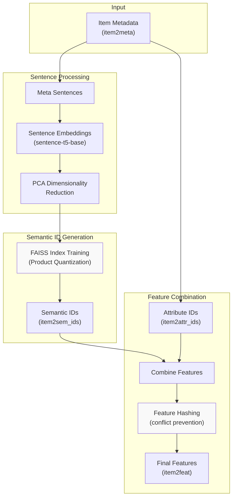
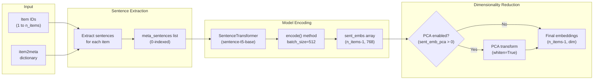
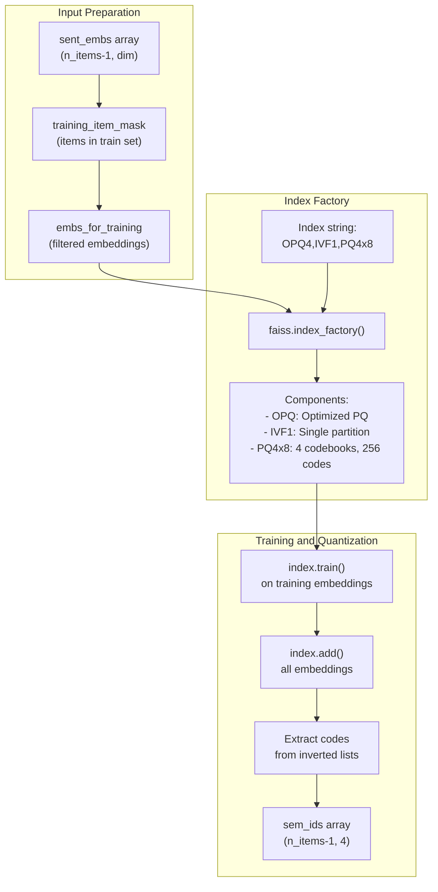
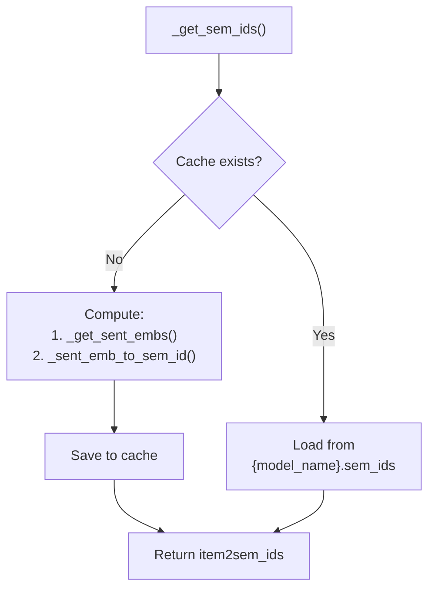
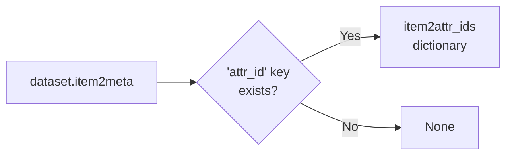
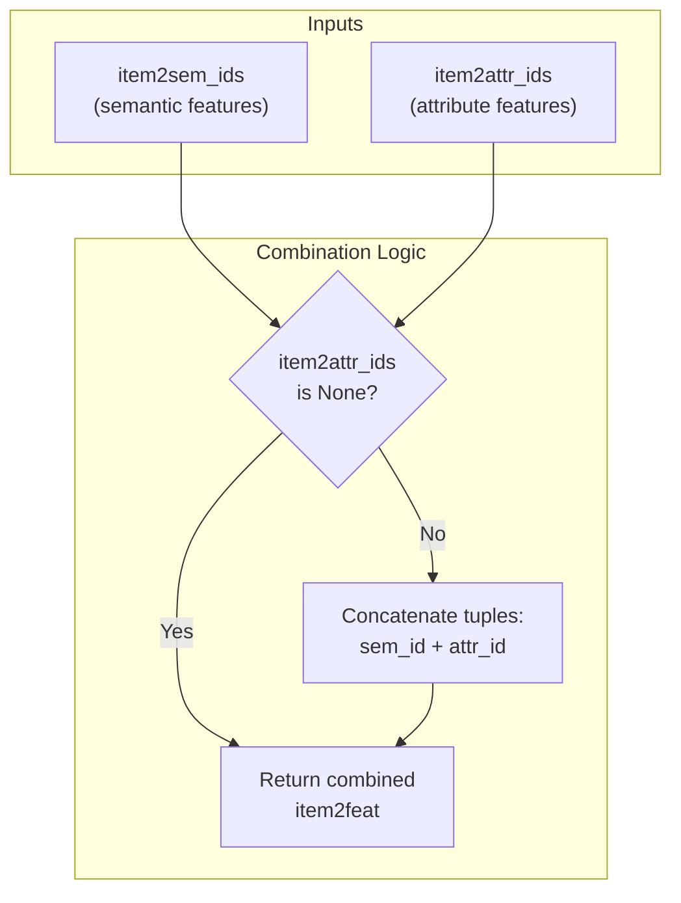
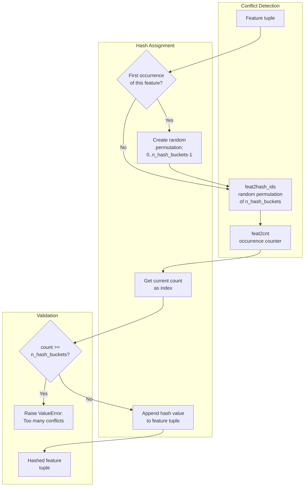
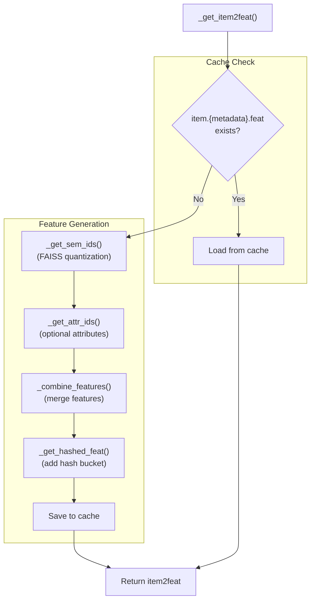

<!-- source: DeepWiki mcp.deepwiki.com · repo google-deepmind/action_piece · page 5.3 Feature Extraction & Processing · fetched 2026-10-26 -->

# Feature Extraction & Processing

<details>
<summary>Relevant source files</summary>

The following files were used as context for generating this wiki page:

- [genrec/datasets/AmazonReviews2014/dataset.py](genrec/datasets/AmazonReviews2014/dataset.py)
- [genrec/models/ActionPiece/config.yaml](genrec/models/ActionPiece/config.yaml)
- [genrec/models/ActionPiece/tokenizer.py](genrec/models/ActionPiece/tokenizer.py)

</details>


This page documents how item features are extracted and processed in the ActionPiece system. The feature extraction pipeline transforms raw item metadata into numerical feature vectors that serve as the foundation for ActionPiece vocabulary construction. This process includes sentence embedding generation, semantic ID extraction via FAISS indexing with product quantization, attribute feature processing, and feature hashing for conflict resolution.

For information about how these features are used to build the ActionPiece vocabulary, see [Vocabulary Construction (ActionPieceCore)](#3.2). For details on the metadata processing that precedes feature extraction, see [AmazonReviews2014 Dataset](#5.2).

## Overview

The feature extraction pipeline converts item metadata into compact, meaningful feature representations through a multi-stage process:



**Pipeline Components:**

| Stage | Input | Output | Purpose |
|-------|-------|--------|---------|
| Sentence Embedding | Metadata strings | Dense vectors (768D or 128D) | Capture semantic meaning |
| FAISS Quantization | Dense vectors | Semantic ID tuples | Compress embeddings into discrete codes |
| Attribute Processing | Raw metadata | Attribute ID tuples | Extract categorical features |
| Feature Combination | Semantic + Attribute IDs | Combined feature tuples | Merge multiple feature types |
| Feature Hashing | Combined features | Hashed feature tuples | Prevent feature conflicts |

Sources: [genrec/models/ActionPiece/tokenizer.py:71-318]()

## Sentence Embedding Generation

The system uses the `sentence-transformers/sentence-t5-base` model to encode item metadata into dense semantic embeddings. This process is orchestrated by the `_encode_sent_emb()` method in `ActionPieceTokenizer`.

### Encoding Process



The encoding process follows these steps:

1. **Sentence Extraction**: For each item (1-indexed), extract the corresponding metadata sentence from `dataset.item2meta`. The sentences are stored in a 0-indexed list: `meta_sentences[0]` corresponds to `item_id = 1`.

2. **Batch Encoding**: The `SentenceTransformer` model encodes all sentences in batches using the configuration parameter `sent_emb_batch_size` (default: 512).

3. **PCA Reduction** (optional): If `sent_emb_pca > 0`, apply PCA with whitening to reduce dimensionality from 768 to the specified dimension (default: 128).

4. **Caching**: The final embeddings are saved to `{cache_dir}/processed/{model_name}.sent_emb` as a binary file.

Sources: [genrec/models/ActionPiece/tokenizer.py:71-139](), [genrec/models/ActionPiece/config.yaml:16-20]()

### Configuration Parameters

| Parameter | Default | Description |
|-----------|---------|-------------|
| `sent_emb_model` | `sentence-transformers/sentence-t5-base` | Sentence embedding model |
| `sent_emb_batch_size` | 512 | Batch size for encoding |
| `sent_emb_dim` | 768 | Original embedding dimension |
| `sent_emb_pca` | 128 | PCA output dimension (-1 = no PCA) |

The `_get_sent_embs()` method handles caching logic: if the embedding file exists, it loads from cache; otherwise, it calls `_encode_sent_emb()` to generate and save embeddings.

Sources: [genrec/models/ActionPiece/tokenizer.py:114-139](), [genrec/models/ActionPiece/config.yaml:16-20]()

## Semantic ID Generation with FAISS

The system converts dense sentence embeddings into discrete semantic IDs using FAISS (Facebook AI Similarity Search) with Product Quantization (PQ). This compression technique reduces storage requirements while maintaining semantic relationships.

### FAISS Index Configuration



### Product Quantization Details

The FAISS index uses Product Quantization to compress embeddings into discrete codes:

- **Index String**: `"OPQ{n_codebooks},IVF1,PQ{n_codebooks}x{log2(codebook_size)}"`
  - `OPQ`: Optimized Product Quantization with learned rotation
  - `IVF1`: Single inverted file (no partitioning)
  - `PQ4x8`: 4 codebooks, each with 256 (2^8) codes

- **Configuration**:
  - `pq_n_codebooks`: 4 (default) - Number of quantizers
  - `pq_codebook_size`: 256 (default) - Size of each codebook
  - `n_threads`: 32 - Number of OpenMP threads for FAISS

- **Output**: Each item receives a tuple of 4 integers, where each integer is in the range [0, 255].

Sources: [genrec/models/ActionPiece/tokenizer.py:155-186](), [genrec/models/ActionPiece/config.yaml:23-26]()

### Code Extraction Process

The `_sent_emb_to_sem_id()` method performs the following steps:

1. **Filter Training Items**: Create a mask for items that appear in the training set using `_get_items_for_training()`.

2. **Initialize Index**: Use `faiss.index_factory()` with the configuration string and `METRIC_INNER_PRODUCT`.

3. **Train Index**: Call `index.train()` on embeddings from training items only to learn the quantization parameters.

4. **Add All Items**: Call `index.add()` on all item embeddings to quantize them.

5. **Extract Codes**: Access the inverted lists to extract the quantized codes:
   ```python
   ivf_index = faiss.downcast_index(index.index)
   invlists = faiss.extract_index_ivf(ivf_index).invlists
   ls = invlists.list_size(0)
   sem_ids = faiss.rev_swig_ptr(invlists.get_codes(0), ls * invlists.code_size)
   sem_ids = sem_ids.reshape(-1, invlists.code_size)
   ```

6. **Create Dictionary**: Convert the array to `item2sem_ids` dictionary mapping raw item IDs to semantic ID tuples.

7. **Cache Results**: Save to `{cache_dir}/processed/{model_name}.sem_ids` in JSON format.

Sources: [genrec/models/ActionPiece/tokenizer.py:155-186]()

### Semantic ID Management

The `_get_sem_ids()` method provides caching and retrieval:



Sources: [genrec/models/ActionPiece/tokenizer.py:188-226]()

## Attribute IDs

In addition to semantic IDs derived from embeddings, the system can incorporate categorical attribute features through the `_get_attr_ids()` method. These attributes are metadata-derived features that provide additional discriminative power.

### Attribute Processing



The attribute ID extraction is straightforward:
- If `dataset.item2meta` contains an `'attr_id'` key, return the corresponding dictionary
- Otherwise, return `None`

This design allows flexible metadata configurations where attributes can be optionally included based on dataset-specific processing defined in the dataset implementation.

Sources: [genrec/models/ActionPiece/tokenizer.py:228-233]()

## Feature Combination

The `_combine_features()` method merges semantic IDs and attribute IDs into unified feature tuples:



**Combination Process:**

1. **Check Attribute Availability**: If `item2attr_ids` is `None`, return `item2sem_ids` directly.

2. **Tuple Concatenation**: For each item, concatenate the semantic ID tuple with the attribute ID tuple:
   ```python
   feat = item2sem_ids[item] + item2attr_ids[item]
   ```

3. **Result**: The combined `item2feat` dictionary maps each item to a tuple containing both semantic and attribute features.

**Example:**
- Semantic IDs: `(42, 103, 7, 215)` (4 values from PQ)
- Attribute IDs: `(2, 5)` (2 categorical attributes)
- Combined: `(42, 103, 7, 215, 2, 5)` (6 total features)

Sources: [genrec/models/ActionPiece/tokenizer.py:235-245]()

## Feature Hashing for Conflict Prevention

The `_get_hashed_feat()` method adds a hash bucket to each feature tuple to prevent conflicts when multiple items share identical feature combinations. This is critical for maintaining unique item representations.

### Hashing Mechanism



### Hash Assignment Process

1. **Track Occurrences**: For each unique feature tuple, maintain a counter `feat2cnt` tracking how many items share that tuple.

2. **Generate Permutation**: On first encounter of a feature tuple, generate a random permutation of `n_hash_buckets` (default: 128) indices.

3. **Assign Hash**: Use the current count as an index into the permutation to select a hash value.

4. **Append Hash**: Append the hash value to the feature tuple: `(*feature_tuple, hash_value)`

5. **Increment Counter**: Increment the counter for this feature tuple.

6. **Conflict Check**: If the counter exceeds `n_hash_buckets`, raise a `ValueError` indicating too many conflicts.

**Example:**
- Original feature: `(42, 103, 7, 215, 2, 5)`
- First item with this feature gets hash 73: `(42, 103, 7, 215, 2, 5, 73)`
- Second item with this feature gets hash 19: `(42, 103, 7, 215, 2, 5, 19)`

This ensures that even items with identical semantic and attribute features receive unique representations.

Sources: [genrec/models/ActionPiece/tokenizer.py:247-285](), [genrec/models/ActionPiece/config.yaml:26]()

### Conflict Validation

After feature hashing, the `_check_conflicts()` method validates that no two items share identical feature tuples:

```python
feat2cnt = collections.Counter()
for feat in item2feat.values():
    feat = tuple(feat)
    feat2cnt[feat] += 1
for feat in feat2cnt:
    if feat2cnt[feat] > 1:
        raise ValueError(f'[TOKENIZER] Conflicts found in features: {feat}')
```

This validation ensures the hash bucket mechanism successfully prevented all conflicts.

Sources: [genrec/models/ActionPiece/tokenizer.py:319-333]()

## Complete Feature Extraction Pipeline

The `_get_item2feat()` method orchestrates the entire feature extraction pipeline:



### Pipeline Execution

1. **Check Cache**: Look for `{cache_dir}/processed/item.{metadata}.feat` file.

2. **Load or Generate**: If cached, load the dictionary; otherwise, execute the pipeline:
   - Call `_get_sem_ids()` to extract semantic IDs via FAISS
   - Call `_get_attr_ids()` to extract attribute IDs (if available)
   - Call `_combine_features()` to merge semantic and attribute IDs
   - Call `_get_hashed_feat()` to add hash buckets

3. **Save Cache**: Write the final `item2hashed_feat` dictionary to the cache file in JSON format.

4. **Return**: Provide the `item2feat` dictionary mapping raw item IDs to feature tuples.

Sources: [genrec/models/ActionPiece/tokenizer.py:287-317]()

## Feature Structure and Usage

### Feature Tuple Composition

The final feature tuple for each item has the following structure:

```
(sem_id_0, sem_id_1, ..., sem_id_{n_codebooks-1}, attr_id_0, ..., attr_id_m, hash_bucket)
```

Where:
- `sem_id_i`: Semantic IDs from product quantization (default: 4 values, each 0-255)
- `attr_id_j`: Attribute IDs from metadata (variable count)
- `hash_bucket`: Hash value for conflict prevention (0 to n_hash_buckets-1)

### Integration with Tokenization

The `item2feat` dictionary is used by `ActionPieceCore` to build the vocabulary:

1. **Initial Features**: Each position in the feature tuple represents a "category" in ActionPiece terminology.

2. **Tokenization**: During tokenization, features are converted to ranked tokens:
   ```python
   for i, feat in enumerate(feats):
       tokenized_feats.append(self.actionpiece.rank[(i, feat)])
   ```

3. **Vocabulary Building**: The `ActionPieceCore.train()` method uses these features to identify frequently co-occurring patterns and merge them into higher-level tokens.

Sources: [genrec/models/ActionPiece/tokenizer.py:335-343](), [genrec/models/ActionPiece/tokenizer.py:389-416]()

## Caching Strategy

The feature extraction pipeline implements multi-level caching to avoid redundant computation:

### Cache Hierarchy

| Cache Level | File Path | Content | Purpose |
|-------------|-----------|---------|---------|
| **Sentence Embeddings** | `{cache_dir}/processed/{model_name}.sent_emb` | Binary float32 array | Avoid re-encoding with SentenceTransformer |
| **Semantic IDs** | `{cache_dir}/processed/{model_name}.sem_ids` | JSON dictionary | Avoid FAISS index training and quantization |
| **Item Features** | `{cache_dir}/processed/item.{metadata}.feat` | JSON dictionary | Avoid entire pipeline re-execution |

### Cache Benefits

1. **Embedding Reuse**: Sentence embeddings can be reused across different tokenizer configurations as long as the embedding model and PCA settings remain unchanged.

2. **Semantic ID Reuse**: Semantic IDs can be reused across different hash bucket sizes or attribute configurations.

3. **Feature Reuse**: Complete features can be reused for different ActionPiece vocabulary sizes or training configurations.

4. **Distributed Training**: Caches are shared across all processes in distributed training via `accelerator.main_process_first()` in the dataset download phase.

Sources: [genrec/models/ActionPiece/tokenizer.py:71-317]()

## Configuration Reference

### Complete Parameter Table

| Parameter | Type | Default | Description |
|-----------|------|---------|-------------|
| `sent_emb_model` | str | `sentence-transformers/sentence-t5-base` | Pre-trained sentence embedding model |
| `sent_emb_batch_size` | int | 512 | Batch size for encoding sentences |
| `sent_emb_dim` | int | 768 | Original dimension of sentence embeddings |
| `sent_emb_pca` | int | 128 | PCA output dimension (-1 to disable) |
| `n_threads` | int | 32 | Number of threads for FAISS operations |
| `pq_n_codebooks` | int | 4 | Number of product quantization codebooks |
| `pq_codebook_size` | int | 256 | Size of each codebook (must be power of 2) |
| `n_hash_buckets` | int | 128 | Number of hash buckets for conflict prevention |
| `metadata` | str | (varies) | Metadata processing mode (none/raw/sentence) |

### FAISS Index String Construction

The FAISS index string is dynamically constructed as:
```python
f"OPQ{pq_n_codebooks},IVF1,PQ{pq_n_codebooks}x{int(np.log2(pq_codebook_size))}"
```

Example with defaults: `"OPQ4,IVF1,PQ4x8"` creates an index with 4 codebooks of 256 codes each.

Sources: [genrec/models/ActionPiece/config.yaml:16-27](), [genrec/models/ActionPiece/tokenizer.py:165-169]()

## Summary

The feature extraction pipeline transforms raw item metadata into compact, meaningful feature representations through:

1. **Sentence Embedding**: Dense semantic vectors from sentence-t5-base with optional PCA
2. **Product Quantization**: FAISS-based compression into discrete semantic IDs
3. **Attribute Integration**: Optional categorical features from metadata
4. **Feature Hashing**: Conflict prevention through random hash bucket assignment
5. **Comprehensive Caching**: Multi-level caching for computational efficiency

These features serve as the foundation for ActionPiece vocabulary construction, where frequently co-occurring feature patterns are merged into higher-level contextual tokens. The pipeline balances semantic richness with computational efficiency, enabling scalable generative recommendation.

Sources: [genrec/models/ActionPiece/tokenizer.py:71-416](), [genrec/models/ActionPiece/config.yaml:16-27]()

---

