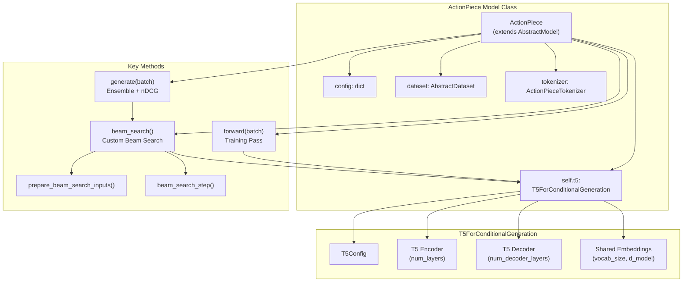
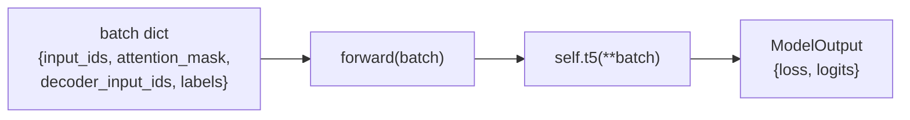
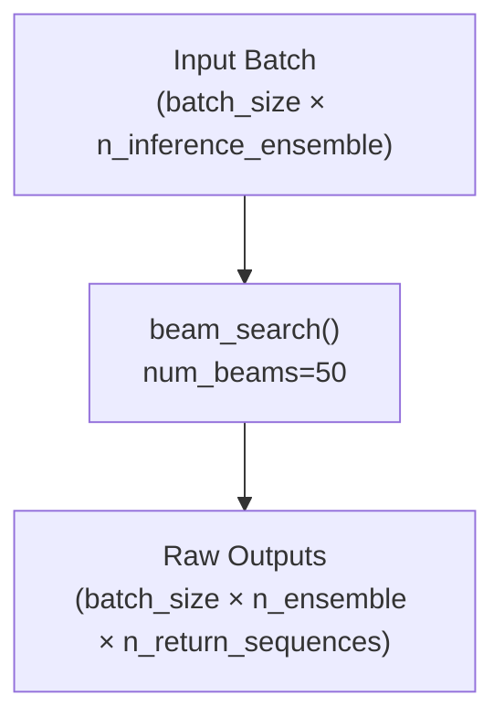
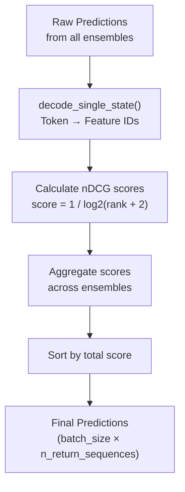
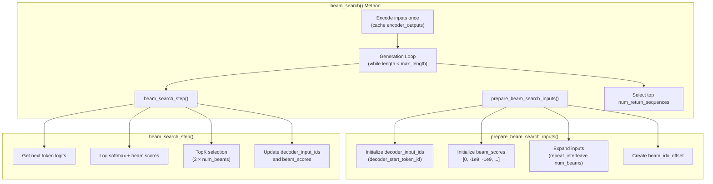
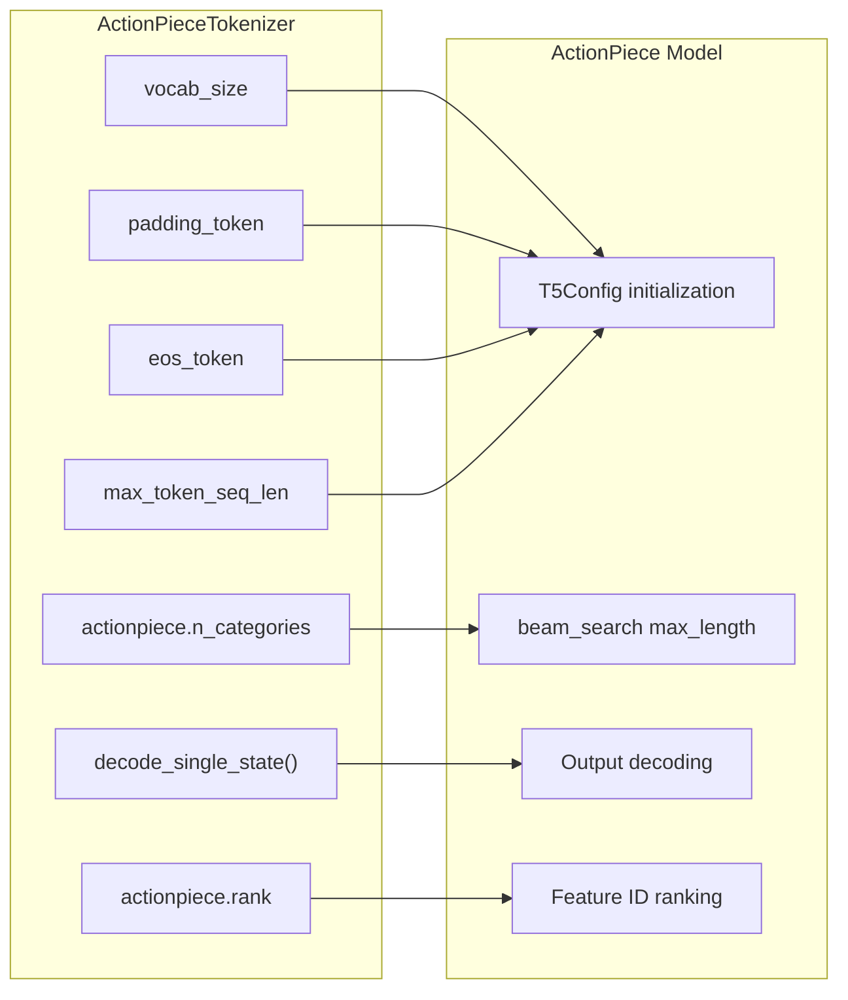
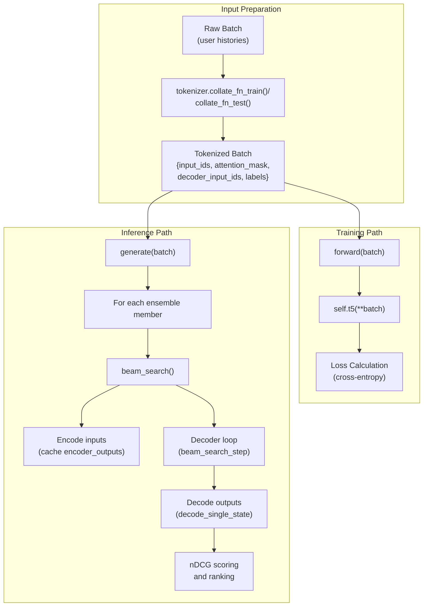

<!-- source: DeepWiki mcp.deepwiki.com · repo google-deepmind/action_piece · page 6 ActionPiece Model Architecture · fetched 2026-10-26 -->

# ActionPiece Model Architecture

<details>
<summary>Relevant source files</summary>

The following files were used as context for generating this wiki page:

- [genrec/model.py](genrec/model.py)
- [genrec/models/ActionPiece/config.yaml](genrec/models/ActionPiece/config.yaml)
- [genrec/models/ActionPiece/model.py](genrec/models/ActionPiece/model.py)

</details>


## Purpose and Scope

This document describes the ActionPiece model architecture, which is the neural network component responsible for learning sequential recommendation patterns and generating predictions. The ActionPiece model is built on the T5 (Text-to-Text Transfer Transformer) architecture and implements methods for training, inference, and sophisticated generation strategies.

This page provides an architectural overview of the model implementation. For detailed information on specific aspects:
- For T5 configuration parameters and initialization, see [T5-Based Model Configuration](#6.1)
- For the sophisticated generation and inference strategies, see [Generation & Inference Strategy](#6.2)
- For the abstract model interface, see [Abstract Base Classes](#4.2)
- For tokenization details, see [ActionPiece Tokenization System](#3)

**Sources:** [genrec/models/ActionPiece/model.py:1-411]()

---

## Model Class Overview

The `ActionPiece` class inherits from `AbstractModel` and implements a T5-based sequence-to-sequence model for generative recommendation. The model treats recommendation as a conditional generation task: given a user's action history (input sequence), it generates the next action(s) to recommend (output sequence).

**Key Components:**

| Component | Type | Purpose |
|-----------|------|---------|
| `self.t5` | `T5ForConditionalGeneration` | Core transformer model from HuggingFace |
| `self.config` | `dict` | Model configuration parameters |
| `self.dataset` | `AbstractDataset` | Reference to dataset for metadata |
| `self.tokenizer` | `ActionPieceTokenizer` | Tokenizer for encoding/decoding sequences |
| `self.n_inference_ensemble` | `int` | Number of ensemble predictions during inference |

**Sources:** [genrec/models/ActionPiece/model.py:30-59](), [genrec/model.py:26-46]()

---

## Model Architecture Diagram



**Sources:** [genrec/models/ActionPiece/model.py:38-58]()

---

## Initialization and Configuration

The `ActionPiece` model is initialized with three primary inputs: configuration dictionary, dataset object, and tokenizer instance. During initialization, it creates a `T5Config` object and instantiates the underlying `T5ForConditionalGeneration` model.

**T5 Configuration Parameters:**

| Parameter | Source Config Key | Purpose |
|-----------|-------------------|---------|
| `num_layers` | `config['num_layers']` | Number of encoder layers |
| `num_decoder_layers` | `config['num_decoder_layers']` | Number of decoder layers |
| `d_model` | `config['d_model']` | Hidden dimension size |
| `d_ff` | `config['d_ff']` | Feed-forward network dimension |
| `num_heads` | `config['num_heads']` | Number of attention heads |
| `d_kv` | `config['d_kv']` | Key-value dimension per head |
| `dropout_rate` | `config['dropout_rate']` | Dropout probability |
| `vocab_size` | `tokenizer.vocab_size` | Vocabulary size from tokenizer |
| `pad_token_id` | `tokenizer.padding_token` | Padding token ID |
| `eos_token_id` | `tokenizer.eos_token` | End-of-sequence token ID |
| `n_positions` | `tokenizer.max_token_seq_len` | Maximum sequence length |

**Default Configuration Values** (from `config.yaml`):

| Parameter | Default Value |
|-----------|---------------|
| `num_layers` | 4 |
| `num_decoder_layers` | 4 |
| `d_model` | 128 |
| `d_ff` | 1024 |
| `num_heads` | 6 |
| `d_kv` | 64 |
| `dropout_rate` | 0.1 |
| `activation_function` | "relu" |
| `feed_forward_proj` | "relu" |
| `num_beams` | 50 |
| `n_inference_ensemble` | 5 |

**Sources:** [genrec/models/ActionPiece/model.py:38-59](), [genrec/models/ActionPiece/config.yaml:31-50]()

---

## Forward Pass for Training

The `forward()` method implements the training pass through the model. It accepts a batch dictionary containing tokenized input sequences and labels, passes them to the T5 model, and returns the model outputs including loss and logits.



The batch dictionary is prepared by the tokenizer's `collate_fn_train()` method and contains:
- `input_ids`: Tokenized input sequence (user history)
- `attention_mask`: Mask indicating valid tokens
- `decoder_input_ids`: Shifted target sequence for teacher forcing
- `labels`: Target sequence labels for loss calculation

The T5 model automatically computes cross-entropy loss between the logits and labels during training.

**Sources:** [genrec/models/ActionPiece/model.py:78-91]()

---

## Generation and Inference Flow

The `generate()` method implements the sophisticated inference strategy that combines ensemble predictions with nDCG-based ranking. This is a two-stage process:

**Stage 1: Ensemble Beam Search**


**Stage 2: nDCG-Based Ensemble Ranking**


The key innovation is that multiple augmented versions of the input (via random walk augmentation during tokenization) are generated independently, then their predictions are ranked and ensembled based on nDCG scores to produce robust final recommendations.

**Sources:** [genrec/models/ActionPiece/model.py:93-155]()

---

## Beam Search Implementation

The ActionPiece model implements a custom beam search algorithm adapted from HuggingFace's transformers library. Unlike standard implementations, this version does not include EOS-based early stopping; instead, generation is controlled by `max_length`.

**Beam Search Components:**



**Key Design Choices:**

| Aspect | Implementation | Reason |
|--------|----------------|--------|
| EOS Handling | Controlled by `max_length` only | Recommendation sequences have fixed structure (n_categories features) |
| Encoder Caching | Store `encoder_outputs` once | Avoid redundant encoder computation in decoder-only iterations |
| Beam Initialization | First beam score = 0, others = -1e9 | Ensure first token is chosen from first beam consistently |
| Score Calculation | Log softmax + cumulative beam scores | Standard beam search probability accumulation |

**Sources:** [genrec/models/ActionPiece/model.py:157-410]()

---

## Integration with ActionPiece Tokenizer

The model is tightly integrated with the `ActionPieceTokenizer` through several touchpoints:

**Tokenizer-Dependent Model Parameters:**



**Critical Dependencies:**
1. **Vocabulary Size**: Model embedding layer size must match tokenizer vocabulary
2. **Special Tokens**: Padding and EOS tokens must align between model and tokenizer
3. **Sequence Length**: Beam search `max_length` set to `n_categories + 1` (one token per feature plus start token)
4. **Decoding**: Model uses tokenizer's `decode_single_state()` to convert generated token sequences back to feature IDs
5. **Ranking**: Model uses tokenizer's `actionpiece.rank` to convert feature IDs to item rankings

**Sources:** [genrec/models/ActionPiece/model.py:41-56](), [genrec/models/ActionPiece/model.py:112-134]()

---

## Parameter Count Calculation

The model provides a detailed parameter count breakdown through the `n_parameters` property:

```python
# Example output:
# #Embedding parameters: 5120000
# #Non-embedding parameters: 2500000
# #Total trainable parameters: 7620000
```

This property differentiates between:
- **Embedding parameters**: From `self.t5.get_input_embeddings()` (vocabulary size × d_model)
- **Non-embedding parameters**: All other transformer layers (encoder, decoder, attention, FFN)
- **Total trainable parameters**: Sum of all parameters with `requires_grad=True`

**Sources:** [genrec/models/ActionPiece/model.py:61-76]()

---

## Method Summary Table

| Method | Purpose | Key Inputs | Key Outputs |
|--------|---------|------------|-------------|
| `__init__()` | Initialize model with T5 config | `config`, `dataset`, `tokenizer` | Configured `ActionPiece` instance |
| `forward()` | Training forward pass | `batch` (dict with input_ids, labels) | `ModelOutput` (loss, logits) |
| `generate()` | Ensemble inference with nDCG ranking | `batch`, `n_return_sequences` | Ranked predictions tensor |
| `beam_search()` | Custom beam search generation | `input_ids`, `attention_mask`, `num_beams` | Generated sequences (optionally with scores) |
| `prepare_beam_search_inputs()` | Initialize beam search state | `input_ids`, `attention_mask`, `batch_size`, `num_beams` | Expanded inputs and initial beam state |
| `beam_search_step()` | Single beam search iteration | `logits`, `decoder_input_ids`, `beam_scores` | Updated decoder_input_ids and beam_scores |
| `n_parameters` | Calculate parameter counts | None (property) | Formatted string with parameter breakdown |

**Sources:** [genrec/models/ActionPiece/model.py:30-410]()

---

## Model Architecture Data Flow

The following diagram illustrates the complete data flow from raw batch input through the model to final predictions:



**Sources:** [genrec/models/ActionPiece/model.py:78-155]()

---

## AbstractModel Interface Compliance

The `ActionPiece` class implements the required methods from `AbstractModel`:

| Abstract Method | Implementation | Location |
|----------------|----------------|----------|
| `__init__()` | Stores config, dataset, tokenizer; creates T5 model | [model.py:38-59]() |
| `calculate_loss()` | Inherited; T5 computes loss in `forward()` | N/A (handled by T5) |
| `generate()` | Custom ensemble + nDCG implementation | [model.py:93-155]() |
| `n_parameters` | Custom property with embedding breakdown | [model.py:61-76]() |

The model also inherits from `nn.Module`, making it compatible with PyTorch's training infrastructure and the HuggingFace Accelerate library used by the training pipeline.

**Sources:** [genrec/models/ActionPiece/model.py:30-36](), [genrec/model.py:26-58]()

---

