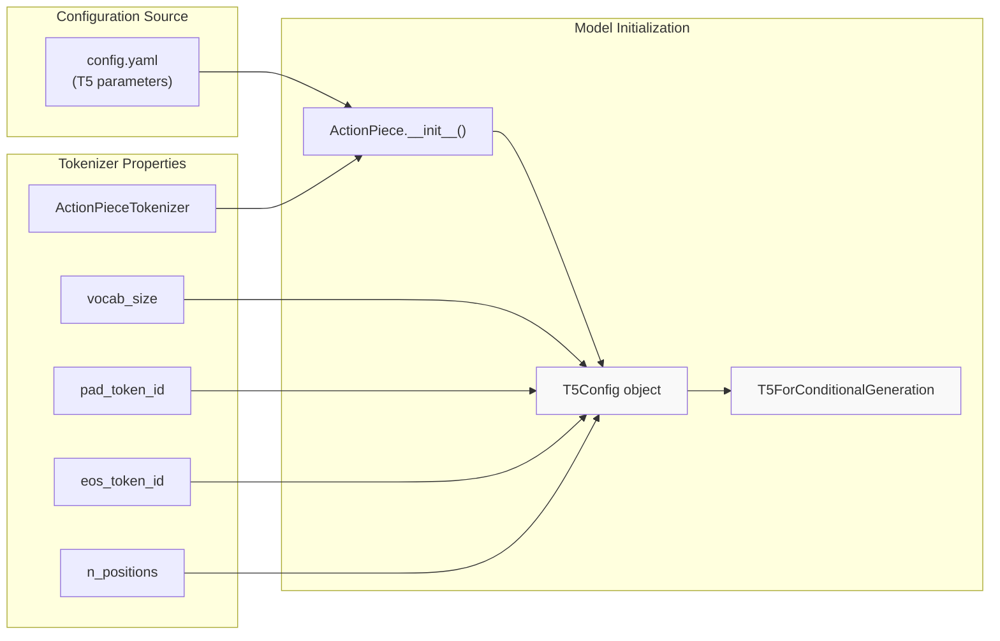
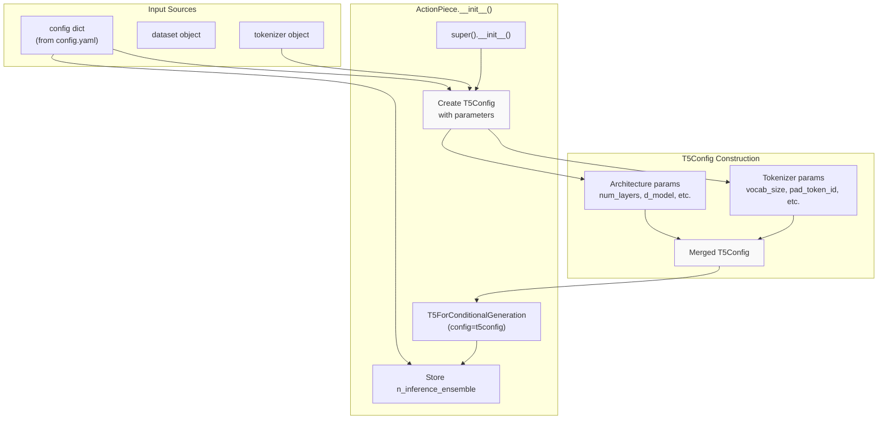
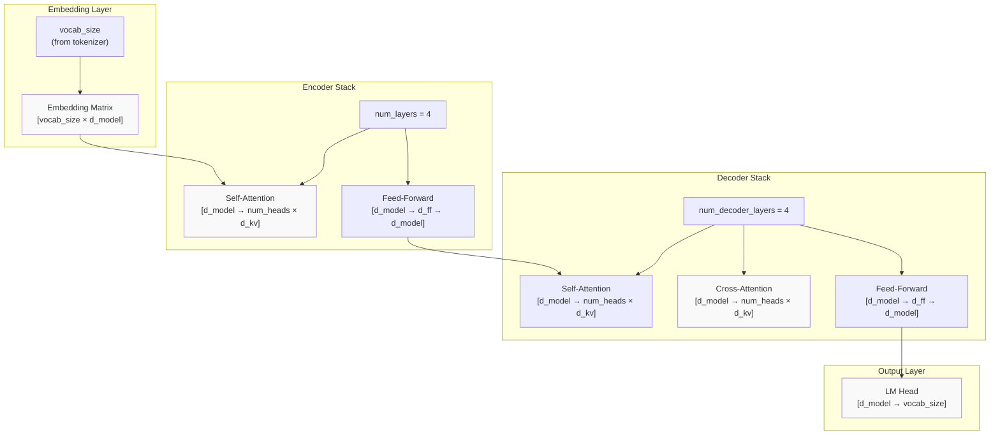
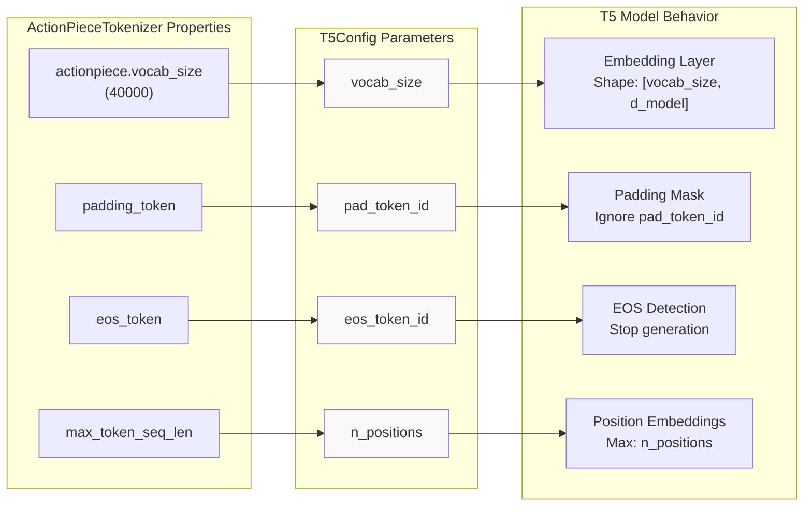

<!-- source: DeepWiki mcp.deepwiki.com · repo google-deepmind/action_piece · page 6.1 T5-Based Model Configuration · fetched 2026-10-26 -->

# T5-Based Model Configuration

<details>
<summary>Relevant source files</summary>

The following files were used as context for generating this wiki page:

- [genrec/models/ActionPiece/config.yaml](genrec/models/ActionPiece/config.yaml)
- [genrec/models/ActionPiece/model.py](genrec/models/ActionPiece/model.py)

</details>


## Purpose and Scope

This page documents the T5-based architecture configuration used by the ActionPiece model. It covers the specific T5 encoder-decoder parameters defined in the model configuration file, how these parameters are applied during model initialization, and their effects on the model architecture.

For information about the complete model implementation including generation and beam search, see [6.2](#6.2). For the broader configuration system including dataset and training parameters, see [8](#8).

---

## Overview

The ActionPiece model is built on `T5ForConditionalGeneration` from the Transformers library. The model architecture is defined through a `T5Config` object that specifies the encoder-decoder structure, including layer counts, hidden dimensions, attention mechanisms, and dropout behavior.

### Configuration Flow



**Sources:** [genrec/models/ActionPiece/model.py:38-58](), [genrec/models/ActionPiece/config.yaml:40-50]()

---

## T5 Architecture Parameters

The T5 architecture configuration is defined in [genrec/models/ActionPiece/config.yaml:40-50](). The following table describes each parameter and its role in the model architecture:

| Parameter | Default Value | Type | Description |
|-----------|---------------|------|-------------|
| `num_layers` | 4 | int | Number of encoder layers. Each layer contains self-attention and feed-forward sub-layers. |
| `num_decoder_layers` | 4 | int | Number of decoder layers. Each layer contains self-attention, cross-attention, and feed-forward sub-layers. |
| `d_model` | 128 | int | Hidden size / embedding dimension. All layer inputs and outputs have this dimensionality. |
| `d_ff` | 1024 | int | Dimension of the feed-forward network intermediate layer. Typically 4-8x larger than `d_model`. |
| `num_heads` | 6 | int | Number of attention heads in multi-head attention. `d_model` must be divisible by `num_heads`. |
| `d_kv` | 64 | int | Dimension of key and value projections per attention head. Total key/value dimension is `num_heads * d_kv`. |
| `dropout_rate` | 0.1 | float | Dropout probability applied to attention weights and feed-forward activations. |
| `activation_function` | "relu" | str | Activation function used in feed-forward networks. Options: "relu", "gelu", "gelu_new", "silu". |
| `feed_forward_proj` | "relu" | str | Type of feed-forward projection. Matches `activation_function` for standard T5. |

**Sources:** [genrec/models/ActionPiece/config.yaml:40-50]()

---

## Model Initialization Process

The ActionPiece model initialization combines configuration parameters from multiple sources to construct the T5 architecture:



**Sources:** [genrec/models/ActionPiece/model.py:38-60]()

### Code Implementation

The T5 configuration is constructed in the `ActionPiece.__init__()` method [genrec/models/ActionPiece/model.py:41-56]():

1. **Create T5Config object** with architecture parameters from `config` dict:
   - `num_layers`, `num_decoder_layers`, `d_model`, `d_ff`, `num_heads`, `d_kv`
   - `dropout_rate`, `activation_function`, `feed_forward_proj`

2. **Add tokenizer-derived parameters**:
   - `vocab_size=tokenizer.vocab_size` - Total vocabulary size from ActionPieceTokenizer
   - `pad_token_id=tokenizer.padding_token` - ID for padding tokens
   - `eos_token_id=tokenizer.eos_token` - ID for end-of-sequence tokens
   - `decoder_start_token_id=0` - Fixed start token for decoder
   - `n_positions=tokenizer.max_token_seq_len` - Maximum sequence length

3. **Instantiate T5ForConditionalGeneration** [genrec/models/ActionPiece/model.py:58]():
   ```python
   self.t5 = T5ForConditionalGeneration(config=t5config)
   ```

**Sources:** [genrec/models/ActionPiece/model.py:38-60]()

---

## Architecture Dimensions and Relationships

The T5 architecture parameters have specific relationships that determine the model's computational complexity and capacity:



**Sources:** [genrec/models/ActionPiece/model.py:41-56]()

### Dimensional Constraints

The following constraints must be satisfied for valid configuration:

| Constraint | Formula | Example (default config) |
|------------|---------|--------------------------|
| Attention head compatibility | `d_model % num_heads == 0` | `128 % 6` ≠ 0 (uses explicit `d_kv` instead) |
| Key/value dimension | `num_heads * d_kv` defines total attention dimension | `6 * 64 = 384` |
| Feed-forward expansion | `d_ff > d_model` (typically 4-8x) | `1024 / 128 = 8x` |
| Sequence length limit | `input_length <= n_positions` | `n_positions = tokenizer.max_token_seq_len` |

**Note:** The default configuration uses `d_kv=64` explicitly rather than deriving it from `d_model / num_heads`. This allows for flexible attention dimension scaling independent of the hidden size.

**Sources:** [genrec/models/ActionPiece/model.py:41-56](), [genrec/models/ActionPiece/config.yaml:40-50]()

---

## Parameter Impact on Model Capacity

The configuration parameters directly impact the model's computational cost and representational capacity:

### Model Size Calculation

The ActionPiece model includes a `n_parameters` property [genrec/models/ActionPiece/model.py:61-76]() that reports:
- **Embedding parameters**: `vocab_size * d_model`
- **Non-embedding parameters**: All encoder/decoder layer parameters
- **Total trainable parameters**: Sum of the above

### Computational Complexity

| Component | Per-Layer Complexity | Default Configuration |
|-----------|---------------------|----------------------|
| Self-Attention | `O(seq_len² * d_model + seq_len * d_model * num_heads * d_kv)` | Dominates for long sequences |
| Cross-Attention | `O(seq_len² * d_model + seq_len * d_model * num_heads * d_kv)` | Only in decoder |
| Feed-Forward | `O(seq_len * d_model * d_ff)` | `seq_len * 128 * 1024` operations |
| Total Encoder | `num_layers * (self_attn + ff)` | `4 * (attn + ff)` |
| Total Decoder | `num_decoder_layers * (self_attn + cross_attn + ff)` | `4 * (attn + attn + ff)` |

**Sources:** [genrec/models/ActionPiece/model.py:61-76](), [genrec/models/ActionPiece/config.yaml:40-50]()

---

## Integration with Tokenizer Properties

The T5Config integrates several properties from the ActionPieceTokenizer to ensure compatibility:



**Sources:** [genrec/models/ActionPiece/model.py:50-55]()

### Tokenizer-Derived Parameters

| T5Config Parameter | Source | Purpose |
|-------------------|--------|---------|
| `vocab_size` | `tokenizer.vocab_size` | Size of embedding matrix and output logits dimension |
| `pad_token_id` | `tokenizer.padding_token` | Token ID ignored in attention masks and loss computation |
| `eos_token_id` | `tokenizer.eos_token` | Token ID that signals sequence termination during generation |
| `decoder_start_token_id` | Fixed at `0` | Initial token for decoder input during generation |
| `n_positions` | `tokenizer.max_token_seq_len` | Maximum sequence length the model can process |

**Note:** The `decoder_start_token_id` is hard-coded to `0` [genrec/models/ActionPiece/model.py:53]() rather than being derived from the tokenizer. This is a deliberate design choice for the T5-based generation setup.

**Sources:** [genrec/models/ActionPiece/model.py:50-55]()

---

## Configuration Examples

### Default Configuration (Compact Model)

The default configuration in [genrec/models/ActionPiece/config.yaml:40-50]() defines a compact T5 model:

```yaml
num_layers: 4
num_decoder_layers: 4
d_model: 128
d_ff: 1024
num_heads: 6
d_kv: 64
dropout_rate: 0.1
activation_function: "relu"
feed_forward_proj: "relu"
```

This results in:
- **Total layers**: 4 encoder + 4 decoder = 8 layers
- **Hidden dimension**: 128
- **Attention dimension**: 6 heads × 64 = 384
- **Feed-forward expansion**: 8x (1024 / 128)

### Scaling Guidelines

To increase model capacity, consider these scaling strategies:

| Strategy | Parameters to Modify | Effect |
|----------|---------------------|---------|
| **Deeper Model** | Increase `num_layers` and `num_decoder_layers` | More layers capture more complex patterns; increases training time linearly |
| **Wider Model** | Increase `d_model` and proportionally increase `d_ff` | Higher capacity per layer; increases parameters quadratically |
| **More Attention** | Increase `num_heads` or `d_kv` | Better multi-aspect attention; moderate parameter increase |
| **Regularization** | Increase `dropout_rate` | Reduces overfitting; no parameter change |

**Warning:** When modifying `d_model` or `num_heads`, ensure the attention dimensions remain compatible. If not using explicit `d_kv`, verify that `d_model % num_heads == 0`.

**Sources:** [genrec/models/ActionPiece/config.yaml:40-50]()

---

## Fixed Architecture Choices

Several T5 architecture choices are fixed in the ActionPiece implementation and cannot be configured:

| Parameter | Fixed Value | Rationale |
|-----------|-------------|-----------|
| `decoder_start_token_id` | 0 | Standard T5 decoder initialization [genrec/models/ActionPiece/model.py:53]() |
| Architecture type | Encoder-Decoder | Required for seq2seq recommendation task |
| Relative positional encoding | T5 default | Inherits from `T5ForConditionalGeneration` |
| Layer normalization | T5 default (RMSNorm) | Inherits from T5 architecture |
| Vocabulary tying | None | Separate input/output embeddings |

These choices are determined by the base `T5ForConditionalGeneration` class and are not exposed as configuration parameters.

**Sources:** [genrec/models/ActionPiece/model.py:41-58]()

---

## Related Configuration Parameters

While this page focuses on T5 architecture parameters, several related configuration parameters affect model behavior:

| Parameter | Location | Impact on T5 Model | Reference |
|-----------|----------|-------------------|-----------|
| `actionpiece_vocab_size` | [config.yaml:29]() | Determines `vocab_size` via tokenizer | [3.2](#3.2) |
| `max_item_seq_len` | [config.yaml:38]() | Affects input sequence length (indirect) | [5.1](#5.1) |
| `num_beams` | [config.yaml:33]() | Beam search width during generation | [6.2](#6.2) |
| `n_inference_ensemble` | [config.yaml:34]() | Number of ensemble generations | [6.2](#6.2) |
| `train_shuffle` | [config.yaml:35]() | Data augmentation during training | [3.3](#3.3) |

**Sources:** [genrec/models/ActionPiece/config.yaml:1-50]()

---

