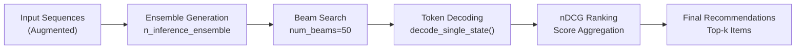
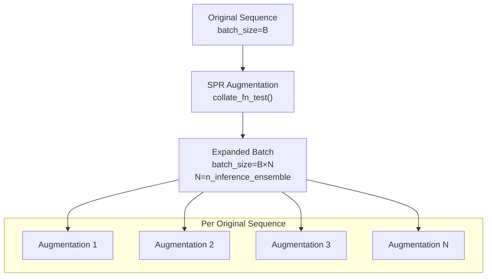
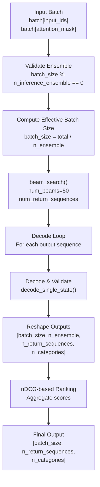
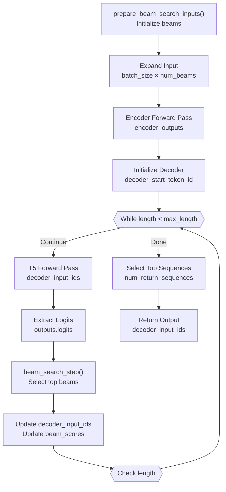
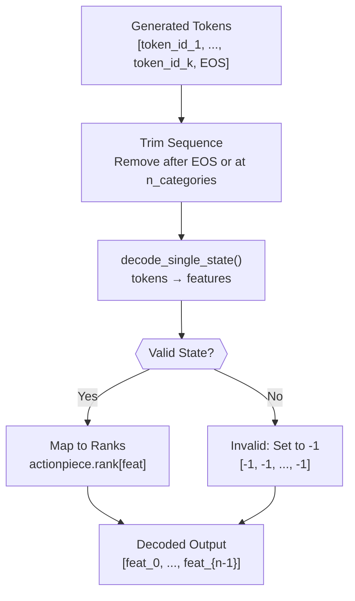
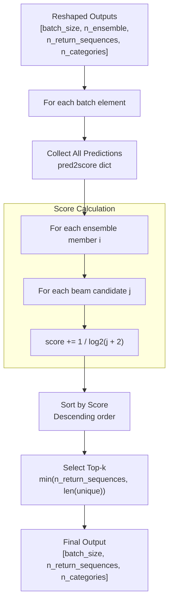
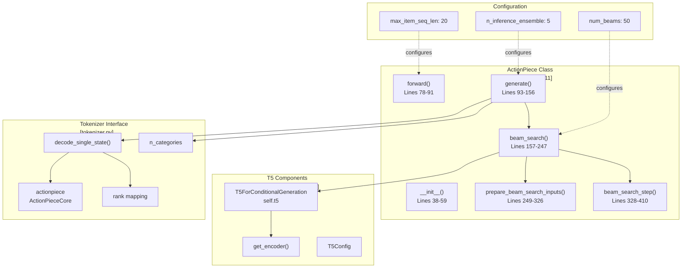

<!-- source: DeepWiki mcp.deepwiki.com · repo google-deepmind/action_piece · page 6.2 Generation & Inference Strategy · fetched 2026-10-26 -->

# Generation & Inference Strategy

<details>
<summary>Relevant source files</summary>

The following files were used as context for generating this wiki page:

- [README.md](README.md)
- [genrec/models/ActionPiece/config.yaml](genrec/models/ActionPiece/config.yaml)
- [genrec/models/ActionPiece/model.py](genrec/models/ActionPiece/model.py)

</details>


## Purpose and Scope

This document describes the generation and inference strategy used by the ActionPiece model to produce item recommendations. Unlike typical sequence-to-sequence models that use simple greedy decoding or basic beam search, ActionPiece employs a sophisticated multi-stage inference pipeline combining **ensemble generation**, **beam search decoding**, and **nDCG-based output ranking** to produce robust recommendations.

For information about the T5 architecture configuration, see [T5-Based Model Configuration](#6.1). For training procedures, see [Trainer & Training Loop](#7.1). For how sequences are tokenized before being fed to the model, see [Sequence Segmentation & Set Permutation Regularization](#3.3).

---

## Inference Pipeline Overview

The ActionPiece model's inference strategy consists of three main stages:



**Inference Flow Overview**

The pipeline processes input sequences through multiple augmentations (ensemble), performs beam search to generate candidate sequences, decodes tokens to items, and ranks candidates using nDCG scores to produce final recommendations.

**Sources:** [genrec/models/ActionPiece/model.py:93-156]()

---

## Ensemble Inference Strategy

### Configuration and Batch Preparation

The ensemble inference strategy is controlled by the `n_inference_ensemble` parameter (default: 5), which specifies how many augmented versions of each input sequence are processed independently.

| Parameter | Default | Description |
|-----------|---------|-------------|
| `n_inference_ensemble` | 5 | Number of augmented inputs per sequence |
| `num_beams` | 50 | Number of beams for beam search |

During test-time data collation, the tokenizer's `collate_fn_test()` method applies Set Permutation Regularization (SPR) to create multiple augmented versions of each input sequence. The batch size is effectively multiplied by `n_inference_ensemble`.



**Ensemble Batch Expansion**

Each input sequence is augmented N times using random permutations during tokenization, creating an expanded batch for ensemble processing.

**Sources:** [genrec/models/ActionPiece/model.py:93-108](), [genrec/models/ActionPiece/config.yaml:34]()

### Generate Method Implementation

The `generate()` method in the `ActionPiece` class orchestrates the entire ensemble inference process:



**Generate Method Flow**

The generation process validates ensemble configuration, performs beam search, decodes outputs, and aggregates results.

**Sources:** [genrec/models/ActionPiece/model.py:93-156]()

---

## Beam Search Implementation

### Beam Search Algorithm

ActionPiece implements a custom beam search algorithm adapted from Hugging Face's Transformers library. The implementation differs from the standard approach by not using early stopping based on EOS tokens; instead, sequence length is strictly controlled by `max_length` (set to `n_categories + 1`).



**Beam Search Algorithm Flow**

The beam search process initializes beams, encodes input once, then iteratively generates tokens until max_length is reached.

**Sources:** [genrec/models/ActionPiece/model.py:157-247]()

### Beam Search Initialization

The `prepare_beam_search_inputs()` method sets up the beam search by:

1. **Expanding input tensors**: Each input sequence is replicated `num_beams` times
2. **Initializing decoder inputs**: All beams start with `decoder_start_token_id`
3. **Setting beam scores**: First beam initialized to 0.0, others to -1e9 to ensure deterministic first step
4. **Creating beam index offsets**: Used for correctly reordering beams during search

| Component | Shape | Initial Value |
|-----------|-------|---------------|
| `input_ids` | `(B × num_beams, seq_len)` | Replicated input |
| `attention_mask` | `(B × num_beams, seq_len)` | Replicated mask |
| `decoder_input_ids` | `(B × num_beams, 1)` | `decoder_start_token_id` |
| `beam_scores` | `(B × num_beams,)` | `[0, -1e9, -1e9, ...]` |
| `beam_idx_offset` | `(B × num_beams,)` | `[0, 0, ..., num_beams, ...]` |

**Sources:** [genrec/models/ActionPiece/model.py:249-326]()

### Beam Search Step

The `beam_search_step()` method executes one decoding step:

1. **Extract next token logits**: From the last position in the sequence
2. **Compute log-softmax**: Convert logits to log probabilities
3. **Add beam scores**: Accumulate scores from previous steps
4. **Select top 2×num_beams candidates**: Per batch element
5. **Extract beam indices and tokens**: Determine which beams to continue
6. **Update decoder inputs**: Append selected tokens to sequences

The function maintains beam diversity by considering `2 × num_beams` candidates but selecting only `num_beams` for continuation.

**Sources:** [genrec/models/ActionPiece/model.py:328-410]()

---

## Output Decoding and Validation

### Token to Item Decoding

After beam search generates token sequences, they must be decoded back into item feature representations. The decoding process involves:

1. **Trim to valid length**: Remove padding and EOS tokens
2. **Decode to state**: Use `decode_single_state()` to convert tokens to features
3. **Validate output**: Ensure the decoded state represents a valid item
4. **Rank mapping**: Convert feature indices to item ranking indices



**Token Decoding Process**

Tokens are trimmed, decoded to feature representations, validated, and mapped to item ranks. Invalid sequences are marked with -1.

**Sources:** [genrec/models/ActionPiece/model.py:119-134]()

### Handling Invalid Outputs

The system handles invalid decoding gracefully:

- If `decode_single_state()` returns `None`, the output is considered invalid
- Invalid outputs are represented as `[-1] * n_categories`
- Invalid outputs receive zero weight in the nDCG ranking stage
- This ensures robustness even when the model generates malformed sequences

---

## nDCG-based Output Ranking

### Score Aggregation Across Ensemble

The final stage combines outputs from all ensemble members and beam search candidates using nDCG-based scoring. For each batch element:

1. **Collect predictions**: From all `n_ensemble × n_return_sequences` candidates
2. **Compute nDCG scores**: Using position-based weighting: `1 / log2(j + 2)`
3. **Aggregate scores**: Sum scores for identical predictions across ensembles
4. **Sort by score**: Rank all unique predictions
5. **Select top-k**: Return `n_return_sequences` highest-scoring predictions



**nDCG-based Ranking Process**

Predictions from all ensemble members and beam positions are aggregated using nDCG weighting and ranked by combined score.

**Sources:** [genrec/models/ActionPiece/model.py:144-155]()

### Scoring Formula

The nDCG-based score for each prediction is computed as:

```
score(pred) = Σ_{i,j} 1 / log2(position_j + 2)
```

Where:
- `i` iterates over ensemble members (0 to `n_inference_ensemble - 1`)
- `j` iterates over beam positions (0 to `n_return_sequences - 1`)
- The sum is over all occurrences of the prediction `pred` across ensembles and beam positions

This weighting scheme:
- **Favors higher-ranked beam candidates**: Position 0 has weight ≈ 1.0, position 1 has weight ≈ 0.63, etc.
- **Aggregates evidence**: Predictions appearing in multiple ensembles receive higher scores
- **Reflects relevance**: Uses the same discounting function as nDCG evaluation metric

---

## Configuration Parameters

### Inference-Related Parameters

The following parameters in `config.yaml` control the generation and inference behavior:

| Parameter | Type | Default | Description |
|-----------|------|---------|-------------|
| `num_beams` | int | 50 | Number of beams for beam search decoding |
| `n_inference_ensemble` | int | 5 | Number of augmented inputs per sequence during inference |
| `n_prob_encode_plus` | int | 0 | Additional probability encoding (model-specific) |
| `max_item_seq_len` | int | 20 | Maximum input sequence length |

**Sources:** [genrec/models/ActionPiece/config.yaml:32-38]()

### Impact on Performance

The inference parameters significantly impact both quality and computational cost:

**num_beams:**
- **Higher values** (50): Better exploration of the output space, higher quality recommendations
- **Lower values** (10): Faster inference, reduced memory usage
- **Trade-off**: Quality vs. speed

**n_inference_ensemble:**
- **Higher values** (5-10): More robust predictions through diversity
- **Lower values** (1-3): Faster inference
- **-1 value**: Disables ensemble (single augmentation)
- **Trade-off**: Robustness vs. computational cost

### Code Entity Mapping



**Code Entity Relationships**

Mapping of key inference methods to their dependencies and configurations.

**Sources:** [genrec/models/ActionPiece/model.py:1-411](), [genrec/models/ActionPiece/config.yaml:1-50]()

---

## Summary

The ActionPiece generation and inference strategy combines three sophisticated techniques:

1. **Ensemble Inference**: Processes multiple augmented versions of each input using Set Permutation Regularization to capture different contextual interpretations
2. **Beam Search**: Explores the output space with 50 beams to find high-quality candidate sequences
3. **nDCG-based Ranking**: Aggregates predictions across ensemble members and beam positions using relevance-weighted scoring

This multi-stage approach produces robust, high-quality recommendations by:
- **Capturing diverse contexts** through ensemble augmentation
- **Exploring output space** through beam search
- **Aggregating evidence** through nDCG-based ranking

The implementation is configurable through `config.yaml` parameters, allowing trade-offs between quality and computational cost based on deployment constraints.

---

