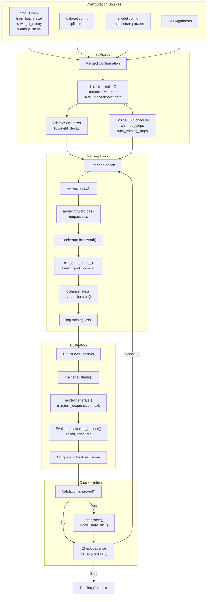
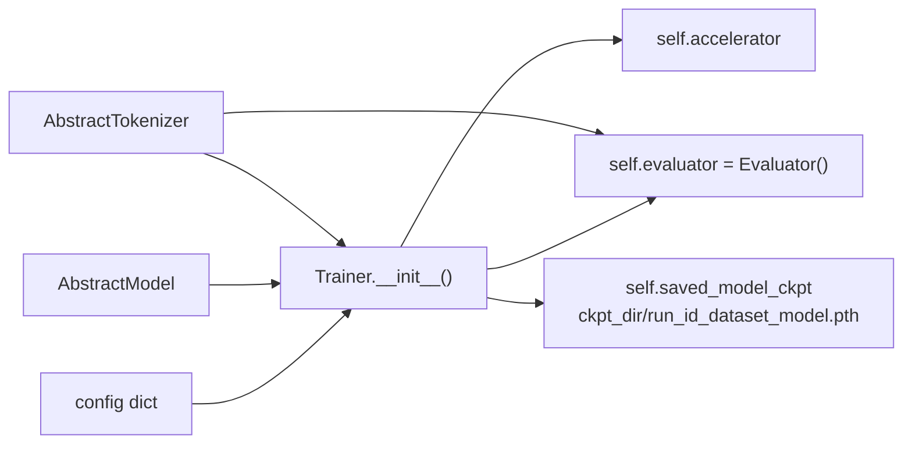
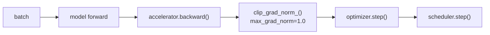
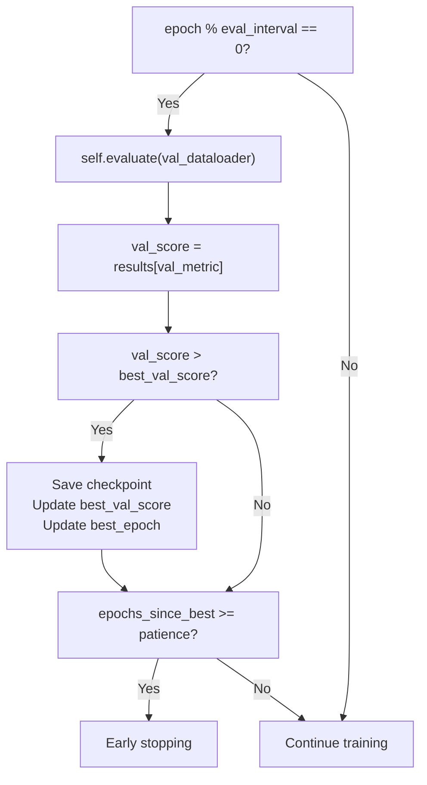
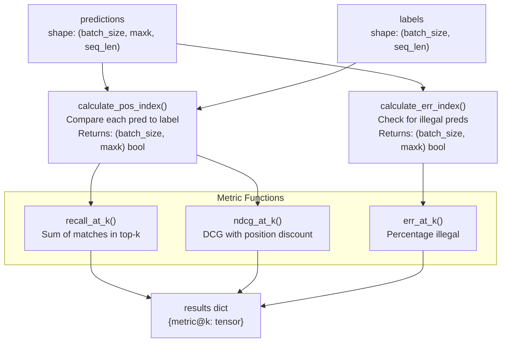
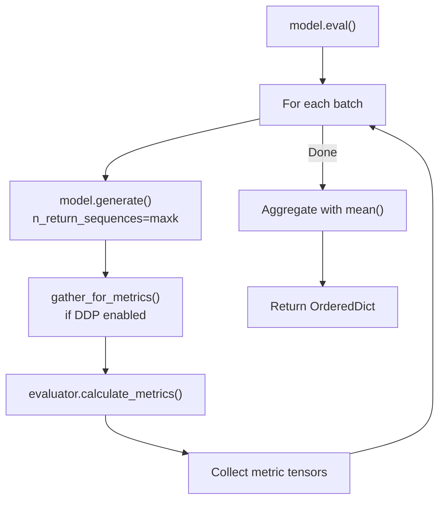

<!-- source: DeepWiki mcp.deepwiki.com · repo google-deepmind/action_piece · page 7 Training & Evaluation · fetched 2026-10-26 -->

# Training & Evaluation

<details>
<summary>Relevant source files</summary>

The following files were used as context for generating this wiki page:

- [genrec/default.yaml](genrec/default.yaml)
- [genrec/evaluator.py](genrec/evaluator.py)
- [genrec/trainer.py](genrec/trainer.py)

</details>


**Purpose and Scope**

This page documents the training and evaluation infrastructure in ActionPiece, covering the training loop orchestration, optimization strategy, evaluation metrics calculation, and model checkpointing. For details about the model architecture being trained, see [ActionPiece Model Architecture](#6). For information about data preparation and batching, see [Data Processing Pipeline](#5).

## Overview

The training and evaluation pipeline is orchestrated by two main components:
- The `Trainer` class ([genrec/trainer.py]()) handles the complete training loop, optimization, and checkpoint management
- The `Evaluator` class ([genrec/evaluator.py]()) calculates evaluation metrics including recall@k, nDCG@k, and error rate@k

The system implements several sophisticated strategies:
- **Cosine learning rate schedule** with warmup for stable training
- **Early stopping** based on validation metrics to prevent overfitting
- **Gradient clipping** to stabilize training
- **Distributed training** support via Hugging Face Accelerate
- **TensorBoard logging** for real-time monitoring

### Training and Evaluation Workflow



**Sources:** [genrec/trainer.py:93-196](), [genrec/default.yaml:16-38]()

## Trainer Class

The `Trainer` class ([genrec/trainer.py:51-250]()) orchestrates the complete training workflow, including optimization, learning rate scheduling, gradient management, and checkpoint handling.

### Initialization



The trainer initialization ([genrec/trainer.py:72-92]()) creates:
- An `Evaluator` instance with the tokenizer for metric calculation
- A checkpoint path based on `ckpt_dir` and the generated filename from configuration
- References to the model and accelerator for distributed training

**Sources:** [genrec/trainer.py:72-92]()

### Training Loop

The `fit()` method ([genrec/trainer.py:93-196]()) implements the main training loop with the following components:

#### Optimizer Configuration

The system uses **AdamW** optimizer ([genrec/trainer.py:100-104]()):

```python
optimizer = AdamW(
    self.model.parameters(),
    lr=self.config['lr'],
    weight_decay=self.config['weight_decay'],
)
```

Configuration:
- Learning rate from `config['lr']` (default: 0.003)
- Weight decay from `config['weight_decay']` (default: 0.1)

**Sources:** [genrec/trainer.py:100-104](), [genrec/default.yaml:27-28]()

#### Learning Rate Scheduling

The system implements **cosine annealing** with warmup ([genrec/trainer.py:111-116]()):

```python
scheduler = get_scheduler(
    name='cosine',
    optimizer=optimizer,
    num_warmup_steps=self.config['warmup_steps'],
    num_training_steps=total_n_steps,
)
```

The schedule:
- Warms up linearly for `warmup_steps` steps (default: 10,000)
- Then follows a cosine decay curve to zero
- Total steps calculated from `epochs` and dataloader length

**Sources:** [genrec/trainer.py:111-116](), [genrec/default.yaml:29-31]()

#### Training Step Details



Each training step ([genrec/trainer.py:144-153]()):

1. **Forward pass**: `outputs = self.model(batch)` produces loss
2. **Backward pass**: `self.accelerator.backward(loss)` computes gradients
3. **Gradient clipping** (optional): If `max_grad_norm` is set, clips gradients using `clip_grad_norm_()` to prevent exploding gradients
4. **Optimizer step**: Updates model parameters
5. **Scheduler step**: Updates learning rate

**Sources:** [genrec/trainer.py:144-153](), [genrec/default.yaml:32]()

#### Distributed Training Support

The system supports distributed training via Hugging Face Accelerate ([genrec/trainer.py:118-122]()):

```python
self.model, optimizer, train_dataloader, val_dataloader, scheduler = (
    self.accelerator.prepare(
        self.model, optimizer, train_dataloader, val_dataloader, scheduler
    )
)
```

This enables:
- Multi-GPU training with DistributedDataParallel (DDP)
- Automatic gradient accumulation
- Mixed precision training
- Gradient synchronization across devices

**Sources:** [genrec/trainer.py:118-122]()

### Validation and Early Stopping



Validation occurs every `eval_interval` epochs ([genrec/trainer.py:165-172]()). The system:

1. Calls `evaluate()` on the validation dataloader
2. Logs all metrics to TensorBoard
3. Compares the `val_metric` (default: `ndcg@10`) to the best score
4. Saves checkpoint if improved

Early stopping ([genrec/trainer.py:189-194]()) halts training if no improvement occurs for `patience` epochs (default: 20).

**Sources:** [genrec/trainer.py:165-194](), [genrec/default.yaml:33-38]()

## Evaluator Class

The `Evaluator` class ([genrec/evaluator.py:21-118]()) calculates ranking metrics by comparing model predictions to ground truth labels.

### Initialization

The evaluator ([genrec/evaluator.py:24-27]()) stores:

```python
def __init__(self, config, tokenizer):
    self.config = config
    self.tokenizer = tokenizer
    self.maxk = max(config['topk'])
```

- Configuration containing `topk` values (default: [5, 10, 20, 50]) and `metrics` (default: [ndcg, recall, err])
- Tokenizer reference for accessing `eos_token`
- Maximum k value for efficiency (generates up to `maxk` predictions)

**Sources:** [genrec/evaluator.py:24-27](), [genrec/default.yaml:36-37]()

### Metric Calculation Pipeline



**Sources:** [genrec/evaluator.py:93-117]()

### Position Index Calculation

The `calculate_pos_index()` method ([genrec/evaluator.py:34-63]()) determines which predictions are correct:

1. For each example in the batch
2. Extract the ground truth token sequence (up to EOS token)
3. Compare each of the `maxk` predictions to the ground truth
4. Mark the first matching prediction as correct
5. Return a boolean tensor of shape `(batch_size, maxk)`

This allows only one correct prediction per example, reflecting the single ground truth item in recommendation tasks.

**Sources:** [genrec/evaluator.py:34-63]()

### Recall@k

```python
def recall_at_k(self, pos_index, k):
    return pos_index[:, :k].sum(dim=1).cpu().float()
```

Recall@k ([genrec/evaluator.py:65-66]()) measures whether the ground truth appears in the top-k predictions. Since there's only one ground truth per example, this is a binary metric (0 or 1).

**Sources:** [genrec/evaluator.py:65-66]()

### nDCG@k

```python
def ndcg_at_k(self, pos_index, k):
    ranks = torch.arange(1, pos_index.shape[-1] + 1).to(pos_index.device)
    dcg = 1.0 / torch.log2(ranks + 1)
    dcg = torch.where(pos_index, dcg, 0)
    return dcg[:, :k].sum(dim=1).cpu().float()
```

Normalized Discounted Cumulative Gain ([genrec/evaluator.py:68-73]()) applies position-based discounting:
- Position 1: gain = 1.0
- Position 2: gain = 1/log2(3) ≈ 0.631
- Position 3: gain = 1/log2(4) = 0.5

This rewards finding the ground truth at higher ranks. With a single ground truth, IDCG = 1.0, so DCG = nDCG.

**Sources:** [genrec/evaluator.py:68-73]()

### Error Rate@k

```python
def calculate_err_index(self, preds):
    preds = preds.detach().cpu()
    return preds[:, :self.maxk, 0] == -1

def err_at_k(self, err_index, k):
    return err_index[:, :k].float().mean(dim=1).cpu()
```

Error rate ([genrec/evaluator.py:75-91]()) measures the percentage of illegal predictions in the top-k. A prediction is illegal if its first token is `-1`, indicating the model generated an invalid action sequence.

**Sources:** [genrec/evaluator.py:75-91]()

### Evaluation Process



The `evaluate()` method in the Trainer ([genrec/trainer.py:198-242]()) orchestrates evaluation:

1. Model set to evaluation mode (no gradient computation)
2. Generate `maxk` predictions per input using beam search
3. For DDP, gather predictions from all devices
4. Calculate metrics for each batch
5. Aggregate across all batches using mean

**Sources:** [genrec/trainer.py:198-242]()

## Checkpointing and Model Persistence

### Checkpoint Path

The checkpoint path is constructed as ([genrec/trainer.py:88-91]()):

```
{ckpt_dir}/{run_id}_{dataset}_{model}.pth
```

Example: `ckpt/genrec_default_AmazonReviews2014_Beauty_ActionPiece.pth`

The `get_file_name()` utility generates this filename from the configuration.

**Sources:** [genrec/trainer.py:88-91]()

### Saving Best Model

The checkpoint is saved when validation improves ([genrec/trainer.py:175-187]()):

```python
if val_score > best_val_score:
    best_val_score = val_score
    best_epoch = epoch + 1
    if self.accelerator.is_main_process:
        if self.config['use_ddp']:  # unwrap model for saving
            unwrapped_model = self.accelerator.unwrap_model(self.model)
            torch.save(unwrapped_model.state_dict(), self.saved_model_ckpt)
        else:
            torch.save(self.model.state_dict(), self.saved_model_ckpt)
```

Important details:
- Only the main process saves (in distributed training)
- For DDP, unwrap the model to save the original architecture
- Saves only `state_dict()`, not the entire model object
- Overwrites previous checkpoint (keeps only best)

**Sources:** [genrec/trainer.py:175-187]()

### Tracking Best Performance

The trainer tracks ([genrec/trainer.py:132-133](), [genrec/trainer.py:196]()):
- `best_epoch`: Epoch number with best validation score
- `best_val_score`: Best validation metric value

These are logged at the end of training for reference.

**Sources:** [genrec/trainer.py:132-133](), [genrec/trainer.py:196]()

## Configuration Parameters

### Training Hyperparameters

| Parameter | Default | Description |
|-----------|---------|-------------|
| `train_batch_size` | 256 | Batch size for training |
| `eval_batch_size` | 32 | Batch size for evaluation |
| `lr` | 0.003 | Learning rate for AdamW |
| `weight_decay` | 0.1 | L2 regularization coefficient |
| `warmup_steps` | 10000 | Linear warmup steps for LR schedule |
| `epochs` | 200 | Maximum training epochs |
| `max_grad_norm` | 1.0 | Gradient clipping threshold (None to disable) |

**Sources:** [genrec/default.yaml:25-32]()

### Evaluation Parameters

| Parameter | Default | Description |
|-----------|---------|-------------|
| `eval_interval` | 1 | Evaluate every n epochs |
| `patience` | 20 | Early stopping patience (None to disable) |
| `topk` | [5, 10, 20, 50] | k values for top-k metrics |
| `metrics` | [ndcg, recall, err] | Metrics to calculate |
| `val_metric` | ndcg@10 | Metric for early stopping and checkpoint selection |

**Sources:** [genrec/default.yaml:33-38]()

## TensorBoard Logging

The trainer logs the following to TensorBoard ([genrec/trainer.py:123-127](), [genrec/trainer.py:155-172]()):

| Log Key | Type | Description |
|---------|------|-------------|
| `Loss/train_loss` | Scalar | Average loss per epoch |
| `Val_Metric/{metric}@{k}` | Scalar | Validation metric values (e.g., `Val_Metric/ndcg@10`) |

Logs are written to `{tensorboard_log_dir}/{run_id}_{dataset}_{model}/` with a 60-second flush interval.

**Sources:** [genrec/trainer.py:123-127](), [genrec/trainer.py:155-172](), [genrec/default.yaml:19]()

## Summary

The training and evaluation system provides:

1. **Robust optimization**: AdamW with cosine scheduling and warmup
2. **Stability mechanisms**: Gradient clipping and early stopping
3. **Comprehensive metrics**: Recall, nDCG, and error rate at multiple k values
4. **Distributed support**: Seamless multi-GPU training via Accelerate
5. **Monitoring**: Real-time TensorBoard logging
6. **Reproducibility**: Deterministic checkpoint saving based on validation performance

This infrastructure enables efficient training of the ActionPiece model while providing detailed insights into model performance throughout the training process.

**Sources:** [genrec/trainer.py](), [genrec/evaluator.py](), [genrec/default.yaml]()

---

