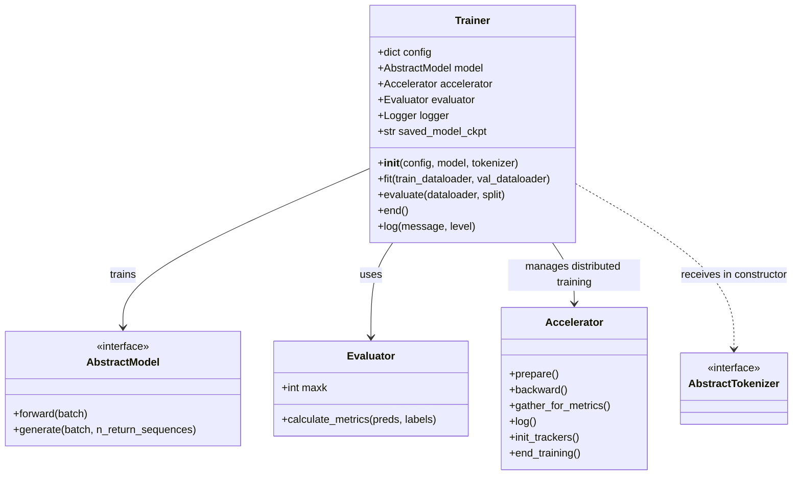
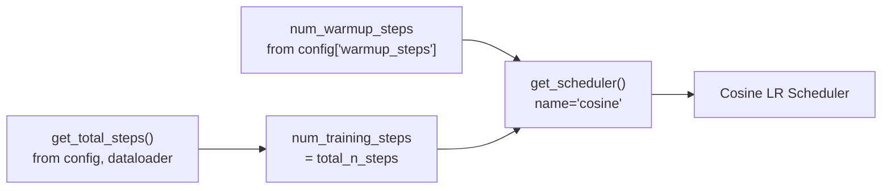
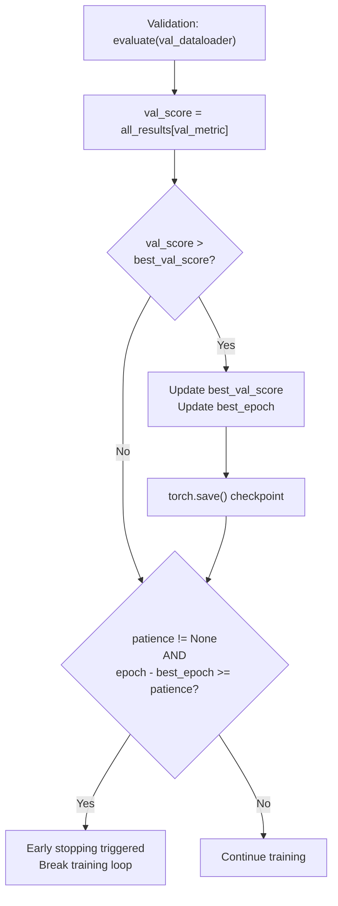
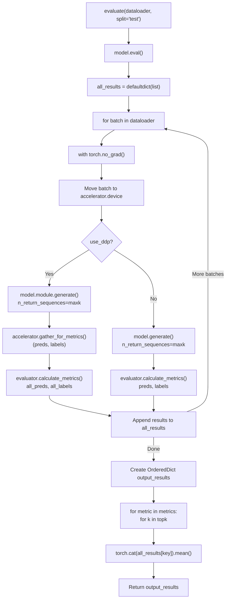
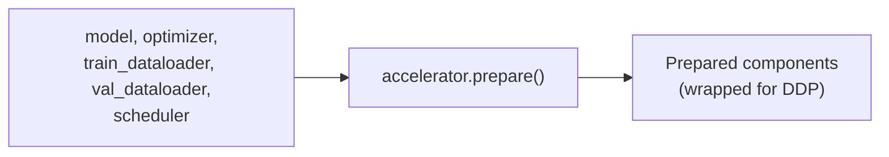
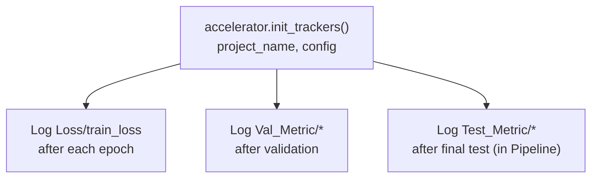
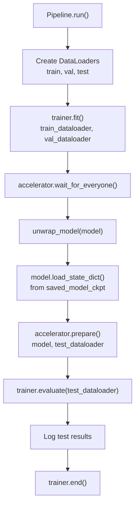

<!-- source: DeepWiki mcp.deepwiki.com · repo google-deepmind/action_piece · page 7.1 Trainer & Training Loop · fetched 2026-10-26 -->

# Trainer & Training Loop

<details>
<summary>Relevant source files</summary>

The following files were used as context for generating this wiki page:

- [genrec/default.yaml](genrec/default.yaml)
- [genrec/pipeline.py](genrec/pipeline.py)
- [genrec/trainer.py](genrec/trainer.py)

</details>


## Purpose and Scope

This document details the `Trainer` class implementation and training loop mechanics in the ActionPiece system. The `Trainer` class ([genrec/trainer.py]()) orchestrates the model training process, including optimization, gradient updates, validation, checkpointing, and early stopping. 

For information about the model being trained, see [ActionPiece Model Architecture](#6). For evaluation metrics computation, see [Evaluation Metrics](#7.2). For checkpoint persistence details, see [Checkpointing & Model Persistence](#7.3).

**Sources:** [genrec/trainer.py]()

---

## Trainer Class Overview

The `Trainer` class is initialized with configuration, model, and tokenizer, and provides methods for model training (`fit()`), evaluation (`evaluate()`), and resource cleanup (`end()`).

### Class Structure



**Sources:** [genrec/trainer.py:51-92]()

---

## Initialization

The `Trainer.__init__()` method sets up the training infrastructure:

| Component | Description | Code Reference |
|-----------|-------------|----------------|
| **config** | Training configuration dictionary | [genrec/trainer.py:82]() |
| **model** | Model instance to be trained | [genrec/trainer.py:83]() |
| **accelerator** | HuggingFace Accelerate instance for distributed training | [genrec/trainer.py:84]() |
| **evaluator** | `Evaluator` instance for metrics calculation | [genrec/trainer.py:85]() |
| **logger** | Python logging instance | [genrec/trainer.py:86]() |
| **saved_model_ckpt** | Checkpoint file path (`ckpt/` directory) | [genrec/trainer.py:88-91]() |

The checkpoint path is constructed using `get_file_name()` utility with `.pth` suffix, ensuring unique naming per configuration.

**Sources:** [genrec/trainer.py:72-91]()

---

## Training Loop Architecture

### fit() Method Flow

```mermaid
graph TD
    Start["fit(train_dataloader, val_dataloader)"]
    InitOpt["Initialize AdamW optimizer<br/>lr, weight_decay"]
    CalcSteps["Calculate total_n_steps<br/>get_total_steps()"]
    CheckSteps{total_n_steps > 0?}
    InitSched["Initialize cosine scheduler<br/>warmup_steps, total_n_steps"]
    Prepare["accelerator.prepare()<br/>model, optimizer, dataloaders, scheduler"]
    InitTrack["accelerator.init_trackers()<br/>TensorBoard logging"]
    CalcEpochs["Calculate n_epochs from steps"]
    InitVars["best_epoch=0, best_val_score=-1"]
    
    EpochLoop["for epoch in range(n_epochs)"]
    SetTrain["model.train()"]
    BatchLoop["for batch in train_dataloader"]
    ZeroGrad["optimizer.zero_grad()"]
    Forward["outputs = model(batch)"]
    GetLoss["loss = outputs.loss"]
    Backward["accelerator.backward(loss)"]
    ClipGrad{max_grad_norm != None?}
    ClipAction["clip_grad_norm_()<br/>parameters, max_grad_norm"]
    OptStep["optimizer.step()"]
    SchedStep["scheduler.step()"]
    AccumLoss["total_loss += loss.item()"]
    
    LogLoss["Log train_loss to TensorBoard"]
    CheckEval{epoch % eval_interval == 0?}
    RunEval["all_results = evaluate(val_dataloader)"]
    LogValMetrics["Log Val_Metric/* to TensorBoard"]
    GetValScore["val_score = all_results[val_metric]"]
    CheckBest{val_score > best_val_score?}
    UpdateBest["best_val_score = val_score<br/>best_epoch = epoch + 1"]
    SaveCkpt["torch.save(model.state_dict())<br/>to saved_model_ckpt"]
    
    CheckPatience{patience != None<br/>AND<br/>epoch - best_epoch >= patience?}
    EarlyStop["Log 'Early stopping'<br/>break"]
    
    NextEpoch["Next epoch"]
    LogBest["Log best_epoch and best_val_score"]
    End["Return"]
    
    Start --> InitOpt
    InitOpt --> CalcSteps
    CalcSteps --> CheckSteps
    CheckSteps -->|No| End
    CheckSteps -->|Yes| InitSched
    InitSched --> Prepare
    Prepare --> InitTrack
    InitTrack --> CalcEpochs
    CalcEpochs --> InitVars
    InitVars --> EpochLoop
    
    EpochLoop --> SetTrain
    SetTrain --> BatchLoop
    BatchLoop --> ZeroGrad
    ZeroGrad --> Forward
    Forward --> GetLoss
    GetLoss --> Backward
    Backward --> ClipGrad
    ClipGrad -->|Yes| ClipAction
    ClipGrad -->|No| OptStep
    ClipAction --> OptStep
    OptStep --> SchedStep
    SchedStep --> AccumLoss
    AccumLoss -->|More batches| BatchLoop
    AccumLoss -->|Done| LogLoss
    
    LogLoss --> CheckEval
    CheckEval -->|No| CheckPatience
    CheckEval -->|Yes| RunEval
    RunEval --> LogValMetrics
    LogValMetrics --> GetValScore
    GetValScore --> CheckBest
    CheckBest -->|No| CheckPatience
    CheckBest -->|Yes| UpdateBest
    UpdateBest --> SaveCkpt
    SaveCkpt --> CheckPatience
    
    CheckPatience -->|Yes| EarlyStop
    CheckPatience -->|No| NextEpoch
    EarlyStop --> LogBest
    NextEpoch -->|More epochs| EpochLoop
    NextEpoch -->|Done| LogBest
    LogBest --> End
```



**Sources:** [genrec/trainer.py:93-196]()

---

## Optimizer Configuration

### AdamW Optimizer

The training loop uses the `AdamW` optimizer from PyTorch with the following configuration:

| Parameter | Default Value | Configuration Key | Description |
|-----------|---------------|-------------------|-------------|
| **Learning Rate** | `0.003` | `lr` | Initial learning rate |
| **Weight Decay** | `0.1` | `weight_decay` | L2 regularization coefficient |

```python
# genrec/trainer.py:100-104
optimizer = AdamW(
    self.model.parameters(),
    lr=self.config['lr'],
    weight_decay=self.config['weight_decay'],
)
```

**Sources:** [genrec/trainer.py:100-104](), [genrec/default.yaml:27-28]()

---

## Learning Rate Scheduling

### Cosine Schedule with Warmup

The trainer uses a **cosine annealing schedule** with linear warmup from the `transformers` library:



| Parameter | Default Value | Configuration Key | Description |
|-----------|---------------|-------------------|-------------|
| **Schedule Type** | `cosine` | Hardcoded | Cosine annealing after warmup |
| **Warmup Steps** | `10000` | `warmup_steps` | Number of linear warmup steps |
| **Training Steps** | Calculated | `steps` or `epochs` | Total training steps (either explicit or computed from epochs) |

The scheduler is updated after every batch via `scheduler.step()` in the training loop.

**Sources:** [genrec/trainer.py:106-122](), [genrec/default.yaml:29-31]()

---

## Gradient Clipping

Gradient clipping prevents exploding gradients during training:

```python
# genrec/trainer.py:149-150
if self.config['max_grad_norm'] is not None:
    clip_grad_norm_(self.model.parameters(), self.config['max_grad_norm'])
```

| Parameter | Default Value | Configuration Key | Description |
|-----------|---------------|-------------------|-------------|
| **Max Gradient Norm** | `1.0` | `max_grad_norm` | Maximum gradient norm. Set to `None` to disable clipping |

Clipping is applied **after** `accelerator.backward()` but **before** `optimizer.step()`.

**Sources:** [genrec/trainer.py:149-150](), [genrec/default.yaml:32]()

---

## Validation and Early Stopping

### Validation Schedule

Validation is performed periodically based on `eval_interval`:

```python
# genrec/trainer.py:165
if (epoch + 1) % self.config['eval_interval'] == 0:
```

| Parameter | Default Value | Configuration Key | Description |
|-----------|---------------|-------------------|-------------|
| **Evaluation Interval** | `1` | `eval_interval` | Evaluate every N epochs |

**Sources:** [genrec/trainer.py:165](), [genrec/default.yaml:33]()

### Early Stopping Logic



| Parameter | Default Value | Configuration Key | Description |
|-----------|---------------|-------------------|-------------|
| **Validation Metric** | `ndcg@10` | `val_metric` | Metric used for model selection |
| **Patience** | `20` | `patience` | Stop after N epochs without improvement. Set to `None` to disable |

The system tracks the best validation score and saves checkpoints only when improvement is observed. Training stops if no improvement occurs for `patience` epochs.

**Sources:** [genrec/trainer.py:174-194](), [genrec/default.yaml:34,38]()

---

## Checkpoint Management

### Saving Best Model

Model checkpoints are saved only when validation performance improves:

```python
# genrec/trainer.py:178-187
if self.accelerator.is_main_process:
    if self.config['use_ddp']:  # unwrap model for saving
        unwrapped_model = self.accelerator.unwrap_model(self.model)
        torch.save(unwrapped_model.state_dict(), self.saved_model_ckpt)
    else:
        torch.save(self.model.state_dict(), self.saved_model_ckpt)
```

**Checkpoint Path:** `{ckpt_dir}/{dataset}_{model}_{run_id}.pth`

The system handles distributed training (DDP) by unwrapping the model before saving to ensure compatibility.

**Sources:** [genrec/trainer.py:178-187](), [genrec/default.yaml:20]()

---

## Evaluation Method

### evaluate() Implementation

The `evaluate()` method computes metrics on a given dataloader:



**Key Aspects:**

1. **No Gradient Computation:** Wrapped in `torch.no_grad()` context
2. **DDP Handling:** For distributed training, uses `model.module.generate()` and `accelerator.gather_for_metrics()`
3. **Metric Aggregation:** Results are collected per-batch and averaged across all batches
4. **Output Format:** Returns `OrderedDict` with keys like `ndcg@10`, `recall@5`, etc.

**Sources:** [genrec/trainer.py:198-242]()

---

## Integration with Distributed Training

### Accelerate Integration

The `Trainer` leverages HuggingFace Accelerate for distributed training support:



**Key Integration Points:**

| Method | Purpose | Code Reference |
|--------|---------|----------------|
| `accelerator.prepare()` | Wraps components for distributed training | [genrec/trainer.py:118-122]() |
| `accelerator.backward()` | Handles gradient synchronization | [genrec/trainer.py:148]() |
| `accelerator.gather_for_metrics()` | Collects predictions from all devices | [genrec/trainer.py:225-227]() |
| `accelerator.log()` | Logs metrics to TensorBoard | [genrec/trainer.py:155-157,169-171]() |
| `accelerator.init_trackers()` | Initializes TensorBoard tracking | [genrec/trainer.py:123-127]() |
| `accelerator.unwrap_model()` | Unwraps DDP model for saving | [genrec/trainer.py:180]() |
| `accelerator.end_training()` | Cleanup at training end | [genrec/trainer.py:246]() |

**Sources:** [genrec/trainer.py:118-127,148,180,225-227,246]()

---

## TensorBoard Logging

The trainer logs metrics to TensorBoard at multiple stages:



**Logged Metrics:**

| Category | Metrics | When Logged | Code Reference |
|----------|---------|-------------|----------------|
| **Training Loss** | `Loss/train_loss` | Every epoch | [genrec/trainer.py:155-157]() |
| **Validation Metrics** | `Val_Metric/{metric}@{k}` | Every `eval_interval` epochs | [genrec/trainer.py:169-171]() |
| **Test Metrics** | `Test_Metric/{metric}@{k}` | After training completes | [genrec/pipeline.py:180-181]() |

Metrics include all combinations of `metrics` × `topk` from configuration (e.g., `ndcg@10`, `recall@20`, `err@5`).

**TensorBoard Directory:** `{tensorboard_log_dir}/{dataset}/{model}/`

**Sources:** [genrec/trainer.py:123-127,155-171](), [genrec/pipeline.py:180-181](), [genrec/default.yaml:19,36-38]()

---

## Training Configuration Parameters

### Complete Parameter Reference

| Parameter | Type | Default | Description |
|-----------|------|---------|-------------|
| `train_batch_size` | int | `256` | Batch size for training |
| `eval_batch_size` | int | `32` | Batch size for evaluation |
| `lr` | float | `0.003` | Initial learning rate |
| `weight_decay` | float | `0.1` | AdamW weight decay (L2 regularization) |
| `warmup_steps` | int | `10000` | Number of warmup steps for LR scheduler |
| `steps` | int or null | `null` | Total training steps (overrides `epochs` if set) |
| `epochs` | int | `200` | Maximum number of training epochs |
| `max_grad_norm` | float or null | `1.0` | Gradient clipping threshold (null to disable) |
| `eval_interval` | int | `1` | Evaluate every N epochs |
| `patience` | int or null | `20` | Early stopping patience (null to disable) |
| `val_metric` | str | `ndcg@10` | Metric for validation and early stopping |
| `metrics` | list | `[ndcg,recall,err]` | Metrics to compute |
| `topk` | list | `[5,10,20,50]` | Top-k values for metric computation |

**Sources:** [genrec/default.yaml:25-38]()

---

## Integration with Pipeline

The `Trainer` is invoked by the `Pipeline` class during the training and evaluation workflow:



**Key Points:**

1. **Training:** `Pipeline.run()` calls `trainer.fit()` with train and validation dataloaders
2. **Synchronization:** `accelerator.wait_for_everyone()` ensures all processes complete training
3. **Best Model Loading:** After training, the best checkpoint is loaded for testing
4. **Test Evaluation:** Final evaluation on test set using the best model
5. **Cleanup:** `trainer.end()` releases resources

**Sources:** [genrec/pipeline.py:136-184]()

---

## Training Step Calculation

The system calculates total training steps based on configuration:

```python
# From genrec/utils.py (inferred from usage)
total_n_steps = get_total_steps(config, train_dataloader)
```

**Logic:**
- If `config['steps']` is set: use that value directly
- Otherwise: calculate from `config['epochs']` and dataloader length
- Accounts for `accelerator.num_processes` when using DDP

The number of epochs is then derived:
```python
# genrec/trainer.py:129-131
n_epochs = np.ceil(
    total_n_steps / (len(train_dataloader) * self.accelerator.num_processes)
).astype(int)
```

**Sources:** [genrec/trainer.py:106-131](), [genrec/default.yaml:30-31]()

---

## Error Handling and Edge Cases

### No Training Steps

If `total_n_steps == 0`, training is skipped:

```python
# genrec/trainer.py:107-109
if total_n_steps == 0:
    self.log('No training steps needed.')
    return
```

### DDP Model Unwrapping

When saving checkpoints in distributed training, the model must be unwrapped:

```python
# genrec/trainer.py:179-183
if self.config['use_ddp']:
    unwrapped_model = self.accelerator.unwrap_model(self.model)
    torch.save(unwrapped_model.state_dict(), self.saved_model_ckpt)
else:
    torch.save(self.model.state_dict(), self.saved_model_ckpt)
```

### Main Process Only Operations

Checkpoint saving and certain logging operations only occur on the main process:

```python
# genrec/trainer.py:178
if self.accelerator.is_main_process:
```

**Sources:** [genrec/trainer.py:107-109,178-187]()

---

## Usage Example

The typical usage pattern as orchestrated by `Pipeline`:

```python
# Configuration
config = {...}  # Loaded from YAML files

# Initialization (in Pipeline.__init__)
trainer = Trainer(config, model, tokenizer)

# Training (in Pipeline.run())
trainer.fit(train_dataloader, val_dataloader)

# Testing (in Pipeline.run())
test_results = trainer.evaluate(test_dataloader)

# Cleanup (in Pipeline.run())
trainer.end()
```

**Sources:** [genrec/pipeline.py:114-121,136-184]()

---

