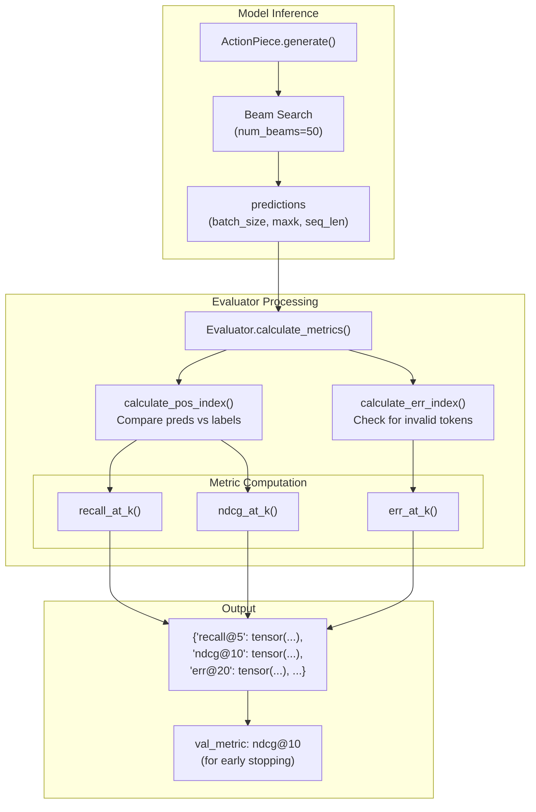
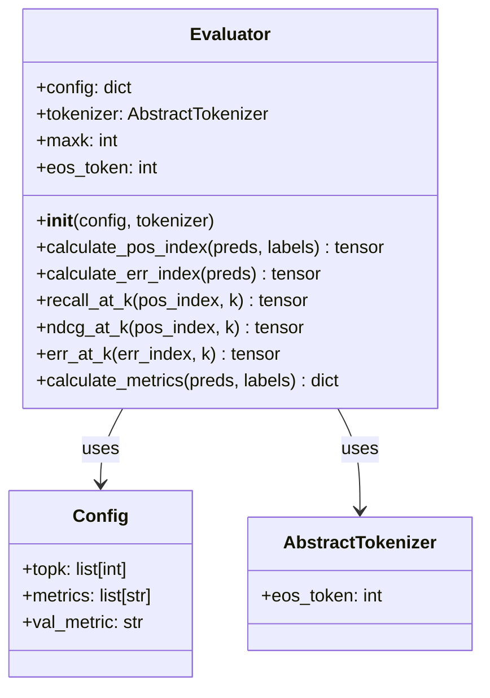
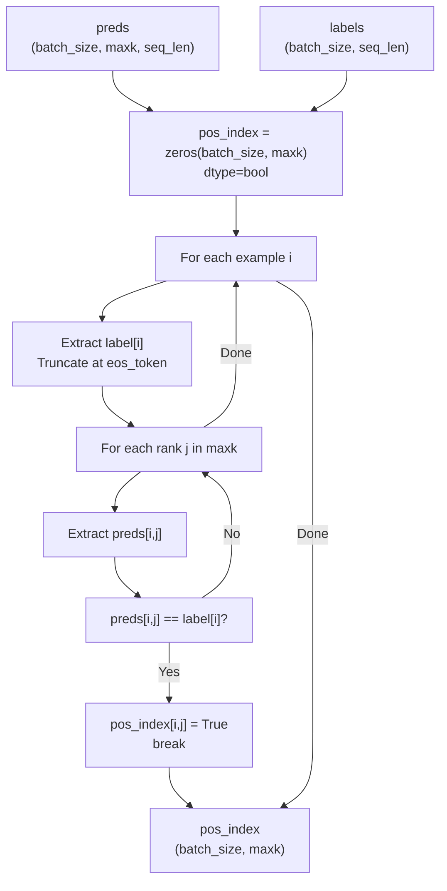
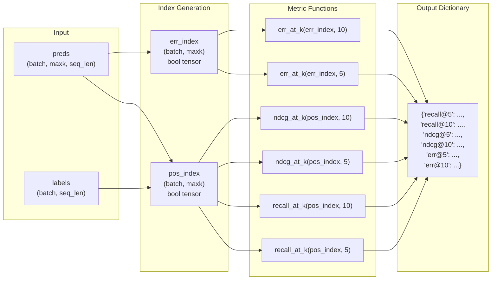
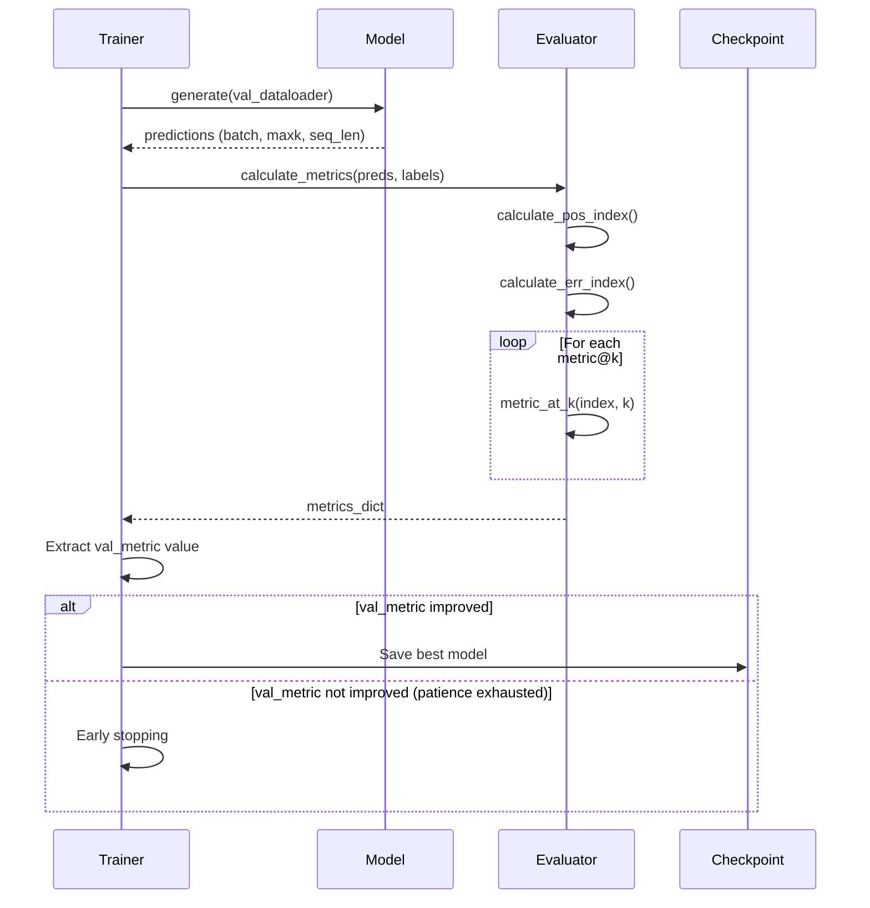

<!-- source: DeepWiki mcp.deepwiki.com · repo google-deepmind/action_piece · page 7.2 Evaluation Metrics · fetched 2026-10-26 -->

# Evaluation Metrics

<details>
<summary>Relevant source files</summary>

The following files were used as context for generating this wiki page:

- [README.md](README.md)
- [genrec/default.yaml](genrec/default.yaml)
- [genrec/evaluator.py](genrec/evaluator.py)

</details>


## Purpose and Scope

This page documents the evaluation metrics system used in the ActionPiece framework, including the `Evaluator` class and the metrics calculated to assess recommendation quality. The evaluator measures how well the model predicts the next item in a user's action sequence.

For information about the training loop and early stopping based on these metrics, see [Trainer & Training Loop](#7.1). For details on how the model generates predictions that are evaluated, see [Generation & Inference Strategy](#6.2).

---

## Overview

The ActionPiece system evaluates recommendation quality using three primary metrics across multiple cutoff values (k):

| Metric | Full Name | Purpose |
|--------|-----------|---------|
| `recall@k` | Recall at k | Measures whether the ground truth item appears in the top k predictions |
| `ndcg@k` | Normalized Discounted Cumulative Gain at k | Measures ranking quality with position-based discounting |
| `err@k` | Error Rate at k | Measures the percentage of illegal/invalid predictions |

The evaluation system is implemented in the `Evaluator` class [genrec/evaluator.py:21-117](), which processes batches of predictions and compares them against ground truth labels.

**Sources:** [genrec/evaluator.py:1-118](), [genrec/default.yaml:36-38]()

---

## Evaluation Workflow



**Diagram: Evaluation Metrics Computation Pipeline**

The workflow processes model predictions through position index calculation and error detection, then computes each metric at specified k values.

**Sources:** [genrec/evaluator.py:93-117]()

---

## Evaluator Class Structure

### Initialization



**Diagram: Evaluator Class Structure**

The `Evaluator` class [genrec/evaluator.py:21-27]() is initialized with:
- **config**: Configuration dictionary containing `topk`, `metrics`, and `val_metric` settings
- **tokenizer**: The tokenizer instance providing `eos_token` for sequence termination detection
- **maxk**: Maximum k value from the `topk` list, used for validation

**Sources:** [genrec/evaluator.py:21-32]()

---

## Position Index Calculation

The core of evaluation is determining whether predictions match ground truth labels. This is done through `calculate_pos_index()`:



**Diagram: Position Index Calculation Logic**

Key implementation details [genrec/evaluator.py:34-63]():

1. **EOS Token Handling**: Ground truth labels are truncated at the `eos_token` position [genrec/evaluator.py:55-57]()
2. **Exact Sequence Matching**: A prediction matches if the entire token sequence equals the ground truth [genrec/evaluator.py:60]()
3. **First Match Only**: Once a match is found at rank j, no further ranks are marked for that example [genrec/evaluator.py:61-62]()
4. **Boolean Output**: Returns a boolean tensor where `pos_index[i,j] = True` means the j-th prediction for example i is correct

**Sources:** [genrec/evaluator.py:34-63]()

---

## Metric Implementations

### Recall@k

Recall@k measures whether the ground truth item appears anywhere in the top k predictions:

$$\text{Recall@k} = \begin{cases} 1 & \text{if ground truth in top k} \\ 0 & \text{otherwise} \end{cases}$$

**Implementation** [genrec/evaluator.py:65-66]():
```python
def recall_at_k(self, pos_index, k):
    return pos_index[:, :k].sum(dim=1).cpu().float()
```

The function sums across the first k positions. Since only one position can be True per example (due to the break in `calculate_pos_index`), the result is either 0.0 or 1.0 per example.

**Sources:** [genrec/evaluator.py:65-66]()

### NDCG@k

Normalized Discounted Cumulative Gain (NDCG) measures ranking quality with logarithmic position-based discounting:

$$\text{DCG@k} = \sum_{i=1}^{k} \frac{\text{rel}_i}{\log_2(i + 1)}$$

**Implementation** [genrec/evaluator.py:68-73]():
```python
def ndcg_at_k(self, pos_index, k):
    # Assume only one ground truth item per example
    ranks = torch.arange(1, pos_index.shape[-1] + 1).to(pos_index.device)
    dcg = 1.0 / torch.log2(ranks + 1)
    dcg = torch.where(pos_index, dcg, 0)
    return dcg[:, :k].sum(dim=1).cpu().float()
```

Key characteristics:
- **Relevance**: Assumes binary relevance (1 for ground truth, 0 otherwise) [genrec/evaluator.py:69]()
- **Discount Factor**: Uses `1/log2(rank + 1)` where rank starts from 1 [genrec/evaluator.py:71]()
- **No Normalization**: The implementation computes DCG directly without normalization (since there's only one relevant item, IDCG = 1/log2(2) = 1.0 when the item is at rank 1)

**Sources:** [genrec/evaluator.py:68-73]()

### ERR@k (Error Rate)

Error rate measures the percentage of invalid predictions among the top k. A prediction is invalid if it starts with token `-1`:

**Implementation** [genrec/evaluator.py:75-91]():
```python
def calculate_err_index(self, preds):
    preds = preds.detach().cpu()
    return preds[:, :self.maxk, 0] == -1

def err_at_k(self, err_index, k):
    return err_index[:, :k].float().mean(dim=1).cpu()
```

The error index checks if the first token (position 0) equals -1 [genrec/evaluator.py:78](). This indicates an illegal or failed generation. The error rate is the mean across the first k predictions.

**Sources:** [genrec/evaluator.py:75-91]()

---

## Metric Calculation Flow



**Diagram: Metric Calculation Flow with Multiple K Values**

The `calculate_metrics()` method [genrec/evaluator.py:93-117]() orchestrates the computation:

1. Generates `pos_index` by comparing predictions to labels
2. Generates `err_index` by checking for invalid tokens
3. Loops through each metric in `config['metrics']` [genrec/evaluator.py:113]()
4. For each metric, loops through each k in `config['topk']` [genrec/evaluator.py:115]()
5. Calls the appropriate metric function and stores results with keys like `'ndcg@10'` [genrec/evaluator.py:116]()

**Sources:** [genrec/evaluator.py:93-117]()

---

## Configuration

The evaluation system is configured through parameters in `genrec/default.yaml`:

| Parameter | Type | Default | Description |
|-----------|------|---------|-------------|
| `topk` | list[int] | `[5, 10, 20, 50]` | Cutoff values for metrics |
| `metrics` | list[str] | `['ndcg', 'recall', 'err']` | Metrics to calculate |
| `val_metric` | str | `'ndcg@10'` | Metric used for validation and early stopping |

**Example Configuration:**
```yaml
topk: [5,10,20,50]
metrics: [ndcg,recall,err]
val_metric: ndcg@10
```

The `val_metric` parameter specifies which metric the training loop monitors for model selection and early stopping. It must be in the format `{metric}@{k}` where `metric` is in the `metrics` list and `k` is in the `topk` list.

**Sources:** [genrec/default.yaml:36-38]()

---

## Integration with Training Loop



**Diagram: Evaluator Integration with Training Loop**

The evaluator integrates with the training system as follows:

1. **During Validation**: The trainer calls the model's `generate()` method to produce predictions
2. **Metric Calculation**: Predictions are passed to `Evaluator.calculate_metrics()` along with ground truth labels
3. **Validation Metric Extraction**: The specific metric defined in `val_metric` (e.g., `'ndcg@10'`) is extracted from the results dictionary
4. **Early Stopping**: The trainer tracks whether `val_metric` improves and implements early stopping based on the `patience` parameter (see [Trainer & Training Loop](#7.1))

**Sources:** [genrec/evaluator.py:93-117](), [genrec/default.yaml:34-38]()

---

## Output Format

The `calculate_metrics()` method returns a dictionary where:
- **Keys**: Formatted as `'{metric}@{k}'` (e.g., `'recall@5'`, `'ndcg@10'`)
- **Values**: PyTorch tensors of shape `(batch_size,)` containing per-example metric scores

Example output structure:
```python
{
    'recall@5': tensor([1.0, 0.0, 1.0, ...]),   # batch_size elements
    'recall@10': tensor([1.0, 0.0, 1.0, ...]),
    'recall@20': tensor([1.0, 1.0, 1.0, ...]),
    'recall@50': tensor([1.0, 1.0, 1.0, ...]),
    'ndcg@5': tensor([1.0, 0.0, 0.631, ...]),
    'ndcg@10': tensor([1.0, 0.0, 0.631, ...]),
    'ndcg@20': tensor([1.0, 0.431, 0.631, ...]),
    'ndcg@50': tensor([1.0, 0.431, 0.631, ...]),
    'err@5': tensor([0.0, 0.2, 0.0, ...]),
    'err@10': tensor([0.0, 0.1, 0.0, ...]),
    'err@20': tensor([0.05, 0.05, 0.0, ...]),
    'err@50': tensor([0.02, 0.04, 0.0, ...])
}
```

These per-example scores are typically aggregated (mean) across the batch for logging and monitoring.

**Sources:** [genrec/evaluator.py:102-117]()

---

## Summary

The ActionPiece evaluation system provides a comprehensive framework for assessing recommendation quality:

| Component | File | Purpose |
|-----------|------|---------|
| `Evaluator` class | [genrec/evaluator.py:21-117]() | Main evaluation orchestrator |
| `calculate_pos_index()` | [genrec/evaluator.py:34-63]() | Compares predictions to ground truth |
| `recall_at_k()` | [genrec/evaluator.py:65-66]() | Binary hit metric |
| `ndcg_at_k()` | [genrec/evaluator.py:68-73]() | Position-aware ranking metric |
| `err_at_k()` | [genrec/evaluator.py:80-91]() | Invalid prediction detection |
| Configuration | [genrec/default.yaml:36-38]() | Metric selection and cutoffs |

The evaluator seamlessly integrates with the training loop for validation, early stopping, and model selection based on the configured `val_metric`.

**Sources:** [genrec/evaluator.py:1-118](), [genrec/default.yaml:36-38]()

---

