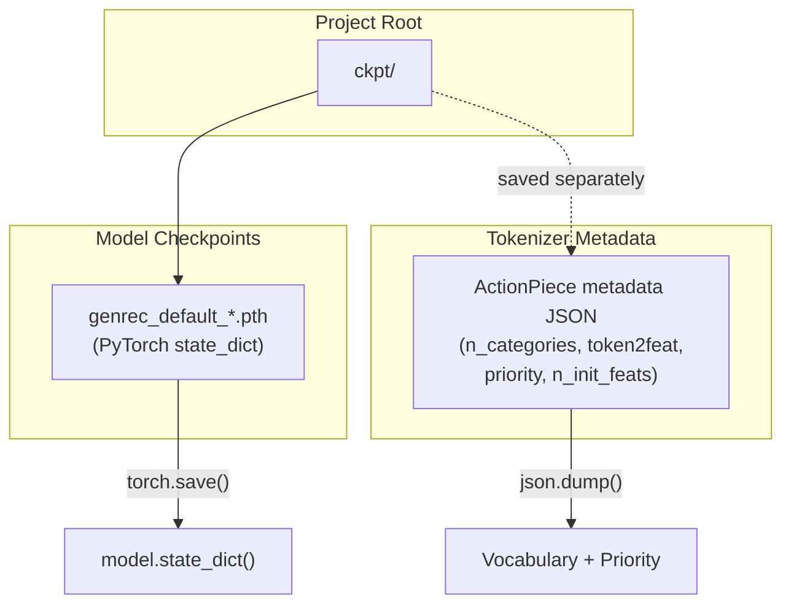
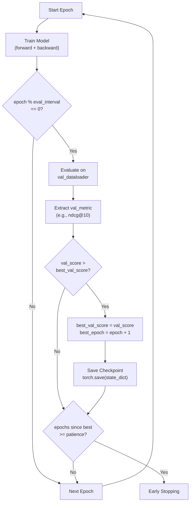
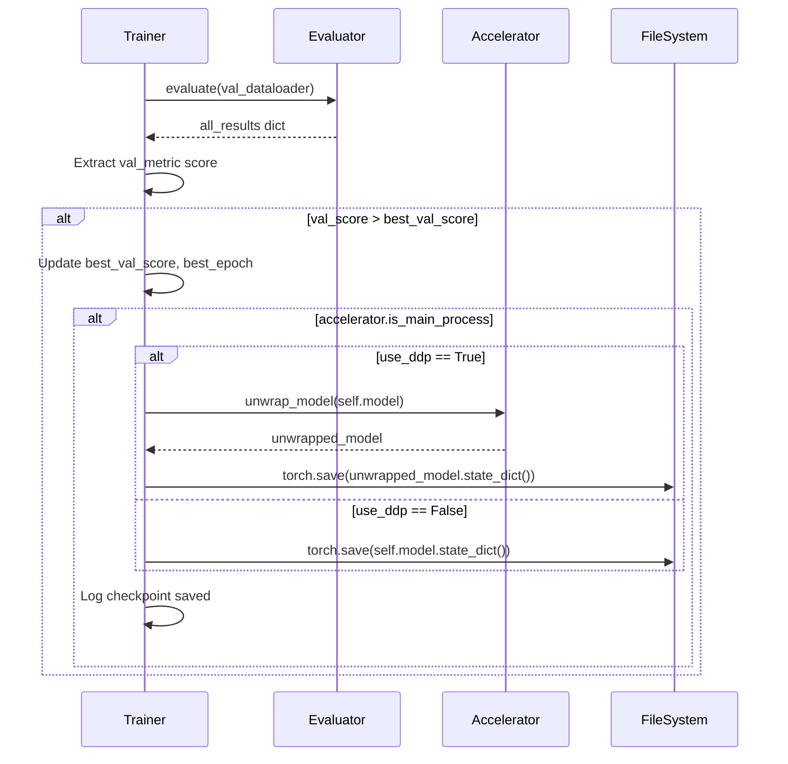
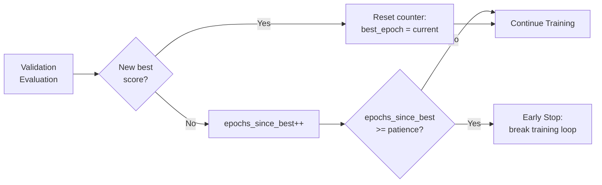
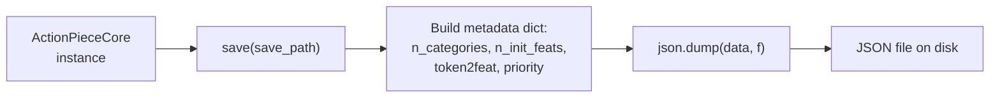
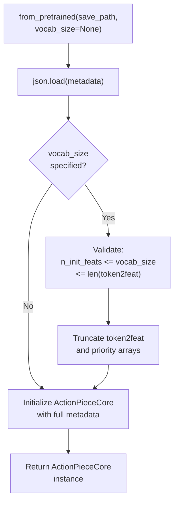
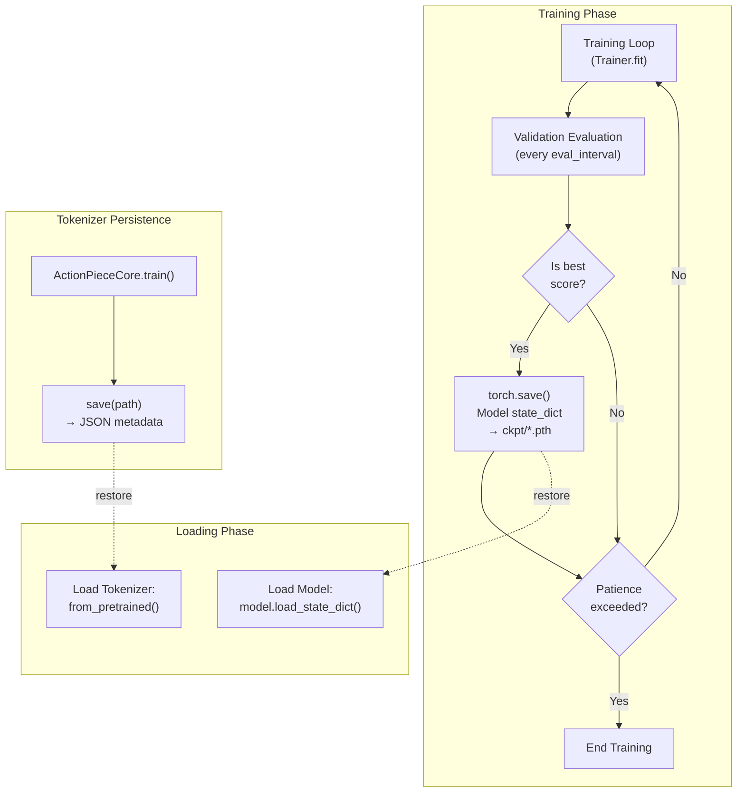

<!-- source: DeepWiki mcp.deepwiki.com · repo google-deepmind/action_piece · page 7.3 Checkpointing & Model Persistence · fetched 2026-10-26 -->

# Checkpointing & Model Persistence

<details>
<summary>Relevant source files</summary>

The following files were used as context for generating this wiki page:

- [genrec/default.yaml](genrec/default.yaml)
- [genrec/models/ActionPiece/core.py](genrec/models/ActionPiece/core.py)
- [genrec/trainer.py](genrec/trainer.py)

</details>


This document describes how the ActionPiece system saves model checkpoints during training, tracks validation performance, implements early stopping, and persists both the T5-based model and the ActionPieceCore tokenizer. For information about the training loop itself, see [Trainer & Training Loop](#7.1). For details on evaluation metrics used to select the best checkpoint, see [Evaluation Metrics](#7.2).

## Overview

The ActionPiece system implements a comprehensive checkpointing strategy that saves:
1. **Model checkpoints**: PyTorch state dictionaries of the T5-based ActionPiece model
2. **Tokenizer metadata**: JSON files containing ActionPieceCore vocabulary and priority information

Checkpoints are saved based on validation metric performance, with support for early stopping to prevent overfitting.

**Sources:** [genrec/trainer.py:88-91](), [genrec/default.yaml:17-38]()

## Checkpoint Directory Structure



Checkpoint files are saved to the directory specified by `ckpt_dir` in the configuration (default: `ckpt/`). The filename is generated by `get_file_name()` using the `run_id` and includes a `.pth` extension.

**Sources:** [genrec/default.yaml:20](), [genrec/trainer.py:88-91]()

## Validation Metric Tracking and Best Model Selection

The training process continuously tracks validation performance to identify the best model checkpoint.

### Configuration Parameters

| Parameter | Default | Description |
|-----------|---------|-------------|
| `val_metric` | `ndcg@10` | Metric used to determine best model |
| `eval_interval` | `1` | Evaluate every n epochs |
| `patience` | `20` | Epochs without improvement before early stopping |
| `topk` | `[5,10,20,50]` | Top-k values for metric calculation |
| `metrics` | `[ndcg,recall,err]` | Metrics to compute during evaluation |

**Sources:** [genrec/default.yaml:33-38]()

### Best Model Selection Logic



The system maintains two key variables throughout training:
- `best_val_score`: Highest validation metric value observed (initialized to -1)
- `best_epoch`: Epoch number when best score was achieved

**Sources:** [genrec/trainer.py:132-196]()

## Checkpoint Saving Process

### Main Checkpoint Saving Logic

The checkpoint saving occurs within the training loop when a new best validation score is achieved:



**Implementation details:**

1. **DDP Handling** [genrec/trainer.py:179-183](): When using distributed data parallel (`use_ddp=True`), the model must be unwrapped before saving to avoid saving the DDP wrapper
2. **Main Process Only** [genrec/trainer.py:178](): Only the main process saves checkpoints to avoid race conditions
3. **State Dict Only**: Only the model's `state_dict()` is saved, not the entire model object

**Sources:** [genrec/trainer.py:174-187]()

## Early Stopping Mechanism

Early stopping prevents overfitting by halting training when validation performance stops improving.

### Early Stopping Flow



The patience mechanism is calculated as:
```python
# Line 189-192 in genrec/trainer.py
if (
    self.config['patience'] is not None
    and epoch + 1 - best_epoch >= self.config['patience']
):
    self.log(f'Early stopping at epoch {epoch + 1}')
    break
```

**Key behaviors:**
- Setting `patience: null` in configuration disables early stopping
- Patience counts epochs, not training steps
- Early stopping check occurs only after validation evaluations

**Sources:** [genrec/trainer.py:189-194](), [genrec/default.yaml:34]()

## ActionPieceCore Tokenizer Persistence

Unlike the model checkpoints which save PyTorch state dicts, the ActionPieceCore tokenizer is persisted as JSON metadata containing the learned vocabulary.

### Tokenizer Metadata Structure

The saved tokenizer JSON contains four key fields:

| Field | Type | Description |
|-------|------|-------------|
| `n_categories` | int | Number of feature categories (e.g., semantic_id + attribute dimensions) |
| `n_init_feats` | int | Number of initial features before merging |
| `token2feat` | list | Vocabulary: maps token index to feature tuple |
| `priority` | list | Priority score for each token (used during encoding) |

**Example structure:**
```python
{
    "n_categories": 3,
    "n_init_feats": 1500,
    "token2feat": [
        [-1, -1],           # Token 0: padding
        [0, 142],           # Token 1: category 0, feature 142
        [1, 53],            # Token 2: category 1, feature 53
        [-1, 1, 2],         # Token 3: merge of tokens 1 and 2
        ...
    ],
    "priority": [0, 0, 0, 15.3, ...]
}
```

**Sources:** [genrec/models/ActionPiece/core.py:168-181]()

### Saving Tokenizer Metadata



The `ActionPieceCore.save()` method:

```python
# Lines 168-181 in genrec/models/ActionPiece/core.py
def save(self, save_path):
    """Save ActionPiece to a metadata file."""
    data = {
        'n_categories': self.n_categories,
        'n_init_feats': self.n_init_feats,
        'token2feat': self.token2feat,
        'priority': self.priority,
    }
    with open(save_path, 'w') as f:
        json.dump(data, f)
```

**Sources:** [genrec/models/ActionPiece/core.py:168-181]()

### Loading Tokenizer Metadata

The `from_pretrained()` class method loads a saved tokenizer and optionally truncates vocabulary:



**Key features:**
1. **Vocabulary truncation** [genrec/models/ActionPiece/core.py:198-208](): Can load a smaller vocabulary from a larger trained tokenizer
2. **Validation** [genrec/models/ActionPiece/core.py:199-206](): Ensures truncated vocabulary is valid (must include all initial features)
3. **Lazy initialization**: `token2all_feat` cache is built on-demand during decoding

**Sources:** [genrec/models/ActionPiece/core.py:183-210]()

## Complete Persistence Workflow



**Sources:** [genrec/trainer.py:93-196](), [genrec/models/ActionPiece/core.py:168-210]()

## Checkpoint File Naming Convention

Checkpoint filenames are generated using the `get_file_name()` utility function, which combines:
- `run_id`: Unique identifier for the training run (from config)
- Dataset and model-specific parameters
- Suffix: `.pth` for model checkpoints

The saved checkpoint path is constructed as:
```python
# Lines 88-90 in genrec/trainer.py
self.saved_model_ckpt = os.path.join(
    self.config['ckpt_dir'], get_file_name(self.config, suffix='.pth')
)
```

**Sources:** [genrec/trainer.py:88-91](), [genrec/utils.py]() (referenced for `get_file_name`)

## Configuration Parameters Summary

All checkpoint-related configuration parameters and their defaults:

```yaml
# Checkpoint directory
ckpt_dir: ckpt/

# Early stopping
patience: 20              # null to disable
eval_interval: 1          # Evaluate every n epochs

# Metric tracking
val_metric: ndcg@10      # Metric for best model selection
metrics: [ndcg,recall,err]
topk: [5,10,20,50]
```

**Sources:** [genrec/default.yaml:20](), [genrec/default.yaml:33-38]()

---

