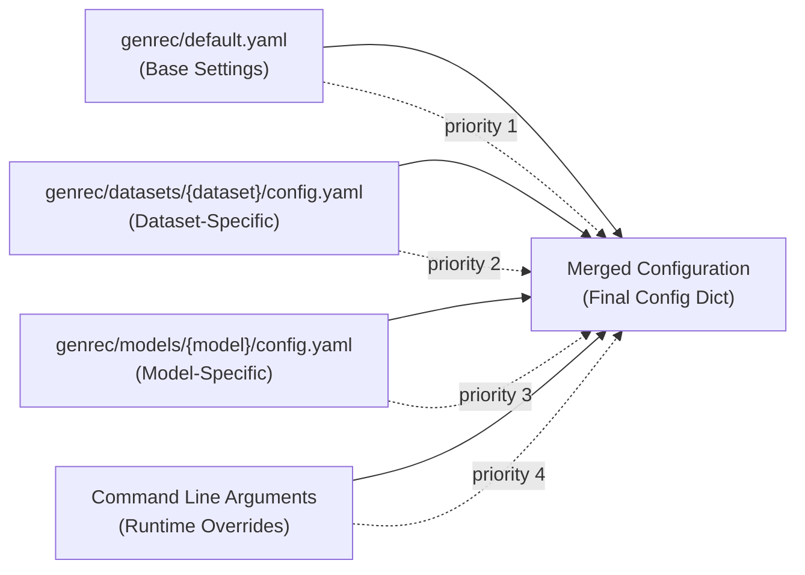
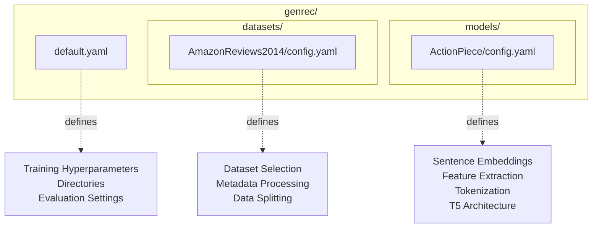
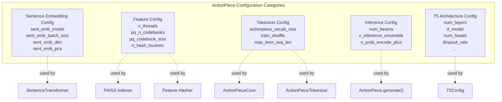
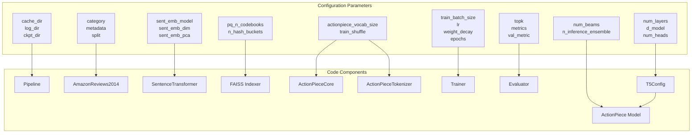

<!-- source: DeepWiki mcp.deepwiki.com · repo google-deepmind/action_piece · page 8 Configuration Reference · fetched 2026-10-26 -->

# Configuration Reference

<details>
<summary>Relevant source files</summary>

The following files were used as context for generating this wiki page:

- [genrec/datasets/AmazonReviews2014/config.yaml](genrec/datasets/AmazonReviews2014/config.yaml)
- [genrec/default.yaml](genrec/default.yaml)
- [genrec/models/ActionPiece/config.yaml](genrec/models/ActionPiece/config.yaml)

</details>


This document provides a comprehensive reference for all configuration parameters in the ActionPiece system. The configuration system uses a hierarchical YAML-based approach that allows flexible experimentation while maintaining reproducibility.

For information about how the configuration system is implemented and loaded, see [Configuration System](#4.3). For information about how configurations affect specific components, see [Pipeline Orchestration](#4.1), [AmazonReviews2014 Dataset](#5.2), and [ActionPiece Model Architecture](#6).

## Configuration System Overview

The ActionPiece system uses a three-tier hierarchical configuration merge strategy:



**Configuration Merge Priority**

Each configuration level can override parameters from previous levels. The merge order ensures that:
1. `genrec/default.yaml` provides base defaults for all experiments
2. `genrec/datasets/{dataset}/config.yaml` overrides dataset-specific settings
3. `genrec/models/{model}/config.yaml` overrides model-specific settings
4. Command-line arguments provide runtime overrides for quick experimentation

Sources: [genrec/default.yaml:1-39](), [genrec/datasets/AmazonReviews2014/config.yaml:1-19](), [genrec/models/ActionPiece/config.yaml:1-50]()

## Configuration Files Structure



Sources: [genrec/default.yaml:1-39](), [genrec/datasets/AmazonReviews2014/config.yaml:1-19](), [genrec/models/ActionPiece/config.yaml:1-50]()

## Default Configuration Parameters

The default configuration file `genrec/default.yaml` contains framework-level settings that apply to all experiments unless overridden.

### System & Directories

| Parameter | Type | Default | Description |
|-----------|------|---------|-------------|
| `num_proc` | int | 1 | Number of processes for parallel data processing |
| `cache_dir` | str | `cache/` | Directory for cached raw and processed data |
| `log_dir` | str | `logs/` | Directory for text log files |
| `tensorboard_log_dir` | str | `tensorboard/` | Directory for TensorBoard event files |
| `ckpt_dir` | str | `ckpt/` | Directory for model checkpoints |
| `run_id` | str | `genrec_default` | Unique identifier for the experiment run |
| `rand_seed` | int | 2024 | Random seed for reproducibility |
| `reproducibility` | bool | True | Enable deterministic operations for reproducibility |

### Training Hyperparameters

| Parameter | Type | Default | Description |
|-----------|------|---------|-------------|
| `train_batch_size` | int | 256 | Batch size during training |
| `eval_batch_size` | int | 32 | Batch size during evaluation |
| `lr` | float | 0.003 | Learning rate for AdamW optimizer |
| `weight_decay` | float | 0.1 | Weight decay coefficient for AdamW |
| `warmup_steps` | int | 10000 | Number of warmup steps for learning rate scheduler |
| `steps` | int | null | Total training steps (null means use epochs instead) |
| `epochs` | int | 200 | Maximum training epochs |
| `max_grad_norm` | float | 1.0 | Maximum gradient norm for clipping (null disables) |
| `eval_interval` | int | 1 | Evaluate every n epochs |
| `patience` | int | 20 | Early stopping patience (epochs without improvement) |

### Evaluation Settings

| Parameter | Type | Default | Description |
|-----------|------|---------|-------------|
| `topk` | list[int] | [5, 10, 20, 50] | Top-k values for ranking metrics |
| `metrics` | list[str] | [ndcg, recall, err] | Evaluation metrics to compute |
| `val_metric` | str | `ndcg@10` | Validation metric for model selection and early stopping |

Sources: [genrec/default.yaml:16-39]()

## Dataset Configuration Parameters

Dataset-specific configurations are located in `genrec/datasets/{dataset_name}/config.yaml`. The AmazonReviews2014 dataset configuration demonstrates the typical structure.

### AmazonReviews2014 Configuration

| Parameter | Type | Default | Description |
|-----------|------|---------|-------------|
| `category` | str | `Sports_and_Outdoors` | Amazon product category to use |
| `metadata` | str | `sentence` | Metadata processing mode: `none` (no metadata), `raw` (raw attributes), or `sentence` (sentence embeddings) |
| `split` | str | `leave_one_out` | Data splitting strategy (currently only `leave_one_out` is implemented) |

**Available Categories:**
The `category` parameter accepts any valid Amazon Reviews 2014 category. Common categories include:
- `Sports_and_Outdoors`
- `Electronics`
- `Movies_and_TV`
- `Books`
- `CDs_and_Vinyl`
- And others from the Amazon Reviews 2014 dataset

**Metadata Processing Modes:**
- `none`: Disables metadata-based features; uses only item IDs
- `raw`: Uses raw categorical attributes from metadata
- `sentence`: Processes metadata into sentence embeddings using sentence-transformers (recommended)

Sources: [genrec/datasets/AmazonReviews2014/config.yaml:16-18]()

## Model Configuration Parameters

Model-specific configurations are located in `genrec/models/{model_name}/config.yaml`. The ActionPiece configuration contains parameters for feature extraction, tokenization, and model architecture.



Sources: [genrec/models/ActionPiece/config.yaml:1-50]()

### Sentence Embedding Configuration

These parameters configure the sentence embedding model used for metadata processing (when `metadata: sentence` is enabled).

| Parameter | Type | Default | Description |
|-----------|------|---------|-------------|
| `sent_emb_model` | str | `sentence-transformers/sentence-t5-base` | Sentence transformer model from Hugging Face |
| `sent_emb_batch_size` | int | 512 | Batch size for sentence embedding inference |
| `sent_emb_dim` | int | 768 | Original dimension of sentence embeddings |
| `sent_emb_pca` | int | 128 | PCA target dimension (-1 disables PCA) |

The sentence embeddings are used to create semantic features for items based on their metadata. PCA dimensionality reduction is applied to reduce computational cost while preserving semantic information.

Sources: [genrec/models/ActionPiece/config.yaml:16-20]()

### Feature Extraction Configuration

These parameters control FAISS indexing and feature hashing for creating item features.

| Parameter | Type | Default | Description |
|-----------|------|---------|-------------|
| `n_threads` | int | 32 | Number of threads for parallel processing |
| `pq_n_codebooks` | int | 4 | Number of codebooks for FAISS Product Quantization |
| `pq_codebook_size` | int | 256 | Size of each PQ codebook (determines quantization granularity) |
| `n_hash_buckets` | int | 128 | Number of hash buckets for feature hashing to prevent conflicts |

**Product Quantization (PQ) Settings:**
- `pq_n_codebooks` × `pq_codebook_size` determines the total quantization space
- Default: 4 codebooks × 256 values = 1024 possible semantic IDs per item
- Used by FAISS for efficient nearest neighbor indexing

**Feature Hashing:**
- `n_hash_buckets` controls the hash space size for combining features
- Prevents hash collisions when combining semantic IDs with attribute IDs
- Larger values reduce collision probability but increase feature space

Sources: [genrec/models/ActionPiece/config.yaml:22-26]()

### ActionPiece Tokenizer Configuration

These parameters configure the ActionPiece vocabulary construction and sequence segmentation.

| Parameter | Type | Default | Description |
|-----------|------|---------|-------------|
| `actionpiece_vocab_size` | int | 40000 | Target vocabulary size for ActionPiece tokenizer |
| `train_shuffle` | str | `feature` | Set Permutation Regularization (SPR) mode: `none` (no shuffling), `feature` (shuffle features within tokens), or `token` (shuffle entire tokens) |
| `max_item_seq_len` | int | 20 | Maximum length of item sequences for model input |

**Set Permutation Regularization (SPR):**
- `none`: No permutation, preserves original order
- `feature`: Shuffles features within each token (recommended, maintains token boundaries)
- `token`: Shuffles entire tokens in sequence (more aggressive regularization)

Sources: [genrec/models/ActionPiece/config.yaml:28-38]()

### Inference Configuration

These parameters control the generation and inference process.

| Parameter | Type | Default | Description |
|-----------|------|---------|-------------|
| `num_beams` | int | 50 | Number of beams for beam search during generation |
| `n_inference_ensemble` | int | 5 | Number of ensemble generations with different SPR augmentations |
| `n_prob_encode_plus` | int | 0 | Probability adjustment parameter (0 means no adjustment) |

**Ensemble Inference:**
The system performs `n_inference_ensemble` independent generations, each with different random SPR permutations, then aggregates results using nDCG-based ranking. This improves robustness and recommendation quality.

Sources: [genrec/models/ActionPiece/config.yaml:32-35]()

### T5 Architecture Configuration

These parameters define the T5 model architecture used by ActionPiece.

| Parameter | Type | Default | Description |
|-----------|------|---------|-------------|
| `num_layers` | int | 4 | Number of encoder layers |
| `num_decoder_layers` | int | 4 | Number of decoder layers |
| `d_model` | int | 128 | Model hidden dimension |
| `d_ff` | int | 1024 | Feed-forward network dimension |
| `num_heads` | int | 6 | Number of attention heads |
| `d_kv` | int | 64 | Dimension of key/value vectors per head |
| `dropout_rate` | float | 0.1 | Dropout probability |
| `activation_function` | str | `relu` | Activation function for feed-forward layers |
| `feed_forward_proj` | str | `relu` | Feed-forward projection type |

**Architecture Notes:**
- The model uses a relatively small architecture (4 layers, 128 dimensions) compared to full-scale T5
- This is optimized for recommendation tasks with limited training data
- `d_model` must be divisible by `num_heads` (128 / 6 ≈ 21.33, so actual d_kv=64 is used)

Sources: [genrec/models/ActionPiece/config.yaml:40-49]()

## Configuration Parameter Mapping to Components

The following diagram shows how configuration parameters map to specific code components:



Sources: [genrec/default.yaml:1-39](), [genrec/datasets/AmazonReviews2014/config.yaml:1-19](), [genrec/models/ActionPiece/config.yaml:1-50]()

## Configuration Loading and Merging

The configuration system loads and merges YAML files in the following order:

1. **Base Configuration**: Load `genrec/default.yaml`
2. **Dataset Configuration**: Load `genrec/datasets/{dataset_name}/config.yaml` and merge
3. **Model Configuration**: Load `genrec/models/{model_name}/config.yaml` and merge
4. **CLI Overrides**: Apply command-line arguments (e.g., `--lr 0.001 --epochs 100`)

The merge process uses dictionary update semantics where later values override earlier ones. This allows selective overriding of specific parameters while maintaining defaults for others.

For implementation details of the configuration loading system, see [Configuration System](#4.3) and [Utility Functions & Logging](#4.4).

## Complete Parameter Reference

### All Configuration Parameters by Category

#### System Configuration

| Parameter | File | Default | Type | Component |
|-----------|------|---------|------|-----------|
| `num_proc` | default.yaml | 1 | int | Pipeline |
| `cache_dir` | default.yaml | `cache/` | str | Pipeline, Dataset |
| `log_dir` | default.yaml | `logs/` | str | Logger |
| `tensorboard_log_dir` | default.yaml | `tensorboard/` | str | TensorBoard |
| `ckpt_dir` | default.yaml | `ckpt/` | str | Trainer |
| `run_id` | default.yaml | `genrec_default` | str | Pipeline |
| `rand_seed` | default.yaml | 2024 | int | Pipeline |
| `reproducibility` | default.yaml | True | bool | Pipeline |

#### Training Configuration

| Parameter | File | Default | Type | Component |
|-----------|------|---------|------|-----------|
| `train_batch_size` | default.yaml | 256 | int | Trainer |
| `eval_batch_size` | default.yaml | 32 | int | Evaluator |
| `lr` | default.yaml | 0.003 | float | Trainer (AdamW) |
| `weight_decay` | default.yaml | 0.1 | float | Trainer (AdamW) |
| `warmup_steps` | default.yaml | 10000 | int | LR Scheduler |
| `steps` | default.yaml | null | int | Trainer |
| `epochs` | default.yaml | 200 | int | Trainer |
| `max_grad_norm` | default.yaml | 1.0 | float | Trainer |
| `eval_interval` | default.yaml | 1 | int | Trainer |
| `patience` | default.yaml | 20 | int | Trainer |

#### Evaluation Configuration

| Parameter | File | Default | Type | Component |
|-----------|------|---------|------|-----------|
| `topk` | default.yaml | [5,10,20,50] | list[int] | Evaluator |
| `metrics` | default.yaml | [ndcg,recall,err] | list[str] | Evaluator |
| `val_metric` | default.yaml | `ndcg@10` | str | Trainer |

#### Dataset Configuration

| Parameter | File | Default | Type | Component |
|-----------|------|---------|------|-----------|
| `category` | dataset/config.yaml | `Sports_and_Outdoors` | str | AmazonReviews2014 |
| `metadata` | dataset/config.yaml | `sentence` | str | AmazonReviews2014 |
| `split` | dataset/config.yaml | `leave_one_out` | str | AmazonReviews2014 |

#### Sentence Embedding Configuration

| Parameter | File | Default | Type | Component |
|-----------|------|---------|------|-----------|
| `sent_emb_model` | model/config.yaml | `sentence-transformers/sentence-t5-base` | str | SentenceTransformer |
| `sent_emb_batch_size` | model/config.yaml | 512 | int | SentenceTransformer |
| `sent_emb_dim` | model/config.yaml | 768 | int | SentenceTransformer |
| `sent_emb_pca` | model/config.yaml | 128 | int | PCA |

#### Feature Extraction Configuration

| Parameter | File | Default | Type | Component |
|-----------|------|---------|------|-----------|
| `n_threads` | model/config.yaml | 32 | int | FAISS, Processing |
| `pq_n_codebooks` | model/config.yaml | 4 | int | FAISS PQ |
| `pq_codebook_size` | model/config.yaml | 256 | int | FAISS PQ |
| `n_hash_buckets` | model/config.yaml | 128 | int | Feature Hasher |

#### Tokenizer Configuration

| Parameter | File | Default | Type | Component |
|-----------|------|---------|------|-----------|
| `actionpiece_vocab_size` | model/config.yaml | 40000 | int | ActionPieceCore |
| `train_shuffle` | model/config.yaml | `feature` | str | ActionPieceTokenizer |
| `max_item_seq_len` | model/config.yaml | 20 | int | ActionPieceTokenizer |

#### Inference Configuration

| Parameter | File | Default | Type | Component |
|-----------|------|---------|------|-----------|
| `num_beams` | model/config.yaml | 50 | int | ActionPiece.generate() |
| `n_inference_ensemble` | model/config.yaml | 5 | int | ActionPiece.generate() |
| `n_prob_encode_plus` | model/config.yaml | 0 | int | ActionPiece |

#### T5 Architecture Configuration

| Parameter | File | Default | Type | Component |
|-----------|------|---------|------|-----------|
| `num_layers` | model/config.yaml | 4 | int | T5Config |
| `num_decoder_layers` | model/config.yaml | 4 | int | T5Config |
| `d_model` | model/config.yaml | 128 | int | T5Config |
| `d_ff` | model/config.yaml | 1024 | int | T5Config |
| `num_heads` | model/config.yaml | 6 | int | T5Config |
| `d_kv` | model/config.yaml | 64 | int | T5Config |
| `dropout_rate` | model/config.yaml | 0.1 | float | T5Config |
| `activation_function` | model/config.yaml | `relu` | str | T5Config |
| `feed_forward_proj` | model/config.yaml | `relu` | str | T5Config |

Sources: [genrec/default.yaml:1-39](), [genrec/datasets/AmazonReviews2014/config.yaml:1-19](), [genrec/models/ActionPiece/config.yaml:1-50]()

## Common Configuration Scenarios

### Changing Dataset Category

To experiment with a different Amazon category, override the `category` parameter:

```bash
python main.py --category Electronics
```

### Adjusting Training Hyperparameters

To use different learning rate and batch size:

```bash
python main.py --lr 0.001 --train_batch_size 128 --epochs 100
```

### Modifying Vocabulary Size

To experiment with different tokenizer vocabulary sizes:

```bash
python main.py --actionpiece_vocab_size 20000
```

### Disabling Metadata

To run experiments without metadata features:

```bash
python main.py --metadata none
```

### Adjusting Inference Settings

To modify beam search and ensemble settings:

```bash
python main.py --num_beams 100 --n_inference_ensemble 10
```

Sources: [genrec/default.yaml:1-39](), [genrec/models/ActionPiece/config.yaml:1-50]()

---

