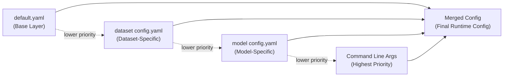
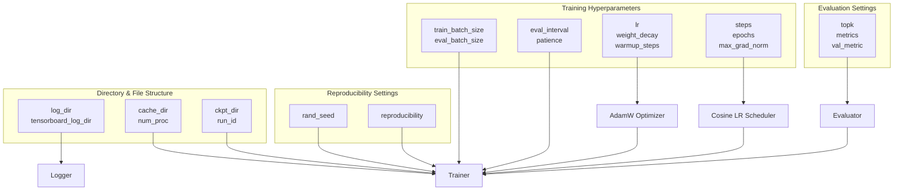
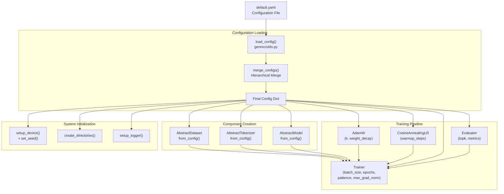

<!-- source: DeepWiki mcp.deepwiki.com · repo google-deepmind/action_piece · page 8.1 Default Configuration (default.yaml) · fetched 2026-10-26 -->

# Default Configuration (default.yaml)

<details>
<summary>Relevant source files</summary>

The following files were used as context for generating this wiki page:

- [README.md](README.md)
- [genrec/default.yaml](genrec/default.yaml)

</details>


## Purpose and Scope

This document provides comprehensive reference for all parameters defined in `genrec/default.yaml`, which serves as the base layer in the ActionPiece configuration hierarchy. These parameters establish system-wide defaults for training, evaluation, logging, and reproducibility.

For dataset-specific configuration parameters, see [Dataset Configuration](#8.2). For model-specific parameters including tokenizer and inference settings, see [Model Configuration](#8.3). For a complete overview of the configuration system architecture, see [Configuration System](#4.3).

**Sources:** [genrec/default.yaml:1-39]()

---

## Configuration Hierarchy

The `default.yaml` file provides the foundation of the ActionPiece configuration system. Settings defined here are overridden by subsequent configuration layers in the following priority order:



**Diagram: Configuration Merge Hierarchy**

The merge process follows these rules:
1. `default.yaml` parameters are loaded first
2. Dataset-specific parameters from `genrec/datasets/<dataset_name>/config.yaml` override defaults
3. Model-specific parameters from `genrec/models/<model_name>/config.yaml` override dataset settings
4. Command-line arguments have the highest priority and override all file-based configurations

**Sources:** [genrec/default.yaml:1-39](), [README.md:27-30]()

---

## Parameter Categories

The default configuration parameters are organized into four functional categories:



**Diagram: Parameter Categories and Their Target Components**

**Sources:** [genrec/default.yaml:16-39]()

---

## Complete Parameter Reference

### Directory and File Structure Parameters

| Parameter | Type | Default Value | Description |
|-----------|------|---------------|-------------|
| `num_proc` | `int` | `1` | Number of parallel processes for data loading and preprocessing operations |
| `cache_dir` | `str` | `"cache/"` | Directory for caching raw and processed data, including downloaded datasets and computed features |
| `log_dir` | `str` | `"logs/"` | Directory for text-based log files containing training progress and debugging information |
| `tensorboard_log_dir` | `str` | `"tensorboard/"` | Directory for TensorBoard event files used for visualization of training metrics |
| `ckpt_dir` | `str` | `"ckpt/"` | Directory for saving model checkpoints during training |
| `run_id` | `str` | `"genrec_default"` | Unique identifier for the current experiment run, used to organize logs and checkpoints |

**Sources:** [genrec/default.yaml:16-21]()

### Reproducibility Settings

| Parameter | Type | Default Value | Description |
|-----------|------|---------------|-------------|
| `rand_seed` | `int` | `2024` | Random seed for PyTorch, NumPy, and Python random number generators |
| `reproducibility` | `bool` | `True` | When `True`, enables deterministic operations in PyTorch for reproducible results (may impact performance) |

**Paper Reproduction Note:** The paper results use seeds from `2024` to `2028` across five runs for each dataset. Command-line override: `--rand_seed=<value>`.

**Sources:** [genrec/default.yaml:22-23](), [README.md:39-74]()

### Training Hyperparameters

| Parameter | Type | Default Value | Description |
|-----------|------|---------------|-------------|
| `train_batch_size` | `int` | `256` | Number of sequences per batch during training |
| `eval_batch_size` | `int` | `32` | Number of sequences per batch during validation and testing |
| `lr` | `float` | `0.003` | Initial learning rate for the AdamW optimizer |
| `weight_decay` | `float` | `0.1` | L2 regularization coefficient for AdamW optimizer |
| `warmup_steps` | `int` | `10000` | Number of steps for linear learning rate warmup before cosine decay begins |
| `steps` | `int` or `null` | `~` (null) | Maximum training steps; `null` means training is controlled by `epochs` instead |
| `epochs` | `int` | `200` | Maximum number of training epochs |
| `max_grad_norm` | `float` or `null` | `1.0` | Maximum gradient norm for gradient clipping; `null` disables clipping |
| `eval_interval` | `int` | `1` | Evaluate model every N epochs |
| `patience` | `int` or `null` | `20` | Early stopping patience: stop training after N epochs without improvement in `val_metric`; `null` disables early stopping |

**Dataset-Specific Overrides (from paper):**

| Dataset | Learning Rate | Weight Decay | Additional Parameters |
|---------|---------------|--------------|----------------------|
| Sports_and_Outdoors | `0.005` | `0.15` | `n_hash_buckets=128` |
| Beauty | `0.001` | `0.15` | `n_hash_buckets=64` |
| CDs_and_Vinyl | `0.001` | `0.07` | `d_model=256`, `d_ff=2048`, `n_hash_buckets=256` |

**Sources:** [genrec/default.yaml:25-34](), [README.md:34-75]()

### Evaluation Settings

| Parameter | Type | Default Value | Description |
|-----------|------|---------------|-------------|
| `topk` | `list[int]` | `[5, 10, 20, 50]` | List of cutoff values (k) for computing top-k evaluation metrics |
| `metrics` | `list[str]` | `["ndcg", "recall", "err"]` | List of metrics to compute during evaluation |
| `val_metric` | `str` | `"ndcg@10"` | Primary metric for model selection and early stopping; format is `<metric>@<k>` |

**Available Metrics:**
- `ndcg`: Normalized Discounted Cumulative Gain - measures ranking quality with position discount
- `recall`: Recall@k - proportion of relevant items in top-k predictions
- `err`: Expected Reciprocal Rank - probability-based ranking metric

**Sources:** [genrec/default.yaml:36-39]()

---

## Parameter Flow Through System Components

The following diagram illustrates how default configuration parameters flow through the ActionPiece system during runtime:



**Diagram: Parameter Flow from Configuration File to Runtime Components**

**Sources:** [genrec/default.yaml:1-39]()

---

## Usage Examples

### Basic Usage

The default configuration is automatically loaded when running experiments. No explicit specification is required:

```bash
python main.py --category=Sports_and_Outdoors
```

All parameters from `default.yaml` are applied unless overridden by dataset config, model config, or command-line arguments.

### Command-Line Override

Override specific parameters via command-line arguments:

```bash
python main.py \
    --category=Beauty \
    --lr=0.001 \
    --weight_decay=0.15 \
    --epochs=150 \
    --rand_seed=2025 \
    --run_id=beauty_experiment_01
```

### Configuration Precedence Example

Given these configuration layers:

1. **default.yaml**: `lr=0.003`, `weight_decay=0.1`
2. **Dataset config**: `weight_decay=0.15`
3. **Model config**: (no override)
4. **CLI args**: `lr=0.001`

**Effective configuration**: `lr=0.001` (from CLI), `weight_decay=0.15` (from dataset config)

**Sources:** [README.md:20-30](), [README.md:38-75]()

---

## Directory Structure Created by Default Configuration

The default configuration creates the following directory structure during execution:

```
project_root/
├── cache/              # cache_dir - Raw data, processed features, tokenizer cache
│   ├── datasets/       # Downloaded Amazon Reviews data
│   └── features/       # Computed sentence embeddings, FAISS indices
├── logs/               # log_dir - Text log files
│   └── genrec_default_<timestamp>.log
├── tensorboard/        # tensorboard_log_dir - TensorBoard events
│   └── genrec_default/
├── ckpt/               # ckpt_dir - Model checkpoints
│   └── genrec_default/
│       ├── best_model.pt
│       └── config.json
```

These directories are created automatically by the system if they do not exist.

**Sources:** [genrec/default.yaml:17-20]()

---

## Related Configuration Files

The default configuration works in conjunction with other configuration files:

| Configuration File | Purpose | Reference |
|-------------------|---------|-----------|
| `genrec/datasets/<dataset>/config.yaml` | Dataset-specific parameters including `category`, `metadata_mode`, data filtering | [Dataset Configuration](#8.2) |
| `genrec/models/<model>/config.yaml` | Model architecture parameters including `d_model`, `n_layers`, tokenizer settings, inference parameters | [Model Configuration](#8.3) |

**Sources:** [README.md:27-30]()

---

## Key Design Decisions

### Early Stopping Strategy

The default patience of `20` epochs balances between:
- Allowing sufficient training time for convergence
- Preventing overfitting on validation data
- Reducing computational cost for unproductive training

The `val_metric=ndcg@10` choice reflects the importance of top-10 recommendations in practical recommendation systems.

### Learning Rate Schedule

The combination of `warmup_steps=10000` and cosine annealing provides:
- Stable initial training during warmup
- Gradual learning rate decay to fine-tune model parameters
- Better generalization compared to constant learning rates

### Gradient Clipping

The `max_grad_norm=1.0` prevents gradient explosion in the T5-based model architecture, which is critical for stable training of transformer models.

**Sources:** [genrec/default.yaml:25-34]()

---

