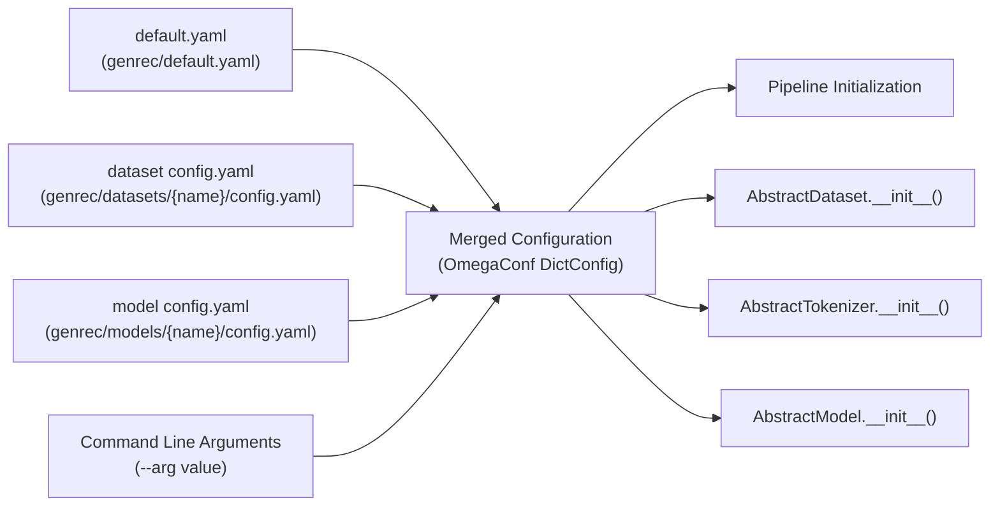
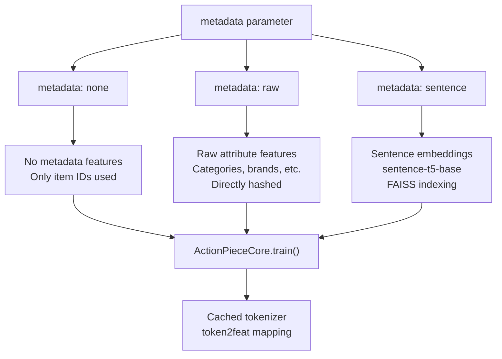
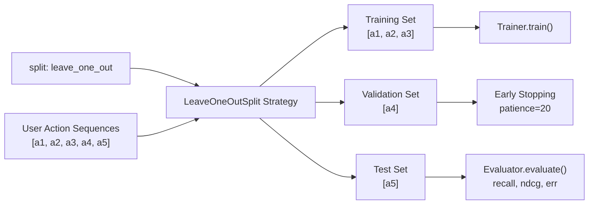
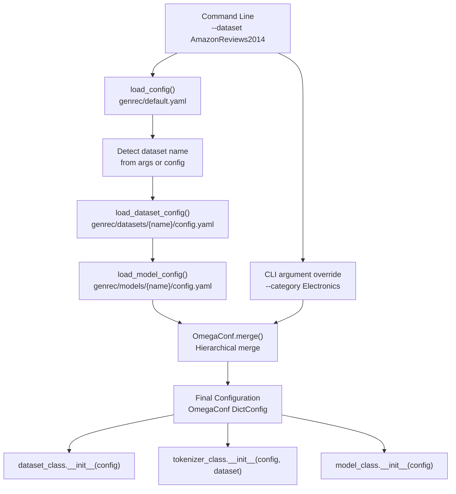
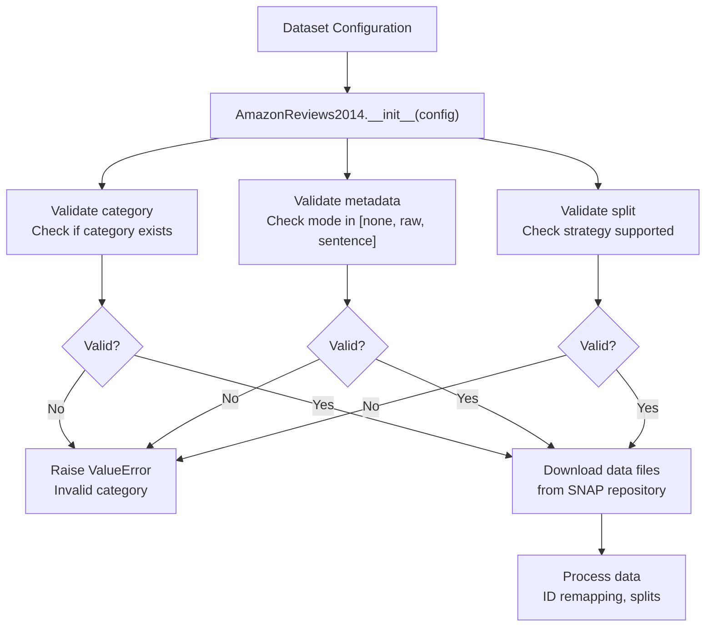

<!-- source: DeepWiki mcp.deepwiki.com · repo google-deepmind/action_piece · page 8.2 Dataset Configuration · fetched 2026-10-26 -->

# Dataset Configuration

<details>
<summary>Relevant source files</summary>

The following files were used as context for generating this wiki page:

- [genrec/datasets/AmazonReviews2014/config.yaml](genrec/datasets/AmazonReviews2014/config.yaml)
- [genrec/default.yaml](genrec/default.yaml)

</details>


## Purpose and Scope

This document describes dataset-specific configuration parameters that control data loading, preprocessing, and splitting behavior for the ActionPiece system. Dataset configuration files are located at `genrec/datasets/{DatasetName}/config.yaml` and are merged into the global configuration hierarchy alongside default settings ([8.1](#8.1)) and model settings ([8.3](#8.3)).

For information about the overall configuration system and merge hierarchy, see [Configuration System](#4.3). For details on dataset implementation and data processing pipelines, see [Data Processing Pipeline](#5).

---

## Configuration File Location

Dataset configuration files are co-located with their dataset implementations following this structure:

```
genrec/datasets/
├── AmazonReviews2014/
│   ├── __init__.py
│   ├── amazon_reviews_2014.py
│   └── config.yaml              # Dataset-specific configuration
└── AbstractDataset/
    └── abstract_dataset.py
```

The dataset configuration is automatically loaded when a dataset is specified via the `--dataset` command-line argument or in the configuration hierarchy.

**Sources:** [genrec/datasets/AmazonReviews2014/config.yaml:1-19]()

---

## Configuration Hierarchy and Merge Order

Dataset configuration parameters are part of a four-level hierarchical merge process:



**Merge Priority:** Command Line > Model Config > Dataset Config > Default Config

Later sources override earlier ones. This allows dataset-specific defaults while maintaining flexibility for experimentation.

**Sources:** [genrec/default.yaml:1-39](), [genrec/datasets/AmazonReviews2014/config.yaml:1-19]()

---

## Dataset Configuration Parameters

The following table documents all parameters available in dataset configuration files:

| Parameter | Type | Valid Values | Default | Description |
|-----------|------|--------------|---------|-------------|
| `category` | string | Dataset-dependent | `Sports_and_Outdoors` | Specifies which category of data to load. For AmazonReviews2014, valid categories include product categories like `Sports_and_Outdoors`, `Electronics`, `Books`, etc. |
| `metadata` | string | `none`, `raw`, `sentence` | `sentence` | Controls metadata processing mode for item features (see [Feature Extraction](#5.3)) |
| `split` | string | `leave_one_out` | `leave_one_out` | Data splitting strategy for train/validation/test sets (see [AbstractDataset Interface](#5.1)) |

**Sources:** [genrec/datasets/AmazonReviews2014/config.yaml:16-18]()

---

## Metadata Processing Modes

The `metadata` parameter controls how item metadata is processed into features for ActionPiece tokenization:



**Mode Details:**

- **`none`**: No metadata features are extracted. Only item IDs are used for vocabulary construction. This results in simpler tokens based purely on co-occurrence patterns of item IDs.

- **`raw`**: Metadata attributes (e.g., categories, brands) are extracted directly from the dataset's metadata files and hashed into feature IDs. This mode uses attribute-based features without semantic embeddings.

- **`sentence`**: Metadata text (titles, descriptions, categories) is processed into sentence embeddings using `sentence-t5-base` model, indexed with FAISS for semantic similarity, and combined with raw attributes. This is the default and most sophisticated mode, enabling semantic feature extraction.

The metadata processing mode directly affects the feature extraction pipeline documented in [Feature Extraction & Processing](#5.3) and the initial vocabulary size (`n_init_feats`) in the cached tokenizer ([3.4](#3.4)).

**Sources:** [genrec/datasets/AmazonReviews2014/config.yaml:17]()

---

## Data Splitting Strategy

The `split` parameter controls how the dataset is divided into training, validation, and test sets:



**Leave-One-Out Split:**

For each user's action sequence, the strategy:
1. Uses all actions except the last two for training
2. Uses the second-to-last action for validation
3. Uses the last action for testing

This splitting strategy is implemented in the `AbstractDataset` class and ensures that the model is evaluated on predicting the next action given historical context, which aligns with the sequential recommendation task.

**Sources:** [genrec/datasets/AmazonReviews2014/config.yaml:18]()

---

## Category-Specific Configuration

The AmazonReviews2014 dataset supports multiple product categories. Each category may have different dataset characteristics:

| Category | Typical Use Case | Notes |
|----------|------------------|-------|
| `Sports_and_Outdoors` | Default category in config | Moderate sparsity, diverse items |
| `Electronics` | High-value recommendations | Denser interactions, longer sequences |
| `Books` | Content-based filtering | Very large item catalog |
| `Movies_and_TV` | Entertainment recommendations | Sparse ratings, episodic content |
| `CDs_and_Vinyl` | Music recommendations | Artist/album hierarchies |

To experiment with different categories, modify the `category` parameter:

```yaml
category: Electronics
```

Or override via command line:

```bash
python main.py --dataset AmazonReviews2014 --category Electronics
```

The category parameter is passed to the dataset's initialization and controls which data files are downloaded and processed from the Stanford Network Analysis Project (SNAP) repository.

**Sources:** [genrec/datasets/AmazonReviews2014/config.yaml:16]()

---

## Configuration Loading Process

The following diagram illustrates how dataset configuration is loaded and integrated into the system:



The configuration loading utilities are provided by the GenRec framework's utility functions. The merged configuration is passed to all components during initialization, ensuring consistent settings across the pipeline.

**Sources:** [genrec/datasets/AmazonReviews2014/config.yaml:1-19](), [genrec/default.yaml:1-39]()

---

## Example Configurations

### Minimal Configuration (No Metadata)

```yaml
category: Sports_and_Outdoors
metadata: none
split: leave_one_out
```

This configuration uses only item co-occurrence patterns without any metadata features. Suitable for baseline comparisons or when metadata is unavailable.

### Raw Metadata Configuration

```yaml
category: Electronics
metadata: raw
split: leave_one_out
```

This configuration extracts raw attribute features (categories, brands) without sentence embeddings. Faster to process than sentence mode but less semantically rich.

### Full Semantic Configuration (Default)

```yaml
category: Books
metadata: sentence
split: leave_one_out
```

This configuration (default) uses sentence embeddings via `sentence-t5-base` and FAISS indexing for semantic feature extraction. Provides the richest feature representation for ActionPiece tokenization.

---

## Dataset Configuration Validation

When a dataset is initialized, the configuration parameters are validated against the dataset's requirements:



Invalid configurations will raise a `ValueError` during dataset initialization, preventing silent failures and ensuring reproducibility.

**Sources:** [genrec/datasets/AmazonReviews2014/config.yaml:16-18]()

---

## Relationship to Other Configuration Files

Dataset configuration parameters interact with settings from other configuration files:

| Dataset Config | Interacts With | Purpose |
|----------------|----------------|---------|
| `category` | `cache_dir` (default.yaml) | Dataset files cached at `{cache_dir}/AmazonReviews2014/{category}/` |
| `metadata` | Model tokenizer config | Determines `n_init_feats` in cached tokenizer |
| `split` | `eval_batch_size` (default.yaml) | Affects validation/test set size and batching |
| `metadata: sentence` | Model config: sentence encoder | Requires `sentence-t5-base` model download |
| All parameters | `rand_seed` (default.yaml) | Controls reproducibility of data shuffling |

For complete parameter reference, see [Default Configuration](#8.1) and [Model Configuration](#8.3).

**Sources:** [genrec/datasets/AmazonReviews2014/config.yaml:1-19](), [genrec/default.yaml:1-39]()

---

