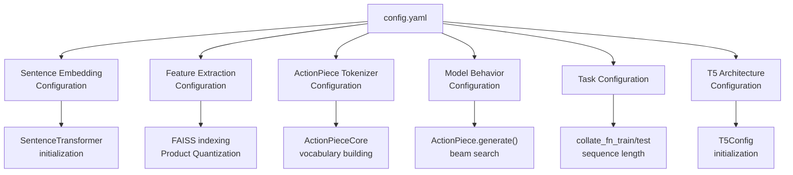
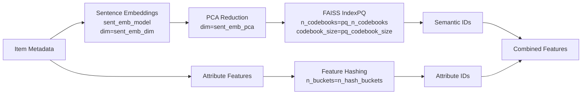
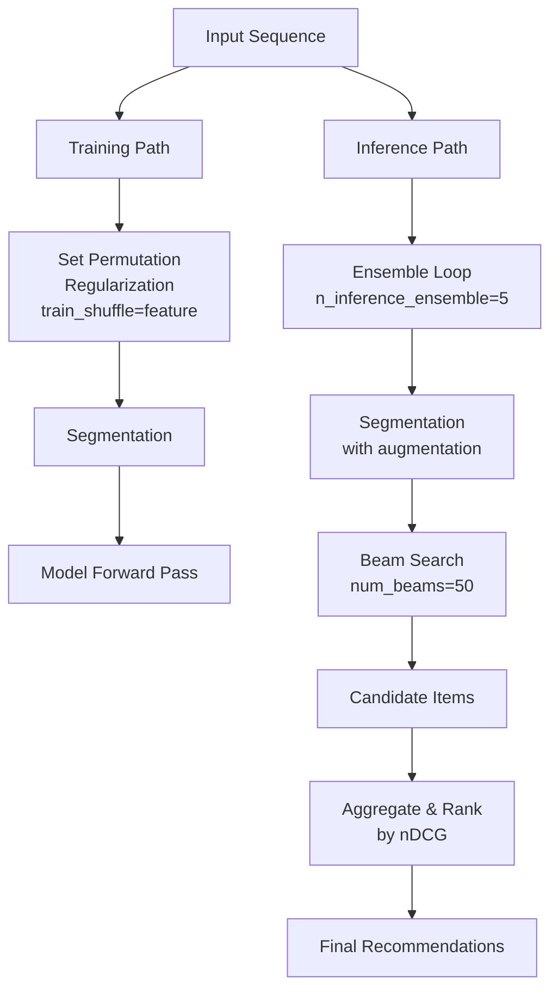
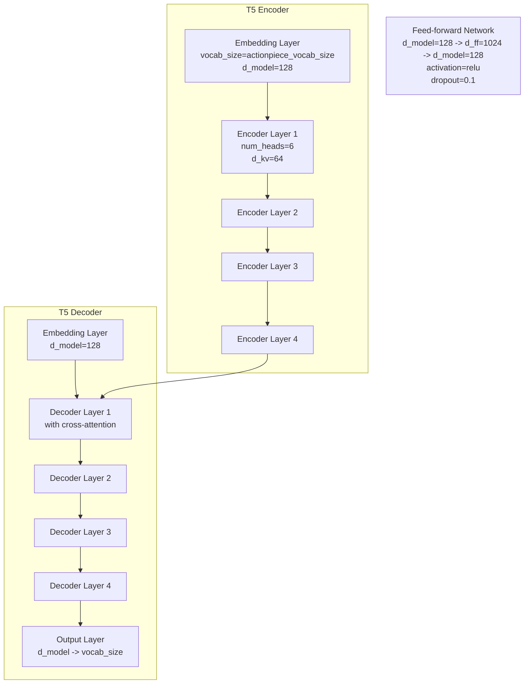
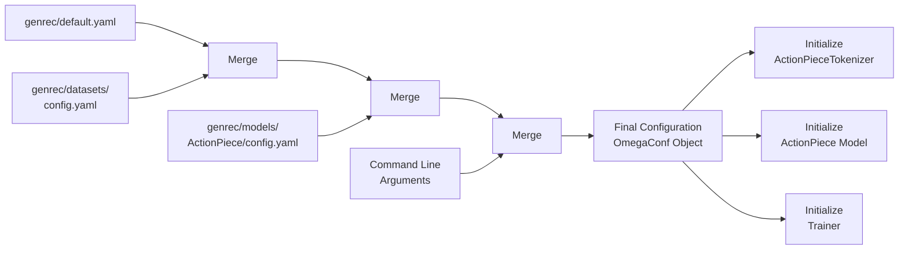

<!-- source: DeepWiki mcp.deepwiki.com · repo google-deepmind/action_piece · page 8.3 Model Configuration · fetched 2026-10-26 -->

# Model Configuration

<details>
<summary>Relevant source files</summary>

The following files were used as context for generating this wiki page:

- [genrec/default.yaml](genrec/default.yaml)
- [genrec/models/ActionPiece/config.yaml](genrec/models/ActionPiece/config.yaml)

</details>


## Purpose and Scope

This page documents the model-specific configuration parameters defined in `genrec/models/ActionPiece/config.yaml`. These parameters control the ActionPiece model architecture, tokenization settings, inference behavior, and feature extraction. This configuration file is loaded and merged with default and dataset configurations as part of the hierarchical configuration system (see [Configuration System](#4.3) for details on the merge hierarchy).

For general training hyperparameters like learning rate and batch size, see [Default Configuration](#8.1). For dataset-specific settings, see [Dataset Configuration](#8.2).

**Sources:** [genrec/models/ActionPiece/config.yaml:1-50]()

---

## Configuration File Location

The model configuration is located at `genrec/models/ActionPiece/config.yaml` within the repository. This file is automatically loaded when the ActionPiece model is specified in the training pipeline. The configuration parameters defined here override corresponding parameters from `default.yaml` but can themselves be overridden by command-line arguments.

**Sources:** [genrec/models/ActionPiece/config.yaml:1-50]()

---

## Configuration Parameter Categories

The model configuration is organized into six major categories:



**Diagram: Configuration Categories and Their Target Components**

**Sources:** [genrec/models/ActionPiece/config.yaml:16-50]()

---

## Sentence Embedding Configuration

These parameters control the sentence embedding model used for extracting semantic features from item metadata.

| Parameter | Type | Default Value | Description |
|-----------|------|---------------|-------------|
| `sent_emb_model` | str | `"sentence-transformers/sentence-t5-base"` | HuggingFace model identifier for sentence embeddings |
| `sent_emb_batch_size` | int | `512` | Batch size for sentence embedding generation |
| `sent_emb_dim` | int | `768` | Original dimension of sentence embeddings |
| `sent_emb_pca` | int | `128` | Target dimension after PCA reduction; `-1` disables PCA |

The `sent_emb_model` parameter specifies which pre-trained sentence transformer to load. The embeddings are generated in batches of size `sent_emb_batch_size` for memory efficiency. If `sent_emb_pca` is a positive integer, PCA dimensionality reduction is applied to reduce the embedding dimension from `sent_emb_dim` to `sent_emb_pca`, which reduces memory usage and speeds up FAISS indexing.

**Usage in Code:**
- Loaded by `SentenceTransformer` in feature extraction pipeline
- Used in `AmazonReviews2014.get_item_metadata()` for generating semantic features

**Sources:** [genrec/models/ActionPiece/config.yaml:16-20]()

---

## Feature Extraction Configuration

These parameters control how item features are extracted and indexed, particularly for FAISS-based semantic ID generation and feature hashing.

| Parameter | Type | Default Value | Description |
|-----------|------|---------------|-------------|
| `n_threads` | int | `32` | Number of threads for parallel processing |
| `pq_n_codebooks` | int | `4` | Number of codebooks for Product Quantization in FAISS |
| `pq_codebook_size` | int | `256` | Size of each codebook (256 = 8-bit quantization) |
| `n_hash_buckets` | int | `128` | Number of hash buckets for feature hashing |

**Product Quantization (PQ) Parameters:**

Product Quantization is applied to sentence embeddings before FAISS indexing to reduce memory footprint. The embedding vector is split into `pq_n_codebooks` sub-vectors, each quantized to `pq_codebook_size` centroids. With `pq_n_codebooks=4` and `pq_codebook_size=256`, each codebook uses 8 bits, resulting in 32 bits (4 bytes) per vector.

**Feature Hashing:**

The `n_hash_buckets` parameter controls the hash space size for combining multiple attribute features. This prevents feature ID conflicts when multiple categorical attributes are hashed to the same space.



**Diagram: Feature Extraction Pipeline with Configuration Parameters**

**Usage in Code:**
- `pq_n_codebooks` and `pq_codebook_size` used in FAISS index initialization
- `n_hash_buckets` used for attribute feature hashing in feature extraction
- `n_threads` used for parallel processing of item metadata

**Sources:** [genrec/models/ActionPiece/config.yaml:22-26]()

---

## ActionPiece Tokenizer Configuration

This parameter controls the vocabulary size of the ActionPiece tokenizer.

| Parameter | Type | Default Value | Description |
|-----------|------|---------------|-------------|
| `actionpiece_vocab_size` | int | `40000` | Target vocabulary size for ActionPiece tokenizer |

The `actionpiece_vocab_size` determines how many tokens will be learned during vocabulary construction. The `ActionPieceCore.train()` method iteratively merges co-occurring feature patterns until this vocabulary size is reached. A larger vocabulary can capture more complex patterns but increases model size and training time.

**Vocabulary Construction Process:**
1. Start with initial features (semantic IDs + attribute IDs)
2. Iteratively merge most frequent co-occurring patterns
3. Stop when vocabulary reaches `actionpiece_vocab_size`

**Usage in Code:**
- Used in `ActionPieceCore.train()` to determine when to stop merging
- Affects the size of the cached tokenizer file
- Influences model embedding layer size

**Sources:** [genrec/models/ActionPiece/config.yaml:28-29]()

---

## Model Behavior Configuration

These parameters control the model's behavior during training and inference, including regularization and generation strategies.

| Parameter | Type | Default Value | Description |
|-----------|------|---------------|-------------|
| `n_prob_encode_plus` | int | `0` | Number of additional positive items to encode during training |
| `num_beams` | int | `50` | Number of beams for beam search during inference |
| `n_inference_ensemble` | int | `5` | Number of ensemble runs with different augmentations |
| `train_shuffle` | str | `"feature"` | Shuffling strategy: `"none"` / `"feature"` / `"token"` |

**Set Permutation Regularization (SPR):**

The `train_shuffle` parameter controls Set Permutation Regularization during training:
- `"none"`: No shuffling, deterministic segmentation
- `"feature"`: Shuffle features within each action before segmentation (implements SPR at feature level)
- `"token"`: Shuffle tokens within each action after segmentation (implements SPR at token level)

**Inference Ensemble:**

The `n_inference_ensemble` parameter enables multiple inference runs with different random augmentations. Each run generates candidates using beam search, and results are aggregated for final ranking. This improves robustness by exploring different segmentation paths.

**Beam Search:**

The `num_beams` parameter controls the beam width for beam search generation. With `num_beams=50`, the model maintains 50 candidate sequences during generation, significantly improving generation quality compared to greedy decoding.



**Diagram: Training vs Inference Behavior Controlled by Configuration**

**Usage in Code:**
- `train_shuffle` used in `ActionPieceTokenizer.collate_fn_train()`
- `num_beams` passed to `ActionPiece.generate()` method
- `n_inference_ensemble` controls loop in evaluation code

**Sources:** [genrec/models/ActionPiece/config.yaml:31-35]()

---

## Task Configuration

This parameter controls task-specific settings for sequence processing.

| Parameter | Type | Default Value | Description |
|-----------|------|---------------|-------------|
| `max_item_seq_len` | int | `20` | Maximum number of items in input sequence |

The `max_item_seq_len` parameter determines the maximum length of user interaction history to consider. Longer sequences are truncated to this length. This affects both training and inference:
- During training: sequences longer than `max_item_seq_len` are truncated
- During inference: only the most recent `max_item_seq_len` items are used as context

**Trade-offs:**
- Longer sequences: More context but slower processing and higher memory usage
- Shorter sequences: Faster but may miss important historical patterns

**Usage in Code:**
- Applied in dataset preprocessing
- Used in `collate_fn_train()` and `collate_fn_test()` to limit sequence length

**Sources:** [genrec/models/ActionPiece/config.yaml:37-38]()

---

## T5 Architecture Configuration

These parameters define the T5 transformer architecture used by the ActionPiece model. The model inherits from `T5ForConditionalGeneration` with custom configuration.

| Parameter | Type | Default Value | Description |
|-----------|------|---------------|-------------|
| `num_layers` | int | `4` | Number of encoder layers |
| `num_decoder_layers` | int | `4` | Number of decoder layers |
| `d_model` | int | `128` | Hidden size dimension |
| `d_ff` | int | `1024` | Feed-forward network intermediate dimension |
| `num_heads` | int | `6` | Number of attention heads |
| `d_kv` | int | `64` | Dimension of key/value projections per attention head |
| `dropout_rate` | float | `0.1` | Dropout probability |
| `activation_function` | str | `"relu"` | Activation function type |
| `feed_forward_proj` | str | `"relu"` | Feed-forward projection type |

**Architecture Overview:**

The ActionPiece model uses a relatively small T5 architecture compared to standard pre-trained T5 models. This configuration creates:
- 4-layer encoder and 4-layer decoder
- 128-dimensional hidden states
- 6 attention heads with 64-dimensional key/value projections
- 1024-dimensional feed-forward intermediate layer



**Diagram: T5 Architecture Structure with Configuration Parameters**

**Parameter Relationships:**

The parameters must satisfy certain constraints:
- `d_kv * num_heads` should equal `d_model` for efficient attention computation (64 × 6 ≠ 128, so T5 uses projection)
- `num_heads` must divide `d_model` evenly for multi-head attention
- `d_ff` is typically 4× to 8× larger than `d_model`

**Usage in Code:**
- All parameters passed to `T5Config` during model initialization
- Used in `ActionPiece.__init__()` to create the T5 model
- Affects model size and computational requirements

**Sources:** [genrec/models/ActionPiece/config.yaml:40-50]()

---

## Configuration Override Examples

The model configuration can be overridden through command-line arguments during training. Here are common override patterns:

### Adjusting Vocabulary Size

```bash
python main.py --actionpiece_vocab_size 60000
```

This increases the vocabulary size from the default 40,000 to 60,000 tokens, allowing the model to capture more complex patterns.

### Modifying Beam Search

```bash
python main.py --num_beams 100 --n_inference_ensemble 10
```

This increases beam width and ensemble size for higher-quality but slower inference.

### Changing Model Architecture

```bash
python main.py --num_layers 6 --num_decoder_layers 6 --d_model 256 --d_ff 2048
```

This creates a larger model with 6 layers and 256-dimensional hidden states.

### Adjusting Training Regularization

```bash
python main.py --train_shuffle token
```

This changes from feature-level to token-level shuffling for Set Permutation Regularization.

**Sources:** [genrec/models/ActionPiece/config.yaml:1-50]()

---

## Configuration Loading Flow



**Diagram: Configuration Merge Flow from Files to Initialized Components**

The model configuration parameters are merged in the following priority order (later overrides earlier):
1. `genrec/default.yaml` - Base configuration
2. Dataset-specific `config.yaml` - Dataset overrides
3. `genrec/models/ActionPiece/config.yaml` - Model-specific overrides (this file)
4. Command-line arguments - User overrides

**Sources:** [genrec/models/ActionPiece/config.yaml:1-50](), [genrec/default.yaml:1-39]()

---

## Configuration Impact on Model Size

The model configuration parameters directly impact the model size and memory requirements:

| Configuration | Parameters Formula | Example Calculation |
|---------------|-------------------|---------------------|
| Embedding Layer | `vocab_size × d_model` | 40,000 × 128 = 5.12M |
| Encoder Layer | `~4 × d_model²` (approx) | 4 × 4 × 128² = 262K per layer |
| Decoder Layer | `~6 × d_model²` (approx, with cross-attention) | 4 × 6 × 128² = 393K per layer |
| Feed-forward | `2 × d_model × d_ff` per layer | 2 × 128 × 1024 × 8 = 2.1M |
| **Total** | - | **~10-15M parameters** |

With the default configuration (`d_model=128`, `num_layers=4`, `vocab_size=40000`), the model contains approximately 10-15 million parameters. This is significantly smaller than standard T5-base (220M parameters), making it efficient for recommendation tasks.

**Sources:** [genrec/models/ActionPiece/config.yaml:40-50]()

---

## Related Configuration Pages

- [Default Configuration](#8.1) - Training hyperparameters, batch sizes, learning rate, and evaluation settings
- [Dataset Configuration](#8.2) - Dataset-specific parameters including category and metadata processing
- [Configuration System](#4.3) - How the hierarchical configuration system works
- [T5-Based Model Configuration](#6.1) - Detailed explanation of T5 architecture
- [Generation & Inference Strategy](#6.2) - How beam search and ensemble inference work

**Sources:** [genrec/models/ActionPiece/config.yaml:1-50]()

---

