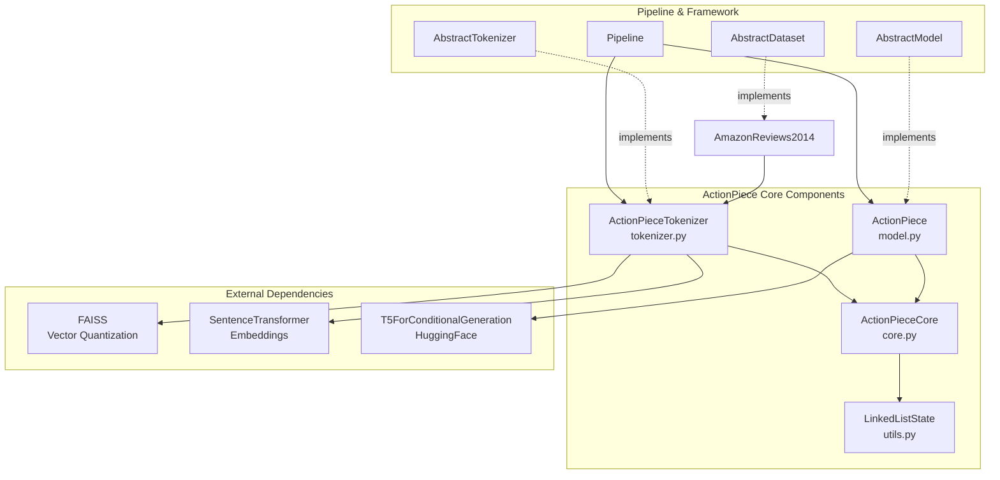
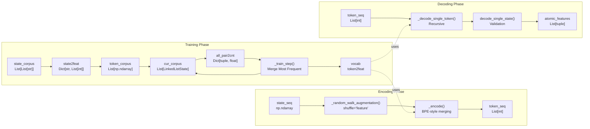
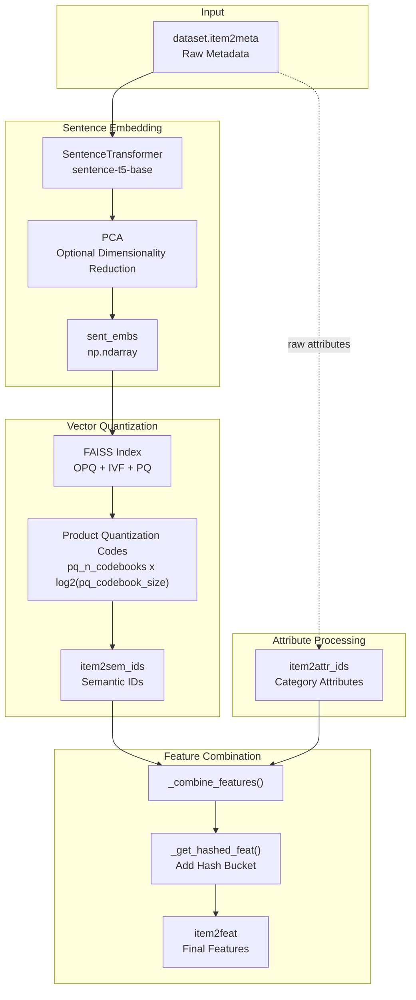
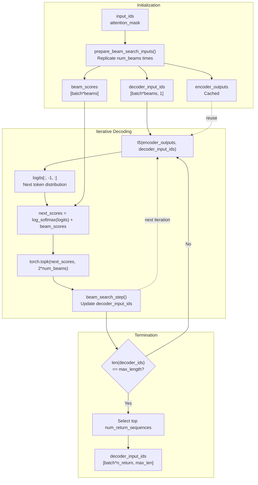

<!-- source: DeepWiki mcp.deepwiki.com · repo google-deepmind/action_piece · page 9 API Reference · fetched 2026-10-26 -->

# API Reference

<details>
<summary>Relevant source files</summary>

The following files were used as context for generating this wiki page:

- [genrec/models/ActionPiece/core.py](genrec/models/ActionPiece/core.py)
- [genrec/models/ActionPiece/model.py](genrec/models/ActionPiece/model.py)
- [genrec/models/ActionPiece/tokenizer.py](genrec/models/ActionPiece/tokenizer.py)

</details>


This page provides technical reference documentation for the core classes, methods, and data structures in the ActionPiece system. It covers the primary APIs developers interact with when using or extending ActionPiece.

For conceptual information about how these components work together, see [ActionPiece Tokenization System](#3). For configuration parameters that control these classes, see [Configuration Reference](#8).

## System Component Overview

The ActionPiece system exposes three primary classes and one supporting data structure:

| Class | File | Purpose |
|-------|------|---------|
| `ActionPieceCore` | `genrec/models/ActionPiece/core.py` | Vocabulary construction and token encoding/decoding |
| `ActionPieceTokenizer` | `genrec/models/ActionPiece/tokenizer.py` | Feature extraction and sequence tokenization for model input |
| `ActionPiece` | `genrec/models/ActionPiece/model.py` | T5-based generation model with beam search |
| `LinkedListState` | `genrec/models/ActionPiece/utils.py` | Efficient data structure for token merging operations |

**Sources:** [genrec/models/ActionPiece/core.py:50-853](), [genrec/models/ActionPiece/tokenizer.py:33-560](), [genrec/models/ActionPiece/model.py:30-411]()

---

## Class Relationship Diagram



**Sources:** [genrec/models/ActionPiece/core.py:50](), [genrec/models/ActionPiece/tokenizer.py:33](), [genrec/models/ActionPiece/model.py:30]()

---

## ActionPieceCore

`ActionPieceCore` is the core vocabulary construction and encoding/decoding engine. It implements a BPE-like algorithm that merges co-occurring feature patterns to build the ActionPiece vocabulary.

**Location:** [genrec/models/ActionPiece/core.py:50-853]()

### Initialization

The class can be initialized in three ways:

| Method | Parameters | Use Case |
|--------|------------|----------|
| `__init__(state2feat=...)` | `state2feat: dict[str, List[int]]` | Build new vocabulary from initial features |
| `__init__(metadata=...)` | `metadata: dict[str, Any]` | Load from saved metadata dictionary |
| `from_pretrained(save_path)` | `save_path: str`, `vocab_size: int` | Load from saved JSON file (recommended) |

**Example initialization from features:**
```python
# state2feat maps state IDs to lists of feature indices
state2feat = {
    'state_1': [0, 1, 2, 3, 4],
    'state_2': [1, 2, 3, 5, 6],
    ...
}
actionpiece = ActionPieceCore(state2feat=state2feat)
```

**Example loading pretrained:**
```python
actionpiece = ActionPieceCore.from_pretrained(
    save_path='path/to/actionpiece.json',
    vocab_size=10000  # Optional truncation
)
```

**Sources:** [genrec/models/ActionPiece/core.py:96-117](), [genrec/models/ActionPiece/core.py:183-210]()

### Key Attributes

| Attribute | Type | Description |
|-----------|------|-------------|
| `vocab` (alias for `token2feat`) | `list` | List of token definitions, indexed by token ID |
| `rank` (alias for `feat2token`) | `dict` | Maps feature tuples to token IDs |
| `vocab_size` | `int` | Total number of tokens in vocabulary |
| `n_categories` | `int` | Number of feature categories (dimensions) |
| `n_init_feats` | `int` | Number of initial atomic features before merging |
| `priority` | `list[float]` | Priority scores for each token (used during encoding) |
| `token2all_feat` | `dict` | Cache mapping tokens to their constituent atomic features |

**Token Format:**
- Initial features: `(category_idx, feature_idx)` - e.g., `(0, 15)` means category 0, feature 15
- Merged tokens: `(-1, token_idx1, token_idx2)` - e.g., `(-1, 5, 12)` means merge of tokens 5 and 12

**Sources:** [genrec/models/ActionPiece/core.py:69-94](), [genrec/models/ActionPiece/core.py:120-130]()

### Core Methods

#### `train(state_corpus, target_vocab_size)`

Trains the ActionPiece vocabulary by iteratively merging the most frequently co-occurring token pairs.

**Parameters:**
- `state_corpus: list[list[str]]` - List of state sequences for training
- `target_vocab_size: int` - Target vocabulary size after merging

**Algorithm:**
1. Convert states to initial token sequences using `state2feat`
2. Build linked list representation for efficient merging ([genrec/models/ActionPiece/core.py:299-341]())
3. Iteratively find most frequent token pair ([genrec/models/ActionPiece/core.py:603-645]())
4. Merge pair and update data structures
5. Repeat until `vocab_size == target_vocab_size`

**Implementation:** [genrec/models/ActionPiece/core.py:577-601]()

**Sources:** [genrec/models/ActionPiece/core.py:577-645]()

#### `encode(state_seq, shuffle='feature')`

Encodes a state sequence into a list of token IDs using the learned vocabulary.

**Parameters:**
- `state_seq: np.ndarray` - State sequence of shape `(N, n_categories)`
- `shuffle: str` - Encoding strategy:
  - `'feature'`: Random walk augmentation (default, fastest)
  - `'token'`: BPE-style merging with token-level shuffling
  - `'none'`: BPE-style merging without shuffling

**Returns:**
- `list[int]` - Encoded token sequence

**Shuffle Strategies:**
- `'feature'`: Flattens states by random permutation of features, then applies BPE ([genrec/models/ActionPiece/core.py:646-664]())
- `'token'`/`'none'`: Constructs linked list, iteratively merges highest priority pairs ([genrec/models/ActionPiece/core.py:746-796]())

**Implementation:** [genrec/models/ActionPiece/core.py:697-796]()

**Sources:** [genrec/models/ActionPiece/core.py:697-796]()

#### `decode_single_state(token_seq)`

Decodes a token sequence back to atomic features, validating it represents a single valid state.

**Parameters:**
- `token_seq: list[int]` - Token sequence to decode

**Returns:**
- `list[tuple[int, int]]` - List of `(category_idx, feature_idx)` tuples, sorted by category
- `None` - If token sequence is invalid (padding, out-of-vocab, or doesn't cover all categories)

**Validation checks:**
1. No padding tokens (`token == 0`)
2. All tokens within vocabulary bounds
3. No duplicate categories
4. All `n_categories` covered

**Implementation:** [genrec/models/ActionPiece/core.py:821-852]()

**Sources:** [genrec/models/ActionPiece/core.py:821-852]()

#### `save(save_path)` and `from_pretrained(save_path)`

**`save(save_path)`** - Serializes vocabulary to JSON file.

**Saved metadata:**
```json
{
    "n_categories": 5,
    "n_init_feats": 1000,
    "token2feat": [[0, 15], [1, 23], [-1, 5, 12], ...],
    "priority": [0.0, 0.0, 1.5, ...]
}
```

**`from_pretrained(save_path, vocab_size=None)`** - Class method to load saved vocabulary.

**Parameters:**
- `save_path: str` - Path to metadata JSON
- `vocab_size: int` - Optional truncation size (must be between `n_init_feats` and full size)

**Implementation:** [genrec/models/ActionPiece/core.py:168-210]()

**Sources:** [genrec/models/ActionPiece/core.py:168-210]()

### Internal Methods

| Method | Purpose |
|--------|---------|
| `_construct_linked_list()` | Build `LinkedListState` representation |
| `_count_pairs_inside_state()` | Count token pairs within single state |
| `_count_pairs_btw_states()` | Count token pairs between adjacent states |
| `_merge_single_rule()` | Apply merging rule to linked list |
| `_decode_single_token()` | Recursively decode token to atomic features |

**Sources:** [genrec/models/ActionPiece/core.py:212-852]()

---

## ActionPiece Encoding/Decoding Flow



**Sources:** [genrec/models/ActionPiece/core.py:577-645](), [genrec/models/ActionPiece/core.py:646-796](), [genrec/models/ActionPiece/core.py:798-852]()

---

## ActionPieceTokenizer

`ActionPieceTokenizer` extends `AbstractTokenizer` and handles feature extraction, vocabulary construction, and sequence tokenization for model training and inference.

**Location:** [genrec/models/ActionPiece/tokenizer.py:33-560]()

### Initialization

```python
tokenizer = ActionPieceTokenizer(config, dataset)
```

**Parameters:**
- `config: dict` - Configuration dictionary with tokenizer parameters
- `dataset: AbstractDataset` - Dataset instance providing item sequences and metadata

**Initialization process:**
1. Extract item features (`_get_item2feat()`)
2. Initialize or load `ActionPieceCore` (`_init_tokenizer()`)
3. Set up collate functions for train/val/test splits

**Implementation:** [genrec/models/ActionPiece/tokenizer.py:53-69]()

**Sources:** [genrec/models/ActionPiece/tokenizer.py:53-69]()

### Key Attributes

| Attribute | Type | Description |
|-----------|------|-------------|
| `actionpiece` | `ActionPieceCore` | Core vocabulary and encoding engine |
| `item2feat` | `dict[Any, Any]` | Maps item IDs to feature tuples |
| `bos_token` | `int` | Beginning-of-sequence token (= `vocab_size`) |
| `eos_token` | `int` | End-of-sequence token (= `vocab_size + 1`) |
| `padding_token` | `int` | Padding token (= 0) |
| `vocab_size` | `int` | Total vocabulary size including special tokens |
| `max_token_seq_len` | `int` | Maximum token sequence length |
| `collate_fn` | `dict` | Maps split names to collate functions |
| `encoded_labels` | `dict` | Cache for encoded label sequences |

**Sources:** [genrec/models/ActionPiece/tokenizer.py:38-69](), [genrec/models/ActionPiece/tokenizer.py:380-387]()

### Feature Extraction Pipeline

The tokenizer extracts features through a multi-stage pipeline:



**Sources:** [genrec/models/ActionPiece/tokenizer.py:71-317]()

### Core Methods

#### `_get_item2feat(dataset)`

Orchestrates the feature extraction pipeline and caches results.

**Process:**
1. Check cache at `dataset.cache_dir/processed/item.{metadata}.feat`
2. If not cached:
   - Extract semantic IDs via FAISS (`_get_sem_ids()`)
   - Extract attribute IDs (`_get_attr_ids()`)
   - Combine features (`_combine_features()`)
   - Add hash buckets (`_get_hashed_feat()`)
   - Save to cache
3. Return `item2feat` dictionary

**Implementation:** [genrec/models/ActionPiece/tokenizer.py:287-317]()

**Sources:** [genrec/models/ActionPiece/tokenizer.py:287-317]()

#### `_get_sem_ids(dataset)`

Extracts semantic IDs using sentence embeddings and FAISS product quantization.

**Process:**
1. Load or encode sentence embeddings ([genrec/models/ActionPiece/tokenizer.py:114-139]())
2. Train FAISS index on training items ([genrec/models/ActionPiece/tokenizer.py:155-186]())
3. Extract PQ codes as semantic IDs
4. Cache results

**FAISS Configuration:**
- Index type: `OPQ{n_codebooks},IVF1,PQ{n_codebooks}x{bits}`
- Metric: `METRIC_INNER_PRODUCT`
- Output: `n_codebooks` semantic IDs per item

**Implementation:** [genrec/models/ActionPiece/tokenizer.py:188-226]()

**Sources:** [genrec/models/ActionPiece/tokenizer.py:71-226]()

#### `tokenize(datasets)`

Converts item sequences to state sequences (tokenized features).

**Parameters:**
- `datasets: dict[Any, Any]` - Dictionary mapping split names to HuggingFace datasets

**Returns:**
- `dict[Any, Any]` - Dictionary mapping split names to tokenized datasets

**Tokenization:**
- For training: Creates subsequences of length up to `max_item_seq_len` ([genrec/models/ActionPiece/tokenizer.py:350-358]())
- For val/test: Takes last `max_item_seq_len + 1` items ([genrec/models/ActionPiece/tokenizer.py:360]())

**Implementation:** [genrec/models/ActionPiece/tokenizer.py:365-378]()

**Sources:** [genrec/models/ActionPiece/tokenizer.py:335-378]()

#### `collate_fn_train(batch)`, `collate_fn_val(batch)`, `collate_fn_test(batch)`

Collate functions that tokenize sequences on-the-fly during training/evaluation.

| Function | Shuffle Strategy | Ensemble | Use Case |
|----------|-----------------|----------|----------|
| `collate_fn_train` | `train_shuffle` config | No | Training with SPR |
| `collate_fn_val` | `'none'` or `'feature'` | Optional | Validation |
| `collate_fn_test` | `'feature'` (repeated) | Yes | Test inference with ensemble |

**Train collate output:**
```python
{
    'input_ids': torch.LongTensor,      # [batch, seq_len]
    'attention_mask': torch.LongTensor, # [batch, seq_len]
    'labels': torch.LongTensor          # [batch, n_categories+1]
}
```

**Test collate specifics:**
- Creates `n_inference_ensemble` copies per example
- Each copy uses different random walk augmentation
- Batch size multiplied by ensemble size

**Implementation:** [genrec/models/ActionPiece/tokenizer.py:434-559]()

**Sources:** [genrec/models/ActionPiece/tokenizer.py:434-559]()

---

## ActionPiece Model

`ActionPiece` extends `AbstractModel` and implements a T5-based sequence-to-sequence model with specialized beam search for recommendation.

**Location:** [genrec/models/ActionPiece/model.py:30-411]()

### Initialization

```python
model = ActionPiece(config, dataset, tokenizer)
```

**Parameters:**
- `config: dict` - Model configuration dictionary
- `dataset: AbstractDataset` - Dataset instance
- `tokenizer: ActionPieceTokenizer` - Tokenizer instance

**T5 Configuration:**
Initializes `T5ForConditionalGeneration` with parameters:

| Parameter | Config Key | Description |
|-----------|------------|-------------|
| `num_layers` | `num_layers` | Encoder layers |
| `num_decoder_layers` | `num_decoder_layers` | Decoder layers |
| `d_model` | `d_model` | Model dimensionality |
| `d_ff` | `d_ff` | Feed-forward dimensionality |
| `num_heads` | `num_heads` | Attention heads |
| `d_kv` | `d_kv` | Key/value dimensionality |
| `vocab_size` | `tokenizer.vocab_size` | Vocabulary size |
| `n_positions` | `tokenizer.max_token_seq_len` | Max sequence length |

**Implementation:** [genrec/models/ActionPiece/model.py:38-59]()

**Sources:** [genrec/models/ActionPiece/model.py:38-59]()

### Core Methods

#### `forward(batch)`

Standard forward pass for training.

**Parameters:**
- `batch: dict` - Batch dictionary containing `input_ids`, `attention_mask`, `labels`

**Returns:**
- `ModelOutput` - HuggingFace output with `loss` and `logits`

**Implementation:** [genrec/models/ActionPiece/model.py:78-91]()

**Sources:** [genrec/models/ActionPiece/model.py:78-91]()

#### `generate(batch, n_return_sequences=1)`

Generates recommendations using ensemble beam search with nDCG-based ranking.

**Parameters:**
- `batch: dict` - Input batch (may contain multiple ensemble copies)
- `n_return_sequences: int` - Number of recommendations per input

**Process:**
1. Run beam search on all ensemble copies ([genrec/models/ActionPiece/model.py:109-116]())
2. Decode outputs to atomic features ([genrec/models/ActionPiece/model.py:119-137]())
3. Aggregate predictions with nDCG scoring ([genrec/models/ActionPiece/model.py:144-152]())
4. Return top-k ranked predictions

**nDCG Scoring:**
```python
score = sum(1 / log2(rank + 2) for rank in beam_positions)
```

**Implementation:** [genrec/models/ActionPiece/model.py:93-155]()

**Sources:** [genrec/models/ActionPiece/model.py:93-155]()

#### `beam_search(input_ids, attention_mask, ...)`

Custom beam search implementation without EOS-based early stopping.

**Parameters:**
- `input_ids: torch.Tensor` - Encoder input
- `attention_mask: torch.Tensor` - Encoder attention mask
- `max_length: int` - Maximum generation length (= `n_categories + 1`)
- `num_beams: int` - Number of beams
- `num_return_sequences: int` - Sequences to return per beam group
- `return_score: bool` - Whether to return log probabilities

**Key differences from HuggingFace:**
- No EOS-based stopping (controlled by `max_length`)
- Fixed length generation for recommendation tasks
- Caches encoder outputs for efficiency

**Algorithm:**
1. Prepare beam inputs ([genrec/models/ActionPiece/model.py:249-326]())
2. Encode inputs once ([genrec/models/ActionPiece/model.py:215-218]())
3. Iteratively extend beams ([genrec/models/ActionPiece/model.py:221-236]())
4. Select top-k sequences

**Implementation:** [genrec/models/ActionPiece/model.py:157-247]()

**Sources:** [genrec/models/ActionPiece/model.py:157-411]()

---

## Beam Search Flow



**Sources:** [genrec/models/ActionPiece/model.py:157-411]()

---

## LinkedListState

`LinkedListState` is a specialized data structure for efficient token merging during vocabulary construction and encoding.

**Location:** `genrec/models/ActionPiece/utils.py` (referenced but not provided in files)

### Purpose

Maintains a doubly-linked list representation of state sequences where:
- **Regular nodes** contain item states (lists of tokens)
- **Context nodes** store tokens representing relationships between adjacent states
- Efficient insertion/deletion during merging operations

### Structure

Each node contains:
- `state: list[int]` - Token list
- `context: bool` - Whether node is a context slot
- `head_id: int` - Sequence identifier
- `prev: LinkedListState` - Previous node
- `next: LinkedListState` - Next node

### Key Operations

| Method | Purpose | Used By |
|--------|---------|---------|
| `append(node)` | Append node to end | `_construct_linked_list()` |
| `copy_link()` | Deep copy entire linked list | `_merge_single_rule()` |
| `tolist()` | Flatten to token list | `encode()` with `shuffle='none'` |
| `to_shuffled_list()` | Flatten with shuffling | `encode()` with `shuffle='token'` |

**Usage in vocabulary construction:**
1. Convert state sequences to linked lists ([genrec/models/ActionPiece/core.py:212-231]())
2. Count pairs efficiently by traversing nodes ([genrec/models/ActionPiece/core.py:260-297]())
3. Apply merge rules by updating nodes ([genrec/models/ActionPiece/core.py:472-506]())
4. Merge empty nodes after rule application ([genrec/models/ActionPiece/core.py:365-411]())

**Sources:** [genrec/models/ActionPiece/core.py:212-506]()

---

## Method Call Hierarchy

The following diagram shows typical method call sequences during key operations:

```mermaid
graph TB
    subgraph "Training ActionPiece Vocabulary"
        TrainStart["actionpiece.train(state_corpus, target_vocab_size)"]
        GetCorpus["_get_token_corpus(state_corpus)"]
        Build["_build(token_corpus)"]
        ConstructLL["_construct_linked_list(head_id, state_seq)"]
        CountPairs["_count_pairs_in_list(head)"]
        
        TrainLoop["while vocab_size < target_vocab_size"]
        TrainStep["_train_step()"]
        GetMaxPair["pq.get() -> (priority, pair)"]
        MergeRule["_merge_single_rule(head, rule, new_token)"]
        MergeInside["_merge_inside_regular_state(node, rule, new_token)"]
        MergeBetween["_merge_two_states(node1, node2, rule, new_token)"]
        MergeEmpty["_merge_empty_nodes(head)"]
        UpdatePQ["_update_pq(diff_pair2cnt)"]
        
        TrainStart --> GetCorpus
        GetCorpus --> Build
        Build --> ConstructLL
        Build --> CountPairs
        Build --> TrainLoop
        TrainLoop --> TrainStep
        TrainStep --> GetMaxPair
        TrainStep --> MergeRule
        MergeRule --> MergeInside
        MergeRule --> MergeBetween
        MergeRule --> MergeEmpty
        TrainStep --> UpdatePQ
        TrainStep -.repeat.-> TrainLoop
    end
    
    subgraph "Encoding Sequence"
        EncStart["actionpiece.encode(state_seq, shuffle)"]
        RandWalk["_random_walk_augmentation(state_seq)"]
        EncodeFlat["_encode(flattened_seq)"]
        FindPair["Find min rank pair in seq"]
        MergePair["Merge pair in sequence"]
        
        EncStart -->|shuffle='feature'| RandWalk
        RandWalk --> EncodeFlat
        EncodeFlat --> FindPair
        FindPair --> MergePair
        MergePair -.repeat until no pairs.-> FindPair
    end
    
    subgraph "Decoding Sequence"
        DecStart["actionpiece.decode_single_state(token_seq)"]
        DecToken["_decode_single_token(token)"]
        CheckValid["Validate: all categories covered, no duplicates"]
        
        DecStart --> DecToken
        DecToken -.recursive for merged tokens.-> DecToken
        DecStart --> CheckValid
    end
```



**Sources:** [genrec/models/ActionPiece/core.py:577-852]()

---

## API Usage Examples

### Building and Training a Vocabulary

```python
# Initialize from item features
state2feat = {
    'item_1': [0, 1, 2, 3, 4],  # 5 feature categories
    'item_2': [0, 2, 3, 5, 6],
    # ...
}

# Create ActionPieceCore
actionpiece = ActionPieceCore(state2feat=state2feat)

# Train vocabulary
state_corpus = [
    ['item_1', 'item_2', 'item_3'],
    ['item_2', 'item_4', 'item_5'],
    # ...
]
actionpiece.train(
    state_corpus=state_corpus,
    target_vocab_size=10000
)

# Save trained vocabulary
actionpiece.save('path/to/actionpiece.json')
```

### Loading and Using Pretrained Vocabulary

```python
# Load pretrained vocabulary
actionpiece = ActionPieceCore.from_pretrained(
    save_path='path/to/actionpiece.json',
    vocab_size=10000  # Optional truncation
)

# Encode a state sequence
state_seq = np.array([
    [0, 1, 2, 3, 4],   # state 1
    [0, 2, 3, 5, 6],   # state 2
    [1, 2, 4, 5, 7]    # state 3
])

# Encode with random walk (fastest)
token_seq = actionpiece.encode(state_seq, shuffle='feature')

# Encode without shuffling (deterministic)
token_seq = actionpiece.encode(state_seq, shuffle='none')

# Decode back to atomic features
decoded = actionpiece.decode_single_state(token_seq)
# Returns: [(0, 1), (1, 2), (2, 4), (3, 5), (4, 7)]
```

### Tokenizer Initialization

```python
# Initialize tokenizer with dataset
config = {
    'metadata': 'sentence',
    'sent_emb_model': 'sentence-transformers/sentence-t5-base',
    'pq_n_codebooks': 8,
    'pq_codebook_size': 256,
    'actionpiece_vocab_size': 10000,
    # ...
}

tokenizer = ActionPieceTokenizer(config, dataset)

# Access vocabulary
vocab_size = tokenizer.vocab_size
n_categories = tokenizer.actionpiece.n_categories

# Tokenize datasets
tokenized_datasets = tokenizer.tokenize(datasets)
```

### Model Inference

```python
# Initialize model
model = ActionPiece(config, dataset, tokenizer)
model.to(device)

# Generate recommendations
batch = next(iter(test_dataloader))
batch = {k: v.to(device) for k, v in batch.items()}

# Generate top-50 recommendations
predictions = model.generate(
    batch=batch,
    n_return_sequences=50
)
# predictions shape: [batch_size, 50, n_categories]
```

**Sources:** [genrec/models/ActionPiece/core.py:50-853](), [genrec/models/ActionPiece/tokenizer.py:33-560](), [genrec/models/ActionPiece/model.py:30-411]()

---

