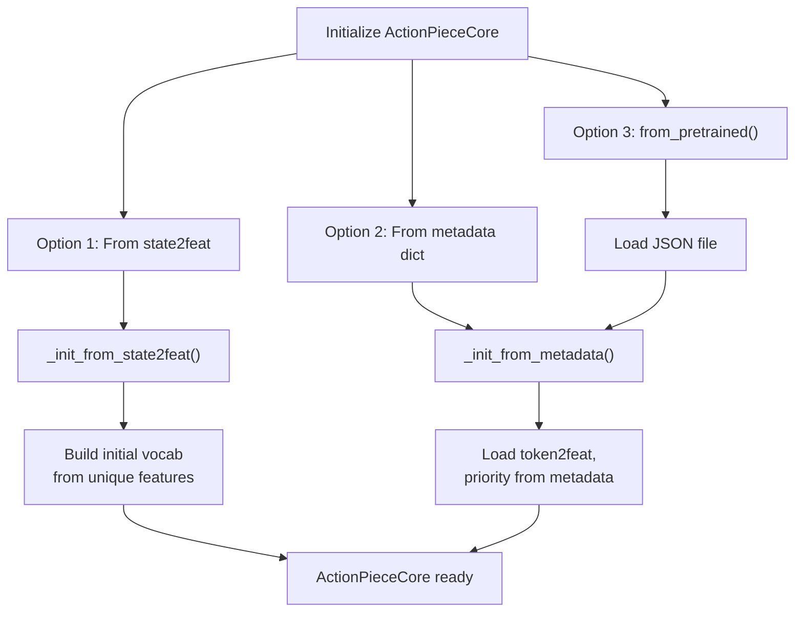
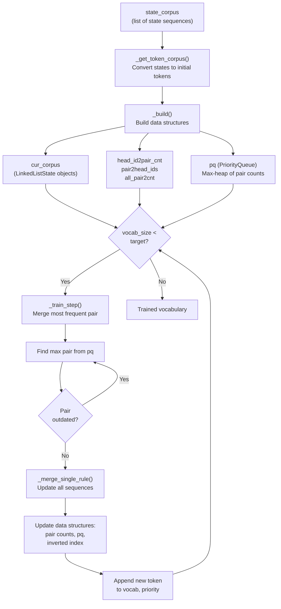
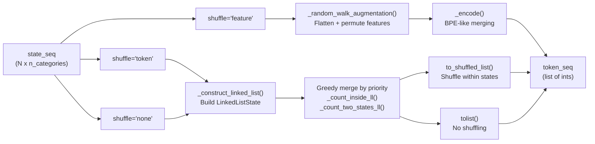
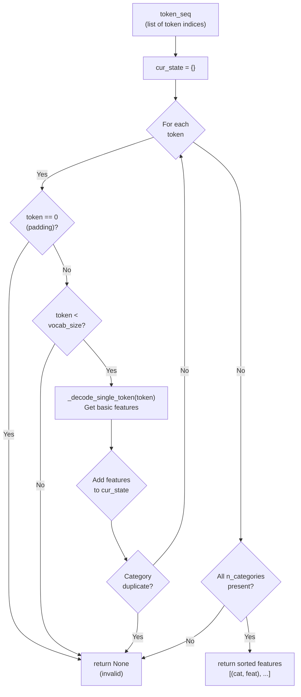
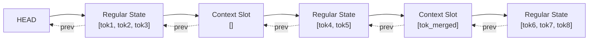
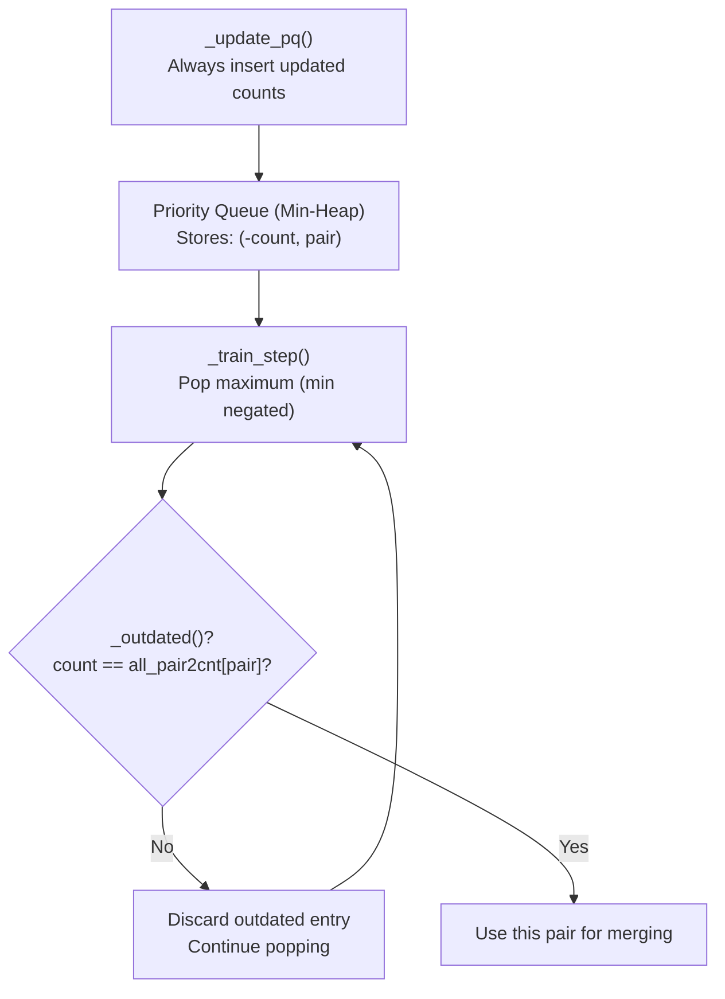
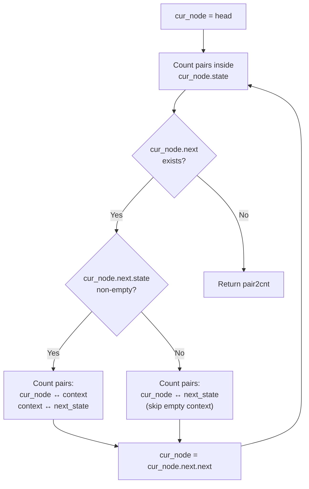
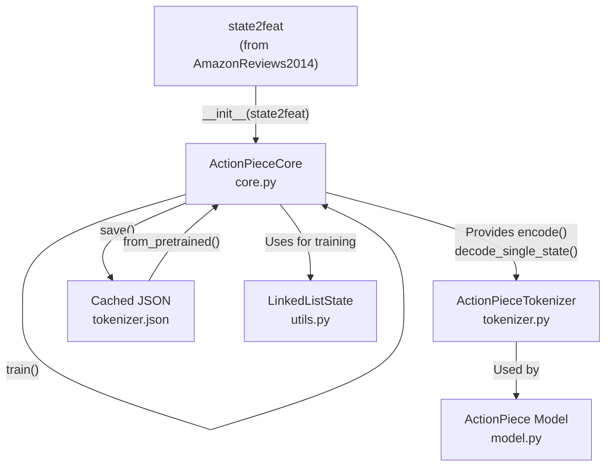

<!-- source: DeepWiki mcp.deepwiki.com · repo google-deepmind/action_piece · page 9.1 ActionPieceCore API · fetched 2026-10-26 -->

# ActionPieceCore API

<details>
<summary>Relevant source files</summary>

The following files were used as context for generating this wiki page:

- [README.md](README.md)
- [genrec/models/ActionPiece/core.py](genrec/models/ActionPiece/core.py)

</details>


## Purpose and Scope

This page documents the `ActionPieceCore` class, which implements the core vocabulary construction and tokenization logic for the ActionPiece system. `ActionPieceCore` is responsible for:

1. Building vocabularies by merging frequently co-occurring feature patterns
2. Encoding action sequences (represented as feature sets) into token sequences
3. Decoding token sequences back into feature representations
4. Persisting and loading trained vocabularies

For the higher-level tokenizer that uses `ActionPieceCore` for sequence processing and batching, see [ActionPieceTokenizer API](#9.2). For conceptual understanding of how ActionPiece tokenization works, see [Vocabulary Construction (ActionPieceCore)](#3.2) and [Sequence Segmentation & Set Permutation Regularization](#3.3).

**Sources:** [genrec/models/ActionPiece/core.py:1-853]()

---

## Class Overview

The `ActionPieceCore` class located in [genrec/models/ActionPiece/core.py:50-853]() implements a BPE-like algorithm that merges co-occurring feature patterns both within action sets and across adjacent action sets. Unlike traditional BPE which operates on flat sequences, ActionPieceCore maintains the set structure of actions during vocabulary construction.

### Key Attributes

| Attribute | Type | Description |
|-----------|------|-------------|
| `vocab` | `list` | The vocabulary, equivalent to `token2feat` |
| `token2feat` | `list[tuple]` | Maps token index to feature tuple(s) |
| `feat2token` | `dict` | Reverse mapping from features to token index |
| `rank` | `dict` | Alias for `feat2token` |
| `priority` | `list[float]` | Priority score for each token |
| `n_categories` | `int` | Number of feature categories per action |
| `n_init_feats` | `int` | Number of tokens in initial vocabulary |
| `vocab_size` | `int` | Total vocabulary size (property) |
| `state2feat` | `dict` | Initial mapping from state IDs to features |
| `cur_corpus` | `list[LinkedListState]` | Corpus as linked lists during training |
| `head_id2pair_cnt` | `list[dict]` | Pair counts for each sequence |
| `pair2head_ids` | `dict` | Inverted index: pair → sequence IDs |
| `all_pair2cnt` | `dict` | Total count of each pair across all sequences |
| `pq` | `PriorityQueue` | Max-heap for finding most frequent pairs |

**Sources:** [genrec/models/ActionPiece/core.py:69-94](), [genrec/models/ActionPiece/core.py:96-119]()

---

## Initialization Methods

`ActionPieceCore` can be initialized in three ways:



**Sources:** [genrec/models/ActionPiece/core.py:96-119](), [genrec/models/ActionPiece/core.py:132-166](), [genrec/models/ActionPiece/core.py:183-210]()

### Option 1: From `state2feat` Dictionary

Initializes with raw feature mappings, creating a vocabulary of all unique features. This is used before training.

```python
# Example structure
state2feat = {
    'state_001': [0, 5, 12],  # category indices for this state
    'state_002': [1, 5, 8],
    # ...
}
core = ActionPieceCore(state2feat=state2feat)
```

The `_init_from_state2feat()` method at [genrec/models/ActionPiece/core.py:132-157]() extracts all unique `(category_idx, feature_idx)` pairs to build the initial vocabulary.

**Sources:** [genrec/models/ActionPiece/core.py:96-104](), [genrec/models/ActionPiece/core.py:132-157]()

### Option 2: From Metadata Dictionary

Initializes from a metadata dictionary (typically loaded from a saved JSON file).

```python
metadata = {
    'n_categories': 5,
    'n_init_feats': 1153,
    'token2feat': [[0, 0], [0, 1], ..., [-1, 100, 200]],
    'priority': [0, 0, ..., 723.6, 670.04]
}
core = ActionPieceCore(metadata=metadata)
```

The `_init_from_metadata()` method at [genrec/models/ActionPiece/core.py:159-166]() reconstructs the vocabulary from saved metadata.

**Sources:** [genrec/models/ActionPiece/core.py:106-113](), [genrec/models/ActionPiece/core.py:159-166]()

### Option 3: Using `from_pretrained()` (Recommended)

The preferred method for loading a trained tokenizer:

```python
core = ActionPieceCore.from_pretrained(
    save_path='path/to/tokenizer.json',
    vocab_size=5000  # Optional: truncate to specific size
)
```

This class method at [genrec/models/ActionPiece/core.py:183-210]() loads JSON metadata and optionally truncates the vocabulary to a target size.

**Sources:** [genrec/models/ActionPiece/core.py:183-210]()

---

## Vocabulary Construction

### The `train()` Method

The `train()` method at [genrec/models/ActionPiece/core.py:577-601]() constructs the ActionPiece vocabulary by iteratively merging the most frequently co-occurring token pairs.

```python
core.train(
    state_corpus=state_corpus,  # list of state sequences
    target_vocab_size=5000
)
```



**Sources:** [genrec/models/ActionPiece/core.py:577-601](), [genrec/models/ActionPiece/core.py:603-644]()

### Training Algorithm Details

The training process implements a greedy merging algorithm with efficient data structures:

1. **Initialization** via `_build()` at [genrec/models/ActionPiece/core.py:299-340]():
   - Converts state sequences to `LinkedListState` structures
   - Counts all token pairs within and between states
   - Builds inverted index `pair2head_ids` mapping pairs to sequences containing them
   - Initializes priority queue with all pair counts

2. **Iterative Merging** via `_train_step()` at [genrec/models/ActionPiece/core.py:603-644]():
   - Extracts maximum count pair from priority queue
   - Checks if pair count is outdated (lazy deletion strategy)
   - Creates new merge rule `(-1, token1, token2)`
   - Updates only sequences containing the pair (using inverted index)
   - Recounts pairs in updated sequences
   - Updates priority queue with new pair counts

**Sources:** [genrec/models/ActionPiece/core.py:299-340](), [genrec/models/ActionPiece/core.py:603-644]()

### Pair Counting Strategy

The algorithm counts pairs with different weights depending on their location:

| Location | Weight | Method |
|----------|--------|--------|
| Within a state | `2 / M` where M = tokens in state | `_count_pairs_inside_state()` |
| Between adjacent states | `1 / (M1 * M2)` | `_count_pairs_btw_states()` |
| Through context slot | `1 / (M1 * M2)` | `_count_pairs_btw_states()` |

The weighting scheme balances merging within sets (intra-action patterns) and across sets (inter-action patterns).

**Sources:** [genrec/models/ActionPiece/core.py:233-258](), [genrec/models/ActionPiece/core.py:64-68]()

---

## Encoding Methods

### `encode()` Method

The `encode()` method at [genrec/models/ActionPiece/core.py:697-796]() converts a state sequence into a token sequence using learned merge rules.

```python
token_seq = core.encode(
    state_seq=state_seq,  # np.ndarray of shape (N, n_categories)
    shuffle='feature'      # 'feature', 'token', or 'none'
)
```

**Shuffle Modes:**



**Sources:** [genrec/models/ActionPiece/core.py:697-796]()

### `encode_fast()` Method

A faster encoding variant using random walk augmentation:

```python
token_seq = core.encode_fast(state_seq)
```

This method at [genrec/models/ActionPiece/core.py:693-695]() combines random walk augmentation with BPE-like encoding, equivalent to `encode(state_seq, shuffle='feature')`.

**Sources:** [genrec/models/ActionPiece/core.py:693-695]()

### Random Walk Augmentation

The `_random_walk_augmentation()` method at [genrec/models/ActionPiece/core.py:646-664]() flattens a state sequence by randomly permuting features within each state:

```python
# Input:  [[f0_0, f0_1, f0_2], [f1_0, f1_1, f1_2]]
# Output: [f0_1, f0_0, f0_2, f1_2, f1_0, f1_1]  (random permutation per state)
```

This implements **Set Permutation Regularization (SPR)**, treating each action as an unordered set of features.

**Sources:** [genrec/models/ActionPiece/core.py:646-664]()

---

## Decoding Methods

### `decode_single_state()` Method

The `decode_single_state()` method at [genrec/models/ActionPiece/core.py:821-852]() converts a token sequence back into basic features, validating that it forms a complete state.

```python
features = core.decode_single_state(token_seq=[105, 234, 567])
# Returns: [(0, 5), (1, 12), (2, 8), (3, 1), (4, 7)]
# Or None if invalid (missing categories, duplicates, etc.)
```



**Sources:** [genrec/models/ActionPiece/core.py:821-852]()

### `_decode_single_token()` Method

The `_decode_single_token()` method at [genrec/models/ActionPiece/core.py:798-819]() recursively decomposes a token into its basic features, with memoization via `token2all_feat`.

**Token Format:**
- Initial token: `(category_idx, feature_idx)` 
- Merged token: `(-1, token1_idx, token2_idx)`

```python
# Example recursive decoding:
# token 500 = (-1, 100, 200)
#   token 100 = (0, 5)
#   token 200 = (-1, 50, 75)
#     token 50 = (1, 3)
#     token 75 = (2, 8)
# Result: [(0, 5), (1, 3), (2, 8)]
```

**Sources:** [genrec/models/ActionPiece/core.py:798-819]()

---

## Persistence Methods

### `save()` Method

The `save()` method at [genrec/models/ActionPiece/core.py:168-181]() serializes the vocabulary to JSON:

```python
core.save(save_path='tokenizer.json')
```

**JSON Structure:**
```json
{
    "n_categories": 5,
    "n_init_feats": 1153,
    "token2feat": [
        [-1, -1],           // padding
        [0, 0], [0, 1],     // initial features
        ...,
        [-1, 100, 200],     // merged tokens
        ...
    ],
    "priority": [
        0, 0, ...,          // initial features have 0 priority
        723.6, 670.04, ...  // merged tokens have priority scores
    ]
}
```

**Sources:** [genrec/models/ActionPiece/core.py:168-181](), [README.md:98-115]()

### `from_pretrained()` Class Method

The `from_pretrained()` class method at [genrec/models/ActionPiece/core.py:183-210]() loads a saved vocabulary:

```python
core = ActionPieceCore.from_pretrained(
    save_path='tokenizer.json',
    vocab_size=5000  # Optional truncation
)
```

The `vocab_size` parameter allows using a smaller subset of the vocabulary by truncating `token2feat` and `priority` lists. The truncated size must be:
- At least `n_init_feats` (cannot remove initial features)
- At most `len(token2feat)` (cannot exceed saved vocabulary)

**Sources:** [genrec/models/ActionPiece/core.py:183-210]()

---

## Internal Data Structures

### LinkedListState Structure

The training algorithm uses `LinkedListState` objects (defined in [genrec/models/ActionPiece/utils.py]()) to represent sequences with alternating regular states and context slots:



Context slots hold merged tokens that span across adjacent states. The `_construct_linked_list()` method at [genrec/models/ActionPiece/core.py:212-231]() creates this structure.

**Sources:** [genrec/models/ActionPiece/core.py:212-231](), [genrec/models/ActionPiece/utils.py]()

### Priority Queue with Lazy Deletion

The training process uses a priority queue with lazy deletion for efficiency:



The `_outdated()` method at [genrec/models/ActionPiece/core.py:342-363]() checks if a popped pair's count matches the current count in `all_pair2cnt`. Outdated entries are discarded without explicit deletion from the heap.

**Sources:** [genrec/models/ActionPiece/core.py:342-363](), [genrec/models/ActionPiece/core.py:536-555]()

### Inverted Index: `pair2head_ids`

The `pair2head_ids` dictionary maps each token pair to the set of sequence IDs containing that pair:

```python
pair2head_ids = {
    (10, 25): {0, 5, 12, 23},  # Sequences containing pair (10, 25)
    (10, 30): {0, 8, 15},
    # ...
}
```

This allows efficient incremental updates: when merging a pair, only sequences containing that pair need to be updated. The `_update_pair2head_ids()` method at [genrec/models/ActionPiece/core.py:508-534]() maintains this index.

**Sources:** [genrec/models/ActionPiece/core.py:508-534](), [genrec/models/ActionPiece/core.py:316-333]()

---

## Key Algorithms

### Merging Algorithm

The `_merge_single_rule()` method at [genrec/models/ActionPiece/core.py:472-506]() applies a merge rule to a linked list:

**Merge Locations:**

| Location | Method | Lines |
|----------|--------|-------|
| Within regular state | `_merge_inside_regular_state()` | [413-422]() |
| State ↔ context slot | `_merge_state_context()` | [424-443]() |
| State ↔ adjacent state | `_merge_two_states()` | [445-470]() |

After merging, `_merge_empty_nodes()` at [genrec/models/ActionPiece/core.py:365-411]() removes empty states and context slots to maintain a clean structure.

**Sources:** [genrec/models/ActionPiece/core.py:472-506](), [genrec/models/ActionPiece/core.py:413-470](), [genrec/models/ActionPiece/core.py:365-411]()

### Pair Counting in Linked Lists

The `_count_pairs_in_list()` method at [genrec/models/ActionPiece/core.py:260-297]() traverses a linked list and counts pairs:



**Sources:** [genrec/models/ActionPiece/core.py:260-297]()

---

## Usage Examples

### Training a New Vocabulary

```python
from genrec.models.ActionPiece.core import ActionPieceCore

# Initialize with state2feat mapping
state2feat = {
    'state_001': [0, 5, 12, 3, 8],  # 5 features
    'state_002': [1, 5, 8, 3, 9],
    # ... more states
}

core = ActionPieceCore(state2feat=state2feat)

# Train vocabulary
state_corpus = [
    ['state_001', 'state_002', 'state_003'],  # sequence 1
    ['state_004', 'state_005'],               # sequence 2
    # ... more sequences
]

core.train(state_corpus, target_vocab_size=5000)

# Save trained vocabulary
core.save('tokenizer.json')
```

**Sources:** [genrec/models/ActionPiece/core.py:96-118](), [genrec/models/ActionPiece/core.py:577-601]()

### Loading and Using a Trained Vocabulary

```python
# Load pretrained tokenizer
core = ActionPieceCore.from_pretrained('tokenizer.json')

# Encode a state sequence
import numpy as np
state_seq = np.array([
    [0, 5, 12, 3, 8],  # state 1 features
    [1, 5, 8, 3, 9],   # state 2 features
])

# Encode with random walk augmentation (SPR)
tokens = core.encode(state_seq, shuffle='feature')
# Returns: [105, 234, 567, 890, 123]

# Decode a token sequence back to features
features = core.decode_single_state([105, 234, 567])
# Returns: [(0, 5), (1, 12), (2, 3), (3, 8), (4, 9)] or None if invalid
```

**Sources:** [genrec/models/ActionPiece/core.py:183-210](), [genrec/models/ActionPiece/core.py:697-796](), [genrec/models/ActionPiece/core.py:821-852]()

---

## Relationship to Other Components



- **Data Source**: `ActionPieceCore` receives initial `state2feat` mapping from dataset processing (see [AmazonReviews2014 Dataset](#5.2))
- **Persistence**: Trained vocabularies are cached and reloaded using the JSON format (see [Cached Tokenizer Structure](#3.4))
- **Integration**: `ActionPieceTokenizer` wraps `ActionPieceCore` to provide collate functions and batch processing (see [ActionPieceTokenizer API](#9.2))
- **Model Usage**: The ActionPiece model uses the tokenizer for input/output processing (see [ActionPiece Model API](#9.3))

**Sources:** [genrec/models/ActionPiece/core.py:1-853](), [genrec/models/ActionPiece/tokenizer.py](), [genrec/models/ActionPiece/model.py](), [genrec/models/ActionPiece/utils.py]()

---

