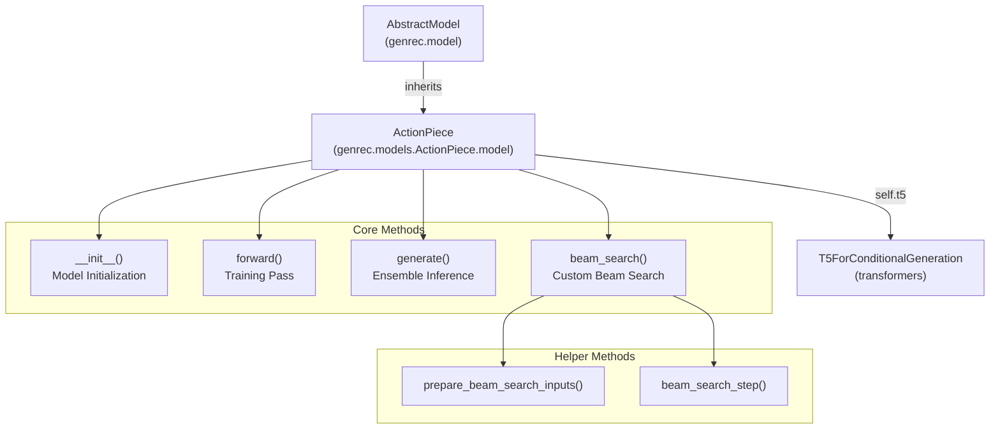
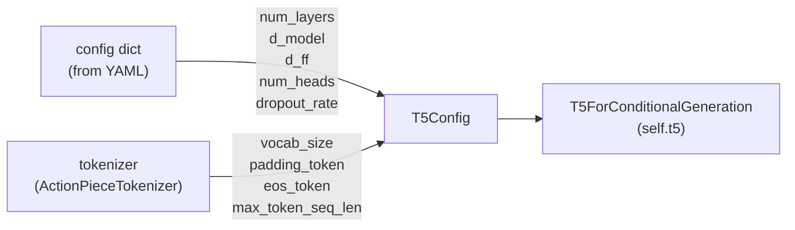
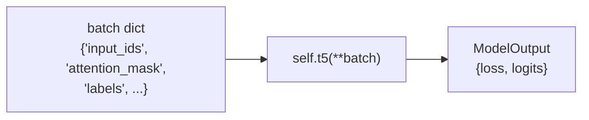
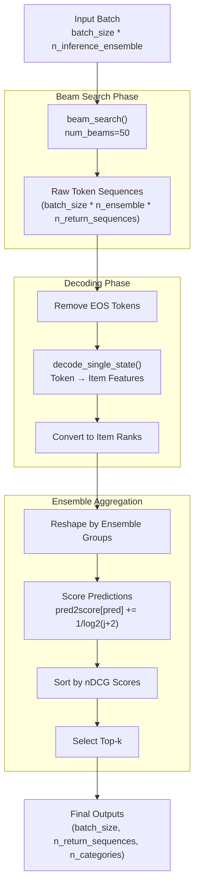
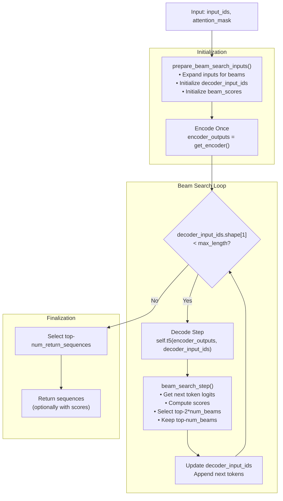
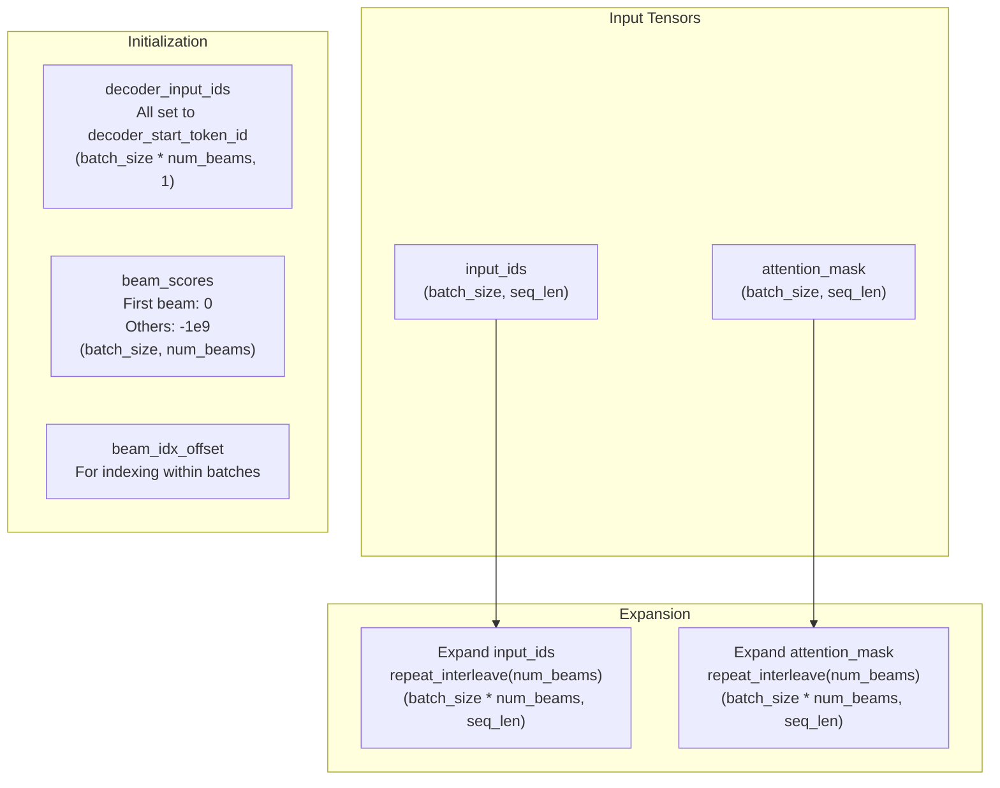
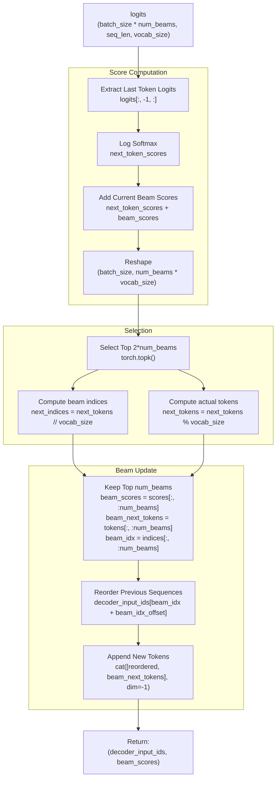

<!-- source: DeepWiki mcp.deepwiki.com · repo google-deepmind/action_piece · page 9.3 ActionPiece Model API · fetched 2026-10-26 -->

# ActionPiece Model API

<details>
<summary>Relevant source files</summary>

The following files were used as context for generating this wiki page:

- [README.md](README.md)
- [genrec/models/ActionPiece/model.py](genrec/models/ActionPiece/model.py)

</details>


## Purpose and Scope

This page documents the `ActionPiece` model class, which implements the T5-based generative recommendation model. It covers the model's initialization, forward pass, generation strategies, and beam search implementation.

For information about the tokenizer that prepares inputs for this model, see [ActionPieceTokenizer API](#9.2). For details about the T5 architecture configuration, see [T5-Based Model Configuration](#6.1). For the training loop that uses this model, see [Trainer & Training Loop](#7.1).

**Sources:** [genrec/models/ActionPiece/model.py:1-411]()

---

## ActionPiece Class Overview

The `ActionPiece` class inherits from `AbstractModel` and wraps a `T5ForConditionalGeneration` model from the Transformers library. It implements three core capabilities: forward passes for training, sophisticated ensemble-based generation for inference, and custom beam search.



**Sources:** [genrec/models/ActionPiece/model.py:30-36](), [genrec/models/ActionPiece/model.py:38-60]()

---

## Model Initialization

### Constructor Parameters

The `__init__` method receives three parameters and initializes the T5 model with a custom configuration:

| Parameter | Type | Description |
|-----------|------|-------------|
| `config` | dict | Model configuration from YAML files |
| `dataset` | AbstractDataset | Dataset instance (passed to parent class) |
| `tokenizer` | AbstractTokenizer | ActionPieceTokenizer instance |

**Sources:** [genrec/models/ActionPiece/model.py:38-39]()

### T5 Configuration Setup

The model creates a `T5Config` object with architecture parameters from the configuration dictionary:



### T5Config Parameters

| T5Config Parameter | Source | Description |
|-------------------|--------|-------------|
| `num_layers` | config['num_layers'] | Number of encoder layers |
| `num_decoder_layers` | config['num_decoder_layers'] | Number of decoder layers |
| `d_model` | config['d_model'] | Hidden dimension size |
| `d_ff` | config['d_ff'] | Feed-forward dimension |
| `num_heads` | config['num_heads'] | Number of attention heads |
| `d_kv` | config['d_kv'] | Dimension per attention head |
| `dropout_rate` | config['dropout_rate'] | Dropout probability |
| `activation_function` | config['activation_function'] | Activation function type |
| `vocab_size` | tokenizer.vocab_size | Vocabulary size from tokenizer |
| `pad_token_id` | tokenizer.padding_token | Padding token ID |
| `eos_token_id` | tokenizer.eos_token | End-of-sequence token ID |
| `decoder_start_token_id` | 0 | Fixed decoder start token |
| `feed_forward_proj` | config['feed_forward_proj'] | Feed-forward projection type |
| `n_positions` | tokenizer.max_token_seq_len | Maximum sequence length |

**Sources:** [genrec/models/ActionPiece/model.py:41-56](), [genrec/models/ActionPiece/model.py:58-59]()

### Additional Instance Variables

The model stores `n_inference_ensemble` for controlling ensemble inference:

- `self.n_inference_ensemble`: Number of augmented inputs to ensemble during inference (from config)

**Sources:** [genrec/models/ActionPiece/model.py:59]()

---

## Model Properties

### n_parameters Property

Returns a formatted string containing parameter counts:

```python
@property
def n_parameters(self) -> str:
```

**Returns:**
- String with three metrics:
  - Number of embedding parameters
  - Number of non-embedding parameters
  - Total trainable parameters

This property calculates parameters that require gradients and separates embedding layer parameters from the rest of the model.

**Sources:** [genrec/models/ActionPiece/model.py:61-76]()

---

## Forward Pass

### forward() Method

```python
def forward(self, batch: dict[Any, Any]) -> torch.Tensor:
```

**Parameters:**
| Parameter | Type | Description |
|-----------|------|-------------|
| `batch` | dict | Input batch containing model inputs |

**Returns:**
| Return Value | Type | Description |
|-------------|------|-------------|
| `outputs` | ModelOutput | Contains `loss` (torch.Tensor) and `logits` (torch.Tensor) |

The method simply delegates to the T5 model's forward pass, which handles both encoder and decoder processing:



During training, the batch includes `labels`, which triggers automatic loss computation inside the T5 model.

**Sources:** [genrec/models/ActionPiece/model.py:78-91]()

---

## Generation Methods

### generate() Method with Ensemble Inference

The `generate()` method implements a sophisticated ensemble inference strategy that combines multiple augmented inputs using nDCG-based scoring:

```python
def generate(self, batch: dict[Any, Any], n_return_sequences: int = 1):
```

**Parameters:**
| Parameter | Type | Description |
|-----------|------|-------------|
| `batch` | dict | Input batch with encoder inputs |
| `n_return_sequences` | int | Number of sequences to return per input |

**Returns:**
| Return Value | Type | Description |
|-------------|------|-------------|
| `final_outputs` | torch.Tensor | Shape: (batch_size, n_return_sequences, n_categories) |

#### Generation Pipeline Flow



#### Ensemble Strategy Details

The method processes ensembles when `n_inference_ensemble != -1`:

1. **Input Structure**: The input batch is assumed to contain `batch_size * n_inference_ensemble` sequences, where each original input has been augmented `n_inference_ensemble` times (via random walk augmentation in tokenizer)

2. **Beam Search**: Each augmented input generates `n_return_sequences` candidates via beam search

3. **Decoding**: Raw token sequences are decoded to item feature sets using `tokenizer.actionpiece.decode_single_state()`. Invalid sequences are marked with `-1`

4. **nDCG-Based Scoring**: For each unique prediction, scores are accumulated:
   ```
   score = Σ (1 / log2(rank + 2))
   ```
   where rank is the beam search position (j)

5. **Final Selection**: Predictions are sorted by aggregated scores, and top-k are selected

**Sources:** [genrec/models/ActionPiece/model.py:93-155]()

---

### beam_search() Method

Custom implementation of beam search adapted from Hugging Face Transformers, with a key difference: **no early stopping on EOS tokens**. Generation is controlled solely by `max_length`:

```python
def beam_search(
    self,
    input_ids: torch.Tensor,
    attention_mask: torch.Tensor,
    max_length: int = 6,
    num_beams: int = 1,
    num_return_sequences: int = 1,
    return_score: bool = False,
):
```

**Parameters:**
| Parameter | Type | Description |
|-----------|------|-------------|
| `input_ids` | torch.Tensor | Encoder input IDs |
| `attention_mask` | torch.Tensor | Encoder attention mask |
| `max_length` | int | Maximum sequence length (typically n_categories + 1) |
| `num_beams` | int | Number of beams for beam search |
| `num_return_sequences` | int | Number of sequences to return |
| `return_score` | bool | Whether to return average log likelihood scores |

**Returns:**
- If `return_score=False`: `torch.Tensor` of shape (batch_size * num_return_sequences, max_length)
- If `return_score=True`: Tuple of (sequences, scores)

#### Beam Search Algorithm Flow



#### Key Implementation Details

1. **Encoder Computation**: The encoder is run once at the start and outputs are cached, avoiding redundant computation in the loop

2. **No EOS Handling**: Unlike standard implementations, this version does not check for or stop at EOS tokens. This is intentional for the recommendation task where output length is fixed (n_categories)

3. **Beam Expansion**: At each step, the top `2 * num_beams` candidates are considered, but only `num_beams` are kept

**Sources:** [genrec/models/ActionPiece/model.py:157-247]()

---

### prepare_beam_search_inputs() Helper

Initializes beam search by expanding inputs and setting initial beam states:

```python
def prepare_beam_search_inputs(
    self,
    input_ids: torch.Tensor,
    attention_mask: torch.Tensor,
    batch_size: int,
    num_beams: int,
):
```

**Operations:**



**Returns:**
1. `input_ids`: Expanded to (batch_size * num_beams, seq_len)
2. `attention_mask`: Expanded to (batch_size * num_beams, seq_len)
3. `initial_decoder_input_ids`: Shape (batch_size * num_beams, 1)
4. `initial_beam_scores`: Shape (batch_size * num_beams,)
5. `beam_idx_offset`: For correct batch indexing

**Key Detail:** Initial beam scores are set to 0 for the first beam and -1e9 for others, ensuring all sequences start from the first beam's token.

**Sources:** [genrec/models/ActionPiece/model.py:249-326]()

---

### beam_search_step() Helper

Executes one iteration of beam search, computing next tokens and scores:

```python
def beam_search_step(
    self,
    logits,
    decoder_input_ids,
    beam_scores,
    beam_idx_offset,
    batch_size,
    num_beams,
) -> tuple[torch.Tensor, torch.Tensor]:
```

**Algorithm:**



**Key Steps:**

1. **Extract Next Token Logits**: Get logits for the last position in the sequence
2. **Compute Scores**: Apply log softmax and add current beam scores
3. **Select Candidates**: Use `torch.topk` to get top `2 * num_beams` candidates per batch
4. **Decode Indices**: Convert flat indices to beam indices and token IDs
5. **Keep Best Beams**: Select top `num_beams` based on scores
6. **Reorder Sequences**: Use `beam_idx_offset` to correctly index sequences across batches
7. **Append Tokens**: Concatenate new tokens to existing sequences

**Returns:**
- `decoder_input_ids`: Updated sequences of shape (batch_size * num_beams, seq_len + 1)
- `beam_scores`: Updated scores of shape (batch_size * num_beams,)

**Sources:** [genrec/models/ActionPiece/model.py:328-410]()

---

## Method Summary Table

| Method | Purpose | Key Inputs | Key Outputs | Used During |
|--------|---------|------------|-------------|-------------|
| `__init__()` | Initialize model | config, dataset, tokenizer | None | Setup |
| `n_parameters` | Get parameter counts | None | String with counts | Logging |
| `forward()` | Forward pass | batch dict | ModelOutput (loss, logits) | Training |
| `generate()` | Ensemble inference | batch dict, n_return_sequences | Final predictions | Inference |
| `beam_search()` | Custom beam search | input_ids, attention_mask, max_length, num_beams | Generated sequences | Called by generate() |
| `prepare_beam_search_inputs()` | Initialize beam search | input_ids, attention_mask, batch_size, num_beams | Expanded inputs and initial states | Called by beam_search() |
| `beam_search_step()` | One beam search iteration | logits, decoder_input_ids, beam_scores | Updated sequences and scores | Called by beam_search() |

**Sources:** [genrec/models/ActionPiece/model.py:1-411]()

---

## Code Entity Mapping

This section maps high-level concepts to specific code entities:

| Concept | Code Entity | Location |
|---------|-------------|----------|
| Model class | `ActionPiece` | [genrec/models/ActionPiece/model.py:30]() |
| Base class | `AbstractModel` | Referenced in imports |
| T5 architecture | `T5ForConditionalGeneration` | [genrec/models/ActionPiece/model.py:26]() |
| T5 configuration | `T5Config` | [genrec/models/ActionPiece/model.py:27]() |
| Model instance | `self.t5` | [genrec/models/ActionPiece/model.py:58]() |
| Ensemble count | `self.n_inference_ensemble` | [genrec/models/ActionPiece/model.py:59]() |
| Training forward pass | `forward()` | [genrec/models/ActionPiece/model.py:78]() |
| Inference generation | `generate()` | [genrec/models/ActionPiece/model.py:93]() |
| Beam search | `beam_search()` | [genrec/models/ActionPiece/model.py:157]() |
| Beam initialization | `prepare_beam_search_inputs()` | [genrec/models/ActionPiece/model.py:249]() |
| Beam iteration | `beam_search_step()` | [genrec/models/ActionPiece/model.py:328]() |

**Sources:** [genrec/models/ActionPiece/model.py:1-411]()

---

