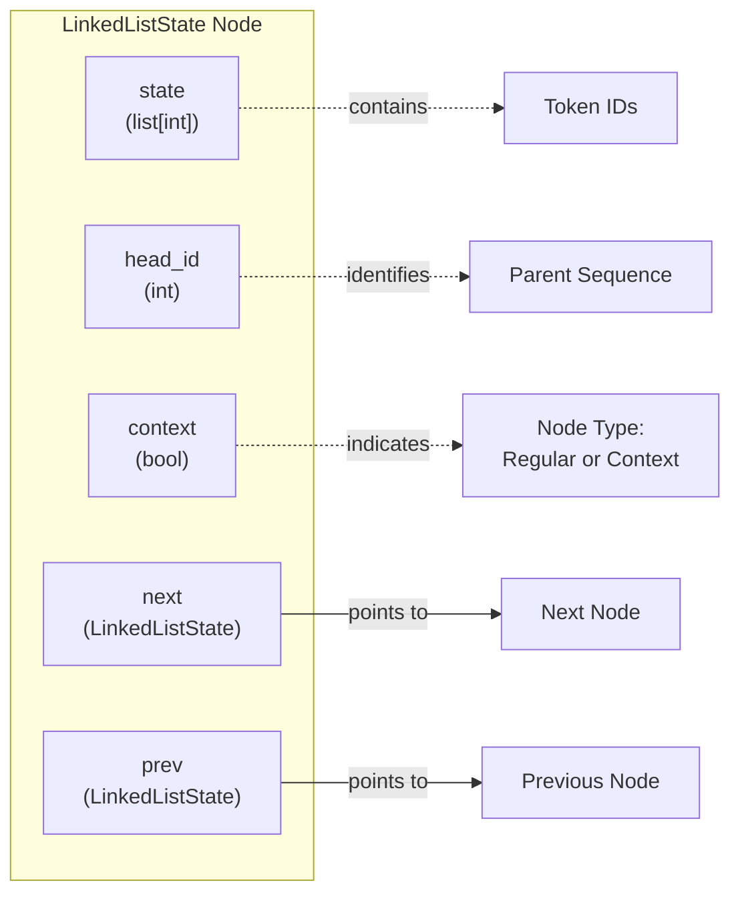
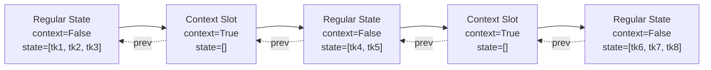
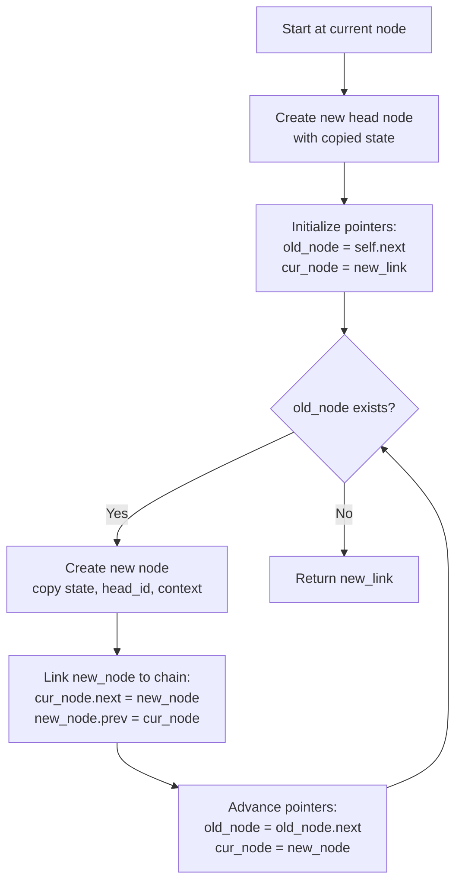
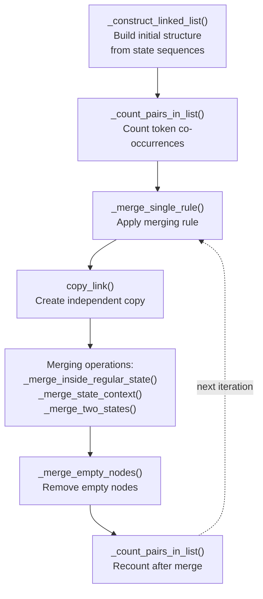
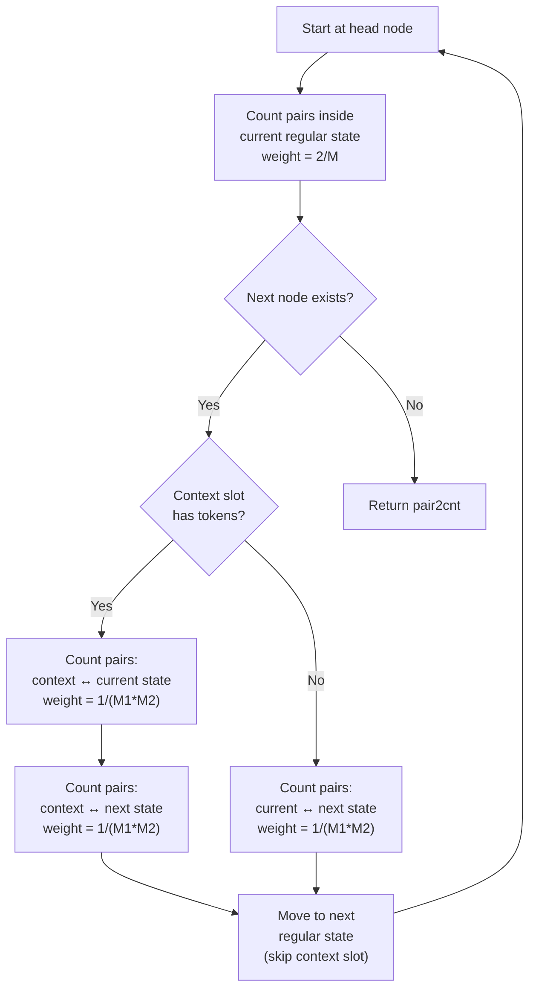
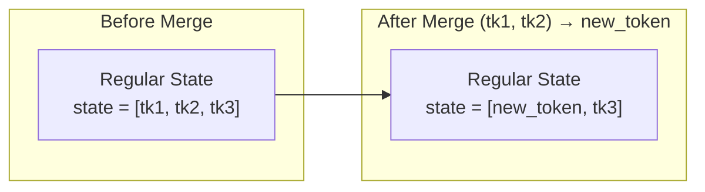
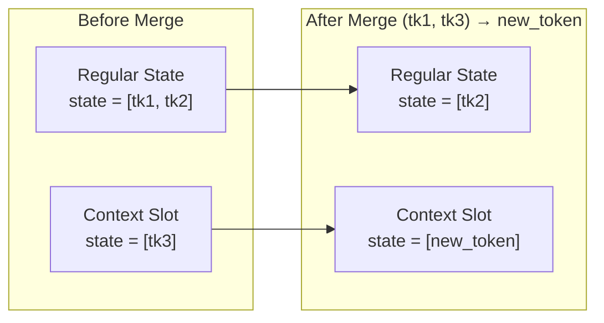
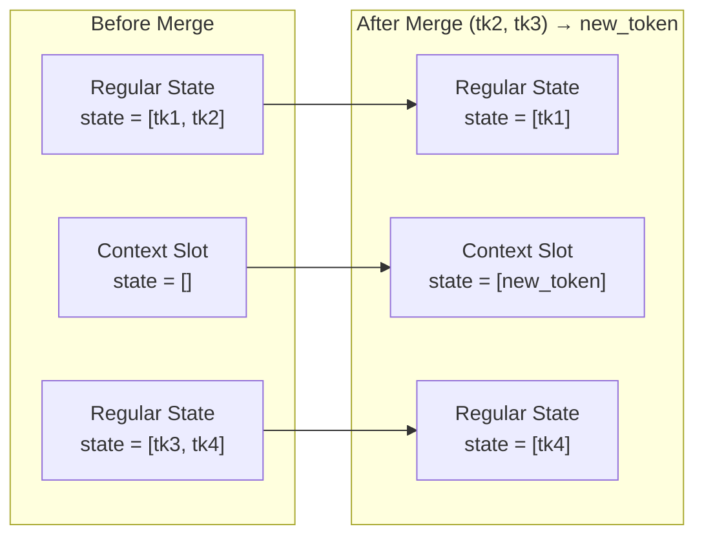
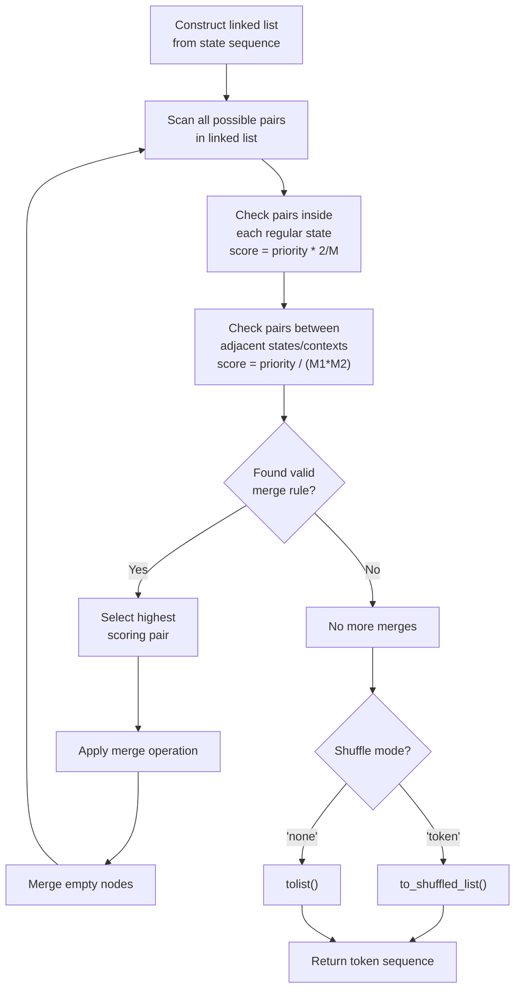

<!-- source: DeepWiki mcp.deepwiki.com · repo google-deepmind/action_piece · page 9.4 LinkedListState Data Structure · fetched 2026-10-26 -->

# LinkedListState Data Structure

<details>
<summary>Relevant source files</summary>

The following files were used as context for generating this wiki page:

- [genrec/models/ActionPiece/core.py](genrec/models/ActionPiece/core.py)
- [genrec/models/ActionPiece/utils.py](genrec/models/ActionPiece/utils.py)

</details>


## Purpose and Scope

This page documents the `LinkedListState` class, a specialized doubly-linked list data structure used by the ActionPiece tokenization system for efficient token merging operations during vocabulary construction and sequence encoding. 

For information about how vocabulary construction works overall, see [Vocabulary Construction (ActionPieceCore)](#3.2). For details on the tokenization API, see [ActionPieceCore API](#9.1).

**Sources:** [genrec/models/ActionPiece/utils.py:21-119](), [genrec/models/ActionPiece/core.py:1-853]()

---

## Overview

The `LinkedListState` class is a node in a doubly-linked list that represents action sequences during ActionPiece vocabulary training. This data structure enables efficient token merging by maintaining a flexible representation of sequences that can be modified in-place during the BPE-like merging algorithm.

### Key Design Principles

| Principle | Description |
|-----------|-------------|
| **Alternating Node Structure** | Regular state nodes alternate with context slot nodes |
| **In-place Modification** | Supports efficient merging without full sequence reconstruction |
| **Bidirectional Traversal** | Doubly-linked structure allows forward and backward navigation |
| **Copy-on-Write** | `copy_link()` creates independent copies for safe concurrent modifications |

**Sources:** [genrec/models/ActionPiece/utils.py:21-119](), [genrec/models/ActionPiece/core.py:212-506]()

---

## Class Structure

### LinkedListState Node Architecture



**Diagram: LinkedListState node attributes and relationships**

**Sources:** [genrec/models/ActionPiece/utils.py:21-44]()

### Attributes

| Attribute | Type | Description |
|-----------|------|-------------|
| `state` | `list[int]` | List of token IDs contained in this node |
| `head_id` | `int` | Identifier for the sequence this node belongs to |
| `context` | `bool` | `True` if this is a context slot, `False` if regular state |
| `next` | `LinkedListState \| None` | Reference to the next node in the list |
| `prev` | `LinkedListState \| None` | Reference to the previous node in the list |

**Sources:** [genrec/models/ActionPiece/utils.py:39-44]()

---

## Linked List Structure During Vocabulary Training

### Alternating Node Pattern

The ActionPiece system constructs linked lists where regular state nodes (containing action tokens) alternate with context slot nodes (initially empty). This pattern enables the system to track both intra-state and inter-state token relationships.



**Diagram: Typical linked list structure with alternating regular state and context slot nodes**

**Sources:** [genrec/models/ActionPiece/core.py:212-231]()

### Construction Process

The `_construct_linked_list()` method in `ActionPieceCore` builds this structure from a state sequence:

1. Create head node from first state (regular state, `context=False`)
2. For each subsequent state:
   - Append context slot node (`context=True`, empty `state=[]`)
   - Append regular state node (`context=False`, contains tokens)
3. Return head node

**Sources:** [genrec/models/ActionPiece/core.py:212-231]()

---

## Core Methods

### Navigation and Traversal

#### append()

```python
def append(self, node):
    """Append a node to the end of the linked list."""
    self.next = node
    node.prev = self
    return self.next
```

Appends a node to the current node and establishes bidirectional links. Returns the appended node for chaining operations.

**Sources:** [genrec/models/ActionPiece/utils.py:46-50]()

#### nextk()

```python
def nextk(self, k):
    """Return the k-th next node of the linked list."""
```

Traverses `k` nodes forward from the current node. Used for navigating the alternating structure (e.g., `nextk(2)` moves to the next regular state).

**Sources:** [genrec/models/ActionPiece/utils.py:84-92]()

---

### Copying Operations

#### copy()

```python
def copy(self):
    """Duplicate this node."""
```

Creates a shallow copy of the current node, copying the `state` list but maintaining the same `next` and `prev` references. Used when a single node needs duplication without copying the entire chain.

**Sources:** [genrec/models/ActionPiece/utils.py:52-61]()

#### copy_link()

```python
def copy_link(self):
    """Duplicate this node and its following nodes."""
```

Creates a deep copy of the entire linked list starting from the current node. All subsequent nodes are duplicated with new `state` lists and new link references. This is critical for safe token merging operations.

**Process Flow:**



**Diagram: copy_link() process flow**

This method is used in `_merge_single_rule()` to create an independent copy of a linked list before applying merging operations, ensuring the original list remains unchanged until the update is validated.

**Sources:** [genrec/models/ActionPiece/utils.py:63-82](), [genrec/models/ActionPiece/core.py:483-486]()

---

### Serialization Methods

#### tolist()

```python
def tolist(self):
    """Convert the linked list to a list of states."""
```

Traverses the entire linked list and concatenates all `state` lists (both regular states and context slots) into a single flat list of tokens. Used for final sequence representation after merging operations complete.

**Sources:** [genrec/models/ActionPiece/utils.py:94-101]()

#### to_shuffled_list()

```python
def to_shuffled_list(self):
    """Convert the linked list to a list of states where each state is shuffled."""
```

Similar to `tolist()`, but shuffles tokens within each node's `state` before concatenation. This implements the "token" shuffle mode during encoding, maintaining state boundaries while randomizing token order within each state.

**Sources:** [genrec/models/ActionPiece/utils.py:103-113](), [genrec/models/ActionPiece/core.py:793-794]()

---

## Usage Patterns in ActionPieceCore

### Linked List Lifecycle During Vocabulary Training



**Diagram: Linked list lifecycle during a single vocabulary training step**

**Sources:** [genrec/models/ActionPiece/core.py:299-645]()

---

### Pair Counting Strategy

The linked list structure enables efficient counting of token co-occurrence pairs during vocabulary construction. The `_count_pairs_in_list()` method implements weighted pair counting:

**Pair Counting Logic:**

| Pair Location | Weight Formula | Description |
|---------------|----------------|-------------|
| **Inside Regular State** | `2 / M` | Pairs within same state, where M = tokens in state |
| **Between Regular States** | `1 / (M1 * M2)` | Pairs across adjacent states (no context) |
| **State ↔ Context Slot** | `1 / (M1 * M2)` | Pairs between state and populated context slot |



**Diagram: Pair counting traversal algorithm**

**Sources:** [genrec/models/ActionPiece/core.py:233-297]()

---

### Token Merging Operations

The linked list structure supports three types of merging operations:

#### 1. Merge Inside Regular State

When two tokens co-occur within the same regular state node:



**Diagram: Merging tokens within a single state**

The new token appears first (coarse-to-fine ordering), and constituent tokens are removed.

**Sources:** [genrec/models/ActionPiece/core.py:413-422]()

#### 2. Merge Between State and Context Slot

When a token in a regular state pairs with a token in an adjacent context slot:



**Diagram: Merging token between state and context slot**

The merged token replaces the existing token in the context slot, and the constituent token is removed from the regular state.

**Sources:** [genrec/models/ActionPiece/core.py:424-443]()

#### 3. Merge Between Two Regular States

When tokens from two adjacent regular states merge (context slot must be empty):



**Diagram: Merging tokens between two regular states**

The merged token is inserted into the previously empty context slot between the states, and constituent tokens are removed from their respective states.

**Sources:** [genrec/models/ActionPiece/core.py:445-471]()

---

### Empty Node Cleanup

The `_merge_empty_nodes()` method maintains linked list integrity after merging operations by:

1. **Moving context slot content to empty regular states:** If a regular state becomes empty and the previous context slot has content, move the context slot content to the regular state
2. **Removing consecutive empty nodes:** If both a regular state and its next context slot are empty, remove both nodes from the chain

This cleanup process runs iteratively until no more changes can be made.

**Sources:** [genrec/models/ActionPiece/core.py:365-411]()

---

## Encoding with LinkedListState

During sequence encoding (when `shuffle` mode is not `'feature'`), the linked list structure enables priority-based greedy merging:



**Diagram: Encoding process using LinkedListState structure**

**Sources:** [genrec/models/ActionPiece/core.py:697-796]()

---

## Performance Characteristics

| Operation | Time Complexity | Notes |
|-----------|-----------------|-------|
| `append()` | O(1) | Constant time link update |
| `copy()` | O(1) | Single node copy with state list copy |
| `copy_link()` | O(n) | Copies entire chain of n nodes |
| `nextk(k)` | O(k) | Linear in k, typically k=2 to skip context slots |
| `tolist()` | O(n*m) | n nodes, m average tokens per node |
| `to_shuffled_list()` | O(n*m*log(m)) | Additional shuffle cost per node |

**Note:** During vocabulary training, each merge operation only updates sequences containing the merged pair (tracked via `pair2head_ids` inverted index), avoiding full corpus traversal.

**Sources:** [genrec/models/ActionPiece/utils.py:46-113](), [genrec/models/ActionPiece/core.py:508-645]()

---

## Summary

The `LinkedListState` data structure is a critical component of the ActionPiece tokenization system that:

- **Represents action sequences** with alternating regular state and context slot nodes
- **Enables efficient token merging** through in-place modifications and copy-on-write semantics
- **Supports weighted pair counting** for vocabulary construction with both intra-state and inter-state relationships
- **Facilitates flexible encoding strategies** through greedy priority-based merging and multiple serialization modes

The bidirectional linked list design with explicit context slots allows ActionPiece to capture both local (within-state) and contextual (between-state) token relationships during vocabulary learning.

**Sources:** [genrec/models/ActionPiece/utils.py:21-119](), [genrec/models/ActionPiece/core.py:212-796]()

---

