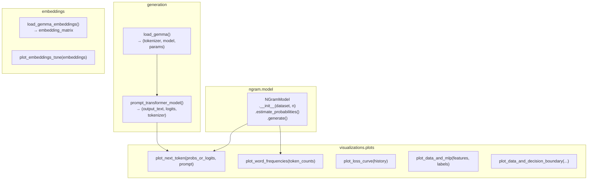
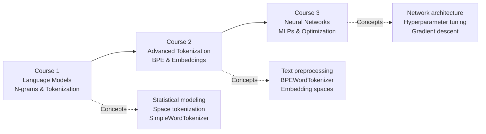
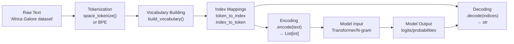
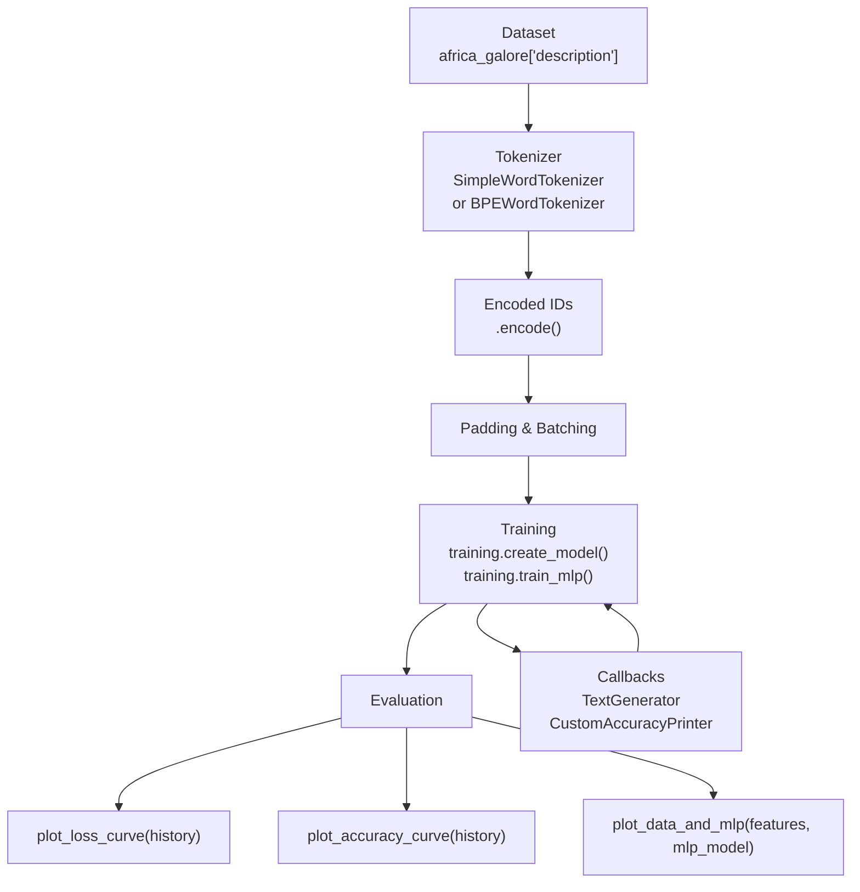
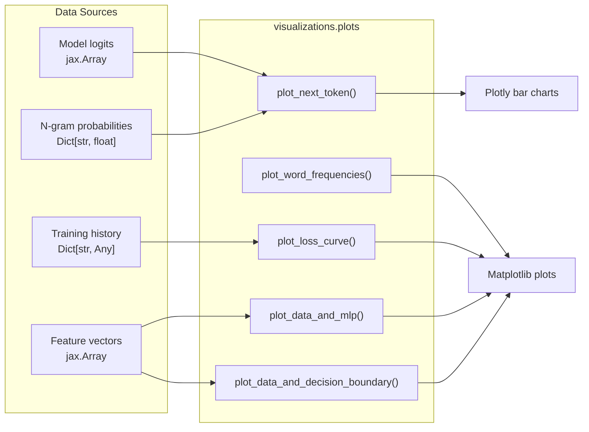
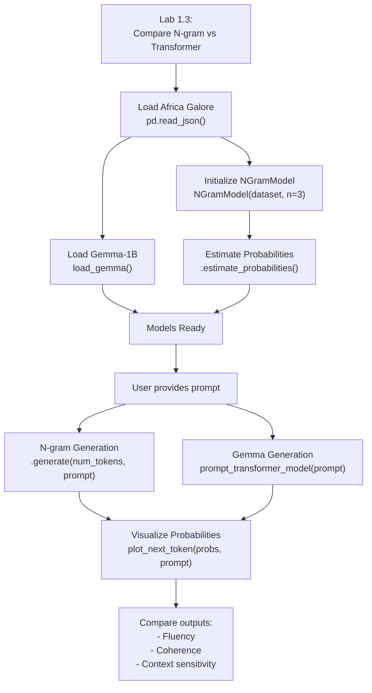
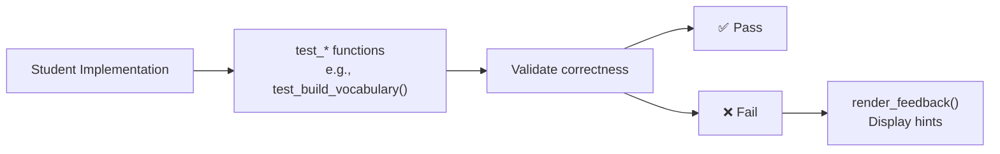

<!-- source: DeepWiki mcp.deepwiki.com · repo google-deepmind/ai-foundations · page 1 Overview · fetched 2026-10-26 -->

# Overview

<details>
<summary>Relevant source files</summary>

The following files were used as context for generating this wiki page:

- [ai_foundations/feedback/course_1/slm/__init__.py](ai_foundations/feedback/course_1/slm/__init__.py)
- [ai_foundations/generation/loaders.py](ai_foundations/generation/loaders.py)
- [ai_foundations/ngram/model.py](ai_foundations/ngram/model.py)
- [ai_foundations/visualizations/__init__.py](ai_foundations/visualizations/__init__.py)
- [ai_foundations/visualizations/plots.py](ai_foundations/visualizations/plots.py)
- [course_1/gdm_lab_1_3_compare_n_gram_models_and_transformer_language_models.ipynb](course_1/gdm_lab_1_3_compare_n_gram_models_and_transformer_language_models.ipynb)
- [course_1/gdm_lab_1_4_prepare_the_dataset_for_training_a_slm.ipynb](course_1/gdm_lab_1_4_prepare_the_dataset_for_training_a_slm.ipynb)

</details>


## Purpose and Scope

The `ai-foundations` repository serves a dual purpose:

1. **Core Python Library**: The `ai_foundations` package provides reusable utilities for language modeling, including n-gram models, pre-trained transformer loading (Gemma), visualization tools, training utilities, embedding manipulation, and automated feedback systems.

2. **Educational Framework**: Three progressive courses (`course_1/`, `course_2/`, `course_3/`) teach AI fundamentals through hands-on labs that build upon the core library. Each course contains Jupyter notebooks implementing specific exercises.

This document provides a high-level overview of the repository architecture and how components interact. For detailed documentation of specific modules, see:
- Core library modules: [Core Library Reference](#2)
- Course-specific implementations: [Course 1](#3), [Course 2](#4), [Course 3](#5)

**Sources**: [course_1/gdm_lab_1_4_prepare_the_dataset_for_training_a_slm.ipynb:1-100](), [course_1/gdm_lab_1_3_compare_n_gram_models_and_transformer_language_models.ipynb:1-100](), [ai_foundations/visualizations/plots.py:1-50]()

## Repository Architecture

The repository is organized into two primary sections:

| Component | Location | Purpose |
|-----------|----------|---------|
| **Core Library** | `ai_foundations/` | Reusable Python package with language modeling utilities |
| **Course 1** | `course_1/` | Language model foundations (n-grams, tokenization, first SLM) |
| **Course 2** | `course_2/` | Advanced tokenization and embeddings (BPE, preprocessing) |
| **Course 3** | `course_3/` | Neural network training (MLPs, hyperparameters, gradients) |

**Sources**: Repository structure from provided diagrams and file listings

### Dual Nature: Library and Educational Content

```mermaid
graph TB
    subgraph Library["ai_foundations Package"]
        NGram["ngram.model.NGramModel"]
        Loaders["generation.loaders.load_gemma()"]
        Viz["visualizations.plots"]
        Train["training module"]
        Emb["embeddings module"]
        FB["feedback module"]
    end
    
    subgraph C1["Course 1: Language Model Foundations"]
        L13["Lab 1.3: Compare Models"]
        L14["Lab 1.4: Dataset Prep<br/>SimpleWordTokenizer"]
        L15["Lab 1.5: Train SLM"]
    end
    
    subgraph C2["Course 2: Tokenization & Embeddings"]
        L21["Lab 2.1: Text Preprocessing"]
        L22["Lab 2.2: Char vs Word"]
        L24["Lab 2.4: BPE Implementation"]
        L25["Lab 2.5: Embeddings"]
    end
    
    subgraph C3["Course 3: Neural Networks"]
        L34["Lab 3.4: Design MLP"]
        L35["Lab 3.5: Hyperparameters"]
        L37["Lab 3.7: Gradients"]
    end
    
    L13 --> NGram
    L13 --> Loaders
    L13 --> Viz
    L14 --> FB
    L15 --> Train
    L22 --> Viz
    L24 --> FB
    L25 --> Emb
    L34 --> Train
    L34 --> Viz
    L35 --> Train
    L37 --> Viz
```



**Sources**: [ai_foundations/ngram/model.py:30-77](), [ai_foundations/generation/loaders.py:28-70](), [ai_foundations/visualizations/__init__.py:1-28](), [course_1/gdm_lab_1_3_compare_n_gram_models_and_transformer_language_models.ipynb:1-250]()

## Core Library Structure

The `ai_foundations` package contains five primary modules:

### Module Overview

| Module | Key Components | Primary Use Cases |
|--------|---------------|------------------|
| `ngram.model` | `NGramModel` class | Statistical language modeling with n-gram probabilities |
| `generation` | `load_gemma()`, `prompt_transformer_model()` | Loading and prompting Gemma transformer models |
| `visualizations` | `plot_next_token()`, `plot_loss_curve()`, `plot_data_and_mlp()` | Visualizing probabilities, training metrics, decision boundaries |
| `training` | `create_model()`, `train_mlp()`, callbacks | Model creation and training loops |
| `embeddings` | `load_gemma_embeddings()`, `plot_embeddings_tsne()` | Loading and visualizing token embeddings |
| `feedback` | `test_*()` functions, `render_feedback()` | Automated testing for lab exercises |

**Sources**: [ai_foundations/visualizations/plots.py:1-100](), [ai_foundations/ngram/model.py:1-50](), [ai_foundations/generation/loaders.py:1-71](), [ai_foundations/feedback/course_1/slm/__init__.py:1-23]()

### Core Classes and Functions



**Sources**: [ai_foundations/ngram/model.py:30-193](), [ai_foundations/generation/loaders.py:28-71](), [ai_foundations/visualizations/plots.py:48-166]()

## Educational Course Progression

The three courses build progressively on each other:

### Course Dependency Flow



**Sources**: Repository structure from table of contents JSON

### Course 1: Language Model Foundations

| Lab | Key Implementation | Core Library Usage |
|-----|-------------------|-------------------|
| Lab 1.3 | Compare `NGramModel` vs Gemma-1B | `ngram.model`, `generation.load_gemma()`, `visualizations.plot_next_token()` |
| Lab 1.4 | Implement `SimpleWordTokenizer` | `feedback.course_1.slm` test functions |
| Lab 1.5 | Train first SLM | `training.create_model()`, `training` callbacks |

**Sources**: [course_1/gdm_lab_1_3_compare_n_gram_models_and_transformer_language_models.ipynb:200-242](), [course_1/gdm_lab_1_4_prepare_the_dataset_for_training_a_slm.ipynb:748-882]()

### Course 2: Advanced Tokenization and Embeddings

Builds on Course 1 by introducing:
- Text preprocessing with HTML/Unicode cleaning
- Character-level vs word-level tokenization comparison
- Byte Pair Encoding (BPE) implementation (`BPEWordTokenizer`)
- Embedding analysis with t-SNE visualization

### Course 3: Neural Network Training

Builds on Courses 1 and 2 by introducing:
- Custom MLP architecture design
- Overfitting/underfitting diagnosis via loss curves
- Gradient computation and optimization with JAX

**Sources**: Table of contents JSON structure

## Key Data Flows

### Tokenization Pipeline



**Sources**: [course_1/gdm_lab_1_4_prepare_the_dataset_for_training_a_slm.ipynb:748-882](), demonstrates `SimpleWordTokenizer` class with `encode()` and `decode()` methods

### Model Training and Evaluation Workflow



**Sources**: [ai_foundations/visualizations/plots.py:304-366](), [course_1/gdm_lab_1_4_prepare_the_dataset_for_training_a_slm.ipynb:748-882]()

### Visualization System Flow



**Sources**: [ai_foundations/visualizations/plots.py:48-461](), function definitions for all visualization utilities

## Common Datasets

The repository uses the **Africa Galore** dataset as the primary training corpus across all courses:

| Dataset | Location | Format | Usage |
|---------|----------|--------|-------|
| Africa Galore | `https://storage.googleapis.com/dm-educational/assets/ai_foundations/africa_galore.json` | JSON with `description` field | Text corpus for tokenization, n-gram training, SLM training |

**Loading pattern**:
```python
africa_galore = pd.read_json("https://storage.googleapis.com/dm-educational/assets/ai_foundations/africa_galore.json")
dataset = africa_galore["description"]
```

**Sources**: [course_1/gdm_lab_1_3_compare_n_gram_models_and_transformer_language_models.ipynb:227-232](), [course_1/gdm_lab_1_4_prepare_the_dataset_for_training_a_slm.ipynb:186-193]()

## Integration Example: Lab 1.3 Workflow

The following diagram shows how a typical lab integrates multiple library components:



**Sources**: [course_1/gdm_lab_1_3_compare_n_gram_models_and_transformer_language_models.ipynb:200-307](), demonstrates full workflow from loading to visualization

## Pre-trained Models

The library provides access to pre-trained Gemma transformer models:

| Model | Identifier | Parameters | Loading Function |
|-------|-----------|-----------|------------------|
| Gemma-1B | `"Gemma-1B"` | ~1 billion | `load_gemma(model_name="Gemma-1B")` |
| Gemma-4B | `"Gemma-4B"` | ~4 billion | `load_gemma(model_name="Gemma-4B")` |
| Gemma-1B-AttentionWeight | `"Gemma-1B-AttentionWeight"` | ~1 billion (with attention visualization) | `load_gemma(model_name="Gemma-1B-AttentionWeight")` |

**Return signature**: `(tokenizer, model, params)`
- `tokenizer`: `gm.text.Gemma3Tokenizer` instance
- `model`: `gm.nn.Gemma3_1B` or `gm.nn.Gemma3_4B` instance
- `params`: `Mapping[str, Any]` with pre-trained weights

**Sources**: [ai_foundations/generation/loaders.py:28-71]()

## Feedback and Testing System

Each lab includes automated testing via the `feedback` module:



**Example test functions**:
- `test_build_tokens_list()` - Validates token list construction
- `test_build_vocabulary()` - Validates vocabulary building
- `test_index_to_token()` - Validates index-to-token mapping
- `test_simple_word_tokenizer()` - Validates `SimpleWordTokenizer` implementation

**Sources**: [ai_foundations/feedback/course_1/slm/__init__.py:1-23](), [course_1/gdm_lab_1_4_prepare_the_dataset_for_training_a_slm.ipynb:283-291]()

## Summary

The `ai-foundations` repository provides:

1. **Reusable Library**: Production-ready implementations of n-gram models (`NGramModel`), transformer loading (`load_gemma()`), visualization utilities (`plots` module), and training infrastructure
2. **Educational Scaffolding**: Three progressive courses with hands-on labs that teach AI fundamentals through practical implementation
3. **Tight Integration**: Labs leverage library components while introducing custom implementations (e.g., `SimpleWordTokenizer`, `BPEWordTokenizer`) that follow library patterns
4. **Automated Feedback**: Test functions provide immediate validation and guidance for student implementations

For detailed documentation of specific components, refer to the subsections: [Core Library Reference](#2), [Course 1](#3), [Course 2](#4), [Course 3](#5).

**Sources**: Repository architecture and file structure from all provided files

---

