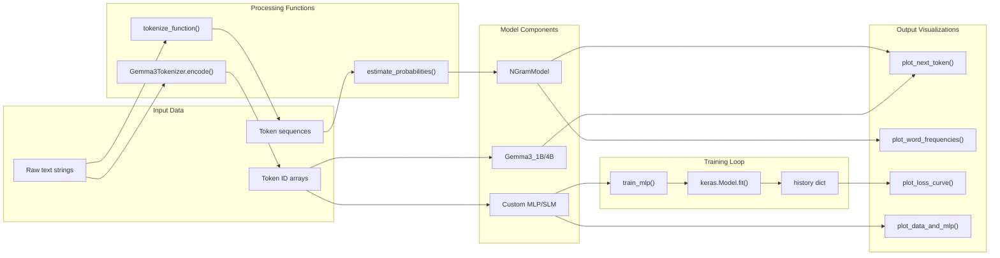
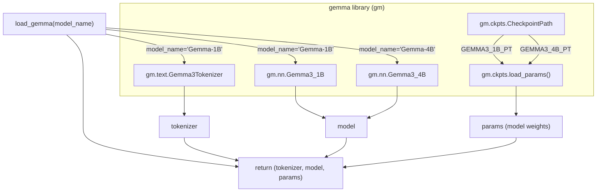
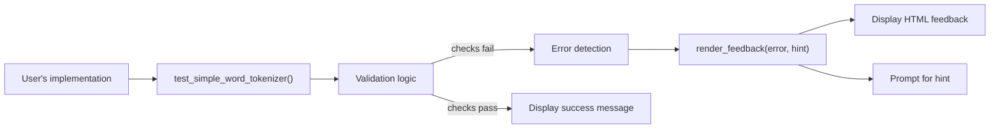
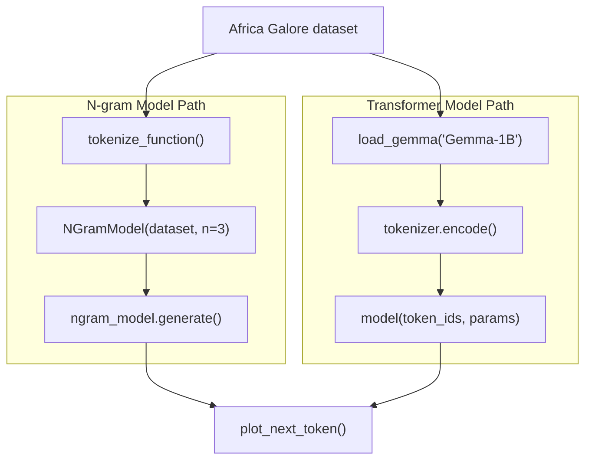
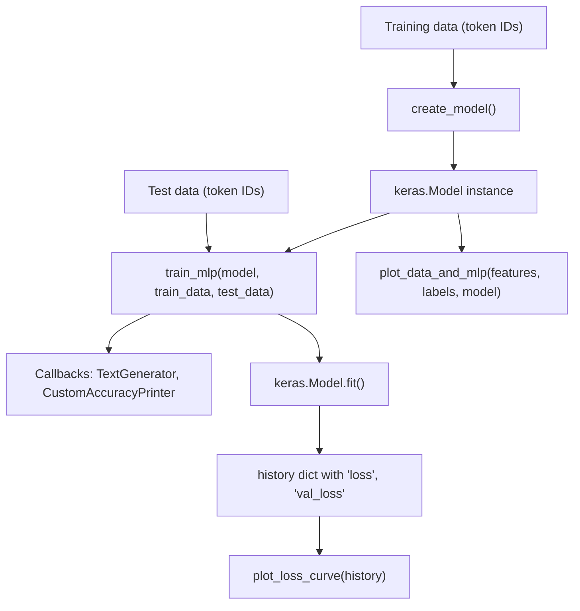
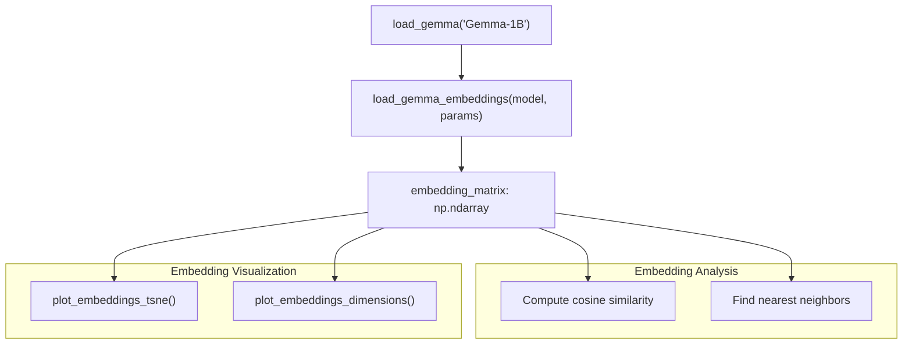

<!-- source: DeepWiki mcp.deepwiki.com · repo google-deepmind/ai-foundations · page 2 Core Library Reference · fetched 2026-10-26 -->

# Core Library Reference

<details>
<summary>Relevant source files</summary>

The following files were used as context for generating this wiki page:

- [ai_foundations/feedback/course_1/slm/__init__.py](ai_foundations/feedback/course_1/slm/__init__.py)
- [ai_foundations/feedback/utils.py](ai_foundations/feedback/utils.py)
- [ai_foundations/generation/loaders.py](ai_foundations/generation/loaders.py)
- [ai_foundations/ngram/model.py](ai_foundations/ngram/model.py)
- [ai_foundations/visualizations/__init__.py](ai_foundations/visualizations/__init__.py)
- [ai_foundations/visualizations/plots.py](ai_foundations/visualizations/plots.py)

</details>


## Purpose and Scope

This document provides a reference overview of the `ai_foundations` Python package, which serves as the core library supporting the educational labs in this repository. The package contains reusable utilities for language modeling, visualization, training, embeddings, and automated feedback testing.

This page serves as a navigation hub for the core library's major components. For detailed information about specific modules and their APIs, see the following subsections:

- For language model utilities, see [Language Models](#2.1)
- For plotting and visualization functions, see [Visualization System](#2.2)
- For model training utilities, see [Training Utilities](#2.3)
- For embedding operations, see [Embeddings Module](#2.4)
- For testing and feedback mechanisms, see [Feedback and Testing System](#2.5)

For information about how these components are used in educational contexts, see [Course 1: Language Model Foundations](#3), [Course 2: Advanced Tokenization and Embeddings](#4), and [Course 3: Neural Network Training Fundamentals](#5).

**Sources:** [ai_foundations/visualizations/__init__.py:1-28](), [ai_foundations/generation/loaders.py:1-71](), [ai_foundations/ngram/model.py:1-193]()

## Package Structure

The `ai_foundations` package is organized into the following top-level modules:

| Module | Purpose | Key Components |
|--------|---------|----------------|
| `ngram` | Statistical language modeling | `NGramModel` class |
| `generation` | Pre-trained model loading and text generation | `load_gemma()`, prompt utilities |
| `visualizations` | Plotting and visualization utilities | `plot_next_token()`, `plot_loss_curve()`, `plot_data_and_mlp()` |
| `training` | Model training loops and callbacks | `create_model()`, `train_mlp()`, custom callbacks |
| `embeddings` | Token embedding operations | `load_gemma_embeddings()`, `plot_embeddings_tsne()` |
| `feedback` | Automated testing and hints | `test_*` functions, `render_feedback()` |
| `machine_learning` | Neural network utilities | Dataset preparation, evaluation metrics |

**Sources:** [ai_foundations/visualizations/__init__.py:1-28](), [ai_foundations/feedback/course_1/slm/__init__.py:1-23]()

## Module Overview

### ngram Module

The `ngram` module provides statistical language modeling capabilities through the `NGramModel` class. This class estimates conditional probabilities from token sequences and generates text using learned n-gram statistics.

**Key Class:** `NGramModel` ([ai_foundations/ngram/model.py:30-193]())

**Primary Methods:**
- `estimate_probabilities()` - Builds probability distributions from training data
- `generate()` - Generates text using random or greedy sampling

For detailed documentation, see [Language Models](#2.1).

**Sources:** [ai_foundations/ngram/model.py:1-193]()

### generation Module

The `generation` module provides utilities for loading pre-trained Gemma transformer models and generating text with them.

**Key Function:** `load_gemma()` ([ai_foundations/generation/loaders.py:28-71]())

Returns a tuple of `(tokenizer, model, params)` for Gemma-1B or Gemma-4B models. Supports standard models and attention-weight variants.

For detailed documentation, see [Language Models](#2.1).

**Sources:** [ai_foundations/generation/loaders.py:1-71]()

### visualizations Module

The `visualizations` module contains comprehensive plotting functions for analyzing models, data, and training progress.

**Exported Functions** ([ai_foundations/visualizations/__init__.py:18-28]()):
- `plot_next_token()` - Visualizes probability distributions over next tokens
- `plot_word_frequencies()` - Creates log-log plots demonstrating Zipf's law
- `plot_loss_curve()` - Plots training and validation loss over epochs
- `plot_accuracy_curve()` - Plots accuracy metrics over epochs
- `plot_data_and_decision_boundary()` - Visualizes 2D classification boundaries
- `plot_data_and_mlp()` - Shows MLP decision boundaries with train/test data
- `visualize_mlp_architecture()` - Renders neural network layer diagrams
- `visualize_hyperparameter_loss()` - Compares hyperparameter impact on loss
- `visualize_attention()` - Shows attention weight heatmaps

For detailed documentation, see [Visualization System](#2.2).

**Sources:** [ai_foundations/visualizations/__init__.py:1-28](), [ai_foundations/visualizations/plots.py:1-695]()

### training Module

The `training` module provides utilities for building and training neural network models, including custom callbacks for monitoring training progress.

**Key Components:**
- Model creation functions for transformer-based language models
- Training loop implementations with JAX/Keras
- Custom callbacks: `TextGenerator`, `CustomAccuracyPrinter`

For detailed documentation, see [Training Utilities](#2.3).

### embeddings Module

The `embeddings` module provides functions for loading, manipulating, and visualizing token embeddings from pre-trained models.

**Key Functions:**
- `load_gemma_embeddings()` - Extracts embedding matrices from Gemma models
- `plot_embeddings_tsne()` - Projects embeddings to 2D using t-SNE
- `plot_embeddings_dimensions()` - Visualizes raw embedding dimensions

For detailed documentation, see [Embeddings Module](#2.4).

### feedback Module

The `feedback` module provides automated testing infrastructure and interactive hint rendering for educational labs.

**Key Components:**
- `render_feedback()` function ([ai_foundations/feedback/utils.py:32-59]())
- Course-specific test functions organized by lab topic
- Example tests from Course 1: `test_build_vocabulary()`, `test_simple_word_tokenizer()` ([ai_foundations/feedback/course_1/slm/__init__.py:18-22]())

For detailed documentation, see [Feedback and Testing System](#2.5).

**Sources:** [ai_foundations/feedback/utils.py:1-59](), [ai_foundations/feedback/course_1/slm/__init__.py:1-23]()

## Core Architecture

### Module Interaction Diagram

```mermaid
graph TB
    subgraph ngram["ngram Module"]
        NGramModel["NGramModel class"]
        estimate_probabilities["estimate_probabilities()"]
        generate_ngram["generate()"]
    end
    
    subgraph generation["generation Module"]
        load_gemma["load_gemma()"]
        Gemma3Tokenizer["gm.text.Gemma3Tokenizer"]
        Gemma3_1B["gm.nn.Gemma3_1B"]
        Gemma3_4B["gm.nn.Gemma3_4B"]
    end
    
    subgraph visualizations["visualizations Module"]
        plot_next_token["plot_next_token()"]
        plot_word_frequencies["plot_word_frequencies()"]
        plot_loss_curve["plot_loss_curve()"]
        plot_data_and_mlp["plot_data_and_mlp()"]
        plot_data_and_decision_boundary["plot_data_and_decision_boundary()"]
        visualize_mlp_architecture["visualize_mlp_architecture()"]
    end
    
    subgraph training["training Module"]
        create_model["create_model()"]
        train_mlp["train_mlp()"]
        TextGenerator["TextGenerator callback"]
        CustomAccuracyPrinter["CustomAccuracyPrinter callback"]
    end
    
    subgraph embeddings["embeddings Module"]
        load_gemma_embeddings["load_gemma_embeddings()"]
        plot_embeddings_tsne["plot_embeddings_tsne()"]
        plot_embeddings_dimensions["plot_embeddings_dimensions()"]
    end
    
    subgraph feedback["feedback Module"]
        render_feedback["render_feedback()"]
        test_build_vocabulary["test_build_vocabulary()"]
        test_simple_word_tokenizer["test_simple_word_tokenizer()"]
        test_build_tokens_list["test_build_tokens_list()"]
    end
    
    NGramModel --> plot_next_token
    generate_ngram --> plot_word_frequencies
    
    load_gemma --> Gemma3Tokenizer
    load_gemma --> Gemma3_1B
    load_gemma --> Gemma3_4B
    Gemma3_1B --> plot_next_token
    Gemma3_4B --> plot_next_token
    
    create_model --> train_mlp
    train_mlp --> TextGenerator
    train_mlp --> CustomAccuracyPrinter
    train_mlp --> plot_loss_curve
    
    train_mlp --> plot_data_and_mlp
    visualize_mlp_architecture -.documents.- train_mlp
    
    load_gemma_embeddings --> plot_embeddings_tsne
    load_gemma_embeddings --> plot_embeddings_dimensions
    
    test_build_vocabulary --> render_feedback
    test_simple_word_tokenizer --> render_feedback
    test_build_tokens_list --> render_feedback
```



**Sources:** [ai_foundations/visualizations/__init__.py:1-28](), [ai_foundations/ngram/model.py:1-193](), [ai_foundations/generation/loaders.py:1-71](), [ai_foundations/feedback/utils.py:1-59](), [ai_foundations/feedback/course_1/slm/__init__.py:1-23]()

### Data Flow Through Core Systems



**Sources:** [ai_foundations/ngram/model.py:30-193](), [ai_foundations/generation/loaders.py:28-71](), [ai_foundations/visualizations/plots.py:48-335]()

## Key Classes and Functions Reference

### NGramModel Class

The `NGramModel` class provides statistical language modeling using n-gram probabilities.

| Attribute/Method | Type | Description |
|-----------------|------|-------------|
| `n` | `int` | Order of the n-gram model (e.g., 2 for bigram, 3 for trigram) |
| `probabilities` | `dict[tuple, dict[str, float]]` | Nested dictionary mapping context to next-token distributions |
| `tokenize_function` | `Callable` | Function to tokenize input strings into token lists |
| `estimate_probabilities()` | method | Estimates conditional probabilities from dataset |
| `generate()` | method | Generates text using random or greedy sampling |

**Implementation:** [ai_foundations/ngram/model.py:30-193]()

**Sources:** [ai_foundations/ngram/model.py:30-193]()

### Visualization Functions

The following table summarizes the primary visualization functions and their purposes:

| Function | Primary Use | Input Types | Output |
|----------|-------------|-------------|--------|
| `plot_next_token()` | Token probability distributions | `np.ndarray` or `dict[str, float]` | Interactive Plotly bar chart |
| `plot_word_frequencies()` | Zipf's law visualization | `collections.Counter` | Log-log matplotlib plot |
| `plot_loss_curve()` | Training progress monitoring | `dict` (Keras history) | Matplotlib line plot |
| `plot_accuracy_curve()` | Accuracy over epochs | `dict` (Keras history) | Matplotlib line plot |
| `plot_data_and_decision_boundary()` | Binary classification visualization | `jax.Array`, weight vector, bias | Matplotlib scatter + boundary |
| `plot_data_and_mlp()` | MLP decision boundaries | `jax.Array`, `keras.Model` | Matplotlib contour plot |
| `visualize_mlp_architecture()` | Neural network structure | `list[int]`, `int` | Matplotlib network diagram |
| `visualize_hyperparameter_loss()` | Hyperparameter tuning results | `dict[HyperParameterConfig, float]` | Matplotlib bar/line plots |

**Implementation:** [ai_foundations/visualizations/plots.py:1-695]()

**Sources:** [ai_foundations/visualizations/plots.py:48-695](), [ai_foundations/visualizations/__init__.py:18-28]()

### Model Loading and Generation



**Sources:** [ai_foundations/generation/loaders.py:28-71]()

### Feedback System Structure

The feedback system provides automated testing and interactive hints through a two-layer architecture:

1. **Core Utility Layer:** `render_feedback()` function ([ai_foundations/feedback/utils.py:32-59]())
2. **Course-Specific Test Layer:** Individual `test_*` functions organized by course and lab

**Example Feedback Flow:**



**Common Test Functions (Course 1):**
- `test_build_vocabulary()` - Validates vocabulary construction
- `test_simple_word_tokenizer()` - Validates tokenizer implementation
- `test_build_tokens_list()` - Validates token list generation
- `test_index_to_token()` - Validates index-to-token mapping
- `test_max_min_seqlen()` - Validates sequence length calculations

**Sources:** [ai_foundations/feedback/utils.py:1-59](), [ai_foundations/feedback/course_1/slm/__init__.py:1-23]()

## Integration Patterns

The core library modules work together to support common workflows in the educational labs:

### Pattern 1: Model Comparison Workflow

Used in Lab 1.3 to compare n-gram and transformer models:



**Sources:** [ai_foundations/ngram/model.py:1-193](), [ai_foundations/generation/loaders.py:28-71](), [ai_foundations/visualizations/plots.py:48-113]()

### Pattern 2: Training and Visualization Workflow

Used in Labs 1.5, 2.6, and throughout Course 3:



**Sources:** [ai_foundations/visualizations/plots.py:304-461]()

### Pattern 3: Embedding Analysis Workflow

Used in Labs 2.5 and 2.6 for embedding exploration:



**Sources:** [ai_foundations/generation/loaders.py:28-71]()

## Usage Notes

### Color Palette

All visualization functions use a consistent color palette defined in [ai_foundations/visualizations/plots.py:35]():

```python
COLOR_PALETTE = ["#FFC20A", "#0C7BDC", "#71A816"]
```

This ensures visual consistency across all plots in the educational materials.

### JAX and NumPy Compatibility

Most functions accept both JAX arrays and NumPy arrays interchangeably. The library uses `jax.numpy` for computations but converts to standard NumPy for matplotlib visualizations where necessary.

### Error Handling in Feedback System

The `render_feedback()` function handles multiple error formats:
- Two-argument errors: `ValueError(title, detail)`
- Tuple-packed errors: `ValueError((title, detail))`
- Single-argument errors: Falls back to generic title with error string as detail

Implementation: [ai_foundations/feedback/utils.py:32-59]()

**Sources:** [ai_foundations/visualizations/plots.py:35](), [ai_foundations/feedback/utils.py:32-59]()

## Related Documentation

For detailed API documentation of individual modules:
- [Language Models](#2.1) - Full API reference for `NGramModel` and `load_gemma()`
- [Visualization System](#2.2) - Complete documentation of all plotting functions
- [Training Utilities](#2.3) - Training loop implementations and callbacks
- [Embeddings Module](#2.4) - Embedding loading and visualization
- [Feedback and Testing System](#2.5) - Automated testing infrastructure

For practical usage examples in educational contexts:
- [Course 1: Language Model Foundations](#3)
- [Course 2: Advanced Tokenization and Embeddings](#4)
- [Course 3: Neural Network Training Fundamentals](#5)

---

