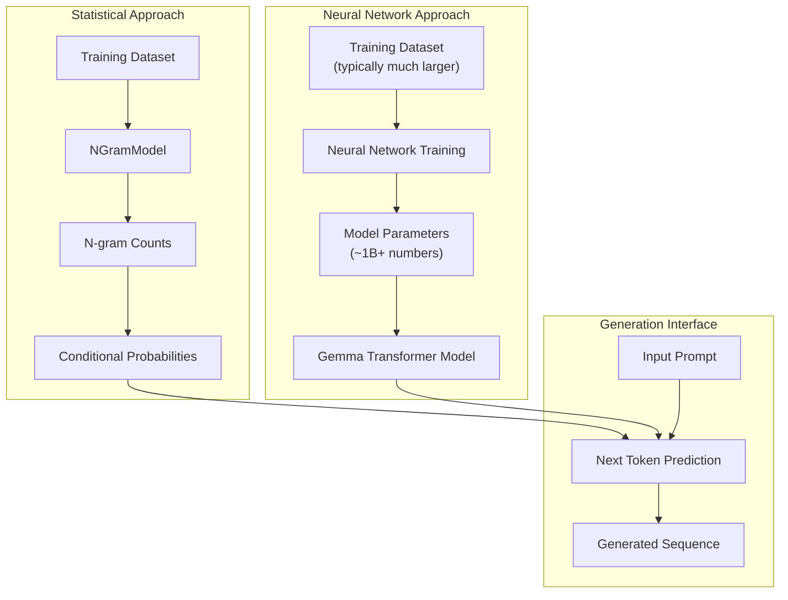
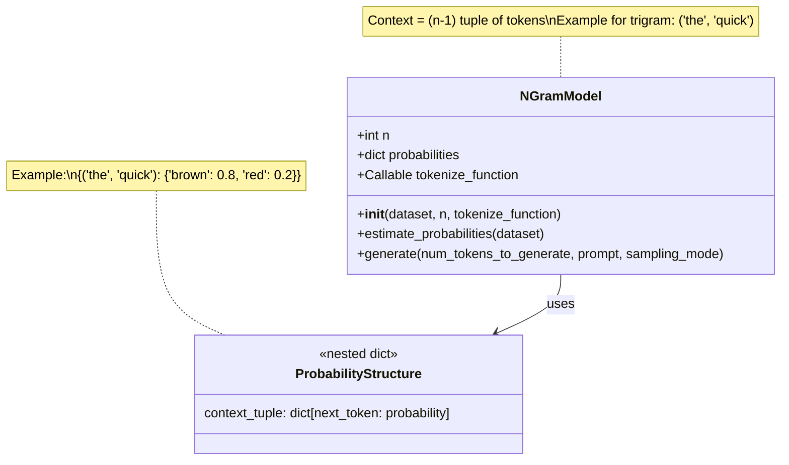
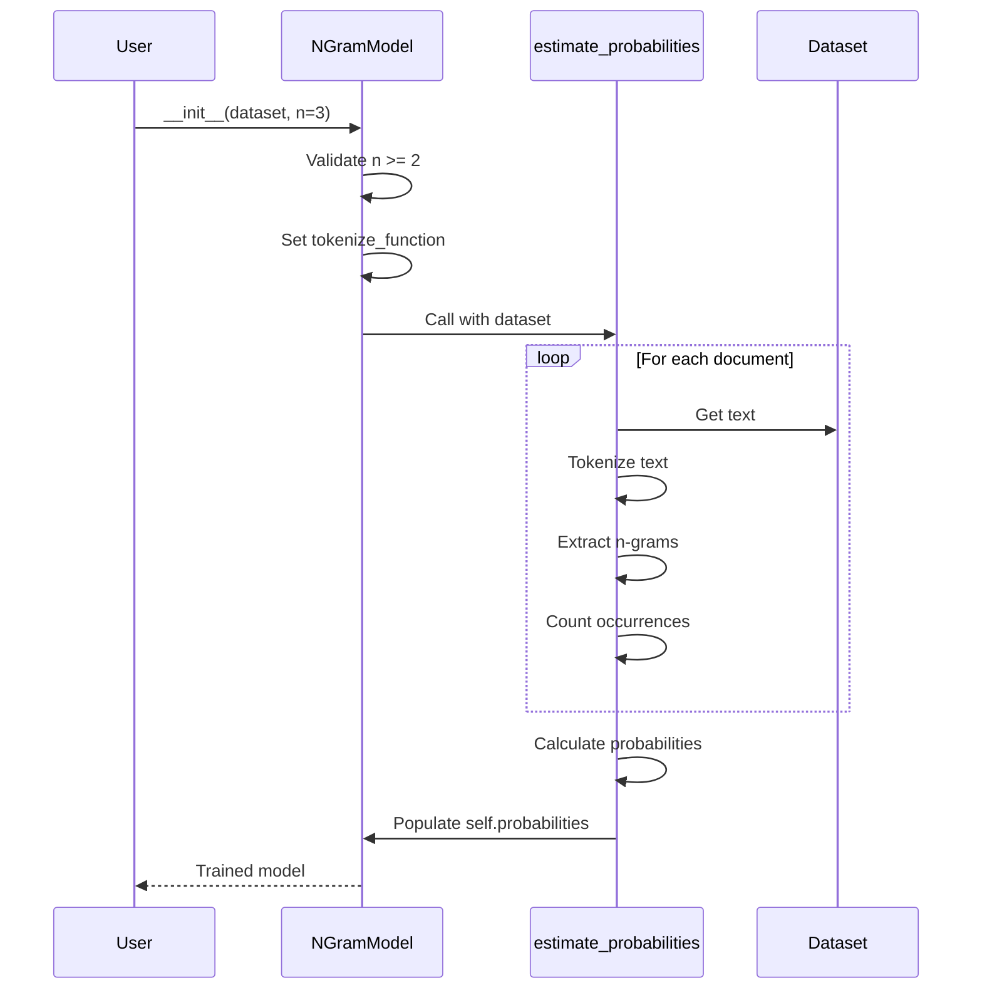
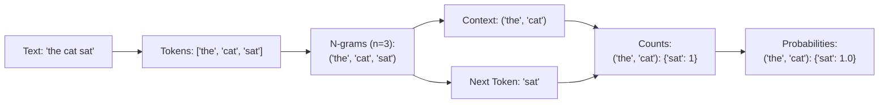
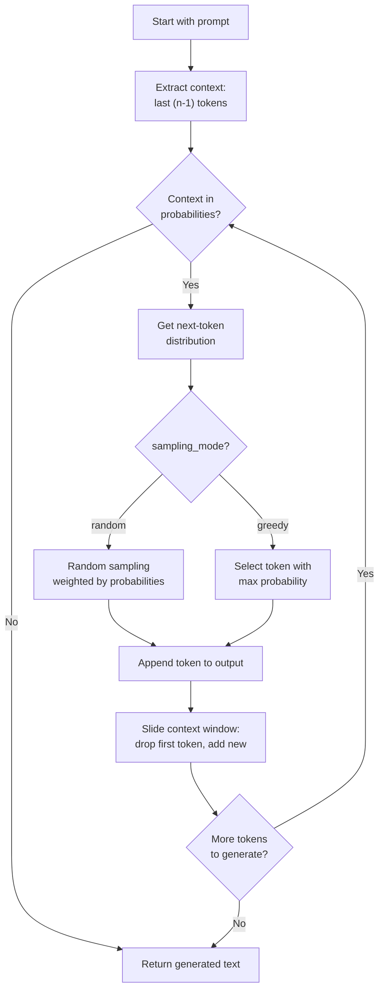
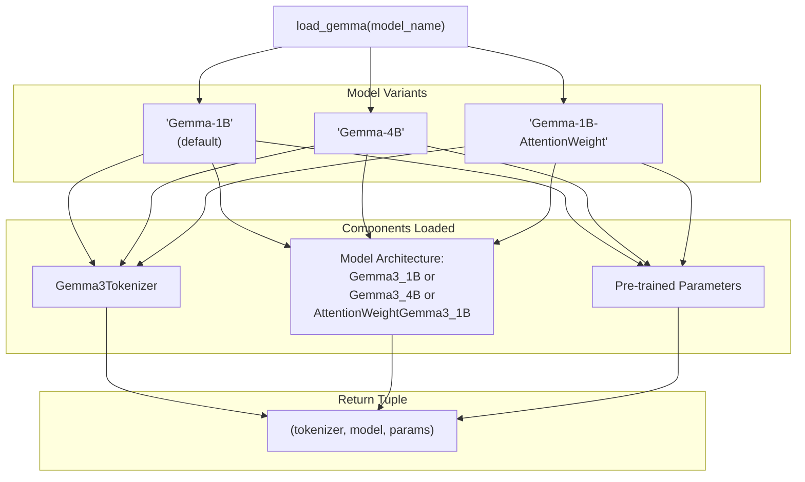
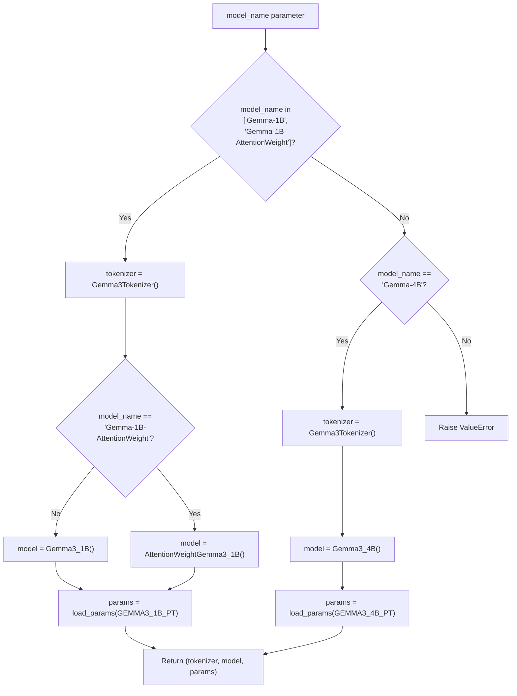
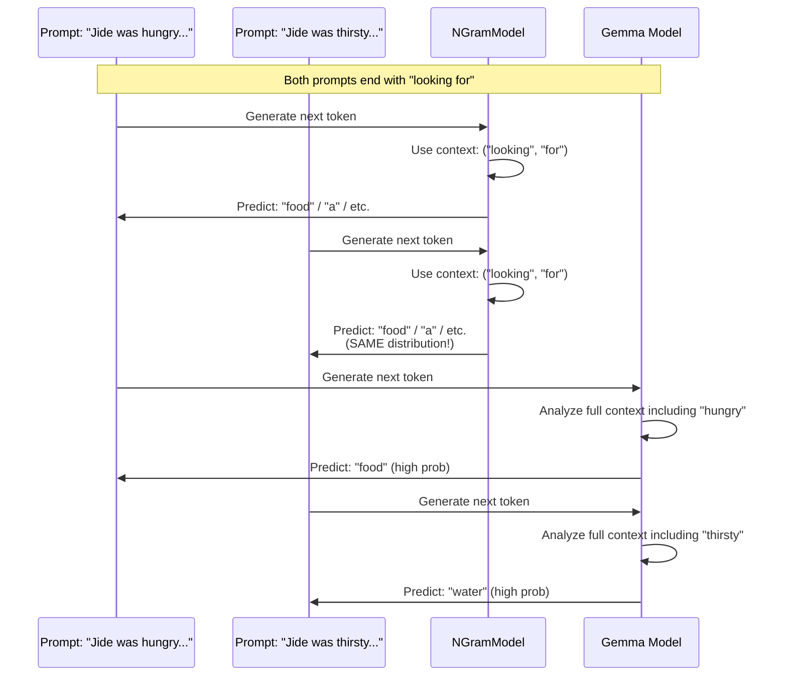

<!-- source: DeepWiki mcp.deepwiki.com · repo google-deepmind/ai-foundations · page 2.1 Language Models · fetched 2026-10-26 -->

# Language Models

<details>
<summary>Relevant source files</summary>

The following files were used as context for generating this wiki page:

- [ai_foundations/feedback/course_1/slm/__init__.py](ai_foundations/feedback/course_1/slm/__init__.py)
- [ai_foundations/generation/loaders.py](ai_foundations/generation/loaders.py)
- [ai_foundations/ngram/model.py](ai_foundations/ngram/model.py)
- [course_1/gdm_lab_1_3_compare_n_gram_models_and_transformer_language_models.ipynb](course_1/gdm_lab_1_3_compare_n_gram_models_and_transformer_language_models.ipynb)

</details>


## Purpose and Scope

This page documents the language model implementations provided by the `ai_foundations` library. It covers two distinct approaches to language modeling:

1. **Statistical N-gram models** via the `NGramModel` class for count-based probability estimation
2. **Pre-trained transformer models** via the `load_gemma` function for loading Gemma neural language models

For information about training your own transformer models, see [Lab 1.5: Training Your First Small Language Model](#3.3). For visualization of model predictions and probability distributions, see [Visualization System](#2.2). For interactive comparison between these two model types, see [Lab 1.3: Comparing N-gram and Transformer Models](#3.2).

---

## Overview of Language Modeling Approaches

The library provides two fundamentally different approaches to language modeling, each with distinct characteristics and use cases.



**Sources:** [ai_foundations/ngram/model.py:1-193](), [ai_foundations/generation/loaders.py:1-71](), [course_1/gdm_lab_1_3_compare_n_gram_models_and_transformer_language_models.ipynb:42-50]()

---

## NGramModel Class

### Architecture and Components

The `NGramModel` class implements statistical language modeling based on n-gram counts from a training corpus. It estimates conditional probabilities P(token | context) where the context is the preceding n-1 tokens.



**Sources:** [ai_foundations/ngram/model.py:30-77]()

### Core Attributes

| Attribute | Type | Description |
|-----------|------|-------------|
| `n` | `int` | Order of the n-gram model (e.g., 2 for bigram, 3 for trigram) |
| `probabilities` | `dict[tuple, dict[str, float]]` | Nested dictionary mapping contexts to next-token probability distributions |
| `tokenize_function` | `Callable[[str], list[str]]` | Function to split text into tokens (defaults to whitespace tokenization) |

**Sources:** [ai_foundations/ngram/model.py:36-44]()

### Initialization and Training

The model is instantiated and trained in a single step during initialization:



**Sources:** [ai_foundations/ngram/model.py:46-77](), [ai_foundations/ngram/model.py:78-121]()

### Probability Estimation Algorithm

The `estimate_probabilities` method implements the following process:

1. **N-gram Extraction**: Slides a window of size `n` over tokenized text
2. **Count Aggregation**: Uses `collections.Counter` to tally occurrences
3. **Probability Calculation**: Divides each next-token count by total context count



**Sources:** [ai_foundations/ngram/model.py:78-121]()

### Generation Process

The `generate` method produces text using the learned probability distributions:

| Parameter | Type | Default | Description |
|-----------|------|---------|-------------|
| `num_tokens_to_generate` | `int` | - | Number of tokens to generate |
| `prompt` | `str` | - | Initial text to continue from |
| `sampling_mode` | `str` | `"random"` | Either `"random"` (probabilistic) or `"greedy"` (deterministic) |

**Generation Algorithm:**
1. Extract last `n-1` tokens from prompt as initial context
2. Look up probability distribution for current context
3. Sample next token according to `sampling_mode`
4. Append token to output and update context (sliding window)
5. Repeat until desired length or context not found



**Sources:** [ai_foundations/ngram/model.py:123-192]()

### Limitations and Characteristics

The `NGramModel` has inherent limitations due to its statistical nature:

| Characteristic | Behavior | Implication |
|----------------|----------|-------------|
| Context Window | Fixed at `n-1` tokens | Cannot utilize longer-range dependencies |
| Data Sparsity | Fails on unseen contexts | May terminate generation early with warning |
| Smoothing | None (unsmoothed) | Zero probability for unseen n-grams |
| Memory Efficiency | Stores all observed n-grams | Can be large for high `n` or large corpora |

**Sources:** [ai_foundations/ngram/model.py:16-20](), [course_1/gdm_lab_1_3_compare_n_gram_models_and_transformer_language_models.ipynb:42-50](), [course_1/gdm_lab_1_3_compare_n_gram_models_and_transformer_language_models.ipynb:631-634]()

---

## Gemma Model Loading

### load_gemma Function

The `load_gemma` function provides a unified interface for loading pre-trained Gemma transformer models and their associated components.



**Function Signature:**
```python
load_gemma(model_name: Literal["Gemma-1B", "Gemma-4B", "Gemma-1B-AttentionWeight"] = "Gemma-1B")
    -> Tuple[gm.text.Gemma3Tokenizer, gm.nn.Gemma3_1B | gm.nn.Gemma3_4B, Mapping[str, Any]]
```

**Sources:** [ai_foundations/generation/loaders.py:28-70]()

### Model Variants and Loading Logic

| Model Name | Model Class | Parameters | Use Case |
|------------|-------------|------------|----------|
| `"Gemma-1B"` | `gm.nn.Gemma3_1B` | `gm.ckpts.CheckpointPath.GEMMA3_1B_PT` | Default option, faster inference, ~1 billion parameters |
| `"Gemma-4B"` | `gm.nn.Gemma3_4B` | `gm.ckpts.CheckpointPath.GEMMA3_4B_PT` | Higher quality outputs, ~4 billion parameters |
| `"Gemma-1B-AttentionWeight"` | `attention.AttentionWeightGemma3_1B` | `gm.ckpts.CheckpointPath.GEMMA3_1B_PT` | Special variant for attention analysis |

**Loading Implementation Flow:**



**Sources:** [ai_foundations/generation/loaders.py:52-70]()

### Tokenizer Component

All Gemma model variants use the same tokenizer class:

- **Type**: `gm.text.Gemma3Tokenizer`
- **Vocabulary Size**: Approximately 256,000 subword tokens
- **Algorithm**: SentencePiece-based subword tokenization
- **Capabilities**: Encodes text to token IDs and decodes token IDs back to text

**Sources:** [ai_foundations/generation/loaders.py:54-62]()

### Model Parameters

The parameters returned by `load_gemma` are pre-trained weights:

- **Type**: `Mapping[str, Any]` (typically JAX arrays)
- **Source**: Google DeepMind's trained Gemma checkpoints
- **Training**: Pre-trained on large-scale text corpora
- **Size**: ~1 billion numbers for Gemma-1B, ~4 billion for Gemma-4B

**Sources:** [ai_foundations/generation/loaders.py:59-63](), [course_1/gdm_lab_1_3_compare_n_gram_models_and_transformer_language_models.ipynb:209-212]()

---

## Comparison: N-gram vs Transformer Models

### Architectural Differences

```mermaid
graph TB
    subgraph "NGramModel Architecture"
        Input1["Input Prompt"]
        Extract1["Extract last (n-1) tokens"]
        Lookup1["Dictionary lookup in<br/>self.probabilities"]
        Sample1["Sample from distribution"]
        Output1["Next token"]
        
        Input1 --> Extract1
        Extract1 --> Lookup1
        Lookup1 --> Sample1
        Sample1 --> Output1
    end
    
    subgraph "Gemma Transformer Architecture"
        Input2["Input Prompt"]
        Tokenize2["Subword tokenization"]
        Embed2["Embedding layer"]
        Attention2["Multi-head attention layers<br/>(many layers)"]
        FFN2["Feed-forward networks"]
        Output2["Next token logits"]
        Sample2["Sample from softmax"]
        Token2["Next token"]
        
        Input2 --> Tokenize2
        Tokenize2 --> Embed2
        Embed2 --> Attention2
        Attention2 --> FFN2
        FFN2 --> Output2
        Output2 --> Sample2
        Sample2 --> Token2
    end
```



**Sources:** [ai_foundations/ngram/model.py:123-192](), [course_1/gdm_lab_1_3_compare_n_gram_models_and_transformer_language_models.ipynb:42-50]()

### Feature Comparison Matrix

| Feature | NGramModel | Gemma Transformer |
|---------|-----------|-------------------|
| **Context Window** | Fixed `n-1` tokens (typically 2-4) | Hundreds to thousands of tokens |
| **Model Type** | Statistical (count-based) | Neural network (learned representations) |
| **Parameter Count** | Equals number of unique n-grams | ~1-4 billion trainable weights |
| **Training Data** | Can work with small datasets | Requires large-scale corpora |
| **Generalization** | Limited to seen n-grams | Can generalize to unseen contexts |
| **Inference Speed** | Very fast (dictionary lookup) | Slower (neural network forward pass) |
| **Memory Usage** | Stores all n-gram probabilities | Stores model weights + activation memory |
| **Failure Mode** | Cannot generate if context unseen | Always produces output (may be low quality) |
| **Fluency** | Often produces word salad | Generally fluent and grammatical |
| **Coherence** | Poor long-range coherence | Better long-range coherence |

**Sources:** [course_1/gdm_lab_1_3_compare_n_gram_models_and_transformer_language_models.ipynb:42-50](), [course_1/gdm_lab_1_3_compare_n_gram_models_and_transformer_language_models.ipynb:527-541](), [course_1/gdm_lab_1_3_compare_n_gram_models_and_transformer_language_models.ipynb:631-634]()

### Context Sensitivity Example

The following diagram illustrates how each model handles context changes:



**Sources:** [course_1/gdm_lab_1_3_compare_n_gram_models_and_transformer_language_models.ipynb:406-473]()

### Use Case Recommendations

**When to use NGramModel:**
- Educational purposes to understand language modeling basics
- Baseline comparisons for research
- Quick prototyping with small, domain-specific datasets
- Resource-constrained environments where speed is critical
- Interpreting model predictions (transparent probability calculations)

**When to use Gemma Models:**
- Production applications requiring high-quality text generation
- Tasks needing long-range context understanding
- Applications where fluency and coherence are important
- Scenarios with large training datasets available
- When model size and inference speed are acceptable trade-offs

**Sources:** [course_1/gdm_lab_1_3_compare_n_gram_models_and_transformer_language_models.ipynb:625-634]()

---

## Code Usage Patterns

### Instantiating and Using NGramModel

Reference implementation from the codebase:

```python
# Load dataset
dataset = africa_galore["description"]  # List of text documents

# Create trigram model (n=3)
trigram_model = ngram_model.NGramModel(dataset, 3)

# Generate text with random sampling
output = trigram_model.generate(
    num_tokens_to_generate=50,
    prompt="Jide was hungry so she went looking for",
    sampling_mode="random"
)

# Generate text with greedy sampling (deterministic)
output = trigram_model.generate(
    num_tokens_to_generate=50,
    prompt="Jide was hungry so she went looking for",
    sampling_mode="greedy"
)
```

**Sources:** [course_1/gdm_lab_1_3_compare_n_gram_models_and_transformer_language_models.ipynb:227-242](), [ai_foundations/ngram/model.py:123-192]()

### Loading and Using Gemma Models

Reference implementation from the codebase:

```python
# Load Gemma-1B model
gemma_model = generation.load_gemma()
# Returns: (tokenizer, model, params)

# Load Gemma-4B model
gemma_model = generation.load_gemma("Gemma-4B")

# The returned object is used by prompt_transformer_model
# See Visualization System documentation for usage
```

**Sources:** [course_1/gdm_lab_1_3_compare_n_gram_models_and_transformer_language_models.ipynb:239-241](), [ai_foundations/generation/loaders.py:28-70]()

### Accessing NGramModel Probabilities

The probability distributions are directly accessible for inspection:

```python
# Access probability distribution for a specific context
context = ("looking", "for")  # Last (n-1) tokens

if context in trigram_model.probabilities:
    next_token_probs = trigram_model.probabilities[context]
    # Returns dict like: {"food": 0.3, "a": 0.2, "something": 0.15, ...}
else:
    # Context not seen during training
    print("Context not found in model")
```

**Sources:** [ai_foundations/ngram/model.py:36-44](), [course_1/gdm_lab_1_3_compare_n_gram_models_and_transformer_language_models.ipynb:364-374]()

---

## Integration with Other Systems

### Visualization Integration

Both model types integrate with the visualization system for probability distribution plotting:

- **NGramModel**: Pass `trigram_model.probabilities[context]` to `visualizations.plot_next_token()`
- **Gemma Models**: Pass `next_token_logits` from `generation.prompt_transformer_model()` to `visualizations.plot_next_token()`

See [Visualization System](#2.2) for details on plotting functions.

**Sources:** [course_1/gdm_lab_1_3_compare_n_gram_models_and_transformer_language_models.ipynb:346-375]()

### Text Generation Integration

The Gemma models loaded by `load_gemma` are consumed by the `generation.prompt_transformer_model()` function for actual text generation. The `NGramModel.generate()` method is self-contained and does not require external generation utilities.

See [Training Utilities](#2.3) for information on using these models in training pipelines.

**Sources:** [course_1/gdm_lab_1_3_compare_n_gram_models_and_transformer_language_models.ipynb:296-306]()

---

