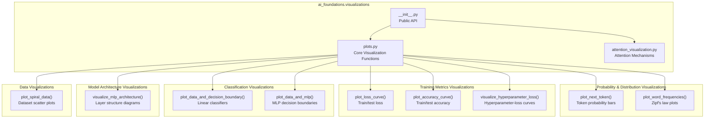
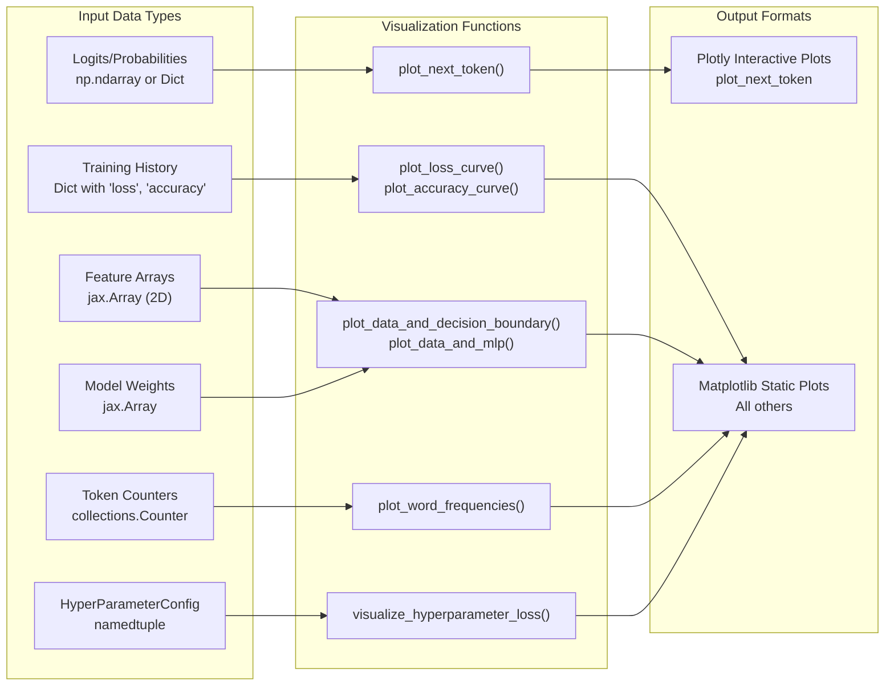
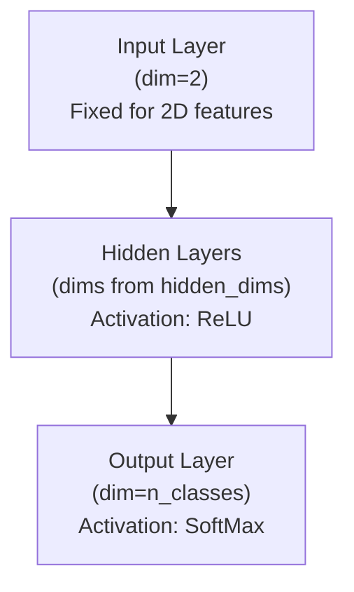
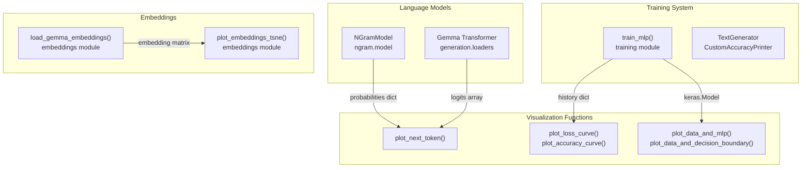

<!-- source: DeepWiki mcp.deepwiki.com · repo google-deepmind/ai-foundations · page 2.2 Visualization System · fetched 2026-10-26 -->

# Visualization System

<details>
<summary>Relevant source files</summary>

The following files were used as context for generating this wiki page:

- [ai_foundations/visualizations/__init__.py](ai_foundations/visualizations/__init__.py)
- [ai_foundations/visualizations/plots.py](ai_foundations/visualizations/plots.py)
- [course_1/gdm_lab_1_3_compare_n_gram_models_and_transformer_language_models.ipynb](course_1/gdm_lab_1_3_compare_n_gram_models_and_transformer_language_models.ipynb)

</details>


## Purpose and Scope

The Visualization System provides a comprehensive suite of plotting functions for analyzing language models, neural networks, and training dynamics. It serves as the primary visualization layer for the ai-foundations educational framework, enabling learners to explore model behaviors, training progress, and data characteristics through interactive and static plots.

This document covers the `ai_foundations.visualizations` module. For model training utilities that generate the metrics visualized here, see [Training Utilities](#2.3). For embedding-specific visualization functions, see [Embeddings Module](#2.4).

**Sources:** [ai_foundations/visualizations/__init__.py:1-28](), [ai_foundations/visualizations/plots.py:1-695]()

## Module Architecture

The visualization system is organized into functional categories, each addressing specific analysis needs. All functions are exposed through the `ai_foundations.visualizations` public API.



**Sources:** [ai_foundations/visualizations/__init__.py:1-28](), [ai_foundations/visualizations/plots.py:1-695]()

## Core Functions and Data Flow

The visualization system processes various data types from language models, training loops, and neural networks, transforming them into visual representations.



**Sources:** [ai_foundations/visualizations/plots.py:48-695]()

## Probability Distribution Visualizations

### plot_next_token

The `plot_next_token()` function visualizes the probability distribution over candidate next tokens, essential for understanding language model predictions.

**Function Signature:**
```python
plot_next_token(
    probs_or_logits: np.ndarray | Dict[str, float],
    prompt: str,
    keep_top: int = 30,
    tokenizer: Optional[Any] = None,
)
```

**Input Processing:**
| Input Type | Processing | Usage |
|------------|-----------|-------|
| `Dict[str, float]` | N-gram probabilities | Extracts keys as tokens, values as probabilities |
| `np.ndarray` (probabilities) | Pre-computed probabilities | Used directly if sum ≈ 1.0 |
| `np.ndarray` (logits) | Raw model outputs | Applies `jax.nn.softmax()` |

**Visualization Process:**
1. Convert logits to probabilities via softmax (if needed) [plots.py:78]()
2. Sort probabilities and select top-k tokens [plots.py:81-84]()
3. Decode token IDs using tokenizer (if provided) [plots.py:89-97]()
4. Generate interactive Plotly bar chart [plots.py:100-112]()

**Sources:** [ai_foundations/visualizations/plots.py:48-113](), [course_1/gdm_lab_1_3_compare_n_gram_models_and_transformer_language_models.ipynb:355-359]()

### plot_word_frequencies

The `plot_word_frequencies()` function creates log-log plots demonstrating Zipf's law in token distributions.

**Function Signature:**
```python
plot_word_frequencies(token_counts: Counter[str])
```

**Visualization Process:**
1. Extract ranks and frequencies from Counter [plots.py:124-130]()
2. Create log-log scatter plot [plots.py:136]()
3. Annotate most and least frequent tokens [plots.py:138-154]()
4. Display with axis labels and title [plots.py:157-163]()

**Sources:** [ai_foundations/visualizations/plots.py:115-166]()

## Training Metrics Visualizations

### plot_loss_curve

The `plot_loss_curve()` function displays training and validation loss progression over epochs.

**Function Signature:**
```python
plot_loss_curve(history: Dict[str, Any])
```

**Expected Dictionary Keys:**
| Key | Required | Description |
|-----|----------|-------------|
| `"loss"` | Yes | Training loss per epoch |
| `"val_loss"` | No | Validation/test loss per epoch |

**Visualization Features:**
- Dual curves for train/test comparison [plots.py:322-326]()
- Automatic y-axis scaling with 10% headroom [plots.py:328]()
- Color-coded using `COLOR_PALETTE` [plots.py:322-324]()

**Sources:** [ai_foundations/visualizations/plots.py:304-335]()

### plot_accuracy_curve

The `plot_accuracy_curve()` function visualizes classification accuracy over training epochs.

**Function Signature:**
```python
plot_accuracy_curve(history: Dict[str, Any])
```

**Expected Dictionary Keys:**
| Key | Required | Description |
|-----|----------|-------------|
| `"accuracy"` | Yes | Training accuracy per epoch |
| `"val_accuracy"` | No | Validation/test accuracy per epoch |

**Visualization Features:**
- Fixed y-axis range [0.0, 1.05] [plots.py:360]()
- Dual curves for train/test comparison [plots.py:355-359]()

**Sources:** [ai_foundations/visualizations/plots.py:337-367]()

## Classification Visualizations

### plot_data_and_decision_boundary

The `plot_data_and_decision_boundary()` function visualizes binary classification problems with linear decision boundaries.

**Function Signature:**
```python
plot_data_and_decision_boundary(
    input_features: jax.Array,
    labels: List[str],
    weight_vector: Optional[jax.Array] = None,
    bias_term: Optional[jax.Array] = None,
    title: str = "2D Prompt Embeddings and Decision Boundary",
    provide_feedback: bool = False,
)
```

**Weight Vector Handling:**
| Format | Interpretation |
|--------|---------------|
| `weight_vector` shape (2,) with `bias_term` | Standard format: w₁, w₂ separate from bias |
| `weight_vector` shape (3,) with `bias_term=None` | Combined format: [bias, w₁, w₂] [plots.py:222-225]() |

**Visualization Elements:**
1. Scatter plot of data points by class [plots.py:208-214]()
2. Decision boundary line: `w₁x₁ + w₂x₂ + b = 0` [plots.py:247-251]()
3. Weight vector arrow [plots.py:254-264]()
4. Orthogonal points highlighted (near boundary) [plots.py:229-244]()
5. Classification error count (if `provide_feedback=True`) [plots.py:286-301]()

**Sources:** [ai_foundations/visualizations/plots.py:168-302]()

### plot_data_and_mlp

The `plot_data_and_mlp()` function visualizes multi-class classification with MLP decision boundaries.

**Function Signature:**
```python
plot_data_and_mlp(
    features: jax.Array,
    label_ids: jax.Array,
    labels: List[str],
    features_test: Optional[jax.Array] = None,
    label_ids_test: Optional[jax.Array] = None,
    mlp_model: Optional[keras.Model] = None,
    title: Optional[str] = None,
)
```

**Visualization Process:**
1. Create 2D mesh grid over feature space [plots.py:405]()
2. Compute MLP predictions on grid points [plots.py:410-415]()
3. Plot filled contours for decision regions [plots.py:415]()
4. Overlay training points as circles [plots.py:418-423]()
5. Overlay test points as asterisks (if provided) [plots.py:424-430]()

**Legend Configuration:**
- Class labels from `labels` parameter
- Dataset split (train/test) with custom markers [plots.py:435-450]()

**Sources:** [ai_foundations/visualizations/plots.py:369-461]()

## Model Architecture Visualizations

### visualize_mlp_architecture

The `visualize_mlp_architecture()` function generates graphical representations of MLP layer structures.

**Function Signature:**
```python
visualize_mlp_architecture(hidden_dims: List[int], n_classes: int)
```

**Architecture Components:**


**Visualization Features:**
1. Layer dimensions: `[2] + hidden_dims + [n_classes]` [plots.py:472]()
2. Neuron representation:
   - Up to 10 neurons: all shown [plots.py:500-503]()
   - More than 10 neurons: first 5 + "..." + last 5 [plots.py:494-499]()
3. Connection lines between all neuron pairs [plots.py:507-516]()
4. Activation function labels between layers [plots.py:555-570]()
5. Color-coded layers using `COLOR_PALETTE` [plots.py:526-533]()

**Sources:** [ai_foundations/visualizations/plots.py:463-577]()

## Data Analysis Visualizations

### plot_spiral_data

The `plot_spiral_data()` function loads and visualizes multi-class spiral datasets.

**Function Signature:**
```python
plot_spiral_data(dataset_url: str)
```

**Data Format:**
- Input: CSV file with columns `"Feature_1"`, `"Feature_2"`, `"Label"` [plots.py:589-590]()
- Output: Scatter plot with color-coded classes [plots.py:593-600]()

**Sources:** [ai_foundations/visualizations/plots.py:579-601]()

## Hyperparameter Analysis

### visualize_hyperparameter_loss

The `visualize_hyperparameter_loss()` function analyzes the impact of different hyperparameter settings on test loss.

**Function Signature:**
```python
visualize_hyperparameter_loss(
    experiment_log: dict[HyperParameterConfig, float],
)
```

**HyperParameterConfig Structure:**
```python
HyperParameterConfig = namedtuple(
    "HyperParameterConfig",
    ["hidden_dims", "dropout_rate", "weight_decay_strength", "use_early_stopping"],
)
```

**Analyzed Hyperparameters:**
| Hyperparameter | Plot Type | Baseline Value |
|----------------|-----------|----------------|
| `dropout_rate` | Line plot | 0.0 |
| `weight_decay_strength` | Line plot | 0.0 |
| `use_early_stopping` | Bar plot | False |

**Validation Process:**
1. Check for baseline configuration in log [plots.py:631-637]()
2. Extract experiments for each hyperparameter [plots.py:651-663]()
3. Generate separate plots for each hyperparameter type [plots.py:641-694]()
4. Provide feedback on missing experiments [plots.py:666-672]()

**Sources:** [ai_foundations/visualizations/plots.py:603-695]()

## Integration with Core Library

The visualization system integrates tightly with other ai-foundations modules to provide end-to-end analysis capabilities.



**Typical Usage Patterns:**

1. **Model Comparison:** N-gram vs Transformer [course_1/gdm_lab_1_3:355-375]()
   ```python
   # Get transformer logits
   output_text, next_token_logits, tokenizer = generation.prompt_transformer_model(
       prompt, max_new_tokens=1, loaded_model=gemma_model
   )
   # Visualize transformer probabilities
   visualizations.plot_next_token(next_token_logits, prompt=prompt, tokenizer=tokenizer)
   
   # Visualize n-gram probabilities
   context_ngram = tuple(prompt.split(" ")[-2:])
   visualizations.plot_next_token(trigram_model.probabilities[context_ngram], prompt=prompt)
   ```

2. **Training Monitoring:** Loss curves during training
   ```python
   history = train_mlp(model, train_data, test_data, epochs=100)
   visualizations.plot_loss_curve(history)
   ```

3. **Decision Boundary Analysis:** MLP classification regions
   ```python
   visualizations.plot_data_and_mlp(
       features, label_ids, labels, 
       features_test, label_ids_test, 
       mlp_model=trained_model
   )
   ```

**Sources:** [course_1/gdm_lab_1_3_compare_n_gram_models_and_transformer_language_models.ipynb:355-375]()

## Technical Implementation Details

### Dependencies

The visualization system relies on the following libraries:

| Library | Primary Usage |
|---------|---------------|
| `plotly.express` | Interactive bar charts (`plot_next_token`) [plots.py:29]() |
| `matplotlib.pyplot` | Static plots (all other functions) [plots.py:26]() |
| `jax` / `jax.numpy` | Numerical operations, softmax [plots.py:21-22]() |
| `numpy` | Array manipulation [plots.py:27]() |
| `pandas` | Dataset loading (`plot_spiral_data`) [plots.py:28]() |
| `keras` | Model architecture visualization [plots.py:23]() |

**Sources:** [ai_foundations/visualizations/plots.py:21-30]()

### Color Palette

All visualizations use a consistent color palette defined as:
```python
COLOR_PALETTE = ["#FFC20A", "#0C7BDC", "#71A816"]
```

**Color Assignments:**
- Yellow (`#FFC20A`): Primary class, train data, test loss
- Blue (`#0C7BDC`): Secondary class, test data, train loss  
- Green (`#71A816`): Tertiary class, orthogonal points, weight vectors

**Sources:** [ai_foundations/visualizations/plots.py:35]()

### Data Type Conventions

The visualization functions accept standard scientific Python types:

| Python Type | JAX Equivalent | Usage Context |
|-------------|----------------|---------------|
| `np.ndarray` | `jax.Array` | Interchangeable for visualizations |
| `Dict[str, float]` | N/A | N-gram probability distributions |
| `collections.Counter` | N/A | Token frequency distributions |
| `keras.Model` | N/A | Neural network decision boundaries |

**Type Flexibility:**
- `plot_next_token` accepts both dictionaries (n-gram) and arrays (neural) [plots.py:49]()
- Decision boundary functions accept JAX arrays for GPU acceleration [plots.py:169]()
- All functions convert to NumPy for matplotlib compatibility where needed [plots.py:414]()

**Sources:** [ai_foundations/visualizations/plots.py:48-695]()

---

