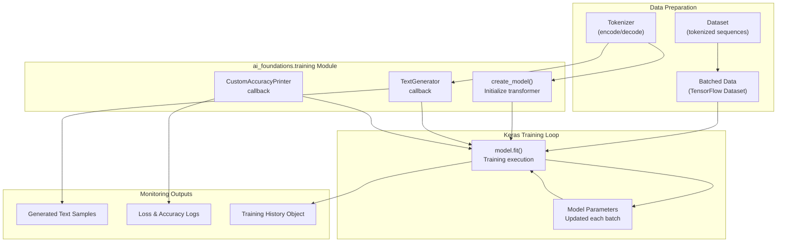
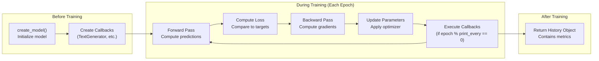
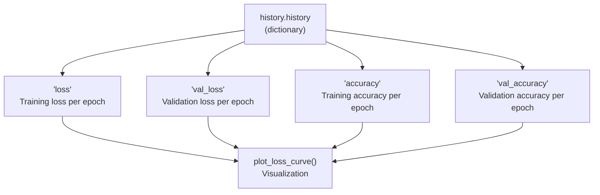
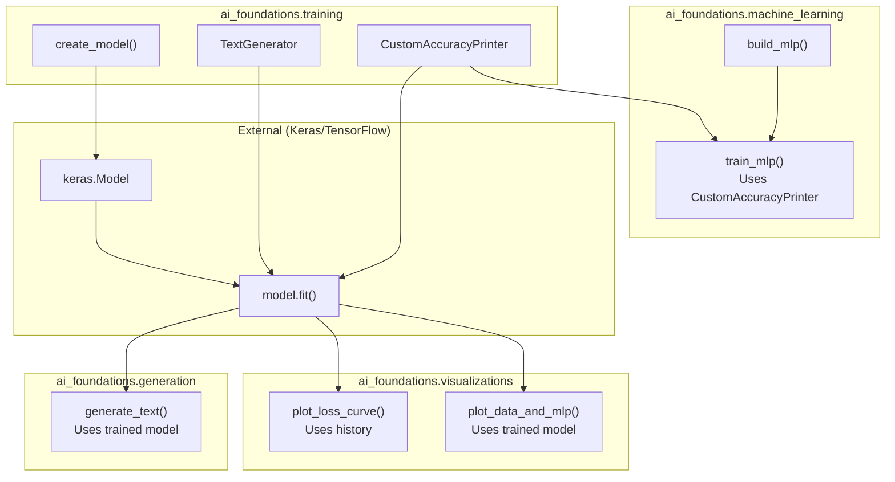

<!-- source: DeepWiki mcp.deepwiki.com · repo google-deepmind/ai-foundations · page 2.3 Training Utilities · fetched 2026-10-26 -->

# Training Utilities

<details>
<summary>Relevant source files</summary>

The following files were used as context for generating this wiki page:

- [course_1/gdm_lab_1_5_train_your_own_small_language_model.ipynb](course_1/gdm_lab_1_5_train_your_own_small_language_model.ipynb)
- [course_2/gdm_lab_2_6_train_an_slm_with_your_bpe_tokenizer.ipynb](course_2/gdm_lab_2_6_train_an_slm_with_your_bpe_tokenizer.ipynb)
- [course_3/gdm_lab_3_4_design_your_own_mlp.ipynb](course_3/gdm_lab_3_4_design_your_own_mlp.ipynb)
- [course_3/gdm_lab_3_5_tune_hyperparameters.ipynb](course_3/gdm_lab_3_5_tune_hyperparameters.ipynb)

</details>


## Purpose and Scope

The `ai_foundations.training` module provides utilities for creating, training, and monitoring machine learning models used throughout the educational labs. This module primarily supports:

- Creating transformer-based language models with configurable architectures
- Implementing Keras callbacks for monitoring training progress
- Generating sample text during training to observe model improvement
- Logging training metrics such as accuracy and loss

For tokenization and data preparation before training, see [Dataset Preparation](#3.1). For visualization of training results (loss curves, decision boundaries), see [Visualization System](#2.2). For lower-level machine learning utilities used in Course 3, see the `ai_foundations.machine_learning` module.

---

## Module Overview

The training module serves as a bridge between model definition and the actual training loop, providing utilities that integrate with Keras's training API. It is used extensively in Course 1 (language model training), Course 2 (BPE tokenizer integration), and Course 3 (MLP training).

| Component | Type | Primary Use Case |
|-----------|------|------------------|
| `create_model` | Function | Initialize transformer models for language modeling tasks |
| `TextGenerator` | Keras Callback | Generate sample text during training to monitor progress |
| `CustomAccuracyPrinter` | Keras Callback | Log accuracy and loss metrics at regular intervals |
| Training integration | API | Works with `model.fit()` and custom training loops |

Sources: [course_1/gdm_lab_1_5_train_your_own_small_language_model.ipynb:190](), [course_2/gdm_lab_2_6_train_an_slm_with_your_bpe_tokenizer.ipynb:181](), [course_3/gdm_lab_3_4_design_your_own_mlp.ipynb:170]()

---

## Training Workflow Architecture



**Diagram: Training workflow showing how training utilities integrate with data preparation and Keras training**

Sources: [course_1/gdm_lab_1_5_train_your_own_small_language_model.ipynb:870-936](), [course_2/gdm_lab_2_6_train_an_slm_with_your_bpe_tokenizer.ipynb:730-752]()

---

## Model Creation

### create_model Function

The `create_model()` function initializes a transformer-based language model suitable for next-token prediction tasks. It builds a complete Keras model with embedding layers, transformer blocks, and output heads.

**Function Signature:**
```python
create_model(
    max_length: int,
    vocabulary_size: int,
    learning_rate: float
) -> keras.Model
```

**Parameters:**

| Parameter | Type | Description |
|-----------|------|-------------|
| `max_length` | `int` | Maximum sequence length the model can process (typically 299 after removing one token for target) |
| `vocabulary_size` | `int` | Size of the tokenizer vocabulary (determines input/output dimensions) |
| `learning_rate` | `float` | Learning rate for the optimizer (typical values: 1e-4 to 8e-5) |

**Returns:** A compiled `keras.Model` ready for training with `model.fit()`

**Typical Usage:**
```python
model = training.create_model(
    max_length=max_length,
    vocabulary_size=tokenizer.vocabulary_size,
    learning_rate=1e-4
)
```

Sources: [course_1/gdm_lab_1_5_train_your_own_small_language_model.ipynb:870-874](), [course_2/gdm_lab_2_6_train_an_slm_with_your_bpe_tokenizer.ipynb:730-734]()

---

## Training Callbacks

### TextGenerator Callback

The `TextGenerator` class is a Keras callback that generates sample text at regular intervals during training. This allows developers to qualitatively assess whether the model is learning meaningful patterns without waiting for training to complete.

**Constructor Signature:**
```python
TextGenerator(
    max_tokens: int,
    start_tokens: list[int],
    tokenizer: Tokenizer,
    print_every: int
)
```

**Parameters:**

| Parameter | Type | Description |
|-----------|------|-------------|
| `max_tokens` | `int` | Number of tokens to generate in each sample (e.g., 10-11 tokens) |
| `start_tokens` | `list[int]` | Initial token IDs to prime the generation (encoded prompt) |
| `tokenizer` | `Tokenizer` | Tokenizer instance with `decode()` method for converting IDs to text |
| `print_every` | `int` | Generate and print text every N epochs (typical: 10) |

**Usage Example:**
```python
prompt = "Abeni,"
prompt_ids = tokenizer.encode(prompt)
text_gen_callback = training.TextGenerator(
    max_tokens=10,
    start_tokens=prompt_ids,
    tokenizer=tokenizer,
    print_every=10
)

history = model.fit(
    x=batches,
    verbose=2,
    epochs=num_epochs,
    callbacks=[text_gen_callback]
)
```

**Behavior:**
- Executes after every `print_every` epochs during training
- Generates text autoregressively using the current model parameters
- Prints the generated text to monitor model progress
- Early in training: typically produces incoherent text
- Late in training: produces more structured, contextually appropriate text

Sources: [course_1/gdm_lab_1_5_train_your_own_small_language_model.ipynb:899-903](), [course_2/gdm_lab_2_6_train_an_slm_with_your_bpe_tokenizer.ipynb:736-740]()

---

### CustomAccuracyPrinter Callback

The `CustomAccuracyPrinter` class logs training and validation metrics at specified intervals. It is particularly useful for MLP training where monitoring both train and test accuracy helps identify overfitting or underfitting.

**Constructor Signature:**
```python
CustomAccuracyPrinter(
    print_every: int
)
```

**Parameters:**

| Parameter | Type | Description |
|-----------|------|-------------|
| `print_every` | `int` | Print metrics every N epochs (typical: 20) |

**Usage Example:**
```python
training_logger = training.CustomAccuracyPrinter(print_every=20)
training_history = machine_learning.train_mlp(
    model,
    X_train,
    y_train,
    validation_data=(X_test, y_test),
    epochs=200,
    callbacks=[training_logger]
)
```

**Output Format:**
The callback prints formatted output showing:
- Current epoch number
- Training loss
- Training accuracy
- Test/validation loss
- Test/validation accuracy

Sources: [course_3/gdm_lab_3_4_design_your_own_mlp.ipynb:386-394](), [course_3/gdm_lab_3_5_tune_hyperparameters.ipynb:254-263]()

---

## Training Loop Integration

### Integration with Keras model.fit()

The training utilities are designed to work seamlessly with Keras's standard `model.fit()` API. The callbacks are passed to the training loop and execute at appropriate points during training.



**Diagram: Callback execution within the Keras training loop**

Sources: [course_1/gdm_lab_1_5_train_your_own_small_language_model.ipynb:931-937]()

---

## Training Workflow for Language Models

The typical workflow for training a small language model (SLM) using the training utilities involves several stages:

### Stage 1: Data Preparation

```python
# Tokenize dataset
tokenizer = SimpleWordTokenizer(dataset)
encoded_tokens = [tokenizer.encode(text) for text in dataset]

# Pad sequences to uniform length
padded_sequences = keras.preprocessing.sequence.pad_sequences(
    encoded_tokens,
    maxlen=max_length,
    padding="post",
    truncating="post",
    value=tokenizer.pad_token_id
)

# Create input/target pairs (shifted by one token)
input_sequences = padded_sequences[:, :-1]
target_sequences = padded_sequences[:, 1:]
```

### Stage 2: Model Initialization

```python
# Create transformer model
model = training.create_model(
    max_length=input_sequences.shape[1],
    vocabulary_size=tokenizer.vocabulary_size,
    learning_rate=1e-4
)
```

### Stage 3: Setup Callbacks

```python
# Initialize text generation callback
prompt = "Abeni,"
prompt_ids = tokenizer.encode(prompt)
text_gen_callback = training.TextGenerator(
    max_tokens=10,
    start_tokens=prompt_ids,
    tokenizer=tokenizer,
    print_every=10
)
```

### Stage 4: Training Execution

```python
# Train the model
history = model.fit(
    x=batches,
    verbose=2,
    epochs=200,
    callbacks=[text_gen_callback]
)
```

Sources: [course_1/gdm_lab_1_5_train_your_own_small_language_model.ipynb:659-936]()

---

## Training Workflow for MLPs

For multi-layer perceptron (MLP) training in Course 3, the workflow differs slightly as it uses the `machine_learning.train_mlp()` function rather than directly calling `model.fit()`:

```python
# Build MLP architecture
model = machine_learning.build_mlp(hidden_dims=[10], n_classes=3)

# Setup logging callback
training_logger = training.CustomAccuracyPrinter(print_every=20)

# Train with explicit validation data
training_history = machine_learning.train_mlp(
    model,
    X_train,
    y_train,
    validation_data=(X_test, y_test),
    epochs=200,
    callbacks=[training_logger]
)
```

**Key Differences from Language Model Training:**
- Uses `machine_learning.train_mlp()` instead of `model.fit()` directly
- Validation data passed explicitly for monitoring generalization
- `CustomAccuracyPrinter` used instead of `TextGenerator`
- Focuses on classification accuracy rather than text generation

Sources: [course_3/gdm_lab_3_4_design_your_own_mlp.ipynb:365-394](), [course_3/gdm_lab_3_5_tune_hyperparameters.ipynb:243-283]()

---

## Model Training Parameters

### Transformer Language Models

When training transformer models with `create_model()`, the following parameters are commonly configured:

| Parameter | Typical Range | Purpose | Lab Example |
|-----------|---------------|---------|-------------|
| `max_length` | 200-300 | Sequence length model can process | 299 (after removing one token) |
| `vocabulary_size` | 3,000-10,000 | Number of unique tokens | ~3,500 (Africa Galore with BPE) |
| `learning_rate` | 1e-5 to 1e-4 | Step size for parameter updates | 1e-4 (Course 1), 8e-5 (Course 2) |
| `num_epochs` | 100-200 | Training iterations through dataset | 200 (Course 1), 100 (Course 2) |
| `batch_size` | 2-32 | Examples processed per update | 32 (Course 1), 2 (Course 2) |

**Parameter Impact:**
- **Higher learning rate**: Faster training but risk of instability
- **Lower learning rate**: More stable but slower convergence
- **More epochs**: Better convergence but risk of overfitting
- **Larger batch size**: More stable gradients, faster training (if memory allows)

Sources: [course_1/gdm_lab_1_5_train_your_own_small_language_model.ipynb:870-931](), [course_2/gdm_lab_2_6_train_an_slm_with_your_bpe_tokenizer.ipynb:730-752]()

---

## Monitoring Training Progress

### Loss Observation

During training, both callbacks and the Keras training loop output loss values. The loss should generally decrease over epochs:

**Early Training (Epoch 1-20):**
- Loss typically high (>4.0 for language models)
- Generated text incoherent
- Accuracy low (<30% for classification)

**Mid Training (Epoch 20-100):**
- Loss decreasing steadily (3.0-2.0)
- Generated text showing structure
- Accuracy improving (50-80%)

**Late Training (Epoch 100+):**
- Loss stabilizing (1.5-2.0)
- Generated text coherent
- Accuracy high (>85%)

**Warning Signs:**
- Loss increasing: Learning rate too high or model diverging
- Loss plateauing early: Learning rate too low or model capacity insufficient
- Training loss much lower than validation loss: Overfitting

Sources: [course_1/gdm_lab_1_5_train_your_own_small_language_model.ipynb:931-952]()

---

## Training History Object

After training completes, the `history` object returned by `model.fit()` or `machine_learning.train_mlp()` contains detailed metrics:

```python
history = model.fit(...)

# Access training metrics
train_loss = history.history['loss']
val_loss = history.history['val_loss']  # If validation data provided
train_acc = history.history['accuracy']  # For classification tasks
val_acc = history.history['val_accuracy']
```

**History Object Structure:**



**Diagram: Structure of the training history object and its usage**

The history object is passed to visualization functions like `visualizations.plot_loss_curve()` to create training progress plots.

Sources: [course_3/gdm_lab_3_4_design_your_own_mlp.ipynb:387-416](), [course_3/gdm_lab_3_5_tune_hyperparameters.ipynb:255-266]()

---

## Integration with Other Modules

The training utilities work closely with several other modules in the ai_foundations package:



**Diagram: Module dependencies and interactions with training utilities**

**Key Integration Points:**

1. **Tokenizers**: Required by `TextGenerator` for decoding generated token IDs
2. **Generation Module**: Uses trained models to generate text with sampling strategies
3. **Visualization Module**: Consumes training history for plotting loss curves
4. **Machine Learning Module**: Uses `CustomAccuracyPrinter` in its `train_mlp()` function

Sources: [course_1/gdm_lab_1_5_train_your_own_small_language_model.ipynb:190-192](), [course_3/gdm_lab_3_4_design_your_own_mlp.ipynb:168-171]()

---

## Typical Training Scenarios

### Scenario 1: Small Language Model with Simple Tokenizer

**Context:** Course 1, Lab 1.5 - Training a transformer on Africa Galore dataset with word tokenization

```python
# Setup
tokenizer = SimpleWordTokenizer(dataset)
model = training.create_model(
    max_length=299,
    vocabulary_size=tokenizer.vocabulary_size,
    learning_rate=1e-4
)

# Monitor with text generation
text_gen_callback = training.TextGenerator(
    max_tokens=10,
    start_tokens=tokenizer.encode("Abeni,"),
    tokenizer=tokenizer,
    print_every=10
)

# Train
history = model.fit(
    x=batches,
    verbose=2,
    epochs=200,
    callbacks=[text_gen_callback]
)
```

Sources: [course_1/gdm_lab_1_5_train_your_own_small_language_model.ipynb:870-936]()

---

### Scenario 2: Language Model with BPE Tokenizer

**Context:** Course 2, Lab 2.6 - Training with byte-pair encoding tokenizer

```python
# Setup with BPE tokenizer
tokenizer = BPEWordTokenizer(dataset, num_merges=3000)
model = training.create_model(
    max_length=299,
    vocabulary_size=tokenizer.vocabulary_size,
    learning_rate=8e-5  # Slightly lower learning rate
)

# Monitor with different prompt
text_gen_callback = training.TextGenerator(
    max_tokens=11,
    start_tokens=tokenizer.encode("Jide"),
    tokenizer=tokenizer,
    print_every=10
)

# Train with smaller batch size
history = model.fit(
    x=input_sequences,
    y=target_sequences,
    verbose=2,
    epochs=100,
    batch_size=2,
    callbacks=[text_gen_callback]
)
```

**Key Differences:**
- BPE tokenizer produces different vocabulary size
- Lower learning rate for more stable training
- Smaller batch size to handle subword tokenization
- Fewer epochs due to more efficient tokenization

Sources: [course_2/gdm_lab_2_6_train_an_slm_with_your_bpe_tokenizer.ipynb:727-752]()

---

### Scenario 3: MLP Classification

**Context:** Course 3, Labs 3.4-3.5 - Training MLPs for 3-class classification

```python
# Setup
model = machine_learning.build_mlp(hidden_dims=[10], n_classes=3)
training_logger = training.CustomAccuracyPrinter(print_every=20)

# Train with validation monitoring
training_history = machine_learning.train_mlp(
    model,
    X_train,
    y_train,
    learning_rate=0.005,
    validation_data=(X_test, y_test),
    epochs=500,
    callbacks=[training_logger]
)

# Check for overfitting
train_acc = training_history.history["accuracy"][-1]
test_acc = training_history.history["val_accuracy"][-1]
print(f"Train: {train_acc:.2%}, Test: {test_acc:.2%}")
```

**Key Differences:**
- Uses `train_mlp()` wrapper instead of `model.fit()` directly
- `CustomAccuracyPrinter` instead of `TextGenerator`
- Validation data to monitor generalization
- More epochs needed for simpler architecture

Sources: [course_3/gdm_lab_3_4_design_your_own_mlp.ipynb:365-394](), [course_3/gdm_lab_3_5_tune_hyperparameters.ipynb:243-283]()

---

## Common Issues and Solutions

### Issue 1: Out of Memory Errors

**Symptom:** Training crashes with "OOM" or memory allocation errors

**Solutions:**
- Reduce `batch_size` (try 16, 8, 4, or 2)
- Reduce `max_length` for sequence models
- Simplify model architecture (fewer layers/parameters)
- Use GPU with more memory if available

**Example:**
```python
# Instead of batch_size=32
history = model.fit(x=batches, batch_size=2, ...)
```

Sources: [course_1/gdm_lab_1_5_train_your_own_small_language_model.ipynb:785]()

---

### Issue 2: Loss Not Decreasing

**Symptom:** Training loss remains high or increases

**Possible Causes & Solutions:**

| Cause | Solution |
|-------|----------|
| Learning rate too high | Reduce `learning_rate` (try 1e-5 or 5e-5) |
| Learning rate too low | Increase `learning_rate` (try 1e-3) |
| Model capacity too small | Increase hidden dimensions or add layers |
| Bad initialization | Re-run with different random seed |
| Data issues | Check tokenization, padding, and batch preparation |

**Example:**
```python
# Try lower learning rate
model = training.create_model(..., learning_rate=5e-5)
```

Sources: [course_1/gdm_lab_1_5_train_your_own_small_language_model.ipynb:860-874]()

---

### Issue 3: Generated Text Not Improving

**Symptom:** `TextGenerator` produces incoherent text even after many epochs

**Diagnostic Steps:**
1. Check if loss is decreasing - if not, see Issue 2
2. Verify tokenizer `encode()`/`decode()` work correctly
3. Ensure `start_tokens` are valid token IDs
4. Try different prompts to rule out prompt-specific issues
5. Increase training epochs (try 300-500)

**Example Verification:**
```python
# Test tokenizer round-trip
test_text = "Abeni,"
encoded = tokenizer.encode(test_text)
decoded = tokenizer.decode(encoded)
assert decoded.strip() == test_text.strip()
```

Sources: [course_1/gdm_lab_1_5_train_your_own_small_language_model.ipynb:899-952]()

---

### Issue 4: Overfitting in MLP Training

**Symptom:** Training accuracy high but test accuracy much lower

**Solutions:**
- Reduce model complexity (fewer layers, fewer neurons)
- Increase training data if possible
- Stop training earlier (reduce epochs)
- Add regularization (not covered in basic labs)

**Example:**
```python
# Instead of [1000, 500, 100]
model = machine_learning.build_mlp(hidden_dims=[20, 10], n_classes=3)
```

Sources: [course_3/gdm_lab_3_5_tune_hyperparameters.ipynb:206-299]()

---

## Summary Table: Training Utilities

| Component | File/Module Location | Primary Function | Used In Courses |
|-----------|---------------------|------------------|-----------------|
| `create_model()` | `ai_foundations.training` | Initialize transformer for language modeling | 1, 2 |
| `TextGenerator` | `ai_foundations.training` | Monitor text generation during training | 1, 2 |
| `CustomAccuracyPrinter` | `ai_foundations.training` | Log training/validation metrics | 3 |
| Integration with `model.fit()` | Keras API | Standard training loop execution | 1, 2 |
| Integration with `train_mlp()` | `ai_foundations.machine_learning` | MLP-specific training wrapper | 3 |

Sources: [course_1/gdm_lab_1_5_train_your_own_small_language_model.ipynb:190](), [course_2/gdm_lab_2_6_train_an_slm_with_your_bpe_tokenizer.ipynb:181](), [course_3/gdm_lab_3_4_design_your_own_mlp.ipynb:170]()

---

