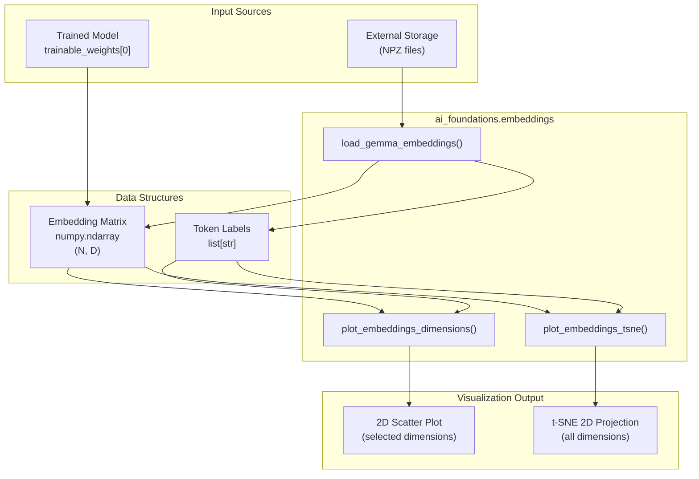
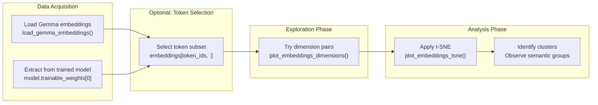
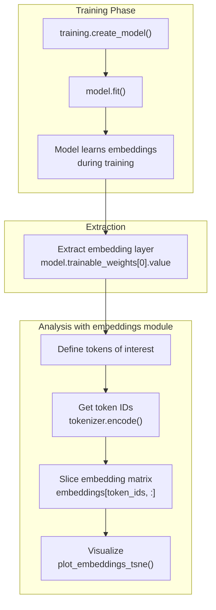
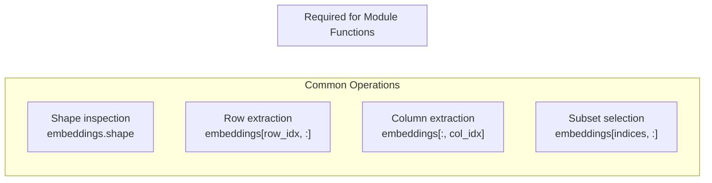
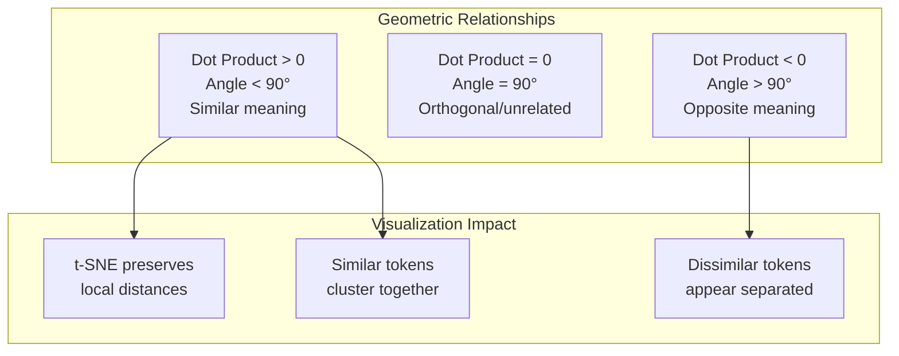
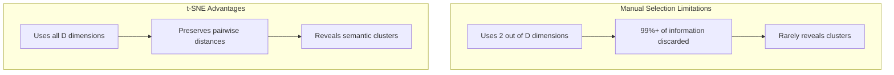
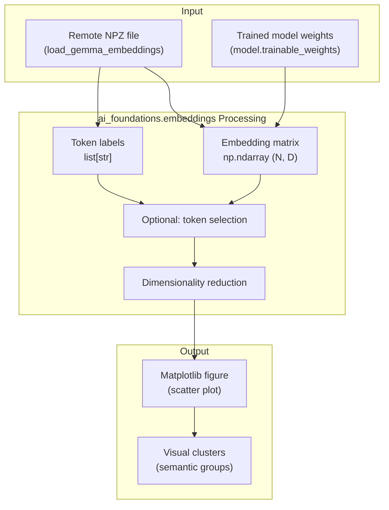

<!-- source: DeepWiki mcp.deepwiki.com · repo google-deepmind/ai-foundations · page 2.4 Embeddings Module · fetched 2026-10-26 -->

# Embeddings Module

<details>
<summary>Relevant source files</summary>

The following files were used as context for generating this wiki page:

- [course_2/gdm_lab_2_5_experiment_with_embeddings.ipynb](course_2/gdm_lab_2_5_experiment_with_embeddings.ipynb)
- [course_2/gdm_lab_2_6_train_an_slm_with_your_bpe_tokenizer.ipynb](course_2/gdm_lab_2_6_train_an_slm_with_your_bpe_tokenizer.ipynb)

</details>


## Purpose and Scope

The Embeddings Module provides utilities for loading, manipulating, and visualizing token embeddings from language models. It focuses on two primary capabilities: loading pre-trained embedding matrices (particularly from Gemma models) and generating visualizations that make high-dimensional embedding spaces interpretable through dimensionality reduction techniques.

For information about training models that learn embeddings, see [Training Utilities](#2.3). For visualization of other model aspects (loss curves, decision boundaries), see [Visualization System](#2.2).

**Sources:** [course_2/gdm_lab_2_5_experiment_with_embeddings.ipynb:1-152](), [course_2/gdm_lab_2_6_train_an_slm_with_your_bpe_tokenizer.ipynb:1-183]()

## Module Overview

The `ai_foundations.embeddings` module operates on embedding matrices represented as numpy arrays with shape `(num_tokens, embedding_dim)`. Each row corresponds to a single token's embedding vector. The module provides functions to load these matrices from external sources and project them into visualizable 2D or 3D spaces.



**Sources:** [course_2/gdm_lab_2_5_experiment_with_embeddings.ipynb:169-182](), [course_2/gdm_lab_2_6_train_an_slm_with_your_bpe_tokenizer.ipynb:784-832]()

## Core Functions

### load_gemma_embeddings

```python
embeddings, labels = emb.load_gemma_embeddings(url)
```

Loads a subset of Gemma model embeddings from a remote `.npz` file. Returns a tuple of `(embeddings, labels)` where:
- `embeddings`: `numpy.ndarray` of shape `(num_tokens, embedding_dim)`
- `labels`: `list[str]` of token strings corresponding to each row

**Usage Pattern:**

| Parameter | Type | Description |
|-----------|------|-------------|
| `url` | `str` | URL to NPZ file containing embeddings |
| **Returns** | `tuple` | `(np.ndarray, list[str])` |

**Example from Lab 2.5:**
```python
embeddings, labels = emb.load_gemma_embeddings(
    "https://storage.googleapis.com/dm-educational/assets/ai_foundations/gemma_embeddings.npz"
)
# embeddings.shape: (24, 1152) for 24 tokens with 1152-dimensional vectors
# labels: ['apple', 'banana', 'car', ...] 
```

**Sources:** [course_2/gdm_lab_2_5_experiment_with_embeddings.ipynb:169-182]()

### plot_embeddings_dimensions

```python
emb.plot_embeddings_dimensions(embeddings, labels, dim_x, dim_y)
```

Visualizes embeddings by plotting two specific dimensions against each other. Each token appears as a labeled point in 2D space where coordinates are the values at dimensions `dim_x` and `dim_y` of the embedding vector.

**Function Signature:**

| Parameter | Type | Description |
|-----------|------|-------------|
| `embeddings` | `np.ndarray` | Embedding matrix of shape `(N, D)` |
| `labels` | `list[str]` | Token labels of length `N` |
| `dim_x` | `int` | Index of dimension for x-axis (0 to D-1) |
| `dim_y` | `int` | Index of dimension for y-axis (0 to D-1) |

**Typical Usage Pattern:**

Users typically iterate through different dimension pairs to find meaningful structure:

```python
# For Gemma 1B embeddings with 1152 dimensions
emb.plot_embeddings_dimensions(embeddings, labels, dim_x=432, dim_y=856)
```

**Limitations:** As noted in Lab 2.5, individual dimension pairs rarely reveal clear semantic clusters because meaningful relationships emerge from combinations of many dimensions.

**Sources:** [course_2/gdm_lab_2_5_experiment_with_embeddings.ipynb:824-839]()

### plot_embeddings_tsne

```python
emb.plot_embeddings_tsne(embeddings, labels, categories=None)
```

Projects high-dimensional embeddings into 2D space using t-SNE (t-Distributed Stochastic Neighbor Embedding) and displays them as a scatter plot. This method preserves local pairwise distances, making semantically similar tokens appear closer together.

**Function Signature:**

| Parameter | Type | Description |
|-----------|------|-------------|
| `embeddings` | `np.ndarray` | Embedding matrix of shape `(N, D)` |
| `labels` | `list[str]` | Token labels of length `N` |
| `categories` | `list[int]` | Optional category indices for color coding |

**Example from Lab 2.6:**

```python
# Extract embeddings for specific tokens
food_tokens = ["water", "coffee", "peanut", "pepper"]
preposition_tokens = ["on", "in", "with", "for"]
token_ids = [tokenizer.encode(t)[0] for t in food_tokens + preposition_tokens]
embeddings_subset = model_embeddings[token_ids, :]

# Create category labels: 0 for food, 1 for prepositions
categories = [0]*len(food_tokens) + [1]*len(preposition_tokens)

emb.plot_embeddings_tsne(embeddings_subset, food_tokens + preposition_tokens, categories)
```

**t-SNE Behavior:** The algorithm transforms the D-dimensional space such that:
- Tokens with high cosine similarity in original space appear close in 2D
- Local neighborhood structure is preserved
- Global distances may be distorted

**Sources:** [course_2/gdm_lab_2_5_experiment_with_embeddings.ipynb:874-882](), [course_2/gdm_lab_2_6_train_an_slm_with_your_bpe_tokenizer.ipynb:784-832]()

## Typical Workflow



**Sources:** [course_2/gdm_lab_2_5_experiment_with_embeddings.ipynb:160-882](), [course_2/gdm_lab_2_6_train_an_slm_with_your_bpe_tokenizer.ipynb:774-832]()

## Integration with Training Pipeline

The embeddings module integrates with the training utilities to visualize learned representations after model training:



**Code Example from Lab 2.6:**

The following pattern extracts and visualizes embeddings learned during training:

```python
# After model training completes
embeddings = model.trainable_weights[0].value  # Shape: (vocab_size, embed_dim)

# Define tokens to analyze
tokens = ["water", "coffee", "onions", "on", "in", "with"]
token_ids = [tokenizer.encode(token)[0] for token in tokens]

# Extract subset
embeddings_subset = embeddings[token_ids, :]

# Visualize
emb.plot_embeddings_tsne(embeddings_subset, tokens)
```

**Sources:** [course_2/gdm_lab_2_6_train_an_slm_with_your_bpe_tokenizer.ipynb:784-832]()

## Embedding Matrix Structure

The embedding matrices handled by this module conform to the following structure:

| Dimension | Description | Typical Range |
|-----------|-------------|---------------|
| Rows | Number of tokens in vocabulary | 24 (subset) to 260,000+ (full Gemma) |
| Columns | Embedding dimension | 1,152 (Gemma 1B) to higher for larger models |
| dtype | Floating point values | `float32` or `float64` |

**Row Indexing:** Each row index corresponds to a token ID. For example:
- `embeddings[5, :]` retrieves the embedding vector for the token with ID 5
- `embeddings[:, 100]` retrieves the 100th dimension across all tokens

**Column Semantics:** Individual dimensions lack interpretable meaning. Semantic information emerges from patterns across many dimensions, which is why dimensionality reduction techniques like t-SNE are necessary for visualization.

**Sources:** [course_2/gdm_lab_2_5_experiment_with_embeddings.ipynb:169-348]()

## Numpy Array Operations

The module expects embeddings to be numpy arrays that support standard slicing and indexing operations:



**Example Indexing Patterns:**

```python
# Get embedding dimension
embedding_dim = embeddings.shape[1]  # Second dimension

# Get embedding for third token (index 2)
third_embedding = embeddings[2, :]  # Shape: (embedding_dim,)

# Get 7th dimension across all tokens
seventh_dim_values = embeddings[:, 6]  # Shape: (num_tokens,)

# Get embeddings for multiple tokens
token_indices = [0, 5, 10]
subset = embeddings[token_indices, :]  # Shape: (3, embedding_dim)
```

**Sources:** [course_2/gdm_lab_2_5_experiment_with_embeddings.ipynb:280-430]()

## Semantic Similarity in Embedding Space

The module operates on embeddings where semantic similarity is encoded geometrically. Tokens with similar meanings have:
- **Small angles** between their embedding vectors (measured by dot product)
- **High cosine similarity** values (normalized dot product)
- **Small Euclidean distances** in the embedding space



**Observed Clusters (Lab 2.5 with Gemma embeddings):**
- Technology terms: "mobile", "phone", "computer", "internet"
- Gender pairs: "man"/"woman", "queen"/"king"
- Animal terms: "cat", "dog"

**Observed Clusters (Lab 2.6 with trained SLM):**
- Function words: prepositions ("on", "in", "with") form tight clusters
- Content words: less consistent clustering due to limited training data

**Sources:** [course_2/gdm_lab_2_5_experiment_with_embeddings.ipynb:500-793](), [course_2/gdm_lab_2_6_train_an_slm_with_your_bpe_tokenizer.ipynb:835-845]()

## Dimensionality Reduction Context

The module addresses a fundamental visualization challenge: human perception is limited to 2-3 dimensions while modern embeddings exist in 1,000+ dimensions.

**Comparison of Approaches:**

| Method | Function | Preserves | Use Case |
|--------|----------|-----------|----------|
| Manual dimension selection | `plot_embeddings_dimensions()` | Exact values of 2 dimensions | Quick exploration, debugging |
| t-SNE projection | `plot_embeddings_tsne()` | Local neighborhood structure | Final analysis, presentation |

**Why t-SNE is Preferred:**

t-SNE considers all D dimensions when computing the 2D projection, whereas manual selection only uses 2 dimensions. This means t-SNE captures more information about semantic relationships.



**Sources:** [course_2/gdm_lab_2_5_experiment_with_embeddings.ipynb:806-897]()

## Usage in Educational Labs

The module is used in two primary lab contexts:

### Lab 2.5: Experiment with Embeddings

**Objectives:**
1. Load pre-trained Gemma embeddings for 24 tokens
2. Implement numpy operations for embedding manipulation
3. Compute cosine similarities between token pairs
4. Compare visualization methods

**Module Functions Used:**
- `load_gemma_embeddings()` to obtain embedding matrix
- `plot_embeddings_dimensions()` for exploration
- `plot_embeddings_tsne()` for final visualization

**Sources:** [course_2/gdm_lab_2_5_experiment_with_embeddings.ipynb:27-908]()

### Lab 2.6: Train SLM with BPE Tokenizer

**Objectives:**
1. Train a transformer model on Africa Galore dataset
2. Extract learned embeddings from trained model
3. Visualize semantic relationships learned during training

**Module Functions Used:**
- `plot_embeddings_tsne()` to visualize learned embeddings
- Custom token selection to examine specific semantic categories

**Sources:** [course_2/gdm_lab_2_6_train_an_slm_with_your_bpe_tokenizer.ipynb:774-845]()

## Data Flow Summary



**Sources:** [course_2/gdm_lab_2_5_experiment_with_embeddings.ipynb:1-908](), [course_2/gdm_lab_2_6_train_an_slm_with_your_bpe_tokenizer.ipynb:1-858]()

---

