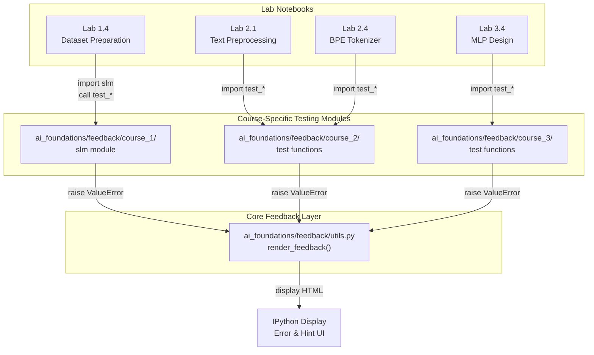
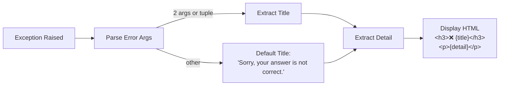
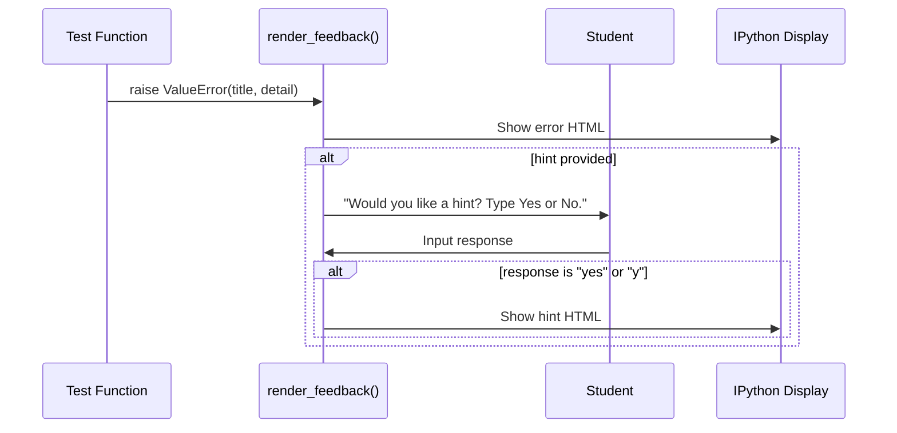
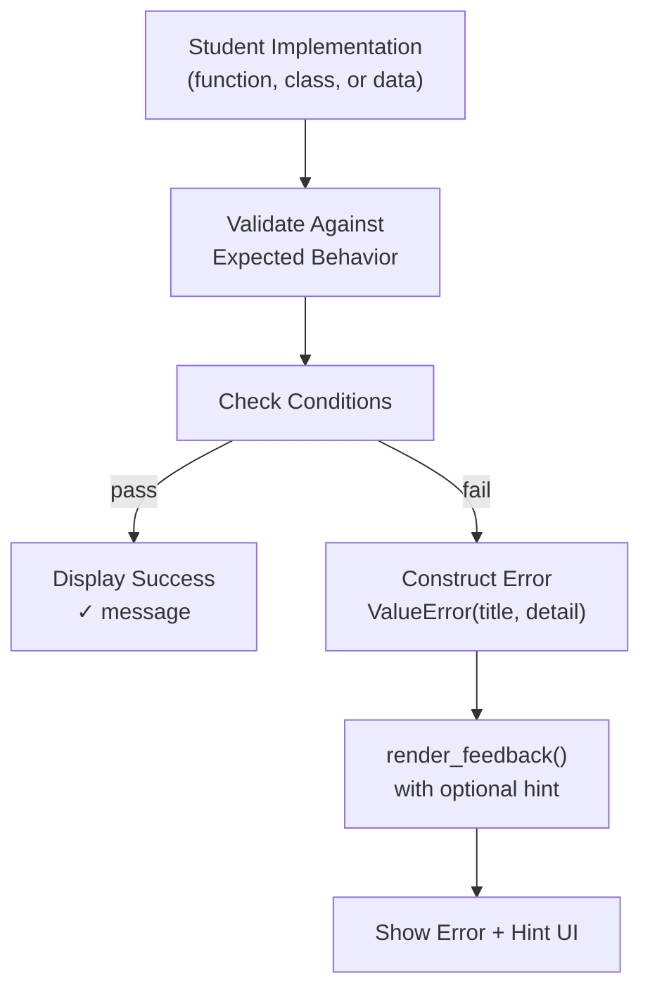
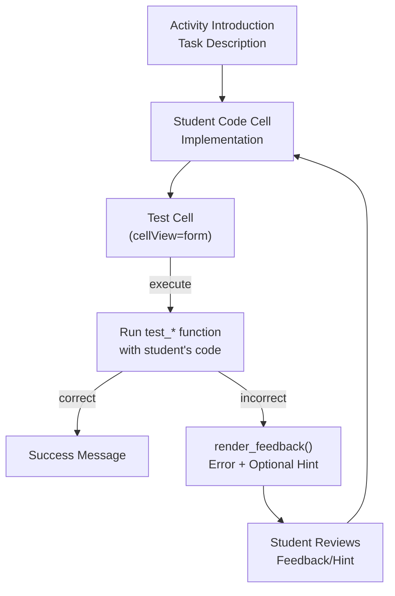
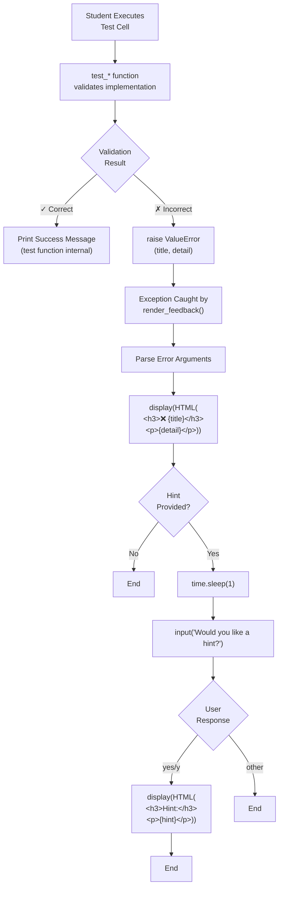
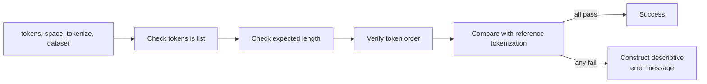

<!-- source: DeepWiki mcp.deepwiki.com · repo google-deepmind/ai-foundations · page 2.5 Feedback and Testing System · fetched 2026-10-26 -->

# Feedback and Testing System

<details>
<summary>Relevant source files</summary>

The following files were used as context for generating this wiki page:

- [ai_foundations/feedback/utils.py](ai_foundations/feedback/utils.py)
- [course_1/gdm_lab_1_4_prepare_the_dataset_for_training_a_slm.ipynb](course_1/gdm_lab_1_4_prepare_the_dataset_for_training_a_slm.ipynb)

</details>


## Purpose and Scope

The Feedback and Testing System provides automated validation of student implementations and interactive hint delivery for the educational labs. This system consists of two primary components: the `render_feedback` utility for displaying formatted error messages and hints, and a collection of course-specific testing functions that validate student code against expected behavior.

For information about the visualization system used to display training progress and model outputs, see [Visualization System](#2.2). For information about training utilities and callbacks, see [Training Utilities](#2.3).

## System Architecture Overview

The feedback system is organized as a two-layer architecture: a core rendering utility and course-specific testing modules.



**Sources:** [ai_foundations/feedback/utils.py:1-59](), [course_1/gdm_lab_1_4_prepare_the_dataset_for_training_a_slm.ipynb:159]()

## Core Rendering Utility

### The `render_feedback` Function

The `render_feedback` function is the central mechanism for displaying standardized error messages and optional hints to students.

| Aspect | Implementation |
|--------|----------------|
| **Location** | `ai_foundations.feedback.utils` |
| **Primary Function** | `render_feedback(error, hint=None)` |
| **Display Backend** | `IPython.display.HTML` |
| **User Interaction** | Console input for hint acceptance |

The function accepts an exception and an optional hint string, displaying them in a formatted HTML interface within Jupyter notebooks.

### Error Message Format

The function expects errors in one of two formats:

1. **Two-argument ValueError**: `ValueError(title, detail)`
2. **Tuple-packed ValueError**: `ValueError((title, detail))`
3. **Single-argument fallback**: Any other exception format uses a default title



**Sources:** [ai_foundations/feedback/utils.py:32-51]()

### Interactive Hint System

After displaying the error, if a hint is provided, the system prompts the user:



The hint acceptance logic uses `time.sleep(1)` to provide a brief pause before prompting, improving readability. Input matching is case-insensitive and accepts both "yes" and "y" as affirmative responses.

**Sources:** [ai_foundations/feedback/utils.py:54-58]()

## Testing Framework Structure

### Course-Specific Test Modules

Each course has a dedicated testing module containing validation functions for that course's labs:

| Module | Example Functions | Labs Covered |
|--------|-------------------|--------------|
| `ai_foundations.feedback.course_1.slm` | `test_build_tokens_list()`<br/>`test_build_vocabulary()`<br/>`test_index_to_token()`<br/>`test_simple_word_tokenizer()` | 1.4, 1.5 |
| `ai_foundations.feedback.course_2` | Text preprocessing tests<br/>BPE tokenizer tests<br/>Embedding tests | 2.1, 2.2, 2.4, 2.5, 2.6 |
| `ai_foundations.feedback.course_3` | MLP construction tests<br/>Hyperparameter tuning tests<br/>Gradient tests | 3.4, 3.5, 3.7 |

### Common Testing Pattern

Test functions across all courses follow a consistent pattern:



**Sources:** [course_1/gdm_lab_1_4_prepare_the_dataset_for_training_a_slm.ipynb:280-290]()

## Test Function Examples from Course 1

### Dataset Preparation Tests

The Course 1 SLM module provides several validation functions for the dataset preparation lab:

#### `test_build_tokens_list()`

Validates that students correctly extract all tokens from the dataset in order.

**Signature**: `slm.test_build_tokens_list(tokens, space_tokenize, dataset)`

**Parameters**:
- `tokens`: Student's constructed list of all tokens
- `space_tokenize`: Tokenization function
- `dataset`: Original Africa Galore dataset

**Purpose**: Ensures the student correctly loops through all paragraphs and tokenizes each one, building a complete token list.

#### `test_build_vocabulary()`

Validates vocabulary construction from token lists.

**Signature**: `slm.test_build_vocabulary(build_vocabulary)`

**Parameters**:
- `build_vocabulary`: Student's function that should return unique tokens

**Purpose**: Verifies that the function correctly extracts unique tokens from a token list.

#### `test_index_to_token()`

Validates the reverse mapping dictionary construction.

**Signature**: `slm.test_index_to_token(index_to_token, vocabulary)`

**Parameters**:
- `index_to_token`: Student's dictionary mapping indices to tokens
- `vocabulary`: The vocabulary list

**Purpose**: Ensures the dictionary correctly maps all indices (0 to vocabulary_size-1) back to their corresponding tokens.

#### `test_simple_word_tokenizer()`

Validates the complete `SimpleWordTokenizer` class implementation.

**Signature**: `slm.test_simple_word_tokenizer(tokenizer, vocabulary, dataset)`

**Parameters**:
- `tokenizer`: Student's instantiated `SimpleWordTokenizer` object
- `vocabulary`: Expected vocabulary
- `dataset`: Africa Galore dataset

**Purpose**: Comprehensive validation that the tokenizer correctly encodes and decodes text, maintaining consistency with the expected vocabulary.

**Sources:** [course_1/gdm_lab_1_4_prepare_the_dataset_for_training_a_slm.ipynb:283](), [course_1/gdm_lab_1_4_prepare_the_dataset_for_training_a_slm.ipynb:361](), [course_1/gdm_lab_1_4_prepare_the_dataset_for_training_a_slm.ipynb:530](), [course_1/gdm_lab_1_4_prepare_the_dataset_for_training_a_slm.ipynb:902]()

## Integration with Lab Notebooks

### Import Pattern

Lab notebooks import course-specific testing modules:

```python
from ai_foundations.feedback.course_1 import slm
```

This import statement appears in the imports section of lab notebooks, typically after installing the ai-foundations package via pip.

### Usage in Coding Activities

Each coding activity follows this structure:



Test cells are typically hidden using `cellView: "form"` metadata, presenting a cleaner interface to students.

**Sources:** [course_1/gdm_lab_1_4_prepare_the_dataset_for_training_a_slm.ipynb:280-290](), [course_1/gdm_lab_1_4_prepare_the_dataset_for_training_a_slm.ipynb:286-287]()

### Cell Structure Example

From Lab 1.4, the pattern for a typical coding activity:

**Markdown Cell**: Task description with instructions
```markdown
------
> 💻 **Your task:**
> Complete the following cell to construct a `tokens` list...
------
```

**Code Cell**: Student implementation
```python
tokens = []
# Add your code here.
```

**Test Cell**: Automated validation
```python
# @title Run this cell to test your code
slm.test_build_tokens_list(tokens, space_tokenize, dataset)
```

**Sources:** [course_1/gdm_lab_1_4_prepare_the_dataset_for_training_a_slm.ipynb:249-290]()

## Error Handling and Display Flow

### Complete Feedback Cycle



**Sources:** [ai_foundations/feedback/utils.py:32-58]()

### Display Backend Implementation

The feedback system leverages IPython's display capabilities:

| Component | Module | Purpose |
|-----------|--------|---------|
| `display` | `IPython.display.display` | Renders HTML content in notebook cells |
| `HTML` | `IPython.display.HTML` | Wraps HTML strings for rich display |

These are aliased at the module level for convenient use:

```python
display = IPython.display.display
HTML = IPython.display.HTML
```

**Sources:** [ai_foundations/feedback/utils.py:28-29]()

## Testing Function Design Principles

### Validation Approach

Test functions receive student implementations and validate them against expected behavior through several checks:

1. **Type Validation**: Ensure returned values are of correct types
2. **Structure Validation**: Verify data structures have correct shape/size
3. **Content Validation**: Check actual values match expected results
4. **Consistency Validation**: Ensure related components work together correctly

### Example: Token List Validation

For `test_build_tokens_list()`, the function likely performs:



**Sources:** [course_1/gdm_lab_1_4_prepare_the_dataset_for_training_a_slm.ipynb:283]()

### Example: Class Validation

For `test_simple_word_tokenizer()`, comprehensive validation checks:

- Vocabulary construction correctness
- `encode()` method produces correct indices
- `decode()` method reconstructs original text
- Bidirectional consistency: `decode(encode(text)) == text`
- Proper handling of edge cases

**Sources:** [course_1/gdm_lab_1_4_prepare_the_dataset_for_training_a_slm.ipynb:902]()

## Module Organization

The feedback system's module structure:

```
ai_foundations/
└── feedback/
    ├── utils.py                 # Core render_feedback function
    ├── course_1/
    │   └── slm.py              # Lab 1.4, 1.5 tests
    ├── course_2/
    │   └── *.py                # Lab 2.1, 2.2, 2.4, 2.5, 2.6 tests
    └── course_3/
        └── *.py                # Lab 3.4, 3.5, 3.7 tests
```

Each course module contains test functions specific to that course's learning objectives and coding activities. The modular structure allows for:

- Independent development of course-specific tests
- Reusable core rendering logic
- Easy extension for new courses or labs

**Sources:** [course_1/gdm_lab_1_4_prepare_the_dataset_for_training_a_slm.ipynb:159](), [ai_foundations/feedback/utils.py:1-59]()

---

