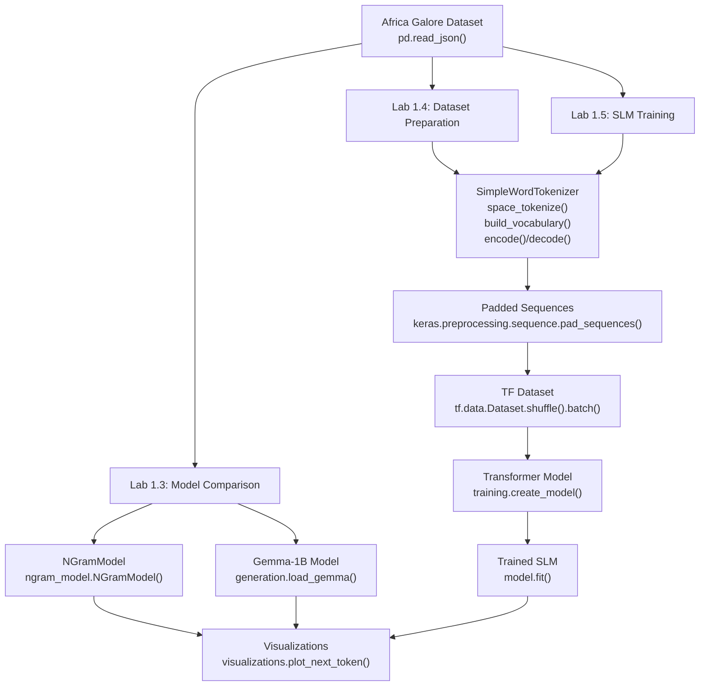
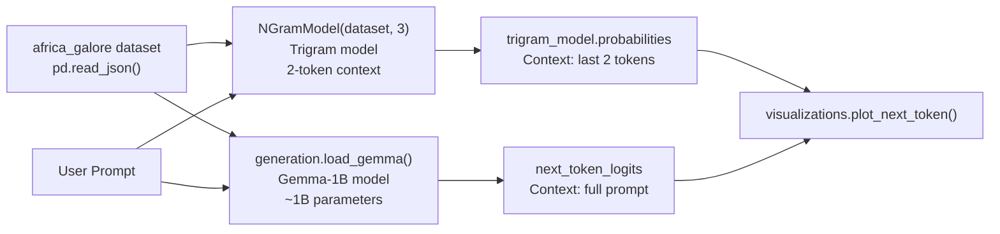
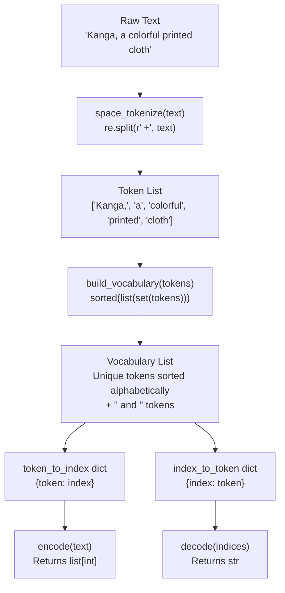
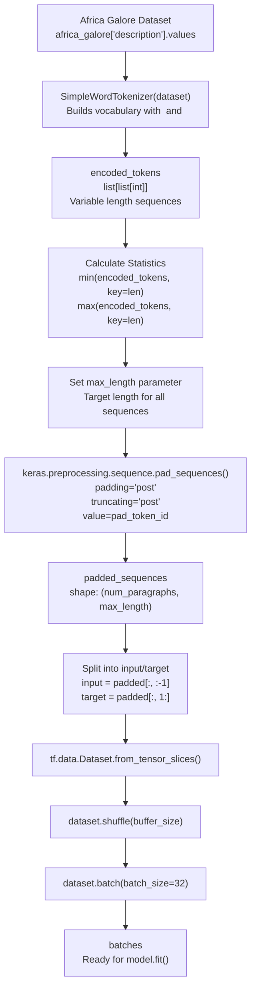
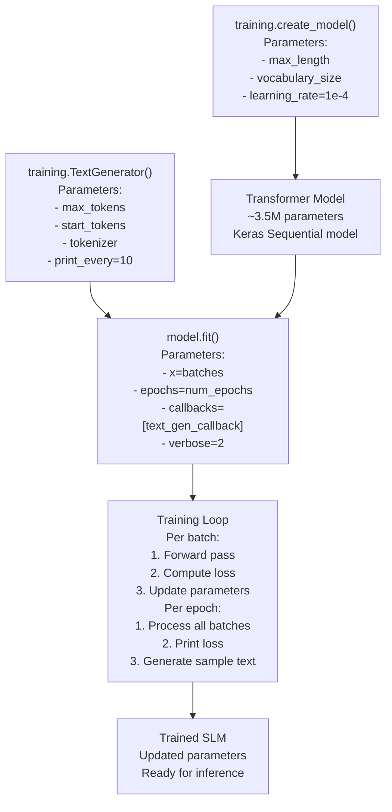

<!-- source: DeepWiki mcp.deepwiki.com · repo google-deepmind/ai-foundations · page 3 Course 1: Language Model Foundations · fetched 2026-10-26 -->

# Course 1: Language Model Foundations

<details>
<summary>Relevant source files</summary>

The following files were used as context for generating this wiki page:

- [course_1/gdm_lab_1_3_compare_n_gram_models_and_transformer_language_models.ipynb](course_1/gdm_lab_1_3_compare_n_gram_models_and_transformer_language_models.ipynb)
- [course_1/gdm_lab_1_4_prepare_the_dataset_for_training_a_slm.ipynb](course_1/gdm_lab_1_4_prepare_the_dataset_for_training_a_slm.ipynb)
- [course_1/gdm_lab_1_5_train_your_own_small_language_model.ipynb](course_1/gdm_lab_1_5_train_your_own_small_language_model.ipynb)

</details>


## Purpose and Scope

This course introduces fundamental concepts in language modeling through three hands-on labs that progress from comparing existing models to training a custom small language model (SLM). Students work with the Africa Galore dataset to explore statistical (n-gram) versus neural (transformer) approaches, implement tokenization and vocabulary building, and execute a complete training pipeline using Keras.

For advanced tokenization techniques including BPE, see [Course 2: Advanced Tokenization and Embeddings](#4). For neural network architecture design and hyperparameter tuning, see [Course 3: Neural Network Training Fundamentals](#5).

---

## Course Structure

Course 1 consists of three sequential labs:

| Lab | Title | Duration | Key Objectives |
|-----|-------|----------|----------------|
| 1.3 | Compare N-gram and Transformer Models | 30 min | Understand differences in probability distributions, context sensitivity, and generation quality |
| 1.4 | Prepare Dataset for Training a SLM | 30 min | Implement tokenization, vocabulary building, and token-to-ID mapping |
| 1.5 | Train Your Own Small Language Model | 40 min | Execute complete training pipeline including padding, batching, and model evaluation |

Sources: [course_1/gdm_lab_1_3_compare_n_gram_models_and_transformer_language_models.ipynb:1-688](), [course_1/gdm_lab_1_4_prepare_the_dataset_for_training_a_slm.ipynb:1-1041](), [course_1/gdm_lab_1_5_train_your_own_small_language_model.ipynb:1-1191]()

---

## Course Workflow Overview



Sources: [course_1/gdm_lab_1_3_compare_n_gram_models_and_transformer_language_models.ipynb:220-242](), [course_1/gdm_lab_1_4_prepare_the_dataset_for_training_a_slm.ipynb:749-881](), [course_1/gdm_lab_1_5_train_your_own_small_language_model.ipynb:864-936]()

---

## Lab 1.3: Comparing N-gram and Transformer Models

### Overview

Lab 1.3 provides an interactive comparison between statistical and neural language models by loading both an `NGramModel` (trigram) and the Gemma-1B transformer, then contrasting their probability distributions and text generations.

### Model Loading

The lab loads two models for comparison:



Sources: [course_1/gdm_lab_1_3_compare_n_gram_models_and_transformer_language_models.ipynb:220-242]()

### Key Functions and Classes

**NGramModel** (`ai_foundations.ngram.model`):
- Constructor: `NGramModel(corpus, n)` - builds n-gram probabilities from corpus
- Method: `generate(num_tokens, prompt, sampling_mode)` - generates text using n-gram probabilities
- Attribute: `probabilities` - dictionary mapping n-gram contexts to next token distributions

**Gemma Model Loading** (`ai_foundations.generation`):
- `load_gemma()` - loads pre-trained Gemma-1B transformer model
- `prompt_transformer_model(prompt, max_new_tokens, loaded_model, sampling_mode)` - generates text and returns `(output_text, next_token_logits, tokenizer)`

**Visualization** (`ai_foundations.visualizations`):
- `plot_next_token(logits_or_probs, prompt, tokenizer)` - displays bar chart of top 30 token probabilities

Sources: [course_1/gdm_lab_1_3_compare_n_gram_models_and_transformer_language_models.ipynb:227-241](), [course_1/gdm_lab_1_3_compare_n_gram_models_and_transformer_language_models.ipynb:284-307](), [course_1/gdm_lab_1_3_compare_n_gram_models_and_transformer_language_models.ipynb:335-375]()

### Context Sensitivity Comparison

The lab demonstrates that n-gram models have limited context windows while transformers consider the entire prompt:

| Aspect | N-gram Model | Transformer Model |
|--------|-------------|-------------------|
| Context Window | Last n-1 tokens (2 for trigram) | Full prompt (hundreds to thousands of tokens) |
| Probability Distribution | Based only on final bigram | Based on entire semantic context |
| Context Adaptation | No change if final bigram unchanged | Adapts to overall meaning |
| Generation Quality | Often incoherent, word salad | Generally fluent and relevant |

Example: Comparing prompts "Jide was hungry so she went looking for" vs "Jide was thirsty so she went looking for":
- **N-gram**: Same distribution (both end with "looking for")
- **Transformer**: Different distributions (associates "hungry" with food-related tokens, "thirsty" with drink-related tokens)

Sources: [course_1/gdm_lab_1_3_compare_n_gram_models_and_transformer_language_models.ipynb:406-473]()

### Sampling Modes

Both models support two sampling strategies:

**Greedy Sampling** (`sampling_mode="greedy"`):
- Always selects token with highest probability
- Produces deterministic outputs
- Re-running generates identical text

**Random Sampling** (`sampling_mode="random"`):
- Samples token according to probability distribution
- Produces stochastic outputs
- Enables diverse and creative generations

Sources: [course_1/gdm_lab_1_3_compare_n_gram_models_and_transformer_language_models.ipynb:560-602]()

---

## Lab 1.4: Dataset Preparation and SimpleWordTokenizer

### Overview

Lab 1.4 implements the preprocessing pipeline required to convert raw text into numerical representations suitable for transformer training. The core artifact is the `SimpleWordTokenizer` class.

### Text-to-Tokens Pipeline



Sources: [course_1/gdm_lab_1_4_prepare_the_dataset_for_training_a_slm.ipynb:209-235](), [course_1/gdm_lab_1_4_prepare_the_dataset_for_training_a_slm.ipynb:340-364](), [course_1/gdm_lab_1_4_prepare_the_dataset_for_training_a_slm.ipynb:462-521]()

### SimpleWordTokenizer Class

The `SimpleWordTokenizer` class encapsulates all tokenization functionality:

**Constructor**: `SimpleWordTokenizer(corpus, vocabulary=None)`
- If `vocabulary=None`: builds vocabulary from corpus using `build_vocabulary()`
- Adds special tokens: `<PAD>` (index 0) and `<UNK>` (last index)
- Creates bidirectional mappings: `token_to_index` and `index_to_token`

**Methods**:
- `space_tokenize(text)` - splits text on spaces using `re.split(r" +", text)`
- `build_vocabulary(tokens)` - returns `sorted(list(set(tokens)))`
- `encode(text)` - converts text to `list[int]`, maps unknown tokens to `unknown_token_id`
- `decode(indices)` - converts `int | list[int]` to space-separated string
- `join_text(text_list)` - joins tokens with spaces

**Attributes**:
- `vocabulary` - sorted list of unique tokens
- `vocabulary_size` - length of vocabulary
- `token_to_index` - dict mapping tokens to integer IDs
- `index_to_token` - dict mapping integer IDs to tokens
- `pad_token_id` - ID for `<PAD>` token (typically 0)
- `unknown_token_id` - ID for `<UNK>` token

Sources: [course_1/gdm_lab_1_4_prepare_the_dataset_for_training_a_slm.ipynb:749-881]()

### Vocabulary Building

The vocabulary construction process involves three key coding activities:

**Activity 1**: Build complete token list from dataset
```python
tokens = []
for paragraph in dataset:
    for token in space_tokenize(paragraph):
        tokens.append(token)
```

**Activity 2**: Extract unique tokens
```python
def build_vocabulary(tokens: list[str]) -> list[str]:
    vocabulary = list(set(tokens))
    return vocabulary
```

**Activity 3**: Create reverse mapping
```python
index_to_token = {}
for token, index in token_to_index.items():
    index_to_token[index] = token
```

Sources: [course_1/gdm_lab_1_4_prepare_the_dataset_for_training_a_slm.ipynb:264-291](), [course_1/gdm_lab_1_4_prepare_the_dataset_for_training_a_slm.ipynb:340-364](), [course_1/gdm_lab_1_4_prepare_the_dataset_for_training_a_slm.ipynb:512-537]()

### Encode/Decode Functions

**Encoding** converts text to token IDs:
```python
def encode(text: str) -> list[int]:
    indices = []
    for token in space_tokenize(text):
        token_index = token_to_index.get(token)
        indices.append(token_index)
    return indices
```

**Decoding** converts token IDs back to text:
```python
def decode(indices: int | list[int]) -> str:
    if isinstance(indices, int):
        indices = [indices]
    tokens = []
    for index in indices:
        token = index_to_token.get(index)
        tokens.append(token)
    return " ".join(tokens)
```

Round-trip verification: `decode(encode(text))` should return original text.

Sources: [course_1/gdm_lab_1_4_prepare_the_dataset_for_training_a_slm.ipynb:604-711]()

---

## Lab 1.5: Training Your Own Small Language Model

### Overview

Lab 1.5 executes a complete transformer training pipeline using the `SimpleWordTokenizer` from Lab 1.4. The trained model has ~3.5 million parameters, significantly smaller than production models like Gemma-1B (~1 billion parameters).

### Training Data Pipeline



Sources: [course_1/gdm_lab_1_5_train_your_own_small_language_model.ipynb:240-409](), [course_1/gdm_lab_1_5_train_your_own_small_language_model.ipynb:554-614](), [course_1/gdm_lab_1_5_train_your_own_small_language_model.ipynb:768-814]()

### Padding and Truncation

**Purpose**: Transform variable-length sequences into fixed-length matrix for neural network input.

**Implementation**:
```python
padded_sequences = keras.preprocessing.sequence.pad_sequences(
    encoded_tokens,
    maxlen=max_length,
    padding="post",      # Add <PAD> tokens at end
    truncating="post",   # Remove tokens from end if too long
    value=tokenizer.pad_token_id
)
```

**Effect**:
- Sequences shorter than `max_length`: padded with `<PAD>` tokens (ID 0)
- Sequences longer than `max_length`: truncated to `max_length`
- Result: all sequences have identical length for matrix representation

Sources: [course_1/gdm_lab_1_5_train_your_own_small_language_model.ipynb:441-614]()

### Input-Target Pair Construction

Language models predict the next token given previous tokens. Training data must reflect this:

**Input Sequence**: All tokens except the last
- Represents context provided to model
- Shape: `(num_examples, max_length - 1)`

**Target Sequence**: All tokens except the first
- Represents correct predictions (shifted left by 1)
- Shape: `(num_examples, max_length - 1)`

**Example**:
```
Original:  ["Table", "Mountain", "is", "beautiful"]
Input:     ["Table", "Mountain", "is"]
Target:    ["Mountain", "is", "beautiful"]
```

**Implementation**:
```python
input_sequences = padded_sequences[:, :-1]   # Remove last token
target_sequences = padded_sequences[:, 1:]   # Remove first token
```

Sources: [course_1/gdm_lab_1_5_train_your_own_small_language_model.ipynb:623-705]()

### Shuffling and Batching

**Purpose**: Increase training diversity and enable efficient batch processing.

**Shuffling** randomizes example order:
```python
tf_dataset = tf.data.Dataset.from_tensor_slices((input_sequences, target_sequences))
tf_dataset = tf_dataset.shuffle(buffer_size=len(input_sequences))
```

**Batching** groups examples:
```python
batch_size = 32
batches = tf_dataset.batch(batch_size)
```

**Result**: Dataset split into groups of `batch_size` paragraphs, each containing diverse topics due to shuffling.

Sources: [course_1/gdm_lab_1_5_train_your_own_small_language_model.ipynb:768-814]()

### Model Creation and Training



Sources: [course_1/gdm_lab_1_5_train_your_own_small_language_model.ipynb:864-936]()

### Model Creation Parameters

**`training.create_model()`** constructs the transformer architecture:

| Parameter | Description | Source |
|-----------|-------------|--------|
| `max_length` | Maximum sequence length (input shape) | From `input_sequences.shape[1]` |
| `vocabulary_size` | Number of unique tokens model can process/predict | From `tokenizer.vocabulary_size` |
| `learning_rate` | Step size for parameter updates during training | Default: `1e-4` |

**Return**: Compiled Keras model ready for training.

Sources: [course_1/gdm_lab_1_5_train_your_own_small_language_model.ipynb:864-875]()

### Training Callback

**`training.TextGenerator`** callback monitors training progress:

```python
text_gen_callback = training.TextGenerator(
    max_tokens=10,              # Number of tokens to generate
    start_tokens=prompt_ids,    # Encoded prompt
    tokenizer=tokenizer,        # For decoding
    print_every=10              # Generate text every 10 epochs
)
```

**Functionality**: Generates sample text during training to observe improvement in generation quality over time.

Sources: [course_1/gdm_lab_1_5_train_your_own_small_language_model.ipynb:892-904]()

### Training Execution

**Training loop**:
```python
num_epochs = 200  # Number of complete passes through dataset
history = model.fit(
    x=batches,
    verbose=2,                      # Print one line per epoch
    epochs=num_epochs,
    callbacks=[text_gen_callback]
)
```

**Process**:
1. **Epoch**: One complete pass through all batches
2. **Step**: Processing one batch (forward pass + parameter update)
3. **Loss**: Metric indicating prediction error (decreases during training)
4. **Callback**: Generates sample text periodically to monitor quality

**Observations during training**:
- Loss should generally decrease over epochs
- Generated text evolves from random words to coherent sentences
- Initial generations: word salad
- Final generations: grammatical, contextually relevant text

Sources: [course_1/gdm_lab_1_5_train_your_own_small_language_model.ipynb:924-952]()

### Model Evaluation

Post-training evaluation uses `generation.generate_text()`:

```python
generated_text, probs = generation.generate_text(
    prompt,
    num_tokens_to_generate,
    model=model,
    tokenizer=tokenizer,
    pad_token_id=tokenizer.pad_token_id,
    sampling_mode="greedy"  # or "random"
)
```

**Evaluation criteria**:
1. **Next token prediction**: Visualize probability distribution using `visualizations.plot_next_token(probs[0], prompt, tokenizer)`
2. **Generation coherence**: Generate longer sequences and assess grammaticality and relevance
3. **Context sensitivity**: Test with slightly modified prompts to verify appropriate distribution changes

**Handling unseen tokens**: Prompts containing tokens not in training vocabulary are mapped to `<UNK>` token, resulting in degraded predictions.

Sources: [course_1/gdm_lab_1_5_train_your_own_small_language_model.ipynb:990-1099]()

---

## Core Module Integration

### ai_foundations.generation

**Functions used in Course 1**:

| Function | Parameters | Returns | Purpose |
|----------|-----------|---------|---------|
| `load_gemma()` | None | Loaded Gemma model | Loads pre-trained Gemma-1B transformer |
| `prompt_transformer_model()` | `prompt`, `max_new_tokens`, `loaded_model`, `sampling_mode` | `(output_text, next_token_logits, tokenizer)` | Generates text from transformer |
| `generate_text()` | `prompt`, `num_tokens`, `model`, `tokenizer`, `pad_token_id`, `sampling_mode` | `(generated_text, probs)` | Generates text from custom trained model |

Sources: [course_1/gdm_lab_1_3_compare_n_gram_models_and_transformer_language_models.ipynb:186-194](), [course_1/gdm_lab_1_5_train_your_own_small_language_model.ipynb:186-194]()

### ai_foundations.visualizations

**Functions used in Course 1**:

| Function | Parameters | Purpose |
|----------|-----------|---------|
| `plot_next_token()` | `logits_or_probs`, `prompt`, `tokenizer` (optional) | Displays bar chart of top 30 token probabilities |

Sources: [course_1/gdm_lab_1_3_compare_n_gram_models_and_transformer_language_models.ipynb:186-194]()

### ai_foundations.ngram.model

**NGramModel class**:

| Method/Attribute | Type | Description |
|------------------|------|-------------|
| `__init__(corpus, n)` | Constructor | Builds n-gram probabilities from corpus |
| `generate(num_tokens, prompt, sampling_mode)` | Method | Generates text using n-gram model |
| `probabilities` | Attribute | Dict mapping n-gram contexts to token distributions |

Sources: [course_1/gdm_lab_1_3_compare_n_gram_models_and_transformer_language_models.ipynb:186-194]()

### ai_foundations.training

**Functions used in Course 1**:

| Function | Parameters | Returns | Purpose |
|----------|-----------|---------|---------|
| `create_model()` | `max_length`, `vocabulary_size`, `learning_rate` | Compiled Keras model | Constructs transformer architecture |
| `TextGenerator()` | `max_tokens`, `start_tokens`, `tokenizer`, `print_every` | Keras callback | Generates sample text during training |

Sources: [course_1/gdm_lab_1_5_train_your_own_small_language_model.ipynb:186-194]()

### ai_foundations.feedback.course_1.slm

**Testing functions**:
- `test_build_tokens_list()` - Validates token list construction
- `test_build_vocabulary()` - Validates vocabulary building
- `test_index_to_token()` - Validates reverse token mapping
- `test_simple_word_tokenizer()` - Validates complete tokenizer class
- `test_max_min_seqlen()` - Validates sequence length calculations

Sources: [course_1/gdm_lab_1_4_prepare_the_dataset_for_training_a_slm.ipynb:148-160]()

---

## Dataset: Africa Galore

All labs in Course 1 use the Africa Galore dataset:

**Source**: `https://storage.googleapis.com/dm-educational/assets/ai_foundations/africa_galore.json`

**Loading**:
```python
import pandas as pd
africa_galore = pd.read_json(URL)
dataset = africa_galore["description"]
```

**Structure**:
- Format: JSON with `description` field
- Content: Paragraphs about African culture, food, traditions
- Size: Hundreds of paragraphs
- Purpose: Small corpus suitable for educational training exercises

**Usage across labs**:
- Lab 1.3: Training corpus for NGramModel
- Lab 1.4: Source text for vocabulary building
- Lab 1.5: Training dataset for custom SLM

Sources: [course_1/gdm_lab_1_3_compare_n_gram_models_and_transformer_language_models.ipynb:227-232](), [course_1/gdm_lab_1_4_prepare_the_dataset_for_training_a_slm.ipynb:186-192](), [course_1/gdm_lab_1_5_train_your_own_small_language_model.ipynb:218-223]()

---

## Key Concepts Summary

### Statistical vs Neural Models

| Aspect | N-gram Models | Transformer Models |
|--------|---------------|-------------------|
| **Approach** | Count-based statistics | Neural network parameters |
| **Context** | Fixed window (n-1 tokens) | Variable, typically hundreds to thousands |
| **Training** | Direct probability estimation from counts | Iterative parameter optimization via gradient descent |
| **Vocabulary handling** | Exact token matching only | Can leverage semantic relationships |
| **Generation quality** | Limited coherence, word salad | Generally fluent and contextually appropriate |
| **Computational cost** | Low (counting) | High (requires GPU for large models) |

Sources: [course_1/gdm_lab_1_3_compare_n_gram_models_and_transformer_language_models.ipynb:623-634]()

### Training Concepts

**Epoch**: One complete pass through entire training dataset

**Batch**: Group of examples processed together before parameter update

**Batch size**: Number of examples per batch (typically 32 in Course 1)

**Loss**: Metric measuring prediction error (should decrease during training)

**Parameters**: Numbers that define model behavior (updated during training)

**Learning rate**: Controls magnitude of parameter updates

**Callback**: Function executed periodically during training (e.g., text generation for monitoring)

Sources: [course_1/gdm_lab_1_5_train_your_own_small_language_model.ipynb:829-843]()

### Special Tokens

**`<PAD>`** (Padding token):
- Purpose: Standardize sequence lengths
- ID: Typically 0
- Usage: Appended to short sequences to match `max_length`
- Handling: Model learns to ignore during training

**`<UNK>`** (Unknown token):
- Purpose: Handle out-of-vocabulary tokens
- ID: Typically last index in vocabulary
- Usage: Substituted for tokens not seen during vocabulary building
- Limitation: Loses token-specific information

Sources: [course_1/gdm_lab_1_4_prepare_the_dataset_for_training_a_slm.ipynb:265-267](), [course_1/gdm_lab_1_5_train_your_own_small_language_model.ipynb:1029-1036]()

---

