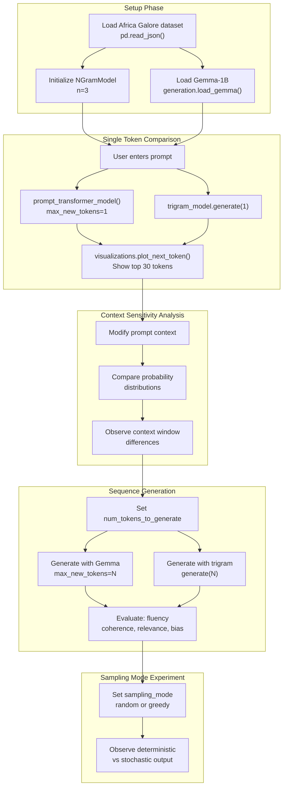
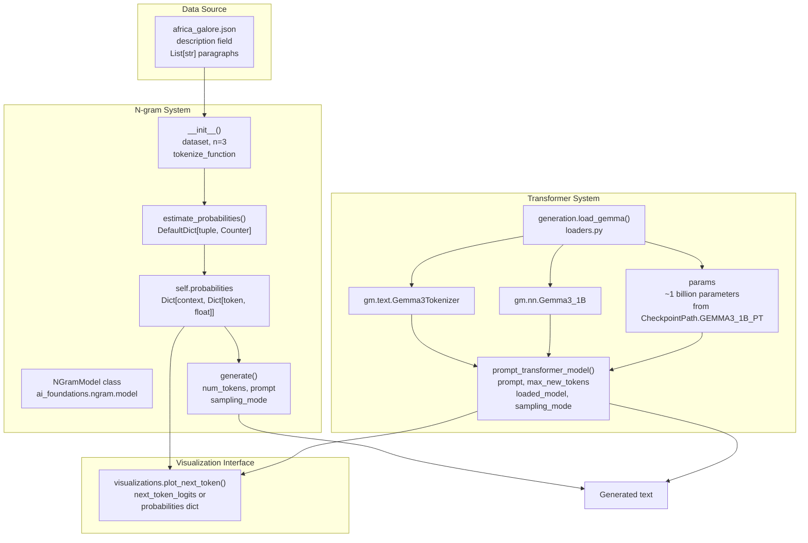
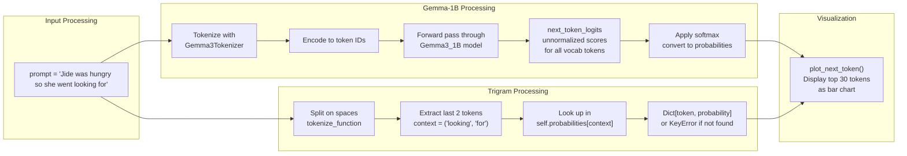
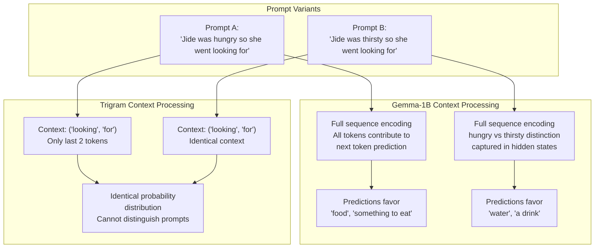
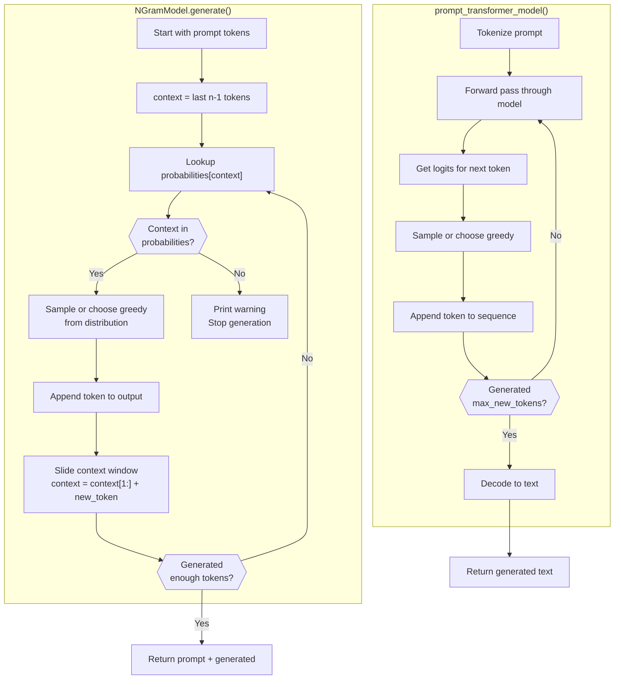
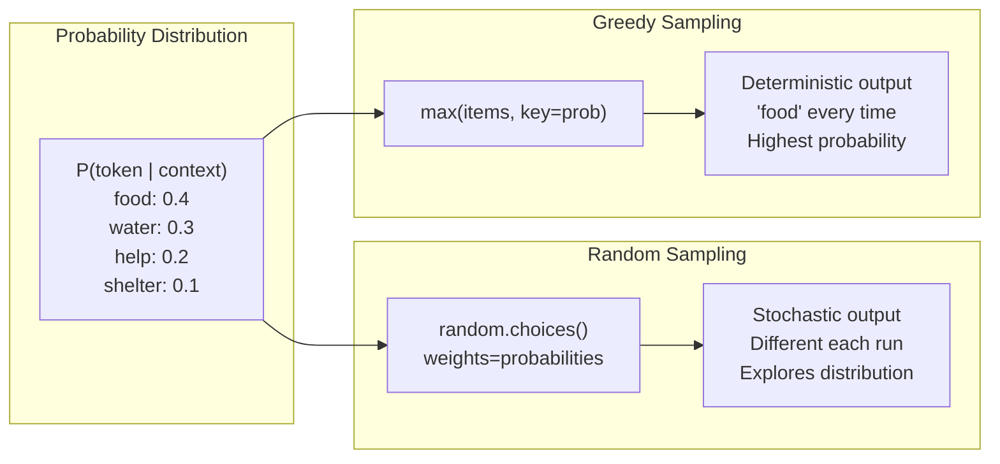
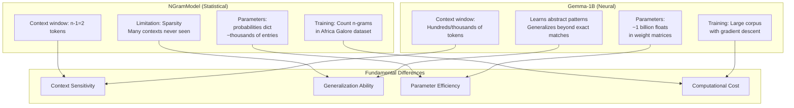

<!-- source: DeepWiki mcp.deepwiki.com · repo google-deepmind/ai-foundations · page 3.2 Lab 1.3: Comparing N-gram and Transformer Models · fetched 2026-10-26 -->

# Lab 1.3: Comparing N-gram and Transformer Models

<details>
<summary>Relevant source files</summary>

The following files were used as context for generating this wiki page:

- [ai_foundations/feedback/course_1/slm/__init__.py](ai_foundations/feedback/course_1/slm/__init__.py)
- [ai_foundations/generation/loaders.py](ai_foundations/generation/loaders.py)
- [ai_foundations/ngram/model.py](ai_foundations/ngram/model.py)
- [course_1/gdm_lab_1_3_compare_n_gram_models_and_transformer_language_models.ipynb](course_1/gdm_lab_1_3_compare_n_gram_models_and_transformer_language_models.ipynb)

</details>


## Purpose and Scope

This document describes Lab 1.3, an interactive educational notebook that provides hands-on comparison between statistical n-gram language models and neural transformer-based language models. The lab loads a trigram model trained on the Africa Galore dataset and the pre-trained Gemma-1B transformer model, allowing users to observe differences in probability distributions, generation quality, context sensitivity, and sampling behavior.

This lab focuses on empirical observation rather than implementation. For tokenization and dataset preparation, see [Lab 1.4](#3.1). For training your own transformer model, see [Lab 1.5](#3.3).

**Sources:** [course_1/gdm_lab_1_3_compare_n_gram_models_and_transformer_language_models.ipynb:27-81]()

## Lab Workflow Overview

The lab follows a structured progression from model loading through various comparison activities. Users interact with pre-configured cells that execute comparison operations without writing new code.



**Sources:** [course_1/gdm_lab_1_3_compare_n_gram_models_and_transformer_language_models.ipynb:196-243](), [course_1/gdm_lab_1_3_compare_n_gram_models_and_transformer_language_models.ipynb:250-602]()

## Model Loading System

### Component Architecture

The lab initializes two distinct language modeling systems that share a common text generation interface but differ fundamentally in their implementation.



**Sources:** [course_1/gdm_lab_1_3_compare_n_gram_models_and_transformer_language_models.ipynb:220-242](), [ai_foundations/ngram/model.py:30-77](), [ai_foundations/generation/loaders.py:28-70]()

### NGramModel Initialization

The `NGramModel` class from [ai_foundations/ngram/model.py:30-193]() is instantiated with the Africa Galore dataset and `n=3` to create a trigram model.

| Parameter | Value | Description |
|-----------|-------|-------------|
| `dataset` | `africa_galore["description"]` | List of paragraph strings |
| `n` | `3` | Creates trigram (context window of 2 tokens) |
| `tokenize_function` | `None` (defaults to space split) | Token extraction method |

The initialization process:
1. Validates `n >= 2` ([ai_foundations/ngram/model.py:63-64]())
2. Sets default space tokenizer if none provided ([ai_foundations/ngram/model.py:66-72]())
3. Calls `estimate_probabilities()` to build probability dictionary ([ai_foundations/ngram/model.py:76]())

The `estimate_probabilities` method ([ai_foundations/ngram/model.py:78-121]()) constructs a nested dictionary structure:
- Outer keys: `(n-1)` token context tuples
- Inner keys: possible next tokens
- Values: conditional probabilities P(token|context)

**Sources:** [ai_foundations/ngram/model.py:46-77](), [ai_foundations/ngram/model.py:78-121]()

### Gemma Model Loading

The `load_gemma()` function ([ai_foundations/generation/loaders.py:28-70]()) returns a three-element tuple:

```python
tokenizer, model, params = generation.load_gemma()
```

| Component | Type | Description |
|-----------|------|-------------|
| `tokenizer` | `gm.text.Gemma3Tokenizer` | Converts text to token IDs and vice versa |
| `model` | `gm.nn.Gemma3_1B` | Neural network architecture definition |
| `params` | `Mapping[str, Any]` | ~1 billion trained parameters from checkpoint |

The function loads pre-trained weights from `gm.ckpts.CheckpointPath.GEMMA3_1B_PT` ([ai_foundations/generation/loaders.py:59]()). These parameters encode language patterns learned from large-scale training data.

**Sources:** [ai_foundations/generation/loaders.py:28-70](), [course_1/gdm_lab_1_3_compare_n_gram_models_and_transformer_language_models.ipynb:209-212]()

## Probability Distribution Comparison

### Single Token Prediction

The lab visualizes probability distributions over the next token using `visualizations.plot_next_token()`. This function accepts either:
- Logits from transformer model (`next_token_logits` from `prompt_transformer_model`)
- Probability dictionary from n-gram model (`trigram_model.probabilities[context]`)



**Sources:** [course_1/gdm_lab_1_3_compare_n_gram_models_and_transformer_language_models.ipynb:284-375]()

### Visualization Output Characteristics

The `plot_next_token` function ([referenced in course_1/gdm_lab_1_3_compare_n_gram_models_and_transformer_language_models.ipynb:355-368]()) displays the top 30 most probable tokens. Key differences between models:

| Aspect | Gemma-1B | Trigram Model |
|--------|----------|---------------|
| **Vocabulary coverage** | Assigns non-zero probability to most vocabulary tokens | Only tokens observed after specific bigram in training data |
| **Context dependency** | Considers full prompt (up to context window limit) | Only last `n-1=2` tokens |
| **Sparsity** | Dense distribution with many low-probability candidates | Sparse; many prompts yield no predictions |
| **Probability mass shown** | Top 30 may not sum to 1.0 (many tokens omitted) | Often sums close to 1.0 (few candidates) |

**Sources:** [course_1/gdm_lab_1_3_compare_n_gram_models_and_transformer_language_models.ipynb:315-375](), [course_1/gdm_lab_1_3_compare_n_gram_models_and_transformer_language_models.ipynb:392-398]()

## Context Sensitivity Analysis

### Context Window Comparison

The lab demonstrates fundamental differences in context window sizes through prompt modification experiments.



**Sources:** [course_1/gdm_lab_1_3_compare_n_gram_models_and_transformer_language_models.ipynb:406-473]()

### Implementation Details

The trigram model's context extraction ([ai_foundations/ngram/model.py:164]()) uses:
```python
context = tuple(tokens[-(self.n - 1):])
```

This creates a sliding window of size `n-1=2` tokens. The model cannot access information beyond this window, making it insensitive to changes earlier in the prompt.

In contrast, Gemma-1B processes the entire prompt through its transformer architecture, allowing "hungry" vs "thirsty" to influence predictions despite being several tokens away from "looking for".

**Sources:** [ai_foundations/ngram/model.py:154-192](), [course_1/gdm_lab_1_3_compare_n_gram_models_and_transformer_language_models.ipynb:466-473]()

## Text Generation Comparison

### Generation Methods

Both models implement autoregressive generation: repeatedly predicting and appending the next token.



**Sources:** [ai_foundations/ngram/model.py:123-192](), [course_1/gdm_lab_1_3_compare_n_gram_models_and_transformer_language_models.ipynb:494-519]()

### Evaluation Criteria

The lab instructs users to evaluate generations along four dimensions:

| Criterion | Definition | Gemma-1B Performance | Trigram Performance |
|-----------|------------|----------------------|---------------------|
| **Fluency** | Grammatical correctness, natural reading flow | High; follows English grammar rules consistently | Low; locally fluent phrases but globally incoherent |
| **Coherence** | Logical consistency, staying on topic | Generally coherent; occasional topic drift | Poor; frequent non-sequiturs due to short context |
| **Relevance** | Appropriateness to prompt | Usually relevant; provides reasonable continuations | Rarely relevant; often fails to generate at all |
| **Bias** | Presence of stereotypes or inequalities | May exhibit training data biases (e.g., gendered profession associations) | Also biased when coherent, but rarely coherent enough to evaluate |

**Sources:** [course_1/gdm_lab_1_3_compare_n_gram_models_and_transformer_language_models.ipynb:258-266](), [course_1/gdm_lab_1_3_compare_n_gram_models_and_transformer_language_models.ipynb:527-541]()

### Generation Failure Modes

The trigram model frequently encounters contexts not present in `self.probabilities`, triggering early termination:

```python
if context not in self.probabilities:
    print("⚠️ No valid continuation found...")
    break
```

This occurs when the generated sequence enters a state unseen during training. Gemma-1B avoids this issue by:
1. Having a much larger training dataset
2. Learning abstract patterns that generalize beyond exact n-gram matches

**Sources:** [ai_foundations/ngram/model.py:168-173](), [course_1/gdm_lab_1_3_compare_n_gram_models_and_transformer_language_models.ipynb:531]()

## Sampling Strategies

### Random vs Greedy Sampling

Both `NGramModel.generate()` and `prompt_transformer_model()` accept a `sampling_mode` parameter controlling token selection.



**Sources:** [ai_foundations/ngram/model.py:181-186](), [course_1/gdm_lab_1_3_compare_n_gram_models_and_transformer_language_models.ipynb:560-617]()

### Implementation

The `NGramModel.generate()` method implements both modes ([ai_foundations/ngram/model.py:181-186]()):

```python
if sampling_mode == "random":
    next_token = random.choices(
        possible_next_tokens, weights=token_probabilities, k=1
    )[0]
else:
    next_token = max(next_token_distribution.items(), key=lambda x: x[1])[0]
```

The `prompt_transformer_model()` function passes `sampling_mode` to the underlying generation logic, which similarly either samples from the softmax distribution or selects the argmax token.

**Sources:** [ai_foundations/ngram/model.py:148-152](), [ai_foundations/ngram/model.py:181-186](), [course_1/gdm_lab_1_3_compare_n_gram_models_and_transformer_language_models.ipynb:577-602]()

### Use Case Guidance

| Application Type | Recommended Mode | Rationale |
|-----------------|------------------|-----------|
| Creative writing | Random | Explores diverse continuations, avoids repetition |
| Factual Q&A | Greedy | Maximizes likelihood of correct information |
| Code generation | Greedy | Prioritizes syntactic correctness |
| Story generation | Random | Increases narrative variety and surprise |

**Sources:** [course_1/gdm_lab_1_3_compare_n_gram_models_and_transformer_language_modules.ipynb:610-617]()

## Key Architectural Differences

### Model Comparison Summary



**Sources:** [course_1/gdm_lab_1_3_compare_n_gram_models_and_transformer_language_models.ipynb:625-634]()

### Why Transformers Outperform N-grams

The lab concludes with two primary explanations ([course_1/gdm_lab_1_3_compare_n_gram_models_and_transformer_language_models.ipynb:631-634]()):

1. **Extended Context Windows**: Transformers process hundreds or thousands of tokens simultaneously, capturing long-range dependencies. N-grams are limited to `n-1` tokens, missing crucial context.

2. **Abstract Pattern Learning**: Neural networks learn that semantically similar words (e.g., "food" and "snack") should have related representations. This enables generalization to novel contexts. N-grams treat each word as a discrete symbol without capturing semantic relationships.

**Sources:** [course_1/gdm_lab_1_3_compare_n_gram_models_and_transformer_language_models.ipynb:625-634]()

## Lab Learning Outcomes

Upon completion, users will have:

1. Observed probability distribution differences between statistical and neural models
2. Compared generation quality across fluency, coherence, relevance, and bias dimensions
3. Understood how context window size affects model behavior
4. Experimented with random vs greedy sampling strategies
5. Recognized fundamental advantages of transformer architectures

The lab provides empirical evidence for transitioning from simple statistical methods to sophisticated neural approaches in language modeling.

**Sources:** [course_1/gdm_lab_1_3_compare_n_gram_models_and_transformer_language_models.ipynb:59-64](), [course_1/gdm_lab_1_3_compare_n_gram_models_and_transformer_language_models.ipynb:642-654]()

---

