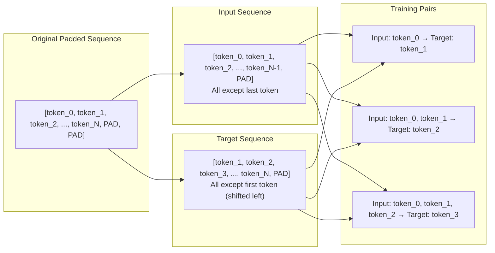
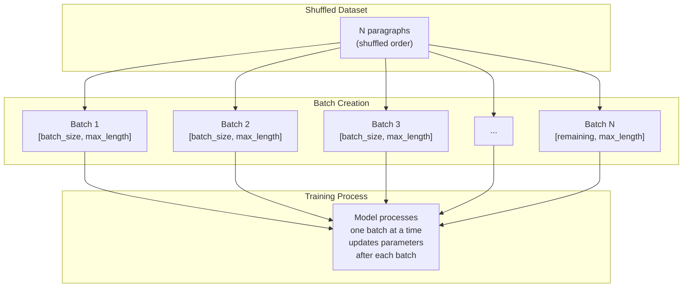
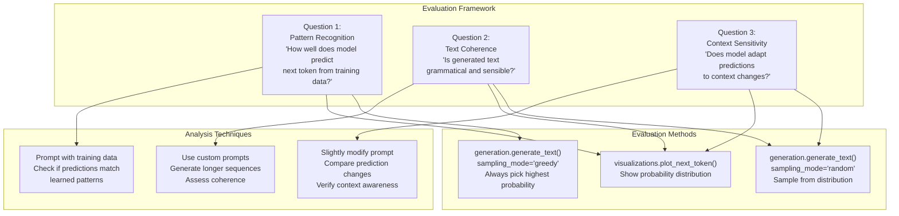
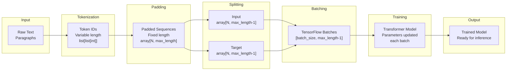

<!-- source: DeepWiki mcp.deepwiki.com · repo google-deepmind/ai-foundations · page 3.3 Lab 1.5: Training Your First Small Language Model · fetched 2026-10-26 -->

# Lab 1.5: Training Your First Small Language Model

<details>
<summary>Relevant source files</summary>

The following files were used as context for generating this wiki page:

- [course_1/gdm_lab_1_5_train_your_own_small_language_model.ipynb](course_1/gdm_lab_1_5_train_your_own_small_language_model.ipynb)

</details>


## Purpose and Scope

This document describes the complete workflow for training a small transformer-based language model on the Africa Galore dataset. It covers data preparation (tokenization, padding, batching), model initialization using Keras, the training loop, and evaluation techniques for assessing model quality.

This lab builds upon the `SimpleWordTokenizer` implementation from [Lab 1.4](#3.1) and demonstrates the practical training process that differentiates transformer models from the statistical N-gram models introduced in [Lab 1.3](#3.2). For details on model architectures and components, see [Training Utilities](#2.3). For embedding analysis after training, see [Lab 2.6](#4.5).

**Sources:** [course_1/gdm_lab_1_5_train_your_own_small_language_model.ipynb:27-78]()

## Training Pipeline Overview

The following diagram illustrates the complete end-to-end pipeline for training a small language model, from raw text to trained model evaluation.

```mermaid
graph TB
    subgraph "Data Loading"
        RAW["Africa Galore Dataset<br/>pd.read_json()"]
        DATASET["dataset = africa_galore['description'].values"]
    end
    
    subgraph "Tokenization"
        TOKENIZER["SimpleWordTokenizer(dataset)<br/>builds vocabulary"]
        ENCODE["tokenizer.encode(text)<br/>converts to token IDs"]
        ENCODED["encoded_tokens: list[list[int]]"]
    end
    
    subgraph "Sequence Preparation"
        PAD["keras.preprocessing.sequence.pad_sequences()<br/>maxlen=max_length"]
        PADDED["padded_sequences: array[batch, seq_len]"]
        SPLIT["input_sequences = padded[:, :-1]<br/>target_sequences = padded[:, 1:]"]
    end
    
    subgraph "Batching"
        TFDATASET["tf.data.Dataset.from_tensor_slices()"]
        SHUFFLE["dataset.shuffle(buffer_size)"]
        BATCH["dataset.batch(batch_size)"]
        BATCHES["batches: TensorFlow Dataset"]
    end
    
    subgraph "Model Training"
        CREATE["training.create_model()<br/>max_length, vocabulary_size"]
        MODEL["Transformer Model<br/>~3.5M parameters"]
        CALLBACK["training.TextGenerator<br/>monitors generation quality"]
        FIT["model.fit(batches, epochs, callbacks)"]
        TRAINED["Trained Model"]
    end
    
    subgraph "Evaluation"
        GENERATE["generation.generate_text()<br/>sampling_mode: greedy/random"]
        VISUALIZE["visualizations.plot_next_token()<br/>probability distribution"]
        ASSESS["Quality Assessment:<br/>coherence, context sensitivity"]
    end
    
    RAW --> DATASET
    DATASET --> TOKENIZER
    TOKENIZER --> ENCODE
    ENCODE --> ENCODED
    ENCODED --> PAD
    PAD --> PADDED
    PADDED --> SPLIT
    SPLIT --> TFDATASET
    TFDATASET --> SHUFFLE
    SHUFFLE --> BATCH
    BATCH --> BATCHES
    
    BATCHES --> CREATE
    CREATE --> MODEL
    MODEL --> CALLBACK
    MODEL --> FIT
    CALLBACK --> FIT
    FIT --> TRAINED
    
    TRAINED --> GENERATE
    GENERATE --> VISUALIZE
    VISUALIZE --> ASSESS
```



**Sources:** [course_1/gdm_lab_1_5_train_your_own_small_language_model.ipynb:40-77](), [course_1/gdm_lab_1_5_train_your_own_small_language_model.ipynb:152-197]()

## Dataset Loading and Tokenization

### Loading the Africa Galore Dataset

The Africa Galore dataset is loaded using pandas and stored as a numpy array of description paragraphs.

```python
africa_galore = pd.read_json("https://storage.googleapis.com/.../africa_galore.json")
dataset = africa_galore["description"].values
```

**Sources:** [course_1/gdm_lab_1_5_train_your_own_small_language_model.ipynb:205-223]()

### SimpleWordTokenizer Implementation

The `SimpleWordTokenizer` class provides the tokenization interface with special token handling:

| Special Token | Purpose | Token ID Assignment |
|--------------|---------|-------------------|
| `<PAD>` | Padding sequences to uniform length | `pad_token_id = 0` (first in vocabulary) |
| `<UNK>` | Handling out-of-vocabulary tokens | `unknown_token_id = len(vocabulary) + 1` (last in vocabulary) |

Key methods:
- `space_tokenize(text)`: Splits text on whitespace using `re.split(" +", text)`
- `encode(text)`: Converts text to list of token IDs, mapping unknown tokens to `<UNK>`
- `decode(indices)`: Converts token IDs back to text

The tokenizer builds vocabulary from the corpus and creates bidirectional mappings:
- `token_to_index`: Dictionary mapping tokens to IDs
- `index_to_token`: Dictionary mapping IDs to tokens

**Sources:** [course_1/gdm_lab_1_5_train_your_own_small_language_model.ipynb:230-409]()

### Encoding Process

```python
tokenizer = SimpleWordTokenizer(dataset)
encoded_tokens = []
for text in dataset:
    token_ids = tokenizer.encode(text)
    encoded_tokens.append(token_ids)
```

The result is a list of variable-length sequences, where each sequence represents one paragraph as token IDs.

**Sources:** [course_1/gdm_lab_1_5_train_your_own_small_language_model.ipynb:399-408]()

## Padding and Truncation

### Sequence Length Analysis

Before padding, the lab computes length statistics to determine appropriate `max_length`:

```python
shortest_paragraph_length = len(min(encoded_tokens, key=len))
longest_paragraph_length = len(max(encoded_tokens, key=len))
```

This analysis reveals the distribution of paragraph lengths in the dataset, informing the choice of target length for padding/truncation.

**Sources:** [course_1/gdm_lab_1_5_train_your_own_small_language_model.ipynb:469-539]()

### Padding Strategy

The `keras.preprocessing.sequence.pad_sequences` function implements combined padding and truncation:

```python
padded_sequences = keras.preprocessing.sequence.pad_sequences(
    encoded_tokens,
    maxlen=max_length,
    padding="post",      # Add padding at end of sequence
    truncating="post",   # Remove tokens from end if too long
    value=tokenizer.pad_token_id
)
```

| Parameter | Value | Effect |
|-----------|-------|--------|
| `maxlen` | User-defined target length | All sequences padded/truncated to this length |
| `padding="post"` | Append padding | `<PAD>` tokens added at end |
| `truncating="post"` | Remove from end | Tokens beyond `maxlen` discarded |
| `value` | `tokenizer.pad_token_id` | ID used for padding tokens |

**Result:** Matrix of shape `[num_paragraphs, max_length]` where every row has exactly `max_length` elements.

**Sources:** [course_1/gdm_lab_1_5_train_your_own_small_language_model.ipynb:437-615]()

## Input and Target Sequence Preparation

### Data Transformation for Next-Token Prediction

Language models predict the next token given previous context. The training data must be structured to support this task through input-target pairs.



### Array Slicing Implementation

```python
# Remove last token from each sequence for input
input_sequences = padded_sequences[:, :-1]

# Remove first token from each sequence for target (shift left)
target_sequences = padded_sequences[:, 1:]
```

This creates aligned input-target pairs where:
- Position `i` in `input_sequences` contains tokens `[0...i]` of original sequence
- Position `i` in `target_sequences` contains token `i+1` (the next token to predict)

After this operation, `max_length` is updated to reflect the new sequence length:
```python
max_length = input_sequences.shape[1]  # Reduced by 1
```

**Sources:** [course_1/gdm_lab_1_5_train_your_own_small_language_model.ipynb:623-727]()

## Shuffling and Batching

### TensorFlow Dataset Creation

The data is converted to a TensorFlow dataset for efficient shuffling and batching:

```python
tf_dataset = tf.data.Dataset.from_tensor_slices((input_sequences, target_sequences))
tf_dataset = tf_dataset.shuffle(buffer_size=len(input_sequences))
batches = tf_dataset.batch(batch_size)
```

**Sources:** [course_1/gdm_lab_1_5_train_your_own_small_language_model.ipynb:735-815]()

### Shuffling Parameters

| Parameter | Purpose | Recommended Value |
|-----------|---------|-------------------|
| `buffer_size` | Number of examples held in memory for shuffling | `len(input_sequences)` for complete shuffle |

For very large datasets, reduce `buffer_size` to manage memory consumption, though this may result in less thorough shuffling.

### Batching Configuration

```python
batch_size = 32  # Number of paragraphs per batch
```

The dataset is split into batches where:
- Each batch contains `batch_size` paragraphs (except possibly the last batch)
- Total batches = `ceil(num_paragraphs / batch_size)`
- Each batch is a tensor of shape `[batch_size, max_length]`

**Batching diagram:**



**Sources:** [course_1/gdm_lab_1_5_train_your_own_small_language_model.ipynb:735-815]()

## Model Creation and Configuration

### Model Initialization

The `training.create_model` function builds a transformer architecture:

```python
model = training.create_model(
    max_length=max_length,
    vocabulary_size=tokenizer.vocabulary_size,
    learning_rate=1e-4
)
```

| Parameter | Type | Purpose |
|-----------|------|---------|
| `max_length` | `int` | Maximum sequence length the model can process |
| `vocabulary_size` | `int` | Number of unique tokens (size of output layer) |
| `learning_rate` | `float` | Step size for parameter updates (default: `1e-4`) |

**Model characteristics:**
- Architecture: Transformer-based
- Parameters: ~3.5 million (significantly smaller than Gemma-1B's ~1 billion)
- Framework: Keras with JAX backend

For implementation details of `create_model`, see [Training Utilities](#2.3).

**Sources:** [course_1/gdm_lab_1_5_train_your_own_small_language_model.ipynb:823-876]()

### Training Callback Configuration

The `TextGenerator` callback monitors training progress by generating text at regular intervals:

```python
prompt = "Abeni,"
prompt_ids = tokenizer.encode(prompt)
text_gen_callback = training.TextGenerator(
    max_tokens=10,
    start_tokens=prompt_ids,
    tokenizer=tokenizer,
    print_every=10  # Generate after every 10 epochs
)
```

This callback demonstrates model improvement during training by showing how generated text becomes more coherent over time.

**Sources:** [course_1/gdm_lab_1_5_train_your_own_small_language_model.ipynb:883-904]()

## Training Process

### Training Execution

```python
num_epochs = 200  # Number of complete passes through dataset
history = model.fit(
    x=batches,
    verbose=2,
    epochs=num_epochs,
    callbacks=[text_gen_callback]
)
```

**Training terminology:**

| Term | Definition |
|------|------------|
| **Epoch** | One complete pass through all batches in the dataset |
| **Step** | Processing of a single batch and updating model parameters |
| **Loss** | Numerical measure of prediction error (should decrease over time) |
| **Parameters** | Model weights updated during training (initialized randomly) |

**Sources:** [course_1/gdm_lab_1_5_train_your_own_small_language_model.ipynb:912-938]()

### Training Observations

During training, monitor:
1. **Loss trend**: Should generally decrease, though temporary increases are normal
2. **Generated text quality**: Should improve from random words to coherent sentences
3. **Training time**: Recommended to use GPU for faster training (see [course_1/gdm_lab_1_5_train_your_own_small_language_model.ipynb:130-148]() for GPU configuration)

The `model.fit` method with `verbose=2` prints one line per epoch showing loss values and generated examples from the callback.

**Sources:** [course_1/gdm_lab_1_5_train_your_own_small_language_model.ipynb:940-953]()

## Model Evaluation Workflow

### Three Evaluation Dimensions

The lab implements a structured evaluation framework assessing three key questions:



**Sources:** [course_1/gdm_lab_1_5_train_your_own_small_language_model.ipynb:960-1099]()

### Generation Modes

The `generation.generate_text` function supports two sampling strategies:

```python
# Greedy sampling: Always choose highest probability token
generated_text, probs = generation.generate_text(
    prompt,
    num_tokens_to_generate,
    model=model,
    tokenizer=tokenizer,
    pad_token_id=tokenizer.pad_token_id,
    sampling_mode="greedy"
)

# Random sampling: Sample from probability distribution
generated_text, probs = generation.generate_text(
    prompt,
    num_tokens_to_generate,
    model=model,
    tokenizer=tokenizer,
    pad_token_id=tokenizer.pad_token_id,
    sampling_mode="random"
)
```

| Sampling Mode | Behavior | Use Case |
|---------------|----------|----------|
| `"greedy"` | Selects token with highest probability | Deterministic, most likely output |
| `"random"` | Samples according to probability distribution | Diverse outputs, more creative |

**Sources:** [course_1/gdm_lab_1_5_train_your_own_small_language_model.ipynb:979-1099]()

### Probability Visualization

The `visualizations.plot_next_token` function displays the top predicted tokens and their probabilities:

```python
visualizations.plot_next_token(
    probs[0],           # Probability distribution for first token
    prompt=prompt,      # Context for the prediction
    tokenizer=tokenizer # For decoding token IDs
)
```

This visualization helps assess:
- Model confidence (high probability on top token vs. uniform distribution)
- Plausibility of alternative predictions
- Context sensitivity (how probabilities change with different prompts)

**Sources:** [course_1/gdm_lab_1_5_train_your_own_small_language_model.ipynb:990-1099]()

### Handling Unknown Tokens

When prompting with tokens not in the training vocabulary:
- Tokenizer maps unknown tokens to special `<UNK>` token
- Model processes `<UNK>` token ID
- Prediction quality typically degrades with multiple unknown tokens
- More sophisticated subword tokenization (covered in [Lab 2.4](#4.3) and [Lab 2.6](#4.5)) addresses this limitation

**Sources:** [course_1/gdm_lab_1_5_train_your_own_small_language_model.ipynb:1028-1037]()

## Key Training Parameters Summary

| Parameter | Typical Value | Location in Code | Impact |
|-----------|---------------|------------------|--------|
| `max_length` | 300 | Padding step | Sequence length; affects memory and context window |
| `batch_size` | 32 | Batching step | Training speed and memory usage |
| `num_epochs` | 200 | Training loop | Training duration and model quality |
| `learning_rate` | 1e-4 | Model creation | Speed and stability of parameter updates |
| `vocabulary_size` | Auto-computed | From tokenizer | Size of output layer |
| `print_every` | 10 | Callback config | Frequency of generation monitoring |

**Sources:** [course_1/gdm_lab_1_5_train_your_own_small_language_model.ipynb:546-936]()

## Core Components Reference

### Functions from `ai_foundations.training`

- `create_model(max_length, vocabulary_size, learning_rate)`: Instantiates Keras transformer model
- `TextGenerator(max_tokens, start_tokens, tokenizer, print_every)`: Callback for monitoring generation during training

For detailed implementation, see [Training Utilities](#2.3).

### Functions from `ai_foundations.generation`

- `generate_text(prompt, num_tokens, model, tokenizer, pad_token_id, sampling_mode)`: Autoregressively generates text from trained model

For detailed implementation, see [Language Models](#2.1).

### Functions from `ai_foundations.visualizations`

- `plot_next_token(probs, prompt, tokenizer)`: Visualizes probability distribution over next token candidates

For detailed implementation, see [Visualization System](#2.2).

**Sources:** [course_1/gdm_lab_1_5_train_your_own_small_language_model.ipynb:176-196]()

## Data Flow Summary



**Sources:** [course_1/gdm_lab_1_5_train_your_own_small_language_model.ipynb:40-938]()

---

