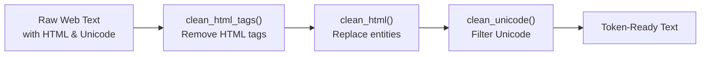
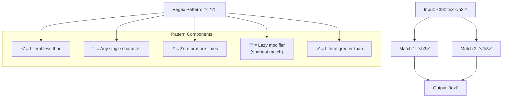
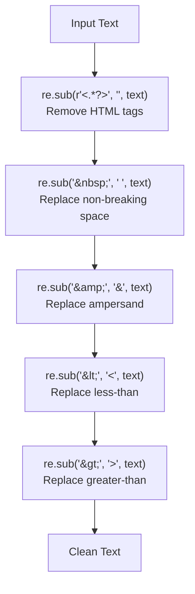
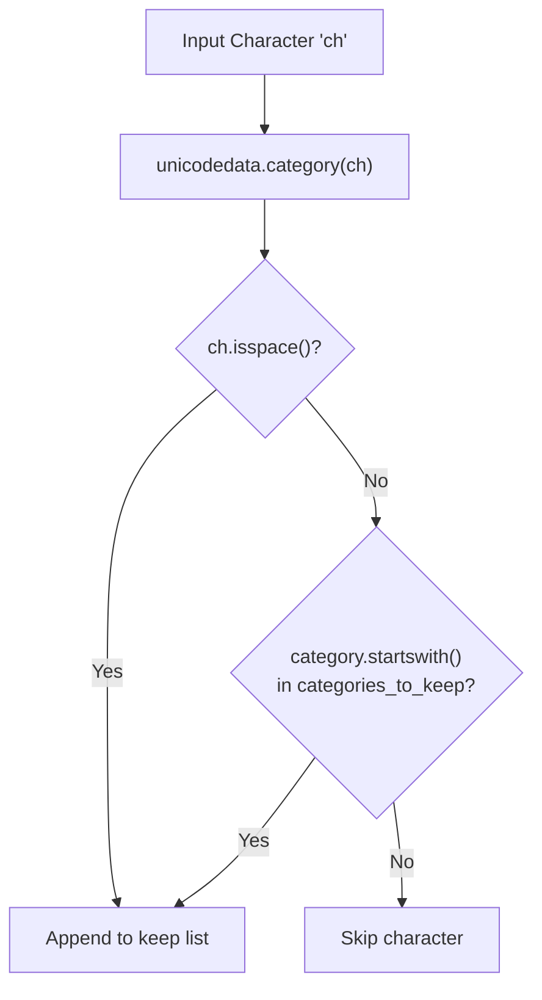
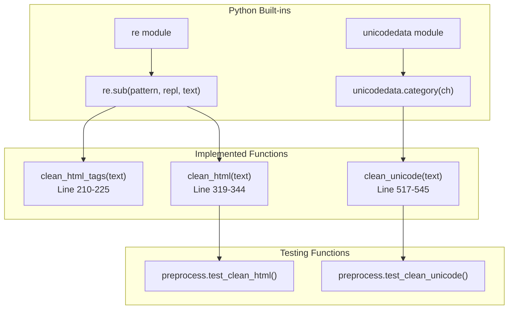
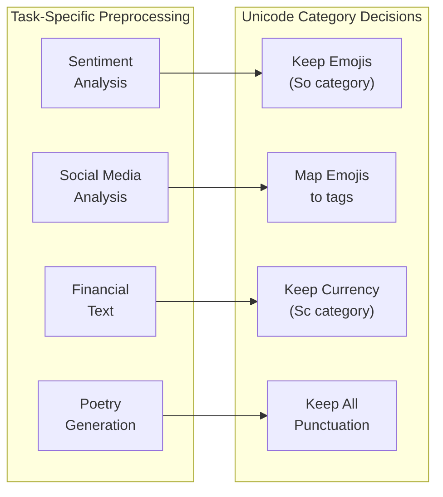
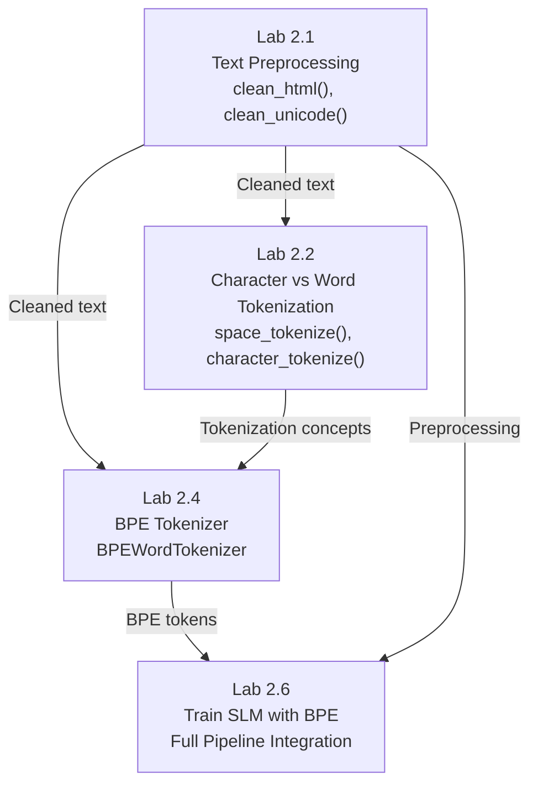

<!-- source: DeepWiki mcp.deepwiki.com · repo google-deepmind/ai-foundations · page 4.1 Lab 2.1: Text Preprocessing · fetched 2026-10-26 -->

# Lab 2.1: Text Preprocessing

Relevant source files

The following files were used as context for generating this wiki page:

- [course_2/gdm_lab_2_1_preprocess_data.ipynb](course_2/gdm_lab_2_1_preprocess_data.ipynb)

## Purpose and Scope

This document covers Lab 2.1, which introduces programmatic text preprocessing techniques for cleaning web-sourced data. The lab focuses on three core preprocessing operations: removing HTML tags using regular expressions, replacing HTML entities, and filtering Unicode characters based on their categories. Students implement three functions (`clean_html_tags`, `clean_html`, and `clean_unicode`) to prepare raw text for tokenization.

For information about tokenization strategies that follow preprocessing, see [Lab 2.2: Character vs Word Tokenization](#4.2). For the complete preprocessing-to-training pipeline using these techniques, see [Lab 2.6: Training SLM with BPE Tokenizer](#4.5).

**Sources**: [course_2/gdm_lab_2_1_preprocess_data.ipynb:42-50]()

## Overview

The lab addresses preprocessing challenges specific to web-sourced text data, which often contains HTML markup, encoded entities, and diverse Unicode characters including emojis. The preprocessing pipeline consists of three stages: HTML tag removal, HTML entity replacement, and Unicode character filtering. Each stage is implemented as a separate function that students complete through guided coding activities.

**Preprocessing Pipeline Flow**

**Sources**: [course_2/gdm_lab_2_1_preprocess_data.ipynb:42-76]()

## Module Dependencies

The lab uses two built-in Python modules and one custom feedback module:

| Module | Purpose | Key Functions Used |
|--------|---------|-------------------|
| `re` | Regular expression operations | `re.sub()` for pattern replacement |
| `unicodedata` | Unicode character database | `unicodedata.category()` for character classification |
| `ai_foundations.feedback.course_2.preprocess` | Automated testing | `test_clean_html()`, `test_clean_unicode()` |

**Sources**: [course_2/gdm_lab_2_1_preprocess_data.ipynb:136-152]()

## HTML Tag Removal

### Regex Pattern for HTML Tags

The `clean_html_tags()` function implements HTML tag removal using the regular expression pattern `r'<.*?>'`. This pattern leverages lazy matching to correctly handle multiple tags in a single string.

**Regex Pattern Structure**

The lazy modifier `?` is critical: without it, the pattern becomes greedy and matches from the first `<` to the last `>`, removing all content between the first and last tags instead of removing each tag individually.

**Sources**: [course_2/gdm_lab_2_1_preprocess_data.ipynb:186-247]()

### Function Implementation

[course_2/gdm_lab_2_1_preprocess_data.ipynb:210-226]()

The `clean_html_tags()` function accepts a `text` string and returns the string with all HTML tags removed. It uses `re.sub(regex_pattern, "", text)` to replace all matches of the pattern with empty strings.

**Sources**: [course_2/gdm_lab_2_1_preprocess_data.ipynb:210-236]()

## HTML Entity Replacement

### Common HTML Entities

HTML entities are escape sequences used to represent special characters in HTML. Web-sourced text often contains these entities even after tags are removed:

| Entity Code | Character | Description |
|-------------|-----------|-------------|
| `&nbsp;` | ` ` (space) | Non-breaking space |
| `&amp;` | `&` | Ampersand |
| `&lt;` | `<` | Less than |
| `&gt;` | `>` | Greater than |

**Sources**: [course_2/gdm_lab_2_1_preprocess_data.ipynb:254-268]()

### Extended Cleaning Function

The `clean_html()` function extends `clean_html_tags()` to also replace HTML entities:

**clean_html() Processing Steps**

The function definition is located at [course_2/gdm_lab_2_1_preprocess_data.ipynb:319-344](), with the complete solution at [course_2/gdm_lab_2_1_preprocess_data.ipynb:625-649]().

**Sources**: [course_2/gdm_lab_2_1_preprocess_data.ipynb:254-375]()

## Unicode Character Filtering

### Unicode Category System

The `unicodedata` module provides the `category()` function that returns a two-letter code identifying a character's type. The first letter indicates the broad category, the second letter provides finer classification:

| Category | Meaning | Subcodes & Examples |
|----------|---------|---------------------|
| **L\*** | Letter | `Lu` (uppercase A), `Ll` (lowercase a), `Lt` (titlecase), `Lm` (modifier ʰ), `Lo` (other: 汉, ע) |
| **N\*** | Number | `Nd` (decimal: 0-9, ٠–٩), `No` (other: ½, Ⅻ) |
| **P\*** | Punctuation | `Po` (other: !, ?), `Pd` (dash —), `Ps`/`Pe` (brackets) |
| **S\*** | Symbol | `Sm` (math: ±, √), `Sc` (currency: ₦, $), `So` (other: 😊, ⭐) |
| **Z\*** | Separator | `Zs` (space), `Zl` (line), `Zp` (paragraph) |
| **C\*** | Other/Control | `Cc` (control codes), `Cf` (formatting), `Cs` (surrogates) |

**Sources**: [course_2/gdm_lab_2_1_preprocess_data.ipynb:458-468]()

### Category-Based Filtering

**Unicode Filtering Decision Logic**

**Sources**: [course_2/gdm_lab_2_1_preprocess_data.ipynb:517-553]()

### clean_unicode() Implementation

The `clean_unicode()` function iterates through each character in the input text and preserves only characters whose Unicode category matches the `categories_to_keep` set:

[course_2/gdm_lab_2_1_preprocess_data.ipynb:517-545]()

The function maintains a `keep` list of characters to preserve. For each character, it:
1. Checks if the character is whitespace (always preserved via `ch.isspace()`)
2. Checks if the character's Unicode category starts with any letter in `categories_to_keep`
3. Appends characters that pass either check to the `keep` list
4. Returns the joined string from the `keep` list

The student activity modifies `categories_to_keep` from `{"L", "N"}` (letters and numbers only) to `{"L", "N", "P"}` (letters, numbers, and punctuation).

**Sources**: [course_2/gdm_lab_2_1_preprocess_data.ipynb:495-553]()

## Code-to-Function Mapping

**Function Dependency Graph**

**Sources**: [course_2/gdm_lab_2_1_preprocess_data.ipynb:136-152](), [course_2/gdm_lab_2_1_preprocess_data.ipynb:210-553]()

## Testing and Validation

The lab uses the custom feedback system from `ai_foundations.feedback.course_2.preprocess` to validate student implementations:

| Test Function | Validates | Location |
|---------------|-----------|----------|
| `preprocess.test_clean_html(clean_html)` | HTML entity replacement correctness | [course_2/gdm_lab_2_1_preprocess_data.ipynb:374]() |
| `preprocess.test_clean_unicode(clean_unicode)` | Unicode category filtering correctness | [course_2/gdm_lab_2_1_preprocess_data.ipynb:553]() |

These test functions are imported from [course_2/gdm_lab_2_1_preprocess_data.ipynb:151]() and accept the student's implemented function as an argument. They execute predefined test cases and provide feedback on correctness.

For more information about the feedback system architecture, see [Feedback and Testing System](#2.5).

**Sources**: [course_2/gdm_lab_2_1_preprocess_data.ipynb:136-152](), [course_2/gdm_lab_2_1_preprocess_data.ipynb:374](), [course_2/gdm_lab_2_1_preprocess_data.ipynb:553]()

## Learning Activities

The lab contains two coding activities where students complete partially implemented functions:

### Coding Activity 1: HTML Entity Replacement

Students complete [course_2/gdm_lab_2_1_preprocess_data.ipynb:319-344]() by adding three `re.sub()` calls to replace:
- `&amp;` → `&`
- `&lt;` → `<`
- `&gt;` → `>`

The solution is provided at [course_2/gdm_lab_2_1_preprocess_data.ipynb:625-649]().

### Coding Activity 2: Unicode Category Extension

Students modify [course_2/gdm_lab_2_1_preprocess_data.ipynb:533]() by changing `categories_to_keep = {"L", "N"}` to `categories_to_keep = {"L", "N", "P"}` to preserve punctuation marks in addition to letters and numbers.

The solution is provided at [course_2/gdm_lab_2_1_preprocess_data.ipynb:670-693]().

**Sources**: [course_2/gdm_lab_2_1_preprocess_data.ipynb:254-309](), [course_2/gdm_lab_2_1_preprocess_data.ipynb:495-506]()

## Design Considerations

The lab emphasizes that preprocessing decisions must align with downstream task requirements:

**Task-Driven Preprocessing Strategies**

The `clean_unicode()` function serves as a flexible template that can be adapted by modifying the `categories_to_keep` set. Examples of customization mentioned in [course_2/gdm_lab_2_1_preprocess_data.ipynb:562-575]():

- **Social media**: Map emojis to tags like `<emoji_happy>` or `<emoji_sad>`
- **Finance projects**: Add `"Sc"` to preserve currency symbols (₦, $)
- **Hashtag processing**: Extract text by removing `#` symbol
- **Special characters**: Replace emoticons like `<3` with `<heart>` tag

**Sources**: [course_2/gdm_lab_2_1_preprocess_data.ipynb:562-575]()

## Integration with Course Progression

This lab is the first in Course 2 and establishes preprocessing foundations used in subsequent labs:

**Lab 2.1 in Course 2 Sequence**

The preprocessing techniques learned here are applied throughout Course 2, particularly when preparing the Africa Galore dataset for tokenization experiments in [Lab 2.2](#4.2) and training pipelines in [Lab 2.6](#4.5).

**Sources**: [course_2/gdm_lab_2_1_preprocess_data.ipynb:583-588]()

---

