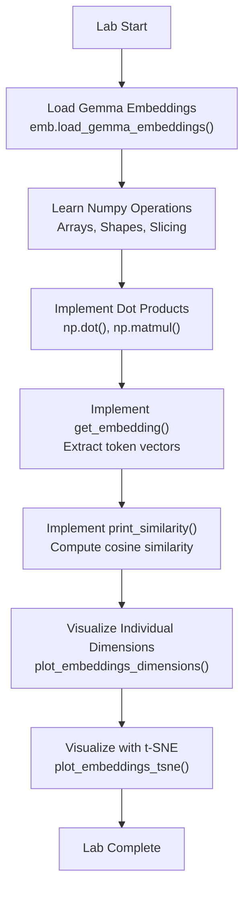
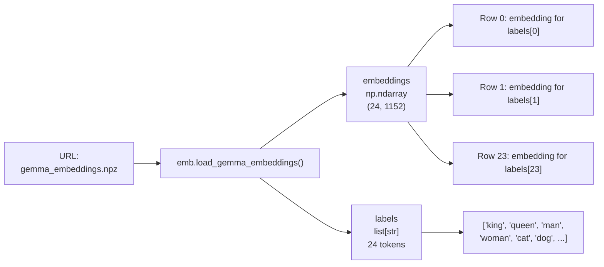
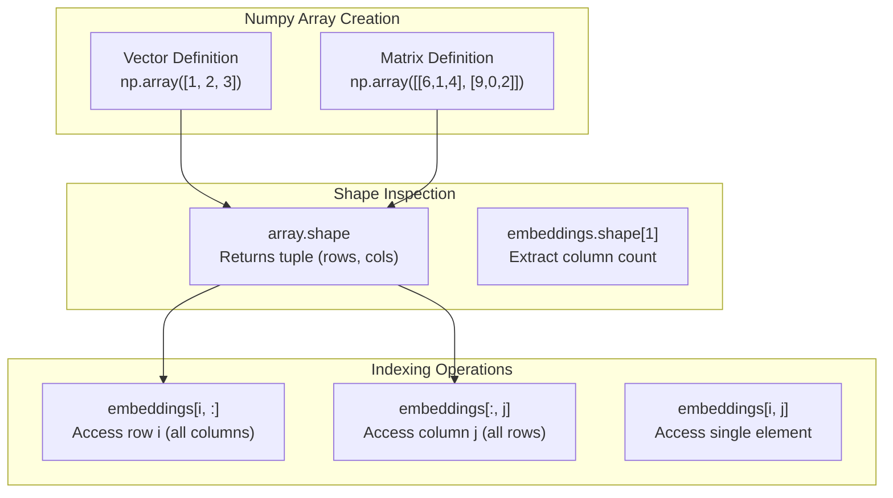
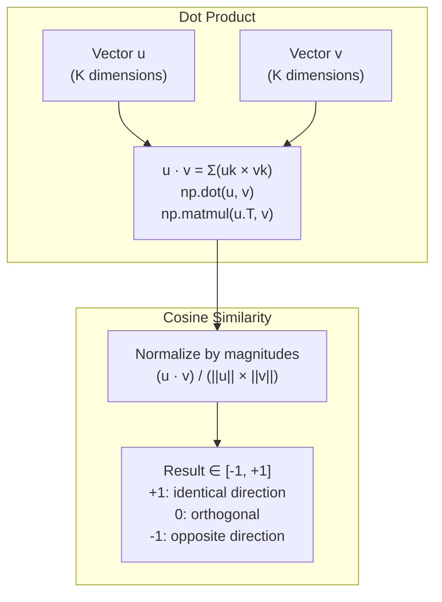
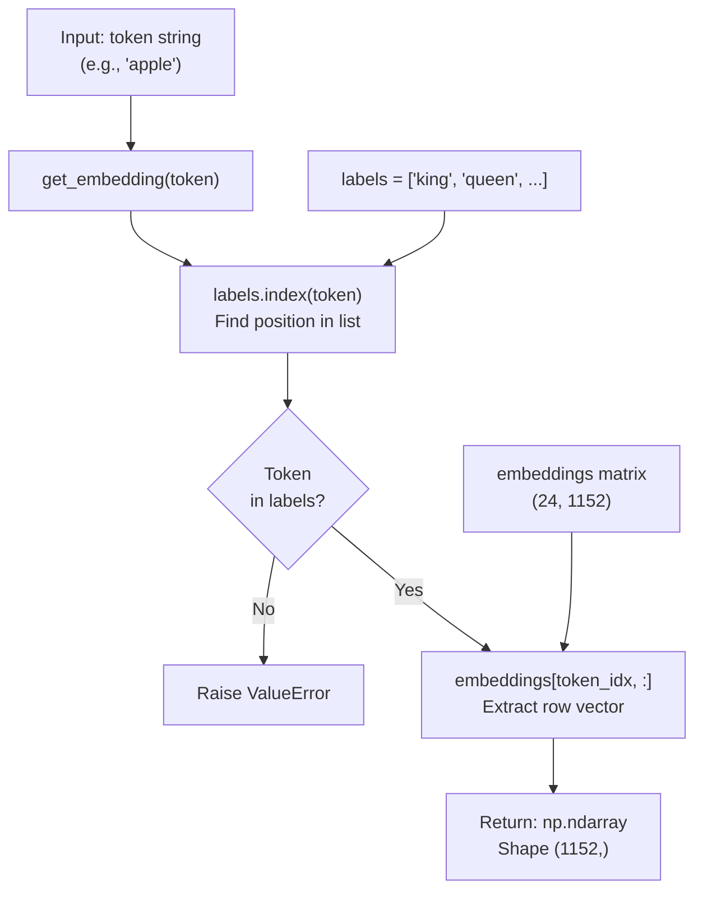
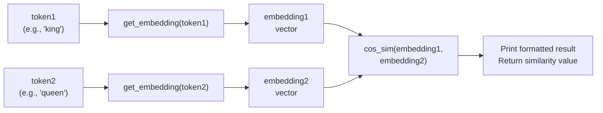
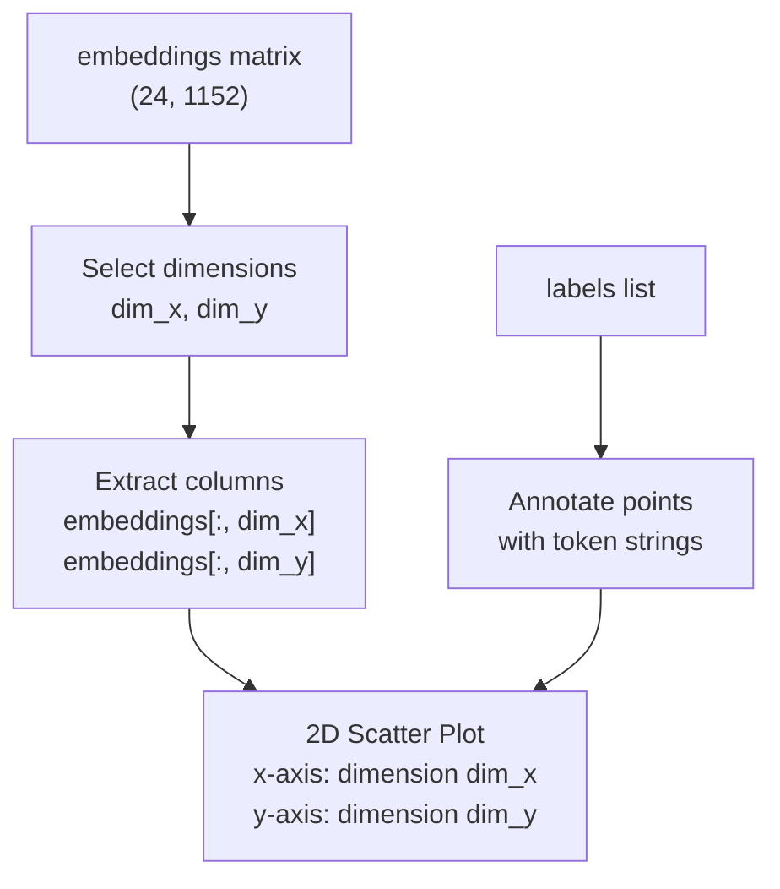
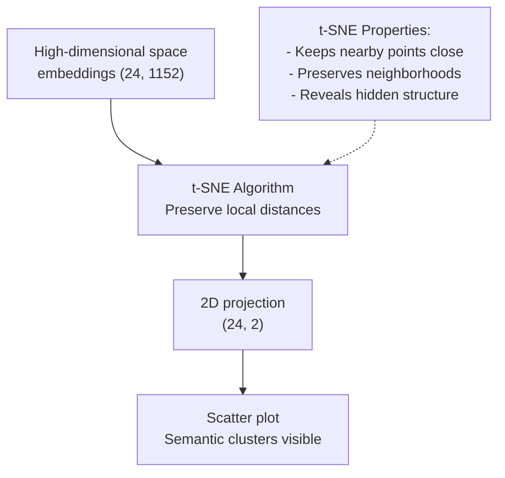
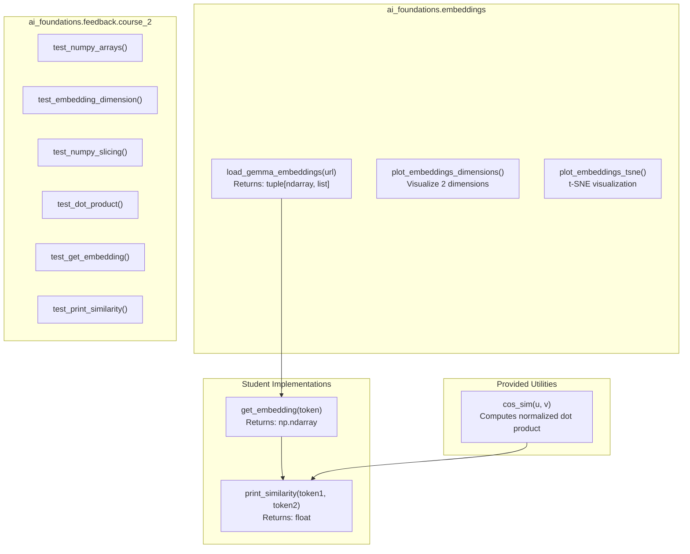

<!-- source: DeepWiki mcp.deepwiki.com · repo google-deepmind/ai-foundations · page 4.4 Lab 2.5: Experimenting with Embeddings · fetched 2026-10-26 -->

# Lab 2.5: Experimenting with Embeddings

<details>
<summary>Relevant source files</summary>

The following files were used as context for generating this wiki page:

- [course_2/gdm_lab_2_5_experiment_with_embeddings.ipynb](course_2/gdm_lab_2_5_experiment_with_embeddings.ipynb)

</details>


## Purpose and Scope

This lab provides hands-on experience working with high-dimensional token embeddings from the Gemma language model. Students learn to manipulate embedding vectors using numpy, compute cosine similarity to measure semantic relationships between tokens, and visualize embeddings through dimensionality reduction techniques. The lab focuses on practical implementation of embedding operations rather than theoretical foundations or model training.

For information about loading and using embeddings in model training, see [Lab 2.6: Training SLM with BPE Tokenizer](#4.5). For the underlying embeddings module API reference, see [Embeddings Module](#2.4).

---

## Lab Workflow Overview

The lab follows a structured progression from basic numpy operations to advanced embedding visualization:



**Sources:** [course_2/gdm_lab_2_5_experiment_with_embeddings.ipynb:42-76]()

---

## Embedding Data Structure

### Loading and Organization

The lab loads a subset of 24 token embeddings from Gemma's full vocabulary (260,000+ tokens) to reduce memory requirements. The function `emb.load_gemma_embeddings()` returns two objects:

| Return Value | Type | Description |
|--------------|------|-------------|
| `embeddings` | `np.ndarray` | Matrix of shape (24, 1152) containing embedding vectors |
| `labels` | `list[str]` | List of 24 token strings corresponding to each row |



**Sources:** [course_2/gdm_lab_2_5_experiment_with_embeddings.ipynb:160-182]()

---

## Numpy Operations for Embeddings

### Matrix and Vector Representation

The lab introduces numpy array operations essential for working with embeddings:



### Key Coding Activities

**Activity 1: Define Arrays**
- Students create vectors and matrices using `np.array()`
- Testing via `emb_feedback.test_numpy_arrays()`

**Activity 2: Extract Embedding Dimension**
```python
embedding_dim = embeddings.shape[1]  # Returns 1152
```

**Activity 3: Access Rows and Columns**
```python
third_row = embeddings[2, :]       # Shape (1152,)
seventh_column = embeddings[:, 6]  # Shape (24,)
```

**Sources:** [course_2/gdm_lab_2_5_experiment_with_embeddings.ipynb:190-431]()

---

## Dot Product and Cosine Similarity

### Mathematical Foundation

The lab implements two key similarity measures:



### Cosine Similarity Function

The provided `cos_sim()` function implements the mathematical formula:

| Component | Implementation | Purpose |
|-----------|----------------|---------|
| Dot Product | `np.matmul(u.T, v)` | Numerator of formula |
| Vector Norms | `np.linalg.norm(u, 2)` | Compute L2 length |
| Normalization | `dot_uv / (len_u * len_v)` | Scale to [-1, 1] range |

**Sources:** [course_2/gdm_lab_2_5_experiment_with_embeddings.ipynb:438-595]()

---

## Token Embedding Extraction

### Function Implementation Flow



### Coding Activity 5: `get_embedding()` Implementation

Students implement this function to extract a specific token's embedding:

```python
def get_embedding(token: str, embeddings: np.ndarray, labels: list[str]) -> np.ndarray:
    if token not in labels:
        raise ValueError(f"No embeddings for {token} exist.")
    
    token_idx = labels.index(token)      # Find index
    embedding = embeddings[token_idx, :]  # Extract row
    return embedding
```

**Testing:** `emb_feedback.test_get_embedding()`

**Sources:** [course_2/gdm_lab_2_5_experiment_with_embeddings.ipynb:598-671]()

---

## Similarity Computation Pipeline

### Coding Activity 6: `print_similarity()` Implementation

This function combines `get_embedding()` and `cos_sim()` to compute and display token similarities:



### Observed Similarity Patterns

The lab demonstrates various similarity relationships:

| Token Pair | Cosine Similarity | Interpretation |
|------------|-------------------|----------------|
| king, king | 1.00 | Identity (same token) |
| king, queen | 0.42 | Related royalty concepts |
| joy, happy | High | Similar emotional valence |
| good, bad | 0.42 | Antonyms (same semantic domain) |
| sad, happy | 0.22 | Antonyms (related emotions) |
| king, bus | 0.04 | Unrelated concepts |
| car, banana | Low | No semantic relationship |

**Sources:** [course_2/gdm_lab_2_5_experiment_with_embeddings.ipynb:674-793]()

---

## Visualization Techniques

### Method 1: Individual Dimension Plotting

The function `emb.plot_embeddings_dimensions()` visualizes two selected dimensions from the 1,152-dimensional space:



**Limitations:**
- Difficult to find dimension pairs with clear semantic clusters
- Individual dimensions don't capture full embedding structure
- Limited interpretability without considering all dimensions

**Interactive Parameters:**
- `dimension_1`: Slider range [0, 1151] for x-axis
- `dimension_2`: Slider range [0, 1151] for y-axis

**Sources:** [course_2/gdm_lab_2_5_experiment_with_embeddings.ipynb:801-852]()

---

## Dimensionality Reduction with t-SNE

### t-SNE Projection Process

The `emb.plot_embeddings_tsne()` function provides superior visualization by preserving pairwise similarities:



### Observed Cluster Patterns

The t-SNE visualization reveals semantic groupings:

| Cluster Type | Example Tokens | Interpretation |
|--------------|----------------|----------------|
| Technology | mobile, phone, computer, internet | Device/connectivity domain |
| Gender | man, woman | Paired demographic concepts |
| Royalty | king, queen | Authority/leadership domain |
| Animals | cat, dog | Pets/mammals |

**Artifacts:** Some proximity (e.g., "cat" near "car") results from dimensionality reduction loss, not true semantic similarity.

**Sources:** [course_2/gdm_lab_2_5_experiment_with_embeddings.ipynb:854-898]()

---

## Module and Function Reference

### Core Functions Implemented by Students



### Import Structure

```python
import numpy as np
from ai_foundations import embeddings as emb
from ai_foundations.feedback.course_2 import embeddings as emb_feedback
```

**Sources:** [course_2/gdm_lab_2_5_experiment_with_embeddings.ipynb:128-152]()

---

## Testing and Feedback System

### Automated Validation

Each coding activity includes a test cell that validates student implementations:

| Test Function | Validates | Location |
|---------------|-----------|----------|
| `test_numpy_arrays()` | Vector/matrix definitions | Activity 1 |
| `test_embedding_dimension()` | Shape extraction | Activity 2 |
| `test_numpy_slicing()` | Row/column access | Activity 3 |
| `test_dot_product()` | Dot product computation | Activity 4 |
| `test_get_embedding()` | Token embedding extraction | Activity 5 |
| `test_print_similarity()` | Full similarity pipeline | Activity 6 |

All test functions are in the `ai_foundations.feedback.course_2.embeddings` module.

**Sources:** [course_2/gdm_lab_2_5_experiment_with_embeddings.ipynb:262-750]()

---

## Educational Outcomes

### Skills Developed

By completing this lab, students gain proficiency in:

1. **Numpy Operations**: Array creation, shape inspection, slicing, and matrix operations
2. **Vector Algebra**: Dot products, vector norms, and geometric interpretation
3. **Similarity Metrics**: Cosine similarity computation and interpretation
4. **Data Extraction**: Indexing into embedding matrices using token labels
5. **Visualization**: Understanding dimensionality reduction trade-offs

### Key Insights

- **High-dimensional embeddings** encode semantic relationships that emerge during training
- **Cosine similarity** captures angle-based semantic closeness (0° = identical, 90° = unrelated, 180° = opposite)
- **Individual dimensions** are not interpretable; semantic meaning arises from combinations
- **t-SNE visualization** successfully reveals semantic clusters while introducing some projection artifacts
- **Antonyms** can have positive similarity because they share semantic domains (e.g., emotions, quality)

**Sources:** [course_2/gdm_lab_2_5_experiment_with_embeddings.ipynb:58-76, 900-908]()

---

