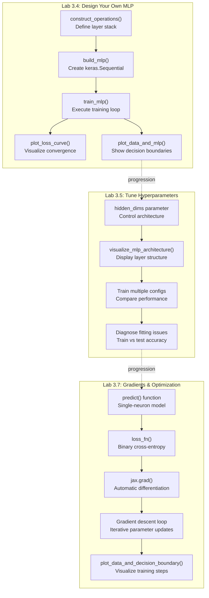
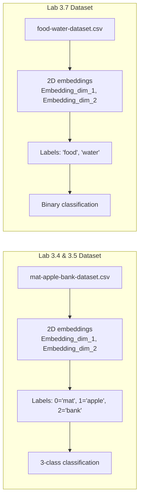
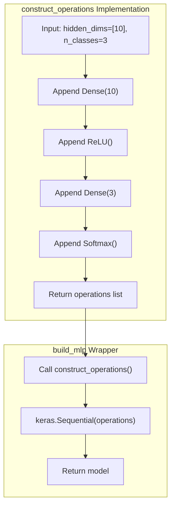
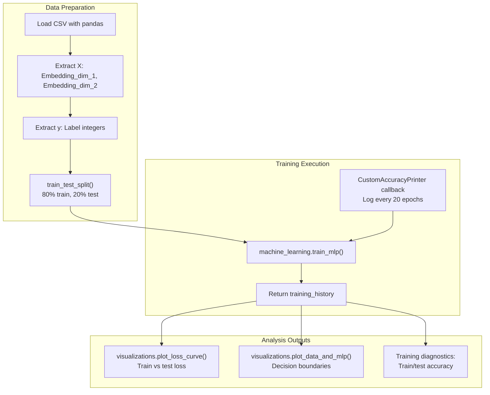
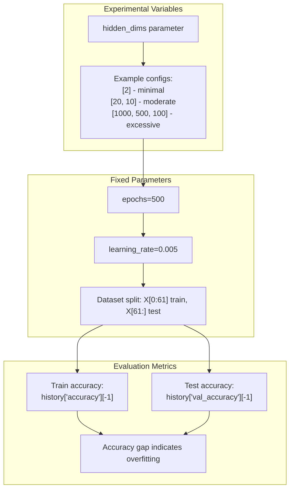
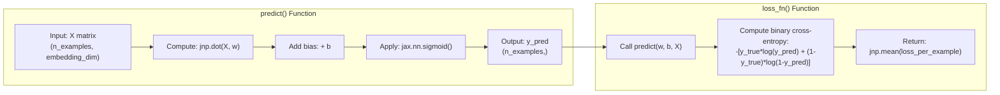
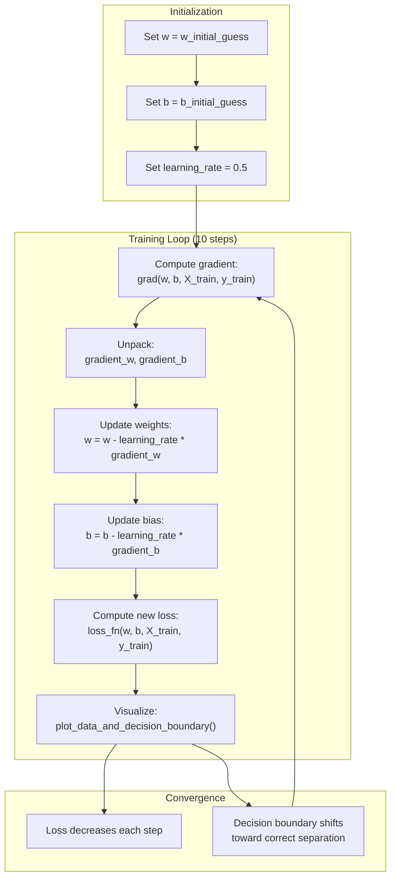
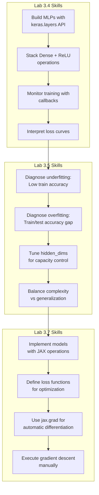

<!-- source: DeepWiki mcp.deepwiki.com · repo google-deepmind/ai-foundations · page 5 Course 3: Neural Network Training Fundamentals · fetched 2026-10-26 -->

# Course 3: Neural Network Training Fundamentals

<details>
<summary>Relevant source files</summary>

The following files were used as context for generating this wiki page:

- [course_3/gdm_lab_3_4_design_your_own_mlp.ipynb](course_3/gdm_lab_3_4_design_your_own_mlp.ipynb)
- [course_3/gdm_lab_3_5_tune_hyperparameters.ipynb](course_3/gdm_lab_3_5_tune_hyperparameters.ipynb)
- [course_3/gdm_lab_3_7_gradients.ipynb](course_3/gdm_lab_3_7_gradients.ipynb)

</details>


## Purpose and Scope

Course 3 provides hands-on experience with the mechanics of training neural networks, focusing on multi-layer perceptrons (MLPs), hyperparameter optimization, and gradient-based learning. Students progress from building custom MLP architectures using Keras to understanding how automatic differentiation enables gradient descent optimization. The course uses toy classification datasets with 2-dimensional embeddings to make training dynamics visually interpretable through decision boundary plots.

For information about language model architectures and tokenization, see [Course 1: Language Model Foundations](#3) and [Course 2: Advanced Tokenization and Embeddings](#4). For core library utilities used throughout these labs, see [Core Library Reference](#2).

**Coverage:**
- Lab 3.4: Constructing MLP architectures with Keras layers
- Lab 3.5: Diagnosing and mitigating overfitting/underfitting through hyperparameter tuning
- Lab 3.7: Understanding gradient computation and optimization mechanics with JAX

Sources: [course_3/gdm_lab_3_4_design_your_own_mlp.ipynb:27-86](), [course_3/gdm_lab_3_5_tune_hyperparameters.ipynb:27-77](), [course_3/gdm_lab_3_7_gradients.ipynb:27-80]()

---

## Course Structure and Learning Progression



Sources: [course_3/gdm_lab_3_4_design_your_own_mlp.ipynb:230-321](), [course_3/gdm_lab_3_5_tune_hyperparameters.ipynb:200-284](), [course_3/gdm_lab_3_7_gradients.ipynb:251-537]()

---

## Core Components and Dependencies

### Module Dependencies

| Module | Key Functions | Purpose |
|--------|---------------|---------|
| `ai_foundations.machine_learning` | `build_mlp`, `train_mlp` | MLP construction and training orchestration |
| `ai_foundations.training` | `CustomAccuracyPrinter` | Training progress callbacks |
| `ai_foundations.visualizations` | `plot_loss_curve`, `plot_data_and_mlp`, `plot_data_and_decision_boundary`, `visualize_mlp_architecture` | Training diagnostics and model visualization |
| `keras.layers` | `Dense`, `ReLU`, `Softmax` | Neural network layer primitives |
| `keras` | `Sequential`, `Model` | Model container classes |
| `jax` | `grad`, `jnp`, `jax.nn.sigmoid` | Automatic differentiation and numerical operations |
| `sklearn.model_selection` | `train_test_split` | Dataset partitioning |

Sources: [course_3/gdm_lab_3_4_design_your_own_mlp.ipynb:153-172](), [course_3/gdm_lab_3_5_tune_hyperparameters.ipynb:143-159](), [course_3/gdm_lab_3_7_gradients.ipynb:147-157]()

### Dataset Configuration



Sources: [course_3/gdm_lab_3_4_design_your_own_mlp.ipynb:203-222](), [course_3/gdm_lab_3_7_gradients.ipynb:180-194]()

---

## Lab 3.4: Designing Custom MLPs

### Architecture Construction Pattern

Students implement the `construct_operations` function that builds a list of Keras layer objects representing an MLP architecture. The function accepts `hidden_dims` (list of layer widths) and `n_classes` (output dimension) parameters.

**Implementation Requirements:**

1. For each dimension in `hidden_dims`, append:
   - `keras.layers.Dense(dim)` - weighted sum computation
   - `keras.layers.ReLU()` - activation function

2. Append output layer:
   - `keras.layers.Dense(n_classes)` - final projection
   - `keras.layers.Softmax()` - probability distribution

The `build_mlp` function wraps these operations into a `keras.Sequential` model.



**Example Usage:**

```python
# Define architecture: [10] = one hidden layer with 10 neurons
model = build_mlp([10], 3)

# Train with validation monitoring
training_logger = training.CustomAccuracyPrinter(print_every=20)
training_history = machine_learning.train_mlp(
    model,
    X_train, y_train,
    validation_data=(X_test, y_test),
    epochs=200,
    callbacks=[training_logger]
)
```

Sources: [course_3/gdm_lab_3_4_design_your_own_mlp.ipynb:278-321](), [course_3/gdm_lab_3_4_design_your_own_mlp.ipynb:365-395]()

### Training and Visualization Pipeline



The `train_mlp` function returns a `training_history` object containing:
- `history["loss"]` - training loss per epoch
- `history["val_loss"]` - test loss per epoch
- `history["accuracy"]` - training accuracy per epoch
- `history["val_accuracy"]` - test accuracy per epoch

Sources: [course_3/gdm_lab_3_4_design_your_own_mlp.ipynb:196-222](), [course_3/gdm_lab_3_4_design_your_own_mlp.ipynb:386-395](), [course_3/gdm_lab_3_4_design_your_own_mlp.ipynb:416-476]()

### Loss Curve Interpretation

The lab introduces three canonical loss curve patterns:

| Pattern | Train Loss | Test Loss | Diagnosis |
|---------|-----------|-----------|-----------|
| **Underfitting** | High and stable | High and stable | Insufficient model capacity |
| **Good Fit** | Low, converging | Low, tracking train | Balanced capacity and regularization |
| **Overfitting** | Very low | High or diverging | Excessive capacity, memorizing noise |

Students compare their observed curves against reference diagrams to diagnose training issues.

Sources: [course_3/gdm_lab_3_4_design_your_own_mlp.ipynb:403-447]()

---

## Lab 3.5: Hyperparameter Tuning

### Experimental Framework

This lab systematically varies two architectural hyperparameters to observe their effect on model generalization:

1. **Number of layers** (depth) - length of `hidden_dims` list
2. **Neurons per layer** (width) - values in `hidden_dims` list

The training dataset is manually split to place outliers in the test set, making overfitting effects more pronounced.



Sources: [course_3/gdm_lab_3_5_tune_hyperparameters.ipynb:180-193](), [course_3/gdm_lab_3_5_tune_hyperparameters.ipynb:243-284]()

### Capacity Analysis Workflow

**Step 1: Architecture Visualization**
```python
hidden_dims = [20, 10]
mlp_model = machine_learning.build_mlp(hidden_dims=hidden_dims, n_classes=3)
visualizations.visualize_mlp_architecture(hidden_dims, 3)
```

**Step 2: Training with Monitoring**
```python
training_logger = training.CustomAccuracyPrinter(print_every=20)
training_history = machine_learning.train_mlp(
    mlp_model, X_train, y_train,
    learning_rate=0.005,
    validation_data=(X_test, y_test),
    epochs=500,
    callbacks=[training_logger]
)
```

**Step 3: Diagnostic Analysis**
```python
train_acc = training_history.history["accuracy"][-1]
test_acc = training_history.history["val_accuracy"][-1]

# Visualize loss convergence
visualizations.plot_loss_curve(training_history.history)

# Visualize decision boundaries
visualizations.plot_data_and_mlp(
    X_train, y_train, labels,
    features_test=X_test,
    label_ids_test=y_test,
    mlp_model=mlp_model,
    title="Decision Boundaries - Your MLP"
)
```

Sources: [course_3/gdm_lab_3_5_tune_hyperparameters.ipynb:243-284]()

### Diagnostic Heuristics

| Configuration | Expected Behavior | Indicators |
|---------------|-------------------|------------|
| **Single layer, few neurons** (e.g., `[2]`) | Underfitting | Low train accuracy (<80%), simple/linear boundaries |
| **Multiple large layers** (e.g., `[1000, 500, 100]`) | Overfitting | High train accuracy (>95%), low test accuracy (<85%), complex boundaries |
| **Moderate architecture** (e.g., `[20, 10]`) | Good fit | Train and test accuracy both high (>90%), smooth boundaries |

The lab emphasizes that capacity tuning is a balancing act—too little capacity prevents learning, too much capacity causes memorization.

Sources: [course_3/gdm_lab_3_5_tune_hyperparameters.ipynb:292-327]()

---

## Lab 3.7: Gradients and Optimization

### Manual Model Implementation with JAX

Unlike Labs 3.4-3.5 which use high-level Keras abstractions, Lab 3.7 implements a single-neuron binary classifier from scratch to expose gradient descent mechanics.

**Model Architecture:**
```
Single neuron with sigmoid activation
Input: X (n_examples, 2)
Parameters: w (2,), b (1,)
Output: y_pred = sigmoid(X · w + b)
```



Sources: [course_3/gdm_lab_3_7_gradients.ipynb:281-303](), [course_3/gdm_lab_3_7_gradients.ipynb:330-360]()

### Automatic Differentiation with JAX

The `jax.grad` function creates a gradient computation function from the loss function. The `argnums` parameter specifies which function arguments to differentiate with respect to.

**Gradient Function Creation:**
```python
# Define gradient function
grad = jax.grad(loss_fn, argnums=[0, 1])
# argnums=[0,1] -> compute gradients w.r.t. first (w) and second (b) arguments

# Compute gradients
gradient = grad(w_initial_guess, b_initial_guess, X_train, y_train)
gradient_w, gradient_b = gradient  # Unpack tuple
```

Sources: [course_3/gdm_lab_3_7_gradients.ipynb:432-454]()

### Gradient Descent Training Loop



**Implementation:**
```python
w = w_initial_guess
b = b_initial_guess
learning_rate = 0.5

for step in range(10):
    # Compute gradients
    gradient = grad(w, b, X_train, y_train)
    gradient_w, gradient_b = gradient
    
    # Update parameters (gradient descent step)
    w = w - learning_rate * gradient_w
    b = b - learning_rate * gradient_b
    
    print(f"Step {step + 1} loss: {loss_fn(w, b, X_train, y_train):.4f}")
    
    visualizations.plot_data_and_decision_boundary(
        X_train, labels,
        weight_vector=w,
        bias_term=b,
        title=f"Step {step + 1}"
    )
```

Sources: [course_3/gdm_lab_3_7_gradients.ipynb:513-537]()

### Decision Boundary Interpretation

The lab visualizes how weight vector `w` and bias term `b` define the decision boundary:

- **Weight vector `w`**: Defines boundary orientation (perpendicular to `w`)
- **Bias term `b`**: Defines boundary position (parallel shift)
- **Gradient direction**: Points toward steepest loss increase; negative gradient points toward steepest decrease

Students experiment with initial values to observe:
1. How `w` controls the slope of the linear boundary
2. How `b` shifts the boundary up/down
3. How gradient descent iteratively adjusts both parameters to minimize loss

Sources: [course_3/gdm_lab_3_7_gradients.ipynb:203-243](), [course_3/gdm_lab_3_7_gradients.ipynb:480-503]()

---

## Training Infrastructure Components

### CustomAccuracyPrinter Callback

The `training.CustomAccuracyPrinter` callback logs training progress at specified intervals:

```python
training_logger = training.CustomAccuracyPrinter(print_every=20)
```

Prints after every 20 epochs:
- Current epoch number
- Training loss
- Test loss
- Training accuracy
- Test accuracy

Sources: [course_3/gdm_lab_3_4_design_your_own_mlp.ipynb:386-395]()

### Training History Object

The `machine_learning.train_mlp` function returns a history object with structure:

```python
training_history.history = {
    "loss": [epoch_1_loss, epoch_2_loss, ...],
    "val_loss": [epoch_1_val_loss, epoch_2_val_loss, ...],
    "accuracy": [epoch_1_acc, epoch_2_acc, ...],
    "val_accuracy": [epoch_1_val_acc, epoch_2_val_acc, ...]
}
```

This dictionary structure enables visualization functions to access per-epoch metrics:

```python
visualizations.plot_loss_curve(training_history.history)
```

Sources: [course_3/gdm_lab_3_4_design_your_own_mlp.ipynb:386-417](), [course_3/gdm_lab_3_5_tune_hyperparameters.ipynb:254-274]()

---

## Visualization Functions Reference

### plot_loss_curve

Generates dual-axis plot showing training and validation loss curves over epochs.

**Usage:**
```python
visualizations.plot_loss_curve(training_history.history)
```

**Inputs:**
- `history` - Dictionary with keys `"loss"` and `"val_loss"`

Sources: [course_3/gdm_lab_3_4_design_your_own_mlp.ipynb:416]()

### plot_data_and_mlp

Visualizes 2D embeddings with color-coded class labels and decision boundaries predicted by a trained MLP model.

**Usage:**
```python
visualizations.plot_data_and_mlp(
    X_train, y_train, labels,
    features_test=X_test,
    label_ids_test=y_test,
    mlp_model=model,
    title="Decision Boundaries - Your MLP"
)
```

**Inputs:**
- `X_train` - Training embeddings (n_train, 2)
- `y_train` - Training label IDs (n_train,)
- `labels` - String labels for legend
- `features_test` - Test embeddings (n_test, 2)
- `label_ids_test` - Test label IDs (n_test,)
- `mlp_model` - Trained Keras model for boundary computation

Sources: [course_3/gdm_lab_3_4_design_your_own_mlp.ipynb:467-476](), [course_3/gdm_lab_3_5_tune_hyperparameters.ipynb:275-283]()

### plot_data_and_decision_boundary

Visualizes 2D embeddings with explicitly specified linear decision boundary defined by weight vector and bias.

**Usage:**
```python
visualizations.plot_data_and_decision_boundary(
    X_train, labels,
    weight_vector=w,
    bias_term=b,
    title="Initial Guess for Weights"
)
```

**Inputs:**
- `X_train` - Embeddings (n_examples, 2)
- `labels` - String labels array
- `weight_vector` - Weight vector w (2,)
- `bias_term` - Bias scalar b (1,)
- `title` - Plot title string

Sources: [course_3/gdm_lab_3_7_gradients.ipynb:236-242](), [course_3/gdm_lab_3_7_gradients.ipynb:465-471]()

### visualize_mlp_architecture

Renders a diagram showing MLP layer structure with neuron counts.

**Usage:**
```python
visualizations.visualize_mlp_architecture(hidden_dims, n_classes)
```

**Inputs:**
- `hidden_dims` - List of hidden layer widths
- `n_classes` - Output layer width

Sources: [course_3/gdm_lab_3_5_tune_hyperparameters.ipynb:251]()

---

## Key Learning Outcomes

### Practical Skills Acquired



Sources: [course_3/gdm_lab_3_4_design_your_own_mlp.ipynb:62-67](), [course_3/gdm_lab_3_5_tune_hyperparameters.ipynb:55-59](), [course_3/gdm_lab_3_7_gradients.ipynb:55-61]()

### Conceptual Understanding

| Concept | Description | Observable Evidence |
|---------|-------------|---------------------|
| **Model Capacity** | Number of parameters determines learning complexity | Higher `hidden_dims` values enable more complex boundaries |
| **Overfitting** | Memorizing training noise instead of learning patterns | Train accuracy >> test accuracy, complex decision boundaries |
| **Underfitting** | Insufficient capacity to capture data patterns | Both train and test accuracy remain low |
| **Gradient Descent** | Iterative parameter optimization via loss gradient | Decision boundary shifts incrementally toward better separation |
| **Automatic Differentiation** | Computing gradients without manual calculus | `jax.grad` produces exact gradients for any differentiable function |

Sources: [course_3/gdm_lab_3_5_tune_hyperparameters.ipynb:292-299](), [course_3/gdm_lab_3_7_gradients.ipynb:480-503](), [course_3/gdm_lab_3_7_gradients.ipynb:588-592]()

---

