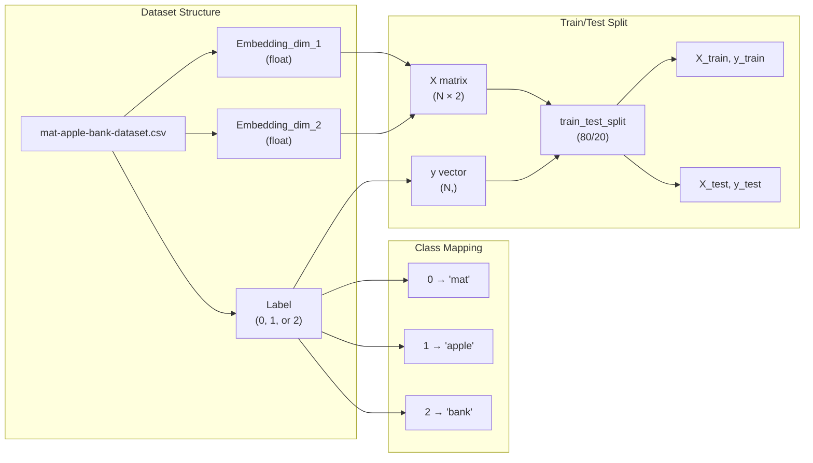
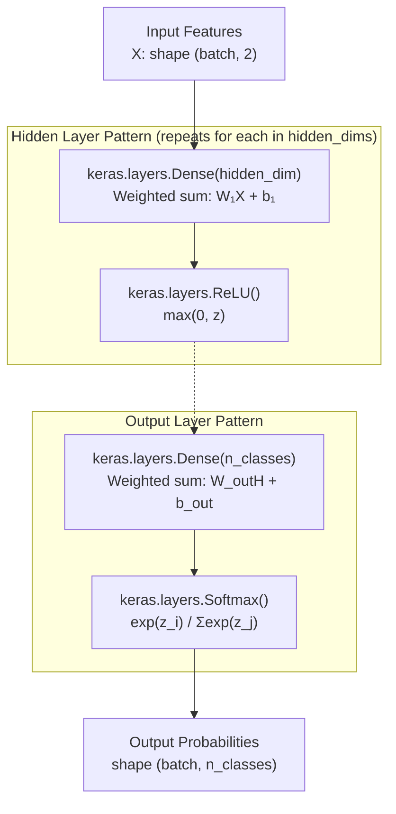
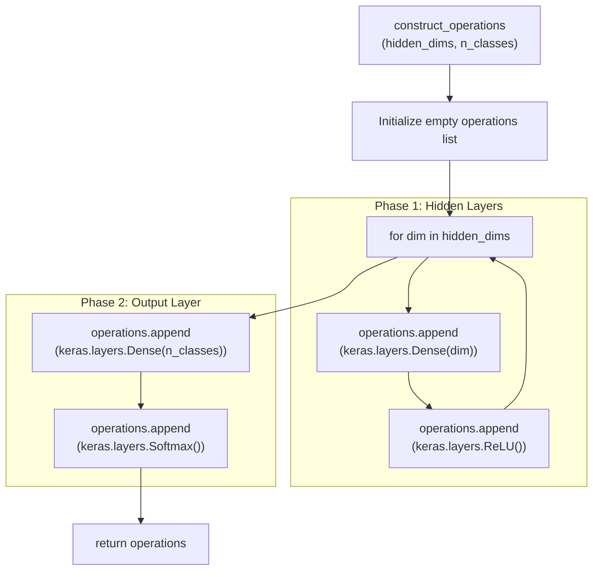
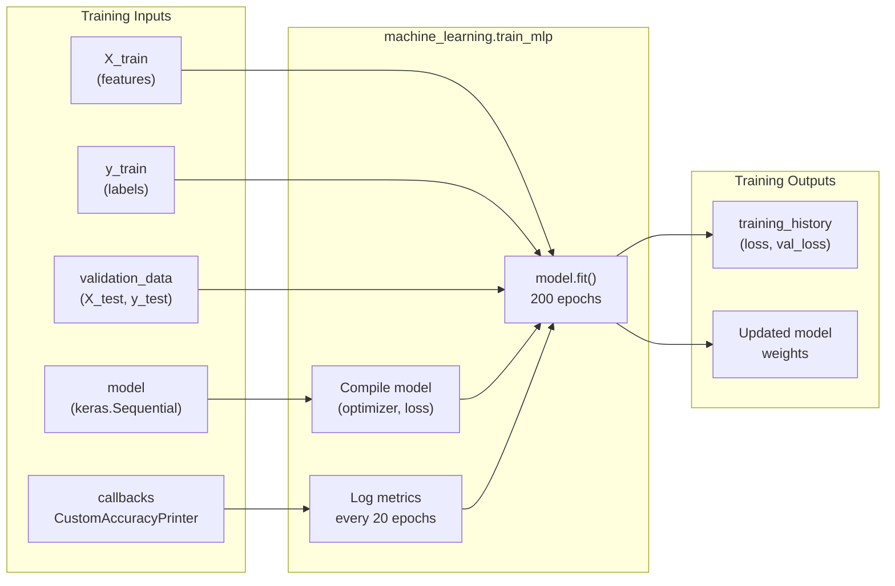
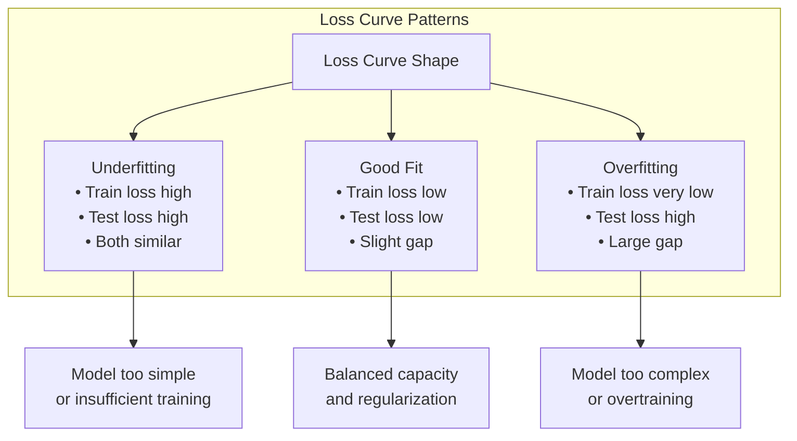
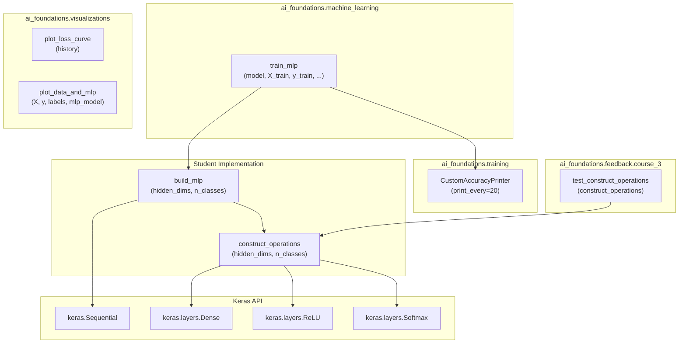

<!-- source: DeepWiki mcp.deepwiki.com · repo google-deepmind/ai-foundations · page 5.1 Lab 3.4: Designing Custom MLPs · fetched 2026-10-26 -->

# Lab 3.4: Designing Custom MLPs

<details>
<summary>Relevant source files</summary>

The following files were used as context for generating this wiki page:

- [course_3/gdm_lab_3_4_design_your_own_mlp.ipynb](course_3/gdm_lab_3_4_design_your_own_mlp.ipynb)

</details>


## Purpose and Scope

This lab introduces students to building multi-layer perceptrons (MLPs) from scratch using the Keras deep learning framework. Students implement the `construct_operations` function to define neural network architectures by stacking layers, train their MLPs on a 3-class classification task using 2D embeddings, and evaluate model performance through loss curves and decision boundary visualizations.

The lab focuses on the practical mechanics of defining neural network architectures using Keras Sequential API. For hyperparameter tuning and diagnosing overfitting/underfitting issues, see [Lab 3.5](#5.2). For understanding the underlying gradient computation and optimization mechanics, see [Lab 3.7](#5.3).

**Sources:** [course_3/gdm_lab_3_4_design_your_own_mlp.ipynb:27-87]()

## Lab Structure and Learning Objectives

The lab is structured around a single coding activity followed by training and visualization exercises. Students complete the following workflow:

| Phase | Activity | Expected Outcome |
|-------|----------|------------------|
| Implementation | Complete `construct_operations` function | Functional MLP architecture builder |
| Initialization | Create model with `build_mlp([10], 3)` | Model instance ready for training |
| Training | Execute `machine_learning.train_mlp()` | Trained model with 200 epochs |
| Evaluation | Plot loss curves and decision boundaries | Visual assessment of model performance |

**Learning Objectives:**
- Implement neural networks using Keras Sequential API
- Understand layer composition with `Dense`, `ReLU`, and `Softmax` operations
- Interpret training/test loss curves for model assessment
- Visualize decision boundaries for classification tasks

**Sources:** [course_3/gdm_lab_3_4_design_your_own_mlp.ipynb:63-87]()

## Dataset: 3-Class Token Classification

### Dataset Characteristics

The lab uses a toy dataset for next-token prediction based on 2D prompt embeddings:



### Data Preparation Implementation

The dataset is loaded and split using scikit-learn's `train_test_split` function:

[course_3/gdm_lab_3_4_design_your_own_mlp.ipynb:203-221]()

Key parameters:
- **Test size:** 20% of total data (`test_size=0.2`)
- **Random state:** Fixed at 42 for reproducibility
- **Data format:** JAX numpy arrays for compatibility with training utilities

**Sources:** [course_3/gdm_lab_3_4_design_your_own_mlp.ipynb:180-221]()

## MLP Architecture Design

### Operation Sequence Pattern

An MLP in this lab follows a standardized pattern where each hidden layer consists of a weighted sum operation (`Dense`) followed by a non-linear activation (`ReLU`), terminated by an output layer with `Softmax` for classification:



### Example: build_mlp([10], 3)

For the default configuration `build_mlp([10], 3)`, the operation sequence is:

| Step | Operation | Input Shape | Output Shape | Purpose |
|------|-----------|-------------|--------------|---------|
| 1 | `Dense(10)` | (batch, 2) | (batch, 10) | Expand from 2D embeddings to 10 neurons |
| 2 | `ReLU()` | (batch, 10) | (batch, 10) | Apply non-linearity |
| 3 | `Dense(3)` | (batch, 10) | (batch, 3) | Project to 3 class logits |
| 4 | `Softmax()` | (batch, 3) | (batch, 3) | Convert to probability distribution |

**Sources:** [course_3/gdm_lab_3_4_design_your_own_mlp.ipynb:230-321]()

## Implementation: construct_operations Function

### Function Specification

The core coding activity requires implementing `construct_operations` which builds the operation sequence:

**Function signature:**
```python
def construct_operations(hidden_dims: list[int], n_classes: int) -> list[keras.Layer]
```

**Parameters:**
- `hidden_dims`: List of integers where each element specifies the number of neurons in that hidden layer
- `n_classes`: Number of output classes (3 for this lab)

**Returns:** List of Keras Layer instances to be passed to `keras.Sequential`

[course_3/gdm_lab_3_4_design_your_own_mlp.ipynb:278-301]()

### Implementation Pattern

The function follows a two-phase construction:



### Solution Implementation

The reference solution demonstrates the pattern:

[course_3/gdm_lab_3_4_design_your_own_mlp.ipynb:534-556]()

Key implementation details:
- Iterate through `hidden_dims` list to add pairs of Dense+ReLU layers
- Append output Dense layer with `n_classes` dimension
- Terminate with Softmax for probability distribution output

### Testing and Validation

The implementation is validated using:

```python
course_3.test_construct_operations(construct_operations)
```

[course_3/gdm_lab_3_4_design_your_own_mlp.ipynb:343]()

This test function from `ai_foundations.feedback.course_3` module validates:
- Correct number of operations
- Proper layer types (Dense, ReLU, Softmax)
- Correct dimensions for each layer

**Sources:** [course_3/gdm_lab_3_4_design_your_own_mlp.ipynb:278-344]()

## Model Building with build_mlp

### Wrapper Function

The `build_mlp` function wraps `construct_operations` and creates a Keras Sequential model:

[course_3/gdm_lab_3_4_design_your_own_mlp.ipynb:304-320]()

**Workflow:**
1. Call `construct_operations(hidden_dims, n_classes)` to get list of layers
2. Pass operations to `keras.Sequential()` constructor
3. Return compiled sequential model

### Model Instantiation

Students create a model instance with specified architecture:

```python
model = build_mlp([10], 3)
```

[course_3/gdm_lab_3_4_design_your_own_mlp.ipynb:366]()

This creates a single hidden layer MLP with 10 neurons. Students can modify the `hidden_dims` parameter to experiment with different architectures:
- `[10]` - Single hidden layer with 10 neurons
- `[5, 10]` - Two hidden layers with 5 and 10 neurons respectively
- `[20, 20]` - Two hidden layers with 20 neurons each

**Sources:** [course_3/gdm_lab_3_4_design_your_own_mlp.ipynb:304-366]()

## Training Pipeline

### Training Function Call

The training process uses `machine_learning.train_mlp` from the ai_foundations library:



### Training Configuration

[course_3/gdm_lab_3_4_design_your_own_mlp.ipynb:386-394]()

**Parameters:**
- `epochs=200`: Number of complete passes through training data
- `validation_data=(X_test, y_test)`: Test set for validation loss computation
- `callbacks=[traning_logger]`: Custom callback that prints metrics every 20 epochs

**Callback Behavior:**

The `training.CustomAccuracyPrinter` callback is initialized with `print_every=20` parameter:

[course_3/gdm_lab_3_4_design_your_own_mlp.ipynb:386]()

This prints:
- Training loss
- Test (validation) loss
- Training accuracy
- Test accuracy

At epochs: 20, 40, 60, ..., 200

**Sources:** [course_3/gdm_lab_3_4_design_your_own_mlp.ipynb:370-394]()

## Evaluation and Visualization

### Loss Curve Analysis

After training, the lab uses `visualizations.plot_loss_curve` to display training progress:

```python
visualizations.plot_loss_curve(training_history.history)
```

[course_3/gdm_lab_3_4_design_your_own_mlp.ipynb:416]()

The function plots:
- **Training loss** (blue line): Loss computed on training set
- **Validation loss** (orange line): Loss computed on test set
- **X-axis**: Epoch number (0-200)
- **Y-axis**: Cross-entropy loss value

### Interpreting Loss Curves

The lab guides students to compare their curves against three reference patterns:



[course_3/gdm_lab_3_4_design_your_own_mlp.ipynb:420-446]()

**Sources:** [course_3/gdm_lab_3_4_design_your_own_mlp.ipynb:403-446]()

### Decision Boundary Visualization

The `visualizations.plot_data_and_mlp` function renders the learned classification boundaries:

```python
visualizations.plot_data_and_mlp(
    X_train,
    y_train,
    labels,
    features_test=X_test,
    label_ids_test=y_test,
    mlp_model=model,
    title="Decision Boundaries - Your MLP",
)
```

[course_3/gdm_lab_3_4_design_your_own_mlp.ipynb:467-475]()

**Visualization Components:**

| Element | Representation | Purpose |
|---------|----------------|---------|
| Background colors | RGB regions | Model's predicted class for each point in 2D space |
| Training points | Filled circles | Training data colored by true class |
| Test points | Hollow circles | Test data colored by true class |
| Boundaries | Color transitions | Regions where model switches class predictions |

The visualization allows assessment of:
- Whether the model separates the three classes correctly
- Smoothness of decision boundaries
- Potential misclassifications (points in wrong-colored regions)

**Sources:** [course_3/gdm_lab_3_4_design_your_own_mlp.ipynb:449-485]()

## Code Entity Reference

### Key Functions and Classes

This lab integrates multiple components from the ai_foundations library and Keras:



### Import Structure

The lab requires the following imports:

[course_3/gdm_lab_3_4_design_your_own_mlp.ipynb:154-171]()

**Key modules:**
- `keras`: Neural network layer definitions and Sequential API
- `jax.numpy`: Array operations (for data handling)
- `pandas`: CSV loading via `pd.read_csv()`
- `sklearn.model_selection`: Train/test splitting
- `ai_foundations.machine_learning`: Training utilities
- `ai_foundations.visualizations`: Plotting functions
- `ai_foundations.training`: Custom callbacks
- `ai_foundations.feedback.course_3`: Testing functions

**Configuration:**
- Sets `KERAS_BACKEND='jax'` to use JAX as Keras backend for consistency with other labs

**Sources:** [course_3/gdm_lab_3_4_design_your_own_mlp.ipynb:139-172]()

## Educational Progression

This lab serves as the foundation for subsequent Course 3 activities:

| Lab | Builds Upon | Introduces |
|-----|-------------|------------|
| **3.4 (This Lab)** | Basic ML concepts | MLP architecture, Keras implementation, loss curves |
| 3.5 (Next) | MLP implementation | Hyperparameter tuning, diagnosing over/underfitting |
| 3.7 (Later) | Training mechanics | Gradient computation with JAX, manual optimization |

The toy dataset (mat/apple/bank classification) is reused across these labs to maintain focus on the training concepts rather than data preprocessing complexities.

**Sources:** [course_3/gdm_lab_3_4_design_your_own_mlp.ipynb:488-498]()

---

