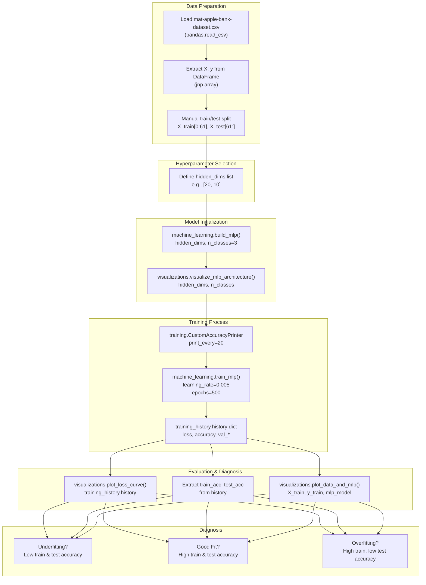
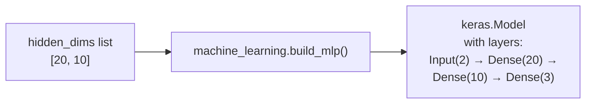
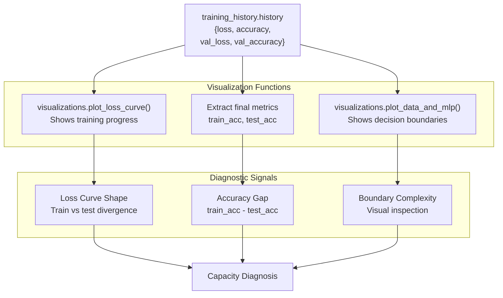
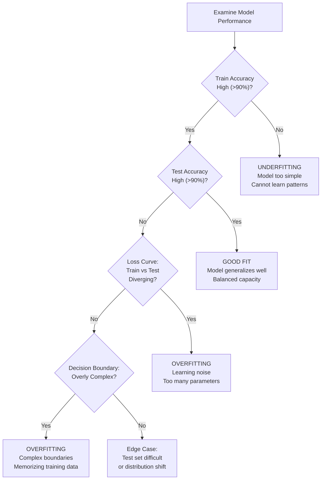
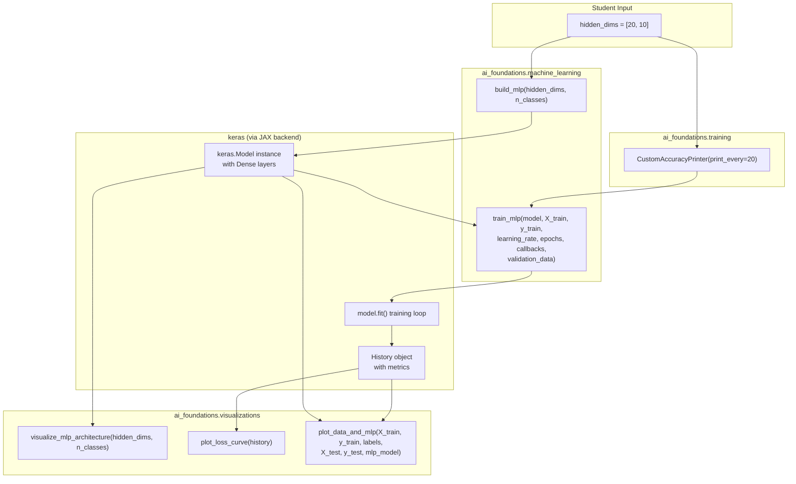

<!-- source: DeepWiki mcp.deepwiki.com · repo google-deepmind/ai-foundations · page 5.2 Lab 3.5: Hyperparameter Tuning · fetched 2026-10-26 -->

# Lab 3.5: Hyperparameter Tuning

<details>
<summary>Relevant source files</summary>

The following files were used as context for generating this wiki page:

- [course_3/gdm_lab_3_5_tune_hyperparameters.ipynb](course_3/gdm_lab_3_5_tune_hyperparameters.ipynb)

</details>


## Purpose and Scope

This lab teaches students to optimize neural network architecture by experimenting with hyperparameters that control model capacity. Students train Multi-Layer Perceptrons (MLPs) with varying depths and widths, then diagnose overfitting and underfitting by analyzing loss curves, accuracy metrics, and decision boundaries on a 2D classification task.

For implementing custom MLP architectures from scratch, see [Lab 3.4: Designing Custom MLPs](#5.1). For understanding the gradient descent optimization process that updates parameters during training, see [Lab 3.7: Gradients and Optimization](#5.3).

**Sources:** [course_3/gdm_lab_3_5_tune_hyperparameters.ipynb:26-46]()

---

## Hyperparameters vs. Model Parameters

The lab distinguishes between two types of parameters in neural network training:

| Parameter Type | Description | Examples | When Set |
|---------------|-------------|----------|----------|
| **Hyperparameters** | Configuration settings chosen before training | Number of layers, neurons per layer, learning rate, epochs | Before training begins |
| **Model Parameters** | Weights and biases learned during training | Connection weights, bias terms | During training via gradient descent |

The lab focuses on two architectural hyperparameters:
- **Number of hidden layers** (network depth)
- **Neurons per layer** (network width, specified via `hidden_dims`)

**Sources:** [course_3/gdm_lab_3_5_tune_hyperparameters.ipynb:44-46]()

---

## Lab Workflow

The following diagram shows the complete experimental workflow for hyperparameter tuning:



**Sources:** [course_3/gdm_lab_3_5_tune_hyperparameters.ipynb:167-283]()

---

## Dataset Configuration

The lab uses the same 2D embedding classification dataset from Lab 3.4, with a specific train/test split designed to place outliers in the test set for clearer diagnostic signals.

### Data Loading and Splitting

```python
# From notebook lines 180-192
df = pd.read_csv("mat-apple-bank-dataset.csv")
X = jnp.array(df[["Embedding_dim_1", "Embedding_dim_2"]].values)
y = jnp.array(df["Label"].values)  # 0="mat", 1="apple", 2="bank"
labels = ["mat", "apple", "bank"]

# Manual split: outliers intentionally in test set
X_train, X_test = X[0:61, :], X[61:, :]
y_train, y_test = y[0:61], y[61:]
```

| Split | Size | Purpose |
|-------|------|---------|
| Training | 61 samples | Core examples for learning decision boundaries |
| Test | Remaining samples | Outlier cases to test generalization |

The manual split ensures challenging examples appear in the test set, making overfitting/underfitting effects more visible.

**Sources:** [course_3/gdm_lab_3_5_tune_hyperparameters.ipynb:167-192]()

---

## Experimental Setup: The `hidden_dims` Parameter

The lab's core experimental variable is `hidden_dims`, a list where each element specifies the number of neurons in a hidden layer.

### Architecture Specification Examples

| `hidden_dims` | Architecture | Parameters (approx) | Expected Behavior |
|--------------|--------------|---------------------|-------------------|
| `[2]` | 1 hidden layer, 2 neurons | ~10 | Underfitting: insufficient capacity |
| `[20, 10]` | 2 hidden layers: 20→10 neurons | ~300 | Good fit: balanced capacity |
| `[1000, 500, 100]` | 3 hidden layers: 1000→500→100 | ~500K+ | Overfitting: excessive capacity |

### Model Building Code Structure



The function `machine_learning.build_mlp(hidden_dims, n_classes)` creates a Keras model with:
- Input layer: 2 dimensions (matching embedding dimensions)
- Hidden layers: as specified by `hidden_dims`
- Output layer: `n_classes=3` neurons (for "mat", "apple", "bank")

**Sources:** [course_3/gdm_lab_3_5_tune_hyperparameters.ipynb:243-250]()

---

## Training and Logging Process

The training process uses fixed hyperparameters (learning rate, epochs) while varying only the architecture, enabling direct attribution of performance differences to model capacity.

### Training Configuration

```python
# From notebook lines 254-263
training_logger = training.CustomAccuracyPrinter(print_every=20)
training_history = machine_learning.train_mlp(
    mlp_model,
    X_train, y_train,
    learning_rate=0.005,      # Fixed across experiments
    validation_data=(X_test, y_test),
    epochs=500,               # Fixed across experiments
    callbacks=[training_logger],
)
```

### Key Training Components

| Component | Function | Purpose |
|-----------|----------|---------|
| `machine_learning.train_mlp()` | Main training loop | Compiles and fits model with specified hyperparameters |
| `training.CustomAccuracyPrinter` | Callback | Logs accuracy every 20 epochs during training |
| `validation_data` | Test set tuple | Enables val_accuracy and val_loss tracking |
| `training_history.history` | Dictionary | Stores metrics: `loss`, `accuracy`, `val_loss`, `val_accuracy` |

**Sources:** [course_3/gdm_lab_3_5_tune_hyperparameters.ipynb:254-263]()

---

## Visualization and Diagnostic Pipeline

After training, the lab uses three visualization techniques to diagnose model capacity:



### Visualization Functions Used

1. **`visualizations.plot_loss_curve(training_history.history)`**
   - Plots training and validation loss over epochs
   - Reveals convergence behavior and train/test gap

2. **Accuracy Extraction**
   ```python
   train_acc = training_history.history["accuracy"][-1]
   test_acc = training_history.history["val_accuracy"][-1]
   ```
   - Final epoch accuracies indicate generalization quality

3. **`visualizations.plot_data_and_mlp(X_train, y_train, labels, mlp_model, ...)`**
   - Overlays decision boundaries on training/test data
   - Shows complexity of learned classification regions

**Sources:** [course_3/gdm_lab_3_5_tune_hyperparameters.ipynb:265-283]()

---

## Capacity Diagnosis Framework

The lab teaches students to diagnose three model capacity states by examining multiple signals:

### Diagnostic Decision Tree



### Diagnostic Signal Table

| Diagnosis | Train Accuracy | Test Accuracy | Loss Curve | Decision Boundary | Example `hidden_dims` |
|-----------|----------------|---------------|------------|-------------------|----------------------|
| **Underfitting** | Low (<70%) | Low (<70%) | Both high, converged | Simple, underfits data | `[2]` - single layer, 2 neurons |
| **Good Fit** | High (>90%) | High (>90%) | Close together, low | Complex but smooth | `[20, 10]` - moderate size |
| **Overfitting** | Very high (>95%) | Lower (70-85%) | Test diverges up | Extremely complex, jagged | `[1000, 500, 100]` - very large |

**Sources:** [course_3/gdm_lab_3_5_tune_hyperparameters.ipynb:292-300]()

---

## Recommended Experimental Protocol

The lab instructs students to test at least three configurations following this protocol:

### Required Experiments

| Experiment | Configuration | Purpose |
|-----------|---------------|---------|
| **Experiment 1** | `hidden_dims = [2]` or similar | Demonstrate underfitting with minimal capacity |
| **Experiment 2** | `hidden_dims` with first layer >1000 and ≥3 layers | Demonstrate overfitting with excessive capacity |
| **Experiment 3** | `hidden_dims = [20, 10]` or similar | Find good fit with balanced capacity |

### Controlled Variables

To isolate the effect of architectural hyperparameters, the following are kept constant:

- `learning_rate = 0.005`
- `epochs = 500`
- Dataset and train/test split
- Optimizer (default Adam in Keras)
- Loss function (sparse categorical crossentropy)

**Sources:** [course_3/gdm_lab_3_5_tune_hyperparameters.ipynb:204-232]()

---

## Code Execution Flow

The following diagram maps the complete code execution from hyperparameter definition to diagnosis:



**Sources:** [course_3/gdm_lab_3_5_tune_hyperparameters.ipynb:243-283]()

---

## Key Learning Outcomes

The lab demonstrates three fundamental machine learning concepts:

### 1. Model Capacity Control

Students learn that network architecture directly controls model capacity through:
- **Depth**: Number of hidden layers enables more complex feature hierarchies
- **Width**: Neurons per layer increases representational power within each layer

### 2. Bias-Variance Tradeoff

| Concept | Manifestation | Observable Signal |
|---------|---------------|-------------------|
| **High Bias** (Underfitting) | Model assumptions too restrictive | Low train and test accuracy |
| **High Variance** (Overfitting) | Model too sensitive to training data | Large gap between train and test accuracy |
| **Balanced** (Good Fit) | Appropriate model complexity | Train and test accuracy both high and close |

### 3. Empirical Hyperparameter Search

The lab teaches an iterative approach to hyperparameter tuning:
1. Start with a baseline architecture
2. Train and evaluate with fixed other hyperparameters
3. Analyze diagnostic signals (loss curves, accuracy, boundaries)
4. Adjust architecture based on diagnosis
5. Repeat until satisfactory generalization achieved

**Sources:** [course_3/gdm_lab_3_5_tune_hyperparameters.ipynb:308-327]()

---

## Integration with Course 3

This lab builds on and connects to other Course 3 labs:

| Related Lab | Connection to Lab 3.5 |
|-------------|----------------------|
| [Lab 3.4: Designing Custom MLPs](#5.1) | Provides `build_mlp()` implementation and architecture visualization tools |
| [Lab 3.7: Gradients and Optimization](#5.3) | Explains how gradient descent optimizes the parameters within the architecture defined here |

The progression teaches: architecture design → capacity tuning → optimization mechanics.

**Sources:** [course_3/gdm_lab_3_5_tune_hyperparameters.ipynb:1-48]()

---

