<!-- source: DeepWiki mcp.deepwiki.com · repo google-deepmind/ai-foundations · page 5.3 Lab 3.7: Gradients and Optimization · fetched 2026-10-26 -->

# Lab 3.7: Gradients and Optimization

<details>
<summary>Relevant source files</summary>

The following files were used as context for generating this wiki page:

- [course_3/gdm_lab_3_7_gradients.ipynb](course_3/gdm_lab_3_7_gradients.ipynb)

</details>


## Purpose and Scope

This document describes Lab 3.7, which teaches the fundamentals of automatic differentiation and gradient descent optimization. Students implement a binary classifier from scratch using JAX, manually compute gradients through automatic differentiation, and iteratively update model parameters to learn optimal decision boundaries. The lab demonstrates the core training mechanics underlying all neural network models.

For information about building custom MLP architectures, see [Lab 3.4: Designing Custom MLPs](#5.1). For hyperparameter tuning and diagnosing overfitting/underfitting, see [Lab 3.5: Hyperparameter Tuning](#5.2).

**Sources:** [course_3/gdm_lab_3_7_gradients.ipynb:27-79]()

---

## Lab Overview

Lab 3.7 focuses on understanding gradient-based optimization at a fundamental level. Students work with a 2-class binary classification problem (food vs. water) using 2-dimensional embeddings. The lab uses JAX's automatic differentiation capabilities to compute gradients and implements gradient descent manually without high-level training frameworks.

**Key Learning Objectives:**
- Compute gradients automatically using JAX's `jax.grad` function
- Understand how gradients indicate the direction of steepest ascent
- Implement gradient descent parameter updates from scratch
- Visualize how decision boundaries evolve during training

**Duration:** 25 minutes

**Sources:** [course_3/gdm_lab_3_7_gradients.ipynb:42-79]()

---

## Dataset and Problem Setup

The lab uses a simplified 2-class dataset where each data point represents a 2-dimensional prompt embedding, and the task is to predict the next token: either "food" (class 1) or "water" (class 0).

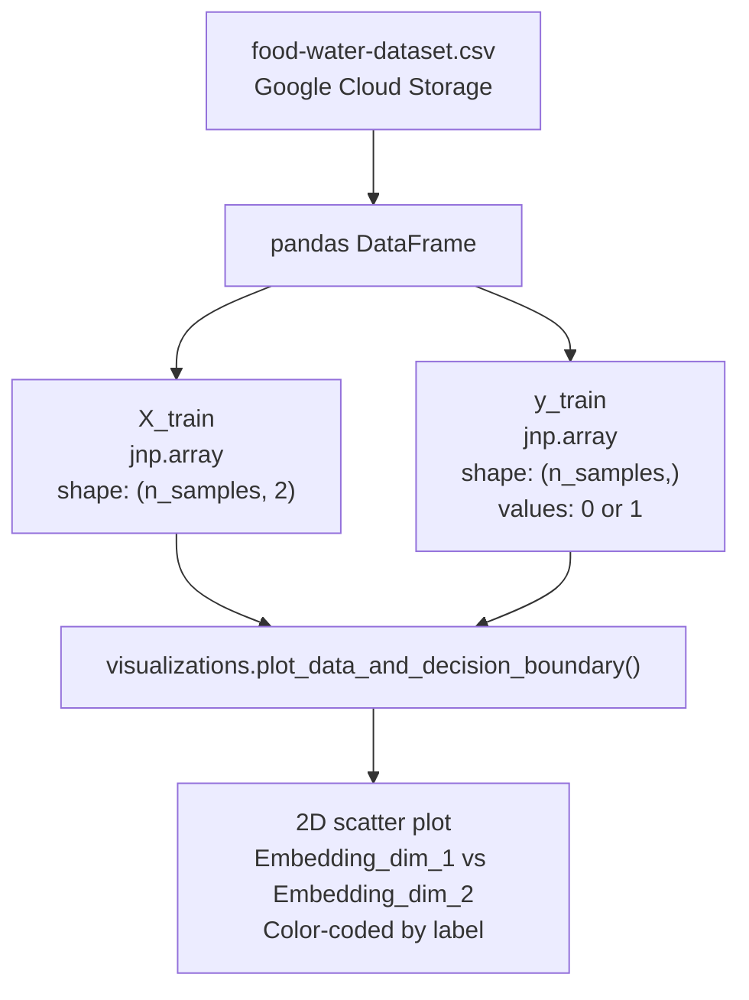

**Dataset Structure:**

| Column | Type | Description |
|--------|------|-------------|
| `Embedding_dim_1` | float | First dimension of 2D embedding |
| `Embedding_dim_2` | float | Second dimension of 2D embedding |
| `Label` | string | Target class: "food" or "water" |

The dataset is converted to JAX arrays for compatibility with JAX's automatic differentiation:

- `X_train`: Feature matrix of shape `(n_samples, 2)`
- `y_train`: Binary labels of shape `(n_samples,)` where food=1, water=0

**Sources:** [course_3/gdm_lab_3_7_gradients.ipynb:164-195]()

---

## Model Architecture: Single-Neuron Binary Classifier

The lab uses the simplest possible neural network: a single neuron with sigmoid activation. This architecture is sufficient to learn linear decision boundaries for binary classification.

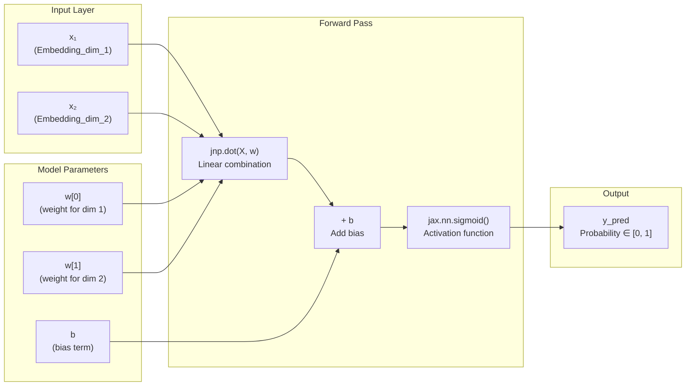

**Mathematical Formula:**

$$y = \sigma(\mathbf{w} \cdot \mathbf{x} + b)$$

where:
- $\mathbf{x} = [x_1, x_2]$ is the input embedding
- $\mathbf{w} = [w_0, w_1]$ is the weight vector
- $b$ is the bias term
- $\sigma$ is the sigmoid function: $\sigma(z) = \frac{1}{1 + e^{-z}}$

**Sources:** [course_3/gdm_lab_3_7_gradients.ipynb:251-303]()

---

## Core Implementation Components

### The `predict` Function

Students implement the `predict` function that computes predictions for all examples in a batch:

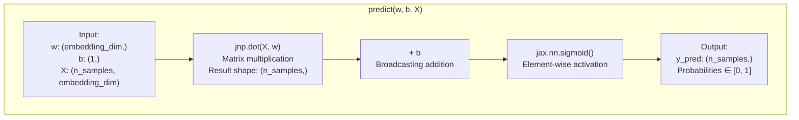

**Key Implementation Details:**
- Uses `jnp.dot(X, w)` instead of `jnp.dot(w, X)` because matrix dimensions must align: `(n_samples, embedding_dim) × (embedding_dim,) → (n_samples,)`
- Applies sigmoid activation element-wise to all predictions
- Returns vector of probabilities, one per input example

**Sources:** [course_3/gdm_lab_3_7_gradients.ipynb:251-303](), [course_3/gdm_lab_3_7_gradients.ipynb:650-672]()

### The `loss_fn` Function

The loss function computes binary cross-entropy loss averaged over all examples:

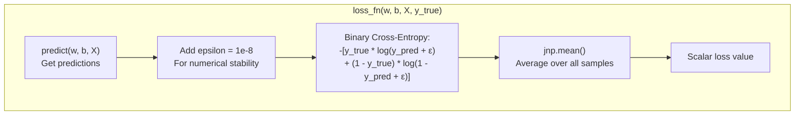

**Mathematical Formula:**

$$\text{Loss}(y_{\text{true}}, y_{\text{pred}}) = -\frac{1}{n}\sum_{i=1}^{n}\left[y_i^{\text{true}} \log(y_i^{\text{pred}}) + (1-y_i^{\text{true}}) \log(1-y_i^{\text{pred}})\right]$$

The epsilon term prevents `log(0)` errors when predictions are exactly 0 or 1.

**Sources:** [course_3/gdm_lab_3_7_gradients.ipynb:311-360]()

---

## Automatic Differentiation with JAX

JAX's `jax.grad` function enables automatic computation of gradients for any differentiable function.

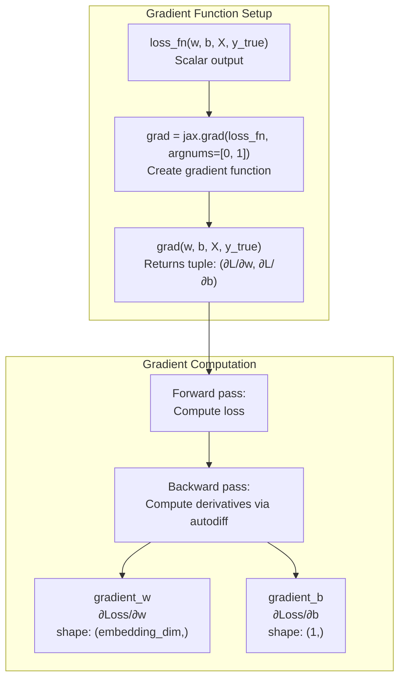

**Key JAX API Components:**

| Component | Purpose |
|-----------|---------|
| `jax.grad(fn, argnums)` | Creates a function that computes gradients of `fn` with respect to arguments specified by `argnums` |
| `argnums=[0, 1]` | Indicates to compute gradients w.r.t. first argument (w) and second argument (b) |
| Return value | Tuple of gradients in same order as `argnums` |

**Sources:** [course_3/gdm_lab_3_7_gradients.ipynb:392-448]()

---

## Gradient Descent Update Rule

The gradient indicates the direction of steepest ascent. To minimize loss, parameters are updated in the opposite direction (steepest descent).

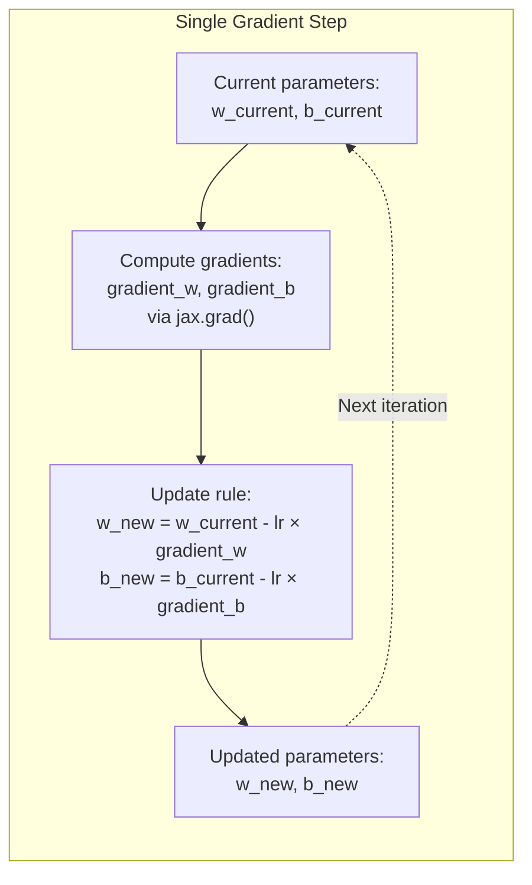

**Update Formulas:**

```python
w_updated = w_current - learning_rate * gradient_w
b_updated = b_current - learning_rate * gradient_b
```

**Hyperparameter:**
- `learning_rate`: Controls step size (typically 0.01 to 0.5). Smaller values make training slower but more stable; larger values can cause instability.

**Sources:** [course_3/gdm_lab_3_7_gradients.ipynb:392-448]()

---

## Training Loop Implementation

The complete gradient descent algorithm iteratively applies parameter updates:

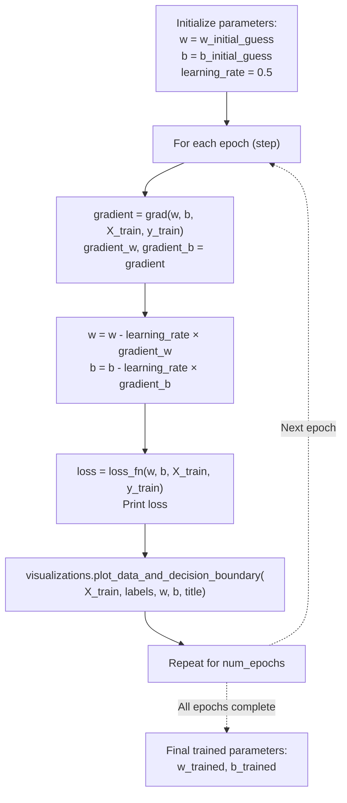

**Training Loop Code Structure:**

The lab implements the training loop at [course_3/gdm_lab_3_7_gradients.ipynb:506-537]():

```python
w = w_initial_guess
b = b_initial_guess
learning_rate = 0.5

for step in range(10):  # num_epochs = 10
    # Compute gradients
    gradient = grad(w, b, X_train, y_train)
    gradient_w, gradient_b = gradient
    
    # Update parameters
    w = w - learning_rate * gradient_w
    b = b - learning_rate * gradient_b
    
    # Monitor progress
    print(f"Step {step + 1} loss: {loss_fn(w, b, X_train, y_train):.4f}")
    
    # Visualize decision boundary
    visualizations.plot_data_and_decision_boundary(...)
```

**Sources:** [course_3/gdm_lab_3_7_gradients.ipynb:480-537]()

---

## Decision Boundary Visualization

The lab uses visualization to show how the decision boundary evolves during training:

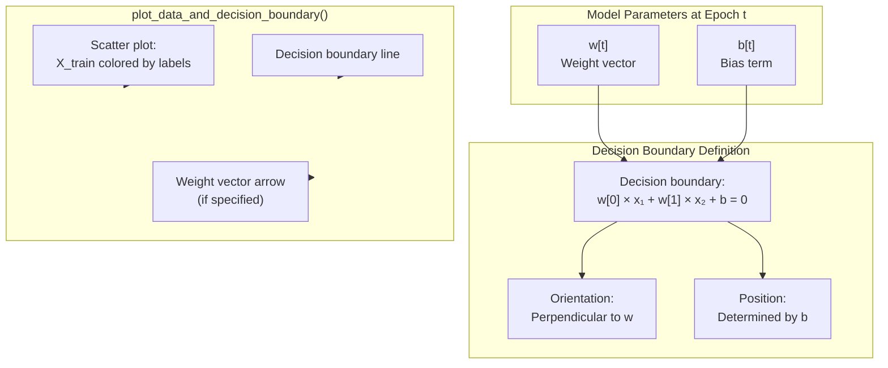

**Key Geometric Properties:**

| Parameter | Effect on Decision Boundary |
|-----------|----------------------------|
| Weight vector `w` | Defines the **orientation** (perpendicular to w). Points toward positive class |
| Bias term `b` | Defines the **position** (parallel shift). Larger b shifts boundary toward negative class |
| Magnitude of `w` | Steepness of probability transition (not position) |

**Usage in Lab:**

The visualization function is called with:
```python
visualizations.plot_data_and_decision_boundary(
    X_train,
    labels,
    weight_vector=w,
    bias_term=b,
    title=f"Step {step + 1}"
)
```

**Sources:** [course_3/gdm_lab_3_7_gradients.ipynb:203-243](), [course_3/gdm_lab_3_7_gradients.ipynb:464-471]()

---

## Observing Training Dynamics

As gradient descent progresses, students observe several phenomena:

```mermaid
graph LR
    subgraph BeforeTraining["Before Training (Step 0)"]
        INIT_LOSS["High loss<br/>(e.g., 0.8-1.2)"]
        INIT_BOUND["Poor decision boundary<br/>Many misclassifications"]
        INIT_W["Random weight orientation"]
    end
    
    subgraph DuringTraining["During Training (Steps 1-5)"]
        MID_LOSS["Decreasing loss<br/>(e.g., 0.4-0.6)"]
        MID_BOUND["Improving boundary<br/>Rotating and shifting"]
        MID_W["Weight vector aligning<br/>toward positive class"]
    end
    
    subgraph AfterTraining["After Training (Steps 8-10)"]
        FINAL_LOSS["Low loss<br/>(e.g., 0.1-0.3)"]
        FINAL_BOUND["Good decision boundary<br/>Few/no misclassifications"]
        FINAL_W["Weight vector points<br/>perpendicular to boundary"]
    end
    
    BeforeTraining --> DuringTraining
    DuringTraining --> AfterTraining
```

**Expected Behavior:**

1. **Loss Decreases Monotonically**: Each gradient step reduces training loss (if learning rate is appropriate)
2. **Boundary Shifts Progressively**: Decision boundary moves to better separate classes
3. **Weight Vector Alignment**: The weight vector rotates to point toward the positive class region
4. **Convergence**: After sufficient iterations, changes become minimal

**Sources:** [course_3/gdm_lab_3_7_gradients.ipynb:480-537](), [course_3/gdm_lab_3_7_gradients.ipynb:539-546]()

---

## Extension to Complex Problems

The lab concludes with reflection on more complex datasets, such as the spiral dataset with 4 classes:

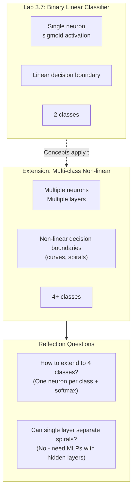

**Key Limitations of Single-Neuron Model:**
- Can only learn **linear** decision boundaries
- Can only handle **binary** classification (or one-vs-all for multi-class)
- Cannot solve **non-linearly separable** problems (e.g., XOR, spirals)

**Path to More Complex Models:**
- Multi-layer perceptrons (MLPs) with hidden layers enable non-linear boundaries
- Multiple output neurons with softmax enable multi-class classification
- Same gradient descent principles apply, but with backpropagation through layers

The lab uses `visualizations.plot_spiral_data()` to display a 4-class spiral dataset as a teaser for more advanced architectures.

**Sources:** [course_3/gdm_lab_3_7_gradients.ipynb:549-580]()

---

## Relationship to Other Course Components

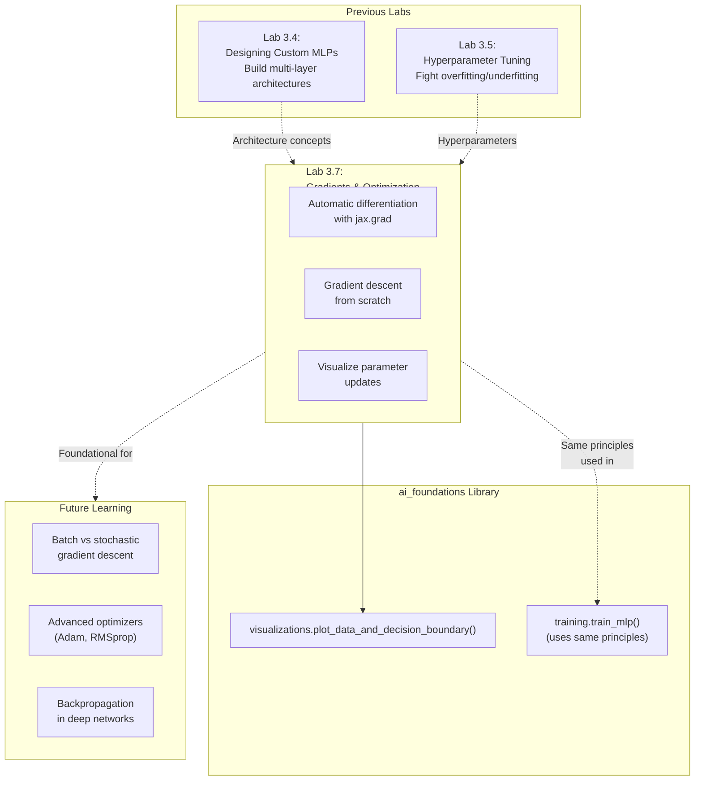

**Connections:**

| Related Component | Relationship |
|-------------------|-------------|
| [Lab 3.4](#5.1) | Lab 3.7 uses a simpler single-neuron model; Lab 3.4 builds multi-layer MLPs using Keras (which internally uses similar gradient descent) |
| [Lab 3.5](#5.2) | Lab 3.5 tunes hyperparameters that affect gradient descent (learning rate is one such hyperparameter) |
| [Training Utilities](#2.3) | The `training.train_mlp()` function uses the same gradient descent principles but with Keras/JAX high-level APIs |
| [Visualization System](#2.2) | Lab 3.7 heavily relies on `plot_data_and_decision_boundary()` to visualize training progress |

**Sources:** [course_3/gdm_lab_3_7_gradients.ipynb:42-79](), [course_3/gdm_lab_3_7_gradients.ipynb:583-593]()

---

## Summary of Key Concepts

| Concept | Implementation | Purpose |
|---------|---------------|---------|
| **Automatic Differentiation** | `jax.grad(loss_fn, argnums=[0,1])` | Compute gradients without manual calculus |
| **Gradient** | `gradient_w, gradient_b = grad(w, b, X, y)` | Indicates direction of steepest ascent of loss function |
| **Gradient Descent** | `w = w - learning_rate * gradient_w` | Iteratively update parameters to minimize loss |
| **Learning Rate** | Scalar hyperparameter (e.g., 0.5) | Controls step size of parameter updates |
| **Decision Boundary** | Line where `w·x + b = 0` | Separates predicted classes in feature space |
| **Binary Cross-Entropy** | Loss function for binary classification | Measures prediction error |
| **Training Loop** | For-loop iterating gradient steps | Repeatedly applies gradient descent until convergence |

**Sources:** [course_3/gdm_lab_3_7_gradients.ipynb:583-593]()