# Page: Overview

# Overview

<details>
<summary>Relevant source files</summary>

The following files were used as context for generating this wiki page:

- [ai_foundations/feedback/course_1/slm/__init__.py](ai_foundations/feedback/course_1/slm/__init__.py)
- [ai_foundations/generation/loaders.py](ai_foundations/generation/loaders.py)
- [ai_foundations/ngram/model.py](ai_foundations/ngram/model.py)
- [ai_foundations/visualizations/__init__.py](ai_foundations/visualizations/__init__.py)
- [ai_foundations/visualizations/plots.py](ai_foundations/visualizations/plots.py)
- [course_1/gdm_lab_1_3_compare_n_gram_models_and_transformer_language_models.ipynb](course_1/gdm_lab_1_3_compare_n_gram_models_and_transformer_language_models.ipynb)
- [course_1/gdm_lab_1_4_prepare_the_dataset_for_training_a_slm.ipynb](course_1/gdm_lab_1_4_prepare_the_dataset_for_training_a_slm.ipynb)

</details>


## Purpose and Scope

The `ai-foundations` repository serves a dual purpose:

1. **Core Python Library**: The `ai_foundations` package provides reusable utilities for language modeling, including n-gram models, pre-trained transformer loading (Gemma), visualization tools, training utilities, embedding manipulation, and automated feedback systems.

2. **Educational Framework**: Three progressive courses (`course_1/`, `course_2/`, `course_3/`) teach AI fundamentals through hands-on labs that build upon the core library. Each course contains Jupyter notebooks implementing specific exercises.

This document provides a high-level overview of the repository architecture and how components interact. For detailed documentation of specific modules, see:
- Core library modules: [Core Library Reference](#2)
- Course-specific implementations: [Course 1](#3), [Course 2](#4), [Course 3](#5)

**Sources**: [course_1/gdm_lab_1_4_prepare_the_dataset_for_training_a_slm.ipynb:1-100](), [course_1/gdm_lab_1_3_compare_n_gram_models_and_transformer_language_models.ipynb:1-100](), [ai_foundations/visualizations/plots.py:1-50]()

## Repository Architecture

The repository is organized into two primary sections:

| Component | Location | Purpose |
|-----------|----------|---------|
| **Core Library** | `ai_foundations/` | Reusable Python package with language modeling utilities |
| **Course 1** | `course_1/` | Language model foundations (n-grams, tokenization, first SLM) |
| **Course 2** | `course_2/` | Advanced tokenization and embeddings (BPE, preprocessing) |
| **Course 3** | `course_3/` | Neural network training (MLPs, hyperparameters, gradients) |

**Sources**: Repository structure from provided diagrams and file listings

### Dual Nature: Library and Educational Content

```mermaid
graph TB
    subgraph Library["ai_foundations Package"]
        NGram["ngram.model.NGramModel"]
        Loaders["generation.loaders.load_gemma()"]
        Viz["visualizations.plots"]
        Train["training module"]
        Emb["embeddings module"]
        FB["feedback module"]
    end
    
    subgraph C1["Course 1: Language Model Foundations"]
        L13["Lab 1.3: Compare Models"]
        L14["Lab 1.4: Dataset Prep<br/>SimpleWordTokenizer"]
        L15["Lab 1.5: Train SLM"]
    end
    
    subgraph C2["Course 2: Tokenization & Embeddings"]
        L21["Lab 2.1: Text Preprocessing"]
        L22["Lab 2.2: Char vs Word"]
        L24["Lab 2.4: BPE Implementation"]
        L25["Lab 2.5: Embeddings"]
    end
    
    subgraph C3["Course 3: Neural Networks"]
        L34["Lab 3.4: Design MLP"]
        L35["Lab 3.5: Hyperparameters"]
        L37["Lab 3.7: Gradients"]
    end
    
    L13 --> NGram
    L13 --> Loaders
    L13 --> Viz
    L14 --> FB
    L15 --> Train
    L22 --> Viz
    L24 --> FB
    L25 --> Emb
    L34 --> Train
    L34 --> Viz
    L35 --> Train
    L37 --> Viz
```

**Sources**: [ai_foundations/ngram/model.py:30-77](), [ai_foundations/generation/loaders.py:28-70](), [ai_foundations/visualizations/__init__.py:1-28](), [course_1/gdm_lab_1_3_compare_n_gram_models_and_transformer_language_models.ipynb:1-250]()

## Core Library Structure

The `ai_foundations` package contains five primary modules:

### Module Overview

| Module | Key Components | Primary Use Cases |
|--------|---------------|------------------|
| `ngram.model` | `NGramModel` class | Statistical language modeling with n-gram probabilities |
| `generation` | `load_gemma()`, `prompt_transformer_model()` | Loading and prompting Gemma transformer models |
| `visualizations` | `plot_next_token()`, `plot_loss_curve()`, `plot_data_and_mlp()` | Visualizing probabilities, training metrics, decision boundaries |
| `training` | `create_model()`, `train_mlp()`, callbacks | Model creation and training loops |
| `embeddings` | `load_gemma_embeddings()`, `plot_embeddings_tsne()` | Loading and visualizing token embeddings |
| `feedback` | `test_*()` functions, `render_feedback()` | Automated testing for lab exercises |

**Sources**: [ai_foundations/visualizations/plots.py:1-100](), [ai_foundations/ngram/model.py:1-50](), [ai_foundations/generation/loaders.py:1-71](), [ai_foundations/feedback/course_1/slm/__init__.py:1-23]()

### Core Classes and Functions

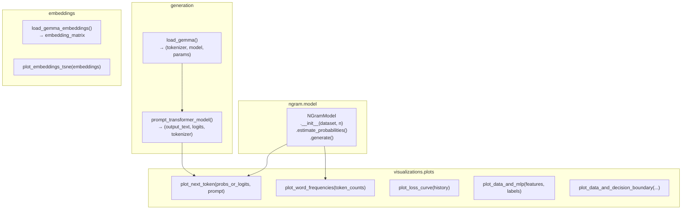

**Sources**: [ai_foundations/ngram/model.py:30-193](), [ai_foundations/generation/loaders.py:28-71](), [ai_foundations/visualizations/plots.py:48-166]()

## Educational Course Progression

The three courses build progressively on each other:

### Course Dependency Flow

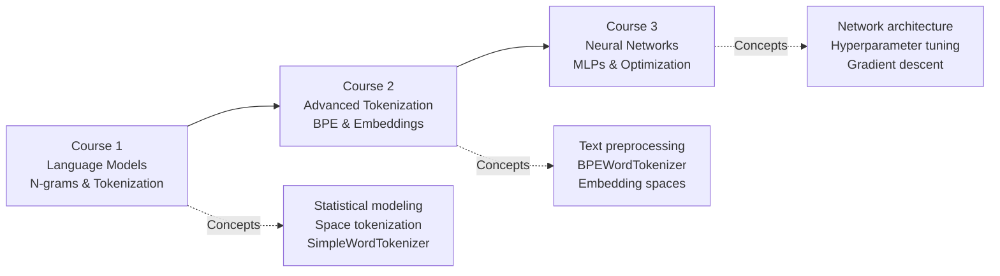

**Sources**: Repository structure from table of contents JSON

### Course 1: Language Model Foundations

| Lab | Key Implementation | Core Library Usage |
|-----|-------------------|-------------------|
| Lab 1.3 | Compare `NGramModel` vs Gemma-1B | `ngram.model`, `generation.load_gemma()`, `visualizations.plot_next_token()` |
| Lab 1.4 | Implement `SimpleWordTokenizer` | `feedback.course_1.slm` test functions |
| Lab 1.5 | Train first SLM | `training.create_model()`, `training` callbacks |

**Sources**: [course_1/gdm_lab_1_3_compare_n_gram_models_and_transformer_language_models.ipynb:200-242](), [course_1/gdm_lab_1_4_prepare_the_dataset_for_training_a_slm.ipynb:748-882]()

### Course 2: Advanced Tokenization and Embeddings

Builds on Course 1 by introducing:
- Text preprocessing with HTML/Unicode cleaning
- Character-level vs word-level tokenization comparison
- Byte Pair Encoding (BPE) implementation (`BPEWordTokenizer`)
- Embedding analysis with t-SNE visualization

### Course 3: Neural Network Training

Builds on Courses 1 and 2 by introducing:
- Custom MLP architecture design
- Overfitting/underfitting diagnosis via loss curves
- Gradient computation and optimization with JAX

**Sources**: Table of contents JSON structure

## Key Data Flows

### Tokenization Pipeline

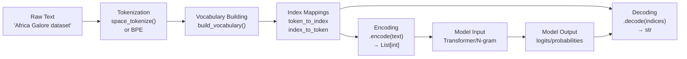

**Sources**: [course_1/gdm_lab_1_4_prepare_the_dataset_for_training_a_slm.ipynb:748-882](), demonstrates `SimpleWordTokenizer` class with `encode()` and `decode()` methods

### Model Training and Evaluation Workflow

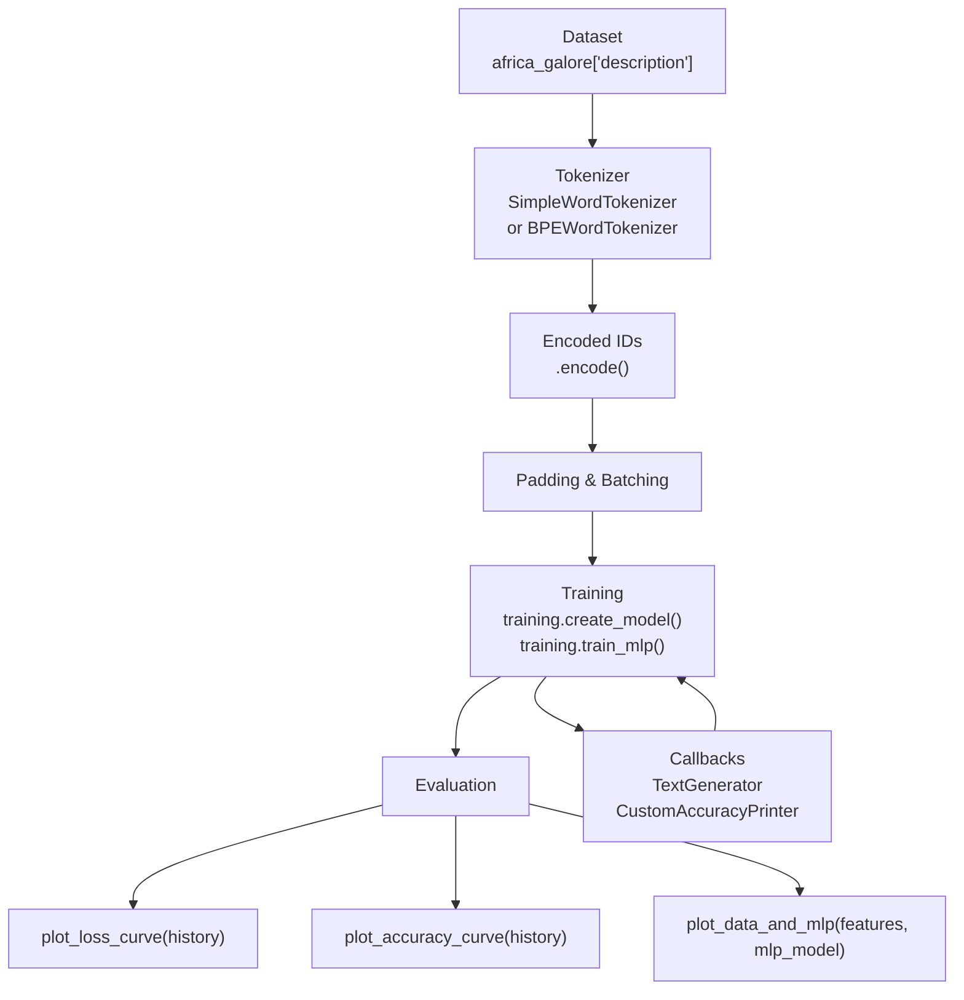

**Sources**: [ai_foundations/visualizations/plots.py:304-366](), [course_1/gdm_lab_1_4_prepare_the_dataset_for_training_a_slm.ipynb:748-882]()

### Visualization System Flow

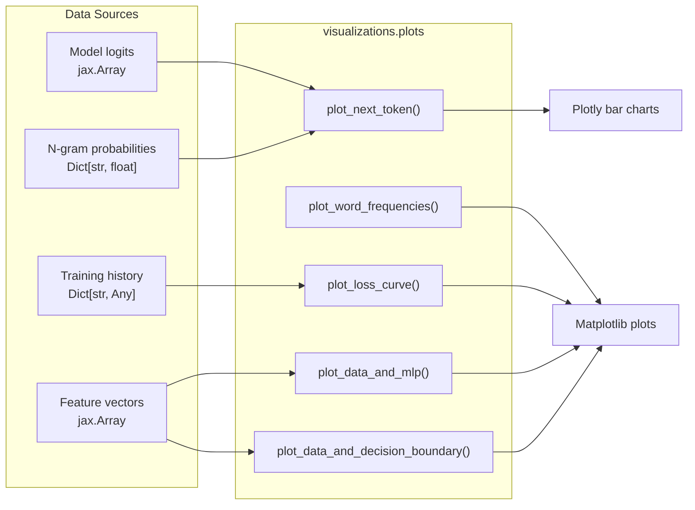

**Sources**: [ai_foundations/visualizations/plots.py:48-461](), function definitions for all visualization utilities

## Common Datasets

The repository uses the **Africa Galore** dataset as the primary training corpus across all courses:

| Dataset | Location | Format | Usage |
|---------|----------|--------|-------|
| Africa Galore | `https://storage.googleapis.com/dm-educational/assets/ai_foundations/africa_galore.json` | JSON with `description` field | Text corpus for tokenization, n-gram training, SLM training |

**Loading pattern**:
```python
africa_galore = pd.read_json("https://storage.googleapis.com/dm-educational/assets/ai_foundations/africa_galore.json")
dataset = africa_galore["description"]
```

**Sources**: [course_1/gdm_lab_1_3_compare_n_gram_models_and_transformer_language_models.ipynb:227-232](), [course_1/gdm_lab_1_4_prepare_the_dataset_for_training_a_slm.ipynb:186-193]()

## Integration Example: Lab 1.3 Workflow

The following diagram shows how a typical lab integrates multiple library components:

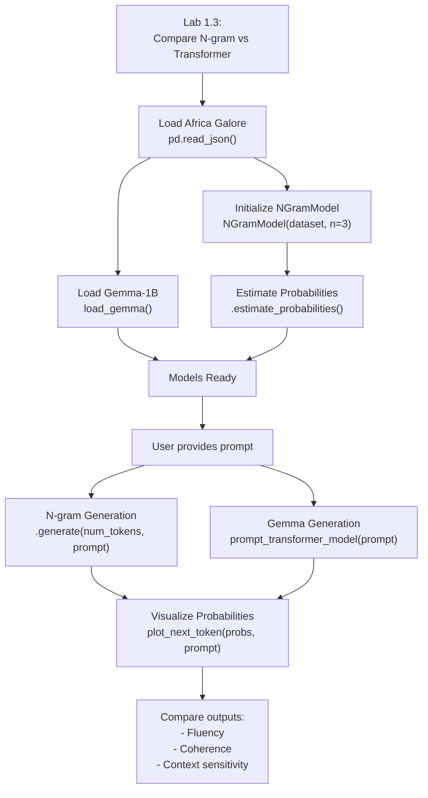

**Sources**: [course_1/gdm_lab_1_3_compare_n_gram_models_and_transformer_language_models.ipynb:200-307](), demonstrates full workflow from loading to visualization

## Pre-trained Models

The library provides access to pre-trained Gemma transformer models:

| Model | Identifier | Parameters | Loading Function |
|-------|-----------|-----------|------------------|
| Gemma-1B | `"Gemma-1B"` | ~1 billion | `load_gemma(model_name="Gemma-1B")` |
| Gemma-4B | `"Gemma-4B"` | ~4 billion | `load_gemma(model_name="Gemma-4B")` |
| Gemma-1B-AttentionWeight | `"Gemma-1B-AttentionWeight"` | ~1 billion (with attention visualization) | `load_gemma(model_name="Gemma-1B-AttentionWeight")` |

**Return signature**: `(tokenizer, model, params)`
- `tokenizer`: `gm.text.Gemma3Tokenizer` instance
- `model`: `gm.nn.Gemma3_1B` or `gm.nn.Gemma3_4B` instance
- `params`: `Mapping[str, Any]` with pre-trained weights

**Sources**: [ai_foundations/generation/loaders.py:28-71]()

## Feedback and Testing System

Each lab includes automated testing via the `feedback` module:

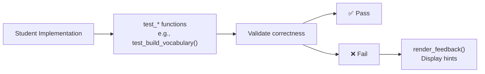

**Example test functions**:
- `test_build_tokens_list()` - Validates token list construction
- `test_build_vocabulary()` - Validates vocabulary building
- `test_index_to_token()` - Validates index-to-token mapping
- `test_simple_word_tokenizer()` - Validates `SimpleWordTokenizer` implementation

**Sources**: [ai_foundations/feedback/course_1/slm/__init__.py:1-23](), [course_1/gdm_lab_1_4_prepare_the_dataset_for_training_a_slm.ipynb:283-291]()

## Summary

The `ai-foundations` repository provides:

1. **Reusable Library**: Production-ready implementations of n-gram models (`NGramModel`), transformer loading (`load_gemma()`), visualization utilities (`plots` module), and training infrastructure
2. **Educational Scaffolding**: Three progressive courses with hands-on labs that teach AI fundamentals through practical implementation
3. **Tight Integration**: Labs leverage library components while introducing custom implementations (e.g., `SimpleWordTokenizer`, `BPEWordTokenizer`) that follow library patterns
4. **Automated Feedback**: Test functions provide immediate validation and guidance for student implementations

For detailed documentation of specific components, refer to the subsections: [Core Library Reference](#2), [Course 1](#3), [Course 2](#4), [Course 3](#5).

**Sources**: Repository architecture and file structure from all provided files

---

# Page: Core Library Reference

# Core Library Reference

<details>
<summary>Relevant source files</summary>

The following files were used as context for generating this wiki page:

- [ai_foundations/feedback/course_1/slm/__init__.py](ai_foundations/feedback/course_1/slm/__init__.py)
- [ai_foundations/feedback/utils.py](ai_foundations/feedback/utils.py)
- [ai_foundations/generation/loaders.py](ai_foundations/generation/loaders.py)
- [ai_foundations/ngram/model.py](ai_foundations/ngram/model.py)
- [ai_foundations/visualizations/__init__.py](ai_foundations/visualizations/__init__.py)
- [ai_foundations/visualizations/plots.py](ai_foundations/visualizations/plots.py)

</details>


## Purpose and Scope

This document provides a reference overview of the `ai_foundations` Python package, which serves as the core library supporting the educational labs in this repository. The package contains reusable utilities for language modeling, visualization, training, embeddings, and automated feedback testing.

This page serves as a navigation hub for the core library's major components. For detailed information about specific modules and their APIs, see the following subsections:

- For language model utilities, see [Language Models](#2.1)
- For plotting and visualization functions, see [Visualization System](#2.2)
- For model training utilities, see [Training Utilities](#2.3)
- For embedding operations, see [Embeddings Module](#2.4)
- For testing and feedback mechanisms, see [Feedback and Testing System](#2.5)

For information about how these components are used in educational contexts, see [Course 1: Language Model Foundations](#3), [Course 2: Advanced Tokenization and Embeddings](#4), and [Course 3: Neural Network Training Fundamentals](#5).

**Sources:** [ai_foundations/visualizations/__init__.py:1-28](), [ai_foundations/generation/loaders.py:1-71](), [ai_foundations/ngram/model.py:1-193]()

## Package Structure

The `ai_foundations` package is organized into the following top-level modules:

| Module | Purpose | Key Components |
|--------|---------|----------------|
| `ngram` | Statistical language modeling | `NGramModel` class |
| `generation` | Pre-trained model loading and text generation | `load_gemma()`, prompt utilities |
| `visualizations` | Plotting and visualization utilities | `plot_next_token()`, `plot_loss_curve()`, `plot_data_and_mlp()` |
| `training` | Model training loops and callbacks | `create_model()`, `train_mlp()`, custom callbacks |
| `embeddings` | Token embedding operations | `load_gemma_embeddings()`, `plot_embeddings_tsne()` |
| `feedback` | Automated testing and hints | `test_*` functions, `render_feedback()` |
| `machine_learning` | Neural network utilities | Dataset preparation, evaluation metrics |

**Sources:** [ai_foundations/visualizations/__init__.py:1-28](), [ai_foundations/feedback/course_1/slm/__init__.py:1-23]()

## Module Overview

### ngram Module

The `ngram` module provides statistical language modeling capabilities through the `NGramModel` class. This class estimates conditional probabilities from token sequences and generates text using learned n-gram statistics.

**Key Class:** `NGramModel` ([ai_foundations/ngram/model.py:30-193]())

**Primary Methods:**
- `estimate_probabilities()` - Builds probability distributions from training data
- `generate()` - Generates text using random or greedy sampling

For detailed documentation, see [Language Models](#2.1).

**Sources:** [ai_foundations/ngram/model.py:1-193]()

### generation Module

The `generation` module provides utilities for loading pre-trained Gemma transformer models and generating text with them.

**Key Function:** `load_gemma()` ([ai_foundations/generation/loaders.py:28-71]())

Returns a tuple of `(tokenizer, model, params)` for Gemma-1B or Gemma-4B models. Supports standard models and attention-weight variants.

For detailed documentation, see [Language Models](#2.1).

**Sources:** [ai_foundations/generation/loaders.py:1-71]()

### visualizations Module

The `visualizations` module contains comprehensive plotting functions for analyzing models, data, and training progress.

**Exported Functions** ([ai_foundations/visualizations/__init__.py:18-28]()):
- `plot_next_token()` - Visualizes probability distributions over next tokens
- `plot_word_frequencies()` - Creates log-log plots demonstrating Zipf's law
- `plot_loss_curve()` - Plots training and validation loss over epochs
- `plot_accuracy_curve()` - Plots accuracy metrics over epochs
- `plot_data_and_decision_boundary()` - Visualizes 2D classification boundaries
- `plot_data_and_mlp()` - Shows MLP decision boundaries with train/test data
- `visualize_mlp_architecture()` - Renders neural network layer diagrams
- `visualize_hyperparameter_loss()` - Compares hyperparameter impact on loss
- `visualize_attention()` - Shows attention weight heatmaps

For detailed documentation, see [Visualization System](#2.2).

**Sources:** [ai_foundations/visualizations/__init__.py:1-28](), [ai_foundations/visualizations/plots.py:1-695]()

### training Module

The `training` module provides utilities for building and training neural network models, including custom callbacks for monitoring training progress.

**Key Components:**
- Model creation functions for transformer-based language models
- Training loop implementations with JAX/Keras
- Custom callbacks: `TextGenerator`, `CustomAccuracyPrinter`

For detailed documentation, see [Training Utilities](#2.3).

### embeddings Module

The `embeddings` module provides functions for loading, manipulating, and visualizing token embeddings from pre-trained models.

**Key Functions:**
- `load_gemma_embeddings()` - Extracts embedding matrices from Gemma models
- `plot_embeddings_tsne()` - Projects embeddings to 2D using t-SNE
- `plot_embeddings_dimensions()` - Visualizes raw embedding dimensions

For detailed documentation, see [Embeddings Module](#2.4).

### feedback Module

The `feedback` module provides automated testing infrastructure and interactive hint rendering for educational labs.

**Key Components:**
- `render_feedback()` function ([ai_foundations/feedback/utils.py:32-59]())
- Course-specific test functions organized by lab topic
- Example tests from Course 1: `test_build_vocabulary()`, `test_simple_word_tokenizer()` ([ai_foundations/feedback/course_1/slm/__init__.py:18-22]())

For detailed documentation, see [Feedback and Testing System](#2.5).

**Sources:** [ai_foundations/feedback/utils.py:1-59](), [ai_foundations/feedback/course_1/slm/__init__.py:1-23]()

## Core Architecture

### Module Interaction Diagram

```mermaid
graph TB
    subgraph ngram["ngram Module"]
        NGramModel["NGramModel class"]
        estimate_probabilities["estimate_probabilities()"]
        generate_ngram["generate()"]
    end
    
    subgraph generation["generation Module"]
        load_gemma["load_gemma()"]
        Gemma3Tokenizer["gm.text.Gemma3Tokenizer"]
        Gemma3_1B["gm.nn.Gemma3_1B"]
        Gemma3_4B["gm.nn.Gemma3_4B"]
    end
    
    subgraph visualizations["visualizations Module"]
        plot_next_token["plot_next_token()"]
        plot_word_frequencies["plot_word_frequencies()"]
        plot_loss_curve["plot_loss_curve()"]
        plot_data_and_mlp["plot_data_and_mlp()"]
        plot_data_and_decision_boundary["plot_data_and_decision_boundary()"]
        visualize_mlp_architecture["visualize_mlp_architecture()"]
    end
    
    subgraph training["training Module"]
        create_model["create_model()"]
        train_mlp["train_mlp()"]
        TextGenerator["TextGenerator callback"]
        CustomAccuracyPrinter["CustomAccuracyPrinter callback"]
    end
    
    subgraph embeddings["embeddings Module"]
        load_gemma_embeddings["load_gemma_embeddings()"]
        plot_embeddings_tsne["plot_embeddings_tsne()"]
        plot_embeddings_dimensions["plot_embeddings_dimensions()"]
    end
    
    subgraph feedback["feedback Module"]
        render_feedback["render_feedback()"]
        test_build_vocabulary["test_build_vocabulary()"]
        test_simple_word_tokenizer["test_simple_word_tokenizer()"]
        test_build_tokens_list["test_build_tokens_list()"]
    end
    
    NGramModel --> plot_next_token
    generate_ngram --> plot_word_frequencies
    
    load_gemma --> Gemma3Tokenizer
    load_gemma --> Gemma3_1B
    load_gemma --> Gemma3_4B
    Gemma3_1B --> plot_next_token
    Gemma3_4B --> plot_next_token
    
    create_model --> train_mlp
    train_mlp --> TextGenerator
    train_mlp --> CustomAccuracyPrinter
    train_mlp --> plot_loss_curve
    
    train_mlp --> plot_data_and_mlp
    visualize_mlp_architecture -.documents.- train_mlp
    
    load_gemma_embeddings --> plot_embeddings_tsne
    load_gemma_embeddings --> plot_embeddings_dimensions
    
    test_build_vocabulary --> render_feedback
    test_simple_word_tokenizer --> render_feedback
    test_build_tokens_list --> render_feedback
```

**Sources:** [ai_foundations/visualizations/__init__.py:1-28](), [ai_foundations/ngram/model.py:1-193](), [ai_foundations/generation/loaders.py:1-71](), [ai_foundations/feedback/utils.py:1-59](), [ai_foundations/feedback/course_1/slm/__init__.py:1-23]()

### Data Flow Through Core Systems

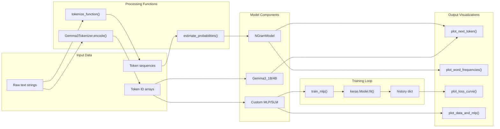

**Sources:** [ai_foundations/ngram/model.py:30-193](), [ai_foundations/generation/loaders.py:28-71](), [ai_foundations/visualizations/plots.py:48-335]()

## Key Classes and Functions Reference

### NGramModel Class

The `NGramModel` class provides statistical language modeling using n-gram probabilities.

| Attribute/Method | Type | Description |
|-----------------|------|-------------|
| `n` | `int` | Order of the n-gram model (e.g., 2 for bigram, 3 for trigram) |
| `probabilities` | `dict[tuple, dict[str, float]]` | Nested dictionary mapping context to next-token distributions |
| `tokenize_function` | `Callable` | Function to tokenize input strings into token lists |
| `estimate_probabilities()` | method | Estimates conditional probabilities from dataset |
| `generate()` | method | Generates text using random or greedy sampling |

**Implementation:** [ai_foundations/ngram/model.py:30-193]()

**Sources:** [ai_foundations/ngram/model.py:30-193]()

### Visualization Functions

The following table summarizes the primary visualization functions and their purposes:

| Function | Primary Use | Input Types | Output |
|----------|-------------|-------------|--------|
| `plot_next_token()` | Token probability distributions | `np.ndarray` or `dict[str, float]` | Interactive Plotly bar chart |
| `plot_word_frequencies()` | Zipf's law visualization | `collections.Counter` | Log-log matplotlib plot |
| `plot_loss_curve()` | Training progress monitoring | `dict` (Keras history) | Matplotlib line plot |
| `plot_accuracy_curve()` | Accuracy over epochs | `dict` (Keras history) | Matplotlib line plot |
| `plot_data_and_decision_boundary()` | Binary classification visualization | `jax.Array`, weight vector, bias | Matplotlib scatter + boundary |
| `plot_data_and_mlp()` | MLP decision boundaries | `jax.Array`, `keras.Model` | Matplotlib contour plot |
| `visualize_mlp_architecture()` | Neural network structure | `list[int]`, `int` | Matplotlib network diagram |
| `visualize_hyperparameter_loss()` | Hyperparameter tuning results | `dict[HyperParameterConfig, float]` | Matplotlib bar/line plots |

**Implementation:** [ai_foundations/visualizations/plots.py:1-695]()

**Sources:** [ai_foundations/visualizations/plots.py:48-695](), [ai_foundations/visualizations/__init__.py:18-28]()

### Model Loading and Generation

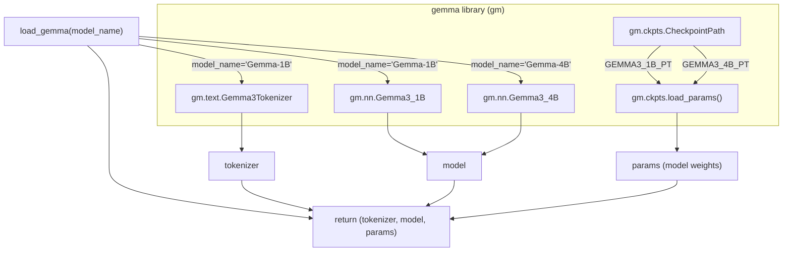

**Sources:** [ai_foundations/generation/loaders.py:28-71]()

### Feedback System Structure

The feedback system provides automated testing and interactive hints through a two-layer architecture:

1. **Core Utility Layer:** `render_feedback()` function ([ai_foundations/feedback/utils.py:32-59]())
2. **Course-Specific Test Layer:** Individual `test_*` functions organized by course and lab

**Example Feedback Flow:**

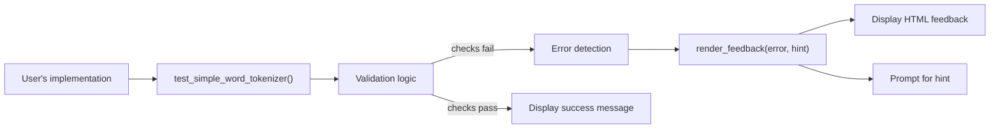

**Common Test Functions (Course 1):**
- `test_build_vocabulary()` - Validates vocabulary construction
- `test_simple_word_tokenizer()` - Validates tokenizer implementation
- `test_build_tokens_list()` - Validates token list generation
- `test_index_to_token()` - Validates index-to-token mapping
- `test_max_min_seqlen()` - Validates sequence length calculations

**Sources:** [ai_foundations/feedback/utils.py:1-59](), [ai_foundations/feedback/course_1/slm/__init__.py:1-23]()

## Integration Patterns

The core library modules work together to support common workflows in the educational labs:

### Pattern 1: Model Comparison Workflow

Used in Lab 1.3 to compare n-gram and transformer models:

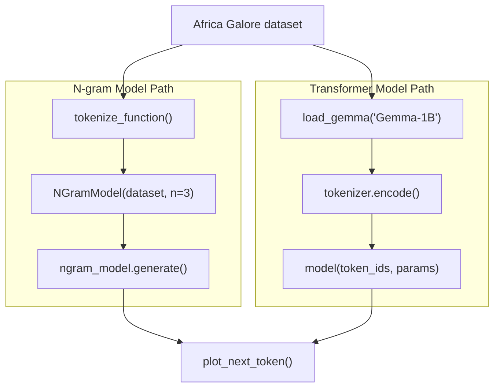

**Sources:** [ai_foundations/ngram/model.py:1-193](), [ai_foundations/generation/loaders.py:28-71](), [ai_foundations/visualizations/plots.py:48-113]()

### Pattern 2: Training and Visualization Workflow

Used in Labs 1.5, 2.6, and throughout Course 3:

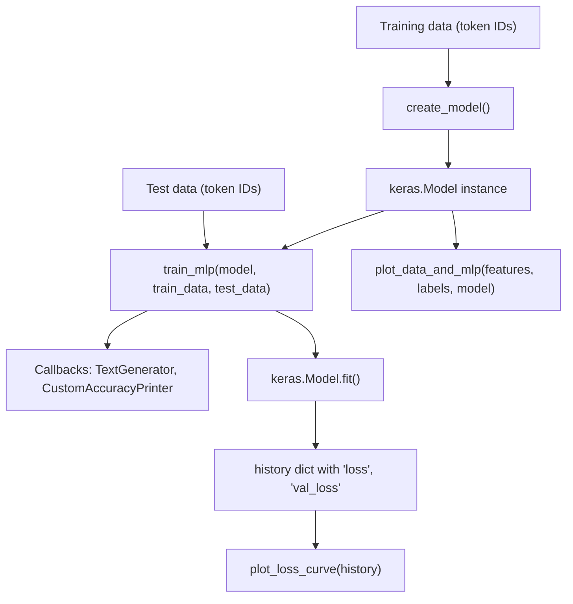

**Sources:** [ai_foundations/visualizations/plots.py:304-461]()

### Pattern 3: Embedding Analysis Workflow

Used in Labs 2.5 and 2.6 for embedding exploration:

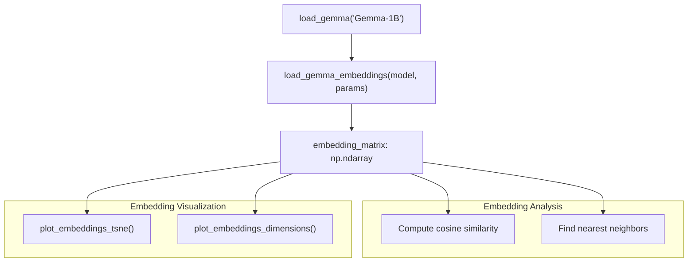

**Sources:** [ai_foundations/generation/loaders.py:28-71]()

## Usage Notes

### Color Palette

All visualization functions use a consistent color palette defined in [ai_foundations/visualizations/plots.py:35]():

```python
COLOR_PALETTE = ["#FFC20A", "#0C7BDC", "#71A816"]
```

This ensures visual consistency across all plots in the educational materials.

### JAX and NumPy Compatibility

Most functions accept both JAX arrays and NumPy arrays interchangeably. The library uses `jax.numpy` for computations but converts to standard NumPy for matplotlib visualizations where necessary.

### Error Handling in Feedback System

The `render_feedback()` function handles multiple error formats:
- Two-argument errors: `ValueError(title, detail)`
- Tuple-packed errors: `ValueError((title, detail))`
- Single-argument errors: Falls back to generic title with error string as detail

Implementation: [ai_foundations/feedback/utils.py:32-59]()

**Sources:** [ai_foundations/visualizations/plots.py:35](), [ai_foundations/feedback/utils.py:32-59]()

## Related Documentation

For detailed API documentation of individual modules:
- [Language Models](#2.1) - Full API reference for `NGramModel` and `load_gemma()`
- [Visualization System](#2.2) - Complete documentation of all plotting functions
- [Training Utilities](#2.3) - Training loop implementations and callbacks
- [Embeddings Module](#2.4) - Embedding loading and visualization
- [Feedback and Testing System](#2.5) - Automated testing infrastructure

For practical usage examples in educational contexts:
- [Course 1: Language Model Foundations](#3)
- [Course 2: Advanced Tokenization and Embeddings](#4)
- [Course 3: Neural Network Training Fundamentals](#5)

---

# Page: Language Models

# Language Models

<details>
<summary>Relevant source files</summary>

The following files were used as context for generating this wiki page:

- [ai_foundations/feedback/course_1/slm/__init__.py](ai_foundations/feedback/course_1/slm/__init__.py)
- [ai_foundations/generation/loaders.py](ai_foundations/generation/loaders.py)
- [ai_foundations/ngram/model.py](ai_foundations/ngram/model.py)
- [course_1/gdm_lab_1_3_compare_n_gram_models_and_transformer_language_models.ipynb](course_1/gdm_lab_1_3_compare_n_gram_models_and_transformer_language_models.ipynb)

</details>


## Purpose and Scope

This page documents the language model implementations provided by the `ai_foundations` library. It covers two distinct approaches to language modeling:

1. **Statistical N-gram models** via the `NGramModel` class for count-based probability estimation
2. **Pre-trained transformer models** via the `load_gemma` function for loading Gemma neural language models

For information about training your own transformer models, see [Lab 1.5: Training Your First Small Language Model](#3.3). For visualization of model predictions and probability distributions, see [Visualization System](#2.2). For interactive comparison between these two model types, see [Lab 1.3: Comparing N-gram and Transformer Models](#3.2).

---

## Overview of Language Modeling Approaches

The library provides two fundamentally different approaches to language modeling, each with distinct characteristics and use cases.

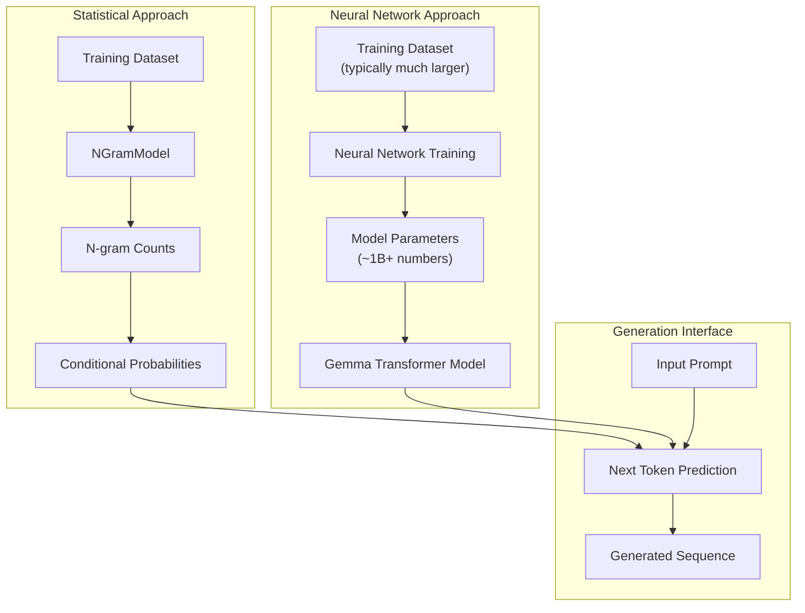

**Sources:** [ai_foundations/ngram/model.py:1-193](), [ai_foundations/generation/loaders.py:1-71](), [course_1/gdm_lab_1_3_compare_n_gram_models_and_transformer_language_models.ipynb:42-50]()

---

## NGramModel Class

### Architecture and Components

The `NGramModel` class implements statistical language modeling based on n-gram counts from a training corpus. It estimates conditional probabilities P(token | context) where the context is the preceding n-1 tokens.

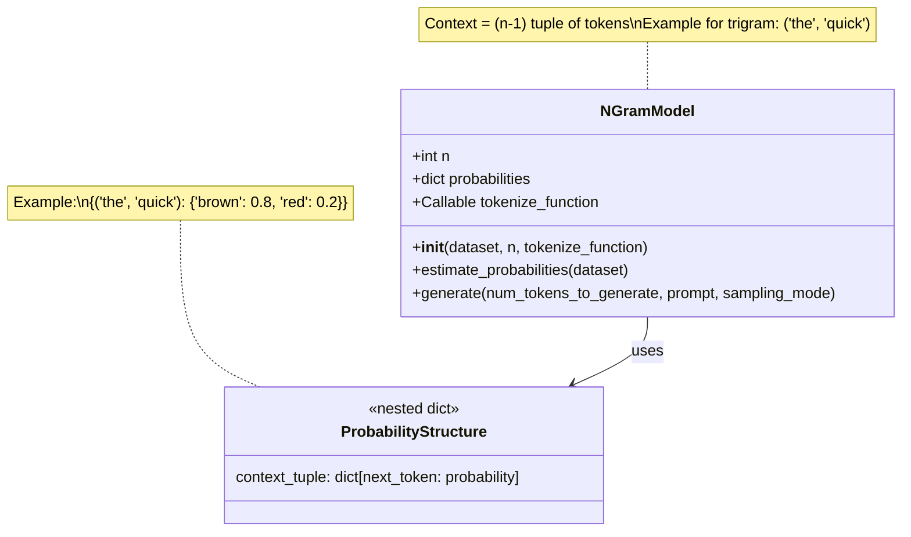

**Sources:** [ai_foundations/ngram/model.py:30-77]()

### Core Attributes

| Attribute | Type | Description |
|-----------|------|-------------|
| `n` | `int` | Order of the n-gram model (e.g., 2 for bigram, 3 for trigram) |
| `probabilities` | `dict[tuple, dict[str, float]]` | Nested dictionary mapping contexts to next-token probability distributions |
| `tokenize_function` | `Callable[[str], list[str]]` | Function to split text into tokens (defaults to whitespace tokenization) |

**Sources:** [ai_foundations/ngram/model.py:36-44]()

### Initialization and Training

The model is instantiated and trained in a single step during initialization:

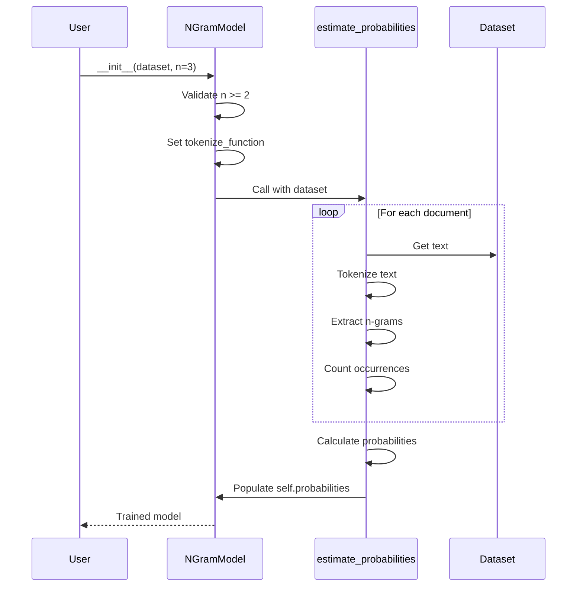

**Sources:** [ai_foundations/ngram/model.py:46-77](), [ai_foundations/ngram/model.py:78-121]()

### Probability Estimation Algorithm

The `estimate_probabilities` method implements the following process:

1. **N-gram Extraction**: Slides a window of size `n` over tokenized text
2. **Count Aggregation**: Uses `collections.Counter` to tally occurrences
3. **Probability Calculation**: Divides each next-token count by total context count

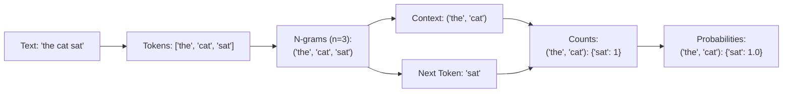

**Sources:** [ai_foundations/ngram/model.py:78-121]()

### Generation Process

The `generate` method produces text using the learned probability distributions:

| Parameter | Type | Default | Description |
|-----------|------|---------|-------------|
| `num_tokens_to_generate` | `int` | - | Number of tokens to generate |
| `prompt` | `str` | - | Initial text to continue from |
| `sampling_mode` | `str` | `"random"` | Either `"random"` (probabilistic) or `"greedy"` (deterministic) |

**Generation Algorithm:**
1. Extract last `n-1` tokens from prompt as initial context
2. Look up probability distribution for current context
3. Sample next token according to `sampling_mode`
4. Append token to output and update context (sliding window)
5. Repeat until desired length or context not found

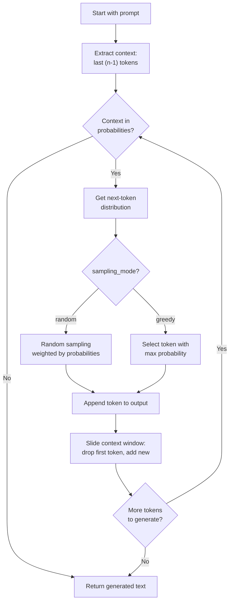

**Sources:** [ai_foundations/ngram/model.py:123-192]()

### Limitations and Characteristics

The `NGramModel` has inherent limitations due to its statistical nature:

| Characteristic | Behavior | Implication |
|----------------|----------|-------------|
| Context Window | Fixed at `n-1` tokens | Cannot utilize longer-range dependencies |
| Data Sparsity | Fails on unseen contexts | May terminate generation early with warning |
| Smoothing | None (unsmoothed) | Zero probability for unseen n-grams |
| Memory Efficiency | Stores all observed n-grams | Can be large for high `n` or large corpora |

**Sources:** [ai_foundations/ngram/model.py:16-20](), [course_1/gdm_lab_1_3_compare_n_gram_models_and_transformer_language_models.ipynb:42-50](), [course_1/gdm_lab_1_3_compare_n_gram_models_and_transformer_language_models.ipynb:631-634]()

---

## Gemma Model Loading

### load_gemma Function

The `load_gemma` function provides a unified interface for loading pre-trained Gemma transformer models and their associated components.

```mermaid
graph TB
    LoadGemma["load_gemma(model_name)"]
    
    subgraph "Model Variants"
        Gemma1B["'Gemma-1B'<br/>(default)"]
        Gemma4B["'Gemma-4B'"]
        GemmaAttn["'Gemma-1B-AttentionWeight'"]
    end
    
    subgraph "Components Loaded"
        Tokenizer["Gemma3Tokenizer"]
        Model["Model Architecture:<br/>Gemma3_1B or<br/>Gemma3_4B or<br/>AttentionWeightGemma3_1B"]
        Params["Pre-trained Parameters"]
    end
    
    subgraph "Return Tuple"
        ReturnValue["(tokenizer, model, params)"]
    end
    
    LoadGemma --> Gemma1B
    LoadGemma --> Gemma4B
    LoadGemma --> GemmaAttn
    
    Gemma1B --> Tokenizer
    Gemma1B --> Model
    Gemma1B --> Params
    
    Gemma4B --> Tokenizer
    Gemma4B --> Model
    Gemma4B --> Params
    
    GemmaAttn --> Tokenizer
    GemmaAttn --> Model
    GemmaAttn --> Params
    
    Tokenizer --> ReturnValue
    Model --> ReturnValue
    Params --> ReturnValue
```

**Function Signature:**
```python
load_gemma(model_name: Literal["Gemma-1B", "Gemma-4B", "Gemma-1B-AttentionWeight"] = "Gemma-1B")
    -> Tuple[gm.text.Gemma3Tokenizer, gm.nn.Gemma3_1B | gm.nn.Gemma3_4B, Mapping[str, Any]]
```

**Sources:** [ai_foundations/generation/loaders.py:28-70]()

### Model Variants and Loading Logic

| Model Name | Model Class | Parameters | Use Case |
|------------|-------------|------------|----------|
| `"Gemma-1B"` | `gm.nn.Gemma3_1B` | `gm.ckpts.CheckpointPath.GEMMA3_1B_PT` | Default option, faster inference, ~1 billion parameters |
| `"Gemma-4B"` | `gm.nn.Gemma3_4B` | `gm.ckpts.CheckpointPath.GEMMA3_4B_PT` | Higher quality outputs, ~4 billion parameters |
| `"Gemma-1B-AttentionWeight"` | `attention.AttentionWeightGemma3_1B` | `gm.ckpts.CheckpointPath.GEMMA3_1B_PT` | Special variant for attention analysis |

**Loading Implementation Flow:**

```mermaid
flowchart TD
    Input["model_name parameter"]
    Check1B{"model_name in<br/>['Gemma-1B',<br/>'Gemma-1B-AttentionWeight']?"}
    Check4B{"model_name ==<br/>'Gemma-4B'?"}
    
    CreateTokenizer1["tokenizer = Gemma3Tokenizer()"]
    CreateTokenizer2["tokenizer = Gemma3Tokenizer()"]
    
    CheckAttn{"model_name ==<br/>'Gemma-1B-AttentionWeight'?"}
    
    Model1B["model = Gemma3_1B()"]
    ModelAttn["model = AttentionWeightGemma3_1B()"]
    Model4B["model = Gemma3_4B()"]
    
    Params1B["params = load_params(GEMMA3_1B_PT)"]
    Params4B["params = load_params(GEMMA3_4B_PT)"]
    
    Return["Return (tokenizer, model, params)"]
    Error["Raise ValueError"]
    
    Input --> Check1B
    Check1B -->|Yes| CreateTokenizer1
    Check1B -->|No| Check4B
    
    CreateTokenizer1 --> CheckAttn
    CheckAttn -->|No| Model1B
    CheckAttn -->|Yes| ModelAttn
    
    Model1B --> Params1B
    ModelAttn --> Params1B
    Params1B --> Return
    
    Check4B -->|Yes| CreateTokenizer2
    Check4B -->|No| Error
    
    CreateTokenizer2 --> Model4B
    Model4B --> Params4B
    Params4B --> Return
```

**Sources:** [ai_foundations/generation/loaders.py:52-70]()

### Tokenizer Component

All Gemma model variants use the same tokenizer class:

- **Type**: `gm.text.Gemma3Tokenizer`
- **Vocabulary Size**: Approximately 256,000 subword tokens
- **Algorithm**: SentencePiece-based subword tokenization
- **Capabilities**: Encodes text to token IDs and decodes token IDs back to text

**Sources:** [ai_foundations/generation/loaders.py:54-62]()

### Model Parameters

The parameters returned by `load_gemma` are pre-trained weights:

- **Type**: `Mapping[str, Any]` (typically JAX arrays)
- **Source**: Google DeepMind's trained Gemma checkpoints
- **Training**: Pre-trained on large-scale text corpora
- **Size**: ~1 billion numbers for Gemma-1B, ~4 billion for Gemma-4B

**Sources:** [ai_foundations/generation/loaders.py:59-63](), [course_1/gdm_lab_1_3_compare_n_gram_models_and_transformer_language_models.ipynb:209-212]()

---

## Comparison: N-gram vs Transformer Models

### Architectural Differences

```mermaid
graph TB
    subgraph "NGramModel Architecture"
        Input1["Input Prompt"]
        Extract1["Extract last (n-1) tokens"]
        Lookup1["Dictionary lookup in<br/>self.probabilities"]
        Sample1["Sample from distribution"]
        Output1["Next token"]
        
        Input1 --> Extract1
        Extract1 --> Lookup1
        Lookup1 --> Sample1
        Sample1 --> Output1
    end
    
    subgraph "Gemma Transformer Architecture"
        Input2["Input Prompt"]
        Tokenize2["Subword tokenization"]
        Embed2["Embedding layer"]
        Attention2["Multi-head attention layers<br/>(many layers)"]
        FFN2["Feed-forward networks"]
        Output2["Next token logits"]
        Sample2["Sample from softmax"]
        Token2["Next token"]
        
        Input2 --> Tokenize2
        Tokenize2 --> Embed2
        Embed2 --> Attention2
        Attention2 --> FFN2
        FFN2 --> Output2
        Output2 --> Sample2
        Sample2 --> Token2
    end
```

**Sources:** [ai_foundations/ngram/model.py:123-192](), [course_1/gdm_lab_1_3_compare_n_gram_models_and_transformer_language_models.ipynb:42-50]()

### Feature Comparison Matrix

| Feature | NGramModel | Gemma Transformer |
|---------|-----------|-------------------|
| **Context Window** | Fixed `n-1` tokens (typically 2-4) | Hundreds to thousands of tokens |
| **Model Type** | Statistical (count-based) | Neural network (learned representations) |
| **Parameter Count** | Equals number of unique n-grams | ~1-4 billion trainable weights |
| **Training Data** | Can work with small datasets | Requires large-scale corpora |
| **Generalization** | Limited to seen n-grams | Can generalize to unseen contexts |
| **Inference Speed** | Very fast (dictionary lookup) | Slower (neural network forward pass) |
| **Memory Usage** | Stores all n-gram probabilities | Stores model weights + activation memory |
| **Failure Mode** | Cannot generate if context unseen | Always produces output (may be low quality) |
| **Fluency** | Often produces word salad | Generally fluent and grammatical |
| **Coherence** | Poor long-range coherence | Better long-range coherence |

**Sources:** [course_1/gdm_lab_1_3_compare_n_gram_models_and_transformer_language_models.ipynb:42-50](), [course_1/gdm_lab_1_3_compare_n_gram_models_and_transformer_language_models.ipynb:527-541](), [course_1/gdm_lab_1_3_compare_n_gram_models_and_transformer_language_models.ipynb:631-634]()

### Context Sensitivity Example

The following diagram illustrates how each model handles context changes:

```mermaid
sequenceDiagram
    participant P1 as Prompt: "Jide was hungry..."
    participant P2 as Prompt: "Jide was thirsty..."
    participant NG as NGramModel
    participant GM as Gemma Model
    
    Note over P1,GM: Both prompts end with "looking for"
    
    P1->>NG: Generate next token
    NG->>NG: Use context: ("looking", "for")
    NG->>P1: Predict: "food" / "a" / etc.
    
    P2->>NG: Generate next token
    NG->>NG: Use context: ("looking", "for")
    NG->>P2: Predict: "food" / "a" / etc.<br/>(SAME distribution!)
    
    P1->>GM: Generate next token
    GM->>GM: Analyze full context including "hungry"
    GM->>P1: Predict: "food" (high prob)
    
    P2->>GM: Generate next token
    GM->>GM: Analyze full context including "thirsty"
    GM->>P2: Predict: "water" (high prob)
```

**Sources:** [course_1/gdm_lab_1_3_compare_n_gram_models_and_transformer_language_models.ipynb:406-473]()

### Use Case Recommendations

**When to use NGramModel:**
- Educational purposes to understand language modeling basics
- Baseline comparisons for research
- Quick prototyping with small, domain-specific datasets
- Resource-constrained environments where speed is critical
- Interpreting model predictions (transparent probability calculations)

**When to use Gemma Models:**
- Production applications requiring high-quality text generation
- Tasks needing long-range context understanding
- Applications where fluency and coherence are important
- Scenarios with large training datasets available
- When model size and inference speed are acceptable trade-offs

**Sources:** [course_1/gdm_lab_1_3_compare_n_gram_models_and_transformer_language_models.ipynb:625-634]()

---

## Code Usage Patterns

### Instantiating and Using NGramModel

Reference implementation from the codebase:

```python
# Load dataset
dataset = africa_galore["description"]  # List of text documents

# Create trigram model (n=3)
trigram_model = ngram_model.NGramModel(dataset, 3)

# Generate text with random sampling
output = trigram_model.generate(
    num_tokens_to_generate=50,
    prompt="Jide was hungry so she went looking for",
    sampling_mode="random"
)

# Generate text with greedy sampling (deterministic)
output = trigram_model.generate(
    num_tokens_to_generate=50,
    prompt="Jide was hungry so she went looking for",
    sampling_mode="greedy"
)
```

**Sources:** [course_1/gdm_lab_1_3_compare_n_gram_models_and_transformer_language_models.ipynb:227-242](), [ai_foundations/ngram/model.py:123-192]()

### Loading and Using Gemma Models

Reference implementation from the codebase:

```python
# Load Gemma-1B model
gemma_model = generation.load_gemma()
# Returns: (tokenizer, model, params)

# Load Gemma-4B model
gemma_model = generation.load_gemma("Gemma-4B")

# The returned object is used by prompt_transformer_model
# See Visualization System documentation for usage
```

**Sources:** [course_1/gdm_lab_1_3_compare_n_gram_models_and_transformer_language_models.ipynb:239-241](), [ai_foundations/generation/loaders.py:28-70]()

### Accessing NGramModel Probabilities

The probability distributions are directly accessible for inspection:

```python
# Access probability distribution for a specific context
context = ("looking", "for")  # Last (n-1) tokens

if context in trigram_model.probabilities:
    next_token_probs = trigram_model.probabilities[context]
    # Returns dict like: {"food": 0.3, "a": 0.2, "something": 0.15, ...}
else:
    # Context not seen during training
    print("Context not found in model")
```

**Sources:** [ai_foundations/ngram/model.py:36-44](), [course_1/gdm_lab_1_3_compare_n_gram_models_and_transformer_language_models.ipynb:364-374]()

---

## Integration with Other Systems

### Visualization Integration

Both model types integrate with the visualization system for probability distribution plotting:

- **NGramModel**: Pass `trigram_model.probabilities[context]` to `visualizations.plot_next_token()`
- **Gemma Models**: Pass `next_token_logits` from `generation.prompt_transformer_model()` to `visualizations.plot_next_token()`

See [Visualization System](#2.2) for details on plotting functions.

**Sources:** [course_1/gdm_lab_1_3_compare_n_gram_models_and_transformer_language_models.ipynb:346-375]()

### Text Generation Integration

The Gemma models loaded by `load_gemma` are consumed by the `generation.prompt_transformer_model()` function for actual text generation. The `NGramModel.generate()` method is self-contained and does not require external generation utilities.

See [Training Utilities](#2.3) for information on using these models in training pipelines.

**Sources:** [course_1/gdm_lab_1_3_compare_n_gram_models_and_transformer_language_models.ipynb:296-306]()

---

# Page: Visualization System

# Visualization System

<details>
<summary>Relevant source files</summary>

The following files were used as context for generating this wiki page:

- [ai_foundations/visualizations/__init__.py](ai_foundations/visualizations/__init__.py)
- [ai_foundations/visualizations/plots.py](ai_foundations/visualizations/plots.py)
- [course_1/gdm_lab_1_3_compare_n_gram_models_and_transformer_language_models.ipynb](course_1/gdm_lab_1_3_compare_n_gram_models_and_transformer_language_models.ipynb)

</details>


## Purpose and Scope

The Visualization System provides a comprehensive suite of plotting functions for analyzing language models, neural networks, and training dynamics. It serves as the primary visualization layer for the ai-foundations educational framework, enabling learners to explore model behaviors, training progress, and data characteristics through interactive and static plots.

This document covers the `ai_foundations.visualizations` module. For model training utilities that generate the metrics visualized here, see [Training Utilities](#2.3). For embedding-specific visualization functions, see [Embeddings Module](#2.4).

**Sources:** [ai_foundations/visualizations/__init__.py:1-28](), [ai_foundations/visualizations/plots.py:1-695]()

## Module Architecture

The visualization system is organized into functional categories, each addressing specific analysis needs. All functions are exposed through the `ai_foundations.visualizations` public API.

```mermaid
graph TB
    subgraph "ai_foundations.visualizations"
        API["__init__.py<br/>Public API"]
        PLOTS["plots.py<br/>Core Visualization Functions"]
        ATTN["attention_visualization.py<br/>Attention Mechanisms"]
    end
    
    subgraph "Probability & Distribution Visualizations"
        NEXTTOKEN["plot_next_token()<br/>Token probability bars"]
        WORDFREQ["plot_word_frequencies()<br/>Zipf's law plots"]
    end
    
    subgraph "Training Metrics Visualizations"
        LOSS["plot_loss_curve()<br/>Train/test loss"]
        ACC["plot_accuracy_curve()<br/>Train/test accuracy"]
        HYPERPARAM["visualize_hyperparameter_loss()<br/>Hyperparameter-loss curves"]
    end
    
    subgraph "Classification Visualizations"
        BOUNDARY["plot_data_and_decision_boundary()<br/>Linear classifiers"]
        MLP["plot_data_and_mlp()<br/>MLP decision boundaries"]
    end
    
    subgraph "Model Architecture Visualizations"
        MLPARCH["visualize_mlp_architecture()<br/>Layer structure diagrams"]
    end
    
    subgraph "Data Visualizations"
        SPIRAL["plot_spiral_data()<br/>Dataset scatter plots"]
    end
    
    API --> PLOTS
    API --> ATTN
    PLOTS --> NEXTTOKEN
    PLOTS --> WORDFREQ
    PLOTS --> LOSS
    PLOTS --> ACC
    PLOTS --> HYPERPARAM
    PLOTS --> BOUNDARY
    PLOTS --> MLP
    PLOTS --> MLPARCH
    PLOTS --> SPIRAL
```

**Sources:** [ai_foundations/visualizations/__init__.py:1-28](), [ai_foundations/visualizations/plots.py:1-695]()

## Core Functions and Data Flow

The visualization system processes various data types from language models, training loops, and neural networks, transforming them into visual representations.

```mermaid
graph LR
    subgraph "Input Data Types"
        LOGITS["Logits/Probabilities<br/>np.ndarray or Dict"]
        HISTORY["Training History<br/>Dict with 'loss', 'accuracy'"]
        FEATURES["Feature Arrays<br/>jax.Array (2D)"]
        WEIGHTS["Model Weights<br/>jax.Array"]
        COUNTERS["Token Counters<br/>collections.Counter"]
        HPARAMS["HyperParameterConfig<br/>namedtuple"]
    end
    
    subgraph "Visualization Functions"
        VIZ1["plot_next_token()"]
        VIZ2["plot_loss_curve()<br/>plot_accuracy_curve()"]
        VIZ3["plot_data_and_decision_boundary()<br/>plot_data_and_mlp()"]
        VIZ4["plot_word_frequencies()"]
        VIZ5["visualize_hyperparameter_loss()"]
    end
    
    subgraph "Output Formats"
        PLOTLY["Plotly Interactive Plots<br/>plot_next_token"]
        MPL["Matplotlib Static Plots<br/>All others"]
    end
    
    LOGITS --> VIZ1
    HISTORY --> VIZ2
    FEATURES --> VIZ3
    WEIGHTS --> VIZ3
    COUNTERS --> VIZ4
    HPARAMS --> VIZ5
    
    VIZ1 --> PLOTLY
    VIZ2 --> MPL
    VIZ3 --> MPL
    VIZ4 --> MPL
    VIZ5 --> MPL
```

**Sources:** [ai_foundations/visualizations/plots.py:48-695]()

## Probability Distribution Visualizations

### plot_next_token

The `plot_next_token()` function visualizes the probability distribution over candidate next tokens, essential for understanding language model predictions.

**Function Signature:**
```python
plot_next_token(
    probs_or_logits: np.ndarray | Dict[str, float],
    prompt: str,
    keep_top: int = 30,
    tokenizer: Optional[Any] = None,
)
```

**Input Processing:**
| Input Type | Processing | Usage |
|------------|-----------|-------|
| `Dict[str, float]` | N-gram probabilities | Extracts keys as tokens, values as probabilities |
| `np.ndarray` (probabilities) | Pre-computed probabilities | Used directly if sum ≈ 1.0 |
| `np.ndarray` (logits) | Raw model outputs | Applies `jax.nn.softmax()` |

**Visualization Process:**
1. Convert logits to probabilities via softmax (if needed) [plots.py:78]()
2. Sort probabilities and select top-k tokens [plots.py:81-84]()
3. Decode token IDs using tokenizer (if provided) [plots.py:89-97]()
4. Generate interactive Plotly bar chart [plots.py:100-112]()

**Sources:** [ai_foundations/visualizations/plots.py:48-113](), [course_1/gdm_lab_1_3_compare_n_gram_models_and_transformer_language_models.ipynb:355-359]()

### plot_word_frequencies

The `plot_word_frequencies()` function creates log-log plots demonstrating Zipf's law in token distributions.

**Function Signature:**
```python
plot_word_frequencies(token_counts: Counter[str])
```

**Visualization Process:**
1. Extract ranks and frequencies from Counter [plots.py:124-130]()
2. Create log-log scatter plot [plots.py:136]()
3. Annotate most and least frequent tokens [plots.py:138-154]()
4. Display with axis labels and title [plots.py:157-163]()

**Sources:** [ai_foundations/visualizations/plots.py:115-166]()

## Training Metrics Visualizations

### plot_loss_curve

The `plot_loss_curve()` function displays training and validation loss progression over epochs.

**Function Signature:**
```python
plot_loss_curve(history: Dict[str, Any])
```

**Expected Dictionary Keys:**
| Key | Required | Description |
|-----|----------|-------------|
| `"loss"` | Yes | Training loss per epoch |
| `"val_loss"` | No | Validation/test loss per epoch |

**Visualization Features:**
- Dual curves for train/test comparison [plots.py:322-326]()
- Automatic y-axis scaling with 10% headroom [plots.py:328]()
- Color-coded using `COLOR_PALETTE` [plots.py:322-324]()

**Sources:** [ai_foundations/visualizations/plots.py:304-335]()

### plot_accuracy_curve

The `plot_accuracy_curve()` function visualizes classification accuracy over training epochs.

**Function Signature:**
```python
plot_accuracy_curve(history: Dict[str, Any])
```

**Expected Dictionary Keys:**
| Key | Required | Description |
|-----|----------|-------------|
| `"accuracy"` | Yes | Training accuracy per epoch |
| `"val_accuracy"` | No | Validation/test accuracy per epoch |

**Visualization Features:**
- Fixed y-axis range [0.0, 1.05] [plots.py:360]()
- Dual curves for train/test comparison [plots.py:355-359]()

**Sources:** [ai_foundations/visualizations/plots.py:337-367]()

## Classification Visualizations

### plot_data_and_decision_boundary

The `plot_data_and_decision_boundary()` function visualizes binary classification problems with linear decision boundaries.

**Function Signature:**
```python
plot_data_and_decision_boundary(
    input_features: jax.Array,
    labels: List[str],
    weight_vector: Optional[jax.Array] = None,
    bias_term: Optional[jax.Array] = None,
    title: str = "2D Prompt Embeddings and Decision Boundary",
    provide_feedback: bool = False,
)
```

**Weight Vector Handling:**
| Format | Interpretation |
|--------|---------------|
| `weight_vector` shape (2,) with `bias_term` | Standard format: w₁, w₂ separate from bias |
| `weight_vector` shape (3,) with `bias_term=None` | Combined format: [bias, w₁, w₂] [plots.py:222-225]() |

**Visualization Elements:**
1. Scatter plot of data points by class [plots.py:208-214]()
2. Decision boundary line: `w₁x₁ + w₂x₂ + b = 0` [plots.py:247-251]()
3. Weight vector arrow [plots.py:254-264]()
4. Orthogonal points highlighted (near boundary) [plots.py:229-244]()
5. Classification error count (if `provide_feedback=True`) [plots.py:286-301]()

**Sources:** [ai_foundations/visualizations/plots.py:168-302]()

### plot_data_and_mlp

The `plot_data_and_mlp()` function visualizes multi-class classification with MLP decision boundaries.

**Function Signature:**
```python
plot_data_and_mlp(
    features: jax.Array,
    label_ids: jax.Array,
    labels: List[str],
    features_test: Optional[jax.Array] = None,
    label_ids_test: Optional[jax.Array] = None,
    mlp_model: Optional[keras.Model] = None,
    title: Optional[str] = None,
)
```

**Visualization Process:**
1. Create 2D mesh grid over feature space [plots.py:405]()
2. Compute MLP predictions on grid points [plots.py:410-415]()
3. Plot filled contours for decision regions [plots.py:415]()
4. Overlay training points as circles [plots.py:418-423]()
5. Overlay test points as asterisks (if provided) [plots.py:424-430]()

**Legend Configuration:**
- Class labels from `labels` parameter
- Dataset split (train/test) with custom markers [plots.py:435-450]()

**Sources:** [ai_foundations/visualizations/plots.py:369-461]()

## Model Architecture Visualizations

### visualize_mlp_architecture

The `visualize_mlp_architecture()` function generates graphical representations of MLP layer structures.

**Function Signature:**
```python
visualize_mlp_architecture(hidden_dims: List[int], n_classes: int)
```

**Architecture Components:**
```mermaid
graph TB
    INPUT["Input Layer<br/>(dim=2)<br/>Fixed for 2D features"]
    HIDDEN["Hidden Layers<br/>(dims from hidden_dims)<br/>Activation: ReLU"]
    OUTPUT["Output Layer<br/>(dim=n_classes)<br/>Activation: SoftMax"]
    
    INPUT --> HIDDEN
    HIDDEN --> OUTPUT
```

**Visualization Features:**
1. Layer dimensions: `[2] + hidden_dims + [n_classes]` [plots.py:472]()
2. Neuron representation:
   - Up to 10 neurons: all shown [plots.py:500-503]()
   - More than 10 neurons: first 5 + "..." + last 5 [plots.py:494-499]()
3. Connection lines between all neuron pairs [plots.py:507-516]()
4. Activation function labels between layers [plots.py:555-570]()
5. Color-coded layers using `COLOR_PALETTE` [plots.py:526-533]()

**Sources:** [ai_foundations/visualizations/plots.py:463-577]()

## Data Analysis Visualizations

### plot_spiral_data

The `plot_spiral_data()` function loads and visualizes multi-class spiral datasets.

**Function Signature:**
```python
plot_spiral_data(dataset_url: str)
```

**Data Format:**
- Input: CSV file with columns `"Feature_1"`, `"Feature_2"`, `"Label"` [plots.py:589-590]()
- Output: Scatter plot with color-coded classes [plots.py:593-600]()

**Sources:** [ai_foundations/visualizations/plots.py:579-601]()

## Hyperparameter Analysis

### visualize_hyperparameter_loss

The `visualize_hyperparameter_loss()` function analyzes the impact of different hyperparameter settings on test loss.

**Function Signature:**
```python
visualize_hyperparameter_loss(
    experiment_log: dict[HyperParameterConfig, float],
)
```

**HyperParameterConfig Structure:**
```python
HyperParameterConfig = namedtuple(
    "HyperParameterConfig",
    ["hidden_dims", "dropout_rate", "weight_decay_strength", "use_early_stopping"],
)
```

**Analyzed Hyperparameters:**
| Hyperparameter | Plot Type | Baseline Value |
|----------------|-----------|----------------|
| `dropout_rate` | Line plot | 0.0 |
| `weight_decay_strength` | Line plot | 0.0 |
| `use_early_stopping` | Bar plot | False |

**Validation Process:**
1. Check for baseline configuration in log [plots.py:631-637]()
2. Extract experiments for each hyperparameter [plots.py:651-663]()
3. Generate separate plots for each hyperparameter type [plots.py:641-694]()
4. Provide feedback on missing experiments [plots.py:666-672]()

**Sources:** [ai_foundations/visualizations/plots.py:603-695]()

## Integration with Core Library

The visualization system integrates tightly with other ai-foundations modules to provide end-to-end analysis capabilities.

```mermaid
graph TB
    subgraph "Language Models"
        NGRAM["NGramModel<br/>ngram.model"]
        GEMMA["Gemma Transformer<br/>generation.loaders"]
    end
    
    subgraph "Training System"
        TRAIN["train_mlp()<br/>training module"]
        CALLBACK["TextGenerator<br/>CustomAccuracyPrinter"]
    end
    
    subgraph "Embeddings"
        EMB["load_gemma_embeddings()<br/>embeddings module"]
        TSNE["plot_embeddings_tsne()<br/>embeddings module"]
    end
    
    subgraph "Visualization Functions"
        PTOKEN["plot_next_token()"]
        PLOSS["plot_loss_curve()<br/>plot_accuracy_curve()"]
        PMLP["plot_data_and_mlp()<br/>plot_data_and_decision_boundary()"]
    end
    
    NGRAM -->|"probabilities dict"| PTOKEN
    GEMMA -->|"logits array"| PTOKEN
    TRAIN -->|"history dict"| PLOSS
    TRAIN -->|"keras.Model"| PMLP
    EMB -->|"embedding matrix"| TSNE
```

**Typical Usage Patterns:**

1. **Model Comparison:** N-gram vs Transformer [course_1/gdm_lab_1_3:355-375]()
   ```python
   # Get transformer logits
   output_text, next_token_logits, tokenizer = generation.prompt_transformer_model(
       prompt, max_new_tokens=1, loaded_model=gemma_model
   )
   # Visualize transformer probabilities
   visualizations.plot_next_token(next_token_logits, prompt=prompt, tokenizer=tokenizer)
   
   # Visualize n-gram probabilities
   context_ngram = tuple(prompt.split(" ")[-2:])
   visualizations.plot_next_token(trigram_model.probabilities[context_ngram], prompt=prompt)
   ```

2. **Training Monitoring:** Loss curves during training
   ```python
   history = train_mlp(model, train_data, test_data, epochs=100)
   visualizations.plot_loss_curve(history)
   ```

3. **Decision Boundary Analysis:** MLP classification regions
   ```python
   visualizations.plot_data_and_mlp(
       features, label_ids, labels, 
       features_test, label_ids_test, 
       mlp_model=trained_model
   )
   ```

**Sources:** [course_1/gdm_lab_1_3_compare_n_gram_models_and_transformer_language_models.ipynb:355-375]()

## Technical Implementation Details

### Dependencies

The visualization system relies on the following libraries:

| Library | Primary Usage |
|---------|---------------|
| `plotly.express` | Interactive bar charts (`plot_next_token`) [plots.py:29]() |
| `matplotlib.pyplot` | Static plots (all other functions) [plots.py:26]() |
| `jax` / `jax.numpy` | Numerical operations, softmax [plots.py:21-22]() |
| `numpy` | Array manipulation [plots.py:27]() |
| `pandas` | Dataset loading (`plot_spiral_data`) [plots.py:28]() |
| `keras` | Model architecture visualization [plots.py:23]() |

**Sources:** [ai_foundations/visualizations/plots.py:21-30]()

### Color Palette

All visualizations use a consistent color palette defined as:
```python
COLOR_PALETTE = ["#FFC20A", "#0C7BDC", "#71A816"]
```

**Color Assignments:**
- Yellow (`#FFC20A`): Primary class, train data, test loss
- Blue (`#0C7BDC`): Secondary class, test data, train loss  
- Green (`#71A816`): Tertiary class, orthogonal points, weight vectors

**Sources:** [ai_foundations/visualizations/plots.py:35]()

### Data Type Conventions

The visualization functions accept standard scientific Python types:

| Python Type | JAX Equivalent | Usage Context |
|-------------|----------------|---------------|
| `np.ndarray` | `jax.Array` | Interchangeable for visualizations |
| `Dict[str, float]` | N/A | N-gram probability distributions |
| `collections.Counter` | N/A | Token frequency distributions |
| `keras.Model` | N/A | Neural network decision boundaries |

**Type Flexibility:**
- `plot_next_token` accepts both dictionaries (n-gram) and arrays (neural) [plots.py:49]()
- Decision boundary functions accept JAX arrays for GPU acceleration [plots.py:169]()
- All functions convert to NumPy for matplotlib compatibility where needed [plots.py:414]()

**Sources:** [ai_foundations/visualizations/plots.py:48-695]()

---

# Page: Training Utilities

# Training Utilities

<details>
<summary>Relevant source files</summary>

The following files were used as context for generating this wiki page:

- [course_1/gdm_lab_1_5_train_your_own_small_language_model.ipynb](course_1/gdm_lab_1_5_train_your_own_small_language_model.ipynb)
- [course_2/gdm_lab_2_6_train_an_slm_with_your_bpe_tokenizer.ipynb](course_2/gdm_lab_2_6_train_an_slm_with_your_bpe_tokenizer.ipynb)
- [course_3/gdm_lab_3_4_design_your_own_mlp.ipynb](course_3/gdm_lab_3_4_design_your_own_mlp.ipynb)
- [course_3/gdm_lab_3_5_tune_hyperparameters.ipynb](course_3/gdm_lab_3_5_tune_hyperparameters.ipynb)

</details>


## Purpose and Scope

The `ai_foundations.training` module provides utilities for creating, training, and monitoring machine learning models used throughout the educational labs. This module primarily supports:

- Creating transformer-based language models with configurable architectures
- Implementing Keras callbacks for monitoring training progress
- Generating sample text during training to observe model improvement
- Logging training metrics such as accuracy and loss

For tokenization and data preparation before training, see [Dataset Preparation](#3.1). For visualization of training results (loss curves, decision boundaries), see [Visualization System](#2.2). For lower-level machine learning utilities used in Course 3, see the `ai_foundations.machine_learning` module.

---

## Module Overview

The training module serves as a bridge between model definition and the actual training loop, providing utilities that integrate with Keras's training API. It is used extensively in Course 1 (language model training), Course 2 (BPE tokenizer integration), and Course 3 (MLP training).

| Component | Type | Primary Use Case |
|-----------|------|------------------|
| `create_model` | Function | Initialize transformer models for language modeling tasks |
| `TextGenerator` | Keras Callback | Generate sample text during training to monitor progress |
| `CustomAccuracyPrinter` | Keras Callback | Log accuracy and loss metrics at regular intervals |
| Training integration | API | Works with `model.fit()` and custom training loops |

Sources: [course_1/gdm_lab_1_5_train_your_own_small_language_model.ipynb:190](), [course_2/gdm_lab_2_6_train_an_slm_with_your_bpe_tokenizer.ipynb:181](), [course_3/gdm_lab_3_4_design_your_own_mlp.ipynb:170]()

---

## Training Workflow Architecture

```mermaid
graph TD
    subgraph "Data Preparation"
        DATASET["Dataset<br/>(tokenized sequences)"]
        TOKENIZER["Tokenizer<br/>(encode/decode)"]
        BATCHES["Batched Data<br/>(TensorFlow Dataset)"]
    end
    
    subgraph "ai_foundations.training Module"
        CREATE["create_model()<br/>Initialize transformer"]
        TEXTGEN["TextGenerator<br/>callback"]
        ACCPRINT["CustomAccuracyPrinter<br/>callback"]
    end
    
    subgraph "Keras Training Loop"
        MODELFIT["model.fit()<br/>Training execution"]
        PARAMS["Model Parameters<br/>Updated each batch"]
    end
    
    subgraph "Monitoring Outputs"
        SAMPLES["Generated Text Samples"]
        METRICS["Loss & Accuracy Logs"]
        HISTORY["Training History Object"]
    end
    
    DATASET --> BATCHES
    TOKENIZER --> CREATE
    BATCHES --> MODELFIT
    CREATE --> MODELFIT
    
    TOKENIZER --> TEXTGEN
    TEXTGEN --> MODELFIT
    ACCPRINT --> MODELFIT
    
    MODELFIT --> PARAMS
    PARAMS --> MODELFIT
    
    TEXTGEN --> SAMPLES
    ACCPRINT --> METRICS
    MODELFIT --> HISTORY
```

**Diagram: Training workflow showing how training utilities integrate with data preparation and Keras training**

Sources: [course_1/gdm_lab_1_5_train_your_own_small_language_model.ipynb:870-936](), [course_2/gdm_lab_2_6_train_an_slm_with_your_bpe_tokenizer.ipynb:730-752]()

---

## Model Creation

### create_model Function

The `create_model()` function initializes a transformer-based language model suitable for next-token prediction tasks. It builds a complete Keras model with embedding layers, transformer blocks, and output heads.

**Function Signature:**
```python
create_model(
    max_length: int,
    vocabulary_size: int,
    learning_rate: float
) -> keras.Model
```

**Parameters:**

| Parameter | Type | Description |
|-----------|------|-------------|
| `max_length` | `int` | Maximum sequence length the model can process (typically 299 after removing one token for target) |
| `vocabulary_size` | `int` | Size of the tokenizer vocabulary (determines input/output dimensions) |
| `learning_rate` | `float` | Learning rate for the optimizer (typical values: 1e-4 to 8e-5) |

**Returns:** A compiled `keras.Model` ready for training with `model.fit()`

**Typical Usage:**
```python
model = training.create_model(
    max_length=max_length,
    vocabulary_size=tokenizer.vocabulary_size,
    learning_rate=1e-4
)
```

Sources: [course_1/gdm_lab_1_5_train_your_own_small_language_model.ipynb:870-874](), [course_2/gdm_lab_2_6_train_an_slm_with_your_bpe_tokenizer.ipynb:730-734]()

---

## Training Callbacks

### TextGenerator Callback

The `TextGenerator` class is a Keras callback that generates sample text at regular intervals during training. This allows developers to qualitatively assess whether the model is learning meaningful patterns without waiting for training to complete.

**Constructor Signature:**
```python
TextGenerator(
    max_tokens: int,
    start_tokens: list[int],
    tokenizer: Tokenizer,
    print_every: int
)
```

**Parameters:**

| Parameter | Type | Description |
|-----------|------|-------------|
| `max_tokens` | `int` | Number of tokens to generate in each sample (e.g., 10-11 tokens) |
| `start_tokens` | `list[int]` | Initial token IDs to prime the generation (encoded prompt) |
| `tokenizer` | `Tokenizer` | Tokenizer instance with `decode()` method for converting IDs to text |
| `print_every` | `int` | Generate and print text every N epochs (typical: 10) |

**Usage Example:**
```python
prompt = "Abeni,"
prompt_ids = tokenizer.encode(prompt)
text_gen_callback = training.TextGenerator(
    max_tokens=10,
    start_tokens=prompt_ids,
    tokenizer=tokenizer,
    print_every=10
)

history = model.fit(
    x=batches,
    verbose=2,
    epochs=num_epochs,
    callbacks=[text_gen_callback]
)
```

**Behavior:**
- Executes after every `print_every` epochs during training
- Generates text autoregressively using the current model parameters
- Prints the generated text to monitor model progress
- Early in training: typically produces incoherent text
- Late in training: produces more structured, contextually appropriate text

Sources: [course_1/gdm_lab_1_5_train_your_own_small_language_model.ipynb:899-903](), [course_2/gdm_lab_2_6_train_an_slm_with_your_bpe_tokenizer.ipynb:736-740]()

---

### CustomAccuracyPrinter Callback

The `CustomAccuracyPrinter` class logs training and validation metrics at specified intervals. It is particularly useful for MLP training where monitoring both train and test accuracy helps identify overfitting or underfitting.

**Constructor Signature:**
```python
CustomAccuracyPrinter(
    print_every: int
)
```

**Parameters:**

| Parameter | Type | Description |
|-----------|------|-------------|
| `print_every` | `int` | Print metrics every N epochs (typical: 20) |

**Usage Example:**
```python
training_logger = training.CustomAccuracyPrinter(print_every=20)
training_history = machine_learning.train_mlp(
    model,
    X_train,
    y_train,
    validation_data=(X_test, y_test),
    epochs=200,
    callbacks=[training_logger]
)
```

**Output Format:**
The callback prints formatted output showing:
- Current epoch number
- Training loss
- Training accuracy
- Test/validation loss
- Test/validation accuracy

Sources: [course_3/gdm_lab_3_4_design_your_own_mlp.ipynb:386-394](), [course_3/gdm_lab_3_5_tune_hyperparameters.ipynb:254-263]()

---

## Training Loop Integration

### Integration with Keras model.fit()

The training utilities are designed to work seamlessly with Keras's standard `model.fit()` API. The callbacks are passed to the training loop and execute at appropriate points during training.

```mermaid
graph LR
    subgraph "Before Training"
        INIT["create_model()<br/>Initialize model"]
        CALLBACK["Create Callbacks<br/>(TextGenerator, etc.)"]
    end
    
    subgraph "During Training (Each Epoch)"
        FORWARD["Forward Pass<br/>Compute predictions"]
        LOSS["Compute Loss<br/>Compare to targets"]
        BACKWARD["Backward Pass<br/>Compute gradients"]
        UPDATE["Update Parameters<br/>Apply optimizer"]
        CALLEXEC["Execute Callbacks<br/>(if epoch % print_every == 0)"]
    end
    
    subgraph "After Training"
        RETURN["Return History Object<br/>Contains metrics"]
    end
    
    INIT --> CALLBACK
    CALLBACK --> FORWARD
    FORWARD --> LOSS
    LOSS --> BACKWARD
    BACKWARD --> UPDATE
    UPDATE --> CALLEXEC
    CALLEXEC --> FORWARD
    CALLEXEC --> RETURN
```

**Diagram: Callback execution within the Keras training loop**

Sources: [course_1/gdm_lab_1_5_train_your_own_small_language_model.ipynb:931-937]()

---

## Training Workflow for Language Models

The typical workflow for training a small language model (SLM) using the training utilities involves several stages:

### Stage 1: Data Preparation

```python
# Tokenize dataset
tokenizer = SimpleWordTokenizer(dataset)
encoded_tokens = [tokenizer.encode(text) for text in dataset]

# Pad sequences to uniform length
padded_sequences = keras.preprocessing.sequence.pad_sequences(
    encoded_tokens,
    maxlen=max_length,
    padding="post",
    truncating="post",
    value=tokenizer.pad_token_id
)

# Create input/target pairs (shifted by one token)
input_sequences = padded_sequences[:, :-1]
target_sequences = padded_sequences[:, 1:]
```

### Stage 2: Model Initialization

```python
# Create transformer model
model = training.create_model(
    max_length=input_sequences.shape[1],
    vocabulary_size=tokenizer.vocabulary_size,
    learning_rate=1e-4
)
```

### Stage 3: Setup Callbacks

```python
# Initialize text generation callback
prompt = "Abeni,"
prompt_ids = tokenizer.encode(prompt)
text_gen_callback = training.TextGenerator(
    max_tokens=10,
    start_tokens=prompt_ids,
    tokenizer=tokenizer,
    print_every=10
)
```

### Stage 4: Training Execution

```python
# Train the model
history = model.fit(
    x=batches,
    verbose=2,
    epochs=200,
    callbacks=[text_gen_callback]
)
```

Sources: [course_1/gdm_lab_1_5_train_your_own_small_language_model.ipynb:659-936]()

---

## Training Workflow for MLPs

For multi-layer perceptron (MLP) training in Course 3, the workflow differs slightly as it uses the `machine_learning.train_mlp()` function rather than directly calling `model.fit()`:

```python
# Build MLP architecture
model = machine_learning.build_mlp(hidden_dims=[10], n_classes=3)

# Setup logging callback
training_logger = training.CustomAccuracyPrinter(print_every=20)

# Train with explicit validation data
training_history = machine_learning.train_mlp(
    model,
    X_train,
    y_train,
    validation_data=(X_test, y_test),
    epochs=200,
    callbacks=[training_logger]
)
```

**Key Differences from Language Model Training:**
- Uses `machine_learning.train_mlp()` instead of `model.fit()` directly
- Validation data passed explicitly for monitoring generalization
- `CustomAccuracyPrinter` used instead of `TextGenerator`
- Focuses on classification accuracy rather than text generation

Sources: [course_3/gdm_lab_3_4_design_your_own_mlp.ipynb:365-394](), [course_3/gdm_lab_3_5_tune_hyperparameters.ipynb:243-283]()

---

## Model Training Parameters

### Transformer Language Models

When training transformer models with `create_model()`, the following parameters are commonly configured:

| Parameter | Typical Range | Purpose | Lab Example |
|-----------|---------------|---------|-------------|
| `max_length` | 200-300 | Sequence length model can process | 299 (after removing one token) |
| `vocabulary_size` | 3,000-10,000 | Number of unique tokens | ~3,500 (Africa Galore with BPE) |
| `learning_rate` | 1e-5 to 1e-4 | Step size for parameter updates | 1e-4 (Course 1), 8e-5 (Course 2) |
| `num_epochs` | 100-200 | Training iterations through dataset | 200 (Course 1), 100 (Course 2) |
| `batch_size` | 2-32 | Examples processed per update | 32 (Course 1), 2 (Course 2) |

**Parameter Impact:**
- **Higher learning rate**: Faster training but risk of instability
- **Lower learning rate**: More stable but slower convergence
- **More epochs**: Better convergence but risk of overfitting
- **Larger batch size**: More stable gradients, faster training (if memory allows)

Sources: [course_1/gdm_lab_1_5_train_your_own_small_language_model.ipynb:870-931](), [course_2/gdm_lab_2_6_train_an_slm_with_your_bpe_tokenizer.ipynb:730-752]()

---

## Monitoring Training Progress

### Loss Observation

During training, both callbacks and the Keras training loop output loss values. The loss should generally decrease over epochs:

**Early Training (Epoch 1-20):**
- Loss typically high (>4.0 for language models)
- Generated text incoherent
- Accuracy low (<30% for classification)

**Mid Training (Epoch 20-100):**
- Loss decreasing steadily (3.0-2.0)
- Generated text showing structure
- Accuracy improving (50-80%)

**Late Training (Epoch 100+):**
- Loss stabilizing (1.5-2.0)
- Generated text coherent
- Accuracy high (>85%)

**Warning Signs:**
- Loss increasing: Learning rate too high or model diverging
- Loss plateauing early: Learning rate too low or model capacity insufficient
- Training loss much lower than validation loss: Overfitting

Sources: [course_1/gdm_lab_1_5_train_your_own_small_language_model.ipynb:931-952]()

---

## Training History Object

After training completes, the `history` object returned by `model.fit()` or `machine_learning.train_mlp()` contains detailed metrics:

```python
history = model.fit(...)

# Access training metrics
train_loss = history.history['loss']
val_loss = history.history['val_loss']  # If validation data provided
train_acc = history.history['accuracy']  # For classification tasks
val_acc = history.history['val_accuracy']
```

**History Object Structure:**

```mermaid
graph TD
    HISTORY["history.history<br/>(dictionary)"]
    
    HISTORY --> LOSS["'loss'<br/>Training loss per epoch"]
    HISTORY --> VALLOSS["'val_loss'<br/>Validation loss per epoch"]
    HISTORY --> ACC["'accuracy'<br/>Training accuracy per epoch"]
    HISTORY --> VALACC["'val_accuracy'<br/>Validation accuracy per epoch"]
    
    LOSS --> PLOT1["plot_loss_curve()<br/>Visualization"]
    VALLOSS --> PLOT1
    ACC --> PLOT1
    VALACC --> PLOT1
```

**Diagram: Structure of the training history object and its usage**

The history object is passed to visualization functions like `visualizations.plot_loss_curve()` to create training progress plots.

Sources: [course_3/gdm_lab_3_4_design_your_own_mlp.ipynb:387-416](), [course_3/gdm_lab_3_5_tune_hyperparameters.ipynb:255-266]()

---

## Integration with Other Modules

The training utilities work closely with several other modules in the ai_foundations package:

```mermaid
graph TB
    subgraph "ai_foundations.training"
        CREATE["create_model()"]
        TEXTGEN["TextGenerator"]
        ACCPRINT["CustomAccuracyPrinter"]
    end
    
    subgraph "ai_foundations.generation"
        GENTEXT["generate_text()<br/>Uses trained model"]
    end
    
    subgraph "ai_foundations.visualizations"
        PLOTLOSS["plot_loss_curve()<br/>Uses history"]
        PLOTBOUND["plot_data_and_mlp()<br/>Uses trained model"]
    end
    
    subgraph "ai_foundations.machine_learning"
        BUILDMLP["build_mlp()"]
        TRAINMLP["train_mlp()<br/>Uses CustomAccuracyPrinter"]
    end
    
    subgraph "External (Keras/TensorFlow)"
        KERAS["keras.Model"]
        FIT["model.fit()"]
    end
    
    CREATE --> KERAS
    KERAS --> FIT
    TEXTGEN --> FIT
    ACCPRINT --> FIT
    
    FIT --> GENTEXT
    FIT --> PLOTLOSS
    FIT --> PLOTBOUND
    
    BUILDMLP --> TRAINMLP
    ACCPRINT --> TRAINMLP
```

**Diagram: Module dependencies and interactions with training utilities**

**Key Integration Points:**

1. **Tokenizers**: Required by `TextGenerator` for decoding generated token IDs
2. **Generation Module**: Uses trained models to generate text with sampling strategies
3. **Visualization Module**: Consumes training history for plotting loss curves
4. **Machine Learning Module**: Uses `CustomAccuracyPrinter` in its `train_mlp()` function

Sources: [course_1/gdm_lab_1_5_train_your_own_small_language_model.ipynb:190-192](), [course_3/gdm_lab_3_4_design_your_own_mlp.ipynb:168-171]()

---

## Typical Training Scenarios

### Scenario 1: Small Language Model with Simple Tokenizer

**Context:** Course 1, Lab 1.5 - Training a transformer on Africa Galore dataset with word tokenization

```python
# Setup
tokenizer = SimpleWordTokenizer(dataset)
model = training.create_model(
    max_length=299,
    vocabulary_size=tokenizer.vocabulary_size,
    learning_rate=1e-4
)

# Monitor with text generation
text_gen_callback = training.TextGenerator(
    max_tokens=10,
    start_tokens=tokenizer.encode("Abeni,"),
    tokenizer=tokenizer,
    print_every=10
)

# Train
history = model.fit(
    x=batches,
    verbose=2,
    epochs=200,
    callbacks=[text_gen_callback]
)
```

Sources: [course_1/gdm_lab_1_5_train_your_own_small_language_model.ipynb:870-936]()

---

### Scenario 2: Language Model with BPE Tokenizer

**Context:** Course 2, Lab 2.6 - Training with byte-pair encoding tokenizer

```python
# Setup with BPE tokenizer
tokenizer = BPEWordTokenizer(dataset, num_merges=3000)
model = training.create_model(
    max_length=299,
    vocabulary_size=tokenizer.vocabulary_size,
    learning_rate=8e-5  # Slightly lower learning rate
)

# Monitor with different prompt
text_gen_callback = training.TextGenerator(
    max_tokens=11,
    start_tokens=tokenizer.encode("Jide"),
    tokenizer=tokenizer,
    print_every=10
)

# Train with smaller batch size
history = model.fit(
    x=input_sequences,
    y=target_sequences,
    verbose=2,
    epochs=100,
    batch_size=2,
    callbacks=[text_gen_callback]
)
```

**Key Differences:**
- BPE tokenizer produces different vocabulary size
- Lower learning rate for more stable training
- Smaller batch size to handle subword tokenization
- Fewer epochs due to more efficient tokenization

Sources: [course_2/gdm_lab_2_6_train_an_slm_with_your_bpe_tokenizer.ipynb:727-752]()

---

### Scenario 3: MLP Classification

**Context:** Course 3, Labs 3.4-3.5 - Training MLPs for 3-class classification

```python
# Setup
model = machine_learning.build_mlp(hidden_dims=[10], n_classes=3)
training_logger = training.CustomAccuracyPrinter(print_every=20)

# Train with validation monitoring
training_history = machine_learning.train_mlp(
    model,
    X_train,
    y_train,
    learning_rate=0.005,
    validation_data=(X_test, y_test),
    epochs=500,
    callbacks=[training_logger]
)

# Check for overfitting
train_acc = training_history.history["accuracy"][-1]
test_acc = training_history.history["val_accuracy"][-1]
print(f"Train: {train_acc:.2%}, Test: {test_acc:.2%}")
```

**Key Differences:**
- Uses `train_mlp()` wrapper instead of `model.fit()` directly
- `CustomAccuracyPrinter` instead of `TextGenerator`
- Validation data to monitor generalization
- More epochs needed for simpler architecture

Sources: [course_3/gdm_lab_3_4_design_your_own_mlp.ipynb:365-394](), [course_3/gdm_lab_3_5_tune_hyperparameters.ipynb:243-283]()

---

## Common Issues and Solutions

### Issue 1: Out of Memory Errors

**Symptom:** Training crashes with "OOM" or memory allocation errors

**Solutions:**
- Reduce `batch_size` (try 16, 8, 4, or 2)
- Reduce `max_length` for sequence models
- Simplify model architecture (fewer layers/parameters)
- Use GPU with more memory if available

**Example:**
```python
# Instead of batch_size=32
history = model.fit(x=batches, batch_size=2, ...)
```

Sources: [course_1/gdm_lab_1_5_train_your_own_small_language_model.ipynb:785]()

---

### Issue 2: Loss Not Decreasing

**Symptom:** Training loss remains high or increases

**Possible Causes & Solutions:**

| Cause | Solution |
|-------|----------|
| Learning rate too high | Reduce `learning_rate` (try 1e-5 or 5e-5) |
| Learning rate too low | Increase `learning_rate` (try 1e-3) |
| Model capacity too small | Increase hidden dimensions or add layers |
| Bad initialization | Re-run with different random seed |
| Data issues | Check tokenization, padding, and batch preparation |

**Example:**
```python
# Try lower learning rate
model = training.create_model(..., learning_rate=5e-5)
```

Sources: [course_1/gdm_lab_1_5_train_your_own_small_language_model.ipynb:860-874]()

---

### Issue 3: Generated Text Not Improving

**Symptom:** `TextGenerator` produces incoherent text even after many epochs

**Diagnostic Steps:**
1. Check if loss is decreasing - if not, see Issue 2
2. Verify tokenizer `encode()`/`decode()` work correctly
3. Ensure `start_tokens` are valid token IDs
4. Try different prompts to rule out prompt-specific issues
5. Increase training epochs (try 300-500)

**Example Verification:**
```python
# Test tokenizer round-trip
test_text = "Abeni,"
encoded = tokenizer.encode(test_text)
decoded = tokenizer.decode(encoded)
assert decoded.strip() == test_text.strip()
```

Sources: [course_1/gdm_lab_1_5_train_your_own_small_language_model.ipynb:899-952]()

---

### Issue 4: Overfitting in MLP Training

**Symptom:** Training accuracy high but test accuracy much lower

**Solutions:**
- Reduce model complexity (fewer layers, fewer neurons)
- Increase training data if possible
- Stop training earlier (reduce epochs)
- Add regularization (not covered in basic labs)

**Example:**
```python
# Instead of [1000, 500, 100]
model = machine_learning.build_mlp(hidden_dims=[20, 10], n_classes=3)
```

Sources: [course_3/gdm_lab_3_5_tune_hyperparameters.ipynb:206-299]()

---

## Summary Table: Training Utilities

| Component | File/Module Location | Primary Function | Used In Courses |
|-----------|---------------------|------------------|-----------------|
| `create_model()` | `ai_foundations.training` | Initialize transformer for language modeling | 1, 2 |
| `TextGenerator` | `ai_foundations.training` | Monitor text generation during training | 1, 2 |
| `CustomAccuracyPrinter` | `ai_foundations.training` | Log training/validation metrics | 3 |
| Integration with `model.fit()` | Keras API | Standard training loop execution | 1, 2 |
| Integration with `train_mlp()` | `ai_foundations.machine_learning` | MLP-specific training wrapper | 3 |

Sources: [course_1/gdm_lab_1_5_train_your_own_small_language_model.ipynb:190](), [course_2/gdm_lab_2_6_train_an_slm_with_your_bpe_tokenizer.ipynb:181](), [course_3/gdm_lab_3_4_design_your_own_mlp.ipynb:170]()

---

# Page: Embeddings Module

# Embeddings Module

<details>
<summary>Relevant source files</summary>

The following files were used as context for generating this wiki page:

- [course_2/gdm_lab_2_5_experiment_with_embeddings.ipynb](course_2/gdm_lab_2_5_experiment_with_embeddings.ipynb)
- [course_2/gdm_lab_2_6_train_an_slm_with_your_bpe_tokenizer.ipynb](course_2/gdm_lab_2_6_train_an_slm_with_your_bpe_tokenizer.ipynb)

</details>


## Purpose and Scope

The Embeddings Module provides utilities for loading, manipulating, and visualizing token embeddings from language models. It focuses on two primary capabilities: loading pre-trained embedding matrices (particularly from Gemma models) and generating visualizations that make high-dimensional embedding spaces interpretable through dimensionality reduction techniques.

For information about training models that learn embeddings, see [Training Utilities](#2.3). For visualization of other model aspects (loss curves, decision boundaries), see [Visualization System](#2.2).

**Sources:** [course_2/gdm_lab_2_5_experiment_with_embeddings.ipynb:1-152](), [course_2/gdm_lab_2_6_train_an_slm_with_your_bpe_tokenizer.ipynb:1-183]()

## Module Overview

The `ai_foundations.embeddings` module operates on embedding matrices represented as numpy arrays with shape `(num_tokens, embedding_dim)`. Each row corresponds to a single token's embedding vector. The module provides functions to load these matrices from external sources and project them into visualizable 2D or 3D spaces.

```mermaid
graph TB
    subgraph "Input Sources"
        URL["External Storage<br/>(NPZ files)"]
        MODEL["Trained Model<br/>trainable_weights[0]"]
    end
    
    subgraph "ai_foundations.embeddings"
        LOAD["load_gemma_embeddings()"]
        PLOTDIM["plot_embeddings_dimensions()"]
        PLOTTSNE["plot_embeddings_tsne()"]
    end
    
    subgraph "Data Structures"
        MATRIX["Embedding Matrix<br/>numpy.ndarray<br/>(N, D)"]
        LABELS["Token Labels<br/>list[str]"]
    end
    
    subgraph "Visualization Output"
        DIM2D["2D Scatter Plot<br/>(selected dimensions)"]
        TSNE2D["t-SNE 2D Projection<br/>(all dimensions)"]
    end
    
    URL --> LOAD
    LOAD --> MATRIX
    LOAD --> LABELS
    
    MODEL --> MATRIX
    
    MATRIX --> PLOTDIM
    LABELS --> PLOTDIM
    PLOTDIM --> DIM2D
    
    MATRIX --> PLOTTSNE
    LABELS --> PLOTTSNE
    PLOTTSNE --> TSNE2D
```

**Sources:** [course_2/gdm_lab_2_5_experiment_with_embeddings.ipynb:169-182](), [course_2/gdm_lab_2_6_train_an_slm_with_your_bpe_tokenizer.ipynb:784-832]()

## Core Functions

### load_gemma_embeddings

```python
embeddings, labels = emb.load_gemma_embeddings(url)
```

Loads a subset of Gemma model embeddings from a remote `.npz` file. Returns a tuple of `(embeddings, labels)` where:
- `embeddings`: `numpy.ndarray` of shape `(num_tokens, embedding_dim)`
- `labels`: `list[str]` of token strings corresponding to each row

**Usage Pattern:**

| Parameter | Type | Description |
|-----------|------|-------------|
| `url` | `str` | URL to NPZ file containing embeddings |
| **Returns** | `tuple` | `(np.ndarray, list[str])` |

**Example from Lab 2.5:**
```python
embeddings, labels = emb.load_gemma_embeddings(
    "https://storage.googleapis.com/dm-educational/assets/ai_foundations/gemma_embeddings.npz"
)
# embeddings.shape: (24, 1152) for 24 tokens with 1152-dimensional vectors
# labels: ['apple', 'banana', 'car', ...] 
```

**Sources:** [course_2/gdm_lab_2_5_experiment_with_embeddings.ipynb:169-182]()

### plot_embeddings_dimensions

```python
emb.plot_embeddings_dimensions(embeddings, labels, dim_x, dim_y)
```

Visualizes embeddings by plotting two specific dimensions against each other. Each token appears as a labeled point in 2D space where coordinates are the values at dimensions `dim_x` and `dim_y` of the embedding vector.

**Function Signature:**

| Parameter | Type | Description |
|-----------|------|-------------|
| `embeddings` | `np.ndarray` | Embedding matrix of shape `(N, D)` |
| `labels` | `list[str]` | Token labels of length `N` |
| `dim_x` | `int` | Index of dimension for x-axis (0 to D-1) |
| `dim_y` | `int` | Index of dimension for y-axis (0 to D-1) |

**Typical Usage Pattern:**

Users typically iterate through different dimension pairs to find meaningful structure:

```python
# For Gemma 1B embeddings with 1152 dimensions
emb.plot_embeddings_dimensions(embeddings, labels, dim_x=432, dim_y=856)
```

**Limitations:** As noted in Lab 2.5, individual dimension pairs rarely reveal clear semantic clusters because meaningful relationships emerge from combinations of many dimensions.

**Sources:** [course_2/gdm_lab_2_5_experiment_with_embeddings.ipynb:824-839]()

### plot_embeddings_tsne

```python
emb.plot_embeddings_tsne(embeddings, labels, categories=None)
```

Projects high-dimensional embeddings into 2D space using t-SNE (t-Distributed Stochastic Neighbor Embedding) and displays them as a scatter plot. This method preserves local pairwise distances, making semantically similar tokens appear closer together.

**Function Signature:**

| Parameter | Type | Description |
|-----------|------|-------------|
| `embeddings` | `np.ndarray` | Embedding matrix of shape `(N, D)` |
| `labels` | `list[str]` | Token labels of length `N` |
| `categories` | `list[int]` | Optional category indices for color coding |

**Example from Lab 2.6:**

```python
# Extract embeddings for specific tokens
food_tokens = ["water", "coffee", "peanut", "pepper"]
preposition_tokens = ["on", "in", "with", "for"]
token_ids = [tokenizer.encode(t)[0] for t in food_tokens + preposition_tokens]
embeddings_subset = model_embeddings[token_ids, :]

# Create category labels: 0 for food, 1 for prepositions
categories = [0]*len(food_tokens) + [1]*len(preposition_tokens)

emb.plot_embeddings_tsne(embeddings_subset, food_tokens + preposition_tokens, categories)
```

**t-SNE Behavior:** The algorithm transforms the D-dimensional space such that:
- Tokens with high cosine similarity in original space appear close in 2D
- Local neighborhood structure is preserved
- Global distances may be distorted

**Sources:** [course_2/gdm_lab_2_5_experiment_with_embeddings.ipynb:874-882](), [course_2/gdm_lab_2_6_train_an_slm_with_your_bpe_tokenizer.ipynb:784-832]()

## Typical Workflow

```mermaid
graph LR
    subgraph "Data Acquisition"
        A1["Load Gemma embeddings<br/>load_gemma_embeddings()"]
        A2["Extract from trained model<br/>model.trainable_weights[0]"]
    end
    
    subgraph "Optional: Token Selection"
        B["Select token subset<br/>embeddings[token_ids, :]"]
    end
    
    subgraph "Exploration Phase"
        C["Try dimension pairs<br/>plot_embeddings_dimensions()"]
    end
    
    subgraph "Analysis Phase"
        D["Apply t-SNE<br/>plot_embeddings_tsne()"]
        E["Identify clusters<br/>Observe semantic groups"]
    end
    
    A1 --> B
    A2 --> B
    B --> C
    C --> D
    D --> E
```

**Sources:** [course_2/gdm_lab_2_5_experiment_with_embeddings.ipynb:160-882](), [course_2/gdm_lab_2_6_train_an_slm_with_your_bpe_tokenizer.ipynb:774-832]()

## Integration with Training Pipeline

The embeddings module integrates with the training utilities to visualize learned representations after model training:

```mermaid
graph TB
    subgraph "Training Phase"
        T1["training.create_model()"]
        T2["model.fit()"]
        T3["Model learns embeddings<br/>during training"]
    end
    
    subgraph "Extraction"
        E1["Extract embedding layer<br/>model.trainable_weights[0].value"]
    end
    
    subgraph "Analysis with embeddings module"
        V1["Define tokens of interest"]
        V2["Get token IDs<br/>tokenizer.encode()"]
        V3["Slice embedding matrix<br/>embeddings[token_ids, :]"]
        V4["Visualize<br/>plot_embeddings_tsne()"]
    end
    
    T1 --> T2
    T2 --> T3
    T3 --> E1
    E1 --> V1
    V1 --> V2
    V2 --> V3
    V3 --> V4
```

**Code Example from Lab 2.6:**

The following pattern extracts and visualizes embeddings learned during training:

```python
# After model training completes
embeddings = model.trainable_weights[0].value  # Shape: (vocab_size, embed_dim)

# Define tokens to analyze
tokens = ["water", "coffee", "onions", "on", "in", "with"]
token_ids = [tokenizer.encode(token)[0] for token in tokens]

# Extract subset
embeddings_subset = embeddings[token_ids, :]

# Visualize
emb.plot_embeddings_tsne(embeddings_subset, tokens)
```

**Sources:** [course_2/gdm_lab_2_6_train_an_slm_with_your_bpe_tokenizer.ipynb:784-832]()

## Embedding Matrix Structure

The embedding matrices handled by this module conform to the following structure:

| Dimension | Description | Typical Range |
|-----------|-------------|---------------|
| Rows | Number of tokens in vocabulary | 24 (subset) to 260,000+ (full Gemma) |
| Columns | Embedding dimension | 1,152 (Gemma 1B) to higher for larger models |
| dtype | Floating point values | `float32` or `float64` |

**Row Indexing:** Each row index corresponds to a token ID. For example:
- `embeddings[5, :]` retrieves the embedding vector for the token with ID 5
- `embeddings[:, 100]` retrieves the 100th dimension across all tokens

**Column Semantics:** Individual dimensions lack interpretable meaning. Semantic information emerges from patterns across many dimensions, which is why dimensionality reduction techniques like t-SNE are necessary for visualization.

**Sources:** [course_2/gdm_lab_2_5_experiment_with_embeddings.ipynb:169-348]()

## Numpy Array Operations

The module expects embeddings to be numpy arrays that support standard slicing and indexing operations:

```mermaid
graph LR
    subgraph "Common Operations"
        OP1["Shape inspection<br/>embeddings.shape"]
        OP2["Row extraction<br/>embeddings[row_idx, :]"]
        OP3["Column extraction<br/>embeddings[:, col_idx]"]
        OP4["Subset selection<br/>embeddings[indices, :]"]
    end
    
    subgraph "Required for Module Functions"
        OP1
        OP2
        OP4
    end
```

**Example Indexing Patterns:**

```python
# Get embedding dimension
embedding_dim = embeddings.shape[1]  # Second dimension

# Get embedding for third token (index 2)
third_embedding = embeddings[2, :]  # Shape: (embedding_dim,)

# Get 7th dimension across all tokens
seventh_dim_values = embeddings[:, 6]  # Shape: (num_tokens,)

# Get embeddings for multiple tokens
token_indices = [0, 5, 10]
subset = embeddings[token_indices, :]  # Shape: (3, embedding_dim)
```

**Sources:** [course_2/gdm_lab_2_5_experiment_with_embeddings.ipynb:280-430]()

## Semantic Similarity in Embedding Space

The module operates on embeddings where semantic similarity is encoded geometrically. Tokens with similar meanings have:
- **Small angles** between their embedding vectors (measured by dot product)
- **High cosine similarity** values (normalized dot product)
- **Small Euclidean distances** in the embedding space

```mermaid
graph TB
    subgraph "Geometric Relationships"
        G1["Dot Product > 0<br/>Angle < 90°<br/>Similar meaning"]
        G2["Dot Product = 0<br/>Angle = 90°<br/>Orthogonal/unrelated"]
        G3["Dot Product < 0<br/>Angle > 90°<br/>Opposite meaning"]
    end
    
    subgraph "Visualization Impact"
        V1["t-SNE preserves<br/>local distances"]
        V2["Similar tokens<br/>cluster together"]
        V3["Dissimilar tokens<br/>appear separated"]
    end
    
    G1 --> V1
    G1 --> V2
    G3 --> V3
```

**Observed Clusters (Lab 2.5 with Gemma embeddings):**
- Technology terms: "mobile", "phone", "computer", "internet"
- Gender pairs: "man"/"woman", "queen"/"king"
- Animal terms: "cat", "dog"

**Observed Clusters (Lab 2.6 with trained SLM):**
- Function words: prepositions ("on", "in", "with") form tight clusters
- Content words: less consistent clustering due to limited training data

**Sources:** [course_2/gdm_lab_2_5_experiment_with_embeddings.ipynb:500-793](), [course_2/gdm_lab_2_6_train_an_slm_with_your_bpe_tokenizer.ipynb:835-845]()

## Dimensionality Reduction Context

The module addresses a fundamental visualization challenge: human perception is limited to 2-3 dimensions while modern embeddings exist in 1,000+ dimensions.

**Comparison of Approaches:**

| Method | Function | Preserves | Use Case |
|--------|----------|-----------|----------|
| Manual dimension selection | `plot_embeddings_dimensions()` | Exact values of 2 dimensions | Quick exploration, debugging |
| t-SNE projection | `plot_embeddings_tsne()` | Local neighborhood structure | Final analysis, presentation |

**Why t-SNE is Preferred:**

t-SNE considers all D dimensions when computing the 2D projection, whereas manual selection only uses 2 dimensions. This means t-SNE captures more information about semantic relationships.

```mermaid
graph TB
    subgraph "Manual Selection Limitations"
        M1["Uses 2 out of D dimensions"]
        M2["99%+ of information discarded"]
        M3["Rarely reveals clusters"]
    end
    
    subgraph "t-SNE Advantages"
        T1["Uses all D dimensions"]
        T2["Preserves pairwise distances"]
        T3["Reveals semantic clusters"]
    end
    
    M1 --> M2
    M2 --> M3
    T1 --> T2
    T2 --> T3
```

**Sources:** [course_2/gdm_lab_2_5_experiment_with_embeddings.ipynb:806-897]()

## Usage in Educational Labs

The module is used in two primary lab contexts:

### Lab 2.5: Experiment with Embeddings

**Objectives:**
1. Load pre-trained Gemma embeddings for 24 tokens
2. Implement numpy operations for embedding manipulation
3. Compute cosine similarities between token pairs
4. Compare visualization methods

**Module Functions Used:**
- `load_gemma_embeddings()` to obtain embedding matrix
- `plot_embeddings_dimensions()` for exploration
- `plot_embeddings_tsne()` for final visualization

**Sources:** [course_2/gdm_lab_2_5_experiment_with_embeddings.ipynb:27-908]()

### Lab 2.6: Train SLM with BPE Tokenizer

**Objectives:**
1. Train a transformer model on Africa Galore dataset
2. Extract learned embeddings from trained model
3. Visualize semantic relationships learned during training

**Module Functions Used:**
- `plot_embeddings_tsne()` to visualize learned embeddings
- Custom token selection to examine specific semantic categories

**Sources:** [course_2/gdm_lab_2_6_train_an_slm_with_your_bpe_tokenizer.ipynb:774-845]()

## Data Flow Summary

```mermaid
graph TD
    subgraph "Input"
        I1["Remote NPZ file<br/>(load_gemma_embeddings)"]
        I2["Trained model weights<br/>(model.trainable_weights)"]
    end
    
    subgraph "ai_foundations.embeddings Processing"
        P1["Embedding matrix<br/>np.ndarray (N, D)"]
        P2["Token labels<br/>list[str]"]
        P3["Optional: token selection"]
        P4["Dimensionality reduction"]
    end
    
    subgraph "Output"
        O1["Matplotlib figure<br/>(scatter plot)"]
        O2["Visual clusters<br/>(semantic groups)"]
    end
    
    I1 --> P1
    I1 --> P2
    I2 --> P1
    
    P1 --> P3
    P2 --> P3
    P3 --> P4
    P4 --> O1
    O1 --> O2
```

**Sources:** [course_2/gdm_lab_2_5_experiment_with_embeddings.ipynb:1-908](), [course_2/gdm_lab_2_6_train_an_slm_with_your_bpe_tokenizer.ipynb:1-858]()

---

# Page: Feedback and Testing System

# Feedback and Testing System

<details>
<summary>Relevant source files</summary>

The following files were used as context for generating this wiki page:

- [ai_foundations/feedback/utils.py](ai_foundations/feedback/utils.py)
- [course_1/gdm_lab_1_4_prepare_the_dataset_for_training_a_slm.ipynb](course_1/gdm_lab_1_4_prepare_the_dataset_for_training_a_slm.ipynb)

</details>


## Purpose and Scope

The Feedback and Testing System provides automated validation of student implementations and interactive hint delivery for the educational labs. This system consists of two primary components: the `render_feedback` utility for displaying formatted error messages and hints, and a collection of course-specific testing functions that validate student code against expected behavior.

For information about the visualization system used to display training progress and model outputs, see [Visualization System](#2.2). For information about training utilities and callbacks, see [Training Utilities](#2.3).

## System Architecture Overview

The feedback system is organized as a two-layer architecture: a core rendering utility and course-specific testing modules.

```mermaid
graph TB
    subgraph "Core Feedback Layer"
        UTILS["ai_foundations/feedback/utils.py<br/>render_feedback()"]
    end
    
    subgraph "Course-Specific Testing Modules"
        C1["ai_foundations/feedback/course_1/<br/>slm module"]
        C2["ai_foundations/feedback/course_2/<br/>test functions"]
        C3["ai_foundations/feedback/course_3/<br/>test functions"]
    end
    
    subgraph "Lab Notebooks"
        LAB14["Lab 1.4<br/>Dataset Preparation"]
        LAB21["Lab 2.1<br/>Text Preprocessing"]
        LAB24["Lab 2.4<br/>BPE Tokenizer"]
        LAB34["Lab 3.4<br/>MLP Design"]
    end
    
    LAB14 -->|"import slm<br/>call test_*"| C1
    LAB21 -->|"import test_*"| C2
    LAB24 -->|"import test_*"| C2
    LAB34 -->|"import test_*"| C3
    
    C1 -->|"raise ValueError"| UTILS
    C2 -->|"raise ValueError"| UTILS
    C3 -->|"raise ValueError"| UTILS
    
    UTILS -->|"display HTML"| OUTPUT["IPython Display<br/>Error & Hint UI"]
```

**Sources:** [ai_foundations/feedback/utils.py:1-59](), [course_1/gdm_lab_1_4_prepare_the_dataset_for_training_a_slm.ipynb:159]()

## Core Rendering Utility

### The `render_feedback` Function

The `render_feedback` function is the central mechanism for displaying standardized error messages and optional hints to students.

| Aspect | Implementation |
|--------|----------------|
| **Location** | `ai_foundations.feedback.utils` |
| **Primary Function** | `render_feedback(error, hint=None)` |
| **Display Backend** | `IPython.display.HTML` |
| **User Interaction** | Console input for hint acceptance |

The function accepts an exception and an optional hint string, displaying them in a formatted HTML interface within Jupyter notebooks.

### Error Message Format

The function expects errors in one of two formats:

1. **Two-argument ValueError**: `ValueError(title, detail)`
2. **Tuple-packed ValueError**: `ValueError((title, detail))`
3. **Single-argument fallback**: Any other exception format uses a default title

```mermaid
graph LR
    ERR["Exception Raised"]
    PARSE["Parse Error Args"]
    TITLE["Extract Title"]
    DETAIL["Extract Detail"]
    DISPLAY["Display HTML<br/>&lt;h3&gt;❌ {title}&lt;/h3&gt;<br/>&lt;p&gt;{detail}&lt;/p&gt;"]
    
    ERR --> PARSE
    PARSE -->|"2 args or tuple"| TITLE
    PARSE -->|"other"| DEFAULT["Default Title:<br/>'Sorry, your answer is not correct.'"]
    TITLE --> DETAIL
    DEFAULT --> DETAIL
    DETAIL --> DISPLAY
```

**Sources:** [ai_foundations/feedback/utils.py:32-51]()

### Interactive Hint System

After displaying the error, if a hint is provided, the system prompts the user:

```mermaid
sequenceDiagram
    participant Test as Test Function
    participant Render as render_feedback()
    participant User as Student
    participant Display as IPython Display
    
    Test->>Render: raise ValueError(title, detail)
    Render->>Display: Show error HTML
    alt hint provided
        Render->>User: "Would you like a hint? Type Yes or No."
        User->>Render: Input response
        alt response is "yes" or "y"
            Render->>Display: Show hint HTML
        end
    end
```

The hint acceptance logic uses `time.sleep(1)` to provide a brief pause before prompting, improving readability. Input matching is case-insensitive and accepts both "yes" and "y" as affirmative responses.

**Sources:** [ai_foundations/feedback/utils.py:54-58]()

## Testing Framework Structure

### Course-Specific Test Modules

Each course has a dedicated testing module containing validation functions for that course's labs:

| Module | Example Functions | Labs Covered |
|--------|-------------------|--------------|
| `ai_foundations.feedback.course_1.slm` | `test_build_tokens_list()`<br/>`test_build_vocabulary()`<br/>`test_index_to_token()`<br/>`test_simple_word_tokenizer()` | 1.4, 1.5 |
| `ai_foundations.feedback.course_2` | Text preprocessing tests<br/>BPE tokenizer tests<br/>Embedding tests | 2.1, 2.2, 2.4, 2.5, 2.6 |
| `ai_foundations.feedback.course_3` | MLP construction tests<br/>Hyperparameter tuning tests<br/>Gradient tests | 3.4, 3.5, 3.7 |

### Common Testing Pattern

Test functions across all courses follow a consistent pattern:

```mermaid
graph TD
    INPUT["Student Implementation<br/>(function, class, or data)"]
    VALIDATE["Validate Against<br/>Expected Behavior"]
    CHECK["Check Conditions"]
    
    INPUT --> VALIDATE
    VALIDATE --> CHECK
    
    CHECK -->|"pass"| SUCCESS["Display Success<br/>✓ message"]
    CHECK -->|"fail"| ERROR["Construct Error<br/>ValueError(title, detail)"]
    
    ERROR --> RENDER["render_feedback()<br/>with optional hint"]
    RENDER --> DISPLAY["Show Error + Hint UI"]
```

**Sources:** [course_1/gdm_lab_1_4_prepare_the_dataset_for_training_a_slm.ipynb:280-290]()

## Test Function Examples from Course 1

### Dataset Preparation Tests

The Course 1 SLM module provides several validation functions for the dataset preparation lab:

#### `test_build_tokens_list()`

Validates that students correctly extract all tokens from the dataset in order.

**Signature**: `slm.test_build_tokens_list(tokens, space_tokenize, dataset)`

**Parameters**:
- `tokens`: Student's constructed list of all tokens
- `space_tokenize`: Tokenization function
- `dataset`: Original Africa Galore dataset

**Purpose**: Ensures the student correctly loops through all paragraphs and tokenizes each one, building a complete token list.

#### `test_build_vocabulary()`

Validates vocabulary construction from token lists.

**Signature**: `slm.test_build_vocabulary(build_vocabulary)`

**Parameters**:
- `build_vocabulary`: Student's function that should return unique tokens

**Purpose**: Verifies that the function correctly extracts unique tokens from a token list.

#### `test_index_to_token()`

Validates the reverse mapping dictionary construction.

**Signature**: `slm.test_index_to_token(index_to_token, vocabulary)`

**Parameters**:
- `index_to_token`: Student's dictionary mapping indices to tokens
- `vocabulary`: The vocabulary list

**Purpose**: Ensures the dictionary correctly maps all indices (0 to vocabulary_size-1) back to their corresponding tokens.

#### `test_simple_word_tokenizer()`

Validates the complete `SimpleWordTokenizer` class implementation.

**Signature**: `slm.test_simple_word_tokenizer(tokenizer, vocabulary, dataset)`

**Parameters**:
- `tokenizer`: Student's instantiated `SimpleWordTokenizer` object
- `vocabulary`: Expected vocabulary
- `dataset`: Africa Galore dataset

**Purpose**: Comprehensive validation that the tokenizer correctly encodes and decodes text, maintaining consistency with the expected vocabulary.

**Sources:** [course_1/gdm_lab_1_4_prepare_the_dataset_for_training_a_slm.ipynb:283](), [course_1/gdm_lab_1_4_prepare_the_dataset_for_training_a_slm.ipynb:361](), [course_1/gdm_lab_1_4_prepare_the_dataset_for_training_a_slm.ipynb:530](), [course_1/gdm_lab_1_4_prepare_the_dataset_for_training_a_slm.ipynb:902]()

## Integration with Lab Notebooks

### Import Pattern

Lab notebooks import course-specific testing modules:

```python
from ai_foundations.feedback.course_1 import slm
```

This import statement appears in the imports section of lab notebooks, typically after installing the ai-foundations package via pip.

### Usage in Coding Activities

Each coding activity follows this structure:

```mermaid
graph TB
    INTRO["Activity Introduction<br/>Task Description"]
    CODE["Student Code Cell<br/>Implementation"]
    TEST["Test Cell<br/>(cellView=form)"]
    
    INTRO --> CODE
    CODE --> TEST
    
    TEST -->|"execute"| RUN["Run test_* function<br/>with student's code"]
    
    RUN -->|"correct"| SUCCESS["Success Message"]
    RUN -->|"incorrect"| FEEDBACK["render_feedback()<br/>Error + Optional Hint"]
    
    FEEDBACK --> REVIEW["Student Reviews<br/>Feedback/Hint"]
    REVIEW --> CODE
```

Test cells are typically hidden using `cellView: "form"` metadata, presenting a cleaner interface to students.

**Sources:** [course_1/gdm_lab_1_4_prepare_the_dataset_for_training_a_slm.ipynb:280-290](), [course_1/gdm_lab_1_4_prepare_the_dataset_for_training_a_slm.ipynb:286-287]()

### Cell Structure Example

From Lab 1.4, the pattern for a typical coding activity:

**Markdown Cell**: Task description with instructions
```markdown
------
> 💻 **Your task:**
> Complete the following cell to construct a `tokens` list...
------
```

**Code Cell**: Student implementation
```python
tokens = []
# Add your code here.
```

**Test Cell**: Automated validation
```python
# @title Run this cell to test your code
slm.test_build_tokens_list(tokens, space_tokenize, dataset)
```

**Sources:** [course_1/gdm_lab_1_4_prepare_the_dataset_for_training_a_slm.ipynb:249-290]()

## Error Handling and Display Flow

### Complete Feedback Cycle

```mermaid
graph TD
    STUDENT["Student Executes<br/>Test Cell"]
    TEST["test_* function<br/>validates implementation"]
    
    STUDENT --> TEST
    
    TEST --> COND{Validation<br/>Result}
    
    COND -->|"✓ Correct"| SUCCESS["Print Success Message<br/>(test function internal)"]
    COND -->|"✗ Incorrect"| ERROR["raise ValueError<br/>(title, detail)"]
    
    ERROR --> CATCH["Exception Caught by<br/>render_feedback()"]
    
    CATCH --> PARSE["Parse Error Arguments"]
    PARSE --> HTML1["display(HTML(<br/>&lt;h3&gt;❌ {title}&lt;/h3&gt;<br/>&lt;p&gt;{detail}&lt;/p&gt;))"]
    
    HTML1 --> HINT_CHECK{Hint<br/>Provided?}
    
    HINT_CHECK -->|"No"| END1["End"]
    HINT_CHECK -->|"Yes"| SLEEP["time.sleep(1)"]
    
    SLEEP --> PROMPT["input('Would you like a hint?')"]
    PROMPT --> RESPONSE{User<br/>Response}
    
    RESPONSE -->|"yes/y"| HTML2["display(HTML(<br/>&lt;h3&gt;Hint:&lt;/h3&gt;<br/>&lt;p&gt;{hint}&lt;/p&gt;))"]
    RESPONSE -->|"other"| END2["End"]
    
    HTML2 --> END3["End"]
```

**Sources:** [ai_foundations/feedback/utils.py:32-58]()

### Display Backend Implementation

The feedback system leverages IPython's display capabilities:

| Component | Module | Purpose |
|-----------|--------|---------|
| `display` | `IPython.display.display` | Renders HTML content in notebook cells |
| `HTML` | `IPython.display.HTML` | Wraps HTML strings for rich display |

These are aliased at the module level for convenient use:

```python
display = IPython.display.display
HTML = IPython.display.HTML
```

**Sources:** [ai_foundations/feedback/utils.py:28-29]()

## Testing Function Design Principles

### Validation Approach

Test functions receive student implementations and validate them against expected behavior through several checks:

1. **Type Validation**: Ensure returned values are of correct types
2. **Structure Validation**: Verify data structures have correct shape/size
3. **Content Validation**: Check actual values match expected results
4. **Consistency Validation**: Ensure related components work together correctly

### Example: Token List Validation

For `test_build_tokens_list()`, the function likely performs:

```mermaid
graph LR
    INPUT["tokens, space_tokenize, dataset"]
    
    CHECK1["Check tokens is list"]
    CHECK2["Check expected length"]
    CHECK3["Verify token order"]
    CHECK4["Compare with reference tokenization"]
    
    INPUT --> CHECK1
    CHECK1 --> CHECK2
    CHECK2 --> CHECK3
    CHECK3 --> CHECK4
    
    CHECK4 -->|"all pass"| SUCCESS["Success"]
    CHECK4 -->|"any fail"| ERROR["Construct descriptive<br/>error message"]
```

**Sources:** [course_1/gdm_lab_1_4_prepare_the_dataset_for_training_a_slm.ipynb:283]()

### Example: Class Validation

For `test_simple_word_tokenizer()`, comprehensive validation checks:

- Vocabulary construction correctness
- `encode()` method produces correct indices
- `decode()` method reconstructs original text
- Bidirectional consistency: `decode(encode(text)) == text`
- Proper handling of edge cases

**Sources:** [course_1/gdm_lab_1_4_prepare_the_dataset_for_training_a_slm.ipynb:902]()

## Module Organization

The feedback system's module structure:

```
ai_foundations/
└── feedback/
    ├── utils.py                 # Core render_feedback function
    ├── course_1/
    │   └── slm.py              # Lab 1.4, 1.5 tests
    ├── course_2/
    │   └── *.py                # Lab 2.1, 2.2, 2.4, 2.5, 2.6 tests
    └── course_3/
        └── *.py                # Lab 3.4, 3.5, 3.7 tests
```

Each course module contains test functions specific to that course's learning objectives and coding activities. The modular structure allows for:

- Independent development of course-specific tests
- Reusable core rendering logic
- Easy extension for new courses or labs

**Sources:** [course_1/gdm_lab_1_4_prepare_the_dataset_for_training_a_slm.ipynb:159](), [ai_foundations/feedback/utils.py:1-59]()

---

# Page: Course 1: Language Model Foundations

# Course 1: Language Model Foundations

<details>
<summary>Relevant source files</summary>

The following files were used as context for generating this wiki page:

- [course_1/gdm_lab_1_3_compare_n_gram_models_and_transformer_language_models.ipynb](course_1/gdm_lab_1_3_compare_n_gram_models_and_transformer_language_models.ipynb)
- [course_1/gdm_lab_1_4_prepare_the_dataset_for_training_a_slm.ipynb](course_1/gdm_lab_1_4_prepare_the_dataset_for_training_a_slm.ipynb)
- [course_1/gdm_lab_1_5_train_your_own_small_language_model.ipynb](course_1/gdm_lab_1_5_train_your_own_small_language_model.ipynb)

</details>


## Purpose and Scope

This course introduces fundamental concepts in language modeling through three hands-on labs that progress from comparing existing models to training a custom small language model (SLM). Students work with the Africa Galore dataset to explore statistical (n-gram) versus neural (transformer) approaches, implement tokenization and vocabulary building, and execute a complete training pipeline using Keras.

For advanced tokenization techniques including BPE, see [Course 2: Advanced Tokenization and Embeddings](#4). For neural network architecture design and hyperparameter tuning, see [Course 3: Neural Network Training Fundamentals](#5).

---

## Course Structure

Course 1 consists of three sequential labs:

| Lab | Title | Duration | Key Objectives |
|-----|-------|----------|----------------|
| 1.3 | Compare N-gram and Transformer Models | 30 min | Understand differences in probability distributions, context sensitivity, and generation quality |
| 1.4 | Prepare Dataset for Training a SLM | 30 min | Implement tokenization, vocabulary building, and token-to-ID mapping |
| 1.5 | Train Your Own Small Language Model | 40 min | Execute complete training pipeline including padding, batching, and model evaluation |

Sources: [course_1/gdm_lab_1_3_compare_n_gram_models_and_transformer_language_models.ipynb:1-688](), [course_1/gdm_lab_1_4_prepare_the_dataset_for_training_a_slm.ipynb:1-1041](), [course_1/gdm_lab_1_5_train_your_own_small_language_model.ipynb:1-1191]()

---

## Course Workflow Overview

```mermaid
graph TD
    Dataset["Africa Galore Dataset<br/>pd.read_json()"]
    
    Lab13["Lab 1.3: Model Comparison"]
    Lab14["Lab 1.4: Dataset Preparation"]
    Lab15["Lab 1.5: SLM Training"]
    
    NGram["NGramModel<br/>ngram_model.NGramModel()"]
    Gemma["Gemma-1B Model<br/>generation.load_gemma()"]
    
    Tokenizer["SimpleWordTokenizer<br/>space_tokenize()<br/>build_vocabulary()<br/>encode()/decode()"]
    
    Padded["Padded Sequences<br/>keras.preprocessing.sequence.pad_sequences()"]
    Batches["TF Dataset<br/>tf.data.Dataset.shuffle().batch()"]
    
    Model["Transformer Model<br/>training.create_model()"]
    Trained["Trained SLM<br/>model.fit()"]
    
    Viz["Visualizations<br/>visualizations.plot_next_token()"]
    
    Dataset --> Lab13
    Dataset --> Lab14
    Dataset --> Lab15
    
    Lab13 --> NGram
    Lab13 --> Gemma
    NGram --> Viz
    Gemma --> Viz
    
    Lab14 --> Tokenizer
    
    Lab15 --> Tokenizer
    Tokenizer --> Padded
    Padded --> Batches
    Batches --> Model
    Model --> Trained
    Trained --> Viz
```

Sources: [course_1/gdm_lab_1_3_compare_n_gram_models_and_transformer_language_models.ipynb:220-242](), [course_1/gdm_lab_1_4_prepare_the_dataset_for_training_a_slm.ipynb:749-881](), [course_1/gdm_lab_1_5_train_your_own_small_language_model.ipynb:864-936]()

---

## Lab 1.3: Comparing N-gram and Transformer Models

### Overview

Lab 1.3 provides an interactive comparison between statistical and neural language models by loading both an `NGramModel` (trigram) and the Gemma-1B transformer, then contrasting their probability distributions and text generations.

### Model Loading

The lab loads two models for comparison:

```mermaid
graph LR
    Dataset["africa_galore dataset<br/>pd.read_json()"]
    
    NGram["NGramModel(dataset, 3)<br/>Trigram model<br/>2-token context"]
    Gemma["generation.load_gemma()<br/>Gemma-1B model<br/>~1B parameters"]
    
    Dataset --> NGram
    Dataset --> Gemma
    
    Prompt["User Prompt"]
    
    NGramProbs["trigram_model.probabilities<br/>Context: last 2 tokens"]
    GemmaProbs["next_token_logits<br/>Context: full prompt"]
    
    Prompt --> NGram
    Prompt --> Gemma
    
    NGram --> NGramProbs
    Gemma --> GemmaProbs
    
    Viz["visualizations.plot_next_token()"]
    NGramProbs --> Viz
    GemmaProbs --> Viz
```

Sources: [course_1/gdm_lab_1_3_compare_n_gram_models_and_transformer_language_models.ipynb:220-242]()

### Key Functions and Classes

**NGramModel** (`ai_foundations.ngram.model`):
- Constructor: `NGramModel(corpus, n)` - builds n-gram probabilities from corpus
- Method: `generate(num_tokens, prompt, sampling_mode)` - generates text using n-gram probabilities
- Attribute: `probabilities` - dictionary mapping n-gram contexts to next token distributions

**Gemma Model Loading** (`ai_foundations.generation`):
- `load_gemma()` - loads pre-trained Gemma-1B transformer model
- `prompt_transformer_model(prompt, max_new_tokens, loaded_model, sampling_mode)` - generates text and returns `(output_text, next_token_logits, tokenizer)`

**Visualization** (`ai_foundations.visualizations`):
- `plot_next_token(logits_or_probs, prompt, tokenizer)` - displays bar chart of top 30 token probabilities

Sources: [course_1/gdm_lab_1_3_compare_n_gram_models_and_transformer_language_models.ipynb:227-241](), [course_1/gdm_lab_1_3_compare_n_gram_models_and_transformer_language_models.ipynb:284-307](), [course_1/gdm_lab_1_3_compare_n_gram_models_and_transformer_language_models.ipynb:335-375]()

### Context Sensitivity Comparison

The lab demonstrates that n-gram models have limited context windows while transformers consider the entire prompt:

| Aspect | N-gram Model | Transformer Model |
|--------|-------------|-------------------|
| Context Window | Last n-1 tokens (2 for trigram) | Full prompt (hundreds to thousands of tokens) |
| Probability Distribution | Based only on final bigram | Based on entire semantic context |
| Context Adaptation | No change if final bigram unchanged | Adapts to overall meaning |
| Generation Quality | Often incoherent, word salad | Generally fluent and relevant |

Example: Comparing prompts "Jide was hungry so she went looking for" vs "Jide was thirsty so she went looking for":
- **N-gram**: Same distribution (both end with "looking for")
- **Transformer**: Different distributions (associates "hungry" with food-related tokens, "thirsty" with drink-related tokens)

Sources: [course_1/gdm_lab_1_3_compare_n_gram_models_and_transformer_language_models.ipynb:406-473]()

### Sampling Modes

Both models support two sampling strategies:

**Greedy Sampling** (`sampling_mode="greedy"`):
- Always selects token with highest probability
- Produces deterministic outputs
- Re-running generates identical text

**Random Sampling** (`sampling_mode="random"`):
- Samples token according to probability distribution
- Produces stochastic outputs
- Enables diverse and creative generations

Sources: [course_1/gdm_lab_1_3_compare_n_gram_models_and_transformer_language_models.ipynb:560-602]()

---

## Lab 1.4: Dataset Preparation and SimpleWordTokenizer

### Overview

Lab 1.4 implements the preprocessing pipeline required to convert raw text into numerical representations suitable for transformer training. The core artifact is the `SimpleWordTokenizer` class.

### Text-to-Tokens Pipeline

```mermaid
graph TD
    RawText["Raw Text<br/>'Kanga, a colorful printed cloth'"]
    
    SpaceTokenize["space_tokenize(text)<br/>re.split(r' +', text)"]
    
    Tokens["Token List<br/>['Kanga,', 'a', 'colorful', 'printed', 'cloth']"]
    
    BuildVocab["build_vocabulary(tokens)<br/>sorted(list(set(tokens)))"]
    
    Vocab["Vocabulary List<br/>Unique tokens sorted alphabetically<br/>+ '<PAD>' and '<UNK>' tokens"]
    
    TokenToIndex["token_to_index dict<br/>{token: index}"]
    IndexToToken["index_to_token dict<br/>{index: token}"]
    
    Encode["encode(text)<br/>Returns list[int]"]
    Decode["decode(indices)<br/>Returns str"]
    
    RawText --> SpaceTokenize
    SpaceTokenize --> Tokens
    Tokens --> BuildVocab
    BuildVocab --> Vocab
    
    Vocab --> TokenToIndex
    Vocab --> IndexToToken
    
    TokenToIndex --> Encode
    IndexToToken --> Decode
```

Sources: [course_1/gdm_lab_1_4_prepare_the_dataset_for_training_a_slm.ipynb:209-235](), [course_1/gdm_lab_1_4_prepare_the_dataset_for_training_a_slm.ipynb:340-364](), [course_1/gdm_lab_1_4_prepare_the_dataset_for_training_a_slm.ipynb:462-521]()

### SimpleWordTokenizer Class

The `SimpleWordTokenizer` class encapsulates all tokenization functionality:

**Constructor**: `SimpleWordTokenizer(corpus, vocabulary=None)`
- If `vocabulary=None`: builds vocabulary from corpus using `build_vocabulary()`
- Adds special tokens: `<PAD>` (index 0) and `<UNK>` (last index)
- Creates bidirectional mappings: `token_to_index` and `index_to_token`

**Methods**:
- `space_tokenize(text)` - splits text on spaces using `re.split(r" +", text)`
- `build_vocabulary(tokens)` - returns `sorted(list(set(tokens)))`
- `encode(text)` - converts text to `list[int]`, maps unknown tokens to `unknown_token_id`
- `decode(indices)` - converts `int | list[int]` to space-separated string
- `join_text(text_list)` - joins tokens with spaces

**Attributes**:
- `vocabulary` - sorted list of unique tokens
- `vocabulary_size` - length of vocabulary
- `token_to_index` - dict mapping tokens to integer IDs
- `index_to_token` - dict mapping integer IDs to tokens
- `pad_token_id` - ID for `<PAD>` token (typically 0)
- `unknown_token_id` - ID for `<UNK>` token

Sources: [course_1/gdm_lab_1_4_prepare_the_dataset_for_training_a_slm.ipynb:749-881]()

### Vocabulary Building

The vocabulary construction process involves three key coding activities:

**Activity 1**: Build complete token list from dataset
```python
tokens = []
for paragraph in dataset:
    for token in space_tokenize(paragraph):
        tokens.append(token)
```

**Activity 2**: Extract unique tokens
```python
def build_vocabulary(tokens: list[str]) -> list[str]:
    vocabulary = list(set(tokens))
    return vocabulary
```

**Activity 3**: Create reverse mapping
```python
index_to_token = {}
for token, index in token_to_index.items():
    index_to_token[index] = token
```

Sources: [course_1/gdm_lab_1_4_prepare_the_dataset_for_training_a_slm.ipynb:264-291](), [course_1/gdm_lab_1_4_prepare_the_dataset_for_training_a_slm.ipynb:340-364](), [course_1/gdm_lab_1_4_prepare_the_dataset_for_training_a_slm.ipynb:512-537]()

### Encode/Decode Functions

**Encoding** converts text to token IDs:
```python
def encode(text: str) -> list[int]:
    indices = []
    for token in space_tokenize(text):
        token_index = token_to_index.get(token)
        indices.append(token_index)
    return indices
```

**Decoding** converts token IDs back to text:
```python
def decode(indices: int | list[int]) -> str:
    if isinstance(indices, int):
        indices = [indices]
    tokens = []
    for index in indices:
        token = index_to_token.get(index)
        tokens.append(token)
    return " ".join(tokens)
```

Round-trip verification: `decode(encode(text))` should return original text.

Sources: [course_1/gdm_lab_1_4_prepare_the_dataset_for_training_a_slm.ipynb:604-711]()

---

## Lab 1.5: Training Your Own Small Language Model

### Overview

Lab 1.5 executes a complete transformer training pipeline using the `SimpleWordTokenizer` from Lab 1.4. The trained model has ~3.5 million parameters, significantly smaller than production models like Gemma-1B (~1 billion parameters).

### Training Data Pipeline

```mermaid
graph TB
    RawDataset["Africa Galore Dataset<br/>africa_galore['description'].values"]
    
    Tokenizer["SimpleWordTokenizer(dataset)<br/>Builds vocabulary with <PAD> and <UNK>"]
    
    EncodedTokens["encoded_tokens<br/>list[list[int]]<br/>Variable length sequences"]
    
    StatsCalc["Calculate Statistics<br/>min(encoded_tokens, key=len)<br/>max(encoded_tokens, key=len)"]
    
    SetMaxLen["Set max_length parameter<br/>Target length for all sequences"]
    
    PadSequences["keras.preprocessing.sequence.pad_sequences()<br/>padding='post'<br/>truncating='post'<br/>value=pad_token_id"]
    
    PaddedSeqs["padded_sequences<br/>shape: (num_paragraphs, max_length)"]
    
    InputTarget["Split into input/target<br/>input = padded[:, :-1]<br/>target = padded[:, 1:]"]
    
    TFDataset["tf.data.Dataset.from_tensor_slices()"]
    
    Shuffle["dataset.shuffle(buffer_size)"]
    
    Batch["dataset.batch(batch_size=32)"]
    
    Batches["batches<br/>Ready for model.fit()"]
    
    RawDataset --> Tokenizer
    Tokenizer --> EncodedTokens
    EncodedTokens --> StatsCalc
    StatsCalc --> SetMaxLen
    SetMaxLen --> PadSequences
    PadSequences --> PaddedSeqs
    PaddedSeqs --> InputTarget
    InputTarget --> TFDataset
    TFDataset --> Shuffle
    Shuffle --> Batch
    Batch --> Batches
```

Sources: [course_1/gdm_lab_1_5_train_your_own_small_language_model.ipynb:240-409](), [course_1/gdm_lab_1_5_train_your_own_small_language_model.ipynb:554-614](), [course_1/gdm_lab_1_5_train_your_own_small_language_model.ipynb:768-814]()

### Padding and Truncation

**Purpose**: Transform variable-length sequences into fixed-length matrix for neural network input.

**Implementation**:
```python
padded_sequences = keras.preprocessing.sequence.pad_sequences(
    encoded_tokens,
    maxlen=max_length,
    padding="post",      # Add <PAD> tokens at end
    truncating="post",   # Remove tokens from end if too long
    value=tokenizer.pad_token_id
)
```

**Effect**:
- Sequences shorter than `max_length`: padded with `<PAD>` tokens (ID 0)
- Sequences longer than `max_length`: truncated to `max_length`
- Result: all sequences have identical length for matrix representation

Sources: [course_1/gdm_lab_1_5_train_your_own_small_language_model.ipynb:441-614]()

### Input-Target Pair Construction

Language models predict the next token given previous tokens. Training data must reflect this:

**Input Sequence**: All tokens except the last
- Represents context provided to model
- Shape: `(num_examples, max_length - 1)`

**Target Sequence**: All tokens except the first
- Represents correct predictions (shifted left by 1)
- Shape: `(num_examples, max_length - 1)`

**Example**:
```
Original:  ["Table", "Mountain", "is", "beautiful"]
Input:     ["Table", "Mountain", "is"]
Target:    ["Mountain", "is", "beautiful"]
```

**Implementation**:
```python
input_sequences = padded_sequences[:, :-1]   # Remove last token
target_sequences = padded_sequences[:, 1:]   # Remove first token
```

Sources: [course_1/gdm_lab_1_5_train_your_own_small_language_model.ipynb:623-705]()

### Shuffling and Batching

**Purpose**: Increase training diversity and enable efficient batch processing.

**Shuffling** randomizes example order:
```python
tf_dataset = tf.data.Dataset.from_tensor_slices((input_sequences, target_sequences))
tf_dataset = tf_dataset.shuffle(buffer_size=len(input_sequences))
```

**Batching** groups examples:
```python
batch_size = 32
batches = tf_dataset.batch(batch_size)
```

**Result**: Dataset split into groups of `batch_size` paragraphs, each containing diverse topics due to shuffling.

Sources: [course_1/gdm_lab_1_5_train_your_own_small_language_model.ipynb:768-814]()

### Model Creation and Training

```mermaid
graph TD
    CreateModel["training.create_model()<br/>Parameters:<br/>- max_length<br/>- vocabulary_size<br/>- learning_rate=1e-4"]
    
    Model["Transformer Model<br/>~3.5M parameters<br/>Keras Sequential model"]
    
    Callback["training.TextGenerator()<br/>Parameters:<br/>- max_tokens<br/>- start_tokens<br/>- tokenizer<br/>- print_every=10"]
    
    Fit["model.fit()<br/>Parameters:<br/>- x=batches<br/>- epochs=num_epochs<br/>- callbacks=[text_gen_callback]<br/>- verbose=2"]
    
    Training["Training Loop<br/>Per batch:<br/>1. Forward pass<br/>2. Compute loss<br/>3. Update parameters<br/>Per epoch:<br/>1. Process all batches<br/>2. Print loss<br/>3. Generate sample text"]
    
    TrainedModel["Trained SLM<br/>Updated parameters<br/>Ready for inference"]
    
    CreateModel --> Model
    Callback --> Fit
    Model --> Fit
    Fit --> Training
    Training --> TrainedModel
```

Sources: [course_1/gdm_lab_1_5_train_your_own_small_language_model.ipynb:864-936]()

### Model Creation Parameters

**`training.create_model()`** constructs the transformer architecture:

| Parameter | Description | Source |
|-----------|-------------|--------|
| `max_length` | Maximum sequence length (input shape) | From `input_sequences.shape[1]` |
| `vocabulary_size` | Number of unique tokens model can process/predict | From `tokenizer.vocabulary_size` |
| `learning_rate` | Step size for parameter updates during training | Default: `1e-4` |

**Return**: Compiled Keras model ready for training.

Sources: [course_1/gdm_lab_1_5_train_your_own_small_language_model.ipynb:864-875]()

### Training Callback

**`training.TextGenerator`** callback monitors training progress:

```python
text_gen_callback = training.TextGenerator(
    max_tokens=10,              # Number of tokens to generate
    start_tokens=prompt_ids,    # Encoded prompt
    tokenizer=tokenizer,        # For decoding
    print_every=10              # Generate text every 10 epochs
)
```

**Functionality**: Generates sample text during training to observe improvement in generation quality over time.

Sources: [course_1/gdm_lab_1_5_train_your_own_small_language_model.ipynb:892-904]()

### Training Execution

**Training loop**:
```python
num_epochs = 200  # Number of complete passes through dataset
history = model.fit(
    x=batches,
    verbose=2,                      # Print one line per epoch
    epochs=num_epochs,
    callbacks=[text_gen_callback]
)
```

**Process**:
1. **Epoch**: One complete pass through all batches
2. **Step**: Processing one batch (forward pass + parameter update)
3. **Loss**: Metric indicating prediction error (decreases during training)
4. **Callback**: Generates sample text periodically to monitor quality

**Observations during training**:
- Loss should generally decrease over epochs
- Generated text evolves from random words to coherent sentences
- Initial generations: word salad
- Final generations: grammatical, contextually relevant text

Sources: [course_1/gdm_lab_1_5_train_your_own_small_language_model.ipynb:924-952]()

### Model Evaluation

Post-training evaluation uses `generation.generate_text()`:

```python
generated_text, probs = generation.generate_text(
    prompt,
    num_tokens_to_generate,
    model=model,
    tokenizer=tokenizer,
    pad_token_id=tokenizer.pad_token_id,
    sampling_mode="greedy"  # or "random"
)
```

**Evaluation criteria**:
1. **Next token prediction**: Visualize probability distribution using `visualizations.plot_next_token(probs[0], prompt, tokenizer)`
2. **Generation coherence**: Generate longer sequences and assess grammaticality and relevance
3. **Context sensitivity**: Test with slightly modified prompts to verify appropriate distribution changes

**Handling unseen tokens**: Prompts containing tokens not in training vocabulary are mapped to `<UNK>` token, resulting in degraded predictions.

Sources: [course_1/gdm_lab_1_5_train_your_own_small_language_model.ipynb:990-1099]()

---

## Core Module Integration

### ai_foundations.generation

**Functions used in Course 1**:

| Function | Parameters | Returns | Purpose |
|----------|-----------|---------|---------|
| `load_gemma()` | None | Loaded Gemma model | Loads pre-trained Gemma-1B transformer |
| `prompt_transformer_model()` | `prompt`, `max_new_tokens`, `loaded_model`, `sampling_mode` | `(output_text, next_token_logits, tokenizer)` | Generates text from transformer |
| `generate_text()` | `prompt`, `num_tokens`, `model`, `tokenizer`, `pad_token_id`, `sampling_mode` | `(generated_text, probs)` | Generates text from custom trained model |

Sources: [course_1/gdm_lab_1_3_compare_n_gram_models_and_transformer_language_models.ipynb:186-194](), [course_1/gdm_lab_1_5_train_your_own_small_language_model.ipynb:186-194]()

### ai_foundations.visualizations

**Functions used in Course 1**:

| Function | Parameters | Purpose |
|----------|-----------|---------|
| `plot_next_token()` | `logits_or_probs`, `prompt`, `tokenizer` (optional) | Displays bar chart of top 30 token probabilities |

Sources: [course_1/gdm_lab_1_3_compare_n_gram_models_and_transformer_language_models.ipynb:186-194]()

### ai_foundations.ngram.model

**NGramModel class**:

| Method/Attribute | Type | Description |
|------------------|------|-------------|
| `__init__(corpus, n)` | Constructor | Builds n-gram probabilities from corpus |
| `generate(num_tokens, prompt, sampling_mode)` | Method | Generates text using n-gram model |
| `probabilities` | Attribute | Dict mapping n-gram contexts to token distributions |

Sources: [course_1/gdm_lab_1_3_compare_n_gram_models_and_transformer_language_models.ipynb:186-194]()

### ai_foundations.training

**Functions used in Course 1**:

| Function | Parameters | Returns | Purpose |
|----------|-----------|---------|---------|
| `create_model()` | `max_length`, `vocabulary_size`, `learning_rate` | Compiled Keras model | Constructs transformer architecture |
| `TextGenerator()` | `max_tokens`, `start_tokens`, `tokenizer`, `print_every` | Keras callback | Generates sample text during training |

Sources: [course_1/gdm_lab_1_5_train_your_own_small_language_model.ipynb:186-194]()

### ai_foundations.feedback.course_1.slm

**Testing functions**:
- `test_build_tokens_list()` - Validates token list construction
- `test_build_vocabulary()` - Validates vocabulary building
- `test_index_to_token()` - Validates reverse token mapping
- `test_simple_word_tokenizer()` - Validates complete tokenizer class
- `test_max_min_seqlen()` - Validates sequence length calculations

Sources: [course_1/gdm_lab_1_4_prepare_the_dataset_for_training_a_slm.ipynb:148-160]()

---

## Dataset: Africa Galore

All labs in Course 1 use the Africa Galore dataset:

**Source**: `https://storage.googleapis.com/dm-educational/assets/ai_foundations/africa_galore.json`

**Loading**:
```python
import pandas as pd
africa_galore = pd.read_json(URL)
dataset = africa_galore["description"]
```

**Structure**:
- Format: JSON with `description` field
- Content: Paragraphs about African culture, food, traditions
- Size: Hundreds of paragraphs
- Purpose: Small corpus suitable for educational training exercises

**Usage across labs**:
- Lab 1.3: Training corpus for NGramModel
- Lab 1.4: Source text for vocabulary building
- Lab 1.5: Training dataset for custom SLM

Sources: [course_1/gdm_lab_1_3_compare_n_gram_models_and_transformer_language_models.ipynb:227-232](), [course_1/gdm_lab_1_4_prepare_the_dataset_for_training_a_slm.ipynb:186-192](), [course_1/gdm_lab_1_5_train_your_own_small_language_model.ipynb:218-223]()

---

## Key Concepts Summary

### Statistical vs Neural Models

| Aspect | N-gram Models | Transformer Models |
|--------|---------------|-------------------|
| **Approach** | Count-based statistics | Neural network parameters |
| **Context** | Fixed window (n-1 tokens) | Variable, typically hundreds to thousands |
| **Training** | Direct probability estimation from counts | Iterative parameter optimization via gradient descent |
| **Vocabulary handling** | Exact token matching only | Can leverage semantic relationships |
| **Generation quality** | Limited coherence, word salad | Generally fluent and contextually appropriate |
| **Computational cost** | Low (counting) | High (requires GPU for large models) |

Sources: [course_1/gdm_lab_1_3_compare_n_gram_models_and_transformer_language_models.ipynb:623-634]()

### Training Concepts

**Epoch**: One complete pass through entire training dataset

**Batch**: Group of examples processed together before parameter update

**Batch size**: Number of examples per batch (typically 32 in Course 1)

**Loss**: Metric measuring prediction error (should decrease during training)

**Parameters**: Numbers that define model behavior (updated during training)

**Learning rate**: Controls magnitude of parameter updates

**Callback**: Function executed periodically during training (e.g., text generation for monitoring)

Sources: [course_1/gdm_lab_1_5_train_your_own_small_language_model.ipynb:829-843]()

### Special Tokens

**`<PAD>`** (Padding token):
- Purpose: Standardize sequence lengths
- ID: Typically 0
- Usage: Appended to short sequences to match `max_length`
- Handling: Model learns to ignore during training

**`<UNK>`** (Unknown token):
- Purpose: Handle out-of-vocabulary tokens
- ID: Typically last index in vocabulary
- Usage: Substituted for tokens not seen during vocabulary building
- Limitation: Loses token-specific information

Sources: [course_1/gdm_lab_1_4_prepare_the_dataset_for_training_a_slm.ipynb:265-267](), [course_1/gdm_lab_1_5_train_your_own_small_language_model.ipynb:1029-1036]()

---

# Page: Lab 1.4: Dataset Preparation and SimpleWordTokenizer

# Lab 1.4: Dataset Preparation and SimpleWordTokenizer

<details>
<summary>Relevant source files</summary>

The following files were used as context for generating this wiki page:

- [course_1/gdm_lab_1_4_prepare_the_dataset_for_training_a_slm.ipynb](course_1/gdm_lab_1_4_prepare_the_dataset_for_training_a_slm.ipynb)

</details>


## Purpose and Scope

This document describes Lab 1.4, which covers the pre-processing steps required to prepare text datasets for training transformer-based language models. The lab focuses on tokenization, vocabulary building, and implementing bidirectional mappings between text tokens and numeric token IDs. The primary deliverable is the `SimpleWordTokenizer` class, which encapsulates all necessary methods for converting text to token IDs (encoding) and token IDs back to text (decoding).

For training a complete Small Language Model (SLM) using this tokenizer, see [Lab 1.5](#3.3). For advanced tokenization strategies including Byte Pair Encoding, see [Lab 2.4](#4.3).

**Sources:** [course_1/gdm_lab_1_4_prepare_the_dataset_for_training_a_slm.ipynb:27-78]()

## Overview

Transformer models require input data in numeric format. This lab implements the fundamental pre-processing pipeline that converts raw text into sequences of integer token IDs that can be processed by neural networks. The workflow consists of:

1. **Tokenization**: Splitting text into discrete tokens
2. **Vocabulary Construction**: Identifying unique tokens in the dataset
3. **Index Mapping**: Creating bidirectional mappings between tokens and numeric IDs
4. **Encoding/Decoding**: Converting between text and token ID representations

**Sources:** [course_1/gdm_lab_1_4_prepare_the_dataset_for_training_a_slm.ipynb:39-45]()

## Data Flow Architecture

```mermaid
graph LR
    subgraph "Input Layer"
        RAW["Raw Text<br/>Africa Galore Dataset"]
    end
    
    subgraph "Tokenization Layer"
        SPACETOK["space_tokenize()<br/>re.split(' +', text)"]
        TOKENS["Token List<br/>['Kanga,', 'a', 'colorful', ...]"]
    end
    
    subgraph "Vocabulary Layer"
        BUILD["build_vocabulary()<br/>sorted(list(set(tokens)))"]
        VOCAB["Vocabulary<br/>Unique token list"]
        SIZE["vocabulary_size<br/>len(vocabulary)"]
    end
    
    subgraph "Mapping Layer"
        T2I["token_to_index<br/>{token: id}"]
        I2T["index_to_token<br/>{id: token}"]
    end
    
    subgraph "Conversion Layer"
        ENC["encode()<br/>text → indices"]
        DEC["decode()<br/>indices → text"]
    end
    
    subgraph "Output Layer"
        IDS["Token IDs<br/>[45, 2, 123, ...]"]
        TEXT["Decoded Text"]
    end
    
    RAW --> SPACETOK
    SPACETOK --> TOKENS
    TOKENS --> BUILD
    BUILD --> VOCAB
    VOCAB --> SIZE
    VOCAB --> T2I
    VOCAB --> I2T
    
    T2I --> ENC
    I2T --> DEC
    
    RAW --> ENC
    ENC --> IDS
    IDS --> DEC
    DEC --> TEXT
```

**Sources:** [course_1/gdm_lab_1_4_prepare_the_dataset_for_training_a_slm.ipynb:214-235](), [course_1/gdm_lab_1_4_prepare_the_dataset_for_training_a_slm.ipynb:345-391](), [course_1/gdm_lab_1_4_prepare_the_dataset_for_training_a_slm.ipynb:604-645]()

## Dataset Loading and Tokenization

### Dataset: Africa Galore

The lab uses the Africa Galore dataset, a collection of paragraphs stored in JSON format. The dataset is loaded using pandas and accessed via the `"description"` column.

| Property | Value |
|----------|-------|
| Source URL | `https://storage.googleapis.com/dm-educational/assets/ai_foundations/africa_galore.json` |
| Data Structure | JSON with `"description"` field |
| Content Type | List of text paragraphs |
| Access Method | `pd.read_json()` |

**Sources:** [course_1/gdm_lab_1_4_prepare_the_dataset_for_training_a_slm.ipynb:186-193]()

### Space Tokenization

The `space_tokenize` function implements word-level tokenization by splitting text on whitespace using regular expressions.

```mermaid
graph TD
    INPUT["Input Text<br/>'Kanga, a colorful printed cloth'"]
    REGEX["re.split(r' +', text)"]
    OUTPUT["Token List<br/>['Kanga,', 'a', 'colorful', 'printed', 'cloth']"]
    
    INPUT --> REGEX
    REGEX --> OUTPUT
```

**Function Signature:**
- **Name**: `space_tokenize`
- **Input**: `text: str` - The input text string
- **Output**: `list[str]` - List of tokens
- **Implementation**: Uses `re.split(r" +", text)` to handle multiple consecutive spaces

The regex pattern `r" +"` matches one or more consecutive spaces, ensuring that multiple spaces between tokens are treated as a single separator.

**Sources:** [course_1/gdm_lab_1_4_prepare_the_dataset_for_training_a_slm.ipynb:214-232](), [course_1/gdm_lab_1_4_prepare_the_dataset_for_training_a_slm.ipynb:803-815]()

## Vocabulary Construction

### Building the Token List

The first step is aggregating all tokens from all paragraphs in the dataset into a single list. This is accomplished by iterating through each paragraph and tokenizing it.

**Coding Activity 1:** [course_1/gdm_lab_1_4_prepare_the_dataset_for_training_a_slm.ipynb:269-277]()

```mermaid
graph TD
    START["Start: tokens = []"]
    LOOP["For each paragraph in dataset"]
    TOK["space_tokenize(paragraph)"]
    APPEND["tokens.append(token)"]
    END["Complete token list"]
    
    START --> LOOP
    LOOP --> TOK
    TOK --> APPEND
    APPEND --> LOOP
    LOOP --> END
```

**Sources:** [course_1/gdm_lab_1_4_prepare_the_dataset_for_training_a_slm.ipynb:239-277](), [course_1/gdm_lab_1_4_prepare_the_dataset_for_training_a_slm.ipynb:961-964]()

### Creating the Vocabulary

The `build_vocabulary` function extracts unique tokens from the complete token list. The vocabulary is constructed by converting the token list to a set (which removes duplicates) and then back to a sorted list.

**Coding Activity 2:** [course_1/gdm_lab_1_4_prepare_the_dataset_for_training_a_slm.ipynb:345-365]()

**Implementation Details:**

| Step | Operation | Purpose |
|------|-----------|---------|
| 1 | `set(tokens)` | Remove duplicate tokens |
| 2 | `list(...)` | Convert set to list |
| 3 | `sorted(...)` | Optional: Sort alphabetically for consistency |

The vocabulary represents all unique tokens that the model can process. Any token not in the vocabulary is considered out-of-vocabulary (OOV).

**Sources:** [course_1/gdm_lab_1_4_prepare_the_dataset_for_training_a_slm.ipynb:318-391](), [course_1/gdm_lab_1_4_prepare_the_dataset_for_training_a_slm.ipynb:830-839](), [course_1/gdm_lab_1_4_prepare_the_dataset_for_training_a_slm.ipynb:987-992]()

## Token-to-Index Mapping

Transformer models operate on numeric indices rather than text strings. Two dictionaries provide bidirectional conversion between tokens and their numeric IDs.

### token_to_index Dictionary

Maps each token string to a unique integer ID. IDs range from 0 to `vocabulary_size - 1`.

```mermaid
graph LR
    subgraph "Vocabulary"
        V0["vocabulary[0]"]
        V1["vocabulary[1]"]
        V2["vocabulary[2]"]
        VK["vocabulary[k-1]"]
    end
    
    subgraph "token_to_index"
        T2I0["token → 0"]
        T2I1["token → 1"]
        T2I2["token → 2"]
        T2IK["token → k-1"]
    end
    
    V0 -.-> T2I0
    V1 -.-> T2I1
    V2 -.-> T2I2
    VK -.-> T2IK
```

**Construction:** [course_1/gdm_lab_1_4_prepare_the_dataset_for_training_a_slm.ipynb:468-472]()

```python
token_to_index = {}
for index, token in enumerate(vocabulary):
    token_to_index[token] = index
```

The `enumerate()` function automatically assigns sequential integer indices starting from 0.

**Sources:** [course_1/gdm_lab_1_4_prepare_the_dataset_for_training_a_slm.ipynb:430-475]()

### index_to_token Dictionary

The inverse mapping that converts integer IDs back to token strings.

**Coding Activity 3:** [course_1/gdm_lab_1_4_prepare_the_dataset_for_training_a_slm.ipynb:517-538]()

**Construction:** [course_1/gdm_lab_1_4_prepare_the_dataset_for_training_a_slm.ipynb:1013-1015]()

```python
index_to_token = {}
for token, index in token_to_index.items():
    index_to_token[index] = token
```

### Bidirectional Mapping Verification

```mermaid
graph LR
    TOKEN["Token: 'Kanga,'"]
    ID["ID: 123"]
    
    TOKEN -->|"token_to_index['Kanga,']"| ID
    ID -->|"index_to_token[123]"| TOKEN
```

The two dictionaries are exact inverses: `index_to_token[token_to_index[token]] == token` for all tokens in the vocabulary.

**Sources:** [course_1/gdm_lab_1_4_prepare_the_dataset_for_training_a_slm.ipynb:517-572](), [course_1/gdm_lab_1_4_prepare_the_dataset_for_training_a_slm.ipynb:1010-1015]()

## Encoding and Decoding Functions

### encode Function

Converts text strings to lists of token IDs. This is the primary transformation required before feeding data to a transformer model.

```mermaid
graph TD
    INPUT["Input: text string"]
    TOK["space_tokenize(text)"]
    LOOP["For each token"]
    LOOKUP["token_to_index.get(token)"]
    APPEND["indices.append(token_index)"]
    OUTPUT["Output: list of int"]
    
    INPUT --> TOK
    TOK --> LOOP
    LOOP --> LOOKUP
    LOOKUP --> APPEND
    APPEND --> LOOP
    LOOP --> OUTPUT
```

**Function Signature:**
- **Name**: `encode`
- **Input**: `text: str` - Raw text string
- **Output**: `list[int]` - List of token IDs
- **Implementation**: [course_1/gdm_lab_1_4_prepare_the_dataset_for_training_a_slm.ipynb:604-621]()

The function uses `token_to_index.get(token)` which returns `None` if the token is not in the vocabulary (OOV handling).

**Sources:** [course_1/gdm_lab_1_4_prepare_the_dataset_for_training_a_slm.ipynb:588-621](), [course_1/gdm_lab_1_4_prepare_the_dataset_for_training_a_slm.ipynb:841-857]()

### decode Function

Converts lists of token IDs back to human-readable text strings. This is essential for interpreting model outputs.

```mermaid
graph TD
    INPUT["Input: indices"]
    CHECK["isinstance(indices, int)?"]
    WRAP["indices = [indices]"]
    LOOP["For each index"]
    LOOKUP["index_to_token.get(index)"]
    APPEND["tokens.append(token)"]
    JOIN["' '.join(tokens)"]
    OUTPUT["Output: text string"]
    
    INPUT --> CHECK
    CHECK -->|"Yes"| WRAP
    CHECK -->|"No"| LOOP
    WRAP --> LOOP
    LOOP --> LOOKUP
    LOOKUP --> APPEND
    APPEND --> LOOP
    LOOP --> JOIN
    JOIN --> OUTPUT
```

**Function Signature:**
- **Name**: `decode`
- **Input**: `indices: int | list[int]` - Single index or list of indices
- **Output**: `str` - Decoded text with tokens joined by spaces
- **Implementation**: [course_1/gdm_lab_1_4_prepare_the_dataset_for_training_a_slm.ipynb:623-645]()

The function accepts either a single integer or a list of integers for convenience.

**Sources:** [course_1/gdm_lab_1_4_prepare_the_dataset_for_training_a_slm.ipynb:588-711](), [course_1/gdm_lab_1_4_prepare_the_dataset_for_training_a_slm.ipynb:859-881]()

### Round-Trip Verification

The encoding and decoding operations are inverses:

```
text → encode() → indices → decode() → text
```

**Example:** [course_1/gdm_lab_1_4_prepare_the_dataset_for_training_a_slm.ipynb:665-711]()

**Sources:** [course_1/gdm_lab_1_4_prepare_the_dataset_for_training_a_slm.ipynb:654-711]()

## SimpleWordTokenizer Class

The `SimpleWordTokenizer` class encapsulates all tokenization functionality into a reusable component. This class provides a standardized interface for dataset preparation across multiple labs.

### Class Architecture

```mermaid
graph TB
    subgraph "SimpleWordTokenizer"
        INIT["__init__(corpus, vocabulary=None)"]
        
        subgraph "Attributes"
            VOCAB["vocabulary: list[str]"]
            VOCABSIZE["vocabulary_size: int"]
            T2I["token_to_index: dict"]
            I2T["index_to_token: dict"]
        end
        
        subgraph "Methods"
            SPACETOK["space_tokenize(text)"]
            JOIN["join_text(text_list)"]
            BUILDVOCAB["build_vocabulary(tokens)"]
            ENCODE["encode(text)"]
            DECODE["decode(indices)"]
        end
        
        INIT --> VOCAB
        INIT --> VOCABSIZE
        INIT --> T2I
        INIT --> I2T
        
        VOCAB -.-> ENCODE
        T2I -.-> ENCODE
        I2T -.-> DECODE
        JOIN -.-> DECODE
    end
```

**Sources:** [course_1/gdm_lab_1_4_prepare_the_dataset_for_training_a_slm.ipynb:749-882]()

### Constructor: __init__

**Signature:** [course_1/gdm_lab_1_4_prepare_the_dataset_for_training_a_slm.ipynb:765-802]()

```python
def __init__(self, corpus: list[str], vocabulary: list[str] | None = None)
```

**Parameters:**

| Parameter | Type | Description |
|-----------|------|-------------|
| `corpus` | `list[str]` | Input text dataset (list of paragraphs) |
| `vocabulary` | `list[str] \| None` | Optional pre-defined vocabulary; if `None`, vocabulary is built from corpus |

**Initialization Flow:**

```mermaid
graph TD
    START["__init__ called"]
    CHECK{"vocabulary<br/>is None?"}
    
    TOKENIZE["Tokenize all texts<br/>in corpus"]
    BUILD["build_vocabulary(tokens)"]
    
    USEVOCAB["Use provided<br/>vocabulary"]
    
    SIZE["Set vocabulary_size"]
    MAPPINGS["Build token_to_index<br/>and index_to_token"]
    END["Initialization complete"]
    
    START --> CHECK
    CHECK -->|"Yes"| TOKENIZE
    CHECK -->|"No"| USEVOCAB
    TOKENIZE --> BUILD
    BUILD --> SIZE
    USEVOCAB --> SIZE
    SIZE --> MAPPINGS
    MAPPINGS --> END
```

**Sources:** [course_1/gdm_lab_1_4_prepare_the_dataset_for_training_a_slm.ipynb:765-802]()

### Core Methods

#### space_tokenize

**Purpose**: Split text on spaces using regex
**Implementation**: [course_1/gdm_lab_1_4_prepare_the_dataset_for_training_a_slm.ipynb:803-815]()

#### join_text

**Purpose**: Combine token list into space-separated string
**Implementation**: [course_1/gdm_lab_1_4_prepare_the_dataset_for_training_a_slm.ipynb:817-828]()

#### build_vocabulary

**Purpose**: Extract unique tokens from token list
**Implementation**: [course_1/gdm_lab_1_4_prepare_the_dataset_for_training_a_slm.ipynb:830-839]()
**Returns**: `sorted(list(set(tokens)))`

#### encode

**Purpose**: Convert text string to token ID list
**Implementation**: [course_1/gdm_lab_1_4_prepare_the_dataset_for_training_a_slm.ipynb:841-857]()

#### decode

**Purpose**: Convert token ID list back to text string
**Implementation**: [course_1/gdm_lab_1_4_prepare_the_dataset_for_training_a_slm.ipynb:859-881]()

**Sources:** [course_1/gdm_lab_1_4_prepare_the_dataset_for_training_a_slm.ipynb:803-881]()

### Usage Example

```mermaid
graph LR
    DATASET["dataset = africa_galore['description']"]
    INIT["tokenizer = SimpleWordTokenizer(dataset)"]
    TEXT["text = 'Hello world'"]
    ENC["indices = tokenizer.encode(text)"]
    DEC["decoded = tokenizer.decode(indices)"]
    
    DATASET --> INIT
    INIT --> ENC
    TEXT --> ENC
    ENC --> DEC
    DEC --> TEXT
```

**Instantiation and Testing:** [course_1/gdm_lab_1_4_prepare_the_dataset_for_training_a_slm.ipynb:901-903]()

**Sources:** [course_1/gdm_lab_1_4_prepare_the_dataset_for_training_a_slm.ipynb:715-906]()

## Testing and Validation

The lab includes automated testing functions from the feedback system to verify correct implementation.

### Test Functions

| Function | Purpose | Location |
|----------|---------|----------|
| `test_build_tokens_list` | Validates token list construction | [course_1/gdm_lab_1_4_prepare_the_dataset_for_training_a_slm.ipynb:283-284]() |
| `test_build_vocabulary` | Validates vocabulary construction | [course_1/gdm_lab_1_4_prepare_the_dataset_for_training_a_slm.ipynb:361-362]() |
| `test_index_to_token` | Validates index-to-token mapping | [course_1/gdm_lab_1_4_prepare_the_dataset_for_training_a_slm.ipynb:530-531]() |
| `test_simple_word_tokenizer` | Validates complete tokenizer class | [course_1/gdm_lab_1_4_prepare_the_dataset_for_training_a_slm.ipynb:901-903]() |

All test functions are imported from `ai_foundations.feedback.course_1.slm`.

**Sources:** [course_1/gdm_lab_1_4_prepare_the_dataset_for_training_a_slm.ipynb:159-160]()

## Data Format Requirements

### Input Format

- **Type**: List of text strings (paragraphs)
- **Encoding**: UTF-8 text
- **Tokenization**: Space-separated words

### Output Format

- **Type**: List of integers (token IDs)
- **Range**: 0 to `vocabulary_size - 1`
- **Ordering**: Sequential, preserving original text order

### Vocabulary Statistics

For the Africa Galore dataset:

| Metric | Value |
|--------|-------|
| Total tokens | Computed from entire corpus |
| Unique tokens | Size of vocabulary |
| Index range | [0, vocabulary_size - 1] |

**Sources:** [course_1/gdm_lab_1_4_prepare_the_dataset_for_training_a_slm.ipynb:383-391]()

## Integration with Training Pipeline

The `SimpleWordTokenizer` serves as the foundation for Lab 1.5, where it is used to prepare data for training a transformer-based SLM.

```mermaid
graph LR
    subgraph "Lab 1.4"
        TOK["SimpleWordTokenizer<br/>encode/decode"]
    end
    
    subgraph "Lab 1.5"
        PREP["Data Preparation<br/>tokenizer.encode()"]
        PAD["Sequence Padding"]
        TRAIN["Model Training"]
    end
    
    subgraph "Future Labs"
        BPE["BPE Tokenizer<br/>Lab 2.4"]
        EMB["Embeddings<br/>Lab 2.5"]
    end
    
    TOK --> PREP
    PREP --> PAD
    PAD --> TRAIN
    
    TOK -.->|"Similar interface"| BPE
    TRAIN --> EMB
```

**Sources:** [course_1/gdm_lab_1_4_prepare_the_dataset_for_training_a_slm.ipynb:913-928]()

## Summary

This lab establishes the foundational tokenization infrastructure required for transformer model training:

1. **Tokenization**: `space_tokenize()` splits text on whitespace
2. **Vocabulary**: Unique token list extracted via `build_vocabulary()`
3. **Mappings**: Bidirectional dictionaries (`token_to_index`, `index_to_token`)
4. **Conversion**: `encode()` and `decode()` functions for text ↔ IDs
5. **Encapsulation**: `SimpleWordTokenizer` class packages all functionality

The resulting tokenizer provides a consistent interface for converting between human-readable text and numeric token sequences suitable for neural network processing.

**Sources:** [course_1/gdm_lab_1_4_prepare_the_dataset_for_training_a_slm.ipynb:913-928]()

---

# Page: Lab 1.3: Comparing N-gram and Transformer Models

# Lab 1.3: Comparing N-gram and Transformer Models

<details>
<summary>Relevant source files</summary>

The following files were used as context for generating this wiki page:

- [ai_foundations/feedback/course_1/slm/__init__.py](ai_foundations/feedback/course_1/slm/__init__.py)
- [ai_foundations/generation/loaders.py](ai_foundations/generation/loaders.py)
- [ai_foundations/ngram/model.py](ai_foundations/ngram/model.py)
- [course_1/gdm_lab_1_3_compare_n_gram_models_and_transformer_language_models.ipynb](course_1/gdm_lab_1_3_compare_n_gram_models_and_transformer_language_models.ipynb)

</details>


## Purpose and Scope

This document describes Lab 1.3, an interactive educational notebook that provides hands-on comparison between statistical n-gram language models and neural transformer-based language models. The lab loads a trigram model trained on the Africa Galore dataset and the pre-trained Gemma-1B transformer model, allowing users to observe differences in probability distributions, generation quality, context sensitivity, and sampling behavior.

This lab focuses on empirical observation rather than implementation. For tokenization and dataset preparation, see [Lab 1.4](#3.1). For training your own transformer model, see [Lab 1.5](#3.3).

**Sources:** [course_1/gdm_lab_1_3_compare_n_gram_models_and_transformer_language_models.ipynb:27-81]()

## Lab Workflow Overview

The lab follows a structured progression from model loading through various comparison activities. Users interact with pre-configured cells that execute comparison operations without writing new code.

```mermaid
graph TB
    subgraph "Setup Phase"
        LOAD_DATA["Load Africa Galore dataset<br/>pd.read_json()"]
        INIT_NGRAM["Initialize NGramModel<br/>n=3"]
        LOAD_GEMMA["Load Gemma-1B<br/>generation.load_gemma()"]
    end
    
    subgraph "Single Token Comparison"
        PROMPT1["User enters prompt"]
        PRED_TRANS["prompt_transformer_model()<br/>max_new_tokens=1"]
        PRED_NGRAM["trigram_model.generate(1)"]
        VIZ_PROB["visualizations.plot_next_token()<br/>Show top 30 tokens"]
    end
    
    subgraph "Context Sensitivity Analysis"
        PROMPT2["Modify prompt context"]
        COMPARE_DIST["Compare probability<br/>distributions"]
        OBSERVE["Observe context window<br/>differences"]
    end
    
    subgraph "Sequence Generation"
        PROMPT3["Set num_tokens_to_generate"]
        GEN_TRANS["Generate with Gemma<br/>max_new_tokens=N"]
        GEN_NGRAM["Generate with trigram<br/>generate(N)"]
        EVAL["Evaluate: fluency<br/>coherence, relevance, bias"]
    end
    
    subgraph "Sampling Mode Experiment"
        TOGGLE["Set sampling_mode<br/>random or greedy"]
        DETERMINISM["Observe deterministic<br/>vs stochastic output"]
    end
    
    LOAD_DATA --> INIT_NGRAM
    LOAD_DATA --> LOAD_GEMMA
    
    INIT_NGRAM --> PROMPT1
    LOAD_GEMMA --> PROMPT1
    
    PROMPT1 --> PRED_TRANS
    PROMPT1 --> PRED_NGRAM
    PRED_TRANS --> VIZ_PROB
    PRED_NGRAM --> VIZ_PROB
    
    VIZ_PROB --> PROMPT2
    PROMPT2 --> COMPARE_DIST
    COMPARE_DIST --> OBSERVE
    
    OBSERVE --> PROMPT3
    PROMPT3 --> GEN_TRANS
    PROMPT3 --> GEN_NGRAM
    GEN_TRANS --> EVAL
    GEN_NGRAM --> EVAL
    
    EVAL --> TOGGLE
    TOGGLE --> DETERMINISM
```

**Sources:** [course_1/gdm_lab_1_3_compare_n_gram_models_and_transformer_language_models.ipynb:196-243](), [course_1/gdm_lab_1_3_compare_n_gram_models_and_transformer_language_models.ipynb:250-602]()

## Model Loading System

### Component Architecture

The lab initializes two distinct language modeling systems that share a common text generation interface but differ fundamentally in their implementation.

```mermaid
graph TB
    subgraph "Data Source"
        DATASET["africa_galore.json<br/>description field<br/>List[str] paragraphs"]
    end
    
    subgraph "N-gram System"
        NGRAM_CLASS["NGramModel class<br/>ai_foundations.ngram.model"]
        NGRAM_INIT["__init__()<br/>dataset, n=3<br/>tokenize_function"]
        NGRAM_EST["estimate_probabilities()<br/>DefaultDict[tuple, Counter]"]
        NGRAM_PROB["self.probabilities<br/>Dict[context, Dict[token, float]]"]
        NGRAM_GEN["generate()<br/>num_tokens, prompt<br/>sampling_mode"]
    end
    
    subgraph "Transformer System"
        LOADER["generation.load_gemma()<br/>loaders.py"]
        TOKENIZER["gm.text.Gemma3Tokenizer"]
        MODEL["gm.nn.Gemma3_1B"]
        PARAMS["params<br/>~1 billion parameters<br/>from CheckpointPath.GEMMA3_1B_PT"]
        PROMPT_FN["prompt_transformer_model()<br/>prompt, max_new_tokens<br/>loaded_model, sampling_mode"]
    end
    
    subgraph "Visualization Interface"
        PLOT_TOKEN["visualizations.plot_next_token()<br/>next_token_logits or<br/>probabilities dict"]
    end
    
    DATASET --> NGRAM_INIT
    NGRAM_INIT --> NGRAM_EST
    NGRAM_EST --> NGRAM_PROB
    NGRAM_PROB --> NGRAM_GEN
    NGRAM_PROB --> PLOT_TOKEN
    
    LOADER --> TOKENIZER
    LOADER --> MODEL
    LOADER --> PARAMS
    TOKENIZER --> PROMPT_FN
    MODEL --> PROMPT_FN
    PARAMS --> PROMPT_FN
    PROMPT_FN --> PLOT_TOKEN
    
    NGRAM_GEN --> OUTPUT["Generated text"]
    PROMPT_FN --> OUTPUT
```

**Sources:** [course_1/gdm_lab_1_3_compare_n_gram_models_and_transformer_language_models.ipynb:220-242](), [ai_foundations/ngram/model.py:30-77](), [ai_foundations/generation/loaders.py:28-70]()

### NGramModel Initialization

The `NGramModel` class from [ai_foundations/ngram/model.py:30-193]() is instantiated with the Africa Galore dataset and `n=3` to create a trigram model.

| Parameter | Value | Description |
|-----------|-------|-------------|
| `dataset` | `africa_galore["description"]` | List of paragraph strings |
| `n` | `3` | Creates trigram (context window of 2 tokens) |
| `tokenize_function` | `None` (defaults to space split) | Token extraction method |

The initialization process:
1. Validates `n >= 2` ([ai_foundations/ngram/model.py:63-64]())
2. Sets default space tokenizer if none provided ([ai_foundations/ngram/model.py:66-72]())
3. Calls `estimate_probabilities()` to build probability dictionary ([ai_foundations/ngram/model.py:76]())

The `estimate_probabilities` method ([ai_foundations/ngram/model.py:78-121]()) constructs a nested dictionary structure:
- Outer keys: `(n-1)` token context tuples
- Inner keys: possible next tokens
- Values: conditional probabilities P(token|context)

**Sources:** [ai_foundations/ngram/model.py:46-77](), [ai_foundations/ngram/model.py:78-121]()

### Gemma Model Loading

The `load_gemma()` function ([ai_foundations/generation/loaders.py:28-70]()) returns a three-element tuple:

```python
tokenizer, model, params = generation.load_gemma()
```

| Component | Type | Description |
|-----------|------|-------------|
| `tokenizer` | `gm.text.Gemma3Tokenizer` | Converts text to token IDs and vice versa |
| `model` | `gm.nn.Gemma3_1B` | Neural network architecture definition |
| `params` | `Mapping[str, Any]` | ~1 billion trained parameters from checkpoint |

The function loads pre-trained weights from `gm.ckpts.CheckpointPath.GEMMA3_1B_PT` ([ai_foundations/generation/loaders.py:59]()). These parameters encode language patterns learned from large-scale training data.

**Sources:** [ai_foundations/generation/loaders.py:28-70](), [course_1/gdm_lab_1_3_compare_n_gram_models_and_transformer_language_models.ipynb:209-212]()

## Probability Distribution Comparison

### Single Token Prediction

The lab visualizes probability distributions over the next token using `visualizations.plot_next_token()`. This function accepts either:
- Logits from transformer model (`next_token_logits` from `prompt_transformer_model`)
- Probability dictionary from n-gram model (`trigram_model.probabilities[context]`)

```mermaid
graph LR
    subgraph "Input Processing"
        PROMPT["prompt = 'Jide was hungry so she went looking for'"]
    end
    
    subgraph "Gemma-1B Processing"
        G_TOKENIZE["Tokenize with<br/>Gemma3Tokenizer"]
        G_ENCODE["Encode to token IDs"]
        G_FORWARD["Forward pass through<br/>Gemma3_1B model"]
        G_LOGITS["next_token_logits<br/>unnormalized scores<br/>for all vocab tokens"]
        G_SOFTMAX["Apply softmax<br/>convert to probabilities"]
    end
    
    subgraph "Trigram Processing"
        T_SPLIT["Split on spaces<br/>tokenize_function"]
        T_CONTEXT["Extract last 2 tokens<br/>context = ('looking', 'for')"]
        T_LOOKUP["Look up in<br/>self.probabilities[context]"]
        T_DIST["Dict[token, probability]<br/>or KeyError if not found"]
    end
    
    subgraph "Visualization"
        VIZ["plot_next_token()<br/>Display top 30 tokens<br/>as bar chart"]
    end
    
    PROMPT --> G_TOKENIZE
    PROMPT --> T_SPLIT
    
    G_TOKENIZE --> G_ENCODE
    G_ENCODE --> G_FORWARD
    G_FORWARD --> G_LOGITS
    G_LOGITS --> G_SOFTMAX
    G_SOFTMAX --> VIZ
    
    T_SPLIT --> T_CONTEXT
    T_CONTEXT --> T_LOOKUP
    T_LOOKUP --> T_DIST
    T_DIST --> VIZ
```

**Sources:** [course_1/gdm_lab_1_3_compare_n_gram_models_and_transformer_language_models.ipynb:284-375]()

### Visualization Output Characteristics

The `plot_next_token` function ([referenced in course_1/gdm_lab_1_3_compare_n_gram_models_and_transformer_language_models.ipynb:355-368]()) displays the top 30 most probable tokens. Key differences between models:

| Aspect | Gemma-1B | Trigram Model |
|--------|----------|---------------|
| **Vocabulary coverage** | Assigns non-zero probability to most vocabulary tokens | Only tokens observed after specific bigram in training data |
| **Context dependency** | Considers full prompt (up to context window limit) | Only last `n-1=2` tokens |
| **Sparsity** | Dense distribution with many low-probability candidates | Sparse; many prompts yield no predictions |
| **Probability mass shown** | Top 30 may not sum to 1.0 (many tokens omitted) | Often sums close to 1.0 (few candidates) |

**Sources:** [course_1/gdm_lab_1_3_compare_n_gram_models_and_transformer_language_models.ipynb:315-375](), [course_1/gdm_lab_1_3_compare_n_gram_models_and_transformer_language_models.ipynb:392-398]()

## Context Sensitivity Analysis

### Context Window Comparison

The lab demonstrates fundamental differences in context window sizes through prompt modification experiments.

```mermaid
graph TB
    subgraph "Prompt Variants"
        P1["Prompt A:<br/>'Jide was hungry so she went looking for'"]
        P2["Prompt B:<br/>'Jide was thirsty so she went looking for'"]
    end
    
    subgraph "Gemma-1B Context Processing"
        G_FULL_A["Full sequence encoding<br/>All tokens contribute to<br/>next token prediction"]
        G_FULL_B["Full sequence encoding<br/>hungry vs thirsty distinction<br/>captured in hidden states"]
        G_PRED_A["Predictions favor<br/>'food', 'something to eat'"]
        G_PRED_B["Predictions favor<br/>'water', 'a drink'"]
    end
    
    subgraph "Trigram Context Processing"
        T_CTX_A["Context: ('looking', 'for')<br/>Only last 2 tokens"]
        T_CTX_B["Context: ('looking', 'for')<br/>Identical context"]
        T_PRED["Identical probability<br/>distribution<br/>Cannot distinguish prompts"]
    end
    
    P1 --> G_FULL_A
    P2 --> G_FULL_B
    G_FULL_A --> G_PRED_A
    G_FULL_B --> G_PRED_B
    
    P1 --> T_CTX_A
    P2 --> T_CTX_B
    T_CTX_A --> T_PRED
    T_CTX_B --> T_PRED
```

**Sources:** [course_1/gdm_lab_1_3_compare_n_gram_models_and_transformer_language_models.ipynb:406-473]()

### Implementation Details

The trigram model's context extraction ([ai_foundations/ngram/model.py:164]()) uses:
```python
context = tuple(tokens[-(self.n - 1):])
```

This creates a sliding window of size `n-1=2` tokens. The model cannot access information beyond this window, making it insensitive to changes earlier in the prompt.

In contrast, Gemma-1B processes the entire prompt through its transformer architecture, allowing "hungry" vs "thirsty" to influence predictions despite being several tokens away from "looking for".

**Sources:** [ai_foundations/ngram/model.py:154-192](), [course_1/gdm_lab_1_3_compare_n_gram_models_and_transformer_language_models.ipynb:466-473]()

## Text Generation Comparison

### Generation Methods

Both models implement autoregressive generation: repeatedly predicting and appending the next token.

```mermaid
graph TB
    subgraph "NGramModel.generate()"
        NG_START["Start with prompt tokens"]
        NG_CONTEXT["context = last n-1 tokens"]
        NG_LOOKUP["Lookup probabilities[context]"]
        NG_SAMPLE["Sample or choose greedy<br/>from distribution"]
        NG_APPEND["Append token to output"]
        NG_SLIDE["Slide context window<br/>context = context[1:] + new_token"]
        NG_CHECK{{"Context in<br/>probabilities?"}}
        NG_FAIL["Print warning<br/>Stop generation"]
        NG_LOOP{{"Generated<br/>enough tokens?"}}
    end
    
    subgraph "prompt_transformer_model()"
        PT_START["Tokenize prompt"]
        PT_FORWARD["Forward pass through model"]
        PT_LOGITS["Get logits for next token"]
        PT_SAMPLE["Sample or choose greedy"]
        PT_APPEND["Append token to sequence"]
        PT_DECODE["Decode to text"]
        PT_LOOP{{"Generated<br/>max_new_tokens?"}}
    end
    
    NG_START --> NG_CONTEXT
    NG_CONTEXT --> NG_LOOKUP
    NG_LOOKUP --> NG_CHECK
    NG_CHECK -->|"Yes"| NG_SAMPLE
    NG_CHECK -->|"No"| NG_FAIL
    NG_SAMPLE --> NG_APPEND
    NG_APPEND --> NG_SLIDE
    NG_SLIDE --> NG_LOOP
    NG_LOOP -->|"No"| NG_LOOKUP
    NG_LOOP -->|"Yes"| NG_RETURN["Return prompt + generated"]
    
    PT_START --> PT_FORWARD
    PT_FORWARD --> PT_LOGITS
    PT_LOGITS --> PT_SAMPLE
    PT_SAMPLE --> PT_APPEND
    PT_APPEND --> PT_LOOP
    PT_LOOP -->|"No"| PT_FORWARD
    PT_LOOP -->|"Yes"| PT_DECODE
    PT_DECODE --> PT_RETURN["Return generated text"]
```

**Sources:** [ai_foundations/ngram/model.py:123-192](), [course_1/gdm_lab_1_3_compare_n_gram_models_and_transformer_language_models.ipynb:494-519]()

### Evaluation Criteria

The lab instructs users to evaluate generations along four dimensions:

| Criterion | Definition | Gemma-1B Performance | Trigram Performance |
|-----------|------------|----------------------|---------------------|
| **Fluency** | Grammatical correctness, natural reading flow | High; follows English grammar rules consistently | Low; locally fluent phrases but globally incoherent |
| **Coherence** | Logical consistency, staying on topic | Generally coherent; occasional topic drift | Poor; frequent non-sequiturs due to short context |
| **Relevance** | Appropriateness to prompt | Usually relevant; provides reasonable continuations | Rarely relevant; often fails to generate at all |
| **Bias** | Presence of stereotypes or inequalities | May exhibit training data biases (e.g., gendered profession associations) | Also biased when coherent, but rarely coherent enough to evaluate |

**Sources:** [course_1/gdm_lab_1_3_compare_n_gram_models_and_transformer_language_models.ipynb:258-266](), [course_1/gdm_lab_1_3_compare_n_gram_models_and_transformer_language_models.ipynb:527-541]()

### Generation Failure Modes

The trigram model frequently encounters contexts not present in `self.probabilities`, triggering early termination:

```python
if context not in self.probabilities:
    print("⚠️ No valid continuation found...")
    break
```

This occurs when the generated sequence enters a state unseen during training. Gemma-1B avoids this issue by:
1. Having a much larger training dataset
2. Learning abstract patterns that generalize beyond exact n-gram matches

**Sources:** [ai_foundations/ngram/model.py:168-173](), [course_1/gdm_lab_1_3_compare_n_gram_models_and_transformer_language_models.ipynb:531]()

## Sampling Strategies

### Random vs Greedy Sampling

Both `NGramModel.generate()` and `prompt_transformer_model()` accept a `sampling_mode` parameter controlling token selection.

```mermaid
graph LR
    subgraph "Probability Distribution"
        DIST["P(token | context)<br/>food: 0.4<br/>water: 0.3<br/>help: 0.2<br/>shelter: 0.1"]
    end
    
    subgraph "Random Sampling"
        R_DRAW["random.choices()<br/>weights=probabilities"]
        R_OUT["Stochastic output<br/>Different each run<br/>Explores distribution"]
    end
    
    subgraph "Greedy Sampling"
        G_MAX["max(items, key=prob)"]
        G_OUT["Deterministic output<br/>'food' every time<br/>Highest probability"]
    end
    
    DIST --> R_DRAW
    DIST --> G_MAX
    R_DRAW --> R_OUT
    G_MAX --> G_OUT
```

**Sources:** [ai_foundations/ngram/model.py:181-186](), [course_1/gdm_lab_1_3_compare_n_gram_models_and_transformer_language_models.ipynb:560-617]()

### Implementation

The `NGramModel.generate()` method implements both modes ([ai_foundations/ngram/model.py:181-186]()):

```python
if sampling_mode == "random":
    next_token = random.choices(
        possible_next_tokens, weights=token_probabilities, k=1
    )[0]
else:
    next_token = max(next_token_distribution.items(), key=lambda x: x[1])[0]
```

The `prompt_transformer_model()` function passes `sampling_mode` to the underlying generation logic, which similarly either samples from the softmax distribution or selects the argmax token.

**Sources:** [ai_foundations/ngram/model.py:148-152](), [ai_foundations/ngram/model.py:181-186](), [course_1/gdm_lab_1_3_compare_n_gram_models_and_transformer_language_models.ipynb:577-602]()

### Use Case Guidance

| Application Type | Recommended Mode | Rationale |
|-----------------|------------------|-----------|
| Creative writing | Random | Explores diverse continuations, avoids repetition |
| Factual Q&A | Greedy | Maximizes likelihood of correct information |
| Code generation | Greedy | Prioritizes syntactic correctness |
| Story generation | Random | Increases narrative variety and surprise |

**Sources:** [course_1/gdm_lab_1_3_compare_n_gram_models_and_transformer_language_modules.ipynb:610-617]()

## Key Architectural Differences

### Model Comparison Summary

```mermaid
graph TB
    subgraph "NGramModel (Statistical)"
        N_DATA["Training: Count n-grams<br/>in Africa Galore dataset"]
        N_PARAMS["Parameters:<br/>probabilities dict<br/>~thousands of entries"]
        N_CONTEXT["Context window: n-1=2 tokens"]
        N_LIMIT["Limitation: Sparsity<br/>Many contexts never seen"]
    end
    
    subgraph "Gemma-1B (Neural)"
        T_DATA["Training: Large corpus<br/>with gradient descent"]
        T_PARAMS["Parameters:<br/>~1 billion floats<br/>in weight matrices"]
        T_CONTEXT["Context window:<br/>Hundreds/thousands of tokens"]
        T_LEARN["Learns abstract patterns<br/>Generalizes beyond exact matches"]
    end
    
    subgraph "Fundamental Differences"
        D1["Context Sensitivity"]
        D2["Generalization Ability"]
        D3["Parameter Efficiency"]
        D4["Computational Cost"]
    end
    
    N_CONTEXT --> D1
    T_CONTEXT --> D1
    
    N_LIMIT --> D2
    T_LEARN --> D2
    
    N_PARAMS --> D3
    T_PARAMS --> D3
    
    N_DATA --> D4
    T_DATA --> D4
```

**Sources:** [course_1/gdm_lab_1_3_compare_n_gram_models_and_transformer_language_models.ipynb:625-634]()

### Why Transformers Outperform N-grams

The lab concludes with two primary explanations ([course_1/gdm_lab_1_3_compare_n_gram_models_and_transformer_language_models.ipynb:631-634]()):

1. **Extended Context Windows**: Transformers process hundreds or thousands of tokens simultaneously, capturing long-range dependencies. N-grams are limited to `n-1` tokens, missing crucial context.

2. **Abstract Pattern Learning**: Neural networks learn that semantically similar words (e.g., "food" and "snack") should have related representations. This enables generalization to novel contexts. N-grams treat each word as a discrete symbol without capturing semantic relationships.

**Sources:** [course_1/gdm_lab_1_3_compare_n_gram_models_and_transformer_language_models.ipynb:625-634]()

## Lab Learning Outcomes

Upon completion, users will have:

1. Observed probability distribution differences between statistical and neural models
2. Compared generation quality across fluency, coherence, relevance, and bias dimensions
3. Understood how context window size affects model behavior
4. Experimented with random vs greedy sampling strategies
5. Recognized fundamental advantages of transformer architectures

The lab provides empirical evidence for transitioning from simple statistical methods to sophisticated neural approaches in language modeling.

**Sources:** [course_1/gdm_lab_1_3_compare_n_gram_models_and_transformer_language_models.ipynb:59-64](), [course_1/gdm_lab_1_3_compare_n_gram_models_and_transformer_language_models.ipynb:642-654]()

---

# Page: Lab 1.5: Training Your First Small Language Model

# Lab 1.5: Training Your First Small Language Model

<details>
<summary>Relevant source files</summary>

The following files were used as context for generating this wiki page:

- [course_1/gdm_lab_1_5_train_your_own_small_language_model.ipynb](course_1/gdm_lab_1_5_train_your_own_small_language_model.ipynb)

</details>


## Purpose and Scope

This document describes the complete workflow for training a small transformer-based language model on the Africa Galore dataset. It covers data preparation (tokenization, padding, batching), model initialization using Keras, the training loop, and evaluation techniques for assessing model quality.

This lab builds upon the `SimpleWordTokenizer` implementation from [Lab 1.4](#3.1) and demonstrates the practical training process that differentiates transformer models from the statistical N-gram models introduced in [Lab 1.3](#3.2). For details on model architectures and components, see [Training Utilities](#2.3). For embedding analysis after training, see [Lab 2.6](#4.5).

**Sources:** [course_1/gdm_lab_1_5_train_your_own_small_language_model.ipynb:27-78]()

## Training Pipeline Overview

The following diagram illustrates the complete end-to-end pipeline for training a small language model, from raw text to trained model evaluation.

```mermaid
graph TB
    subgraph "Data Loading"
        RAW["Africa Galore Dataset<br/>pd.read_json()"]
        DATASET["dataset = africa_galore['description'].values"]
    end
    
    subgraph "Tokenization"
        TOKENIZER["SimpleWordTokenizer(dataset)<br/>builds vocabulary"]
        ENCODE["tokenizer.encode(text)<br/>converts to token IDs"]
        ENCODED["encoded_tokens: list[list[int]]"]
    end
    
    subgraph "Sequence Preparation"
        PAD["keras.preprocessing.sequence.pad_sequences()<br/>maxlen=max_length"]
        PADDED["padded_sequences: array[batch, seq_len]"]
        SPLIT["input_sequences = padded[:, :-1]<br/>target_sequences = padded[:, 1:]"]
    end
    
    subgraph "Batching"
        TFDATASET["tf.data.Dataset.from_tensor_slices()"]
        SHUFFLE["dataset.shuffle(buffer_size)"]
        BATCH["dataset.batch(batch_size)"]
        BATCHES["batches: TensorFlow Dataset"]
    end
    
    subgraph "Model Training"
        CREATE["training.create_model()<br/>max_length, vocabulary_size"]
        MODEL["Transformer Model<br/>~3.5M parameters"]
        CALLBACK["training.TextGenerator<br/>monitors generation quality"]
        FIT["model.fit(batches, epochs, callbacks)"]
        TRAINED["Trained Model"]
    end
    
    subgraph "Evaluation"
        GENERATE["generation.generate_text()<br/>sampling_mode: greedy/random"]
        VISUALIZE["visualizations.plot_next_token()<br/>probability distribution"]
        ASSESS["Quality Assessment:<br/>coherence, context sensitivity"]
    end
    
    RAW --> DATASET
    DATASET --> TOKENIZER
    TOKENIZER --> ENCODE
    ENCODE --> ENCODED
    ENCODED --> PAD
    PAD --> PADDED
    PADDED --> SPLIT
    SPLIT --> TFDATASET
    TFDATASET --> SHUFFLE
    SHUFFLE --> BATCH
    BATCH --> BATCHES
    
    BATCHES --> CREATE
    CREATE --> MODEL
    MODEL --> CALLBACK
    MODEL --> FIT
    CALLBACK --> FIT
    FIT --> TRAINED
    
    TRAINED --> GENERATE
    GENERATE --> VISUALIZE
    VISUALIZE --> ASSESS
```

**Sources:** [course_1/gdm_lab_1_5_train_your_own_small_language_model.ipynb:40-77](), [course_1/gdm_lab_1_5_train_your_own_small_language_model.ipynb:152-197]()

## Dataset Loading and Tokenization

### Loading the Africa Galore Dataset

The Africa Galore dataset is loaded using pandas and stored as a numpy array of description paragraphs.

```python
africa_galore = pd.read_json("https://storage.googleapis.com/.../africa_galore.json")
dataset = africa_galore["description"].values
```

**Sources:** [course_1/gdm_lab_1_5_train_your_own_small_language_model.ipynb:205-223]()

### SimpleWordTokenizer Implementation

The `SimpleWordTokenizer` class provides the tokenization interface with special token handling:

| Special Token | Purpose | Token ID Assignment |
|--------------|---------|-------------------|
| `<PAD>` | Padding sequences to uniform length | `pad_token_id = 0` (first in vocabulary) |
| `<UNK>` | Handling out-of-vocabulary tokens | `unknown_token_id = len(vocabulary) + 1` (last in vocabulary) |

Key methods:
- `space_tokenize(text)`: Splits text on whitespace using `re.split(" +", text)`
- `encode(text)`: Converts text to list of token IDs, mapping unknown tokens to `<UNK>`
- `decode(indices)`: Converts token IDs back to text

The tokenizer builds vocabulary from the corpus and creates bidirectional mappings:
- `token_to_index`: Dictionary mapping tokens to IDs
- `index_to_token`: Dictionary mapping IDs to tokens

**Sources:** [course_1/gdm_lab_1_5_train_your_own_small_language_model.ipynb:230-409]()

### Encoding Process

```python
tokenizer = SimpleWordTokenizer(dataset)
encoded_tokens = []
for text in dataset:
    token_ids = tokenizer.encode(text)
    encoded_tokens.append(token_ids)
```

The result is a list of variable-length sequences, where each sequence represents one paragraph as token IDs.

**Sources:** [course_1/gdm_lab_1_5_train_your_own_small_language_model.ipynb:399-408]()

## Padding and Truncation

### Sequence Length Analysis

Before padding, the lab computes length statistics to determine appropriate `max_length`:

```python
shortest_paragraph_length = len(min(encoded_tokens, key=len))
longest_paragraph_length = len(max(encoded_tokens, key=len))
```

This analysis reveals the distribution of paragraph lengths in the dataset, informing the choice of target length for padding/truncation.

**Sources:** [course_1/gdm_lab_1_5_train_your_own_small_language_model.ipynb:469-539]()

### Padding Strategy

The `keras.preprocessing.sequence.pad_sequences` function implements combined padding and truncation:

```python
padded_sequences = keras.preprocessing.sequence.pad_sequences(
    encoded_tokens,
    maxlen=max_length,
    padding="post",      # Add padding at end of sequence
    truncating="post",   # Remove tokens from end if too long
    value=tokenizer.pad_token_id
)
```

| Parameter | Value | Effect |
|-----------|-------|--------|
| `maxlen` | User-defined target length | All sequences padded/truncated to this length |
| `padding="post"` | Append padding | `<PAD>` tokens added at end |
| `truncating="post"` | Remove from end | Tokens beyond `maxlen` discarded |
| `value` | `tokenizer.pad_token_id` | ID used for padding tokens |

**Result:** Matrix of shape `[num_paragraphs, max_length]` where every row has exactly `max_length` elements.

**Sources:** [course_1/gdm_lab_1_5_train_your_own_small_language_model.ipynb:437-615]()

## Input and Target Sequence Preparation

### Data Transformation for Next-Token Prediction

Language models predict the next token given previous context. The training data must be structured to support this task through input-target pairs.

```mermaid
graph LR
    subgraph "Original Padded Sequence"
        ORIG["[token_0, token_1, token_2, ..., token_N, PAD, PAD]"]
    end
    
    subgraph "Input Sequence"
        INPUT["[token_0, token_1, token_2, ..., token_N-1, PAD]<br/>All except last token"]
    end
    
    subgraph "Target Sequence"
        TARGET["[token_1, token_2, token_3, ..., token_N, PAD]<br/>All except first token (shifted left)"]
    end
    
    ORIG --> INPUT
    ORIG --> TARGET
    
    subgraph "Training Pairs"
        PAIR1["Input: token_0 → Target: token_1"]
        PAIR2["Input: token_0, token_1 → Target: token_2"]
        PAIR3["Input: token_0, token_1, token_2 → Target: token_3"]
    end
    
    INPUT --> PAIR1
    TARGET --> PAIR1
    INPUT --> PAIR2
    TARGET --> PAIR2
    INPUT --> PAIR3
    TARGET --> PAIR3
```

### Array Slicing Implementation

```python
# Remove last token from each sequence for input
input_sequences = padded_sequences[:, :-1]

# Remove first token from each sequence for target (shift left)
target_sequences = padded_sequences[:, 1:]
```

This creates aligned input-target pairs where:
- Position `i` in `input_sequences` contains tokens `[0...i]` of original sequence
- Position `i` in `target_sequences` contains token `i+1` (the next token to predict)

After this operation, `max_length` is updated to reflect the new sequence length:
```python
max_length = input_sequences.shape[1]  # Reduced by 1
```

**Sources:** [course_1/gdm_lab_1_5_train_your_own_small_language_model.ipynb:623-727]()

## Shuffling and Batching

### TensorFlow Dataset Creation

The data is converted to a TensorFlow dataset for efficient shuffling and batching:

```python
tf_dataset = tf.data.Dataset.from_tensor_slices((input_sequences, target_sequences))
tf_dataset = tf_dataset.shuffle(buffer_size=len(input_sequences))
batches = tf_dataset.batch(batch_size)
```

**Sources:** [course_1/gdm_lab_1_5_train_your_own_small_language_model.ipynb:735-815]()

### Shuffling Parameters

| Parameter | Purpose | Recommended Value |
|-----------|---------|-------------------|
| `buffer_size` | Number of examples held in memory for shuffling | `len(input_sequences)` for complete shuffle |

For very large datasets, reduce `buffer_size` to manage memory consumption, though this may result in less thorough shuffling.

### Batching Configuration

```python
batch_size = 32  # Number of paragraphs per batch
```

The dataset is split into batches where:
- Each batch contains `batch_size` paragraphs (except possibly the last batch)
- Total batches = `ceil(num_paragraphs / batch_size)`
- Each batch is a tensor of shape `[batch_size, max_length]`

**Batching diagram:**

```mermaid
graph TB
    subgraph "Shuffled Dataset"
        PARA["N paragraphs<br/>(shuffled order)"]
    end
    
    subgraph "Batch Creation"
        B1["Batch 1<br/>[batch_size, max_length]"]
        B2["Batch 2<br/>[batch_size, max_length]"]
        B3["Batch 3<br/>[batch_size, max_length]"]
        BDOTS["..."]
        BN["Batch N<br/>[remaining, max_length]"]
    end
    
    PARA --> B1
    PARA --> B2
    PARA --> B3
    PARA --> BDOTS
    PARA --> BN
    
    subgraph "Training Process"
        TRAIN["Model processes<br/>one batch at a time<br/>updates parameters<br/>after each batch"]
    end
    
    B1 --> TRAIN
    B2 --> TRAIN
    B3 --> TRAIN
    BDOTS --> TRAIN
    BN --> TRAIN
```

**Sources:** [course_1/gdm_lab_1_5_train_your_own_small_language_model.ipynb:735-815]()

## Model Creation and Configuration

### Model Initialization

The `training.create_model` function builds a transformer architecture:

```python
model = training.create_model(
    max_length=max_length,
    vocabulary_size=tokenizer.vocabulary_size,
    learning_rate=1e-4
)
```

| Parameter | Type | Purpose |
|-----------|------|---------|
| `max_length` | `int` | Maximum sequence length the model can process |
| `vocabulary_size` | `int` | Number of unique tokens (size of output layer) |
| `learning_rate` | `float` | Step size for parameter updates (default: `1e-4`) |

**Model characteristics:**
- Architecture: Transformer-based
- Parameters: ~3.5 million (significantly smaller than Gemma-1B's ~1 billion)
- Framework: Keras with JAX backend

For implementation details of `create_model`, see [Training Utilities](#2.3).

**Sources:** [course_1/gdm_lab_1_5_train_your_own_small_language_model.ipynb:823-876]()

### Training Callback Configuration

The `TextGenerator` callback monitors training progress by generating text at regular intervals:

```python
prompt = "Abeni,"
prompt_ids = tokenizer.encode(prompt)
text_gen_callback = training.TextGenerator(
    max_tokens=10,
    start_tokens=prompt_ids,
    tokenizer=tokenizer,
    print_every=10  # Generate after every 10 epochs
)
```

This callback demonstrates model improvement during training by showing how generated text becomes more coherent over time.

**Sources:** [course_1/gdm_lab_1_5_train_your_own_small_language_model.ipynb:883-904]()

## Training Process

### Training Execution

```python
num_epochs = 200  # Number of complete passes through dataset
history = model.fit(
    x=batches,
    verbose=2,
    epochs=num_epochs,
    callbacks=[text_gen_callback]
)
```

**Training terminology:**

| Term | Definition |
|------|------------|
| **Epoch** | One complete pass through all batches in the dataset |
| **Step** | Processing of a single batch and updating model parameters |
| **Loss** | Numerical measure of prediction error (should decrease over time) |
| **Parameters** | Model weights updated during training (initialized randomly) |

**Sources:** [course_1/gdm_lab_1_5_train_your_own_small_language_model.ipynb:912-938]()

### Training Observations

During training, monitor:
1. **Loss trend**: Should generally decrease, though temporary increases are normal
2. **Generated text quality**: Should improve from random words to coherent sentences
3. **Training time**: Recommended to use GPU for faster training (see [course_1/gdm_lab_1_5_train_your_own_small_language_model.ipynb:130-148]() for GPU configuration)

The `model.fit` method with `verbose=2` prints one line per epoch showing loss values and generated examples from the callback.

**Sources:** [course_1/gdm_lab_1_5_train_your_own_small_language_model.ipynb:940-953]()

## Model Evaluation Workflow

### Three Evaluation Dimensions

The lab implements a structured evaluation framework assessing three key questions:

```mermaid
graph TB
    subgraph "Evaluation Framework"
        Q1["Question 1:<br/>Pattern Recognition<br/>'How well does model predict<br/>next token from training data?'"]
        Q2["Question 2:<br/>Text Coherence<br/>'Is generated text<br/>grammatical and sensible?'"]
        Q3["Question 3:<br/>Context Sensitivity<br/>'Does model adapt predictions<br/>to context changes?'"]
    end
    
    subgraph "Evaluation Methods"
        M1["generation.generate_text()<br/>sampling_mode='greedy'<br/>Always pick highest probability"]
        M2["generation.generate_text()<br/>sampling_mode='random'<br/>Sample from distribution"]
        M3["visualizations.plot_next_token()<br/>Show probability distribution"]
    end
    
    subgraph "Analysis Techniques"
        A1["Prompt with training data<br/>Check if predictions match<br/>learned patterns"]
        A2["Use custom prompts<br/>Generate longer sequences<br/>Assess coherence"]
        A3["Slightly modify prompt<br/>Compare prediction changes<br/>Verify context awareness"]
    end
    
    Q1 --> M1
    Q1 --> M3
    Q1 --> A1
    
    Q2 --> M2
    Q2 --> M3
    Q2 --> A2
    
    Q3 --> M2
    Q3 --> M3
    Q3 --> A3
```

**Sources:** [course_1/gdm_lab_1_5_train_your_own_small_language_model.ipynb:960-1099]()

### Generation Modes

The `generation.generate_text` function supports two sampling strategies:

```python
# Greedy sampling: Always choose highest probability token
generated_text, probs = generation.generate_text(
    prompt,
    num_tokens_to_generate,
    model=model,
    tokenizer=tokenizer,
    pad_token_id=tokenizer.pad_token_id,
    sampling_mode="greedy"
)

# Random sampling: Sample from probability distribution
generated_text, probs = generation.generate_text(
    prompt,
    num_tokens_to_generate,
    model=model,
    tokenizer=tokenizer,
    pad_token_id=tokenizer.pad_token_id,
    sampling_mode="random"
)
```

| Sampling Mode | Behavior | Use Case |
|---------------|----------|----------|
| `"greedy"` | Selects token with highest probability | Deterministic, most likely output |
| `"random"` | Samples according to probability distribution | Diverse outputs, more creative |

**Sources:** [course_1/gdm_lab_1_5_train_your_own_small_language_model.ipynb:979-1099]()

### Probability Visualization

The `visualizations.plot_next_token` function displays the top predicted tokens and their probabilities:

```python
visualizations.plot_next_token(
    probs[0],           # Probability distribution for first token
    prompt=prompt,      # Context for the prediction
    tokenizer=tokenizer # For decoding token IDs
)
```

This visualization helps assess:
- Model confidence (high probability on top token vs. uniform distribution)
- Plausibility of alternative predictions
- Context sensitivity (how probabilities change with different prompts)

**Sources:** [course_1/gdm_lab_1_5_train_your_own_small_language_model.ipynb:990-1099]()

### Handling Unknown Tokens

When prompting with tokens not in the training vocabulary:
- Tokenizer maps unknown tokens to special `<UNK>` token
- Model processes `<UNK>` token ID
- Prediction quality typically degrades with multiple unknown tokens
- More sophisticated subword tokenization (covered in [Lab 2.4](#4.3) and [Lab 2.6](#4.5)) addresses this limitation

**Sources:** [course_1/gdm_lab_1_5_train_your_own_small_language_model.ipynb:1028-1037]()

## Key Training Parameters Summary

| Parameter | Typical Value | Location in Code | Impact |
|-----------|---------------|------------------|--------|
| `max_length` | 300 | Padding step | Sequence length; affects memory and context window |
| `batch_size` | 32 | Batching step | Training speed and memory usage |
| `num_epochs` | 200 | Training loop | Training duration and model quality |
| `learning_rate` | 1e-4 | Model creation | Speed and stability of parameter updates |
| `vocabulary_size` | Auto-computed | From tokenizer | Size of output layer |
| `print_every` | 10 | Callback config | Frequency of generation monitoring |

**Sources:** [course_1/gdm_lab_1_5_train_your_own_small_language_model.ipynb:546-936]()

## Core Components Reference

### Functions from `ai_foundations.training`

- `create_model(max_length, vocabulary_size, learning_rate)`: Instantiates Keras transformer model
- `TextGenerator(max_tokens, start_tokens, tokenizer, print_every)`: Callback for monitoring generation during training

For detailed implementation, see [Training Utilities](#2.3).

### Functions from `ai_foundations.generation`

- `generate_text(prompt, num_tokens, model, tokenizer, pad_token_id, sampling_mode)`: Autoregressively generates text from trained model

For detailed implementation, see [Language Models](#2.1).

### Functions from `ai_foundations.visualizations`

- `plot_next_token(probs, prompt, tokenizer)`: Visualizes probability distribution over next token candidates

For detailed implementation, see [Visualization System](#2.2).

**Sources:** [course_1/gdm_lab_1_5_train_your_own_small_language_model.ipynb:176-196]()

## Data Flow Summary

```mermaid
graph LR
    subgraph "Input"
        RAW["Raw Text<br/>Paragraphs"]
    end
    
    subgraph "Tokenization"
        TOK_IDS["Token IDs<br/>Variable length<br/>list[list[int]]"]
    end
    
    subgraph "Padding"
        PADDED["Padded Sequences<br/>Fixed length<br/>array[N, max_length]"]
    end
    
    subgraph "Splitting"
        INPUT_SEQ["Input<br/>array[N, max_length-1]"]
        TARGET_SEQ["Target<br/>array[N, max_length-1]"]
    end
    
    subgraph "Batching"
        BATCHES["TensorFlow Batches<br/>[batch_size, max_length-1]"]
    end
    
    subgraph "Training"
        MODEL["Transformer Model<br/>Parameters updated<br/>each batch"]
    end
    
    subgraph "Output"
        TRAINED["Trained Model<br/>Ready for inference"]
    end
    
    RAW --> TOK_IDS
    TOK_IDS --> PADDED
    PADDED --> INPUT_SEQ
    PADDED --> TARGET_SEQ
    INPUT_SEQ --> BATCHES
    TARGET_SEQ --> BATCHES
    BATCHES --> MODEL
    MODEL --> TRAINED
```

**Sources:** [course_1/gdm_lab_1_5_train_your_own_small_language_model.ipynb:40-938]()

---

# Page: Course 2: Advanced Tokenization and Embeddings

# Course 2: Advanced Tokenization and Embeddings

<details>
<summary>Relevant source files</summary>

The following files were used as context for generating this wiki page:

- [course_2/gdm_lab_2_2_tokenize_texts_into_characters_and_words.ipynb](course_2/gdm_lab_2_2_tokenize_texts_into_characters_and_words.ipynb)
- [course_2/gdm_lab_2_4_implement_a_bpe_tokenizer.ipynb](course_2/gdm_lab_2_4_implement_a_bpe_tokenizer.ipynb)
- [course_2/gdm_lab_2_5_experiment_with_embeddings.ipynb](course_2/gdm_lab_2_5_experiment_with_embeddings.ipynb)

</details>


## Purpose and Scope

Course 2 provides an in-depth exploration of tokenization strategies and embedding representations for natural language processing. This course builds upon the basic tokenization concepts introduced in [Course 1](#3) and prepares learners for neural network training covered in [Course 3](#5).

The course progresses through five hands-on labs covering text preprocessing, tokenization strategy comparison, byte pair encoding (BPE) implementation, embedding analysis, and integrated model training with advanced tokenizers.

For implementation details of specific labs, see:
- [Lab 2.1: Text Preprocessing](#4.1)
- [Lab 2.2: Character vs Word Tokenization](#4.2)
- [Lab 2.4: Implementing BPE Tokenizer](#4.3)
- [Lab 2.5: Experimenting with Embeddings](#4.4)
- [Lab 2.6: Training SLM with BPE Tokenizer](#4.5)

---

## Course Architecture

The following diagram illustrates how Course 2 labs progress through increasingly sophisticated tokenization and embedding concepts:

```mermaid
graph TD
    subgraph "Course 2 Progression"
        L21["Lab 2.1<br/>Text Preprocessing<br/>HTML/Unicode cleaning"]
        L22["Lab 2.2<br/>Character vs Word<br/>Tokenization comparison"]
        L24["Lab 2.4<br/>BPE Implementation<br/>Subword tokenization"]
        L25["Lab 2.5<br/>Embeddings Exploration<br/>Cosine similarity, t-SNE"]
        L26["Lab 2.6<br/>SLM Training<br/>BPE + Transformer"]
    end
    
    subgraph "Core Concepts"
        PREPROC["Text Cleaning<br/>Normalization"]
        TOKENCOMP["Tokenization Trade-offs<br/>Vocab size vs Seq length"]
        SUBWORD["Subword Tokenization<br/>BPE Algorithm"]
        EMBED["Embedding Geometry<br/>Semantic similarity"]
        INTEGRATE["End-to-End Pipeline<br/>Tokenizer + Model"]
    end
    
    L21 --> PREPROC
    L22 --> TOKENCOMP
    L24 --> SUBWORD
    L25 --> EMBED
    L26 --> INTEGRATE
    
    PREPROC --> L22
    TOKENCOMP --> L24
    SUBWORD --> L25
    EMBED --> L26
```

**Sources:** [course_2/gdm_lab_2_2_tokenize_texts_into_characters_and_words.ipynb:27-72](), [course_2/gdm_lab_2_4_implement_a_bpe_tokenizer.ipynb:27-72](), [course_2/gdm_lab_2_5_experiment_with_embeddings.ipynb:27-76]()

---

## Tokenization Pipeline

Course 2 explores three primary tokenization strategies, each with distinct trade-offs for vocabulary size and sequence length:

```mermaid
graph LR
    subgraph "Input"
        TEXT["Raw Text<br/>Africa Galore dataset"]
    end
    
    subgraph "Preprocessing Functions"
        CLEAN["preprocess_text()<br/>Lowercase, remove punctuation"]
    end
    
    subgraph "Tokenization Strategies"
        CHAR["character_tokenize()<br/>list(text)"]
        WORD["space_tokenize()<br/>text.split(' ')"]
        BPE["BPEWordTokenizer<br/>bpe_initialize()<br/>get_pair_frequencies()<br/>merge_pair_in_word()"]
    end
    
    subgraph "Analysis Functions"
        COUNT["get_token_counts()<br/>Counter object"]
        ZIPF["plot_word_frequencies()<br/>Log-log Zipf's law"]
        STATS["Vocab size<br/>Sequence length"]
    end
    
    TEXT --> CLEAN
    CLEAN --> CHAR
    CLEAN --> WORD
    CLEAN --> BPE
    
    CHAR --> COUNT
    WORD --> COUNT
    BPE --> COUNT
    
    COUNT --> ZIPF
    COUNT --> STATS
```

**Sources:** [course_2/gdm_lab_2_2_tokenize_texts_into_characters_and_words.ipynb:203-242](), [course_2/gdm_lab_2_2_tokenize_texts_into_characters_and_words.ipynb:479-530](), [course_2/gdm_lab_2_4_implement_a_bpe_tokenizer.ipynb:217-243](), [course_2/gdm_lab_2_4_implement_a_bpe_tokenizer.ipynb:488-539]()

---

## Tokenization Strategy Trade-offs

The three tokenization approaches present fundamental trade-offs between vocabulary size and sequence length:

| Strategy | Function | Vocab Size | Seq Length | OOV Handling |
|----------|----------|------------|------------|--------------|
| Character-level | `character_tokenize()` | ~50-100 chars | Very long (~6x longer) | Excellent |
| Word-level | `space_tokenize()` | ~1M words | Short | Poor |
| BPE Subword | `BPEWordTokenizer` | ~30K subwords | Medium | Good |

**Key Trade-off:** Character-level tokenization eliminates out-of-vocabulary (OOV) problems but produces extremely long sequences. Word-level tokenization creates compact sequences but requires massive vocabularies and struggles with rare or misspelled words. BPE provides a middle ground through learned subword units.

**Sources:** [course_2/gdm_lab_2_2_tokenize_texts_into_characters_and_words.ipynb:453-655]()

---

## Byte Pair Encoding (BPE) Algorithm

The BPE implementation in Lab 2.4 follows an iterative merge process:

```mermaid
graph TD
    INIT["bpe_initialize(dataset)<br/>Convert to chars + '</w>'<br/>Initialize vocabulary"]
    
    LOOP_START{{"For each merge iteration"}}
    
    COUNT["get_pair_frequencies(corpus)<br/>Count adjacent token pairs<br/>Returns Counter object"]
    
    SELECT["Select most frequent pair<br/>pair_freqs.most_common(1)"]
    
    MERGE["merge_pair_in_word(word, pair)<br/>Replace pair with merged token<br/>Update corpus"]
    
    UPDATE["Add merged token to vocabulary<br/>vocabulary.add(new_token)"]
    
    LOOP_END{{"Repeat until num_merges"}}
    
    OUTPUT["Return merges list<br/>Return final vocabulary<br/>Return tokenized corpus"]
    
    INIT --> LOOP_START
    LOOP_START --> COUNT
    COUNT --> SELECT
    SELECT --> MERGE
    MERGE --> UPDATE
    UPDATE --> LOOP_END
    LOOP_END -->|Continue| LOOP_START
    LOOP_END -->|Done| OUTPUT
```

The `learn_bpe()` function orchestrates this process:

```python
def learn_bpe(dataset: list[str], num_merges: int) -> tuple[list[tuple[str, str]], list[list[str]]]
```

**Sources:** [course_2/gdm_lab_2_4_implement_a_bpe_tokenizer.ipynb:145-154](), [course_2/gdm_lab_2_4_implement_a_bpe_tokenizer.ipynb:262-316](), [course_2/gdm_lab_2_4_implement_a_bpe_tokenizer.ipynb:382-412](), [course_2/gdm_lab_2_4_implement_a_bpe_tokenizer.ipynb:488-539]()

---

## Embedding Exploration Workflow

Lab 2.5 introduces the geometry of token embeddings through hands-on numpy operations and visualization:

```mermaid
graph TD
    subgraph "Data Loading"
        LOAD["load_gemma_embeddings(url)<br/>Returns embeddings matrix<br/>Returns labels list"]
    end
    
    subgraph "Vector Operations"
        EXTRACT["get_embedding(token)<br/>labels.index(token)<br/>embeddings[idx, :]"]
        
        DOT["np.dot(u, v)<br/>np.matmul(u.T, v)<br/>Inner product"]
        
        COSSIM["cos_sim(u, v)<br/>dot / (||u|| * ||v||)<br/>Normalized similarity"]
    end
    
    subgraph "Similarity Analysis"
        PRINT["print_similarity(token1, token2)<br/>Get embeddings<br/>Compute cosine similarity"]
    end
    
    subgraph "Visualization Methods"
        RAW["plot_embeddings_dimensions()<br/>Select 2 dimensions<br/>Direct projection"]
        
        TSNE["plot_embeddings_tsne()<br/>t-SNE dimensionality reduction<br/>Preserves pairwise similarities"]
    end
    
    LOAD --> EXTRACT
    EXTRACT --> DOT
    DOT --> COSSIM
    COSSIM --> PRINT
    
    EXTRACT --> RAW
    EXTRACT --> TSNE
```

**Key Functions:**
- `load_gemma_embeddings()`: Loads pre-trained embedding matrix from Gemma model
- `get_embedding(token)`: Extracts specific token's embedding vector
- `cos_sim(u, v)`: Computes cosine similarity between two embedding vectors
- `plot_embeddings_tsne()`: Projects high-dimensional embeddings to 2D using t-SNE

**Sources:** [course_2/gdm_lab_2_5_experiment_with_embeddings.ipynb:160-182](), [course_2/gdm_lab_2_5_experiment_with_embeddings.ipynb:631-657](), [course_2/gdm_lab_2_5_experiment_with_embeddings.ipynb:571-595](), [course_2/gdm_lab_2_5_experiment_with_embeddings.ipynb:874-882]()

---

## Numpy Operations for Embeddings

Course 2 introduces essential numpy operations for working with embedding matrices:

### Array Creation and Shape

```python
# Vector creation
v = np.array([1, 2, 3])  # Shape: (3,)

# Matrix creation  
M = np.array([[6, 1, 4], [9, 0, 2]])  # Shape: (2, 3)

# Access shape
embedding_dim = embeddings.shape[1]  # Number of columns
```

### Indexing and Slicing

```python
# Access specific row (single token embedding)
third_row = embeddings[2, :]

# Access specific column (dimension across all tokens)
seventh_column = embeddings[:, 6]
```

### Dot Products

```python
# Dot product for similarity
dot_product = np.dot(u, v)
# or
dot_product = np.matmul(u.T, v)

# Cosine similarity normalization
len_u = np.linalg.norm(u, 2)  # L2 norm (vector length)
cosine_sim = dot_uv / (len_u * len_v)
```

**Sources:** [course_2/gdm_lab_2_5_experiment_with_embeddings.ipynb:190-220](), [course_2/gdm_lab_2_5_experiment_with_embeddings.ipynb:280-319](), [course_2/gdm_lab_2_5_experiment_with_embeddings.ipynb:369-417](), [course_2/gdm_lab_2_5_experiment_with_embeddings.ipynb:438-497]()

---

## Zipf's Law Visualization

Lab 2.2 demonstrates that token frequencies in natural language follow a power-law distribution:

```mermaid
graph LR
    subgraph "Token Frequency Analysis"
        TOKENS["tokens_list<br/>Preprocessed tokens"]
        
        COUNT["get_token_counts(tokens_list)<br/>Returns Counter object<br/>Keys: tokens, Values: frequencies"]
        
        RANK["Rank tokens by frequency<br/>most_common() method"]
        
        PLOT["plot_word_frequencies(token_counts)<br/>Log-log scale<br/>Frequency vs Rank"]
    end
    
    subgraph "Zipf's Law"
        FORMULA["frequency ∝ 1/rank<br/>log(frequency) = -log(rank) + constant<br/>Straight line on log-log plot"]
    end
    
    TOKENS --> COUNT
    COUNT --> RANK
    RANK --> PLOT
    PLOT -.->|"Validates"| FORMULA
```

**Mathematical Relationship:**

$$f \propto \frac{1}{r} \implies \log(f) = -\log(r) + \text{constant}$$

Where:
- $f$ = token frequency
- $r$ = token rank (1st, 2nd, 3rd most common, etc.)

This creates a characteristic "long tail" distribution where a few tokens ("the", "a", "and") dominate while most tokens are rare.

**Sources:** [course_2/gdm_lab_2_2_tokenize_texts_into_characters_and_words.ipynb:250-323](), [course_2/gdm_lab_2_2_tokenize_texts_into_characters_and_words.ipynb:355-410]()

---

## Integration with Core Library

Course 2 labs utilize multiple modules from the `ai_foundations` package:

### Visualization Functions

| Function | Purpose | Lab |
|----------|---------|-----|
| `visualizations.plot_word_frequencies()` | Log-log plots for Zipf's law | 2.2 |
| `embeddings.plot_embeddings_dimensions()` | Direct 2D projection of embedding dimensions | 2.5 |
| `embeddings.plot_embeddings_tsne()` | t-SNE dimensionality reduction | 2.5 |

### Embedding Functions

| Function | Purpose | Lab |
|----------|---------|-----|
| `embeddings.load_gemma_embeddings()` | Load pre-trained Gemma embedding matrix | 2.5 |

### Feedback Functions

| Function | Purpose | Lab |
|----------|---------|-----|
| `feedback.course_2.tokenize.test_get_token_counts()` | Validate token counting implementation | 2.2 |
| `feedback.course_2.embeddings.test_numpy_arrays()` | Validate numpy array creation | 2.5 |
| `feedback.course_2.embeddings.test_dot_product()` | Validate dot product computation | 2.5 |
| `feedback.course_2.embeddings.test_get_embedding()` | Validate embedding extraction | 2.5 |
| `feedback.course_2.embeddings.test_print_similarity()` | Validate cosine similarity | 2.5 |

**Sources:** [course_2/gdm_lab_2_2_tokenize_texts_into_characters_and_words.ipynb:134-151](), [course_2/gdm_lab_2_5_experiment_with_embeddings.ipynb:136-152]()

---

## Cosine Similarity Geometry

The cosine similarity measure captures angular relationships between embedding vectors:

```mermaid
graph TD
    subgraph "Cosine Similarity Formula"
        FORMULA["cos_sim(u, v) = u·v / (||u|| ||v||)<br/>Range: [-1, +1]"]
    end
    
    subgraph "Interpretation"
        POS["+1: Identical direction<br/>Similar meaning<br/>Example: 'king' and 'queen'"]
        
        ZERO["0: Orthogonal (90°)<br/>Unrelated concepts<br/>Example: 'king' and 'bus'"]
        
        NEG["-1: Opposite direction<br/>Antonyms or dissimilar<br/>Example: potential antonyms"]
    end
    
    FORMULA --> POS
    FORMULA --> ZERO
    FORMULA --> NEG
    
    subgraph "Implementation"
        DOTPROD["np.matmul(u.T, v)<br/>Unnormalized similarity"]
        
        NORM["np.linalg.norm(u, 2)<br/>np.linalg.norm(v, 2)<br/>Vector magnitudes"]
        
        DIVIDE["dot_product / (len_u * len_v)<br/>Normalized to [-1, +1]"]
    end
    
    DOTPROD --> DIVIDE
    NORM --> DIVIDE
```

**Example Results from Lab 2.5:**
- `cos_sim("king", "queen")` ≈ 0.42 (semantically related)
- `cos_sim("joy", "happy")` ≈ high (synonyms)
- `cos_sim("king", "bus")` ≈ 0.04 (unrelated)

**Sources:** [course_2/gdm_lab_2_5_experiment_with_embeddings.ipynb:505-532](), [course_2/gdm_lab_2_5_experiment_with_embeddings.ipynb:540-595](), [course_2/gdm_lab_2_5_experiment_with_embeddings.ipynb:762-793]()

---

## Dimensionality Reduction: Raw vs t-SNE

Lab 2.5 contrasts two approaches to visualizing high-dimensional embeddings:

### Raw Dimension Plotting

```python
plot_embeddings_dimensions(embeddings, labels, dim_x=432, dim_y=600)
```

**Limitations:**
- Shows only 2 of 1,152 dimensions
- Most dimension pairs reveal no clear patterns
- Difficult to find interpretable axes
- Misses multi-dimensional semantic relationships

### t-SNE Projection

```python
plot_embeddings_tsne(embeddings, labels)
```

**Advantages:**
- Considers all 1,152 dimensions
- Preserves local pairwise distances
- Creates interpretable 2D clusters
- Reveals semantic neighborhoods

**Observed Clusters in Lab 2.5:**
- Technology: "mobile", "phone", "computer", "internet"
- Royalty: "king", "queen"
- Gender: "man", "woman"
- Animals: "cat", "dog"

**Caveat:** Dimensionality reduction introduces artifacts. Some distant tokens (e.g., "cat" and "car") may appear nearby in 2D despite being dissimilar in the full space.

**Sources:** [course_2/gdm_lab_2_5_experiment_with_embeddings.ipynb:810-852](), [course_2/gdm_lab_2_5_experiment_with_embeddings.ipynb:860-897]()

---

## Dataset

All Course 2 labs use the **Africa Galore** dataset:

```python
africa_galore = pd.read_json(
    "https://storage.googleapis.com/dm-educational/assets/ai_foundations/africa_galore.json"
)
dataset = africa_galore["description"].values
```

**Properties:**
- Synthetic short paragraphs about African topics
- Used for consistent tokenization experiments
- Demonstrates Zipf's law on modest-sized corpus
- Provides vocabulary for BPE learning

**Sources:** [course_2/gdm_lab_2_2_tokenize_texts_into_characters_and_words.ipynb:167-181](), [course_2/gdm_lab_2_4_implement_a_bpe_tokenizer.ipynb:170-182]()

---

## Progression to Course 3

Course 2 establishes the foundation for neural network training in [Course 3](#5):

- **Tokenization:** BPE implementation prepares learners to use production tokenizers
- **Embeddings:** Understanding embedding geometry prepares for training embedding layers
- **Vector Operations:** Numpy fluency enables working with gradients and loss computations
- **High-Dimensional Spaces:** t-SNE experience builds intuition for debugging neural networks

The embedding concepts explored in Lab 2.5 directly connect to the embedding layers trained in Lab 2.6 and throughout Course 3.

**Sources:** High-level system architecture diagrams, table of contents structure

---

# Page: Lab 2.1: Text Preprocessing

# Lab 2.1: Text Preprocessing

<details>
<summary>Relevant source files</summary>

The following files were used as context for generating this wiki page:

- [course_2/gdm_lab_2_1_preprocess_data.ipynb](course_2/gdm_lab_2_1_preprocess_data.ipynb)

</details>


## Purpose and Scope

This document covers Lab 2.1, which introduces programmatic text preprocessing techniques for cleaning web-sourced data. The lab focuses on three core preprocessing operations: removing HTML tags using regular expressions, replacing HTML entities, and filtering Unicode characters based on their categories. Students implement three functions (`clean_html_tags`, `clean_html`, and `clean_unicode`) to prepare raw text for tokenization.

For information about tokenization strategies that follow preprocessing, see [Lab 2.2: Character vs Word Tokenization](#4.2). For the complete preprocessing-to-training pipeline using these techniques, see [Lab 2.6: Training SLM with BPE Tokenizer](#4.5).

**Sources**: [course_2/gdm_lab_2_1_preprocess_data.ipynb:42-50]()

## Overview

The lab addresses preprocessing challenges specific to web-sourced text data, which often contains HTML markup, encoded entities, and diverse Unicode characters including emojis. The preprocessing pipeline consists of three stages: HTML tag removal, HTML entity replacement, and Unicode character filtering. Each stage is implemented as a separate function that students complete through guided coding activities.

```mermaid
graph LR
    RawText["Raw Web Text<br/>with HTML & Unicode"]
    CleanTags["clean_html_tags()<br/>Remove HTML tags"]
    CleanEntities["clean_html()<br/>Replace entities"]
    CleanUnicode["clean_unicode()<br/>Filter Unicode"]
    TokenReady["Token-Ready Text"]
    
    RawText --> CleanTags
    CleanTags --> CleanEntities
    CleanEntities --> CleanUnicode
    CleanUnicode --> TokenReady
```

**Preprocessing Pipeline Flow**

**Sources**: [course_2/gdm_lab_2_1_preprocess_data.ipynb:42-76]()

## Module Dependencies

The lab uses two built-in Python modules and one custom feedback module:

| Module | Purpose | Key Functions Used |
|--------|---------|-------------------|
| `re` | Regular expression operations | `re.sub()` for pattern replacement |
| `unicodedata` | Unicode character database | `unicodedata.category()` for character classification |
| `ai_foundations.feedback.course_2.preprocess` | Automated testing | `test_clean_html()`, `test_clean_unicode()` |

**Sources**: [course_2/gdm_lab_2_1_preprocess_data.ipynb:136-152]()

## HTML Tag Removal

### Regex Pattern for HTML Tags

The `clean_html_tags()` function implements HTML tag removal using the regular expression pattern `r'<.*?>'`. This pattern leverages lazy matching to correctly handle multiple tags in a single string.

```mermaid
graph TB
    Pattern["Regex Pattern: r'&lt;.*?&gt;'"]
    
    subgraph "Pattern Components"
        Literal1["'&lt;' = Literal less-than"]
        Wildcard["'.' = Any single character"]
        Quantifier["'*' = Zero or more times"]
        Lazy["'?' = Lazy modifier<br/>(shortest match)"]
        Literal2["'&gt;' = Literal greater-than"]
    end
    
    Example["Input: '&lt;h3&gt;text&lt;/h3&gt;'"]
    Match1["Match 1: '&lt;h3&gt;'"]
    Match2["Match 2: '&lt;/h3&gt;'"]
    Result["Output: 'text'"]
    
    Pattern --> Literal1
    Pattern --> Wildcard
    Pattern --> Quantifier
    Pattern --> Lazy
    Pattern --> Literal2
    
    Example --> Match1
    Example --> Match2
    Match1 --> Result
    Match2 --> Result
```

**Regex Pattern Structure**

The lazy modifier `?` is critical: without it, the pattern becomes greedy and matches from the first `<` to the last `>`, removing all content between the first and last tags instead of removing each tag individually.

**Sources**: [course_2/gdm_lab_2_1_preprocess_data.ipynb:186-247]()

### Function Implementation

[course_2/gdm_lab_2_1_preprocess_data.ipynb:210-226]()

The `clean_html_tags()` function accepts a `text` string and returns the string with all HTML tags removed. It uses `re.sub(regex_pattern, "", text)` to replace all matches of the pattern with empty strings.

**Sources**: [course_2/gdm_lab_2_1_preprocess_data.ipynb:210-236]()

## HTML Entity Replacement

### Common HTML Entities

HTML entities are escape sequences used to represent special characters in HTML. Web-sourced text often contains these entities even after tags are removed:

| Entity Code | Character | Description |
|-------------|-----------|-------------|
| `&nbsp;` | ` ` (space) | Non-breaking space |
| `&amp;` | `&` | Ampersand |
| `&lt;` | `<` | Less than |
| `&gt;` | `>` | Greater than |

**Sources**: [course_2/gdm_lab_2_1_preprocess_data.ipynb:254-268]()

### Extended Cleaning Function

The `clean_html()` function extends `clean_html_tags()` to also replace HTML entities:

```mermaid
flowchart TD
    Input["Input Text"]
    RemoveTags["re.sub(r'&lt;.*?&gt;', '', text)<br/>Remove HTML tags"]
    ReplaceNbsp["re.sub('&amp;nbsp;', ' ', text)<br/>Replace non-breaking space"]
    ReplaceAmp["re.sub('&amp;amp;', '&amp;', text)<br/>Replace ampersand"]
    ReplaceLt["re.sub('&amp;lt;', '&lt;', text)<br/>Replace less-than"]
    ReplaceGt["re.sub('&amp;gt;', '&gt;', text)<br/>Replace greater-than"]
    Output["Clean Text"]
    
    Input --> RemoveTags
    RemoveTags --> ReplaceNbsp
    ReplaceNbsp --> ReplaceAmp
    ReplaceAmp --> ReplaceLt
    ReplaceLt --> ReplaceGt
    ReplaceGt --> Output
```

**clean_html() Processing Steps**

The function definition is located at [course_2/gdm_lab_2_1_preprocess_data.ipynb:319-344](), with the complete solution at [course_2/gdm_lab_2_1_preprocess_data.ipynb:625-649]().

**Sources**: [course_2/gdm_lab_2_1_preprocess_data.ipynb:254-375]()

## Unicode Character Filtering

### Unicode Category System

The `unicodedata` module provides the `category()` function that returns a two-letter code identifying a character's type. The first letter indicates the broad category, the second letter provides finer classification:

| Category | Meaning | Subcodes & Examples |
|----------|---------|---------------------|
| **L\*** | Letter | `Lu` (uppercase A), `Ll` (lowercase a), `Lt` (titlecase), `Lm` (modifier ʰ), `Lo` (other: 汉, ע) |
| **N\*** | Number | `Nd` (decimal: 0-9, ٠–٩), `No` (other: ½, Ⅻ) |
| **P\*** | Punctuation | `Po` (other: !, ?), `Pd` (dash —), `Ps`/`Pe` (brackets) |
| **S\*** | Symbol | `Sm` (math: ±, √), `Sc` (currency: ₦, $), `So` (other: 😊, ⭐) |
| **Z\*** | Separator | `Zs` (space), `Zl` (line), `Zp` (paragraph) |
| **C\*** | Other/Control | `Cc` (control codes), `Cf` (formatting), `Cs` (surrogates) |

**Sources**: [course_2/gdm_lab_2_1_preprocess_data.ipynb:458-468]()

### Category-Based Filtering

```mermaid
flowchart TD
    Character["Input Character 'ch'"]
    GetCategory["unicodedata.category(ch)"]
    CheckSpace{"ch.isspace()?"}
    CheckCategory{"category.startswith()<br/>in categories_to_keep?"}
    Keep["Append to keep list"]
    Discard["Skip character"]
    
    Character --> GetCategory
    GetCategory --> CheckSpace
    CheckSpace -->|Yes| Keep
    CheckSpace -->|No| CheckCategory
    CheckCategory -->|Yes| Keep
    CheckCategory -->|No| Discard
```

**Unicode Filtering Decision Logic**

**Sources**: [course_2/gdm_lab_2_1_preprocess_data.ipynb:517-553]()

### clean_unicode() Implementation

The `clean_unicode()` function iterates through each character in the input text and preserves only characters whose Unicode category matches the `categories_to_keep` set:

[course_2/gdm_lab_2_1_preprocess_data.ipynb:517-545]()

The function maintains a `keep` list of characters to preserve. For each character, it:
1. Checks if the character is whitespace (always preserved via `ch.isspace()`)
2. Checks if the character's Unicode category starts with any letter in `categories_to_keep`
3. Appends characters that pass either check to the `keep` list
4. Returns the joined string from the `keep` list

The student activity modifies `categories_to_keep` from `{"L", "N"}` (letters and numbers only) to `{"L", "N", "P"}` (letters, numbers, and punctuation).

**Sources**: [course_2/gdm_lab_2_1_preprocess_data.ipynb:495-553]()

## Code-to-Function Mapping

```mermaid
graph TB
    subgraph "Python Built-ins"
        ReModule["re module"]
        ReSub["re.sub(pattern, repl, text)"]
        UnicodedataModule["unicodedata module"]
        Category["unicodedata.category(ch)"]
    end
    
    subgraph "Implemented Functions"
        CleanHTMLTags["clean_html_tags(text)<br/>Line 210-225"]
        CleanHTML["clean_html(text)<br/>Line 319-344"]
        CleanUnicode["clean_unicode(text)<br/>Line 517-545"]
    end
    
    subgraph "Testing Functions"
        TestHTML["preprocess.test_clean_html()"]
        TestUnicode["preprocess.test_clean_unicode()"]
    end
    
    ReModule --> ReSub
    ReSub --> CleanHTMLTags
    ReSub --> CleanHTML
    
    UnicodedataModule --> Category
    Category --> CleanUnicode
    
    CleanHTML --> TestHTML
    CleanUnicode --> TestUnicode
```

**Function Dependency Graph**

**Sources**: [course_2/gdm_lab_2_1_preprocess_data.ipynb:136-152](), [course_2/gdm_lab_2_1_preprocess_data.ipynb:210-553]()

## Testing and Validation

The lab uses the custom feedback system from `ai_foundations.feedback.course_2.preprocess` to validate student implementations:

| Test Function | Validates | Location |
|---------------|-----------|----------|
| `preprocess.test_clean_html(clean_html)` | HTML entity replacement correctness | [course_2/gdm_lab_2_1_preprocess_data.ipynb:374]() |
| `preprocess.test_clean_unicode(clean_unicode)` | Unicode category filtering correctness | [course_2/gdm_lab_2_1_preprocess_data.ipynb:553]() |

These test functions are imported from [course_2/gdm_lab_2_1_preprocess_data.ipynb:151]() and accept the student's implemented function as an argument. They execute predefined test cases and provide feedback on correctness.

For more information about the feedback system architecture, see [Feedback and Testing System](#2.5).

**Sources**: [course_2/gdm_lab_2_1_preprocess_data.ipynb:136-152](), [course_2/gdm_lab_2_1_preprocess_data.ipynb:374](), [course_2/gdm_lab_2_1_preprocess_data.ipynb:553]()

## Learning Activities

The lab contains two coding activities where students complete partially implemented functions:

### Coding Activity 1: HTML Entity Replacement

Students complete [course_2/gdm_lab_2_1_preprocess_data.ipynb:319-344]() by adding three `re.sub()` calls to replace:
- `&amp;` → `&`
- `&lt;` → `<`
- `&gt;` → `>`

The solution is provided at [course_2/gdm_lab_2_1_preprocess_data.ipynb:625-649]().

### Coding Activity 2: Unicode Category Extension

Students modify [course_2/gdm_lab_2_1_preprocess_data.ipynb:533]() by changing `categories_to_keep = {"L", "N"}` to `categories_to_keep = {"L", "N", "P"}` to preserve punctuation marks in addition to letters and numbers.

The solution is provided at [course_2/gdm_lab_2_1_preprocess_data.ipynb:670-693]().

**Sources**: [course_2/gdm_lab_2_1_preprocess_data.ipynb:254-309](), [course_2/gdm_lab_2_1_preprocess_data.ipynb:495-506]()

## Design Considerations

The lab emphasizes that preprocessing decisions must align with downstream task requirements:

```mermaid
graph LR
    subgraph "Task-Specific Preprocessing"
        SocialMedia["Social Media<br/>Analysis"]
        Finance["Financial<br/>Text"]
        Sentiment["Sentiment<br/>Analysis"]
        Poetry["Poetry<br/>Generation"]
    end
    
    subgraph "Unicode Category Decisions"
        KeepEmoji["Keep Emojis<br/>(So category)"]
        MapEmoji["Map Emojis<br/>to tags"]
        KeepCurrency["Keep Currency<br/>(Sc category)"]
        KeepAll["Keep All<br/>Punctuation"]
    end
    
    SocialMedia --> MapEmoji
    Finance --> KeepCurrency
    Sentiment --> KeepEmoji
    Poetry --> KeepAll
```

**Task-Driven Preprocessing Strategies**

The `clean_unicode()` function serves as a flexible template that can be adapted by modifying the `categories_to_keep` set. Examples of customization mentioned in [course_2/gdm_lab_2_1_preprocess_data.ipynb:562-575]():

- **Social media**: Map emojis to tags like `<emoji_happy>` or `<emoji_sad>`
- **Finance projects**: Add `"Sc"` to preserve currency symbols (₦, $)
- **Hashtag processing**: Extract text by removing `#` symbol
- **Special characters**: Replace emoticons like `<3` with `<heart>` tag

**Sources**: [course_2/gdm_lab_2_1_preprocess_data.ipynb:562-575]()

## Integration with Course Progression

This lab is the first in Course 2 and establishes preprocessing foundations used in subsequent labs:

```mermaid
flowchart TD
    Lab21["Lab 2.1<br/>Text Preprocessing<br/>clean_html(), clean_unicode()"]
    Lab22["Lab 2.2<br/>Character vs Word Tokenization<br/>space_tokenize(), character_tokenize()"]
    Lab24["Lab 2.4<br/>BPE Tokenizer<br/>BPEWordTokenizer"]
    Lab26["Lab 2.6<br/>Train SLM with BPE<br/>Full Pipeline Integration"]
    
    Lab21 -->|"Cleaned text"| Lab22
    Lab21 -->|"Cleaned text"| Lab24
    Lab22 -->|"Tokenization concepts"| Lab24
    Lab24 -->|"BPE tokens"| Lab26
    Lab21 -->|"Preprocessing"| Lab26
```

**Lab 2.1 in Course 2 Sequence**

The preprocessing techniques learned here are applied throughout Course 2, particularly when preparing the Africa Galore dataset for tokenization experiments in [Lab 2.2](#4.2) and training pipelines in [Lab 2.6](#4.5).

**Sources**: [course_2/gdm_lab_2_1_preprocess_data.ipynb:583-588]()

---

# Page: Lab 2.2: Character vs Word Tokenization

# Lab 2.2: Character vs Word Tokenization

<details>
<summary>Relevant source files</summary>

The following files were used as context for generating this wiki page:

- [course_2/gdm_lab_2_2_tokenize_texts_into_characters_and_words.ipynb](course_2/gdm_lab_2_2_tokenize_texts_into_characters_and_words.ipynb)

</details>


## Purpose and Scope

This document describes Lab 2.2, which provides an interactive exploration of tokenization strategies for natural language processing. The lab focuses on comparing character-level and word-level tokenization approaches, analyzing their impact on vocabulary size and sequence length, and understanding token frequency distributions through Zipf's law.

This lab is part of Course 2: Advanced Tokenization and Embeddings. For text preprocessing techniques that prepare data for tokenization, see [Lab 2.1: Text Preprocessing](#4.1). For more sophisticated subword tokenization using Byte Pair Encoding, see [Lab 2.4: Implementing BPE Tokenizer](#4.3).

**Sources:** [course_2/gdm_lab_2_2_tokenize_texts_into_characters_and_words.ipynb:27-49]()

## System Overview

The lab uses the Africa Galore dataset to demonstrate tokenization trade-offs through a series of interactive coding activities. Students implement token counting, visualize frequency distributions, and compare the effects of different tokenization strategies on downstream model requirements.

```mermaid
graph TB
    subgraph "Data Input"
        AG["Africa Galore Dataset<br/>pandas.read_json"]
        SAMPLE["Sample Text<br/>dataset[0]"]
    end
    
    subgraph "Preprocessing"
        PREP["preprocess_text()<br/>lowercase + regex tokenize"]
    end
    
    subgraph "Token Analysis"
        COUNT["get_token_counts()<br/>Counter[str]"]
        ZIPF["plot_word_frequencies()<br/>log-log visualization"]
    end
    
    subgraph "Tokenization Methods"
        CHAR["character_tokenize()<br/>list(text)"]
        WORD["space_tokenize()<br/>text.split(' ')"]
    end
    
    subgraph "Metrics Comparison"
        SEQLEN["Sequence Length<br/>len(tokens)"]
        VOCABSIZE["Vocabulary Size<br/>len(set(tokens))"]
    end
    
    AG --> SAMPLE
    AG --> PREP
    PREP --> COUNT
    COUNT --> ZIPF
    
    SAMPLE --> CHAR
    SAMPLE --> WORD
    
    CHAR --> SEQLEN
    WORD --> SEQLEN
    CHAR --> VOCABSIZE
    WORD --> VOCABSIZE
```

**Sources:** [course_2/gdm_lab_2_2_tokenize_texts_into_characters_and_words.ipynb:1-758]()

## Data Loading and Preprocessing

### Dataset Loading

The lab uses the Africa Galore dataset, a collection of synthetic paragraphs stored as JSON. The dataset is loaded using pandas and the description field is extracted for analysis.

```mermaid
graph LR
    URL["Africa Galore JSON<br/>storage.googleapis.com"]
    PD["pd.read_json()"]
    DATASET["dataset: ndarray<br/>africa_galore['description'].values"]
    TEXT["Sample Paragraph<br/>dataset[0]"]
    
    URL --> PD
    PD --> DATASET
    DATASET --> TEXT
```

**Sources:** [course_2/gdm_lab_2_2_tokenize_texts_into_characters_and_words.ipynb:167-181]()

### Text Preprocessing Function

The `preprocess_text()` function performs normalization before token frequency analysis:

| Operation | Implementation | Purpose |
|-----------|---------------|---------|
| Lowercase conversion | `text.lower()` | Normalize case to treat "The" and "the" as same token |
| Punctuation removal | `re.findall(r'\b\w+\b', paragraph)` | Remove punctuation from tokens using word boundary regex |
| Token extraction | Loop over paragraphs and regex matches | Flatten all tokens into single list |

The function signature:
- **Input**: `list[str]` of paragraphs
- **Output**: `list[str]` of lowercase tokens without punctuation

**Sources:** [course_2/gdm_lab_2_2_tokenize_texts_into_characters_and_words.ipynb:184-242]()

## Token Frequency Analysis

### Token Counting Implementation

The lab requires students to implement `get_token_counts()` which computes token frequencies using Python's `Counter` class:

**Function Signature:**
```
get_token_counts(tokens_list: list[str]) -> Counter[str]
```

**Expected Behavior:**
- Keys: unique tokens (strings)
- Values: frequency count (integers)
- Returns: `Counter` object with token frequencies

The implementation is tested using `tokenize.test_get_token_counts()` from the feedback system.

**Sources:** [course_2/gdm_lab_2_2_tokenize_texts_into_characters_and_words.ipynb:245-323]()

### Most and Least Common Tokens

After computing token counts, the lab examines distribution characteristics:

**Most Common Tokens:**
- Dominated by function words: "the", "a", "and", "of", "is"
- Consistent with large English corpus analyses
- Retrieved using `token_counts.most_common(10)`

**Least Common Tokens:**
- Long tail of infrequent tokens
- Many tokens appear only once in dataset
- Retrieved using `token_counts.most_common()[-10:]`

**Sources:** [course_2/gdm_lab_2_2_tokenize_texts_into_characters_and_words.ipynb:311-347]()

## Zipf's Law Visualization

### Mathematical Foundation

The lab introduces Zipf's law, which states that token frequency is inversely proportional to rank:

$$f \propto \frac{1}{r}$$

where:
- $f$ = frequency
- $r$ = rank (1 for most frequent, 2 for second most frequent, etc.)

Taking logarithms yields a linear relationship:

$$\log(f) = -\log(r) + \text{constant}$$

This forms a straight line with slope -1 on a log-log plot.

### Visualization Function

The lab uses the visualization system to plot token frequencies:

```mermaid
graph TB
    TOKEN_COUNTS["token_counts: Counter[str]<br/>Dictionary of token frequencies"]
    VIZ["visualizations.plot_word_frequencies()"]
    LOGLOG["Log-Log Plot<br/>x-axis: log(rank)<br/>y-axis: log(frequency)"]
    ANNO["Annotations<br/>Most frequent tokens<br/>Least frequent tokens"]
    
    TOKEN_COUNTS --> VIZ
    VIZ --> LOGLOG
    VIZ --> ANNO
```

The function `visualizations.plot_word_frequencies()` automatically:
- Computes rank from frequency ordering
- Applies logarithmic scaling to both axes
- Annotates extreme tokens
- Displays downward-sloping straight line characteristic of Zipf's law

**Sources:** [course_2/gdm_lab_2_2_tokenize_texts_into_characters_and_words.ipynb:350-411]()

## Tokenization Strategies

### Character-Level Tokenization

The `character_tokenize()` function implements the simplest tokenization approach by converting text to a list of individual characters.

**Function Definition:**
```
character_tokenize(text: str) -> list[str]
```

**Implementation:**
- Uses Python's `list(text)` conversion
- Each character (letter, space, punctuation) becomes a token
- No special handling for multi-byte characters

**Characteristics:**

| Property | Value |
|----------|-------|
| Vocabulary size | ~50-100 (all unique characters in language) |
| Sequence length | Very long (1 token per character) |
| Out-of-vocabulary handling | Excellent (all characters typically in vocab) |
| Semantic information per token | Very low |

**Example Output:**
For the first paragraph in Africa Galore dataset:
- Token count: 685 tokens
- Sample tokens: `['T', 'h', 'e', ' ', 'A', 'f', 'r', 'i', 'c', 'a']`

**Sources:** [course_2/gdm_lab_2_2_tokenize_texts_into_characters_and_words.ipynb:459-567]()

### Word-Level Tokenization

The `space_tokenize()` function implements naive word-level tokenization by splitting on spaces.

**Function Definition:**
```
space_tokenize(text: str) -> list[str]
```

**Implementation:**
- Uses Python's `text.split(" ")`
- Splits only on space characters
- Punctuation remains attached to words (e.g., "music," vs "music")

**Characteristics:**

| Property | Value |
|----------|-------|
| Vocabulary size | ~1 million (English language word count) |
| Sequence length | Short (1 token per word) |
| Out-of-vocabulary handling | Poor (rare words often unseen) |
| Semantic information per token | High |

**Example Output:**
For the first paragraph in Africa Galore dataset:
- Token count: 118 tokens
- Sample tokens: `['The', 'African', 'continent', 'has', 'a', 'very', 'rich', 'history', 'of', 'music,']`

**Limitation:**
This tokenizer is naive because it treats "music," (with comma) as different from "music" (without comma), artificially inflating vocabulary size.

**Sources:** [course_2/gdm_lab_2_2_tokenize_texts_into_characters_and_words.ipynb:496-589]()

## Trade-off Analysis

### Sequence Length Comparison

The lab demonstrates how tokenization strategy dramatically affects sequence length using the first paragraph from Africa Galore:

```mermaid
graph TB
    TEXT["Input Text<br/>First paragraph<br/>~685 characters"]
    
    subgraph "Character-Level"
        CHAR_TOK["character_tokenize()"]
        CHAR_LEN["Sequence Length: 685<br/>len(tokens_char)"]
    end
    
    subgraph "Word-Level"
        WORD_TOK["space_tokenize()"]
        WORD_LEN["Sequence Length: 118<br/>len(tokens_word)"]
    end
    
    TEXT --> CHAR_TOK
    TEXT --> WORD_TOK
    CHAR_TOK --> CHAR_LEN
    WORD_TOK --> WORD_LEN
    
    RATIO["Ratio: 5.8x longer<br/>with character tokenization"]
    CHAR_LEN -.-> RATIO
    WORD_LEN -.-> RATIO
```

**Impact on Models:**
- Longer sequences require more memory
- Longer sequences increase computational cost
- Many transformer models have fixed maximum sequence length limits
- Character-level tokenization may truncate text that word-level can process

**Sources:** [course_2/gdm_lab_2_2_tokenize_texts_into_characters_and_words.ipynb:534-598]()

### Vocabulary Size Comparison

The lab compares vocabulary sizes by examining unique tokens:

**Measurement:**
```python
vocab_char = set(tokens_char)
vocab_word = set(tokens_word)
```

**Results for Single Paragraph:**

| Tokenization Strategy | Vocabulary Size | Typical Full Dataset Size |
|-----------------------|-----------------|---------------------------|
| Character-level | ~50-100 | 100-300 characters |
| Word-level | Variable | 1,000,000+ words |

**Implications:**

1. **Parameter Count:**
   - Character-level models require fewer embedding parameters
   - Word-level models need massive embedding matrices

2. **Data Sparsity:**
   - Character-level: all tokens seen frequently
   - Word-level: many tokens appear rarely (Zipf's tail)

3. **Semantic Representation:**
   - Character-level: meaning distributed across many tokens
   - Word-level: meaning concentrated in single tokens

**Sources:** [course_2/gdm_lab_2_2_tokenize_texts_into_characters_and_words.ipynb:600-655]()

## Integration with Course Framework

### Feedback System Integration

The lab uses the feedback system for automated testing:

```mermaid
graph LR
    IMPL["Student Implementation<br/>get_token_counts()"]
    TEST["tokenize.test_get_token_counts()"]
    FEEDBACK["render_feedback()<br/>Pass/Fail + Hints"]
    
    IMPL --> TEST
    TEST --> FEEDBACK
```

The test function is imported from:
```python
from ai_foundations.feedback.course_2 import tokenize
```

**Sources:** [course_2/gdm_lab_2_2_tokenize_texts_into_characters_and_words.ipynb:140-151](), [course_2/gdm_lab_2_2_tokenize_texts_into_characters_and_words.ipynb:290-300]()

### Visualization System Integration

The lab integrates with the core visualization module:

```python
from ai_foundations import visualizations
```

**Functions Used:**
- `visualizations.plot_word_frequencies(token_counts)` - Creates log-log frequency vs rank plot

This visualization function automatically handles:
- Rank computation from Counter object
- Logarithmic axis scaling
- Annotation of extreme values
- Zipf's law reference line

**Sources:** [course_2/gdm_lab_2_2_tokenize_texts_into_characters_and_words.ipynb:140-151](), [course_2/gdm_lab_2_2_tokenize_texts_into_characters_and_words.ipynb:369-379]()

## Key Takeaways

### Design Trade-offs Summary

| Dimension | Character-Level | Word-Level |
|-----------|----------------|------------|
| Vocabulary Size | Very Small (~100) | Very Large (~1M) |
| Sequence Length | Very Long | Short |
| OOV Handling | Excellent | Poor |
| Semantic Density | Low | High |
| Parameter Efficiency | High | Low |
| Training Data Needs | Low | High |

### Motivation for Subword Tokenization

The stark trade-offs between character and word tokenization motivate the development of subword tokenization strategies like Byte Pair Encoding (BPE). These approaches aim to:
- Maintain moderate vocabulary sizes (e.g., 30,000 tokens)
- Achieve reasonable sequence lengths
- Handle rare/unknown words through subword decomposition
- Balance semantic information with parameter efficiency

Students explore BPE implementation in the subsequent lab (see [Lab 2.4: Implementing BPE Tokenizer](#4.3)).

**Sources:** [course_2/gdm_lab_2_2_tokenize_texts_into_characters_and_words.ipynb:657-670]()

## Lab Workflow

The complete lab follows this progression:

```mermaid
graph TD
    START["Lab Start"]
    
    LOAD["Load Africa Galore<br/>pd.read_json()"]
    PREPROC["Preprocess Text<br/>preprocess_text()"]
    
    ACTIVITY1["Activity 1:<br/>Implement get_token_counts()"]
    TEST1["Test Implementation<br/>test_get_token_counts()"]
    
    ANALYZE["Analyze Token Distribution<br/>most_common(), tail"]
    ZIPF["Visualize Zipf's Law<br/>plot_word_frequencies()"]
    
    COMPARE["Compare Tokenization Strategies"]
    CHAR_DEMO["Character Tokenization<br/>character_tokenize()"]
    WORD_DEMO["Word Tokenization<br/>space_tokenize()"]
    
    METRICS["Measure Trade-offs"]
    SEQ_COMP["Sequence Length: 685 vs 118"]
    VOCAB_COMP["Vocabulary Size Comparison"]
    
    CONCLUSION["Understand BPE Motivation"]
    
    START --> LOAD
    LOAD --> PREPROC
    PREPROC --> ACTIVITY1
    ACTIVITY1 --> TEST1
    TEST1 --> ANALYZE
    ANALYZE --> ZIPF
    
    ZIPF --> COMPARE
    COMPARE --> CHAR_DEMO
    COMPARE --> WORD_DEMO
    
    CHAR_DEMO --> METRICS
    WORD_DEMO --> METRICS
    METRICS --> SEQ_COMP
    METRICS --> VOCAB_COMP
    
    SEQ_COMP --> CONCLUSION
    VOCAB_COMP --> CONCLUSION
```

**Sources:** [course_2/gdm_lab_2_2_tokenize_texts_into_characters_and_words.ipynb:1-758]()

---

# Page: Lab 2.4: Implementing BPE Tokenizer

# Lab 2.4: Implementing BPE Tokenizer

<details>
<summary>Relevant source files</summary>

The following files were used as context for generating this wiki page:

- [course_2/gdm_lab_2_4_implement_a_bpe_tokenizer.ipynb](course_2/gdm_lab_2_4_implement_a_bpe_tokenizer.ipynb)

</details>


## Purpose and Scope

This lab provides a hands-on implementation of the **Byte Pair Encoding (BPE)** algorithm for subword tokenization. Students build the core functions that iteratively merge frequent character pairs to create a vocabulary of subword tokens. This addresses the vocabulary size versus sequence length trade-off discussed in [Lab 2.2: Character vs Word Tokenization](#4.2).

The implementation focuses on the learning phase of BPE, producing a list of merge operations and a vocabulary. For integration with transformer models during training, see [Lab 2.6: Training SLM with BPE Tokenizer](#4.5).

**Sources:** [course_2/gdm_lab_2_4_implement_a_bpe_tokenizer.ipynb:27-46]()

## Algorithm Overview

The BPE algorithm builds a subword vocabulary through iterative merging of the most frequent adjacent token pairs. Starting from individual characters, it progressively creates longer subword units based on frequency statistics from the training corpus.

### Five-Step Process

| Step | Name | Description | Key Output |
|------|------|-------------|------------|
| 1 | Initialization | Split text into characters, append `</w>` end-of-word markers | `corpus`, initial `vocabulary` |
| 2 | Counting | Count all adjacent token pair frequencies | `pair_frequencies` Counter |
| 3 | Merging | Identify most frequent pair, create new token | New token added to `vocabulary` |
| 4 | Replacing | Replace all instances of the pair with new token | Updated `corpus` |
| 5 | Repeating | Iterate steps 2-4 until target vocabulary size | Final `merges` list |

**Sources:** [course_2/gdm_lab_2_4_implement_a_bpe_tokenizer.ipynb:145-154]()

## BPE Algorithm Data Flow

```mermaid
graph TB
    subgraph Input["Input Data"]
        DS["Africa Galore Dataset<br/>list[str] paragraphs"]
    end
    
    subgraph Init["Step 1: Initialization (bpe_initialize)"]
        SPLIT["Split on spaces<br/>paragraph.split(' ')"]
        CHARS["Convert to chars<br/>list(word)"]
        EOW["Append EOW_SYMBOL<br/>+ ['&lt;/w&gt;']"]
        INITVOC["Initial vocabulary<br/>set[str] unique chars"]
    end
    
    subgraph Loop["Steps 2-4: Iterative Merging Loop"]
        COUNT["Step 2: get_pair_frequencies()<br/>Counter[tuple[str,str], int]"]
        SELECT["Step 3: most_common(1)[0]<br/>Select most frequent pair"]
        ADDVOC["Add merged token<br/>vocabulary.add(new_token)"]
        MERGE["Step 4: merge_pair_in_word()<br/>Replace pairs in corpus"]
    end
    
    subgraph Output["Final Output"]
        MERGES["merges: list[tuple[str,str]]<br/>Ordered merge operations"]
        VOCAB["vocabulary: set[str]<br/>All subword tokens"]
        CORPUS["corpus: list[list[str]]<br/>Tokenized words"]
    end
    
    DS --> SPLIT
    SPLIT --> CHARS
    CHARS --> EOW
    EOW --> INITVOC
    EOW --> COUNT
    
    COUNT --> SELECT
    SELECT --> ADDVOC
    ADDVOC --> MERGE
    MERGE --> COUNT
    
    MERGE --> MERGES
    ADDVOC --> VOCAB
    MERGE --> CORPUS
    
    COUNT -.repeats num_merges times.-> MERGES
```

**Sources:** [course_2/gdm_lab_2_4_implement_a_bpe_tokenizer.ipynb:488-538]()

## Core Implementation Functions

### bpe_initialize Function

The `bpe_initialize()` function converts raw text into the initial BPE representation where each word is a list of individual characters with an end-of-word marker appended.

**Function Signature:**
```python
def bpe_initialize(dataset: list[str]) -> tuple[list[list[str]], set[str]]
```

**Implementation Details:**
- Iterates through each paragraph in the dataset
- Splits paragraphs on spaces to extract words
- Converts each word to `list(word) + [EOW_SYMBOL]`
- Builds vocabulary as a set by calling `vocabulary.update(chars)` for each word
- Returns tuple of `(corpus, vocabulary)`

**Data Transformation:**
```
Input:  ["The cat"]
Output: corpus = [['T','h','e','</w>'], ['c','a','t','</w>']]
        vocabulary = {'T','h','e','c','a','t','</w>'}
```

**Sources:** [course_2/gdm_lab_2_4_implement_a_bpe_tokenizer.ipynb:217-253](), [course_2/gdm_lab_2_4_implement_a_bpe_tokenizer.ipynb:648-673]()

### get_pair_frequencies Function

The `get_pair_frequencies()` function counts all adjacent token pairs in the corpus using a `Counter` object.

**Function Signature:**
```python
def get_pair_frequencies(corpus: list[list[str]]) -> Counter[tuple[str, str], int]
```

**Implementation Logic:**
- Iterates through each word in the corpus
- For each position `i` in range `len(word) - 1`:
  - Creates tuple `pair = (word[i], word[i+1])`
  - Increments `pairs[pair]` counter
- Returns Counter mapping pairs to frequencies

**Example Output:**
```
Counter({
    ('e', '</w>'): 15234,
    ('i', 'n'): 8901,
    ('a', 'n'): 7654,
    ...
})
```

**Sources:** [course_2/gdm_lab_2_4_implement_a_bpe_tokenizer.ipynb:286-316](), [course_2/gdm_lab_2_4_implement_a_bpe_tokenizer.ipynb:693-716]()

### merge_pair_in_word Function

The `merge_pair_in_word()` function replaces all occurrences of a specified pair with a single merged token in a given word.

**Function Signature:**
```python
def merge_pair_in_word(word: list[str], pair_to_merge: tuple[str, str]) -> list[str]
```

**Algorithm:**
- Creates `merged_symbol = pair_to_merge[0] + pair_to_merge[1]`
- Iterates through word with index `i`
- Checks condition: `i < len(word) - 1 and (word[i], word[i+1]) == pair_to_merge`
- If match: append `merged_symbol`, increment `i += 2`
- If no match: append `word[i]`, increment `i += 1`
- Returns new word list

**Example Transformation:**
```
Input:  word = ['t','h','e','</w>'], pair_to_merge = ('e','</w>')
Output: ['t','h','e</w>']
```

**Sources:** [course_2/gdm_lab_2_4_implement_a_bpe_tokenizer.ipynb:382-416](), [course_2/gdm_lab_2_4_implement_a_bpe_tokenizer.ipynb:737-765]()

## Complete BPE Learning Function

### learn_bpe Orchestration

```mermaid
graph TD
    START["learn_bpe(dataset, num_merges)"]
    
    INIT["corpus, vocabulary = bpe_initialize(dataset)"]
    INITMERGE["merges = []"]
    
    LOOP{"for _ in range(num_merges)"}
    
    GETFREQ["pair_freqs = get_pair_frequencies(corpus)"]
    CHECK{"pair_freqs empty?"}
    
    MOSTFREQ["most_freq_pair, freq = pair_freqs.most_common(1)[0]"]
    CHECKFREQ{"freq < 1?"}
    
    APPEND["merges.append(most_freq_pair)"]
    NEWTOKEN["new_token = pair[0] + pair[1]<br/>vocabulary.add(new_token)"]
    
    NEWCORPUS["new_corpus = []"]
    LOOPWORDS{"for word in corpus"}
    MERGEWORD["new_word = merge_pair_in_word(word, most_freq_pair)"]
    APPENDWORD["new_corpus.append(new_word)"]
    UPDATE["corpus = new_corpus"]
    
    RETURN["return merges, vocabulary, corpus"]
    
    START --> INIT
    INIT --> INITMERGE
    INITMERGE --> LOOP
    
    LOOP -->|iteration| GETFREQ
    GETFREQ --> CHECK
    CHECK -->|yes| RETURN
    CHECK -->|no| MOSTFREQ
    MOSTFREQ --> CHECKFREQ
    CHECKFREQ -->|yes| RETURN
    CHECKFREQ -->|no| APPEND
    
    APPEND --> NEWTOKEN
    NEWTOKEN --> NEWCORPUS
    NEWCORPUS --> LOOPWORDS
    LOOPWORDS -->|each word| MERGEWORD
    MERGEWORD --> APPENDWORD
    APPENDWORD --> LOOPWORDS
    LOOPWORDS -->|done| UPDATE
    UPDATE --> LOOP
    
    LOOP -->|complete| RETURN
```

**Sources:** [course_2/gdm_lab_2_4_implement_a_bpe_tokenizer.ipynb:488-538]()

### learn_bpe Function Details

The `learn_bpe()` function implements the complete BPE algorithm by orchestrating the three core functions in a loop.

**Function Signature:**
```python
def learn_bpe(dataset: list[str], num_merges: int) -> tuple[list[tuple[str, str]], set[str], list[list[str]]]
```

**Parameters:**
- `dataset`: List of strings (paragraphs)
- `num_merges`: Target number of merge operations to perform

**Returns:**
- `merges`: Ordered list of tuple pairs showing merge history
- `vocabulary`: Final set of all subword tokens
- `corpus`: Final tokenized corpus after all merges

**Loop Structure:**
1. Calls `get_pair_frequencies(corpus)` each iteration
2. Early termination if `pair_freqs` is empty or most frequent has `freq < 1`
3. Stores each merge operation in `merges` list for reproducibility
4. Updates entire corpus by applying `merge_pair_in_word()` to each word

**Sources:** [course_2/gdm_lab_2_4_implement_a_bpe_tokenizer.ipynb:488-538]()

## Data Structures and Types

### Core Data Types Used

```mermaid
graph LR
    subgraph InputTypes["Input Types"]
        DST["dataset<br/>list[str]<br/>Raw paragraphs"]
    end
    
    subgraph IntermediateTypes["Intermediate Types"]
        CORP["corpus<br/>list[list[str]]<br/>Words as token lists"]
        PAIRFREQ["pair_freqs<br/>Counter[tuple[str,str], int]<br/>Pair frequency counts"]
        PAIR["most_freq_pair<br/>tuple[str,str]<br/>Two adjacent tokens"]
    end
    
    subgraph OutputTypes["Output Types"]
        MERG["merges<br/>list[tuple[str,str]]<br/>Merge history"]
        VOC["vocabulary<br/>set[str]<br/>All tokens"]
        FINALCORP["final corpus<br/>list[list[str]]<br/>Tokenized result"]
    end
    
    DST --> CORP
    CORP --> PAIRFREQ
    PAIRFREQ --> PAIR
    PAIR --> MERG
    CORP --> VOC
    CORP --> FINALCORP
```

**Key Constants:**
- `EOW_SYMBOL = "</w>"`: Special marker for word boundaries

**Imported Modules:**
- `Counter` from `collections`: Efficient frequency counting
- `defaultdict` from `collections`: Default dictionary values
- `pandas` as `pd`: Dataset loading

**Sources:** [course_2/gdm_lab_2_4_implement_a_bpe_tokenizer.ipynb:135-137](), [course_2/gdm_lab_2_4_implement_a_bpe_tokenizer.ipynb:215-215]()

## Example Execution on Sample Corpus

### Sample Data

The lab demonstrates BPE on a small corpus with repeated morphological patterns:

```python
sample_text = [
    "desert", "deserted", "deserts", "desert", "tested", 
    "test", "deserted", "desert", "desertion", "desertion", "function"
]
```

**Sources:** [course_2/gdm_lab_2_4_implement_a_bpe_tokenizer.ipynb:567-579]()

### Merge Sequence Example

```mermaid
graph TD
    START["Initial: All single characters<br/>['d','e','s','e','r','t','&lt;/w&gt;']"]
    
    M1["Merge 1: ('e','r') → 'er'<br/>['d','e','s','er','t','&lt;/w&gt;']"]
    
    M2["Merge 2: ('er','t') → 'ert'<br/>['d','e','s','ert','&lt;/w&gt;']"]
    
    M3["Merge 3: ('d','e') → 'de'<br/>['de','s','ert','&lt;/w&gt;']"]
    
    M4["Merge 4: ('de','s') → 'des'<br/>['des','ert','&lt;/w&gt;']"]
    
    M5["Merge 5: ('des','ert') → 'desert'<br/>['desert','&lt;/w&gt;']"]
    
    FINAL["Final tokens for 'desert':<br/>['desert&lt;/w&gt;']"]
    
    START --> M1
    M1 --> M2
    M2 --> M3
    M3 --> M4
    M4 --> M5
    M5 --> FINAL
```

**Sources:** [course_2/gdm_lab_2_4_implement_a_bpe_tokenizer.ipynb:567-590]()

### Observable Patterns

When executed with `num_merges=10`, the algorithm learns subword units that capture common morphological patterns:

1. **Frequent endings**: The `</w>` marker frequently merges with common word-final characters
2. **Common substrings**: Patterns like "des", "ert", "ed" merge early due to high frequency
3. **Morpheme discovery**: Related words ("desert", "deserted", "desertion") share learned subword tokens

**Sources:** [course_2/gdm_lab_2_4_implement_a_bpe_tokenizer.ipynb:567-590]()

## Integration with Dataset

### Africa Galore Dataset Loading

The lab uses the Africa Galore dataset for realistic tokenization:

```python
africa_galore = pd.read_json(
    "https://storage.googleapis.com/dm-educational/assets/ai_foundations/africa_galore.json"
)
dataset = africa_galore["description"].values
```

The dataset contains thousands of paragraphs, providing sufficient statistical signal for BPE to learn meaningful subword units. Initial character-level vocabulary typically has around 100-200 unique characters, while after thousands of merges, the vocabulary grows with increasingly longer subword tokens.

**Sources:** [course_2/gdm_lab_2_4_implement_a_bpe_tokenizer.ipynb:177-182]()

## Implementation Notes

### Vocabulary Growth

Each merge operation adds exactly one new token to the vocabulary:
- Initial vocabulary size: Number of unique characters (typically 100-200)
- After `n` merges: Initial size + `n`
- Target vocabulary size determines `num_merges` parameter

### Computational Considerations

- `get_pair_frequencies()` has O(N) complexity where N is total tokens in corpus
- Each merge iteration requires full corpus traversal in `merge_pair_in_word()`
- For large datasets and many merges, runtime scales as O(num_merges × N)
- Counter operations provide efficient frequency counting

### End-of-Word Symbol Importance

The `EOW_SYMBOL = "</w>"` serves critical purposes:
1. Distinguishes word-final characters (e.g., "s" at word end vs. middle)
2. Enables learning of suffix patterns ("ed</w>", "ing</w>")
3. Preserves word boundary information for decoding

**Sources:** [course_2/gdm_lab_2_4_implement_a_bpe_tokenizer.ipynb:215-215](), [course_2/gdm_lab_2_4_implement_a_bpe_tokenizer.ipynb:145-154]()

## Relationship to Other Components

This lab implements the core BPE learning algorithm. For related tokenization concepts:

- **Preprocessing**: Text cleaning before BPE is covered in [Lab 2.1: Text Preprocessing](#4.1)
- **Tokenization comparison**: Trade-offs between character, word, and subword approaches are analyzed in [Lab 2.2: Character vs Word Tokenization](#4.2)
- **BPE tokenizer class**: Integration into a reusable `BPEWordTokenizer` class appears in [Lab 2.6: Training SLM with BPE Tokenizer](#4.5)
- **Embeddings**: How subword tokens are represented as vectors is explored in [Lab 2.5: Experimenting with Embeddings](#4.4)

The `merges` list output from `learn_bpe()` is the core artifact needed to build a tokenizer that can encode arbitrary text using the learned subword vocabulary.

**Sources:** [course_2/gdm_lab_2_4_implement_a_bpe_tokenizer.ipynb:27-46](), [course_2/gdm_lab_2_4_implement_a_bpe_tokenizer.ipynb:598-611]()

---

# Page: Lab 2.5: Experimenting with Embeddings

# Lab 2.5: Experimenting with Embeddings

<details>
<summary>Relevant source files</summary>

The following files were used as context for generating this wiki page:

- [course_2/gdm_lab_2_5_experiment_with_embeddings.ipynb](course_2/gdm_lab_2_5_experiment_with_embeddings.ipynb)

</details>


## Purpose and Scope

This lab provides hands-on experience working with high-dimensional token embeddings from the Gemma language model. Students learn to manipulate embedding vectors using numpy, compute cosine similarity to measure semantic relationships between tokens, and visualize embeddings through dimensionality reduction techniques. The lab focuses on practical implementation of embedding operations rather than theoretical foundations or model training.

For information about loading and using embeddings in model training, see [Lab 2.6: Training SLM with BPE Tokenizer](#4.5). For the underlying embeddings module API reference, see [Embeddings Module](#2.4).

---

## Lab Workflow Overview

The lab follows a structured progression from basic numpy operations to advanced embedding visualization:

```mermaid
graph TD
    START["Lab Start"] --> LOAD["Load Gemma Embeddings<br/>emb.load_gemma_embeddings()"]
    LOAD --> NUMPY["Learn Numpy Operations<br/>Arrays, Shapes, Slicing"]
    NUMPY --> DOT["Implement Dot Products<br/>np.dot(), np.matmul()"]
    DOT --> GETЕМБ["Implement get_embedding()<br/>Extract token vectors"]
    GETЕМБ --> COSSIM["Implement print_similarity()<br/>Compute cosine similarity"]
    COSSIM --> VIZ1["Visualize Individual Dimensions<br/>plot_embeddings_dimensions()"]
    VIZ1 --> VIZ2["Visualize with t-SNE<br/>plot_embeddings_tsne()"]
    VIZ2 --> END["Lab Complete"]
```

**Sources:** [course_2/gdm_lab_2_5_experiment_with_embeddings.ipynb:42-76]()

---

## Embedding Data Structure

### Loading and Organization

The lab loads a subset of 24 token embeddings from Gemma's full vocabulary (260,000+ tokens) to reduce memory requirements. The function `emb.load_gemma_embeddings()` returns two objects:

| Return Value | Type | Description |
|--------------|------|-------------|
| `embeddings` | `np.ndarray` | Matrix of shape (24, 1152) containing embedding vectors |
| `labels` | `list[str]` | List of 24 token strings corresponding to each row |

```mermaid
graph LR
    URL["URL:<br/>gemma_embeddings.npz"] --> LOADER["emb.load_gemma_embeddings()"]
    LOADER --> EMB_MATRIX["embeddings<br/>np.ndarray<br/>(24, 1152)"]
    LOADER --> LABELS["labels<br/>list[str]<br/>24 tokens"]
    EMB_MATRIX --> ROW0["Row 0: embedding for labels[0]"]
    EMB_MATRIX --> ROW1["Row 1: embedding for labels[1]"]
    EMB_MATRIX --> ROWN["Row 23: embedding for labels[23]"]
    LABELS --> TOKEN_LIST["['king', 'queen', 'man',<br/>'woman', 'cat', 'dog', ...]"]
```

**Sources:** [course_2/gdm_lab_2_5_experiment_with_embeddings.ipynb:160-182]()

---

## Numpy Operations for Embeddings

### Matrix and Vector Representation

The lab introduces numpy array operations essential for working with embeddings:

```mermaid
graph TD
    subgraph "Numpy Array Creation"
        VEC["Vector Definition<br/>np.array([1, 2, 3])"]
        MAT["Matrix Definition<br/>np.array([[6,1,4], [9,0,2]])"]
    end
    
    subgraph "Shape Inspection"
        SHAPE["array.shape<br/>Returns tuple (rows, cols)"]
        DIM["embeddings.shape[1]<br/>Extract column count"]
    end
    
    subgraph "Indexing Operations"
        ROW["embeddings[i, :]<br/>Access row i (all columns)"]
        COL["embeddings[:, j]<br/>Access column j (all rows)"]
        ELEM["embeddings[i, j]<br/>Access single element"]
    end
    
    VEC --> SHAPE
    MAT --> SHAPE
    SHAPE --> ROW
    SHAPE --> COL
```

### Key Coding Activities

**Activity 1: Define Arrays**
- Students create vectors and matrices using `np.array()`
- Testing via `emb_feedback.test_numpy_arrays()`

**Activity 2: Extract Embedding Dimension**
```python
embedding_dim = embeddings.shape[1]  # Returns 1152
```

**Activity 3: Access Rows and Columns**
```python
third_row = embeddings[2, :]       # Shape (1152,)
seventh_column = embeddings[:, 6]  # Shape (24,)
```

**Sources:** [course_2/gdm_lab_2_5_experiment_with_embeddings.ipynb:190-431]()

---

## Dot Product and Cosine Similarity

### Mathematical Foundation

The lab implements two key similarity measures:

```mermaid
graph TD
    subgraph "Dot Product"
        U["Vector u<br/>(K dimensions)"]
        V["Vector v<br/>(K dimensions)"]
        DOTPROD["u · v = Σ(uk × vk)<br/>np.dot(u, v)<br/>np.matmul(u.T, v)"]
        U --> DOTPROD
        V --> DOTPROD
    end
    
    subgraph "Cosine Similarity"
        DOTPROD --> NORM["Normalize by magnitudes<br/>(u · v) / (||u|| × ||v||)"]
        NORM --> RESULT["Result ∈ [-1, +1]<br/>+1: identical direction<br/>0: orthogonal<br/>-1: opposite direction"]
    end
```

### Cosine Similarity Function

The provided `cos_sim()` function implements the mathematical formula:

| Component | Implementation | Purpose |
|-----------|----------------|---------|
| Dot Product | `np.matmul(u.T, v)` | Numerator of formula |
| Vector Norms | `np.linalg.norm(u, 2)` | Compute L2 length |
| Normalization | `dot_uv / (len_u * len_v)` | Scale to [-1, 1] range |

**Sources:** [course_2/gdm_lab_2_5_experiment_with_embeddings.ipynb:438-595]()

---

## Token Embedding Extraction

### Function Implementation Flow

```mermaid
graph TD
    TOKEN["Input: token string<br/>(e.g., 'apple')"] --> GET_EMB["get_embedding(token)"]
    GET_EMB --> FIND_IDX["labels.index(token)<br/>Find position in list"]
    FIND_IDX --> CHECK{"Token<br/>in labels?"}
    CHECK -->|No| ERROR["Raise ValueError"]
    CHECK -->|Yes| EXTRACT["embeddings[token_idx, :]<br/>Extract row vector"]
    EXTRACT --> RETURN["Return: np.ndarray<br/>Shape (1152,)"]
    
    LABELS_LIST["labels = ['king', 'queen', ...]"] --> FIND_IDX
    EMB_MATRIX["embeddings matrix<br/>(24, 1152)"] --> EXTRACT
```

### Coding Activity 5: `get_embedding()` Implementation

Students implement this function to extract a specific token's embedding:

```python
def get_embedding(token: str, embeddings: np.ndarray, labels: list[str]) -> np.ndarray:
    if token not in labels:
        raise ValueError(f"No embeddings for {token} exist.")
    
    token_idx = labels.index(token)      # Find index
    embedding = embeddings[token_idx, :]  # Extract row
    return embedding
```

**Testing:** `emb_feedback.test_get_embedding()`

**Sources:** [course_2/gdm_lab_2_5_experiment_with_embeddings.ipynb:598-671]()

---

## Similarity Computation Pipeline

### Coding Activity 6: `print_similarity()` Implementation

This function combines `get_embedding()` and `cos_sim()` to compute and display token similarities:

```mermaid
graph LR
    TOKEN1["token1<br/>(e.g., 'king')"] --> GET1["get_embedding(token1)"]
    TOKEN2["token2<br/>(e.g., 'queen')"] --> GET2["get_embedding(token2)"]
    
    GET1 --> EMB1["embedding1<br/>vector"]
    GET2 --> EMB2["embedding2<br/>vector"]
    
    EMB1 --> COSSIM["cos_sim(embedding1,<br/>embedding2)"]
    EMB2 --> COSSIM
    
    COSSIM --> PRINT["Print formatted result<br/>Return similarity value"]
```

### Observed Similarity Patterns

The lab demonstrates various similarity relationships:

| Token Pair | Cosine Similarity | Interpretation |
|------------|-------------------|----------------|
| king, king | 1.00 | Identity (same token) |
| king, queen | 0.42 | Related royalty concepts |
| joy, happy | High | Similar emotional valence |
| good, bad | 0.42 | Antonyms (same semantic domain) |
| sad, happy | 0.22 | Antonyms (related emotions) |
| king, bus | 0.04 | Unrelated concepts |
| car, banana | Low | No semantic relationship |

**Sources:** [course_2/gdm_lab_2_5_experiment_with_embeddings.ipynb:674-793]()

---

## Visualization Techniques

### Method 1: Individual Dimension Plotting

The function `emb.plot_embeddings_dimensions()` visualizes two selected dimensions from the 1,152-dimensional space:

```mermaid
graph TD
    EMB["embeddings matrix<br/>(24, 1152)"] --> SELECT["Select dimensions<br/>dim_x, dim_y"]
    SELECT --> EXTRACT["Extract columns<br/>embeddings[:, dim_x]<br/>embeddings[:, dim_y]"]
    EXTRACT --> PLOT["2D Scatter Plot<br/>x-axis: dimension dim_x<br/>y-axis: dimension dim_y"]
    LABELS["labels list"] --> ANNOTATE["Annotate points<br/>with token strings"]
    ANNOTATE --> PLOT
```

**Limitations:**
- Difficult to find dimension pairs with clear semantic clusters
- Individual dimensions don't capture full embedding structure
- Limited interpretability without considering all dimensions

**Interactive Parameters:**
- `dimension_1`: Slider range [0, 1151] for x-axis
- `dimension_2`: Slider range [0, 1151] for y-axis

**Sources:** [course_2/gdm_lab_2_5_experiment_with_embeddings.ipynb:801-852]()

---

## Dimensionality Reduction with t-SNE

### t-SNE Projection Process

The `emb.plot_embeddings_tsne()` function provides superior visualization by preserving pairwise similarities:

```mermaid
graph TD
    HIGH_DIM["High-dimensional space<br/>embeddings (24, 1152)"] --> TSNE["t-SNE Algorithm<br/>Preserve local distances"]
    TSNE --> LOW_DIM["2D projection<br/>(24, 2)"]
    LOW_DIM --> SCATTER["Scatter plot<br/>Semantic clusters visible"]
    
    TSNE_PROPS["t-SNE Properties:<br/>- Keeps nearby points close<br/>- Preserves neighborhoods<br/>- Reveals hidden structure"]
    TSNE_PROPS -.-> TSNE
```

### Observed Cluster Patterns

The t-SNE visualization reveals semantic groupings:

| Cluster Type | Example Tokens | Interpretation |
|--------------|----------------|----------------|
| Technology | mobile, phone, computer, internet | Device/connectivity domain |
| Gender | man, woman | Paired demographic concepts |
| Royalty | king, queen | Authority/leadership domain |
| Animals | cat, dog | Pets/mammals |

**Artifacts:** Some proximity (e.g., "cat" near "car") results from dimensionality reduction loss, not true semantic similarity.

**Sources:** [course_2/gdm_lab_2_5_experiment_with_embeddings.ipynb:854-898]()

---

## Module and Function Reference

### Core Functions Implemented by Students

```mermaid
graph TD
    subgraph "Student Implementations"
        GET_EMB["get_embedding(token)<br/>Returns: np.ndarray"]
        PRINT_SIM["print_similarity(token1, token2)<br/>Returns: float"]
    end
    
    subgraph "Provided Utilities"
        COS_SIM["cos_sim(u, v)<br/>Computes normalized dot product"]
    end
    
    subgraph "ai_foundations.embeddings"
        LOAD["load_gemma_embeddings(url)<br/>Returns: tuple[ndarray, list]"]
        PLOT_DIM["plot_embeddings_dimensions()<br/>Visualize 2 dimensions"]
        PLOT_TSNE["plot_embeddings_tsne()<br/>t-SNE visualization"]
    end
    
    subgraph "ai_foundations.feedback.course_2"
        TEST_NUMPY["test_numpy_arrays()"]
        TEST_EMB_DIM["test_embedding_dimension()"]
        TEST_SLICE["test_numpy_slicing()"]
        TEST_DOT["test_dot_product()"]
        TEST_GET["test_get_embedding()"]
        TEST_PRINT["test_print_similarity()"]
    end
    
    GET_EMB --> PRINT_SIM
    COS_SIM --> PRINT_SIM
    LOAD --> GET_EMB
```

### Import Structure

```python
import numpy as np
from ai_foundations import embeddings as emb
from ai_foundations.feedback.course_2 import embeddings as emb_feedback
```

**Sources:** [course_2/gdm_lab_2_5_experiment_with_embeddings.ipynb:128-152]()

---

## Testing and Feedback System

### Automated Validation

Each coding activity includes a test cell that validates student implementations:

| Test Function | Validates | Location |
|---------------|-----------|----------|
| `test_numpy_arrays()` | Vector/matrix definitions | Activity 1 |
| `test_embedding_dimension()` | Shape extraction | Activity 2 |
| `test_numpy_slicing()` | Row/column access | Activity 3 |
| `test_dot_product()` | Dot product computation | Activity 4 |
| `test_get_embedding()` | Token embedding extraction | Activity 5 |
| `test_print_similarity()` | Full similarity pipeline | Activity 6 |

All test functions are in the `ai_foundations.feedback.course_2.embeddings` module.

**Sources:** [course_2/gdm_lab_2_5_experiment_with_embeddings.ipynb:262-750]()

---

## Educational Outcomes

### Skills Developed

By completing this lab, students gain proficiency in:

1. **Numpy Operations**: Array creation, shape inspection, slicing, and matrix operations
2. **Vector Algebra**: Dot products, vector norms, and geometric interpretation
3. **Similarity Metrics**: Cosine similarity computation and interpretation
4. **Data Extraction**: Indexing into embedding matrices using token labels
5. **Visualization**: Understanding dimensionality reduction trade-offs

### Key Insights

- **High-dimensional embeddings** encode semantic relationships that emerge during training
- **Cosine similarity** captures angle-based semantic closeness (0° = identical, 90° = unrelated, 180° = opposite)
- **Individual dimensions** are not interpretable; semantic meaning arises from combinations
- **t-SNE visualization** successfully reveals semantic clusters while introducing some projection artifacts
- **Antonyms** can have positive similarity because they share semantic domains (e.g., emotions, quality)

**Sources:** [course_2/gdm_lab_2_5_experiment_with_embeddings.ipynb:58-76, 900-908]()

---

# Page: Lab 2.6: Training SLM with BPE Tokenizer

# Lab 2.6: Training SLM with BPE Tokenizer

<details>
<summary>Relevant source files</summary>

The following files were used as context for generating this wiki page:

- [course_2/gdm_lab_2_6_train_an_slm_with_your_bpe_tokenizer.ipynb](course_2/gdm_lab_2_6_train_an_slm_with_your_bpe_tokenizer.ipynb)

</details>


## Purpose and Scope

This document describes the complete pipeline for training a small language model (SLM) using a Byte Pair Encoding (BPE) tokenizer. The lab demonstrates the integration of BPE tokenization with transformer model training, combining concepts from tokenization strategy implementation and neural language model training.

For details on implementing the BPE algorithm from scratch, see [Lab 2.4: Implementing BPE Tokenizer](#4.3). For foundational concepts on training transformer models with simpler tokenizers, see [Lab 1.5: Training Your First Small Language Model](#3.3). For background on embedding visualization techniques, see [Lab 2.5: Experimenting with Embeddings](#4.4).

**Sources:** [course_2/gdm_lab_2_6_train_an_slm_with_your_bpe_tokenizer.ipynb:42-77]()

## Lab Overview

The lab executes a complete machine learning pipeline that trains both a tokenizer and a language model:

| Pipeline Stage | Input | Output | Key Components |
|---|---|---|---|
| Tokenizer Training | Raw text corpus | Learned merges + vocabulary | `BPEWordTokenizer._learn_bpe()` |
| Text Encoding | Raw text | Token ID sequences | `BPEWordTokenizer.encode()` |
| Data Preparation | Token sequences | Padded/truncated arrays | `keras.preprocessing.sequence.pad_sequences()` |
| Model Training | Padded sequences | Trained transformer | `training.create_model()`, `model.fit()` |
| Embedding Analysis | Trained embeddings | 2D visualizations | `emb.plot_embeddings_tsne()` |

**Sources:** [course_2/gdm_lab_2_6_train_an_slm_with_your_bpe_tokenizer.ipynb:42-77]()

## Complete Data Flow Architecture

```mermaid
graph TB
    subgraph "Data Source"
        AG["Africa Galore Dataset<br/>pd.read_json()"]
    end
    
    subgraph "Tokenizer Training"
        INIT["BPEWordTokenizer.__init__()<br/>texts, num_merges"]
        LEARN["_learn_bpe()<br/>Learn merge rules"]
        VOCAB["Build vocabulary<br/>+ special tokens"]
    end
    
    subgraph "Text Processing"
        ENCODE["BPEWordTokenizer.encode()<br/>text → token_ids"]
        PAD["keras.preprocessing.sequence.pad_sequences()<br/>maxlen=300"]
        SHIFT["Create input/target pairs<br/>input_sequences, target_sequences"]
    end
    
    subgraph "Model Training"
        CREATE["training.create_model()<br/>max_length, vocabulary_size"]
        FIT["model.fit()<br/>x=input_sequences, y=target_sequences"]
        CALLBACK["training.TextGenerator<br/>Generate text during training"]
    end
    
    subgraph "Embedding Analysis"
        EXTRACT["Extract embeddings<br/>model.trainable_weights[0].value"]
        SELECT["Select token subset<br/>food, prepositions, etc."]
        TSNE["emb.plot_embeddings_tsne()<br/>2D projection"]
    end
    
    AG --> INIT
    INIT --> LEARN
    LEARN --> VOCAB
    VOCAB --> ENCODE
    
    AG --> ENCODE
    ENCODE --> PAD
    PAD --> SHIFT
    
    SHIFT --> CREATE
    CREATE --> FIT
    CALLBACK --> FIT
    
    FIT --> EXTRACT
    EXTRACT --> SELECT
    SELECT --> TSNE
```

**Sources:** [course_2/gdm_lab_2_6_train_an_slm_with_your_bpe_tokenizer.ipynb:1-878]()

## BPEWordTokenizer Class Structure

The `BPEWordTokenizer` class implements a complete BPE tokenization system with training, encoding, and decoding capabilities. It is defined in the notebook itself rather than the `ai_foundations` library.

### Class Attributes and Special Tokens

```mermaid
graph LR
    subgraph "BPEWordTokenizer Attributes"
        VOCAB["vocabulary<br/>list[str]"]
        SIZE["vocabulary_size<br/>int"]
        T2I["token_to_index<br/>dict[str, int]"]
        I2T["index_to_token<br/>dict[int, str]"]
        MERGES["merges<br/>list[tuple[str, str]]"]
        CORPUS["tokenized_corpus<br/>list[list[list[str]]]"]
    end
    
    subgraph "Special Tokens"
        PAD["PAD_TOKEN = '<PAD>'<br/>pad_token_id"]
        UNK["UNKNOWN_TOKEN = '<UNK>'<br/>unknown_token_id"]
        END["END_WORD = '</w>'<br/>Word boundary marker"]
    end
    
    VOCAB --> T2I
    VOCAB --> I2T
    T2I --> PAD
    T2I --> UNK
    MERGES -.learned during.-> CORPUS
```

**Sources:** [course_2/gdm_lab_2_6_train_an_slm_with_your_bpe_tokenizer.ipynb:217-291]()

### Core Method Architecture

```mermaid
graph TB
    subgraph "Public Interface"
        INIT["__init__()<br/>Initialize with texts or vocabulary"]
        ENCODE["encode(text: str)<br/>→ list[int]"]
        DECODE["decode(token_ids)<br/>→ str"]
    end
    
    subgraph "BPE Training Methods"
        LEARN["_learn_bpe(corpus, num_merges)<br/>→ merges, tokenized_corpus, vocabulary"]
        GETPAIRS["_get_pair_frequencies(corpus)<br/>→ Counter[tuple[str, str]]"]
        MERGEPAIRS["_merge_pairs_in_word(word, pair)<br/>→ list[str]"]
    end
    
    subgraph "Encoding/Decoding Helpers"
        SPLIT["_split_text(text: str)<br/>→ list[str]"]
        JOIN["join_text(tokens: list[str])<br/>→ str"]
    end
    
    INIT --> LEARN
    LEARN --> GETPAIRS
    LEARN --> MERGEPAIRS
    GETPAIRS -.counts pairs.-> MERGEPAIRS
    
    ENCODE --> SPLIT
    SPLIT --> MERGEPAIRS
    
    DECODE --> JOIN
```

**Sources:** [course_2/gdm_lab_2_6_train_an_slm_with_your_bpe_tokenizer.ipynb:217-480]()

### Key Implementation Details

| Method | Lines | Functionality |
|---|---|---|
| `__init__` | [course_2/gdm_lab_2_6_train_an_slm_with_your_bpe_tokenizer.ipynb:239-291]() | Initializes tokenizer, learns BPE if no vocabulary provided, adds special tokens and required characters |
| `_learn_bpe` | [course_2/gdm_lab_2_6_train_an_slm_with_your_bpe_tokenizer.ipynb:422-479]() | Iteratively finds most frequent adjacent token pairs and merges them `num_merges` times |
| `_get_pair_frequencies` | [course_2/gdm_lab_2_6_train_an_slm_with_your_bpe_tokenizer.ipynb:375-390]() | Counts all adjacent token pairs across the entire corpus |
| `_merge_pairs_in_word` | [course_2/gdm_lab_2_6_train_an_slm_with_your_bpe_tokenizer.ipynb:392-420]() | Applies a single merge operation to one word's token list |
| `_split_text` | [course_2/gdm_lab_2_6_train_an_slm_with_your_bpe_tokenizer.ipynb:292-310]() | Splits text into subword tokens by applying learned merges in order |
| `encode` | [course_2/gdm_lab_2_6_train_an_slm_with_your_bpe_tokenizer.ipynb:335-349]() | Converts text to token IDs using `_split_text` and vocabulary mappings |
| `decode` | [course_2/gdm_lab_2_6_train_an_slm_with_your_bpe_tokenizer.ipynb:351-373]() | Reconstructs text from token IDs using `join_text` |
| `join_text` | [course_2/gdm_lab_2_6_train_an_slm_with_your_bpe_tokenizer.ipynb:312-333]() | Joins subword tokens into complete text, respecting word boundaries marked by `</w>` |

**Sources:** [course_2/gdm_lab_2_6_train_an_slm_with_your_bpe_tokenizer.ipynb:217-480]()

## Tokenizer Training Workflow

### BPE Learning Algorithm

The tokenizer is trained on the Africa Galore dataset with the following process:

```mermaid
graph TB
    LOAD["Load dataset<br/>pd.read_json('africa_galore.json')<br/>dataset = africa_galore['description'].values"]
    
    INIT_TOK["tokenizer = BPEWordTokenizer(dataset, num_merges=3000)"]
    
    subgraph "Inside _learn_bpe()"
        CHAR["Split corpus into characters<br/>['l','a','u','n','c','h','e','d','</w>']"]
        INIT_VOCAB["Initialize vocabulary<br/>with individual characters + '</w>'"]
        
        LOOP_START["for _ in range(num_merges):"]
        COUNT["Get pair frequencies<br/>_get_pair_frequencies(flat_corpus)"]
        FIND["Find most frequent pair<br/>pair_freqs.most_common(1)[0]"]
        MERGE["Apply merge to all words<br/>_merge_pairs_in_word(word, pair)"]
        UPDATE["Add merged token to vocabulary<br/>vocabulary.add(pair[0] + pair[1])"]
        
        LOOP_START --> COUNT
        COUNT --> FIND
        FIND --> MERGE
        MERGE --> UPDATE
        UPDATE --> LOOP_START
    end
    
    SPECIAL["Add special tokens<br/>'<PAD>', '<UNK>', alphanumerics"]
    BUILD["Build token_to_index<br/>and index_to_token mappings"]
    
    LOAD --> INIT_TOK
    INIT_TOK --> CHAR
    CHAR --> INIT_VOCAB
    INIT_VOCAB --> LOOP_START
    LOOP_START -.num_merges iterations.-> SPECIAL
    SPECIAL --> BUILD
```

**Sources:** [course_2/gdm_lab_2_6_train_an_slm_with_your_bpe_tokenizer.ipynb:498-537](), [course_2/gdm_lab_2_6_train_an_slm_with_your_bpe_tokenizer.ipynb:422-479]()

### Vocabulary Growth During Training

The lab uses `num_merges=3000` which progressively builds the vocabulary from individual characters to common subword units. The `tqdm` progress bar tracks vocabulary size growth during training.

Example tokenization output shows how common words are represented:
- Frequent words: single tokens (e.g., `"launched</w>"`)  
- Less frequent words: multiple subword tokens (e.g., `"la", "un", "ched</w>"`)

**Sources:** [course_2/gdm_lab_2_6_train_an_slm_with_your_bpe_tokenizer.ipynb:513-537](), [course_2/gdm_lab_2_6_train_an_slm_with_your_bpe_tokenizer.ipynb:550-582]()

### Out-of-Vocabulary Handling

BPE tokenization handles unknown words by decomposing them into known subword units:

```mermaid
graph LR
    INPUT["Input: 'A Zimbabwian dish 😋.'"]
    
    subgraph "Tokenization Results"
        KNOWN["Known words<br/>'A', 'dish'<br/>→ single tokens"]
        DECOMP["Unknown word<br/>'Zimbabwian'<br/>→ 'Zimbab', 'wi', 'an'"]
        UNK_CHAR["Unknown character<br/>'😋'<br/>→ '<UNK>'"]
    end
    
    INPUT --> KNOWN
    INPUT --> DECOMP
    INPUT --> UNK_CHAR
```

The example at [course_2/gdm_lab_2_6_train_an_slm_with_your_bpe_tokenizer.ipynb:596-620]() demonstrates that "Zimbabwian" (not in training data) is split into subword tokens that may have been learned from related words like "Zimbabwe".

**Sources:** [course_2/gdm_lab_2_6_train_an_slm_with_your_bpe_tokenizer.ipynb:585-620]()

## Data Preparation Pipeline

### Converting Text to Model Input

```mermaid
graph TB
    RAW["Raw text dataset<br/>dataset = africa_galore['description'].values"]
    
    subgraph "Encoding Stage"
        ENCODE_LOOP["for paragraph in dataset:<br/>encoded_tokens.append(tokenizer.encode(paragraph))"]
        TOKEN_IDS["encoded_tokens<br/>list[list[int]]<br/>Variable length sequences"]
    end
    
    subgraph "Padding Stage"
        PAD_CALL["keras.preprocessing.sequence.pad_sequences()<br/>maxlen=300, padding='post', truncating='post'<br/>value=tokenizer.pad_token_id"]
        PADDED["padded_sequences<br/>np.ndarray shape (N, 300)<br/>Fixed length sequences"]
    end
    
    subgraph "Input/Target Split"
        INPUT_SEQ["input_sequences = padded_sequences[:, :-1]<br/>All tokens except last"]
        TARGET_SEQ["target_sequences = padded_sequences[:, 1:]<br/>All tokens except first"]
    end
    
    RAW --> ENCODE_LOOP
    ENCODE_LOOP --> TOKEN_IDS
    TOKEN_IDS --> PAD_CALL
    PAD_CALL --> PADDED
    PADDED --> INPUT_SEQ
    PADDED --> TARGET_SEQ
```

**Sources:** [course_2/gdm_lab_2_6_train_an_slm_with_your_bpe_tokenizer.ipynb:627-703]()

### Sequence Processing Parameters

| Parameter | Value | Purpose |
|---|---|---|
| `max_length` | 300 | Maximum sequence length for model input |
| `padding` | `'post'` | Add padding tokens at end of sequences |
| `truncating` | `'post'` | Truncate sequences from the end |
| `value` | `tokenizer.pad_token_id` | Use tokenizer's padding token ID |

The input/target shift at [course_2/gdm_lab_2_6_train_an_slm_with_your_bpe_tokenizer.ipynb:689-703]() creates the next-token prediction task: for each position in `input_sequences`, the model must predict the corresponding position in `target_sequences`.

**Sources:** [course_2/gdm_lab_2_6_train_an_slm_with_your_bpe_tokenizer.ipynb:650-703]()

## Model Training with BPE Tokenizer

### Training Configuration

```mermaid
graph TB
    subgraph "Model Creation"
        CREATE["training.create_model()<br/>max_length=299<br/>vocabulary_size=tokenizer.vocabulary_size<br/>learning_rate=8e-5"]
        MODEL["Transformer Model<br/>Embedding + Transformer Blocks + Dense"]
    end
    
    subgraph "Callback Setup"
        PROMPT["prompt = 'Jide'<br/>prompt_ids = tokenizer.encode(prompt)"]
        CALLBACK["training.TextGenerator()<br/>max_tokens=11<br/>start_tokens=prompt_ids<br/>tokenizer=tokenizer<br/>print_every=10"]
    end
    
    subgraph "Training Loop"
        FIT["model.fit()<br/>x=input_sequences<br/>y=target_sequences<br/>epochs=100<br/>batch_size=2<br/>verbose=2<br/>callbacks=[text_gen_callback]"]
        HISTORY["history object<br/>Training metrics"]
    end
    
    CREATE --> MODEL
    MODEL --> FIT
    PROMPT --> CALLBACK
    CALLBACK --> FIT
    FIT --> HISTORY
```

**Sources:** [course_2/gdm_lab_2_6_train_an_slm_with_your_bpe_tokenizer.ipynb:706-753]()

### Training Process Details

The training configuration at [course_2/gdm_lab_2_6_train_an_slm_with_your_bpe_tokenizer.ipynb:720-753]() includes:

| Component | Configuration | Purpose |
|---|---|---|
| `training.create_model()` | `max_length=299`, `vocabulary_size=tokenizer.vocabulary_size` | Creates transformer model sized for BPE vocabulary |
| `keras.utils.set_random_seed()` | `3112` | Ensures reproducible training runs |
| `training.TextGenerator` | `print_every=10` | Monitors generation quality every 10 epochs |
| `model.fit()` | `batch_size=2`, `epochs=100`, `verbose=2` | Trains with small batches, detailed logging |

The `TextGenerator` callback uses the same `tokenizer.encode()` and `tokenizer.decode()` methods for generation monitoring, demonstrating the tokenizer's integration with the training loop.

**Sources:** [course_2/gdm_lab_2_6_train_an_slm_with_your_bpe_tokenizer.ipynb:720-753]()

### Generation During Training

Early in training, the model generates random subword combinations that don't form valid words because it hasn't learned proper subword composition patterns. As training progresses, the model learns to combine subword tokens into recognizable words and eventually coherent phrases.

This behavior is distinct from word-level tokenizers where even early generations produce valid words (though potentially nonsensical sequences). The BPE tokenizer requires the model to learn an additional compositional skill: how to properly assemble subwords into words.

**Sources:** [course_2/gdm_lab_2_6_train_an_slm_with_your_bpe_tokenizer.ipynb:756-766]()

## Embedding Visualization Pipeline

### Extraction and Selection Workflow

```mermaid
graph TB
    subgraph "Embedding Extraction"
        WEIGHTS["model.trainable_weights[0].value<br/>Extract embedding matrix"]
        MATRIX["embeddings<br/>shape: (vocabulary_size, embedding_dim)"]
    end
    
    subgraph "Token Selection"
        DEFINE["Define token categories:<br/>food_and_drink = ['water', 'coffee', ...]<br/>prepositions = ['on', 'in', 'with', ...]<br/>adjectives = ['aromatic', 'hot']<br/>countries = ['Egypt', 'Congo', ...]"]
        ENCODE_TOKENS["token_ids = []<br/>for token in tokens:<br/>    token_ids.extend(tokenizer.encode(token))"]
        ASSERT["assert len(token_ids) == len(tokens)<br/>Verify single-token encoding"]
    end
    
    subgraph "Subset Extraction"
        SUBSET["embeddings_subset = embeddings[token_ids, :]<br/>Extract embeddings for selected tokens"]
    end
    
    subgraph "Visualization"
        TSNE["emb.plot_embeddings_tsne()<br/>embeddings_subset, tokens, categories"]
        PLOT["2D t-SNE plot<br/>Color-coded by category"]
    end
    
    WEIGHTS --> MATRIX
    MATRIX --> SUBSET
    
    DEFINE --> ENCODE_TOKENS
    ENCODE_TOKENS --> ASSERT
    ASSERT --> SUBSET
    
    SUBSET --> TSNE
    TSNE --> PLOT
```

**Sources:** [course_2/gdm_lab_2_6_train_an_slm_with_your_bpe_tokenizer.ipynb:774-832]()

### Token Categories for Analysis

The visualization examines four semantic categories:

| Category | Tokens | Expected Behavior |
|---|---|---|
| Food & Drink | `water`, `coffee`, `onions`, `peanut`, `pepper`, `pudding`, `sauce`, `stew`, `carrots,` | May cluster if frequently co-occurring in recipes |
| Prepositions | `on`, `in`, `with`, `for`, `of` | Form tight cluster due to similar grammatical function |
| Adjectives | `aromatic`, `hot` | May cluster if used in similar contexts |
| Countries | `Egypt`, `Congo`, `Ghana,`, `Tanzania` | May cluster as geographic entities |

The implementation at [course_2/gdm_lab_2_6_train_an_slm_with_your_bpe_tokenizer.ipynb:784-832]() assigns numeric category labels (`0`, `1`, `2`, `3`) for color-coding the visualization output.

**Sources:** [course_2/gdm_lab_2_6_train_an_slm_with_your_bpe_tokenizer.ipynb:784-832]()

### Embedding Analysis Results

The t-SNE visualization reveals:

1. **Prepositions cluster tightly** - These high-frequency function words appear in many contexts, providing sufficient training signal even on a small dataset
2. **Other categories cluster loosely** - Content words like food items or countries may appear in fewer contexts, limiting the model's ability to learn their semantic relationships
3. **Dataset size impact** - The small Africa Galore dataset provides limited context for rare tokens, explaining why only frequent functional words form clear clusters

The assertion at [course_2/gdm_lab_2_6_train_an_slm_with_your_bpe_tokenizer.ipynb:825]() verifies that each selected word is encoded as a single token by the BPE tokenizer, which is important for meaningful embedding analysis.

**Sources:** [course_2/gdm_lab_2_6_train_an_slm_with_your_bpe_tokenizer.ipynb:784-845]()

## Integration with Core Library

### Dependencies from ai_foundations Package

```mermaid
graph LR
    subgraph "Lab Components"
        BPE["BPEWordTokenizer<br/>Defined in notebook"]
        DATA["Africa Galore Dataset<br/>Loaded with pandas"]
    end
    
    subgraph "ai_foundations.training"
        CREATE["create_model()"]
        TEXTGEN["TextGenerator callback"]
    end
    
    subgraph "ai_foundations.embeddings"
        PLOT["plot_embeddings_tsne()"]
    end
    
    subgraph "External Libraries"
        KERAS["keras<br/>Model definition, fit(), pad_sequences()"]
        NUMPY["numpy<br/>Array operations"]
    end
    
    BPE -.provides tokenizer.-> CREATE
    BPE -.provides tokenizer.-> TEXTGEN
    DATA --> BPE
    
    CREATE --> KERAS
    TEXTGEN --> KERAS
    
    BPE -.provides decoded tokens.-> PLOT
    PLOT --> KERAS
```

**Sources:** [course_2/gdm_lab_2_6_train_an_slm_with_your_bpe_tokenizer.ipynb:158-183](), [course_2/gdm_lab_2_6_train_an_slm_with_your_bpe_tokenizer.ipynb:720-753]()

### Module Imports and Configuration

The notebook imports:

| Import | Purpose |
|---|---|
| `from ai_foundations import training` | Provides `create_model()` and `TextGenerator` for transformer training |
| `from ai_foundations import embeddings as emb` | Provides `plot_embeddings_tsne()` for visualization |
| `os.environ["KERAS_BACKEND"] = "jax"` | Configures Keras to use JAX backend |
| `keras.preprocessing.sequence.pad_sequences()` | Standard Keras utility for sequence padding |
| `keras.utils.set_random_seed()` | Ensures reproducible model initialization |

The `training.create_model()` function accepts the BPE tokenizer's `vocabulary_size` as a parameter, demonstrating the loose coupling between the tokenizer implementation and the model training utilities.

**Sources:** [course_2/gdm_lab_2_6_train_an_slm_with_your_bpe_tokenizer.ipynb:158-183]()

## Key Differences from Previous Labs

| Aspect | Lab 1.5 (SimpleWordTokenizer) | Lab 2.6 (BPEWordTokenizer) |
|---|---|---|
| Tokenization | Word-level, space-split | Subword-level, learned merges |
| OOV Handling | Maps to `<UNK>` token | Decomposes into known subwords |
| Vocabulary Size | Determined by unique words | Controlled by `num_merges` parameter |
| Sequence Length | Longer (more tokens per text) | Shorter (subwords more granular than words) |
| Early Generations | Valid words, nonsensical sequences | Invalid subword combinations initially |
| Late Generations | Improved word sequences | Valid words, then coherent phrases |

The BPE approach requires the model to learn both subword composition and language structure, whereas word-level tokenization only requires learning language structure with pre-formed words.

**Sources:** [course_2/gdm_lab_2_6_train_an_slm_with_your_bpe_tokenizer.ipynb:756-766]()

## Summary

Lab 2.6 integrates BPE tokenization with transformer model training, demonstrating:

1. **Complete BPE implementation** in `BPEWordTokenizer` class with training, encoding, and decoding
2. **Tokenizer training** on Africa Galore dataset with configurable `num_merges` parameter
3. **Data preparation** using Keras utilities for padding and sequence formatting
4. **Model training** with `training.create_model()` and `TextGenerator` callback monitoring
5. **Embedding visualization** using `emb.plot_embeddings_tsne()` to analyze learned semantic relationships

The lab bridges tokenization theory (Lab 2.4) with practical language model training (Lab 1.5) and embedding analysis (Lab 2.5), providing a complete end-to-end pipeline from raw text to trained model with visualized representations.

**Sources:** [course_2/gdm_lab_2_6_train_an_slm_with_your_bpe_tokenizer.ipynb:848-857]()

---

# Page: Course 3: Neural Network Training Fundamentals

# Course 3: Neural Network Training Fundamentals

<details>
<summary>Relevant source files</summary>

The following files were used as context for generating this wiki page:

- [course_3/gdm_lab_3_4_design_your_own_mlp.ipynb](course_3/gdm_lab_3_4_design_your_own_mlp.ipynb)
- [course_3/gdm_lab_3_5_tune_hyperparameters.ipynb](course_3/gdm_lab_3_5_tune_hyperparameters.ipynb)
- [course_3/gdm_lab_3_7_gradients.ipynb](course_3/gdm_lab_3_7_gradients.ipynb)

</details>


## Purpose and Scope

Course 3 provides hands-on experience with the mechanics of training neural networks, focusing on multi-layer perceptrons (MLPs), hyperparameter optimization, and gradient-based learning. Students progress from building custom MLP architectures using Keras to understanding how automatic differentiation enables gradient descent optimization. The course uses toy classification datasets with 2-dimensional embeddings to make training dynamics visually interpretable through decision boundary plots.

For information about language model architectures and tokenization, see [Course 1: Language Model Foundations](#3) and [Course 2: Advanced Tokenization and Embeddings](#4). For core library utilities used throughout these labs, see [Core Library Reference](#2).

**Coverage:**
- Lab 3.4: Constructing MLP architectures with Keras layers
- Lab 3.5: Diagnosing and mitigating overfitting/underfitting through hyperparameter tuning
- Lab 3.7: Understanding gradient computation and optimization mechanics with JAX

Sources: [course_3/gdm_lab_3_4_design_your_own_mlp.ipynb:27-86](), [course_3/gdm_lab_3_5_tune_hyperparameters.ipynb:27-77](), [course_3/gdm_lab_3_7_gradients.ipynb:27-80]()

---

## Course Structure and Learning Progression

```mermaid
graph TD
    subgraph "Lab 3.4: Design Your Own MLP"
        A["construct_operations()<br/>Define layer stack"]
        B["build_mlp()<br/>Create keras.Sequential"]
        C["train_mlp()<br/>Execute training loop"]
        D["plot_loss_curve()<br/>Visualize convergence"]
        E["plot_data_and_mlp()<br/>Show decision boundaries"]
    end
    
    subgraph "Lab 3.5: Tune Hyperparameters"
        F["hidden_dims parameter<br/>Control architecture"]
        G["visualize_mlp_architecture()<br/>Display layer structure"]
        H["Train multiple configs<br/>Compare performance"]
        I["Diagnose fitting issues<br/>Train vs test accuracy"]
    end
    
    subgraph "Lab 3.7: Gradients & Optimization"
        J["predict() function<br/>Single-neuron model"]
        K["loss_fn()<br/>Binary cross-entropy"]
        L["jax.grad()<br/>Automatic differentiation"]
        M["Gradient descent loop<br/>Iterative parameter updates"]
        N["plot_data_and_decision_boundary()<br/>Visualize training steps"]
    end
    
    A --> B
    B --> C
    C --> D
    C --> E
    
    F --> G
    G --> H
    H --> I
    
    J --> K
    K --> L
    L --> M
    M --> N
    
    E -.progression.-> F
    I -.progression.-> J
```

Sources: [course_3/gdm_lab_3_4_design_your_own_mlp.ipynb:230-321](), [course_3/gdm_lab_3_5_tune_hyperparameters.ipynb:200-284](), [course_3/gdm_lab_3_7_gradients.ipynb:251-537]()

---

## Core Components and Dependencies

### Module Dependencies

| Module | Key Functions | Purpose |
|--------|---------------|---------|
| `ai_foundations.machine_learning` | `build_mlp`, `train_mlp` | MLP construction and training orchestration |
| `ai_foundations.training` | `CustomAccuracyPrinter` | Training progress callbacks |
| `ai_foundations.visualizations` | `plot_loss_curve`, `plot_data_and_mlp`, `plot_data_and_decision_boundary`, `visualize_mlp_architecture` | Training diagnostics and model visualization |
| `keras.layers` | `Dense`, `ReLU`, `Softmax` | Neural network layer primitives |
| `keras` | `Sequential`, `Model` | Model container classes |
| `jax` | `grad`, `jnp`, `jax.nn.sigmoid` | Automatic differentiation and numerical operations |
| `sklearn.model_selection` | `train_test_split` | Dataset partitioning |

Sources: [course_3/gdm_lab_3_4_design_your_own_mlp.ipynb:153-172](), [course_3/gdm_lab_3_5_tune_hyperparameters.ipynb:143-159](), [course_3/gdm_lab_3_7_gradients.ipynb:147-157]()

### Dataset Configuration

```mermaid
graph LR
    subgraph "Lab 3.4 & 3.5 Dataset"
        A["mat-apple-bank-dataset.csv"]
        B["2D embeddings<br/>Embedding_dim_1, Embedding_dim_2"]
        C["Labels: 0='mat', 1='apple', 2='bank'"]
        D["3-class classification"]
    end
    
    subgraph "Lab 3.7 Dataset"
        E["food-water-dataset.csv"]
        F["2D embeddings<br/>Embedding_dim_1, Embedding_dim_2"]
        G["Labels: 'food', 'water'"]
        H["Binary classification"]
    end
    
    A --> B
    B --> C
    C --> D
    
    E --> F
    F --> G
    G --> H
```

Sources: [course_3/gdm_lab_3_4_design_your_own_mlp.ipynb:203-222](), [course_3/gdm_lab_3_7_gradients.ipynb:180-194]()

---

## Lab 3.4: Designing Custom MLPs

### Architecture Construction Pattern

Students implement the `construct_operations` function that builds a list of Keras layer objects representing an MLP architecture. The function accepts `hidden_dims` (list of layer widths) and `n_classes` (output dimension) parameters.

**Implementation Requirements:**

1. For each dimension in `hidden_dims`, append:
   - `keras.layers.Dense(dim)` - weighted sum computation
   - `keras.layers.ReLU()` - activation function

2. Append output layer:
   - `keras.layers.Dense(n_classes)` - final projection
   - `keras.layers.Softmax()` - probability distribution

The `build_mlp` function wraps these operations into a `keras.Sequential` model.

```mermaid
graph TD
    subgraph "construct_operations Implementation"
        A["Input: hidden_dims=[10], n_classes=3"]
        B["Append Dense(10)"]
        C["Append ReLU()"]
        D["Append Dense(3)"]
        E["Append Softmax()"]
        F["Return operations list"]
    end
    
    subgraph "build_mlp Wrapper"
        G["Call construct_operations()"]
        H["keras.Sequential(operations)"]
        I["Return model"]
    end
    
    A --> B
    B --> C
    C --> D
    D --> E
    E --> F
    
    F --> G
    G --> H
    H --> I
```

**Example Usage:**

```python
# Define architecture: [10] = one hidden layer with 10 neurons
model = build_mlp([10], 3)

# Train with validation monitoring
training_logger = training.CustomAccuracyPrinter(print_every=20)
training_history = machine_learning.train_mlp(
    model,
    X_train, y_train,
    validation_data=(X_test, y_test),
    epochs=200,
    callbacks=[training_logger]
)
```

Sources: [course_3/gdm_lab_3_4_design_your_own_mlp.ipynb:278-321](), [course_3/gdm_lab_3_4_design_your_own_mlp.ipynb:365-395]()

### Training and Visualization Pipeline

```mermaid
graph TB
    subgraph "Data Preparation"
        A["Load CSV with pandas"]
        B["Extract X: Embedding_dim_1, Embedding_dim_2"]
        C["Extract y: Label integers"]
        D["train_test_split()<br/>80% train, 20% test"]
    end
    
    subgraph "Training Execution"
        E["machine_learning.train_mlp()"]
        F["CustomAccuracyPrinter callback<br/>Log every 20 epochs"]
        G["Return training_history"]
    end
    
    subgraph "Analysis Outputs"
        H["visualizations.plot_loss_curve()<br/>Train vs test loss"]
        I["visualizations.plot_data_and_mlp()<br/>Decision boundaries"]
        J["Training diagnostics:<br/>Train/test accuracy"]
    end
    
    A --> B
    B --> C
    C --> D
    D --> E
    F --> E
    E --> G
    G --> H
    G --> I
    G --> J
```

The `train_mlp` function returns a `training_history` object containing:
- `history["loss"]` - training loss per epoch
- `history["val_loss"]` - test loss per epoch
- `history["accuracy"]` - training accuracy per epoch
- `history["val_accuracy"]` - test accuracy per epoch

Sources: [course_3/gdm_lab_3_4_design_your_own_mlp.ipynb:196-222](), [course_3/gdm_lab_3_4_design_your_own_mlp.ipynb:386-395](), [course_3/gdm_lab_3_4_design_your_own_mlp.ipynb:416-476]()

### Loss Curve Interpretation

The lab introduces three canonical loss curve patterns:

| Pattern | Train Loss | Test Loss | Diagnosis |
|---------|-----------|-----------|-----------|
| **Underfitting** | High and stable | High and stable | Insufficient model capacity |
| **Good Fit** | Low, converging | Low, tracking train | Balanced capacity and regularization |
| **Overfitting** | Very low | High or diverging | Excessive capacity, memorizing noise |

Students compare their observed curves against reference diagrams to diagnose training issues.

Sources: [course_3/gdm_lab_3_4_design_your_own_mlp.ipynb:403-447]()

---

## Lab 3.5: Hyperparameter Tuning

### Experimental Framework

This lab systematically varies two architectural hyperparameters to observe their effect on model generalization:

1. **Number of layers** (depth) - length of `hidden_dims` list
2. **Neurons per layer** (width) - values in `hidden_dims` list

The training dataset is manually split to place outliers in the test set, making overfitting effects more pronounced.

```mermaid
graph TD
    subgraph "Experimental Variables"
        A["hidden_dims parameter"]
        B["Example configs:<br/>[2] - minimal<br/>[20, 10] - moderate<br/>[1000, 500, 100] - excessive"]
    end
    
    subgraph "Fixed Parameters"
        C["epochs=500"]
        D["learning_rate=0.005"]
        E["Dataset split: X[0:61] train, X[61:] test"]
    end
    
    subgraph "Evaluation Metrics"
        F["Train accuracy:<br/>history['accuracy'][-1]"]
        G["Test accuracy:<br/>history['val_accuracy'][-1]"]
        H["Accuracy gap indicates overfitting"]
    end
    
    A --> B
    B --> C
    C --> D
    D --> E
    E --> F
    E --> G
    F --> H
    G --> H
```

Sources: [course_3/gdm_lab_3_5_tune_hyperparameters.ipynb:180-193](), [course_3/gdm_lab_3_5_tune_hyperparameters.ipynb:243-284]()

### Capacity Analysis Workflow

**Step 1: Architecture Visualization**
```python
hidden_dims = [20, 10]
mlp_model = machine_learning.build_mlp(hidden_dims=hidden_dims, n_classes=3)
visualizations.visualize_mlp_architecture(hidden_dims, 3)
```

**Step 2: Training with Monitoring**
```python
training_logger = training.CustomAccuracyPrinter(print_every=20)
training_history = machine_learning.train_mlp(
    mlp_model, X_train, y_train,
    learning_rate=0.005,
    validation_data=(X_test, y_test),
    epochs=500,
    callbacks=[training_logger]
)
```

**Step 3: Diagnostic Analysis**
```python
train_acc = training_history.history["accuracy"][-1]
test_acc = training_history.history["val_accuracy"][-1]

# Visualize loss convergence
visualizations.plot_loss_curve(training_history.history)

# Visualize decision boundaries
visualizations.plot_data_and_mlp(
    X_train, y_train, labels,
    features_test=X_test,
    label_ids_test=y_test,
    mlp_model=mlp_model,
    title="Decision Boundaries - Your MLP"
)
```

Sources: [course_3/gdm_lab_3_5_tune_hyperparameters.ipynb:243-284]()

### Diagnostic Heuristics

| Configuration | Expected Behavior | Indicators |
|---------------|-------------------|------------|
| **Single layer, few neurons** (e.g., `[2]`) | Underfitting | Low train accuracy (<80%), simple/linear boundaries |
| **Multiple large layers** (e.g., `[1000, 500, 100]`) | Overfitting | High train accuracy (>95%), low test accuracy (<85%), complex boundaries |
| **Moderate architecture** (e.g., `[20, 10]`) | Good fit | Train and test accuracy both high (>90%), smooth boundaries |

The lab emphasizes that capacity tuning is a balancing act—too little capacity prevents learning, too much capacity causes memorization.

Sources: [course_3/gdm_lab_3_5_tune_hyperparameters.ipynb:292-327]()

---

## Lab 3.7: Gradients and Optimization

### Manual Model Implementation with JAX

Unlike Labs 3.4-3.5 which use high-level Keras abstractions, Lab 3.7 implements a single-neuron binary classifier from scratch to expose gradient descent mechanics.

**Model Architecture:**
```
Single neuron with sigmoid activation
Input: X (n_examples, 2)
Parameters: w (2,), b (1,)
Output: y_pred = sigmoid(X · w + b)
```

```mermaid
graph LR
    subgraph "predict() Function"
        A["Input: X matrix<br/>(n_examples, embedding_dim)"]
        B["Compute: jnp.dot(X, w)"]
        C["Add bias: + b"]
        D["Apply: jax.nn.sigmoid()"]
        E["Output: y_pred<br/>(n_examples,)"]
    end
    
    subgraph "loss_fn() Function"
        F["Call predict(w, b, X)"]
        G["Compute binary cross-entropy:<br/>-[y_true*log(y_pred) + (1-y_true)*log(1-y_pred)]"]
        H["Return: jnp.mean(loss_per_example)"]
    end
    
    A --> B
    B --> C
    C --> D
    D --> E
    
    E --> F
    F --> G
    G --> H
```

Sources: [course_3/gdm_lab_3_7_gradients.ipynb:281-303](), [course_3/gdm_lab_3_7_gradients.ipynb:330-360]()

### Automatic Differentiation with JAX

The `jax.grad` function creates a gradient computation function from the loss function. The `argnums` parameter specifies which function arguments to differentiate with respect to.

**Gradient Function Creation:**
```python
# Define gradient function
grad = jax.grad(loss_fn, argnums=[0, 1])
# argnums=[0,1] -> compute gradients w.r.t. first (w) and second (b) arguments

# Compute gradients
gradient = grad(w_initial_guess, b_initial_guess, X_train, y_train)
gradient_w, gradient_b = gradient  # Unpack tuple
```

Sources: [course_3/gdm_lab_3_7_gradients.ipynb:432-454]()

### Gradient Descent Training Loop

```mermaid
graph TD
    subgraph "Initialization"
        A["Set w = w_initial_guess"]
        B["Set b = b_initial_guess"]
        C["Set learning_rate = 0.5"]
    end
    
    subgraph "Training Loop (10 steps)"
        D["Compute gradient:<br/>grad(w, b, X_train, y_train)"]
        E["Unpack:<br/>gradient_w, gradient_b"]
        F["Update weights:<br/>w = w - learning_rate * gradient_w"]
        G["Update bias:<br/>b = b - learning_rate * gradient_b"]
        H["Compute new loss:<br/>loss_fn(w, b, X_train, y_train)"]
        I["Visualize:<br/>plot_data_and_decision_boundary()"]
    end
    
    subgraph "Convergence"
        J["Loss decreases each step"]
        K["Decision boundary shifts<br/>toward correct separation"]
    end
    
    A --> B
    B --> C
    C --> D
    D --> E
    E --> F
    F --> G
    G --> H
    H --> I
    I --> J
    I --> K
    K --> D
```

**Implementation:**
```python
w = w_initial_guess
b = b_initial_guess
learning_rate = 0.5

for step in range(10):
    # Compute gradients
    gradient = grad(w, b, X_train, y_train)
    gradient_w, gradient_b = gradient
    
    # Update parameters (gradient descent step)
    w = w - learning_rate * gradient_w
    b = b - learning_rate * gradient_b
    
    print(f"Step {step + 1} loss: {loss_fn(w, b, X_train, y_train):.4f}")
    
    visualizations.plot_data_and_decision_boundary(
        X_train, labels,
        weight_vector=w,
        bias_term=b,
        title=f"Step {step + 1}"
    )
```

Sources: [course_3/gdm_lab_3_7_gradients.ipynb:513-537]()

### Decision Boundary Interpretation

The lab visualizes how weight vector `w` and bias term `b` define the decision boundary:

- **Weight vector `w`**: Defines boundary orientation (perpendicular to `w`)
- **Bias term `b`**: Defines boundary position (parallel shift)
- **Gradient direction**: Points toward steepest loss increase; negative gradient points toward steepest decrease

Students experiment with initial values to observe:
1. How `w` controls the slope of the linear boundary
2. How `b` shifts the boundary up/down
3. How gradient descent iteratively adjusts both parameters to minimize loss

Sources: [course_3/gdm_lab_3_7_gradients.ipynb:203-243](), [course_3/gdm_lab_3_7_gradients.ipynb:480-503]()

---

## Training Infrastructure Components

### CustomAccuracyPrinter Callback

The `training.CustomAccuracyPrinter` callback logs training progress at specified intervals:

```python
training_logger = training.CustomAccuracyPrinter(print_every=20)
```

Prints after every 20 epochs:
- Current epoch number
- Training loss
- Test loss
- Training accuracy
- Test accuracy

Sources: [course_3/gdm_lab_3_4_design_your_own_mlp.ipynb:386-395]()

### Training History Object

The `machine_learning.train_mlp` function returns a history object with structure:

```python
training_history.history = {
    "loss": [epoch_1_loss, epoch_2_loss, ...],
    "val_loss": [epoch_1_val_loss, epoch_2_val_loss, ...],
    "accuracy": [epoch_1_acc, epoch_2_acc, ...],
    "val_accuracy": [epoch_1_val_acc, epoch_2_val_acc, ...]
}
```

This dictionary structure enables visualization functions to access per-epoch metrics:

```python
visualizations.plot_loss_curve(training_history.history)
```

Sources: [course_3/gdm_lab_3_4_design_your_own_mlp.ipynb:386-417](), [course_3/gdm_lab_3_5_tune_hyperparameters.ipynb:254-274]()

---

## Visualization Functions Reference

### plot_loss_curve

Generates dual-axis plot showing training and validation loss curves over epochs.

**Usage:**
```python
visualizations.plot_loss_curve(training_history.history)
```

**Inputs:**
- `history` - Dictionary with keys `"loss"` and `"val_loss"`

Sources: [course_3/gdm_lab_3_4_design_your_own_mlp.ipynb:416]()

### plot_data_and_mlp

Visualizes 2D embeddings with color-coded class labels and decision boundaries predicted by a trained MLP model.

**Usage:**
```python
visualizations.plot_data_and_mlp(
    X_train, y_train, labels,
    features_test=X_test,
    label_ids_test=y_test,
    mlp_model=model,
    title="Decision Boundaries - Your MLP"
)
```

**Inputs:**
- `X_train` - Training embeddings (n_train, 2)
- `y_train` - Training label IDs (n_train,)
- `labels` - String labels for legend
- `features_test` - Test embeddings (n_test, 2)
- `label_ids_test` - Test label IDs (n_test,)
- `mlp_model` - Trained Keras model for boundary computation

Sources: [course_3/gdm_lab_3_4_design_your_own_mlp.ipynb:467-476](), [course_3/gdm_lab_3_5_tune_hyperparameters.ipynb:275-283]()

### plot_data_and_decision_boundary

Visualizes 2D embeddings with explicitly specified linear decision boundary defined by weight vector and bias.

**Usage:**
```python
visualizations.plot_data_and_decision_boundary(
    X_train, labels,
    weight_vector=w,
    bias_term=b,
    title="Initial Guess for Weights"
)
```

**Inputs:**
- `X_train` - Embeddings (n_examples, 2)
- `labels` - String labels array
- `weight_vector` - Weight vector w (2,)
- `bias_term` - Bias scalar b (1,)
- `title` - Plot title string

Sources: [course_3/gdm_lab_3_7_gradients.ipynb:236-242](), [course_3/gdm_lab_3_7_gradients.ipynb:465-471]()

### visualize_mlp_architecture

Renders a diagram showing MLP layer structure with neuron counts.

**Usage:**
```python
visualizations.visualize_mlp_architecture(hidden_dims, n_classes)
```

**Inputs:**
- `hidden_dims` - List of hidden layer widths
- `n_classes` - Output layer width

Sources: [course_3/gdm_lab_3_5_tune_hyperparameters.ipynb:251]()

---

## Key Learning Outcomes

### Practical Skills Acquired

```mermaid
graph TD
    subgraph "Lab 3.4 Skills"
        A["Build MLPs with<br/>keras.layers API"]
        B["Stack Dense + ReLU<br/>operations"]
        C["Monitor training with<br/>callbacks"]
        D["Interpret loss curves"]
    end
    
    subgraph "Lab 3.5 Skills"
        E["Diagnose underfitting:<br/>Low train accuracy"]
        F["Diagnose overfitting:<br/>Train/test accuracy gap"]
        G["Tune hidden_dims<br/>for capacity control"]
        H["Balance complexity<br/>vs generalization"]
    end
    
    subgraph "Lab 3.7 Skills"
        I["Implement models<br/>with JAX operations"]
        J["Define loss functions<br/>for optimization"]
        K["Use jax.grad for<br/>automatic differentiation"]
        L["Execute gradient descent<br/>manually"]
    end
    
    A --> B
    B --> C
    C --> D
    D --> E
    
    E --> F
    F --> G
    G --> H
    
    H --> I
    I --> J
    J --> K
    K --> L
```

Sources: [course_3/gdm_lab_3_4_design_your_own_mlp.ipynb:62-67](), [course_3/gdm_lab_3_5_tune_hyperparameters.ipynb:55-59](), [course_3/gdm_lab_3_7_gradients.ipynb:55-61]()

### Conceptual Understanding

| Concept | Description | Observable Evidence |
|---------|-------------|---------------------|
| **Model Capacity** | Number of parameters determines learning complexity | Higher `hidden_dims` values enable more complex boundaries |
| **Overfitting** | Memorizing training noise instead of learning patterns | Train accuracy >> test accuracy, complex decision boundaries |
| **Underfitting** | Insufficient capacity to capture data patterns | Both train and test accuracy remain low |
| **Gradient Descent** | Iterative parameter optimization via loss gradient | Decision boundary shifts incrementally toward better separation |
| **Automatic Differentiation** | Computing gradients without manual calculus | `jax.grad` produces exact gradients for any differentiable function |

Sources: [course_3/gdm_lab_3_5_tune_hyperparameters.ipynb:292-299](), [course_3/gdm_lab_3_7_gradients.ipynb:480-503](), [course_3/gdm_lab_3_7_gradients.ipynb:588-592]()

---

# Page: Lab 3.4: Designing Custom MLPs

# Lab 3.4: Designing Custom MLPs

<details>
<summary>Relevant source files</summary>

The following files were used as context for generating this wiki page:

- [course_3/gdm_lab_3_4_design_your_own_mlp.ipynb](course_3/gdm_lab_3_4_design_your_own_mlp.ipynb)

</details>


## Purpose and Scope

This lab introduces students to building multi-layer perceptrons (MLPs) from scratch using the Keras deep learning framework. Students implement the `construct_operations` function to define neural network architectures by stacking layers, train their MLPs on a 3-class classification task using 2D embeddings, and evaluate model performance through loss curves and decision boundary visualizations.

The lab focuses on the practical mechanics of defining neural network architectures using Keras Sequential API. For hyperparameter tuning and diagnosing overfitting/underfitting issues, see [Lab 3.5](#5.2). For understanding the underlying gradient computation and optimization mechanics, see [Lab 3.7](#5.3).

**Sources:** [course_3/gdm_lab_3_4_design_your_own_mlp.ipynb:27-87]()

## Lab Structure and Learning Objectives

The lab is structured around a single coding activity followed by training and visualization exercises. Students complete the following workflow:

| Phase | Activity | Expected Outcome |
|-------|----------|------------------|
| Implementation | Complete `construct_operations` function | Functional MLP architecture builder |
| Initialization | Create model with `build_mlp([10], 3)` | Model instance ready for training |
| Training | Execute `machine_learning.train_mlp()` | Trained model with 200 epochs |
| Evaluation | Plot loss curves and decision boundaries | Visual assessment of model performance |

**Learning Objectives:**
- Implement neural networks using Keras Sequential API
- Understand layer composition with `Dense`, `ReLU`, and `Softmax` operations
- Interpret training/test loss curves for model assessment
- Visualize decision boundaries for classification tasks

**Sources:** [course_3/gdm_lab_3_4_design_your_own_mlp.ipynb:63-87]()

## Dataset: 3-Class Token Classification

### Dataset Characteristics

The lab uses a toy dataset for next-token prediction based on 2D prompt embeddings:

```mermaid
graph LR
    subgraph "Dataset Structure"
        CSV["mat-apple-bank-dataset.csv"]
        CSV --> E1["Embedding_dim_1<br/>(float)"]
        CSV --> E2["Embedding_dim_2<br/>(float)"]
        CSV --> L["Label<br/>(0, 1, or 2)"]
    end
    
    subgraph "Class Mapping"
        L --> C0["0 → 'mat'"]
        L --> C1["1 → 'apple'"]
        L --> C2["2 → 'bank'"]
    end
    
    subgraph "Train/Test Split"
        E1 --> X["X matrix<br/>(N × 2)"]
        E2 --> X
        L --> Y["y vector<br/>(N,)"]
        X --> Split["train_test_split<br/>(80/20)"]
        Y --> Split
        Split --> Train["X_train, y_train"]
        Split --> Test["X_test, y_test"]
    end
```

### Data Preparation Implementation

The dataset is loaded and split using scikit-learn's `train_test_split` function:

[course_3/gdm_lab_3_4_design_your_own_mlp.ipynb:203-221]()

Key parameters:
- **Test size:** 20% of total data (`test_size=0.2`)
- **Random state:** Fixed at 42 for reproducibility
- **Data format:** JAX numpy arrays for compatibility with training utilities

**Sources:** [course_3/gdm_lab_3_4_design_your_own_mlp.ipynb:180-221]()

## MLP Architecture Design

### Operation Sequence Pattern

An MLP in this lab follows a standardized pattern where each hidden layer consists of a weighted sum operation (`Dense`) followed by a non-linear activation (`ReLU`), terminated by an output layer with `Softmax` for classification:

```mermaid
graph TD
    Input["Input Features<br/>X: shape (batch, 2)"]
    
    subgraph "Hidden Layer Pattern (repeats for each in hidden_dims)"
        Dense1["keras.layers.Dense(hidden_dim)<br/>Weighted sum: W₁X + b₁"]
        ReLU1["keras.layers.ReLU()<br/>max(0, z)"]
    end
    
    subgraph "Output Layer Pattern"
        DenseOut["keras.layers.Dense(n_classes)<br/>Weighted sum: W_outH + b_out"]
        Softmax["keras.layers.Softmax()<br/>exp(z_i) / Σexp(z_j)"]
    end
    
    Input --> Dense1
    Dense1 --> ReLU1
    ReLU1 -.-> DenseOut
    DenseOut --> Softmax
    Softmax --> Output["Output Probabilities<br/>shape (batch, n_classes)"]
```

### Example: build_mlp([10], 3)

For the default configuration `build_mlp([10], 3)`, the operation sequence is:

| Step | Operation | Input Shape | Output Shape | Purpose |
|------|-----------|-------------|--------------|---------|
| 1 | `Dense(10)` | (batch, 2) | (batch, 10) | Expand from 2D embeddings to 10 neurons |
| 2 | `ReLU()` | (batch, 10) | (batch, 10) | Apply non-linearity |
| 3 | `Dense(3)` | (batch, 10) | (batch, 3) | Project to 3 class logits |
| 4 | `Softmax()` | (batch, 3) | (batch, 3) | Convert to probability distribution |

**Sources:** [course_3/gdm_lab_3_4_design_your_own_mlp.ipynb:230-321]()

## Implementation: construct_operations Function

### Function Specification

The core coding activity requires implementing `construct_operations` which builds the operation sequence:

**Function signature:**
```python
def construct_operations(hidden_dims: list[int], n_classes: int) -> list[keras.Layer]
```

**Parameters:**
- `hidden_dims`: List of integers where each element specifies the number of neurons in that hidden layer
- `n_classes`: Number of output classes (3 for this lab)

**Returns:** List of Keras Layer instances to be passed to `keras.Sequential`

[course_3/gdm_lab_3_4_design_your_own_mlp.ipynb:278-301]()

### Implementation Pattern

The function follows a two-phase construction:

```mermaid
graph TD
    Start["construct_operations<br/>(hidden_dims, n_classes)"]
    Init["Initialize empty operations list"]
    
    subgraph "Phase 1: Hidden Layers"
        Loop["for dim in hidden_dims"]
        Append1["operations.append<br/>(keras.layers.Dense(dim))"]
        Append2["operations.append<br/>(keras.layers.ReLU())"]
    end
    
    subgraph "Phase 2: Output Layer"
        AppendOut1["operations.append<br/>(keras.layers.Dense(n_classes))"]
        AppendOut2["operations.append<br/>(keras.layers.Softmax())"]
    end
    
    Return["return operations"]
    
    Start --> Init
    Init --> Loop
    Loop --> Append1
    Append1 --> Append2
    Append2 --> Loop
    Loop --> AppendOut1
    AppendOut1 --> AppendOut2
    AppendOut2 --> Return
```

### Solution Implementation

The reference solution demonstrates the pattern:

[course_3/gdm_lab_3_4_design_your_own_mlp.ipynb:534-556]()

Key implementation details:
- Iterate through `hidden_dims` list to add pairs of Dense+ReLU layers
- Append output Dense layer with `n_classes` dimension
- Terminate with Softmax for probability distribution output

### Testing and Validation

The implementation is validated using:

```python
course_3.test_construct_operations(construct_operations)
```

[course_3/gdm_lab_3_4_design_your_own_mlp.ipynb:343]()

This test function from `ai_foundations.feedback.course_3` module validates:
- Correct number of operations
- Proper layer types (Dense, ReLU, Softmax)
- Correct dimensions for each layer

**Sources:** [course_3/gdm_lab_3_4_design_your_own_mlp.ipynb:278-344]()

## Model Building with build_mlp

### Wrapper Function

The `build_mlp` function wraps `construct_operations` and creates a Keras Sequential model:

[course_3/gdm_lab_3_4_design_your_own_mlp.ipynb:304-320]()

**Workflow:**
1. Call `construct_operations(hidden_dims, n_classes)` to get list of layers
2. Pass operations to `keras.Sequential()` constructor
3. Return compiled sequential model

### Model Instantiation

Students create a model instance with specified architecture:

```python
model = build_mlp([10], 3)
```

[course_3/gdm_lab_3_4_design_your_own_mlp.ipynb:366]()

This creates a single hidden layer MLP with 10 neurons. Students can modify the `hidden_dims` parameter to experiment with different architectures:
- `[10]` - Single hidden layer with 10 neurons
- `[5, 10]` - Two hidden layers with 5 and 10 neurons respectively
- `[20, 20]` - Two hidden layers with 20 neurons each

**Sources:** [course_3/gdm_lab_3_4_design_your_own_mlp.ipynb:304-366]()

## Training Pipeline

### Training Function Call

The training process uses `machine_learning.train_mlp` from the ai_foundations library:

```mermaid
graph LR
    subgraph "Training Inputs"
        Model["model<br/>(keras.Sequential)"]
        XTrain["X_train<br/>(features)"]
        YTrain["y_train<br/>(labels)"]
        Val["validation_data<br/>(X_test, y_test)"]
        Callback["callbacks<br/>CustomAccuracyPrinter"]
    end
    
    subgraph "machine_learning.train_mlp"
        Compile["Compile model<br/>(optimizer, loss)"]
        Fit["model.fit()<br/>200 epochs"]
        Log["Log metrics<br/>every 20 epochs"]
    end
    
    subgraph "Training Outputs"
        History["training_history<br/>(loss, val_loss)"]
        Weights["Updated model<br/>weights"]
    end
    
    Model --> Compile
    XTrain --> Fit
    YTrain --> Fit
    Val --> Fit
    Callback --> Log
    Compile --> Fit
    Log --> Fit
    Fit --> History
    Fit --> Weights
```

### Training Configuration

[course_3/gdm_lab_3_4_design_your_own_mlp.ipynb:386-394]()

**Parameters:**
- `epochs=200`: Number of complete passes through training data
- `validation_data=(X_test, y_test)`: Test set for validation loss computation
- `callbacks=[traning_logger]`: Custom callback that prints metrics every 20 epochs

**Callback Behavior:**

The `training.CustomAccuracyPrinter` callback is initialized with `print_every=20` parameter:

[course_3/gdm_lab_3_4_design_your_own_mlp.ipynb:386]()

This prints:
- Training loss
- Test (validation) loss
- Training accuracy
- Test accuracy

At epochs: 20, 40, 60, ..., 200

**Sources:** [course_3/gdm_lab_3_4_design_your_own_mlp.ipynb:370-394]()

## Evaluation and Visualization

### Loss Curve Analysis

After training, the lab uses `visualizations.plot_loss_curve` to display training progress:

```python
visualizations.plot_loss_curve(training_history.history)
```

[course_3/gdm_lab_3_4_design_your_own_mlp.ipynb:416]()

The function plots:
- **Training loss** (blue line): Loss computed on training set
- **Validation loss** (orange line): Loss computed on test set
- **X-axis**: Epoch number (0-200)
- **Y-axis**: Cross-entropy loss value

### Interpreting Loss Curves

The lab guides students to compare their curves against three reference patterns:

```mermaid
graph TD
    subgraph "Loss Curve Patterns"
        Pattern["Loss Curve Shape"]
        
        Under["Underfitting<br/>• Train loss high<br/>• Test loss high<br/>• Both similar"]
        Good["Good Fit<br/>• Train loss low<br/>• Test loss low<br/>• Slight gap"]
        Over["Overfitting<br/>• Train loss very low<br/>• Test loss high<br/>• Large gap"]
    end
    
    Pattern --> Under
    Pattern --> Good
    Pattern --> Over
    
    Under --> Diag1["Model too simple<br/>or insufficient training"]
    Good --> Diag2["Balanced capacity<br/>and regularization"]
    Over --> Diag3["Model too complex<br/>or overtraining"]
```

[course_3/gdm_lab_3_4_design_your_own_mlp.ipynb:420-446]()

**Sources:** [course_3/gdm_lab_3_4_design_your_own_mlp.ipynb:403-446]()

### Decision Boundary Visualization

The `visualizations.plot_data_and_mlp` function renders the learned classification boundaries:

```python
visualizations.plot_data_and_mlp(
    X_train,
    y_train,
    labels,
    features_test=X_test,
    label_ids_test=y_test,
    mlp_model=model,
    title="Decision Boundaries - Your MLP",
)
```

[course_3/gdm_lab_3_4_design_your_own_mlp.ipynb:467-475]()

**Visualization Components:**

| Element | Representation | Purpose |
|---------|----------------|---------|
| Background colors | RGB regions | Model's predicted class for each point in 2D space |
| Training points | Filled circles | Training data colored by true class |
| Test points | Hollow circles | Test data colored by true class |
| Boundaries | Color transitions | Regions where model switches class predictions |

The visualization allows assessment of:
- Whether the model separates the three classes correctly
- Smoothness of decision boundaries
- Potential misclassifications (points in wrong-colored regions)

**Sources:** [course_3/gdm_lab_3_4_design_your_own_mlp.ipynb:449-485]()

## Code Entity Reference

### Key Functions and Classes

This lab integrates multiple components from the ai_foundations library and Keras:

```mermaid
graph TD
    subgraph "Student Implementation"
        ConstructOps["construct_operations<br/>(hidden_dims, n_classes)"]
        BuildMLP["build_mlp<br/>(hidden_dims, n_classes)"]
    end
    
    subgraph "Keras API"
        Sequential["keras.Sequential"]
        Dense["keras.layers.Dense"]
        ReLU["keras.layers.ReLU"]
        Softmax["keras.layers.Softmax"]
    end
    
    subgraph "ai_foundations.machine_learning"
        TrainMLP["train_mlp<br/>(model, X_train, y_train, ...)"]
    end
    
    subgraph "ai_foundations.training"
        AccPrinter["CustomAccuracyPrinter<br/>(print_every=20)"]
    end
    
    subgraph "ai_foundations.visualizations"
        PlotLoss["plot_loss_curve<br/>(history)"]
        PlotBoundary["plot_data_and_mlp<br/>(X, y, labels, mlp_model)"]
    end
    
    subgraph "ai_foundations.feedback.course_3"
        TestFunc["test_construct_operations<br/>(construct_operations)"]
    end
    
    ConstructOps --> Dense
    ConstructOps --> ReLU
    ConstructOps --> Softmax
    BuildMLP --> ConstructOps
    BuildMLP --> Sequential
    TrainMLP --> AccPrinter
    TrainMLP --> BuildMLP
    TestFunc --> ConstructOps
```

### Import Structure

The lab requires the following imports:

[course_3/gdm_lab_3_4_design_your_own_mlp.ipynb:154-171]()

**Key modules:**
- `keras`: Neural network layer definitions and Sequential API
- `jax.numpy`: Array operations (for data handling)
- `pandas`: CSV loading via `pd.read_csv()`
- `sklearn.model_selection`: Train/test splitting
- `ai_foundations.machine_learning`: Training utilities
- `ai_foundations.visualizations`: Plotting functions
- `ai_foundations.training`: Custom callbacks
- `ai_foundations.feedback.course_3`: Testing functions

**Configuration:**
- Sets `KERAS_BACKEND='jax'` to use JAX as Keras backend for consistency with other labs

**Sources:** [course_3/gdm_lab_3_4_design_your_own_mlp.ipynb:139-172]()

## Educational Progression

This lab serves as the foundation for subsequent Course 3 activities:

| Lab | Builds Upon | Introduces |
|-----|-------------|------------|
| **3.4 (This Lab)** | Basic ML concepts | MLP architecture, Keras implementation, loss curves |
| 3.5 (Next) | MLP implementation | Hyperparameter tuning, diagnosing over/underfitting |
| 3.7 (Later) | Training mechanics | Gradient computation with JAX, manual optimization |

The toy dataset (mat/apple/bank classification) is reused across these labs to maintain focus on the training concepts rather than data preprocessing complexities.

**Sources:** [course_3/gdm_lab_3_4_design_your_own_mlp.ipynb:488-498]()

---

# Page: Lab 3.5: Hyperparameter Tuning

# Lab 3.5: Hyperparameter Tuning

<details>
<summary>Relevant source files</summary>

The following files were used as context for generating this wiki page:

- [course_3/gdm_lab_3_5_tune_hyperparameters.ipynb](course_3/gdm_lab_3_5_tune_hyperparameters.ipynb)

</details>


## Purpose and Scope

This lab teaches students to optimize neural network architecture by experimenting with hyperparameters that control model capacity. Students train Multi-Layer Perceptrons (MLPs) with varying depths and widths, then diagnose overfitting and underfitting by analyzing loss curves, accuracy metrics, and decision boundaries on a 2D classification task.

For implementing custom MLP architectures from scratch, see [Lab 3.4: Designing Custom MLPs](#5.1). For understanding the gradient descent optimization process that updates parameters during training, see [Lab 3.7: Gradients and Optimization](#5.3).

**Sources:** [course_3/gdm_lab_3_5_tune_hyperparameters.ipynb:26-46]()

---

## Hyperparameters vs. Model Parameters

The lab distinguishes between two types of parameters in neural network training:

| Parameter Type | Description | Examples | When Set |
|---------------|-------------|----------|----------|
| **Hyperparameters** | Configuration settings chosen before training | Number of layers, neurons per layer, learning rate, epochs | Before training begins |
| **Model Parameters** | Weights and biases learned during training | Connection weights, bias terms | During training via gradient descent |

The lab focuses on two architectural hyperparameters:
- **Number of hidden layers** (network depth)
- **Neurons per layer** (network width, specified via `hidden_dims`)

**Sources:** [course_3/gdm_lab_3_5_tune_hyperparameters.ipynb:44-46]()

---

## Lab Workflow

The following diagram shows the complete experimental workflow for hyperparameter tuning:

```mermaid
graph TD
    subgraph "Data Preparation"
        LOAD["Load mat-apple-bank-dataset.csv<br/>(pandas.read_csv)"]
        EXTRACT["Extract X, y from DataFrame<br/>(jnp.array)"]
        SPLIT["Manual train/test split<br/>X_train[0:61], X_test[61:]"]
    end
    
    subgraph "Hyperparameter Selection"
        DEFINE["Define hidden_dims list<br/>e.g., [20, 10]"]
    end
    
    subgraph "Model Initialization"
        BUILD["machine_learning.build_mlp()<br/>hidden_dims, n_classes=3"]
        VIZ_ARCH["visualizations.visualize_mlp_architecture()<br/>hidden_dims, n_classes"]
    end
    
    subgraph "Training Process"
        CALLBACK["training.CustomAccuracyPrinter<br/>print_every=20"]
        TRAIN["machine_learning.train_mlp()<br/>learning_rate=0.005<br/>epochs=500"]
        HISTORY["training_history.history dict<br/>loss, accuracy, val_*"]
    end
    
    subgraph "Evaluation & Diagnosis"
        LOSS_CURVE["visualizations.plot_loss_curve()<br/>training_history.history"]
        ACCURACY["Extract train_acc, test_acc<br/>from history"]
        BOUNDARY["visualizations.plot_data_and_mlp()<br/>X_train, y_train, mlp_model"]
    end
    
    subgraph "Diagnosis"
        UNDER["Underfitting?<br/>Low train & test accuracy"]
        GOOD["Good Fit?<br/>High train & test accuracy"]
        OVER["Overfitting?<br/>High train, low test accuracy"]
    end
    
    LOAD --> EXTRACT
    EXTRACT --> SPLIT
    SPLIT --> DEFINE
    
    DEFINE --> BUILD
    BUILD --> VIZ_ARCH
    VIZ_ARCH --> CALLBACK
    CALLBACK --> TRAIN
    TRAIN --> HISTORY
    
    HISTORY --> LOSS_CURVE
    HISTORY --> ACCURACY
    HISTORY --> BOUNDARY
    
    LOSS_CURVE --> UNDER
    LOSS_CURVE --> GOOD
    LOSS_CURVE --> OVER
    
    ACCURACY --> UNDER
    ACCURACY --> GOOD
    ACCURACY --> OVER
    
    BOUNDARY --> UNDER
    BOUNDARY --> GOOD
    BOUNDARY --> OVER
```

**Sources:** [course_3/gdm_lab_3_5_tune_hyperparameters.ipynb:167-283]()

---

## Dataset Configuration

The lab uses the same 2D embedding classification dataset from Lab 3.4, with a specific train/test split designed to place outliers in the test set for clearer diagnostic signals.

### Data Loading and Splitting

```python
# From notebook lines 180-192
df = pd.read_csv("mat-apple-bank-dataset.csv")
X = jnp.array(df[["Embedding_dim_1", "Embedding_dim_2"]].values)
y = jnp.array(df["Label"].values)  # 0="mat", 1="apple", 2="bank"
labels = ["mat", "apple", "bank"]

# Manual split: outliers intentionally in test set
X_train, X_test = X[0:61, :], X[61:, :]
y_train, y_test = y[0:61], y[61:]
```

| Split | Size | Purpose |
|-------|------|---------|
| Training | 61 samples | Core examples for learning decision boundaries |
| Test | Remaining samples | Outlier cases to test generalization |

The manual split ensures challenging examples appear in the test set, making overfitting/underfitting effects more visible.

**Sources:** [course_3/gdm_lab_3_5_tune_hyperparameters.ipynb:167-192]()

---

## Experimental Setup: The `hidden_dims` Parameter

The lab's core experimental variable is `hidden_dims`, a list where each element specifies the number of neurons in a hidden layer.

### Architecture Specification Examples

| `hidden_dims` | Architecture | Parameters (approx) | Expected Behavior |
|--------------|--------------|---------------------|-------------------|
| `[2]` | 1 hidden layer, 2 neurons | ~10 | Underfitting: insufficient capacity |
| `[20, 10]` | 2 hidden layers: 20→10 neurons | ~300 | Good fit: balanced capacity |
| `[1000, 500, 100]` | 3 hidden layers: 1000→500→100 | ~500K+ | Overfitting: excessive capacity |

### Model Building Code Structure

```mermaid
graph LR
    DIMS["hidden_dims list<br/>[20, 10]"]
    BUILD["machine_learning.build_mlp()"]
    MODEL["keras.Model<br/>with layers:<br/>Input(2) → Dense(20) →<br/>Dense(10) → Dense(3)"]
    
    DIMS --> BUILD
    BUILD --> MODEL
```

The function `machine_learning.build_mlp(hidden_dims, n_classes)` creates a Keras model with:
- Input layer: 2 dimensions (matching embedding dimensions)
- Hidden layers: as specified by `hidden_dims`
- Output layer: `n_classes=3` neurons (for "mat", "apple", "bank")

**Sources:** [course_3/gdm_lab_3_5_tune_hyperparameters.ipynb:243-250]()

---

## Training and Logging Process

The training process uses fixed hyperparameters (learning rate, epochs) while varying only the architecture, enabling direct attribution of performance differences to model capacity.

### Training Configuration

```python
# From notebook lines 254-263
training_logger = training.CustomAccuracyPrinter(print_every=20)
training_history = machine_learning.train_mlp(
    mlp_model,
    X_train, y_train,
    learning_rate=0.005,      # Fixed across experiments
    validation_data=(X_test, y_test),
    epochs=500,               # Fixed across experiments
    callbacks=[training_logger],
)
```

### Key Training Components

| Component | Function | Purpose |
|-----------|----------|---------|
| `machine_learning.train_mlp()` | Main training loop | Compiles and fits model with specified hyperparameters |
| `training.CustomAccuracyPrinter` | Callback | Logs accuracy every 20 epochs during training |
| `validation_data` | Test set tuple | Enables val_accuracy and val_loss tracking |
| `training_history.history` | Dictionary | Stores metrics: `loss`, `accuracy`, `val_loss`, `val_accuracy` |

**Sources:** [course_3/gdm_lab_3_5_tune_hyperparameters.ipynb:254-263]()

---

## Visualization and Diagnostic Pipeline

After training, the lab uses three visualization techniques to diagnose model capacity:

```mermaid
graph TD
    HISTORY["training_history.history<br/>{loss, accuracy,<br/>val_loss, val_accuracy}"]
    
    subgraph "Visualization Functions"
        PLOT_LOSS["visualizations.plot_loss_curve()<br/>Shows training progress"]
        EXTRACT["Extract final metrics<br/>train_acc, test_acc"]
        PLOT_BOUND["visualizations.plot_data_and_mlp()<br/>Shows decision boundaries"]
    end
    
    subgraph "Diagnostic Signals"
        SIGNAL1["Loss Curve Shape<br/>Train vs test divergence"]
        SIGNAL2["Accuracy Gap<br/>train_acc - test_acc"]
        SIGNAL3["Boundary Complexity<br/>Visual inspection"]
    end
    
    HISTORY --> PLOT_LOSS
    HISTORY --> EXTRACT
    HISTORY --> PLOT_BOUND
    
    PLOT_LOSS --> SIGNAL1
    EXTRACT --> SIGNAL2
    PLOT_BOUND --> SIGNAL3
    
    SIGNAL1 --> DIAGNOSIS["Capacity Diagnosis"]
    SIGNAL2 --> DIAGNOSIS
    SIGNAL3 --> DIAGNOSIS
```

### Visualization Functions Used

1. **`visualizations.plot_loss_curve(training_history.history)`**
   - Plots training and validation loss over epochs
   - Reveals convergence behavior and train/test gap

2. **Accuracy Extraction**
   ```python
   train_acc = training_history.history["accuracy"][-1]
   test_acc = training_history.history["val_accuracy"][-1]
   ```
   - Final epoch accuracies indicate generalization quality

3. **`visualizations.plot_data_and_mlp(X_train, y_train, labels, mlp_model, ...)`**
   - Overlays decision boundaries on training/test data
   - Shows complexity of learned classification regions

**Sources:** [course_3/gdm_lab_3_5_tune_hyperparameters.ipynb:265-283]()

---

## Capacity Diagnosis Framework

The lab teaches students to diagnose three model capacity states by examining multiple signals:

### Diagnostic Decision Tree

```mermaid
graph TD
    START["Examine Model Performance"]
    
    TRAIN_ACC{"Train Accuracy<br/>High (>90%)?"}
    TEST_ACC{"Test Accuracy<br/>High (>90%)?"}
    LOSS_GAP{"Loss Curve:<br/>Train vs Test<br/>Diverging?"}
    BOUND{"Decision Boundary:<br/>Overly Complex?"}
    
    START --> TRAIN_ACC
    
    TRAIN_ACC -->|No| UNDER["UNDERFITTING<br/>Model too simple<br/>Cannot learn patterns"]
    TRAIN_ACC -->|Yes| TEST_ACC
    
    TEST_ACC -->|Yes| GOOD["GOOD FIT<br/>Model generalizes well<br/>Balanced capacity"]
    TEST_ACC -->|No| LOSS_GAP
    
    LOSS_GAP -->|Yes| OVER1["OVERFITTING<br/>Learning noise<br/>Too many parameters"]
    LOSS_GAP -->|No| BOUND
    
    BOUND -->|Yes| OVER2["OVERFITTING<br/>Complex boundaries<br/>Memorizing training data"]
    BOUND -->|No| EDGE["Edge Case:<br/>Test set difficult<br/>or distribution shift"]
```

### Diagnostic Signal Table

| Diagnosis | Train Accuracy | Test Accuracy | Loss Curve | Decision Boundary | Example `hidden_dims` |
|-----------|----------------|---------------|------------|-------------------|----------------------|
| **Underfitting** | Low (<70%) | Low (<70%) | Both high, converged | Simple, underfits data | `[2]` - single layer, 2 neurons |
| **Good Fit** | High (>90%) | High (>90%) | Close together, low | Complex but smooth | `[20, 10]` - moderate size |
| **Overfitting** | Very high (>95%) | Lower (70-85%) | Test diverges up | Extremely complex, jagged | `[1000, 500, 100]` - very large |

**Sources:** [course_3/gdm_lab_3_5_tune_hyperparameters.ipynb:292-300]()

---

## Recommended Experimental Protocol

The lab instructs students to test at least three configurations following this protocol:

### Required Experiments

| Experiment | Configuration | Purpose |
|-----------|---------------|---------|
| **Experiment 1** | `hidden_dims = [2]` or similar | Demonstrate underfitting with minimal capacity |
| **Experiment 2** | `hidden_dims` with first layer >1000 and ≥3 layers | Demonstrate overfitting with excessive capacity |
| **Experiment 3** | `hidden_dims = [20, 10]` or similar | Find good fit with balanced capacity |

### Controlled Variables

To isolate the effect of architectural hyperparameters, the following are kept constant:

- `learning_rate = 0.005`
- `epochs = 500`
- Dataset and train/test split
- Optimizer (default Adam in Keras)
- Loss function (sparse categorical crossentropy)

**Sources:** [course_3/gdm_lab_3_5_tune_hyperparameters.ipynb:204-232]()

---

## Code Execution Flow

The following diagram maps the complete code execution from hyperparameter definition to diagnosis:

```mermaid
graph TB
    subgraph "Student Input"
        INPUT["hidden_dims = [20, 10]"]
    end
    
    subgraph "ai_foundations.machine_learning"
        BUILD_MLP["build_mlp(hidden_dims, n_classes)"]
        TRAIN_MLP["train_mlp(model, X_train, y_train,<br/>learning_rate, epochs, callbacks,<br/>validation_data)"]
    end
    
    subgraph "ai_foundations.training"
        CALLBACK["CustomAccuracyPrinter(print_every=20)"]
    end
    
    subgraph "ai_foundations.visualizations"
        VIZ_ARCH["visualize_mlp_architecture(hidden_dims, n_classes)"]
        PLOT_LOSS["plot_loss_curve(history)"]
        PLOT_MLP["plot_data_and_mlp(X_train, y_train, labels,<br/>X_test, y_test, mlp_model)"]
    end
    
    subgraph "keras (via JAX backend)"
        MODEL["keras.Model instance<br/>with Dense layers"]
        FIT["model.fit() training loop"]
        HISTORY["History object<br/>with metrics"]
    end
    
    INPUT --> BUILD_MLP
    BUILD_MLP --> MODEL
    MODEL --> VIZ_ARCH
    
    INPUT --> CALLBACK
    MODEL --> TRAIN_MLP
    CALLBACK --> TRAIN_MLP
    TRAIN_MLP --> FIT
    FIT --> HISTORY
    
    HISTORY --> PLOT_LOSS
    HISTORY --> PLOT_MLP
    MODEL --> PLOT_MLP
```

**Sources:** [course_3/gdm_lab_3_5_tune_hyperparameters.ipynb:243-283]()

---

## Key Learning Outcomes

The lab demonstrates three fundamental machine learning concepts:

### 1. Model Capacity Control

Students learn that network architecture directly controls model capacity through:
- **Depth**: Number of hidden layers enables more complex feature hierarchies
- **Width**: Neurons per layer increases representational power within each layer

### 2. Bias-Variance Tradeoff

| Concept | Manifestation | Observable Signal |
|---------|---------------|-------------------|
| **High Bias** (Underfitting) | Model assumptions too restrictive | Low train and test accuracy |
| **High Variance** (Overfitting) | Model too sensitive to training data | Large gap between train and test accuracy |
| **Balanced** (Good Fit) | Appropriate model complexity | Train and test accuracy both high and close |

### 3. Empirical Hyperparameter Search

The lab teaches an iterative approach to hyperparameter tuning:
1. Start with a baseline architecture
2. Train and evaluate with fixed other hyperparameters
3. Analyze diagnostic signals (loss curves, accuracy, boundaries)
4. Adjust architecture based on diagnosis
5. Repeat until satisfactory generalization achieved

**Sources:** [course_3/gdm_lab_3_5_tune_hyperparameters.ipynb:308-327]()

---

## Integration with Course 3

This lab builds on and connects to other Course 3 labs:

| Related Lab | Connection to Lab 3.5 |
|-------------|----------------------|
| [Lab 3.4: Designing Custom MLPs](#5.1) | Provides `build_mlp()` implementation and architecture visualization tools |
| [Lab 3.7: Gradients and Optimization](#5.3) | Explains how gradient descent optimizes the parameters within the architecture defined here |

The progression teaches: architecture design → capacity tuning → optimization mechanics.

**Sources:** [course_3/gdm_lab_3_5_tune_hyperparameters.ipynb:1-48]()

---

# Page: Lab 3.7: Gradients and Optimization

# Lab 3.7: Gradients and Optimization

<details>
<summary>Relevant source files</summary>

The following files were used as context for generating this wiki page:

- [course_3/gdm_lab_3_7_gradients.ipynb](course_3/gdm_lab_3_7_gradients.ipynb)

</details>


## Purpose and Scope

This document describes Lab 3.7, which teaches the fundamentals of automatic differentiation and gradient descent optimization. Students implement a binary classifier from scratch using JAX, manually compute gradients through automatic differentiation, and iteratively update model parameters to learn optimal decision boundaries. The lab demonstrates the core training mechanics underlying all neural network models.

For information about building custom MLP architectures, see [Lab 3.4: Designing Custom MLPs](#5.1). For hyperparameter tuning and diagnosing overfitting/underfitting, see [Lab 3.5: Hyperparameter Tuning](#5.2).

**Sources:** [course_3/gdm_lab_3_7_gradients.ipynb:27-79]()

---

## Lab Overview

Lab 3.7 focuses on understanding gradient-based optimization at a fundamental level. Students work with a 2-class binary classification problem (food vs. water) using 2-dimensional embeddings. The lab uses JAX's automatic differentiation capabilities to compute gradients and implements gradient descent manually without high-level training frameworks.

**Key Learning Objectives:**
- Compute gradients automatically using JAX's `jax.grad` function
- Understand how gradients indicate the direction of steepest ascent
- Implement gradient descent parameter updates from scratch
- Visualize how decision boundaries evolve during training

**Duration:** 25 minutes

**Sources:** [course_3/gdm_lab_3_7_gradients.ipynb:42-79]()

---

## Dataset and Problem Setup

The lab uses a simplified 2-class dataset where each data point represents a 2-dimensional prompt embedding, and the task is to predict the next token: either "food" (class 1) or "water" (class 0).

```mermaid
graph TD
    CSV["food-water-dataset.csv<br/>Google Cloud Storage"] --> DF["pandas DataFrame"]
    DF --> X["X_train<br/>jnp.array<br/>shape: (n_samples, 2)"]
    DF --> Y["y_train<br/>jnp.array<br/>shape: (n_samples,)<br/>values: 0 or 1"]
    
    X --> VIZ["visualizations.plot_data_and_decision_boundary()"]
    Y --> VIZ
    
    VIZ --> PLOT["2D scatter plot<br/>Embedding_dim_1 vs Embedding_dim_2<br/>Color-coded by label"]
```

**Dataset Structure:**

| Column | Type | Description |
|--------|------|-------------|
| `Embedding_dim_1` | float | First dimension of 2D embedding |
| `Embedding_dim_2` | float | Second dimension of 2D embedding |
| `Label` | string | Target class: "food" or "water" |

The dataset is converted to JAX arrays for compatibility with JAX's automatic differentiation:

- `X_train`: Feature matrix of shape `(n_samples, 2)`
- `y_train`: Binary labels of shape `(n_samples,)` where food=1, water=0

**Sources:** [course_3/gdm_lab_3_7_gradients.ipynb:164-195]()

---

## Model Architecture: Single-Neuron Binary Classifier

The lab uses the simplest possible neural network: a single neuron with sigmoid activation. This architecture is sufficient to learn linear decision boundaries for binary classification.

```mermaid
graph LR
    subgraph Input["Input Layer"]
        X1["x₁<br/>(Embedding_dim_1)"]
        X2["x₂<br/>(Embedding_dim_2)"]
    end
    
    subgraph Parameters["Model Parameters"]
        W1["w[0]<br/>(weight for dim 1)"]
        W2["w[1]<br/>(weight for dim 2)"]
        B["b<br/>(bias term)"]
    end
    
    subgraph Computation["Forward Pass"]
        DOT["jnp.dot(X, w)<br/>Linear combination"]
        ADD["+ b<br/>Add bias"]
        SIGMOID["jax.nn.sigmoid()<br/>Activation function"]
    end
    
    subgraph Output["Output"]
        Y["y_pred<br/>Probability ∈ [0, 1]"]
    end
    
    X1 --> DOT
    X2 --> DOT
    W1 --> DOT
    W2 --> DOT
    DOT --> ADD
    B --> ADD
    ADD --> SIGMOID
    SIGMOID --> Y
```

**Mathematical Formula:**

$$y = \sigma(\mathbf{w} \cdot \mathbf{x} + b)$$

where:
- $\mathbf{x} = [x_1, x_2]$ is the input embedding
- $\mathbf{w} = [w_0, w_1]$ is the weight vector
- $b$ is the bias term
- $\sigma$ is the sigmoid function: $\sigma(z) = \frac{1}{1 + e^{-z}}$

**Sources:** [course_3/gdm_lab_3_7_gradients.ipynb:251-303]()

---

## Core Implementation Components

### The `predict` Function

Students implement the `predict` function that computes predictions for all examples in a batch:

```mermaid
graph TD
    subgraph Function["predict(w, b, X)"]
        INPUT["Input:<br/>w: (embedding_dim,)<br/>b: (1,)<br/>X: (n_samples, embedding_dim)"]
        
        MATMUL["jnp.dot(X, w)<br/>Matrix multiplication<br/>Result shape: (n_samples,)"]
        
        ADDBIAS["+ b<br/>Broadcasting addition"]
        
        ACTIVATE["jax.nn.sigmoid()<br/>Element-wise activation"]
        
        OUTPUT["Output:<br/>y_pred: (n_samples,)<br/>Probabilities ∈ [0, 1]"]
    end
    
    INPUT --> MATMUL
    MATMUL --> ADDBIAS
    ADDBIAS --> ACTIVATE
    ACTIVATE --> OUTPUT
```

**Key Implementation Details:**
- Uses `jnp.dot(X, w)` instead of `jnp.dot(w, X)` because matrix dimensions must align: `(n_samples, embedding_dim) × (embedding_dim,) → (n_samples,)`
- Applies sigmoid activation element-wise to all predictions
- Returns vector of probabilities, one per input example

**Sources:** [course_3/gdm_lab_3_7_gradients.ipynb:251-303](), [course_3/gdm_lab_3_7_gradients.ipynb:650-672]()

### The `loss_fn` Function

The loss function computes binary cross-entropy loss averaged over all examples:

```mermaid
graph TD
    subgraph LossFn["loss_fn(w, b, X, y_true)"]
        PRED["predict(w, b, X)<br/>Get predictions"]
        
        EPSILON["Add epsilon = 1e-8<br/>For numerical stability"]
        
        BCE["Binary Cross-Entropy:<br/>-[y_true * log(y_pred + ε)<br/>+ (1 - y_true) * log(1 - y_pred + ε)]"]
        
        MEAN["jnp.mean()<br/>Average over all samples"]
        
        LOSS["Scalar loss value"]
    end
    
    PRED --> EPSILON
    EPSILON --> BCE
    BCE --> MEAN
    MEAN --> LOSS
```

**Mathematical Formula:**

$$\text{Loss}(y_{\text{true}}, y_{\text{pred}}) = -\frac{1}{n}\sum_{i=1}^{n}\left[y_i^{\text{true}} \log(y_i^{\text{pred}}) + (1-y_i^{\text{true}}) \log(1-y_i^{\text{pred}})\right]$$

The epsilon term prevents `log(0)` errors when predictions are exactly 0 or 1.

**Sources:** [course_3/gdm_lab_3_7_gradients.ipynb:311-360]()

---

## Automatic Differentiation with JAX

JAX's `jax.grad` function enables automatic computation of gradients for any differentiable function.

```mermaid
graph TD
    subgraph Setup["Gradient Function Setup"]
        LOSSFN["loss_fn(w, b, X, y_true)<br/>Scalar output"]
        
        GRADDEF["grad = jax.grad(loss_fn, argnums=[0, 1])<br/>Create gradient function"]
        
        GRADFN["grad(w, b, X, y_true)<br/>Returns tuple: (∂L/∂w, ∂L/∂b)"]
    end
    
    subgraph Computation["Gradient Computation"]
        FORWARD["Forward pass:<br/>Compute loss"]
        
        BACKWARD["Backward pass:<br/>Compute derivatives via autodiff"]
        
        GRADW["gradient_w<br/>∂Loss/∂w<br/>shape: (embedding_dim,)"]
        
        GRADB["gradient_b<br/>∂Loss/∂b<br/>shape: (1,)"]
    end
    
    LOSSFN --> GRADDEF
    GRADDEF --> GRADFN
    GRADFN --> FORWARD
    FORWARD --> BACKWARD
    BACKWARD --> GRADW
    BACKWARD --> GRADB
```

**Key JAX API Components:**

| Component | Purpose |
|-----------|---------|
| `jax.grad(fn, argnums)` | Creates a function that computes gradients of `fn` with respect to arguments specified by `argnums` |
| `argnums=[0, 1]` | Indicates to compute gradients w.r.t. first argument (w) and second argument (b) |
| Return value | Tuple of gradients in same order as `argnums` |

**Sources:** [course_3/gdm_lab_3_7_gradients.ipynb:392-448]()

---

## Gradient Descent Update Rule

The gradient indicates the direction of steepest ascent. To minimize loss, parameters are updated in the opposite direction (steepest descent).

```mermaid
graph LR
    subgraph Iteration["Single Gradient Step"]
        CURRENT["Current parameters:<br/>w_current, b_current"]
        
        GRAD["Compute gradients:<br/>gradient_w, gradient_b<br/>via jax.grad()"]
        
        UPDATE["Update rule:<br/>w_new = w_current - lr × gradient_w<br/>b_new = b_current - lr × gradient_b"]
        
        NEXT["Updated parameters:<br/>w_new, b_new"]
    end
    
    CURRENT --> GRAD
    GRAD --> UPDATE
    UPDATE --> NEXT
    NEXT -.Next iteration.-> CURRENT
```

**Update Formulas:**

```python
w_updated = w_current - learning_rate * gradient_w
b_updated = b_current - learning_rate * gradient_b
```

**Hyperparameter:**
- `learning_rate`: Controls step size (typically 0.01 to 0.5). Smaller values make training slower but more stable; larger values can cause instability.

**Sources:** [course_3/gdm_lab_3_7_gradients.ipynb:392-448]()

---

## Training Loop Implementation

The complete gradient descent algorithm iteratively applies parameter updates:

```mermaid
graph TD
    INIT["Initialize parameters:<br/>w = w_initial_guess<br/>b = b_initial_guess<br/>learning_rate = 0.5"]
    
    LOOP_START["For each epoch (step)"]
    
    COMPUTE_GRAD["gradient = grad(w, b, X_train, y_train)<br/>gradient_w, gradient_b = gradient"]
    
    UPDATE_PARAMS["w = w - learning_rate × gradient_w<br/>b = b - learning_rate × gradient_b"]
    
    COMPUTE_LOSS["loss = loss_fn(w, b, X_train, y_train)<br/>Print loss"]
    
    VISUALIZE["visualizations.plot_data_and_decision_boundary(<br/>X_train, labels, w, b, title)"]
    
    LOOP_END["Repeat for num_epochs"]
    
    FINAL["Final trained parameters:<br/>w_trained, b_trained"]
    
    INIT --> LOOP_START
    LOOP_START --> COMPUTE_GRAD
    COMPUTE_GRAD --> UPDATE_PARAMS
    UPDATE_PARAMS --> COMPUTE_LOSS
    COMPUTE_LOSS --> VISUALIZE
    VISUALIZE --> LOOP_END
    LOOP_END -.Next epoch.-> LOOP_START
    LOOP_END -.All epochs complete.-> FINAL
```

**Training Loop Code Structure:**

The lab implements the training loop at [course_3/gdm_lab_3_7_gradients.ipynb:506-537]():

```python
w = w_initial_guess
b = b_initial_guess
learning_rate = 0.5

for step in range(10):  # num_epochs = 10
    # Compute gradients
    gradient = grad(w, b, X_train, y_train)
    gradient_w, gradient_b = gradient
    
    # Update parameters
    w = w - learning_rate * gradient_w
    b = b - learning_rate * gradient_b
    
    # Monitor progress
    print(f"Step {step + 1} loss: {loss_fn(w, b, X_train, y_train):.4f}")
    
    # Visualize decision boundary
    visualizations.plot_data_and_decision_boundary(...)
```

**Sources:** [course_3/gdm_lab_3_7_gradients.ipynb:480-537]()

---

## Decision Boundary Visualization

The lab uses visualization to show how the decision boundary evolves during training:

```mermaid
graph TD
    subgraph Parameters["Model Parameters at Epoch t"]
        WT["w[t]<br/>Weight vector"]
        BT["b[t]<br/>Bias term"]
    end
    
    subgraph Boundary["Decision Boundary Definition"]
        EQ["Decision boundary:<br/>w[0] × x₁ + w[1] × x₂ + b = 0"]
        
        ORIENT["Orientation:<br/>Perpendicular to w"]
        
        SHIFT["Position:<br/>Determined by b"]
    end
    
    subgraph Visualization["plot_data_and_decision_boundary()"]
        SCATTER["Scatter plot:<br/>X_train colored by labels"]
        
        LINE["Decision boundary line"]
        
        VECTOR["Weight vector arrow<br/>(if specified)"]
    end
    
    WT --> EQ
    BT --> EQ
    EQ --> ORIENT
    EQ --> SHIFT
    
    SCATTER --> Visualization
    LINE --> Visualization
    VECTOR --> Visualization
```

**Key Geometric Properties:**

| Parameter | Effect on Decision Boundary |
|-----------|----------------------------|
| Weight vector `w` | Defines the **orientation** (perpendicular to w). Points toward positive class |
| Bias term `b` | Defines the **position** (parallel shift). Larger b shifts boundary toward negative class |
| Magnitude of `w` | Steepness of probability transition (not position) |

**Usage in Lab:**

The visualization function is called with:
```python
visualizations.plot_data_and_decision_boundary(
    X_train,
    labels,
    weight_vector=w,
    bias_term=b,
    title=f"Step {step + 1}"
)
```

**Sources:** [course_3/gdm_lab_3_7_gradients.ipynb:203-243](), [course_3/gdm_lab_3_7_gradients.ipynb:464-471]()

---

## Observing Training Dynamics

As gradient descent progresses, students observe several phenomena:

```mermaid
graph LR
    subgraph BeforeTraining["Before Training (Step 0)"]
        INIT_LOSS["High loss<br/>(e.g., 0.8-1.2)"]
        INIT_BOUND["Poor decision boundary<br/>Many misclassifications"]
        INIT_W["Random weight orientation"]
    end
    
    subgraph DuringTraining["During Training (Steps 1-5)"]
        MID_LOSS["Decreasing loss<br/>(e.g., 0.4-0.6)"]
        MID_BOUND["Improving boundary<br/>Rotating and shifting"]
        MID_W["Weight vector aligning<br/>toward positive class"]
    end
    
    subgraph AfterTraining["After Training (Steps 8-10)"]
        FINAL_LOSS["Low loss<br/>(e.g., 0.1-0.3)"]
        FINAL_BOUND["Good decision boundary<br/>Few/no misclassifications"]
        FINAL_W["Weight vector points<br/>perpendicular to boundary"]
    end
    
    BeforeTraining --> DuringTraining
    DuringTraining --> AfterTraining
```

**Expected Behavior:**

1. **Loss Decreases Monotonically**: Each gradient step reduces training loss (if learning rate is appropriate)
2. **Boundary Shifts Progressively**: Decision boundary moves to better separate classes
3. **Weight Vector Alignment**: The weight vector rotates to point toward the positive class region
4. **Convergence**: After sufficient iterations, changes become minimal

**Sources:** [course_3/gdm_lab_3_7_gradients.ipynb:480-537](), [course_3/gdm_lab_3_7_gradients.ipynb:539-546]()

---

## Extension to Complex Problems

The lab concludes with reflection on more complex datasets, such as the spiral dataset with 4 classes:

```mermaid
graph TD
    subgraph SimpleCase["Lab 3.7: Binary Linear Classifier"]
        SINGLE["Single neuron<br/>sigmoid activation"]
        LINEAR["Linear decision boundary"]
        BINARY["2 classes"]
    end
    
    subgraph ComplexCase["Extension: Multi-class Non-linear"]
        MULTI["Multiple neurons<br/>Multiple layers"]
        NONLINEAR["Non-linear decision boundaries<br/>(curves, spirals)"]
        CLASSES["4+ classes"]
    end
    
    subgraph Question["Reflection Questions"]
        Q1["How to extend to 4 classes?<br/>(One neuron per class + softmax)"]
        Q2["Can single layer separate spirals?<br/>(No - need MLPs with hidden layers)"]
    end
    
    SimpleCase -.Concepts apply to.-> ComplexCase
    ComplexCase --> Question
```

**Key Limitations of Single-Neuron Model:**
- Can only learn **linear** decision boundaries
- Can only handle **binary** classification (or one-vs-all for multi-class)
- Cannot solve **non-linearly separable** problems (e.g., XOR, spirals)

**Path to More Complex Models:**
- Multi-layer perceptrons (MLPs) with hidden layers enable non-linear boundaries
- Multiple output neurons with softmax enable multi-class classification
- Same gradient descent principles apply, but with backpropagation through layers

The lab uses `visualizations.plot_spiral_data()` to display a 4-class spiral dataset as a teaser for more advanced architectures.

**Sources:** [course_3/gdm_lab_3_7_gradients.ipynb:549-580]()

---

## Relationship to Other Course Components

```mermaid
graph TD
    subgraph Prior["Previous Labs"]
        L34["Lab 3.4:<br/>Designing Custom MLPs<br/>Build multi-layer architectures"]
        L35["Lab 3.5:<br/>Hyperparameter Tuning<br/>Fight overfitting/underfitting"]
    end
    
    subgraph Current["Lab 3.7:<br/>Gradients & Optimization"]
        AUTODIFF["Automatic differentiation<br/>with jax.grad"]
        GRADESC["Gradient descent<br/>from scratch"]
        VISUAL["Visualize parameter<br/>updates"]
    end
    
    subgraph CoreLib["ai_foundations Library"]
        VIZ["visualizations.plot_data_and_decision_boundary()"]
        TRAIN["training.train_mlp()<br/>(uses same principles)"]
    end
    
    subgraph Future["Future Learning"]
        BATCH["Batch vs stochastic<br/>gradient descent"]
        OPTIM["Advanced optimizers<br/>(Adam, RMSprop)"]
        BACKPROP["Backpropagation<br/>in deep networks"]
    end
    
    L34 -.Architecture concepts.-> Current
    L35 -.Hyperparameters.-> Current
    
    Current --> VIZ
    Current -.Same principles<br/>used in.-> TRAIN
    
    Current -.Foundational for.-> Future
```

**Connections:**

| Related Component | Relationship |
|-------------------|-------------|
| [Lab 3.4](#5.1) | Lab 3.7 uses a simpler single-neuron model; Lab 3.4 builds multi-layer MLPs using Keras (which internally uses similar gradient descent) |
| [Lab 3.5](#5.2) | Lab 3.5 tunes hyperparameters that affect gradient descent (learning rate is one such hyperparameter) |
| [Training Utilities](#2.3) | The `training.train_mlp()` function uses the same gradient descent principles but with Keras/JAX high-level APIs |
| [Visualization System](#2.2) | Lab 3.7 heavily relies on `plot_data_and_decision_boundary()` to visualize training progress |

**Sources:** [course_3/gdm_lab_3_7_gradients.ipynb:42-79](), [course_3/gdm_lab_3_7_gradients.ipynb:583-593]()

---

## Summary of Key Concepts

| Concept | Implementation | Purpose |
|---------|---------------|---------|
| **Automatic Differentiation** | `jax.grad(loss_fn, argnums=[0,1])` | Compute gradients without manual calculus |
| **Gradient** | `gradient_w, gradient_b = grad(w, b, X, y)` | Indicates direction of steepest ascent of loss function |
| **Gradient Descent** | `w = w - learning_rate * gradient_w` | Iteratively update parameters to minimize loss |
| **Learning Rate** | Scalar hyperparameter (e.g., 0.5) | Controls step size of parameter updates |
| **Decision Boundary** | Line where `w·x + b = 0` | Separates predicted classes in feature space |
| **Binary Cross-Entropy** | Loss function for binary classification | Measures prediction error |
| **Training Loop** | For-loop iterating gradient steps | Repeatedly applies gradient descent until convergence |

**Sources:** [course_3/gdm_lab_3_7_gradients.ipynb:583-593]()