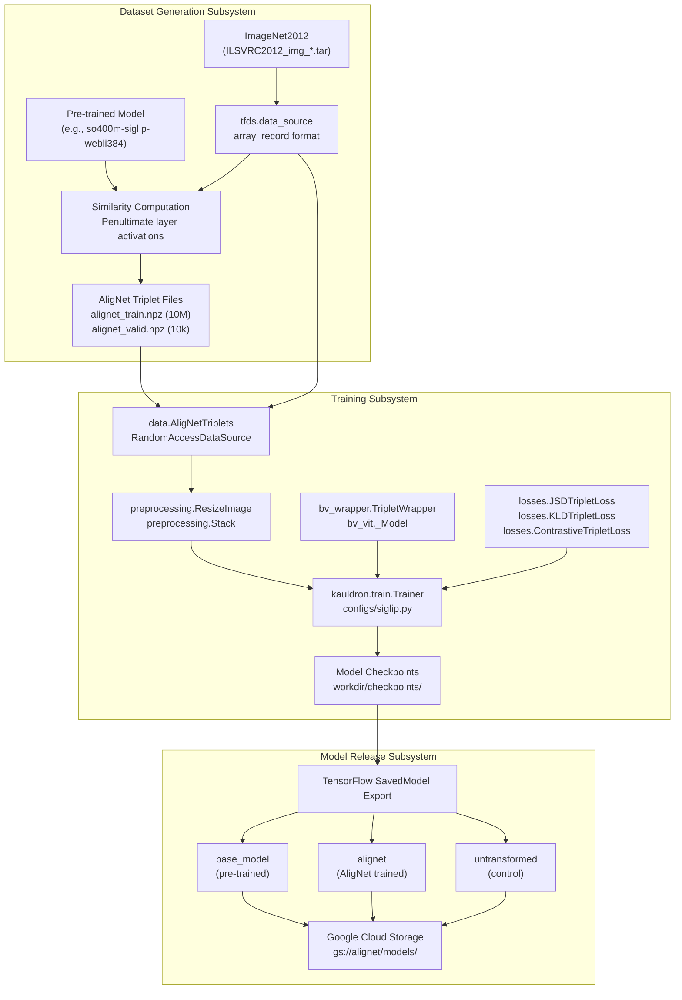
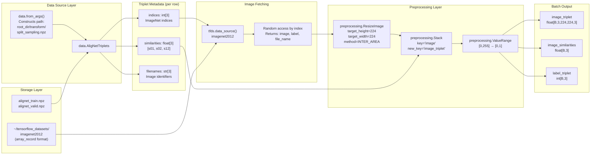
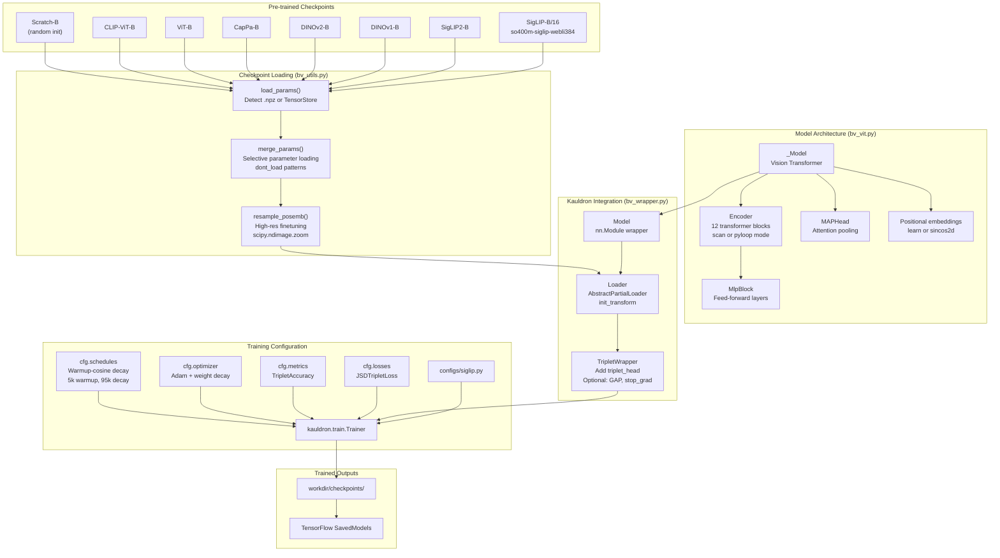

<!-- source: DeepWiki mcp.deepwiki.com · repo google-deepmind/alignet · page 1 Overview · fetched 2026-10-26 -->

# Overview

<details>
<summary>Relevant source files</summary>

The following files were used as context for generating this wiki page:

- [README.md](README.md)

</details>


## Purpose and Scope

This document provides a high-level overview of the AligNet project, explaining its goals, architecture, and key components. AligNet is a research framework for aligning machine and human visual representations across abstraction levels by training vision transformer models on synthetic human-like similarity judgments.

For detailed instructions on setting up the environment and downloading datasets, see [Getting Started](#2). For in-depth documentation of the dataset structure and format, see [AligNet Dataset](#3). For training system details, see [Training System](#6). For information about using the released models, see [Released Models and Inference](#7).

**Sources:** [README.md:1-31]()

## Project Goals

AligNet addresses the challenge of aligning neural network representations with human conceptual knowledge. The project's core hypothesis is that models aligned with the hierarchical nature of human semantic cognition will:

- Generalize better to new tasks
- Be more robust to distribution shifts
- Produce safer and more interpretable outputs
- Be practically more useful in downstream applications

The project achieves this by:

1. **Dataset Generation**: Creating 10 million synthetic human-like similarity judgment triplets from ImageNet2012 images
2. **Model Training**: Fine-tuning pre-trained vision transformers on the triplet dataset using specialized loss functions
3. **Model Release**: Providing 24 trained model variants (8 architectures × 3 training conditions) for community use

**Sources:** [README.md:17-31]()

## System Architecture

The AligNet system consists of three major subsystems that work together to produce aligned vision models:



**Diagram: End-to-End AligNet System Architecture**

The diagram illustrates how the three subsystems interact:

1. **Dataset Generation** produces triplet files containing image indices and similarity scores
2. **Training** loads triplets, fetches images on-demand, and fine-tunes vision transformers
3. **Model Release** exports trained checkpoints as TensorFlow SavedModels to cloud storage

**Sources:** [README.md:45-83](), [README.md:138-153](), [README.md:154-199]()

## Core Components and Code Mapping

The following table maps conceptual components to their concrete implementations in the codebase:

| Component | Primary Files | Key Classes/Functions | Purpose |
|-----------|--------------|----------------------|---------|
| **Dataset Storage** | `alignet_train.npz`<br/>`alignet_valid.npz` | N/A (NumPy arrays) | Store triplet metadata: `indices`, `similarities`, `filenames` |
| **Data Loading** | `data.py` | `AligNetTriplets`<br/>`from_args` | Load triplet metadata and fetch images from ImageNet |
| **Data Preprocessing** | `preprocessing.py` | `ResizeImage`<br/>`Stack` | Resize images to 224×224 and stack into triplet batches |
| **Vision Transformer** | `bv_vit.py` | `_Model`<br/>`Encoder`<br/>`MlpBlock`<br/>`MAPHead` | Core ViT architecture with configurable components |
| **Model Integration** | `bv_wrapper.py` | `Model`<br/>`TripletWrapper`<br/>`Loader` | Wrap Big Vision models for Kauldron framework |
| **Checkpoint Management** | `bv_utils.py` | `load_params`<br/>`merge_params`<br/>`resample_posemb` | Load and merge parameters from pre-trained checkpoints |
| **Loss Functions** | `losses.py` | `JSDTripletLoss`<br/>`KLDTripletLoss`<br/>`ContrastiveTripletLoss` | Triplet-based training objectives |
| **Metrics** | `metrics.py` | `TripletAccuracy` | Measure triplet prediction correctness |
| **Training Config** | `configs/siglip.py` | `cfg` (Kauldron config) | Complete training specification |
| **Model Export** | SavedModel format | `serving_default` signature | TensorFlow inference interface |

**Sources:** [data.py](), [preprocessing.py](), [bv_vit.py](), [bv_wrapper.py](), [bv_utils.py](), [losses.py](), [metrics.py](), [configs/siglip.py]()

## Data Pipeline Architecture

The data pipeline efficiently loads triplet metadata and fetches images on-demand from ImageNet:



**Diagram: Data Pipeline from Storage to Training Batch**

Key design decisions:

1. **Metadata Separation**: Triplet metadata (indices, similarities) stored in compact `.npz` files, while images fetched on-demand
2. **Random Access Requirement**: ImageNet must be in `array_record` format (not TFRecords) to support efficient random access
3. **Factory Pattern**: `from_args()` constructs dataset paths from high-level parameters (transform type, sampling strategy)
4. **Preprocessing Stack**: Images resized to 224×224 using OpenCV's `INTER_AREA` interpolation, then stacked into triplets

**Sources:** [data.py](), [preprocessing.py](), [README.md:46-83](), [README.md:86-132]()

## Model Architecture and Training

The training system integrates Big Vision vision transformers with Kauldron's training framework:



**Diagram: Model Architecture and Training Pipeline**

The training system has the following layers:

1. **Checkpoint Loading** (`bv_utils.py`): Loads pre-trained weights from various formats (.npz, TensorStore), converts between scan/pyloop encoder modes, and resamples positional embeddings for different resolutions
2. **Core Architecture** (`bv_vit.py`): Implements Vision Transformer with configurable encoder modes, pooling strategies, and positional embedding types
3. **Kauldron Integration** (`bv_wrapper.py`): Provides three wrapper classes to bridge Big Vision models to Kauldron framework
4. **Training Configuration** (`configs/siglip.py`): Specifies complete training setup including dataset, model, losses, metrics, optimizer, and schedules
5. **Output**: Produces checkpoints saved to `workdir/checkpoints/` which can be exported as TensorFlow SavedModels

**Sources:** [bv_vit.py](), [bv_utils.py](), [bv_wrapper.py](), [configs/siglip.py](), [losses.py](), [metrics.py](), [README.md:154-178]()

## Released Model Variants

The project releases 24 model variants organized by base architecture and training condition:

| Base Architecture | base_model | alignet | untransformed |
|------------------|------------|---------|---------------|
| **SigLIP-B** | Pre-trained checkpoint | AligNet fine-tuned | UnAligNet control |
| **SigLIP2-B** | Pre-trained checkpoint | AligNet fine-tuned | UnAligNet control |
| **DINOv1-B** | Pre-trained checkpoint | AligNet fine-tuned | UnAligNet control |
| **DINOv2-B** | Pre-trained checkpoint | AligNet fine-tuned | UnAligNet control |
| **CapPa-B** | Pre-trained checkpoint | AligNet fine-tuned | UnAligNet control |
| **ViT-B** | Pre-trained checkpoint | AligNet fine-tuned | UnAligNet control |
| **CLIP-ViT-B** | Pre-trained checkpoint | AligNet fine-tuned | UnAligNet control |
| **Scratch-B** | Random initialization | AligNet fine-tuned | UnAligNet control |

Each model is distributed as a TensorFlow SavedModel with the following interface:

```python
# Load model
m = tf.saved_model.load(MODEL_NAME)
forward = m.signatures['serving_default']

# Run inference
images = np.zeros((batch_size, 224, 224, 3), dtype=np.float32)
output = forward(images=images)
```

The `output` dictionary contains:
- **`pre_logits`**: `float[B, H]` - Final embeddings before task-specific heads (H = 768-1536 depending on architecture)
- **`i1k_logits`**: `float[B, 1000]` - ImageNet-1000 classification logits
- **`triplet_logits`**: `float[B, 1024]` - AligNet triplet task head outputs
- **`layer_{N}`**: `float[B, 196, H]` - Intermediate representations from transformer layer N (N = 1..12)

Models are hosted at: `gs://alignet/models/` and available via Google Cloud Storage console.

**Sources:** [README.md:154-199]()

## Key Dependencies and Frameworks

The AligNet codebase is built on top of several key frameworks:

| Framework | Purpose | Usage |
|-----------|---------|-------|
| **Kauldron** | Training orchestration | Provides `Trainer`, config system, and training loop |
| **Big Vision** | Vision Transformer implementation | Core ViT architecture (`bv_vit.py`) and utilities |
| **TensorFlow Datasets** | ImageNet access | `tfds.data_source("imagenet2012")` in `array_record` format |
| **JAX/Flax** | Neural network framework | Model definition and training computations |
| **NumPy** | Data storage | Triplet metadata in `.npz` format |
| **TensorFlow** | Model export | SavedModel format for released models |

The training command invokes the Kauldron main entry point:

```bash
python -m kauldron.main \
  --cfg=alignet/configs/siglip.py \
  --cfg.workdir=/tmp/kauldron/workdir \
  --cfg.aux.data_dir=/path/to/alignet/dataset
```

**Sources:** [README.md:32-44](), [README.md:138-153]()

## Dataset Variants and Sampling Strategies

The project provides multiple dataset variants for ablation studies:

| Sampling Strategy | Description | Class Distribution |
|------------------|-------------|-------------------|
| **between-class** | All 3 images from different classes | Random sampling across classes |
| **class-border** | 2 images from same class, 1 from different | Tests near-boundary decisions |
| **within-class** | All 3 images from same class | Tests fine-grained similarity |

Files are named following the pattern: `{transform}_{split}_{sampling}.npz`

Example paths:
- `alignet/train/between_class.npz`
- `alignet/valid/class_border.npz`
- `alignet/train/within_class.npz`

The `data.from_args()` factory method constructs the appropriate path based on configuration parameters.

**Sources:** [README.md:86-100](), [data.py]()

## Additional Resources

The project also provides:

1. **Supplementary Representations**: Pre-computed last-layer activations from the SigLIP foundation model (so400m-siglip-webli384) and k-Means cluster assignments (500 clusters) for each ImageNet image
2. **Levels Evaluation Dataset**: Human similarity judgments spanning multiple levels of semantic abstraction, available at https://gin.g-node.org/fborn/Dataset_Levels
3. **Research Paper**: "Aligning Machine and Human Visual Representations across Abstraction Levels" (arXiv:2409.06509)

**Sources:** [README.md:101-107](), [README.md:133-137](), [README.md:200-212]()

---

