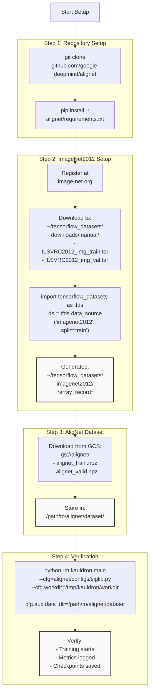
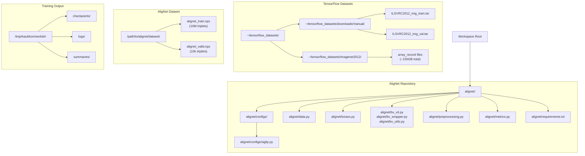
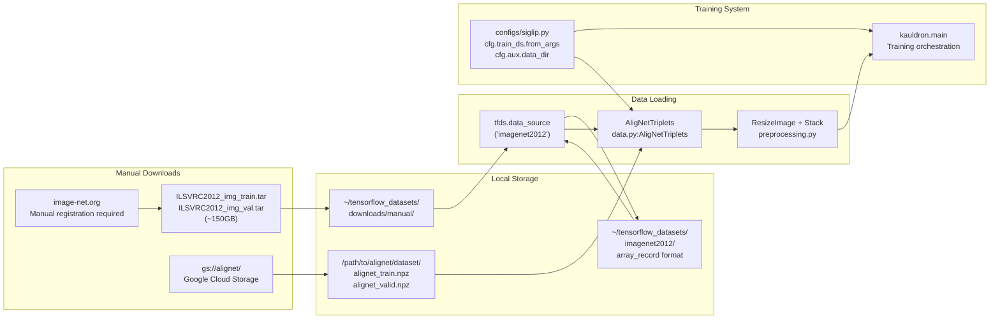

<!-- source: DeepWiki mcp.deepwiki.com · repo google-deepmind/alignet · page 2 Getting Started · fetched 2026-10-26 -->

# Getting Started

<details>
<summary>Relevant source files</summary>

The following files were used as context for generating this wiki page:

- [README.md](README.md)
- [requirements.txt](requirements.txt)

</details>


This page provides an overview of the initial setup process for the AligNet project. It covers the prerequisites, setup workflow, directory structure, and verification steps needed to begin working with the AligNet training code and datasets. For detailed installation instructions, see [Installation](#2.1). For information about accessing the AligNet dataset, see [Accessing the AligNet Dataset](#2.2).

## Prerequisites

Before beginning the setup process, ensure you have:

| Requirement | Purpose | Notes |
|------------|---------|-------|
| Python 3.x | Runtime environment | Compatible with JAX ecosystem |
| pip | Package manager | For installing dependencies |
| ~150GB disk space | ImageNet2012 storage | For manual ILSVRC2012 tar files and generated array_records |
| ~5GB disk space | AligNet dataset | For triplet .npz files |
| ImageNet access | Dataset license | Registration required at https://image-net.org/download-images |
| Google Cloud access | Model downloads | For accessing `gs://alignet/` bucket |

Sources: [README.md:108-127]()

## Setup Workflow Overview

The following diagram illustrates the complete setup process, from repository cloning to running your first training job:



Sources: [README.md:32-152]()

## Workspace Directory Structure

After completing the setup process, your workspace will have the following structure:



Sources: [README.md:32-152]()

## Key Dependencies

The AligNet project requires two primary dependencies, specified in [requirements.txt:1-2]():

| Package | Purpose | Key Components Used |
|---------|---------|---------------------|
| `kauldron` | Training framework | `kd.train.Trainer`, `kd.data`, configuration system |
| `opencv-python` | Image preprocessing | Used in `ResizeImage` for interpolation |

Additional implicit dependencies include:
- `tensorflow` - For `tfds.data_source` and SavedModel inference
- `tensorflow-datasets` - For ImageNet2012 access
- `jax` / `flax` - For neural network implementation (via Big Vision)
- `numpy` - For loading `.npz` files

Sources: [requirements.txt:1-2]()

## Data Dependencies and Flow

The following diagram shows how the different data components interact during setup and training:



**Key Points:**

- **ImageNet2012 Format Requirement**: The dataset must be in `array_record` format (not TFRecords) to support random access. This is achieved by using `tfds.data_source()` instead of `tfds.load()` as noted in [README.md:129-131]().

- **AligNet Triplet Files**: The `.npz` files contain metadata (indices, similarities, filenames) but not the actual images. Images are fetched from the ImageNet2012 dataset using the indices stored in the `.npz` files.

- **Configuration Path**: The `cfg.aux.data_dir` parameter in the training command specifies where to find the AligNet `.npz` files.

Sources: [README.md:45-132]()

## Verification Steps

After completing the setup, verify your installation with these steps:

### 1. Verify Package Installation

```python
import kauldron
import cv2
import tensorflow_datasets as tfds
print("Dependencies installed successfully")
```

### 2. Verify ImageNet2012 Access

```python
import tensorflow_datasets as tfds

# This should not raise an error if setup is correct
ds = tfds.data_source("imagenet2012", split="train")
print(f"ImageNet2012 dataset accessible with {len(ds)} samples")
```

If this fails, ensure:
- The manual tar files are in `~/tensorflow_datasets/downloads/manual/`
- The `array_record` files have been generated in `~/tensorflow_datasets/imagenet2012/`

### 3. Verify AligNet Dataset Access

```python
import numpy as np

# Load the training set
data = np.load("/path/to/alignet/dataset/alignet_train.npz")
print(f"Training triplets: {data['indices'].shape[0]}")
print(f"Arrays available: {list(data.keys())}")

# Expected output:
# Training triplets: 10000000
# Arrays available: ['indices', 'similarities', 'filenames']
```

### 4. Test Data Pipeline

```python
from alignet import data
import tensorflow_datasets as tfds

# Initialize the data source
ds = data.AligNetTriplets.from_args(
    root_dir="/path/to/alignet/dataset",
    transform="alignet",
    split="train",
    sampling="between_class"
)

# Fetch one batch
batch = next(iter(ds.get_iter(batch_size=2)))
print(f"Batch keys: {batch.keys()}")
print(f"Image triplet shape: {batch['image_triplet'].shape}")

# Expected output:
# Batch keys: dict_keys(['image_triplet', 'image_similarities', 'label_triplet', ...])
# Image triplet shape: (2, 3, 224, 224, 3)
```

Sources: [README.md:122-127](), [data.py]() (referenced via system architecture)

## Quick Start Training

Once verification is complete, you can launch a training run:

```bash
python -m kauldron.main \
  --cfg=alignet/configs/siglip.py \
  --cfg.workdir=/tmp/kauldron/workdir \
  --cfg.aux.data_dir=/path/to/alignet/dataset
```

**Configuration Parameters:**

| Parameter | Purpose | Example Value |
|-----------|---------|---------------|
| `--cfg` | Path to training configuration | `alignet/configs/siglip.py` |
| `--cfg.workdir` | Directory for checkpoints and logs | `/tmp/kauldron/workdir` |
| `--cfg.aux.data_dir` | Path to AligNet `.npz` files | `/path/to/alignet/dataset` |

The training process will:
1. Load the SigLIP-B/16 base model from checkpoint
2. Initialize the AligNet dataset with 10M training triplets
3. Train for 100,000 steps with the JSDTripletLoss
4. Save checkpoints every 10,000 steps
5. Run evaluation every 5,000 steps on three sampling strategies

For detailed information about the training configuration and process, see [Training System](#6).

Sources: [README.md:138-152]()

## Common Issues

| Issue | Cause | Solution |
|-------|-------|----------|
| `tfds.data_source` not found | TensorFlow Datasets version too old | Upgrade: `pip install --upgrade tensorflow-datasets` |
| "Manual download required" error | ImageNet tar files not in manual directory | Place `ILSVRC2012_img_*.tar` files in `~/tensorflow_datasets/downloads/manual/` |
| "Dataset not found in array_record format" | Dataset generated in TFRecords format | Delete dataset and regenerate using `tfds.data_source()` instead of `tfds.load()` |
| Out of memory during training | Batch size too large for GPU | Reduce batch size in config or use gradient accumulation |
| `.npz` file not found | Incorrect `data_dir` path | Verify `--cfg.aux.data_dir` points to directory containing `alignet_train.npz` |

Sources: [README.md:108-132]()

## Next Steps

After completing the setup and verification:

1. **Understanding the Data**: Learn about triplet structure and sampling strategies in [AligNet Dataset](#3)
2. **Model Architecture**: Explore the Vision Transformer implementation in [Model Architecture](#4)
3. **Training Deep Dive**: Understand loss functions and training configuration in [Training System](#6)
4. **Using Pre-trained Models**: Access the released AligNet models in [Released Models and Inference](#7)
5. **Customization**: Modify configurations for different experiments (see [Training Configuration](#6.1))

Sources: [README.md:1-280]() (overall structure and navigation)

---

