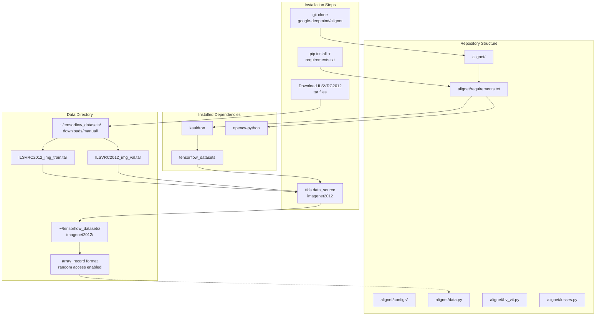
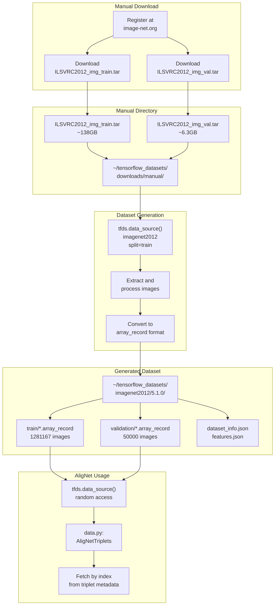

<!-- source: DeepWiki mcp.deepwiki.com · repo google-deepmind/alignet · page 2.1 Installation · fetched 2026-10-26 -->

# Installation

<details>
<summary>Relevant source files</summary>

The following files were used as context for generating this wiki page:

- [README.md](README.md)
- [requirements.txt](requirements.txt)

</details>


## Purpose and Scope

This page provides step-by-step instructions for installing the AligNet training system and its dependencies. The installation process covers cloning the repository, installing Python packages, and configuring the ImageNet2012 dataset required for training. For information about downloading the pre-generated AligNet triplet dataset, see [Accessing the AligNet Dataset](#2.2).

## Overview

The AligNet system requires three components to be installed:

1. **Repository and Code**: The main codebase containing training scripts and model implementations
2. **Python Dependencies**: Kauldron training framework and supporting libraries
3. **ImageNet2012 Dataset**: Source images in `array_record` format via TensorFlow Datasets

The following diagram illustrates the installation workflow and key file locations:



**Sources:** [README.md:32-43](), [README.md:108-132]()

## Repository Setup

Clone the AligNet repository from GitHub:

```bash
git clone https://github.com/google-deepmind/alignet.git
```

This creates an `alignet/` directory containing the following key components:

| Component | Description |
|-----------|-------------|
| `configs/` | Training configurations (e.g., `siglip.py`) |
| `data.py` | `AligNetTriplets` data source implementation |
| `bv_vit.py` | Vision Transformer model architecture |
| `bv_wrapper.py` | Kauldron integration wrappers |
| `bv_utils.py` | Checkpoint loading utilities |
| `losses.py` | Triplet loss implementations |
| `metrics.py` | Training metrics |
| `preprocessing.py` | Data preprocessing transforms |
| `requirements.txt` | Python package dependencies |

**Sources:** [README.md:34-38]()

## Python Dependencies

Install the required Python packages using pip:

```bash
pip install -r alignet/requirements.txt
```

The `requirements.txt` file specifies two direct dependencies:

| Package | Purpose |
|---------|---------|
| `kauldron` | Training framework orchestrating model training, evaluation, and checkpointing |
| `opencv-python` | Image preprocessing operations (used in `preprocessing.py`) |

The `kauldron` package transitively installs additional dependencies including `tensorflow`, `tensorflow_datasets`, `jax`, `flax`, and other required libraries for the training pipeline.

**Sources:** [requirements.txt:1-2](), [README.md:39-43]()

## ImageNet2012 Dataset Setup

The AligNet training system requires the ImageNet2012 dataset in `array_record` format to enable random access to images during triplet training. This section details the manual setup process required by TensorFlow Datasets.

### Prerequisites

You must obtain access to the ImageNet2012 dataset by registering at https://image-net.org/download-images. After registration, you will receive download links for the required archive files.

### Required Files

Download the following files (approximately 150GB total):

| File | Size | Description |
|------|------|-------------|
| `ILSVRC2012_img_train.tar` | ~138GB | Training images (1000 classes) |
| `ILSVRC2012_img_val.tar` | ~6.3GB | Validation images |

Place both files in the manual download directory used by TensorFlow Datasets. The default location is:

```
~/tensorflow_datasets/downloads/manual/
```

### Dataset Preparation

The following diagram shows the ImageNet2012 preparation workflow:



After placing the tar files in the manual directory, trigger dataset generation by running the following Python code:

```python
import tensorflow_datasets as tfds
ds = tfds.data_source("imagenet2012", split="train")
```

This process takes approximately one hour to complete and performs the following operations:

1. Extracts images from the tar archives
2. Organizes images by class and split
3. Converts images to `array_record` format
4. Generates metadata files

### Critical Note: array_record vs TFRecords

The AligNet training system requires the `array_record` format, which supports random access to individual images by index. This is essential for the triplet training workflow implemented in `data.py`.

**Important:** Use `tfds.data_source()` instead of `tfds.load()`. The `tfds.load()` function defaults to TFRecords format, which does not support random access and will not work with the AligNet training pipeline.

The distinction is critical because:

- **TFRecords**: Sequential access only, incompatible with `AligNetTriplets` class
- **array_record**: Random access enabled, required for index-based image retrieval

The `AligNetTriplets` data source in `data.py` fetches images using integer indices stored in the triplet metadata files (see [Data Loading with AligNetTriplets](#3.3)). This requires the `array_record` format's random access capability.

**Sources:** [README.md:108-132]()

## Verification

After completing the installation steps, verify the setup by checking that the following components are accessible:

### Verify Python Dependencies

```python
import kauldron
import cv2
import tensorflow_datasets as tfds
print("Dependencies installed successfully")
```

### Verify ImageNet2012 Dataset

```python
import tensorflow_datasets as tfds

# Verify dataset exists and supports random access
ds = tfds.data_source("imagenet2012", split="train")
print(f"Dataset size: {len(ds)}")  # Should be 1281167

# Test random access
example = ds[0]
print(f"Image shape: {example['image'].shape}")
print(f"Label: {example['label']}")
```

Expected output:
- Dataset size: 1281167 (training split)
- Image shape: variable (will be resized during preprocessing)
- Label: integer between 0 and 999

### Verify Repository Structure

Check that key files are present:

```bash
ls alignet/
# Expected: bv_vit.py, bv_wrapper.py, bv_utils.py, configs/, data.py,
#           losses.py, metrics.py, preprocessing.py, requirements.txt
```

**Sources:** [README.md:124-127]()

## Next Steps

After completing installation:

1. **Download AligNet Triplets**: See [Accessing the AligNet Dataset](#2.2) for instructions on downloading the pre-generated triplet metadata files
2. **Run Training**: See [Running Training](#6.6) for command-line examples
3. **Download Pre-trained Models**: See [Downloading Models](#7.2) for accessing released checkpoints

## Installation Summary

The following table summarizes the installed components and their disk space requirements:

| Component | Location | Size | Purpose |
|-----------|----------|------|---------|
| Repository | `alignet/` | ~10MB | Training code and configurations |
| Python Packages | Python environment | ~2GB | Kauldron, TensorFlow, and dependencies |
| ImageNet2012 source | `~/tensorflow_datasets/downloads/manual/` | ~150GB | Original tar archives |
| ImageNet2012 processed | `~/tensorflow_datasets/imagenet2012/` | ~150GB | array_record format dataset |
| **Total** | | **~300GB** | Full installation |

**Note:** The source tar files can be deleted after successful dataset generation to save ~150GB of disk space.

**Sources:** [README.md:32-43](), [README.md:108-132](), [requirements.txt:1-2]()

---

