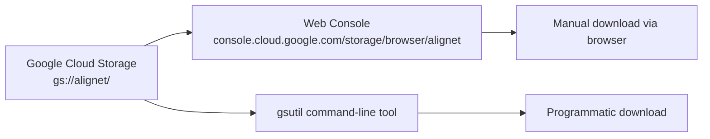
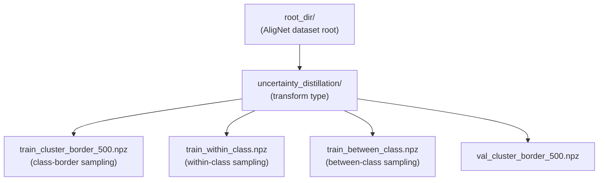
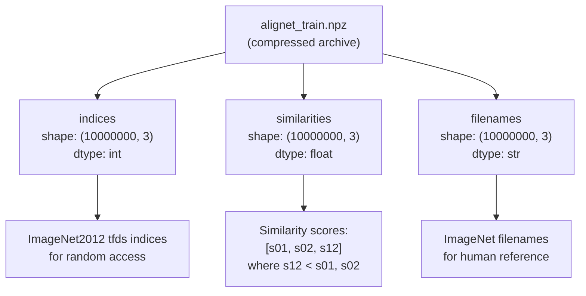
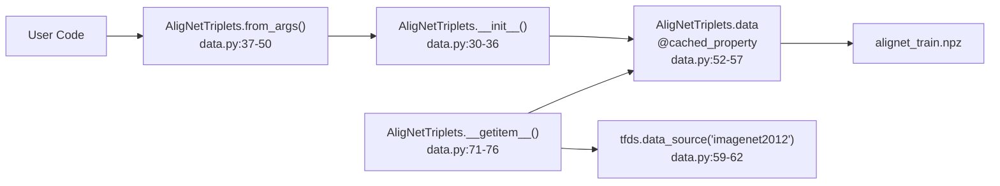
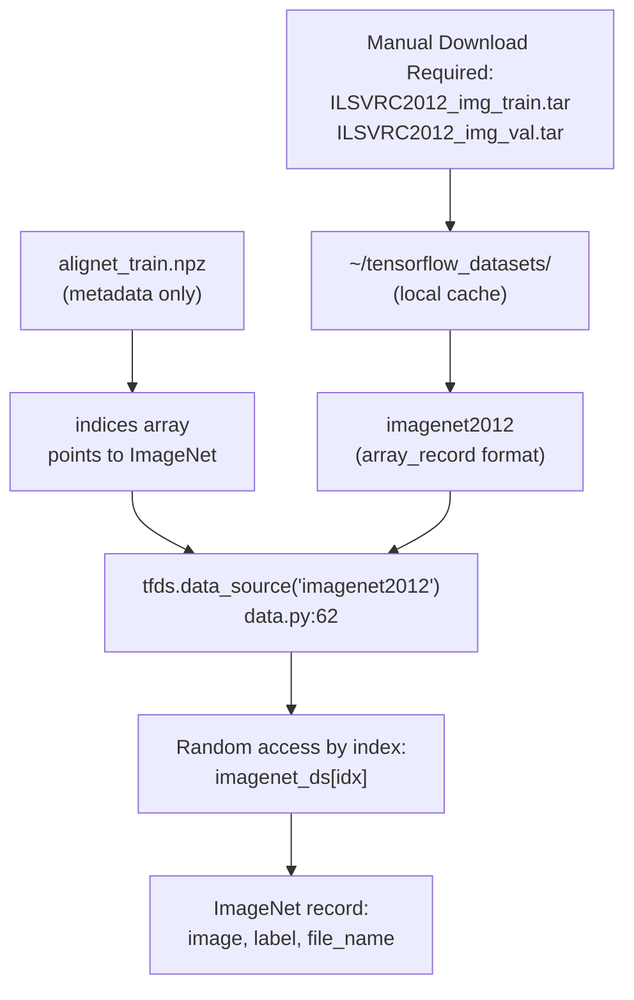

<!-- source: DeepWiki mcp.deepwiki.com · repo google-deepmind/alignet · page 2.2 Accessing the AligNet Dataset · fetched 2026-10-26 -->

# Accessing the AligNet Dataset

<details>
<summary>Relevant source files</summary>

The following files were used as context for generating this wiki page:

- [README.md](README.md)
- [data.py](data.py)

</details>


## Purpose and Scope

This page explains how to download and access the AligNet triplet dataset from Google Cloud Storage. It covers the available dataset files, download procedures, and basic file format information needed to begin working with the data.

For detailed information about the dataset structure and triplet format, see [Dataset Structure and Format](#3.1). For information about how to load the dataset in code, see [Data Loading with AligNetTriplets](#3.3).

---

## Dataset Storage Location

The AligNet dataset is hosted on Google Cloud Storage and publicly accessible without authentication. All dataset files are located in the `alignet` bucket.



**Diagram: AligNet Dataset Access Methods**

The dataset can be accessed via:
- **Web Browser**: https://console.cloud.google.com/storage/browser/alignet
- **gsutil CLI**: `gs://alignet/` (requires Google Cloud SDK)

**Sources**: [README.md:52]()

---

## Available Dataset Files

The AligNet dataset consists of two primary NPZ files containing triplet metadata, plus supplementary files for ablation studies.

### Core Dataset Files

| File | Size | Triplets | Purpose |
|------|------|----------|---------|
| `alignet_train.npz` | ~3.5 GB | 10,000,000 | Training set |
| `alignet_valid.npz` | ~3.5 MB | 10,000 | Validation set |

Each file contains three arrays with matching dimensions:
- `indices`: ImageNet2012 image indices for the triplet
- `similarities`: Pre-computed similarity scores between image pairs
- `filenames`: ImageNet2012 filenames for human-readable reference

**Sources**: [README.md:60-82]()

### Supplementary Dataset Variants

The repository provides additional triplet datasets generated with different sampling strategies for ablation studies:



**Diagram: Dataset Directory Structure**

The supplementary datasets follow a naming convention:
```
{split}_{sampling}.npz
```

Where:
- `split`: `train` or `val`
- `sampling`: Sampling strategy identifier
  - `cluster_border_500`: Images sampled near class boundaries (default)
  - `within_class`: All three images from the same class
  - `between_class`: All three images from different classes

**Sources**: [README.md:86-100](), [data.py:38-50]()

### Representation Files

Additional files provide pre-computed embeddings and cluster assignments:

- **Last-layer activations**: Pre-computed from `so400m-siglip-webli384` model
- **Cluster assignments**: K-means clustering (500 clusters) of the activations

**Sources**: [README.md:101-106]()

---

## Downloading the Dataset

### Method 1: Web Browser Download

1. Navigate to https://console.cloud.google.com/storage/browser/alignet
2. Locate the desired NPZ file(s)
3. Click the download button for each file
4. Save to your local directory (e.g., `/path/to/alignet/dataset`)

### Method 2: gsutil Command-Line Tool

Install the Google Cloud SDK if not already available:
```bash
# Install gcloud SDK (if needed)
curl https://sdk.cloud.google.com | bash
exec -l $SHELL
```

Download files using gsutil:
```bash
# Download core dataset files
gsutil -m cp gs://alignet/alignet_train.npz /path/to/alignet/dataset/
gsutil -m cp gs://alignet/alignet_valid.npz /path/to/alignet/dataset/

# Download all files in a subdirectory
gsutil -m cp -r gs://alignet/uncertainty_distillation/ /path/to/alignet/dataset/
```

The `-m` flag enables parallel multi-threaded transfer for faster downloads.

### Method 3: Python with Google Cloud Storage Client

```python
from google.cloud import storage
import os

def download_blob(bucket_name, source_blob_name, destination_file_name):
    """Downloads a blob from the bucket."""
    storage_client = storage.Client.create_anonymous_client()
    bucket = storage_client.bucket(bucket_name)
    blob = bucket.blob(source_blob_name)
    blob.download_to_filename(destination_file_name)

# Download core files
download_blob('alignet', 'alignet_train.npz', '/path/to/alignet_train.npz')
download_blob('alignet', 'alignet_valid.npz', '/path/to/alignet_valid.npz')
```

**Sources**: [README.md:52]()

---

## File Format Overview

The AligNet dataset uses NumPy's compressed array format (`.npz`), which is a ZIP archive containing multiple NumPy arrays.



**Diagram: NPZ File Structure**

### Array Specifications

Each row `i` in the arrays describes the `i`-th triplet:

| Array | Shape | Data Type | Description |
|-------|-------|-----------|-------------|
| `indices` | `(n, 3)` | `int` | ImageNet2012 indices for use with `tfds.data_source` |
| `similarities` | `(n, 3)` | `float` | Pre-computed similarity values `[s01, s02, s12]` |
| `filenames` | `(n, 3)` | `str` | ImageNet2012 filenames as `[filename0, filename1, filename2]` |

Where:
- `n = 10,000,000` for training split
- `n = 10,000` for validation split
- Image at index 2 (`filename2`) is the "odd-one-out"
- Similarities are sorted such that `s12 < s01` and `s12 < s02`

**Sources**: [README.md:63-82]()

---

## Loading and Inspecting Dataset Files

### Basic NPZ Loading

The dataset files can be loaded using standard NumPy operations:

```python
import numpy as np

# Load the NPZ file
data = np.load('/path/to/alignet_train.npz')

# Access individual arrays
indices = data['indices']        # Shape: (10000000, 3)
similarities = data['similarities']  # Shape: (10000000, 3)
filenames = data['filenames']    # Shape: (10000000, 3)

# Inspect a single triplet (row 0)
print(f"Triplet 0 indices: {indices[0]}")
print(f"Triplet 0 similarities: {similarities[0]}")
print(f"Triplet 0 filenames: {filenames[0]}")
```

### Relationship to AligNetTriplets Data Source

The `AligNetTriplets` class in [data.py:30-96]() wraps this NPZ loading logic and provides integration with the training pipeline:



**Diagram: AligNetTriplets Loading Pipeline**

The `from_args` factory method constructs the NPZ file path from high-level parameters:

```python
# Constructs path as: root_dir/transform/split_sampling.npz
dataset_path = epath.Path(root_dir) / transform / f"{split}_{sampling}.npz"
```

This enables flexible dataset selection in training configurations without hardcoding paths.

**Sources**: [data.py:37-57]()

---

## Verifying Downloads

### File Size Verification

Expected file sizes for core datasets:

```bash
# Training set: approximately 3.5 GB
ls -lh alignet_train.npz

# Validation set: approximately 3.5 MB
ls -lh alignet_valid.npz
```

### Content Verification

Verify that the NPZ file contains the expected arrays:

```python
import numpy as np

data = np.load('alignet_train.npz')
print(f"Arrays in file: {list(data.keys())}")
# Expected: ['indices', 'similarities', 'filenames']

print(f"indices shape: {data['indices'].shape}")
# Expected: (10000000, 3) for train, (10000, 3) for valid

print(f"similarities shape: {data['similarities'].shape}")
# Expected: (10000000, 3) for train, (10000, 3) for valid

# Verify sorting constraint: s12 should be smallest
s01, s02, s12 = data['similarities'][0]
assert s12 < s01 and s12 < s02, "Similarity sorting constraint violated"
print("✓ Similarity sorting verified")
```

---

## Integration with ImageNet2012

The AligNet dataset does not contain actual image data—only metadata (indices, similarities, filenames). The actual images must be retrieved from the ImageNet2012 dataset using `tfds.data_source`.



**Diagram: AligNet-ImageNet Integration**

For setup instructions, see [Installation](#2.1). For details on how the data loading pipeline fetches images, see [Data Loading with AligNetTriplets](#3.3).

**Sources**: [README.md:108-132](), [data.py:59-62]()

---

## Path Configuration in Training

When running training, specify the dataset location via the `--cfg.aux.data_dir` flag:

```bash
python -m kauldron.main \
  --cfg=alignet/configs/siglip.py \
  --cfg.workdir=/tmp/kauldron/workdir \
  --cfg.aux.data_dir=/path/to/alignet/dataset
```

The configuration uses `AligNetTriplets.from_args` to construct the full path:

| Parameter | Value | Effect |
|-----------|-------|--------|
| `root_dir` | `/path/to/alignet/dataset` | Base directory containing NPZ files |
| `transform` | `"uncertainty_distillation"` | Subdirectory for dataset variant |
| `split` | `"train"` or `"val"` | Training or validation split |
| `sampling` | `"cluster_border_500"` | Triplet sampling strategy |

These combine to form: `/path/to/alignet/dataset/uncertainty_distillation/train_cluster_border_500.npz`

**Sources**: [README.md:141-152](), [data.py:37-50]()

---

## Summary

To access the AligNet dataset:

1. **Download**: Obtain NPZ files from `gs://alignet/` bucket
2. **Verify**: Check file sizes and array shapes
3. **ImageNet Setup**: Ensure ImageNet2012 is available via `tfds.data_source` (see [Installation](#2.1))
4. **Configure**: Point training scripts to dataset location via `--cfg.aux.data_dir`

The dataset is ready to use once the NPZ files are downloaded and ImageNet2012 is configured. For information about the triplet structure and what the arrays contain, see [Dataset Structure and Format](#3.1). For programmatic loading in training pipelines, see [Data Loading with AligNetTriplets](#3.3).

**Sources**: [README.md:45-82](), [README.md:108-132](), [data.py:30-96]()

---

