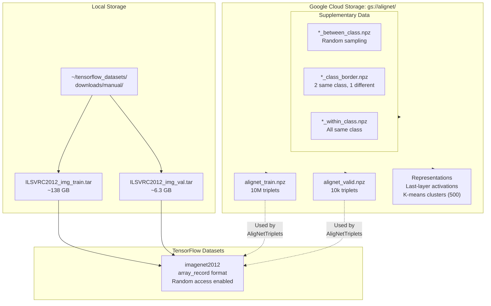
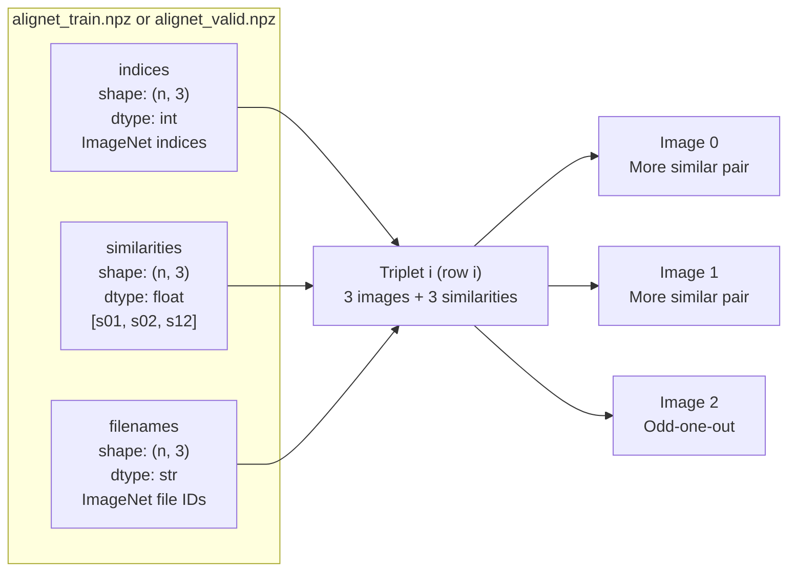
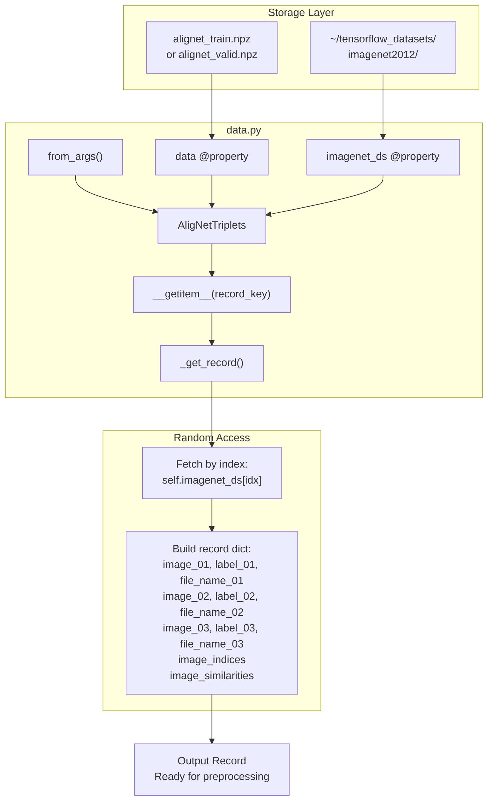

<!-- source: DeepWiki mcp.deepwiki.com · repo google-deepmind/alignet · page 3 AligNet Dataset · fetched 2026-10-26 -->

# AligNet Dataset

<details>
<summary>Relevant source files</summary>

The following files were used as context for generating this wiki page:

- [README.md](README.md)
- [data.py](data.py)

</details>


## Purpose and Scope

This page provides comprehensive documentation of the AligNet dataset, including its structure, file format, storage locations, and access methods. The AligNet dataset is a synthetically generated collection of image triplets designed to align machine visual representations with human similarity judgments across abstraction levels.

For detailed information about specific aspects of the dataset:
- Dataset structure and file format: see [Dataset Structure and Format](#3.1)
- Triplet sampling strategies: see [Triplet Sampling Strategies](#3.2)
- Data loading implementation: see [Data Loading with AligNetTriplets](#3.3)
- Image preprocessing: see [Data Preprocessing Pipeline](#3.4)

For information about training models using this dataset, see [Training System](#6).

---

## Overview

The AligNet dataset consists of image triplets sampled from ImageNet2012, where each triplet includes three images and corresponding predicted similarity scores. The dataset is designed for training models on odd-one-out tasks, where the goal is to identify which image in the triplet is most dissimilar to the other two.

### Key Characteristics

| Property | Value |
|----------|-------|
| **Total Training Triplets** | 10,000,000 |
| **Total Validation Triplets** | 10,000 |
| **Source Images** | ImageNet2012 (ILSVRC2012) |
| **File Format** | NumPy compressed arrays (.npz) |
| **Storage Location** | Google Cloud Storage: `gs://alignet/` |
| **Triplet Sorting** | Last image is always the "odd-one-out" |

The dataset enables research on aligning neural network representations with hierarchical human semantic cognition by providing large-scale synthetic human-like similarity judgments.

**Sources:** [README.md:45-83]()

---

## Dataset Organization

### Dataset Organization and Storage



**Dataset Storage Architecture**

The AligNet dataset is distributed across two storage systems:

1. **Google Cloud Storage** (`gs://alignet/`): Contains the triplet metadata files in `.npz` format
2. **Local TensorFlow Datasets**: Contains the actual ImageNet2012 images in `array_record` format

This separation enables efficient storage by avoiding duplication of image data while maintaining compact triplet metadata.

**Sources:** [README.md:45-107](), [README.md:109-127]()

---

## Triplet Data Format

### NPZ File Structure

Each `.npz` file contains three aligned arrays of length *n* (where n=10M for training, n=10k for validation):



**Array Descriptions**

| Array Name | Shape | Data Type | Description |
|------------|-------|-----------|-------------|
| `indices` | `(n, 3)` | `int` | ImageNet2012 dataset indices for each image in the triplet. Used for direct lookup via `tfds.data_source`. |
| `similarities` | `(n, 3)` | `float` | Pre-computed similarity scores: `[s01, s02, s12]` where `sij` is the similarity between image *i* and image *j*. |
| `filenames` | `(n, 3)` | `str` | ImageNet file identifiers for each image: `[filename0, filename1, filename2]`. |

### Triplet Ordering Convention

Within each triplet, images are **sorted** such that:
- **Images 0 and 1** form the more similar pair
- **Image 2** is the "odd-one-out" (most dissimilar)

This is enforced by the constraint: `s12 < s01` and `s12 < s02`

**Sources:** [README.md:64-82]()

---

## Data Access Pipeline

### From Storage to Training



**AligNetTriplets Class**

The `AligNetTriplets` class ([data.py:30-96]()) implements the `pygrain.RandomAccessDataSource` interface, providing efficient access to triplet data:

**Key Methods:**

| Method | Purpose |
|--------|---------|
| `from_args(root_dir, split, transform, sampling)` | Factory method to construct dataset path from high-level parameters |
| `data` (cached property) | Lazy-loads and caches the `.npz` file contents |
| `imagenet_ds` (cached property) | Lazy-loads the ImageNet2012 `tfds.data_source` for random access |
| `__getitem__(record_key)` | Returns a complete triplet record by index |
| `_get_record(indices, similarities)` | Fetches images from ImageNet and assembles the output dictionary |

**Factory Method Usage:**

```python
# Typical usage via from_args factory
dataset = AligNetTriplets.from_args(
    root_dir="/path/to/alignet/data",
    split="train",  # or "val"
    transform="uncertainty_distillation",
    sampling="cluster_border_500"
)
# Constructs path: root_dir/transform/split_sampling.npz
```

**Sources:** [data.py:30-96]()

---

## Output Record Format

Each call to `__getitem__()` returns a dictionary with the following structure:

| Key | Type | Description |
|-----|------|-------------|
| `image_01` | `np.ndarray` | First image tensor (H×W×3) |
| `image_02` | `np.ndarray` | Second image tensor (H×W×3) |
| `image_03` | `np.ndarray` | Third image (odd-one-out) tensor (H×W×3) |
| `label_01` | `np.int32` | ImageNet class label for first image |
| `label_02` | `np.int32` | ImageNet class label for second image |
| `label_03` | `np.int32` | ImageNet class label for third image |
| `file_name_01` | `str` | ImageNet filename for first image |
| `file_name_02` | `str` | ImageNet filename for second image |
| `file_name_03` | `str` | ImageNet filename for third image |
| `image_indices` | `np.ndarray` | Three ImageNet indices `[idx0, idx1, idx2]` |
| `image_similarities` | `np.ndarray[float32]` | Three similarity scores `[s01, s02, s12]` |

**Sources:** [data.py:78-92]()

---

## ImageNet2012 Dependency

### Array Record Format Requirement

The AligNet training pipeline requires ImageNet2012 in `array_record` format (not TFRecords) to enable **random access** to images by index. This is essential for the triplet sampling strategy.

**Setup Instructions:**

1. **Download ImageNet2012 source files** (requires registration at https://image-net.org/download-images):
   - `ILSVRC2012_img_train.tar` (~138 GB)
   - `ILSVRC2012_img_val.tar` (~6.3 GB)

2. **Place files in manual download directory:**
   ```
   ~/tensorflow_datasets/downloads/manual/
   ```

3. **Trigger dataset creation** using `tfds.data_source` (not `tfds.load`):
   ```python
   import tensorflow_datasets as tfds
   ds = tfds.data_source("imagenet2012", split="train")
   # Takes approximately 1 hour to build
   ```

**Critical Note:** Using `tfds.data_source` instead of `tfds.load` ensures the dataset is built in `array_record` format, which supports the random access pattern required by `AligNetTriplets.__getitem__()` ([data.py:86]()).

**Sources:** [README.md:108-131](), [data.py:60-62]()

---

## Supplementary Dataset Variants

In addition to the main AligNet dataset, supplementary variants are available for ablation studies. These variants differ in their **triplet sampling strategy**:

### Sampling Strategy Variants

| Strategy | Description | Filename Pattern |
|----------|-------------|------------------|
| **between-class** | All 3 images from different classes (similar to random sampling) | `*_between_class.npz` |
| **class-border** | 2 images from same class, 1 from different class | `*_class_border.npz` |
| **within-class** | All 3 images from same class (sampled without replacement) | `*_within_class.npz` |

These variants enable controlled experiments to study how different sampling strategies affect model alignment. For detailed information about these strategies, see [Triplet Sampling Strategies](#3.2).

**Sources:** [README.md:86-99]()

---

## Additional Resources

### Pre-computed Representations

The dataset also includes:
- **Last-layer activations** from the foundation model (so400m-siglip-webli384) used to compute triplet similarities
- **K-means cluster assignments** (500 clusters) for each ImageNet image

These resources support advanced analysis and research on representation learning.

**Sources:** [README.md:101-106]()

---

## Summary

The AligNet dataset provides a large-scale resource for training models to align with human visual similarity judgments:

1. **10M training triplets** and **10k validation triplets** stored in efficient `.npz` format
2. **Separation of metadata and images**: Triplet indices/similarities in `.npz` files, actual images accessed via `tfds.data_source`
3. **Random access**: Enabled by `array_record` format and the `AligNetTriplets` class
4. **Flexible sampling**: Multiple variants (between-class, class-border, within-class) for ablation studies
5. **Integration-ready**: Implements `pygrain.RandomAccessDataSource` for seamless integration with training pipelines

For implementation details on data loading, see [Data Loading with AligNetTriplets](#3.3). For preprocessing operations applied to the raw triplet data, see [Data Preprocessing Pipeline](#3.4).

---

