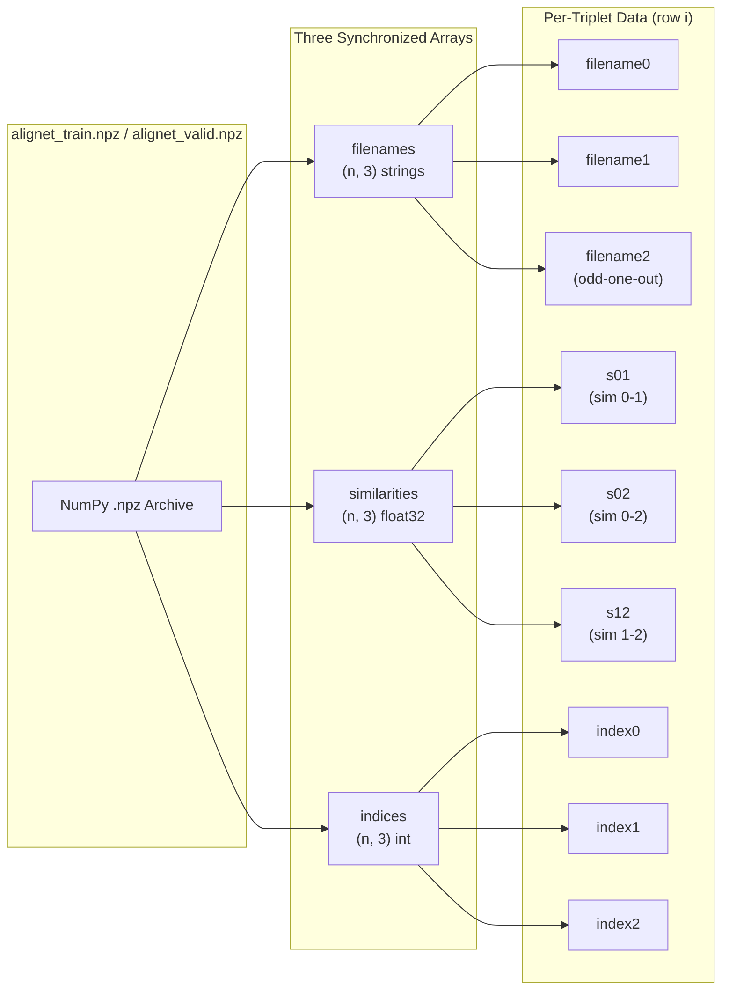
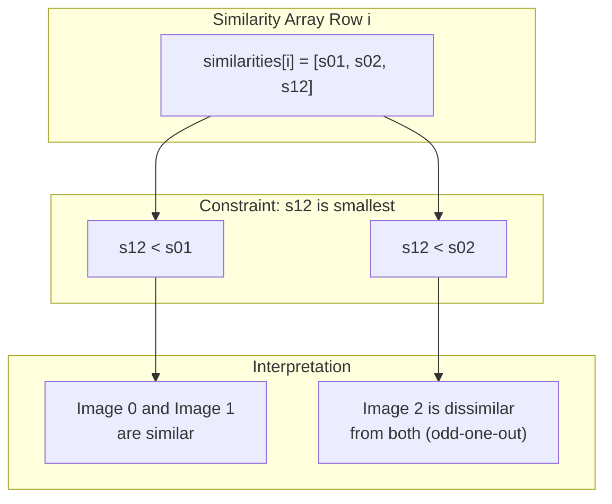
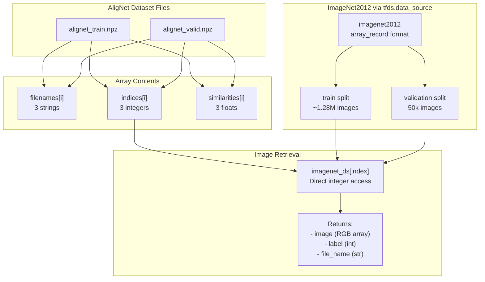
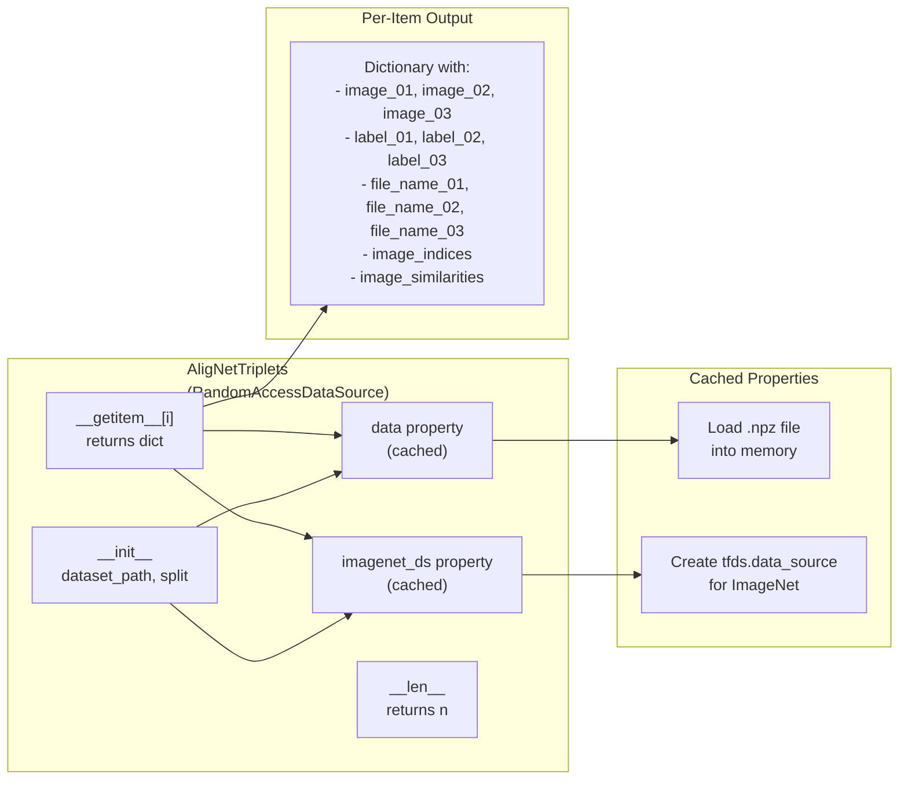

<!-- source: DeepWiki mcp.deepwiki.com · repo google-deepmind/alignet · page 3.1 Dataset Structure and Format · fetched 2026-10-26 -->

# Dataset Structure and Format

<details>
<summary>Relevant source files</summary>

The following files were used as context for generating this wiki page:

- [README.md](README.md)
- [data.py](data.py)

</details>


## Purpose and Scope

This document describes the structure and format of the AligNet triplet dataset files. It covers the `.npz` file format, the three arrays contained within each file (`filenames`, `similarities`, `indices`), data dimensions, and the triplet ordering convention. For information about how to load and access this data programmatically, see [Data Loading with AligNetTriplets](#3.3). For details on the different sampling strategies used to generate the triplets, see [Triplet Sampling Strategies](#3.2).

## Dataset Files Overview

The AligNet dataset consists of two primary files stored in NumPy's compressed array format (`.npz`):

| File | Size | Description |
|------|------|-------------|
| `alignet_train.npz` | 10,000,000 triplets | Training split |
| `alignet_valid.npz` | 10,000 triplets | Validation split |

These files are hosted on Google Cloud Storage and can be downloaded from `gs://alignet/` [README.md:52]().

Each `.npz` file contains three synchronized arrays with *n* rows, where *n* is the number of triplets (10M for training, 10k for validation). Row *i* in each array describes the *i*-th triplet.



**Sources:** [README.md:60-82]()

## Array Structures

### Filenames Array

**Shape:** `(n, 3)` where *n* is the number of triplets  
**Data Type:** String  
**Purpose:** Identifies the three ImageNet2012 images used in each triplet

Each row contains three filename strings `[filename0, filename1, filename2]` from the ImageNet2012 dataset. The filenames follow ImageNet's naming convention (e.g., `n01440764_10026.JPEG`).

**Ordering Convention:** The third image (`filename2`) is always the "odd-one-out" - the image that is most dissimilar to the other two according to the pre-trained model used during dataset generation [README.md:73-74]().

**Example structure:**
```
filenames[i] = ["n01440764_10026.JPEG", "n01440764_18321.JPEG", "n02085620_7397.JPEG"]
                 └─ image 0              └─ image 1              └─ image 2 (odd-one-out)
```

**Sources:** [README.md:71-74]()

### Similarities Array

**Shape:** `(n, 3)`  
**Data Type:** `float32`  
**Purpose:** Pre-computed pairwise similarity values between the three images in each triplet

Each row contains three similarity scores `[s01, s02, s12]` where `sij` represents the similarity between image *i* and image *j*. These similarities were computed using a pre-trained neural network's penultimate layer representations (specifically, the SigLIP so400m-siglip-webli384 model) [README.md:75-77]().

**Ordering Convention:** The triplets are sorted such that `s12 < s01` and `s12 < s02`, ensuring image 2 is indeed the odd-one-out [README.md:78]().



**Sources:** [README.md:75-78]()

### Indices Array

**Shape:** `(n, 3)`  
**Data Type:** Integer  
**Purpose:** Provides direct integer indices into the ImageNet2012 dataset via `tfds.data_source`

Each row contains three indices `[index0, index1, index2]` that can be used to fetch images directly from a `tfds.data_source("imagenet2012")` instance without needing to resolve filenames [README.md:79-82]().

This array is technically redundant (since filenames can also be used to identify images), but it enables more efficient random access when using TensorFlow Datasets [README.md:81]().

**Usage in code:**
```python
imagenet_ds = tfds.data_source("imagenet2012", split="train")
image_record = imagenet_ds[int(index0)]  # Direct integer indexing
```

**Sources:** [README.md:79-82](), [data.py:60-62, 86]()

## Data Type Summary

| Array | Shape | Data Type | Range/Format |
|-------|-------|-----------|--------------|
| `filenames` | `(n, 3)` | `string` | ImageNet2012 filenames (e.g., `n01440764_10026.JPEG`) |
| `similarities` | `(n, 3)` | `float32` | Similarity scores, typically in [0, 1] or [-1, 1] range |
| `indices` | `(n, 3)` | `int` | Non-negative integers indexing into ImageNet2012 dataset |

**Sources:** [README.md:71-82]()

## Accessing the Data

The `.npz` format can be loaded using NumPy's `np.load()` function, which returns a dictionary-like object:

```python
import numpy as np

with open("alignet_train.npz", "rb") as f:
    data = dict(np.load(f))

# Access arrays
filenames = data["filenames"]     # shape: (10000000, 3)
similarities = data["similarities"] # shape: (10000000, 3)
indices = data["indices"]          # shape: (10000000, 3)

# Access specific triplet
triplet_idx = 42
triplet_filenames = filenames[triplet_idx]  # 3 filenames
triplet_sims = similarities[triplet_idx]    # [s01, s02, s12]
triplet_indices = indices[triplet_idx]      # [idx0, idx1, idx2]
```

The `AligNetTriplets` class in [data.py:30-96]() encapsulates this loading logic and provides a `RandomAccessDataSource` interface for use with the training pipeline.

**Sources:** [data.py:52-57](), [README.md:63]()

## Relationship to ImageNet2012



**Dataset Format Requirement:** ImageNet2012 must be in `array_record` format (not TFRecords) to support the random access required by triplet training. This is achieved by using `tfds.data_source("imagenet2012")` instead of `tfds.load()` [README.md:129-131]().

**Split Mapping:** 
- AligNet `train` and `val` splits both use ImageNet2012's `train` split
- AligNet `test` split (if present) would use ImageNet2012's `validation` split

This mapping is implemented in [data.py:61]():
```python
split_i1k = "train" if self.split in ["train", "val"] else "validation"
```

**Sources:** [README.md:108-131](), [data.py:60-62]()

## File Location and Naming Conventions

The AligNet dataset files follow a hierarchical directory structure when using the `AligNetTriplets.from_args()` factory method [data.py:37-50]():

```
<root_dir>/
└── <transform>/
    └── <split>_<sampling>.npz
```

**Parameters:**
- `root_dir`: Base directory containing all AligNet variants
- `transform`: Type of dataset variant (e.g., `"uncertainty_distillation"`)
- `split`: One of `"train"` or `"valid"` (or `"val"`)
- `sampling`: Sampling strategy (e.g., `"cluster_border_500"`)

**Example paths:**
```
/data/alignet/
└── uncertainty_distillation/
    ├── train_cluster_border_500.npz
    └── valid_cluster_border_500.npz
```

The official released files use simpler names:
- `alignet_train.npz`
- `alignet_valid.npz`

**Sources:** [data.py:37-50](), [README.md:60-61]()

## Data Loading Implementation

The `AligNetTriplets` class provides efficient access to the triplet data:



The `data` and `imagenet_ds` properties use `@functools.cached_property` [data.py:52, 59]() to load resources once and cache them for subsequent accesses.

**Sources:** [data.py:30-96]()

---

