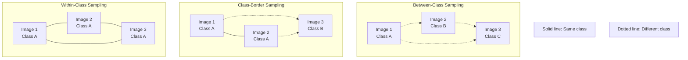
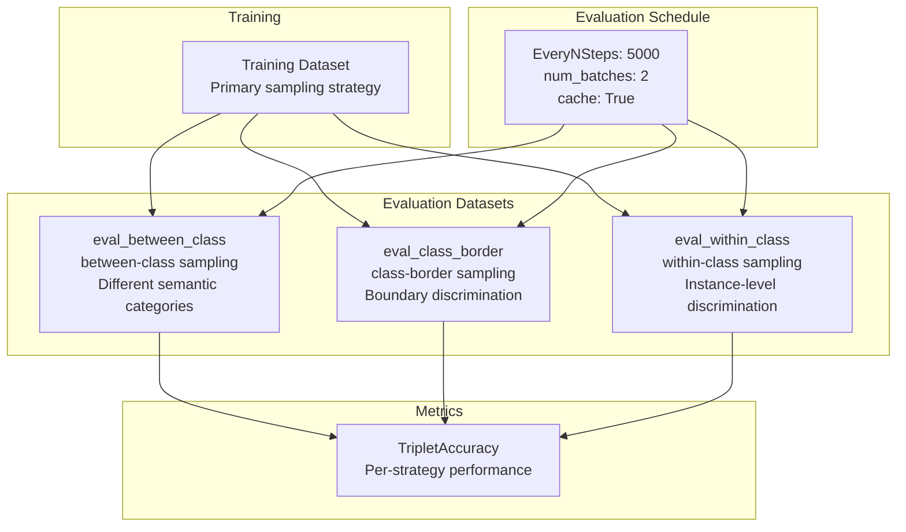

<!-- source: DeepWiki mcp.deepwiki.com · repo google-deepmind/alignet · page 3.2 Triplet Sampling Strategies · fetched 2026-10-26 -->

# Triplet Sampling Strategies

<details>
<summary>Relevant source files</summary>

The following files were used as context for generating this wiki page:

- [README.md](README.md)
- [data.py](data.py)

</details>


## Purpose and Scope

This document explains the three triplet sampling strategies used in the AligNet dataset: **between-class**, **class-border**, and **within-class**. These strategies control how image triplets are constructed based on their ImageNet class labels, allowing for targeted training and evaluation of different aspects of visual similarity.

For information about the dataset structure and file format, see [Dataset Structure and Format](#3.1). For details on loading the dataset, see [Data Loading with AligNetTriplets](#3.3).

---

## Overview of Sampling Strategies

The AligNet dataset provides triplets sampled using three different strategies. Each strategy creates triplets with different relationships between the ImageNet class labels of the three images, enabling the training and evaluation of models under different semantic constraints.

The three sampling strategies are:

| Strategy | Description | Use Case |
|----------|-------------|----------|
| **between-class** | All 3 images from different classes | Tests general visual similarity across semantic categories; similar to vanilla random sampling |
| **class-border** | 2 images from same class, 1 from different class | Tests discrimination at class boundaries; requires fine-grained distinctions |
| **within-class** | All 3 images from same class | Tests subtle visual differences within semantic categories; requires instance-level discrimination |

Sources: [README.md:92-99]()

---

## Sampling Strategy Conceptual Overview



**Diagram: Conceptual representation of the three sampling strategies**

The diagram shows how images in a triplet are related by their class labels. Between-class sampling creates the most diverse triplets semantically, while within-class sampling focuses on subtle intra-class variations.

Sources: [README.md:92-99]()

---

## Between-Class Sampling

### Definition

Between-class sampling constructs triplets where all three images belong to three different ImageNet classes. This is similar to vanilla random sampling from the dataset.

### Characteristics

- **Semantic diversity**: Maximum semantic variation across the triplet
- **Difficulty**: Generally easier for models to distinguish, as differences tend to be at higher semantic levels
- **Use case**: Tests whether models can make broad categorical distinctions aligned with human perception

### Example Structure

```
Triplet 1:
  - Image 1: "golden_retriever" (Class 207)
  - Image 2: "sports_car" (Class 817)
  - Image 3: "coffee_mug" (Class 504)
```

Sources: [README.md:94-95]()

---

## Class-Border Sampling

### Definition

Class-border sampling constructs triplets where two images are sampled (without replacement) from the same ImageNet class and one image is sampled from a different class. This creates triplets that lie at the boundary between semantic categories.

### Characteristics

- **Boundary testing**: Evaluates discrimination at class boundaries
- **Difficulty**: Medium difficulty; requires distinguishing between visually similar images from the same class versus images from different classes
- **Use case**: Tests fine-grained discrimination capabilities and how well models respect semantic boundaries

### Example Structure

```
Triplet 1:
  - Image 1: "golden_retriever_1" (Class 207)
  - Image 2: "golden_retriever_2" (Class 207)
  - Image 3: "labrador_retriever" (Class 208)
```

Sources: [README.md:96-97]()

---

## Within-Class Sampling

### Definition

Within-class sampling constructs triplets where all three images are sampled (without replacement) from the same ImageNet class. This focuses on subtle visual differences within a semantic category.

### Characteristics

- **Instance-level discrimination**: Tests ability to distinguish between different instances of the same category
- **Difficulty**: Most challenging; requires identifying subtle visual differences beyond semantic category
- **Use case**: Tests whether models capture fine-grained perceptual differences that humans use for instance discrimination

### Example Structure

```
Triplet 1:
  - Image 1: "golden_retriever_1" (Class 207)
  - Image 2: "golden_retriever_2" (Class 207)
  - Image 3: "golden_retriever_3" (Class 207)
```

Sources: [README.md:98-99]()

---

## Sampling Strategy in Code

### Specifying Sampling via `from_args`

The sampling strategy is specified when constructing an `AligNetTriplets` data source using the factory method `from_args`:

```mermaid
graph LR
    FROM_ARGS["AligNetTriplets.from_args()"]
    
    subgraph "Input Parameters"
        ROOT["root_dir<br/>Base directory"]
        SPLIT["split<br/>train or val"]
        TRANSFORM["transform<br/>uncertainty_distillation"]
        SAMPLING["sampling<br/>cluster_border_500"]
    end
    
    subgraph "File Path Construction"
        PATH_BUILDER["Path construction:<br/>root_dir/transform/<br/>split_sampling.npz"]
        EXAMPLE1["train_cluster_border_500.npz"]
        EXAMPLE2["val_cluster_between_500.npz"]
        EXAMPLE3["train_cluster_within_500.npz"]
    end
    
    subgraph "Data Source"
        INSTANCE["AligNetTriplets instance<br/>with dataset_path"]
    end
    
    ROOT --> FROM_ARGS
    SPLIT --> FROM_ARGS
    TRANSFORM --> FROM_ARGS
    SAMPLING --> FROM_ARGS
    
    FROM_ARGS --> PATH_BUILDER
    
    PATH_BUILDER --> EXAMPLE1
    PATH_BUILDER --> EXAMPLE2
    PATH_BUILDER --> EXAMPLE3
    
    EXAMPLE1 --> INSTANCE
    EXAMPLE2 --> INSTANCE
    EXAMPLE3 --> INSTANCE
```



**Diagram: How sampling strategy parameters map to file paths**

Sources: [data.py:37-50]()

### Code Reference

The `from_args` class method constructs the dataset path based on the sampling strategy:

```python
# From data.py:38-50
@classmethod
def from_args(
    cls,
    root_dir: str,
    split: str = "train",  # or "val"
    transform: str = "uncertainty_distillation",
    sampling: str = "cluster_border_500",
) -> AligNetTriplets:
  """Create Source by specifying split,transform, etc. instead of paths."""
  dataset_path = epath.Path(root_dir) / transform / f"{split}_{sampling}.npz"
  return cls(
      dataset_path=dataset_path,
      split=split,
  )
```

The `sampling` parameter controls which `.npz` file is loaded. Common values include:
- `"cluster_between_500"` for between-class sampling
- `"cluster_border_500"` for class-border sampling
- `"cluster_within_500"` for within-class sampling

Sources: [data.py:38-50]()

---

## File Naming Convention

The sampling strategy is encoded in the filename of the `.npz` files:

| Sampling Strategy | Example Filename (train) | Example Filename (val) |
|-------------------|--------------------------|------------------------|
| Between-class | `train_cluster_between_500.npz` | `val_cluster_between_500.npz` |
| Class-border | `train_cluster_border_500.npz` | `val_cluster_border_500.npz` |
| Within-class | `train_cluster_within_500.npz` | `val_cluster_within_500.npz` |

The `500` suffix typically refers to the number of clusters used in the sampling process (when clustering-based methods are employed).

Sources: [data.py:46](), [README.md:86-99]()

---

## Sampling Strategy in Training and Evaluation

### Training Dataset

The main training dataset uses a specific sampling strategy, typically specified in the configuration file:

```python
# Typical usage in config
cfg.train_ds = AligNetTriplets.from_args(
    root_dir=cfg.aux.data_dir,
    split="train",
    transform="uncertainty_distillation",
    sampling="cluster_border_500",  # Strategy specified here
)
```

Sources: [data.py:38-50]()

### Multi-Strategy Evaluation

During training, the system evaluates the model on triplets sampled using all three strategies to assess performance comprehensively:



**Diagram: Multi-strategy evaluation during training**

The training configuration typically includes separate evaluators for each sampling strategy, allowing monitoring of performance across different semantic relationships.

Sources: High-level system diagrams (Diagram 4), [README.md:92-99]()

---

## Configuration Example

Example of how different sampling strategies are configured for evaluation:

| Evaluator Name | Sampling Strategy | Purpose |
|----------------|-------------------|---------|
| `eval_between_class` | `cluster_between_500` | Test performance on cross-category distinctions |
| `eval_class_border` | `cluster_border_500` | Test performance at semantic boundaries |
| `eval_within_class` | `cluster_within_500` | Test performance on instance-level differences |

Each evaluator loads a different `.npz` file corresponding to its sampling strategy and reports metrics separately, enabling fine-grained analysis of model behavior.

Sources: High-level system diagrams (Diagram 4), [README.md:92-99]()

---

## Dataset Files for Each Strategy

The AligNet dataset provides pre-computed triplets for each sampling strategy. These files can be found in the supplementary information section of the released data:

```
alignet/
├── uncertainty_distillation/
│   ├── train_cluster_between_500.npz    # Between-class training
│   ├── train_cluster_border_500.npz     # Class-border training
│   ├── train_cluster_within_500.npz     # Within-class training
│   ├── val_cluster_between_500.npz      # Between-class validation
│   ├── val_cluster_border_500.npz       # Class-border validation
│   └── val_cluster_within_500.npz       # Within-class validation
```

Each file contains the same structure (`indices`, `similarities`, `filenames` arrays) but with triplets sampled according to the respective strategy.

Sources: [README.md:86-99](), [data.py:46]()

---

## Summary

The three triplet sampling strategies provide complementary views of visual similarity:

1. **Between-class**: Tests broad semantic distinctions (easiest)
2. **Class-border**: Tests boundary discrimination (medium difficulty)
3. **Within-class**: Tests instance-level perception (hardest)

These strategies are specified via the `sampling` parameter in `AligNetTriplets.from_args()` and map to different `.npz` files. During training, models are typically evaluated on all three strategies to ensure comprehensive alignment with human visual representations across abstraction levels.

Sources: [README.md:92-99](), [data.py:38-50]()

---

