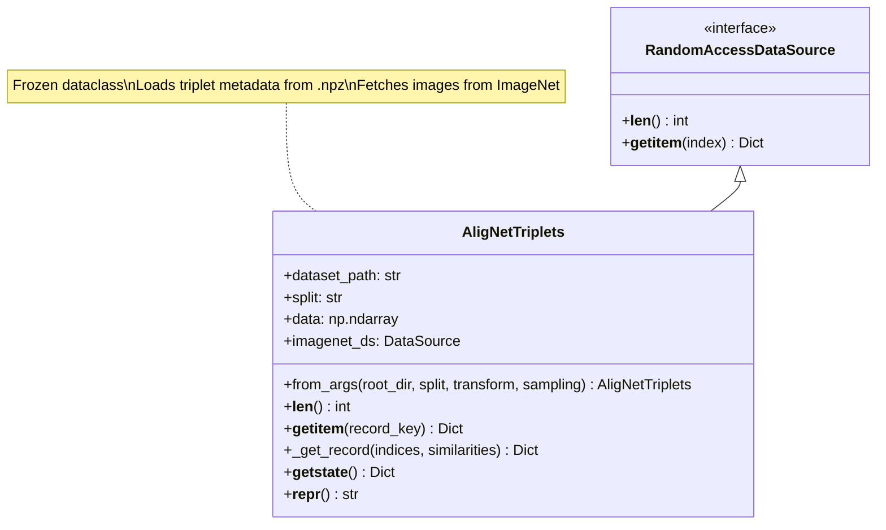
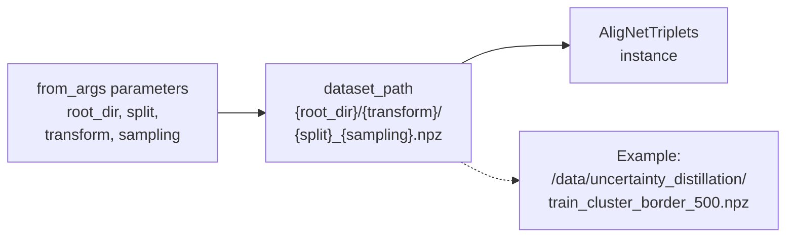
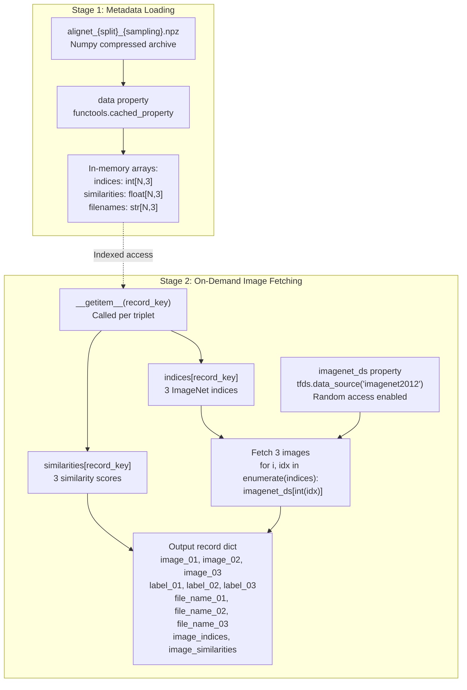
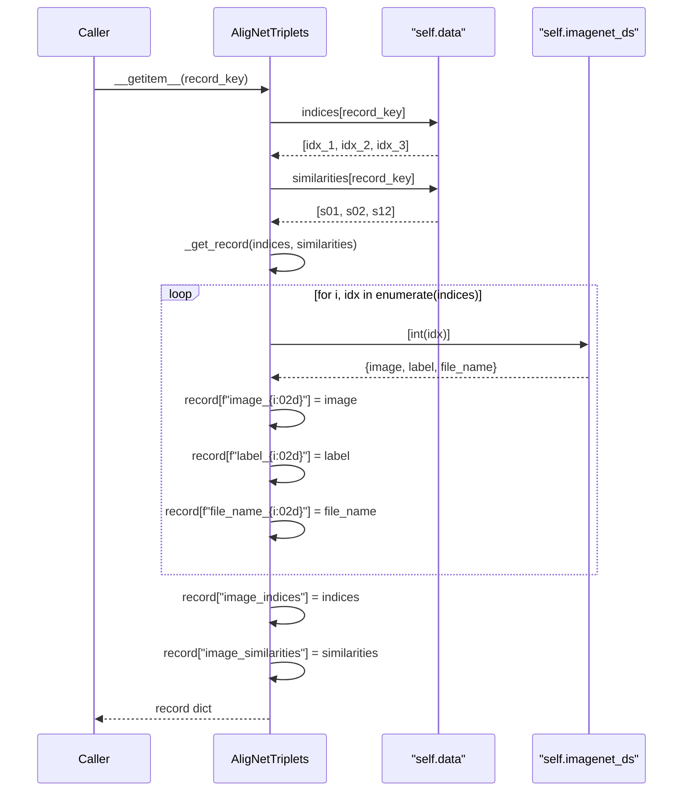
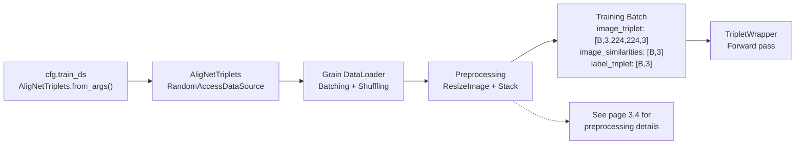

<!-- source: DeepWiki mcp.deepwiki.com · repo google-deepmind/alignet · page 3.3 Data Loading with AligNetTriplets · fetched 2026-10-26 -->

# Data Loading with AligNetTriplets

<details>
<summary>Relevant source files</summary>

The following files were used as context for generating this wiki page:

- [README.md](README.md)
- [data.py](data.py)

</details>


## Purpose and Scope

This document describes the `AligNetTriplets` data source class, which serves as the primary interface for loading triplet data during training and evaluation. The class loads triplet metadata from `.npz` files and fetches corresponding images from ImageNet via TensorFlow Datasets.

For information about the structure and format of the `.npz` files themselves, see [Dataset Structure and Format](#3.1). For details on triplet sampling strategies, see [Triplet Sampling Strategies](#3.2). For preprocessing operations applied after data loading, see [Data Preprocessing Pipeline](#3.4).

**Sources**: [data.py:1-97](), [README.md:45-132]()

## AligNetTriplets Class Overview

The `AligNetTriplets` class is the core data loading component in the AligNet training pipeline. It implements the `pygrain.RandomAccessDataSource` interface, enabling efficient random access to triplets during training.

### Class Structure



**Key Characteristics**:
- **Frozen dataclass**: Immutable configuration ensures thread safety
- **Random access**: Supports arbitrary index-based retrieval (required for triplet training)
- **Lazy loading**: Uses `functools.cached_property` to defer expensive operations until needed
- **Picklable**: Implements `__getstate__` to support multiprocessing (excludes cached data)

**Sources**: [data.py:30-96]()

## Construction with from_args

The `from_args` class method provides a high-level factory interface for constructing `AligNetTriplets` instances from experiment parameters rather than file paths.

### Factory Method Interface

| Parameter | Type | Default | Description |
|-----------|------|---------|-------------|
| `root_dir` | `str` | (required) | Root directory containing `.npz` files |
| `split` | `str` | `"train"` | Dataset split: `"train"` or `"val"` |
| `transform` | `str` | `"uncertainty_distillation"` | Transform type used to generate triplets |
| `sampling` | `str` | `"cluster_border_500"` | Sampling strategy identifier |

### Path Construction

The method constructs the dataset path using the following pattern:

```
{root_dir}/{transform}/{split}_{sampling}.npz
```

For example, with default parameters:
```
/path/to/data/uncertainty_distillation/train_cluster_border_500.npz
```



**Common Configurations**:

| Use Case | Split | Transform | Sampling |
|----------|-------|-----------|----------|
| Primary training | `"train"` | `"uncertainty_distillation"` | `"cluster_border_500"` |
| Validation | `"val"` | `"uncertainty_distillation"` | `"cluster_border_500"` |
| Between-class evaluation | `"val"` | `"uncertainty_distillation"` | `"between_class"` |
| Within-class evaluation | `"val"` | `"uncertainty_distillation"` | `"within_class"` |

**Sources**: [data.py:37-50](), [README.md:92-99]()

## Data Loading Mechanics

The `AligNetTriplets` class employs a two-stage loading strategy: metadata is loaded once from the `.npz` file, and images are fetched on-demand from ImageNet for each triplet.

### Two-Stage Loading Architecture



### Metadata Loading (Stage 1)

The `data` property loads the entire `.npz` file into memory once and caches the result:

```python
@functools.cached_property
def data(self) -> np.ndarray:
    path = epath.Path(self.dataset_path)
    with path.open("rb") as f:
        data = dict(np.load(f))
    return data
```

**Contents of loaded data**:
- `indices`: Shape `[N, 3]`, dtype `int` - ImageNet dataset indices for the three images
- `similarities`: Shape `[N, 3]`, dtype `float` - Pairwise similarities `[s01, s02, s12]`
- `filenames`: Shape `[N, 3]`, dtype `str` - ImageNet filenames (optional, not used by default)

Where `N=10,000,000` for training split and `N=10,000` for validation split.

**Sources**: [data.py:52-57]()

### ImageNet Access (Stage 2)

The `imagenet_ds` property establishes a connection to the ImageNet dataset via TensorFlow Datasets:

```python
@functools.cached_property
def imagenet_ds(self):
    split_i1k = "train" if self.split in ["train", "val"] else "validation"
    return tfds.data_source("imagenet2012", split=split_i1k)
```

**Split Mapping**:
| AligNet Split | ImageNet Split |
|---------------|----------------|
| `"train"` | `"train"` |
| `"val"` | `"train"` |
| Other | `"validation"` |

**Important**: The use of `tfds.data_source` rather than `tfds.load` is critical. This ensures the dataset is generated in `array_record` format, which supports random access. The default TFRecords format does not support random access and will fail during training.

**Sources**: [data.py:59-62](), [README.md:109-131]()

### Record Retrieval

The `__getitem__` method orchestrates the retrieval of a complete triplet record:



**Sources**: [data.py:71-92]()

## Output Record Structure

Each call to `__getitem__` returns a dictionary containing all information about a single triplet. The record contains three images, their labels, filenames, and similarity scores.

### Record Schema

| Key | Type | Shape | Description |
|-----|------|-------|-------------|
| `image_01` | `np.ndarray` | `[H, W, 3]` | First image (raw, uint8) |
| `image_02` | `np.ndarray` | `[H, W, 3]` | Second image (raw, uint8) |
| `image_03` | `np.ndarray` | `[H, W, 3]` | Third image (odd-one-out) |
| `label_01` | `np.ndarray` | `[]` | ImageNet class label (int32) |
| `label_02` | `np.ndarray` | `[]` | ImageNet class label (int32) |
| `label_03` | `np.ndarray` | `[]` | ImageNet class label (int32) |
| `file_name_01` | `str` | - | ImageNet filename |
| `file_name_02` | `str` | - | ImageNet filename |
| `file_name_03` | `str` | - | ImageNet filename |
| `image_indices` | `np.ndarray` | `[3]` | ImageNet dataset indices |
| `image_similarities` | `np.ndarray` | `[3]` | Pairwise similarities [s01, s02, s12] |

### Key Properties

1. **Image Ordering**: The third image (`image_03`) is always the "odd-one-out" - the image most dissimilar to the other two according to the similarity model used during dataset generation.

2. **Similarity Ordering**: By construction, `s12 < s01` and `s12 < s02`, meaning the similarity between images 1-2 is greater than 1-3 or 2-3.

3. **Raw Images**: Images are returned in their original ImageNet format (typically uint8, variable resolution). Preprocessing is applied in a subsequent pipeline stage (see [Data Preprocessing Pipeline](#3.4)).

4. **Typed Labels**: Labels are explicitly cast to `np.int32` to ensure consistent dtype across the pipeline.

**Sources**: [data.py:78-92](), [README.md:71-78]()

## Integration with Training Pipeline

The `AligNetTriplets` data source integrates into the Kauldron training pipeline via configuration. The data flows through several stages before reaching the model.

### Data Pipeline Flow



### Configuration Example

In the training configuration (e.g., `configs/siglip.py`), the data source is constructed as follows:

```python
cfg.train_ds = AligNetTriplets.from_args(
    root_dir=cfg.aux.data_dir,  # e.g., "/path/to/alignet/dataset"
    split="train",
    transform="uncertainty_distillation",
    sampling="cluster_border_500",
)
```

The validation evaluators use similar construction with different splits and sampling strategies:

```python
cfg.evals.eval_class_border = kd.evals.Evaluator(
    run=kd.evals.EveryNSteps(5000),
    num_batches=2,
    ds=AligNetTriplets.from_args(
        root_dir=cfg.aux.data_dir,
        split="val",
        transform="uncertainty_distillation",
        sampling="class_border",
    ),
)
```

### Dataset Size

The length of the dataset (`len(data_source)`) determines the number of examples available per epoch:

- **Training**: 10,000,000 triplets
- **Validation**: 10,000 triplets

This size affects the training schedule: with 100,000 training steps and assuming a batch size that yields approximately 100 steps per epoch, the model sees the data ~1000 times over the course of training.

**Sources**: [data.py:64-65](), [README.md:60-61](), [README.md:140-152]()

## Pickling and Multiprocessing Support

The `AligNetTriplets` class implements custom pickling behavior to support multiprocessing in data loading pipelines.

### Pickling Strategy

```python
def __getstate__(self):
    # ignore data, and imagenet_ds for pickling
    return {"dataset_path": self.dataset_path, "split": self.split}
```

**Rationale**:
- Only configuration parameters (`dataset_path`, `split`) are serialized
- Cached properties (`data`, `imagenet_ds`) are excluded from the pickled state
- When unpickled in a worker process, cached properties are lazily reloaded
- This approach avoids transferring large NumPy arrays across process boundaries
- Each worker process maintains its own copy of the metadata and ImageNet connection

**Benefits**:
- Reduced memory overhead during multiprocessing
- Faster process spawning (no large array serialization)
- Each worker can independently cache data without coordination

**Sources**: [data.py:67-69]()

## Summary

The `AligNetTriplets` class provides an efficient, random-access interface for loading AligNet triplet data:

1. **Factory Construction**: `from_args` enables high-level configuration with experiment parameters
2. **Two-Stage Loading**: Metadata loaded once, images fetched on-demand
3. **Random Access**: Supports efficient triplet sampling via `pygrain.RandomAccessDataSource`
4. **Structured Output**: Returns complete triplet records with images, labels, and similarities
5. **Multiprocessing-Ready**: Custom pickling enables efficient parallel data loading

The class serves as the foundation of the data pipeline, bridging the gap between static `.npz` metadata files and the dynamic image retrieval needed during training.

**Sources**: [data.py:1-97](), [README.md:45-152]()

---

