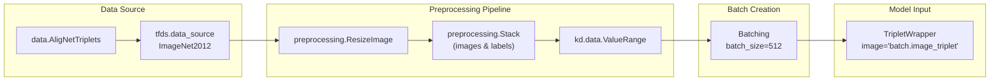

<!-- source: DeepWiki mcp.deepwiki.com · repo google-deepmind/alignet · page 3.4 Data Preprocessing Pipeline · fetched 2026-10-26 -->

# Data Preprocessing Pipeline

<details>
<summary>Relevant source files</summary>

The following files were used as context for generating this wiki page:

- [configs/siglip.py](configs/siglip.py)
- [preprocessing.py](preprocessing.py)

</details>


## Purpose and Scope

This document describes the data preprocessing pipeline used to transform raw ImageNet images into the batched triplet format required for AligNet training. The preprocessing pipeline consists of two custom transforms (`ResizeImage` and `Stack`) along with several Kauldron built-in transforms that handle normalization and batch composition.

For information about how triplet data is loaded before preprocessing, see [Data Loading with AligNetTriplets](#3.3). For training configuration details, see [Training Configuration](#6.1).

## Overview

The preprocessing pipeline transforms individual ImageNet images into batched triplets suitable for the AligNet model. The pipeline is configured as a sequence of transforms applied to each data sample before batching. The key operations include:

1. **Resizing** individual images to the target resolution (224×224)
2. **Stacking** three images into a single triplet array
3. **Stacking** three labels into a label triplet
4. **Normalizing** pixel values from [0, 255] to [0, 1]
5. **Filtering** to keep only required keys

Sources: [configs/siglip.py:118-156](), [preprocessing.py:1-61]()

## Preprocessing Pipeline Architecture

The following diagram illustrates the complete preprocessing pipeline, showing how data flows from the `AligNetTriplets` data source through each transform stage:

```mermaid
graph TB
    subgraph "Data Source Output"
        DS_OUT["AligNetTriplets output<br/>Dict with keys:<br/>image_01, image_02, image_03<br/>label_01, label_02, label_03<br/>image_similarities"]
    end
    
    subgraph "Transform Stage 1: ResizeImage"
        RESIZE["preprocessing.ResizeImage<br/>class: ElementWiseTransform<br/>size=(224, 224)<br/>interpolation='cubic'"]
        RESIZE_METHOD["map_element()<br/>cv2.resize()"]
        RESIZE_OUT["Resized images:<br/>image_01: uint8[224,224,3]<br/>image_02: uint8[224,224,3]<br/>image_03: uint8[224,224,3]"]
    end
    
    subgraph "Transform Stage 2: Stack Images"
        STACK_IMG["preprocessing.Stack<br/>class: MapTransform<br/>in_keys=['image_01', 'image_02', 'image_03']<br/>out_key='image_triplet'"]
        STACK_IMG_METHOD["map()<br/>xnp.stack(axis=0)"]
        STACK_IMG_OUT["image_triplet:<br/>uint8[3,224,224,3]"]
    end
    
    subgraph "Transform Stage 3: Stack Labels"
        STACK_LBL["preprocessing.Stack<br/>in_keys=['label_01', 'label_02', 'label_03']<br/>out_key='label_triplet'"]
        STACK_LBL_OUT["label_triplet:<br/>int[3]"]
    end
    
    subgraph "Transform Stage 4: Rearrange"
        REARRANGE["kd.data.Rearrange<br/>key='label_triplet'<br/>pattern='... -> ... 1'"]
        REARRANGE_OUT["label_triplet:<br/>int[3,1]"]
    end
    
    subgraph "Transform Stage 5: Filter Keys"
        ELEMENTS["kd.data.Elements<br/>keep=['image_triplet',<br/>'image_similarities',<br/>'label_triplet']"]
        ELEMENTS_OUT["Filtered dict with<br/>only 3 keys"]
    end
    
    subgraph "Transform Stage 6: Normalize"
        VALUERANGE["kd.data.ValueRange<br/>key='image_triplet'<br/>in_vrange=(0, 255)<br/>vrange=(0, 1)"]
        VALUERANGE_OUT["image_triplet:<br/>float32[3,224,224,3]<br/>Range: [0.0, 1.0]"]
    end
    
    subgraph "Final Batch Output"
        BATCH["Batched output:<br/>image_triplet: float32[B,3,224,224,3]<br/>image_similarities: float32[B,3]<br/>label_triplet: int[B,3,1]"]
    end
    
    DS_OUT --> RESIZE
    RESIZE --> RESIZE_METHOD
    RESIZE_METHOD --> RESIZE_OUT
    RESIZE_OUT --> STACK_IMG
    STACK_IMG --> STACK_IMG_METHOD
    STACK_IMG_METHOD --> STACK_IMG_OUT
    STACK_IMG_OUT --> STACK_LBL
    STACK_LBL --> STACK_LBL_OUT
    STACK_LBL_OUT --> REARRANGE
    REARRANGE --> REARRANGE_OUT
    REARRANGE_OUT --> ELEMENTS
    ELEMENTS --> ELEMENTS_OUT
    ELEMENTS_OUT --> VALUERANGE
    VALUERANGE --> VALUERANGE_OUT
    VALUERANGE_OUT --> BATCH
```



Sources: [configs/siglip.py:134-156]()

## Custom Preprocessing Transforms

### ResizeImage Transform

The `ResizeImage` class resizes images to a target spatial resolution using OpenCV interpolation methods. It extends `kd.data.ElementWiseTransform`, meaning it operates independently on each specified key in the data dictionary.

**Class Definition:**
- Location: [preprocessing.py:44-60]()
- Base class: `kd.data.ElementWiseTransform`
- Frozen dataclass with keyword-only arguments

**Parameters:**

| Parameter | Type | Default | Description |
|-----------|------|---------|-------------|
| `size` | `tuple[int, int]` | Required | Target (width, height) dimensions |
| `interpolation` | `str` | `"cubic"` | Interpolation method name |

**Supported Interpolation Methods:**

The `interpolation` parameter accepts string values that map to OpenCV constants:

| String Value | OpenCV Constant | Use Case |
|--------------|-----------------|----------|
| `"nearest"` | `cv2.INTER_NEAREST` | Fastest, lowest quality |
| `"bilinear"` | `cv2.INTER_LINEAR` | Fast, moderate quality |
| `"area"` | `cv2.INTER_AREA` | Best for downsampling |
| `"cubic"` | `cv2.INTER_CUBIC` | **Default**, high quality |
| `"lanczos4"` | `cv2.INTER_LANCZOS4` | Highest quality, slowest |

**Implementation:**

The `map_element` method [preprocessing.py:50-59]() performs the actual resize operation:

```python
def map_element(self, element: Any) -> Any:
    interpolation = {...}[self.interpolation]
    return cv2.resize(element, self.size, interpolation=interpolation)
```

The method looks up the OpenCV interpolation constant and calls `cv2.resize` with the target size.

**Usage in Training:**

In the training configuration [configs/siglip.py:135-138](), `ResizeImage` is applied to all three triplet images:

```python
preprocessing.ResizeImage(
    size=resize,  # (224, 224)
    key=["image_01", "image_02", "image_03"],
)
```

Sources: [preprocessing.py:43-60](), [configs/siglip.py:135-138]()

### Stack Transform

The `Stack` class combines multiple arrays from different dictionary keys into a single stacked array along a new leading axis. It extends `kd.data.MapTransform`, operating on the entire data dictionary at once.

**Class Definition:**
- Location: [preprocessing.py:28-41]()
- Base class: `kd.data.MapTransform`
- Frozen dataclass with keyword-only arguments

**Parameters:**

| Parameter | Type | Description |
|-----------|------|-------------|
| `in_keys` | `Sequence[str]` | List of dictionary keys to stack |
| `out_key` | `str` | Output key for the stacked array |

**Implementation:**

The `map` method [preprocessing.py:34-40]() stacks arrays from the specified input keys:

```python
def map(self, elements: Any) -> Any:
    if not self.in_keys:
        raise ValueError("in_keys must not be empty.")
    xnp = enp.lazy.get_xnp(elements[self.in_keys[0]])
    stacked = xnp.stack([elements[k] for k in self.in_keys], axis=0)
    elements[self.out_key] = stacked
    return elements
```

The method:
1. Validates that `in_keys` is not empty
2. Detects the array library (NumPy/JAX) using `enp.lazy.get_xnp`
3. Stacks arrays along axis 0 using the appropriate library's `stack` function
4. Stores the result in the output key

**Usage in Training:**

The transform is used twice in the pipeline [configs/siglip.py:139-146]():

1. **Stacking Images:**
```python
preprocessing.Stack(
    out_key="image_triplet",
    in_keys=["image_01", "image_02", "image_03"],
)
# Output: image_triplet with shape [3, 224, 224, 3]
```

2. **Stacking Labels:**
```python
preprocessing.Stack(
    out_key="label_triplet",
    in_keys=["label_01", "label_02", "label_03"],
)
# Output: label_triplet with shape [3]
```

Sources: [preprocessing.py:27-41](), [configs/siglip.py:139-146]()

## Additional Kauldron Transforms

### ValueRange Transform

The `kd.data.ValueRange` transform [configs/siglip.py:151-153]() normalizes pixel values from the input range [0, 255] to the model's expected range [0, 1]:

```python
kd.data.ValueRange(
    key="image_triplet",
    in_vrange=(0, 255),
    vrange=(0, 1)
)
```

This transform:
- Converts `uint8` images to `float32`
- Applies linear scaling: `output = (input - 0) / (255 - 0) * (1 - 0) + 0`
- Ensures images are in the range expected by vision transformers

### Rearrange Transform

The `kd.data.Rearrange` transform [configs/siglip.py:147]() adds a trailing dimension to the label triplet:

```python
kd.data.Rearrange(key="label_triplet", pattern="... -> ... 1")
```

This reshapes `label_triplet` from shape `[3]` to `[3, 1]`, matching the expected format for downstream processing.

### Elements Transform

The `kd.data.Elements` transform [configs/siglip.py:148-150]() filters the data dictionary to keep only required keys:

```python
kd.data.Elements(
    keep=["image_triplet", "image_similarities", "label_triplet"]
)
```

This removes intermediate keys (e.g., `image_01`, `image_02`, `image_03`, `label_01`, `label_02`, `label_03`) that are no longer needed after stacking, reducing memory overhead.

Sources: [configs/siglip.py:147-153]()

## Complete Transform Sequence

The following table summarizes the complete preprocessing pipeline as configured in `make_triplet_ds`:

| Order | Transform | Input Keys | Output Keys | Shape Transformation |
|-------|-----------|------------|-------------|----------------------|
| 1 | `ResizeImage` | `image_01`, `image_02`, `image_03` | (same) | `[H,W,3]` → `[224,224,3]` for each |
| 2 | `Stack` (images) | `image_01`, `image_02`, `image_03` | `image_triplet` | 3× `[224,224,3]` → `[3,224,224,3]` |
| 3 | `Stack` (labels) | `label_01`, `label_02`, `label_03` | `label_triplet` | 3× `[]` → `[3]` |
| 4 | `Rearrange` | `label_triplet` | (same) | `[3]` → `[3,1]` |
| 5 | `Elements` | All keys | 3 keys only | Filters to keep specified keys |
| 6 | `ValueRange` | `image_triplet` | (same) | `uint8[3,224,224,3]` → `float32[3,224,224,3]`, range [0,255]→[0,1] |

After batching with `batch_size=B`, the final shapes are:
- `image_triplet`: `float32[B, 3, 224, 224, 3]`
- `image_similarities`: `float32[B, 3]`
- `label_triplet`: `int[B, 3, 1]`

Sources: [configs/siglip.py:134-156]()

## Integration with Data Loading

The following diagram shows how preprocessing integrates with the broader data loading system:



The preprocessing pipeline is configured within `kd.data.py.DataSource` [configs/siglip.py:126-156]() using the `transforms` parameter. The data source handles:
1. Loading triplet metadata from `.npz` files
2. Fetching images from ImageNet via `tfds.data_source`
3. Applying the preprocessing transforms in sequence
4. Shuffling (for training) and batching

Sources: [configs/siglip.py:118-156]()

## Customization and Configuration

### Changing Image Resolution

The image size can be modified by changing the `resize` parameter in `make_triplet_ds` [configs/siglip.py:124]():

```python
def make_triplet_ds(
    ...
    resize: tuple[int, int] = (224, 224),  # Change to (384, 384) for high-res
):
```

This parameter is passed directly to the `ResizeImage` transform. Common resolutions include:
- `(224, 224)`: Standard ViT-B/16 resolution
- `(384, 384)`: High-resolution finetuning
- `(448, 448)`: Ultra-high resolution

### Interpolation Method

The interpolation method can be customized when instantiating `ResizeImage`. The default `"cubic"` provides a good balance of quality and speed. Use `"area"` for better quality when downsampling, or `"lanczos4"` for maximum quality at the cost of performance.

### Training vs. Evaluation

The preprocessing pipeline is identical for training and evaluation datasets, except for the `shuffle` parameter [configs/siglip.py:133]():

```python
shuffle=True if training else False,
```

This ensures evaluation results are deterministic and reproducible.

Sources: [configs/siglip.py:118-156](), [preprocessing.py:44-60]()

## Performance Considerations

### OpenCV Dependency

The `ResizeImage` transform uses OpenCV (`cv2.resize`) rather than PIL or TensorFlow operations. OpenCV is generally faster for image resizing, especially when using cubic interpolation, which is the default for this pipeline.

### Memory Efficiency

The `Elements` transform [configs/siglip.py:148-150]() removes intermediate keys after stacking, which is important for memory efficiency when processing large batches. Without this step, each batch would retain 9 keys (3 images + 3 labels + 3 output keys) instead of just 3.

### Lazy NumPy Detection

The `Stack` transform uses `enp.lazy.get_xnp` [preprocessing.py:37]() to automatically detect whether to use NumPy or JAX array operations. This makes the preprocessing pipeline compatible with both CPU and accelerator-based training without code changes.

Sources: [preprocessing.py:27-60](), [configs/siglip.py:148-150]()

---

