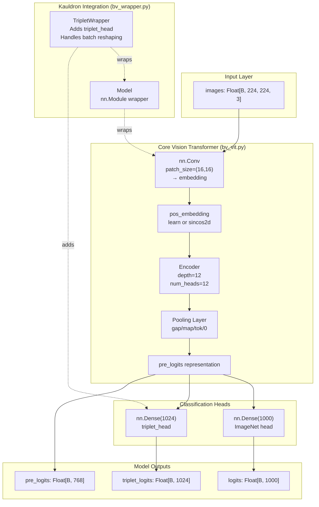
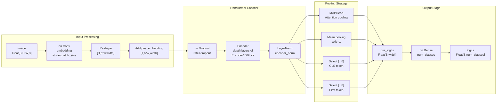
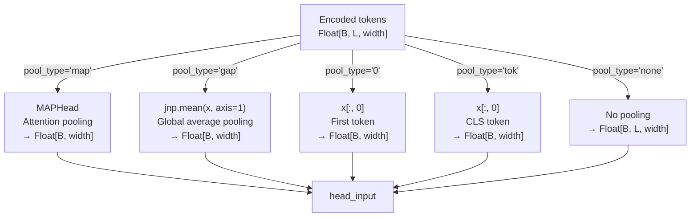
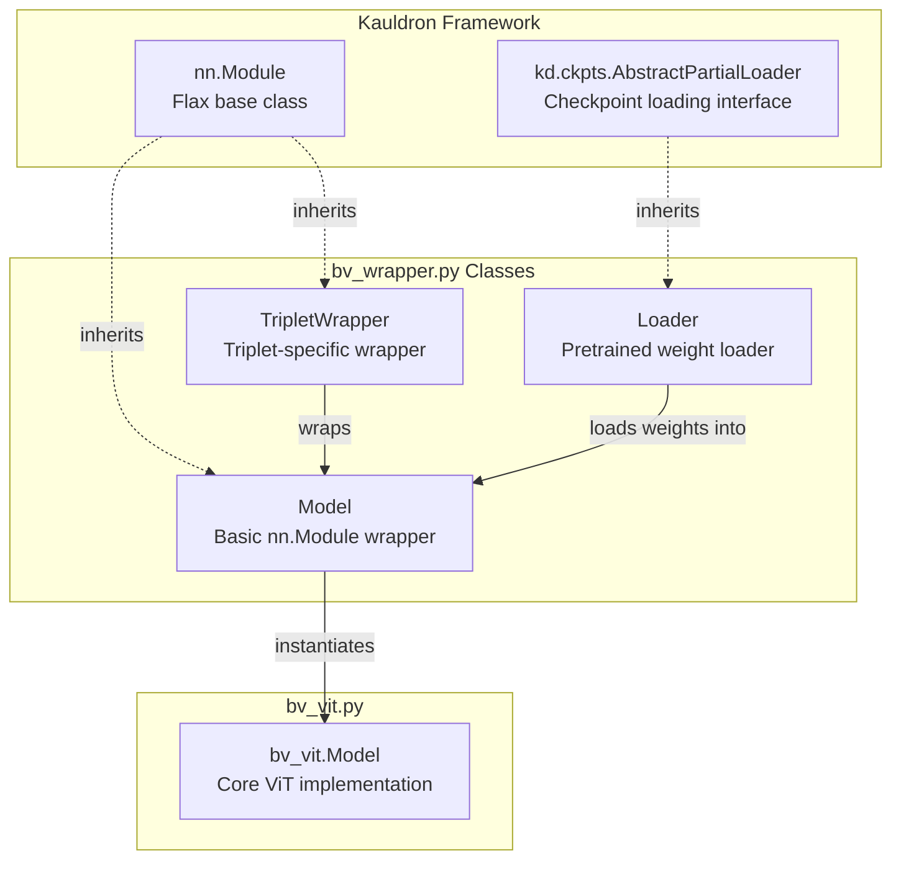
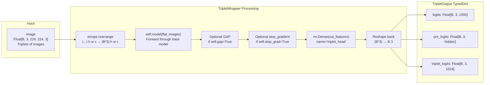
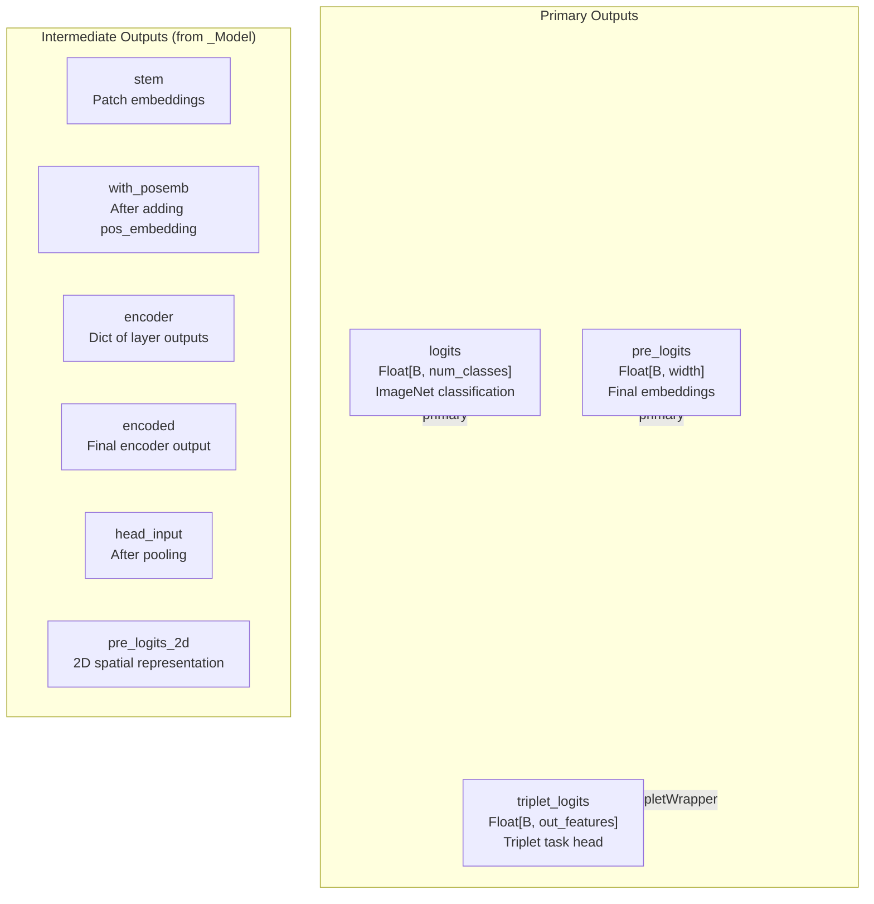
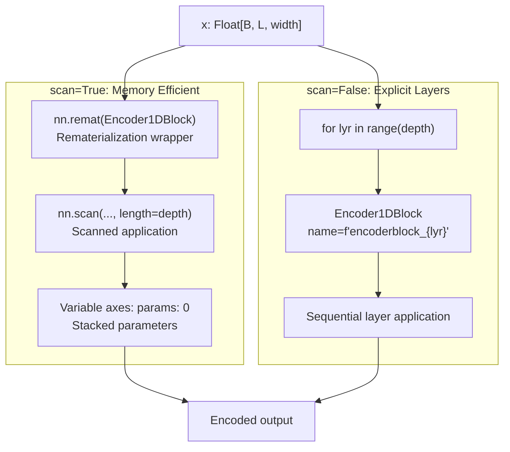

<!-- source: DeepWiki mcp.deepwiki.com · repo google-deepmind/alignet · page 4 Model Architecture · fetched 2026-10-26 -->

# Model Architecture

<details>
<summary>Relevant source files</summary>

The following files were used as context for generating this wiki page:

- [README.md](README.md)
- [bv_vit.py](bv_vit.py)
- [bv_wrapper.py](bv_wrapper.py)

</details>


## Purpose and Scope

This document provides comprehensive documentation of the Vision Transformer (ViT) architecture used in AligNet, including the core model implementation, component structure, and integration with the Kauldron training framework. 

For details on specific components like `Encoder1DBlock` and `MAPHead`, see [Model Components](#4.2). For configuration of model variants (B/16, L/16, etc.), see [Model Variants and Configuration](#4.3). For checkpoint loading and management, see [Checkpoint Management](#5). For training configuration using these models, see [Training System](#6).

**Sources:** [README.md:1-31](), [bv_vit.py:1-21](), [bv_wrapper.py:16-19]()

## Overview

The AligNet model architecture consists of three layers:

1. **Core Vision Transformer** (`bv_vit.py`): A flexible ViT implementation forked from Big Vision
2. **Kauldron Integration Wrappers** (`bv_wrapper.py`): Classes that bridge Big Vision models to the Kauldron training framework
3. **Triplet-Specific Extensions**: Additional heads and modifications for triplet learning

The architecture supports 8 different pre-trained base models (SigLIP, DINOv2, ViT, etc.) and can be configured for various input resolutions and model scales.

**Sources:** [bv_vit.py:16-21](), [bv_wrapper.py:16-19](), [README.md:161-171]()

## Architecture Diagram: Complete Model Stack



**Sources:** [bv_vit.py:212-309](), [bv_wrapper.py:38-163]()

## Core Vision Transformer Implementation

The `_Model` class in [bv_vit.py:212-309]() implements a standard Vision Transformer with configurable components. The model processes images through the following stages:

### Forward Pass Flow



**Sources:** [bv_vit.py:232-309]()

### Model Configuration Parameters

The `_Model` class accepts the following key parameters:

| Parameter | Type | Default | Description |
|-----------|------|---------|-------------|
| `num_classes` | `Optional[int]` | `None` | Number of output classes; if `None`, no classification head |
| `patch_size` | `Sequence[int]` | `(16, 16)` | Size of image patches |
| `width` | `int` | `768` | Hidden dimension width |
| `depth` | `int` | `12` | Number of transformer layers |
| `mlp_dim` | `Optional[int]` | `None` | MLP hidden dimension (defaults to 4×width) |
| `num_heads` | `int` | `12` | Number of attention heads |
| `posemb` | `str` | `"learn"` | Position embedding type: `"learn"` or `"sincos2d"` |
| `pool_type` | `str` | `"gap"` | Pooling strategy: `"gap"`, `"map"`, `"tok"`, `"0"`, or `"none"` |
| `scan` | `bool` | `False` | Use `lax.scan` for memory-efficient encoder |
| `dtype_mm` | `str` | `"float32"` | Data type for matrix multiplication |
| `dropout` | `float` | `0.0` | Dropout rate |

**Sources:** [bv_vit.py:212-229]()

## Pooling Strategies

The model supports multiple pooling strategies defined by the `pool_type` parameter in [bv_vit.py:274-288]():



The `"map"` strategy uses `MAPHead` (Multi-head Attention Pooling) defined in [bv_vit.py:187-210](). This learnable attention-based pooling is particularly effective for fine-grained tasks.

**Sources:** [bv_vit.py:274-288](), [bv_vit.py:187-210]()

## Kauldron Integration

The [bv_wrapper.py]() module provides three classes that integrate Big Vision models with Kauldron:

### Integration Class Hierarchy



**Sources:** [bv_wrapper.py:38-163]()

### Model Wrapper

The `Model` class [bv_wrapper.py:38-54]() provides a simple Kauldron-compatible wrapper:

```python
class Model(nn.Module):
  variant: str = "B/16"
  model_kwargs: dict[str, Any] = dataclasses.field(default_factory=dict)
  image: Optional[kd.kontext.Key] = kd.kontext.REQUIRED
  is_training = kd.nn.train_property()
```

This wrapper:
- Instantiates `bv_vit.Model` with specified variant and kwargs
- Integrates with Kauldron's context system via `kd.kontext.Key`
- Returns a dictionary containing `logits` and intermediate outputs

**Sources:** [bv_wrapper.py:38-54]()

### Loader for Pretrained Weights

The `Loader` class [bv_wrapper.py:57-107]() implements `kd.ckpts.AbstractPartialLoader` to load pretrained weights:

| Attribute | Type | Description |
|-----------|------|-------------|
| `init_file` | `str` | Path to checkpoint file or vanity name |
| `dont_load` | `Optional[Sequence[str]]` | Parameter patterns to skip loading |
| `prefix` | `Optional[str]` | Prefix path in state dict |

The `transform()` method [bv_wrapper.py:65-107]() performs:
1. Extracts initialized parameters from state
2. Loads pretrained checkpoint using `bv_utils.load_params()`
3. Converts scan-style checkpoints to pyloop format (Kauldron requirement)
4. Merges parameters according to `dont_load` patterns
5. Resamples positional embeddings if resolution differs
6. Removes device sharding from loaded parameters

**Sources:** [bv_wrapper.py:57-107]()

### TripletWrapper for Triplet Learning

The `TripletWrapper` class [bv_wrapper.py:118-162]() adds triplet-specific functionality:



Key parameters:

| Parameter | Type | Default | Description |
|-----------|------|---------|-------------|
| `model` | `nn.Module` | Required | Base model to wrap |
| `out_features` | `int` | `1024` | Dimension of triplet head output |
| `stop_grad` | `bool` | `False` | Apply gradient stopping to pre_logits |
| `gap` | `bool` | `False` | Add global average pooling before head |

The wrapper handles batch dimension manipulation to process triplets efficiently: it flattens triplet batches before the forward pass and reshapes them back afterward.

**Sources:** [bv_wrapper.py:118-162]()

## Model Output Structure

Both wrappers return dictionaries with consistent output formats:

### Model Output Keys



The `encoder` output contains per-layer information with keys like `"block00"`, `"block01"`, etc., each containing:
- `"sa"`: Self-attention output
- `"+sa"`: After residual connection
- `"mlp"`: MLP block output  
- `"+mlp"`: After residual connection

**Sources:** [bv_vit.py:232-309](), [bv_wrapper.py:110-116](), [bv_wrapper.py:129-162]()

## Encoder Implementation Modes

The `Encoder` class [bv_vit.py:129-184]() supports two implementation modes:

### Scan vs PyLoop Modes



**Scan mode** [bv_vit.py:145-169]():
- Uses `nn.scan` to apply a single `Encoder1DBlock` multiple times
- Stacks parameters along dimension 0
- Enables gradient checkpointing via `nn.remat`
- Reduces memory usage but requires parameter conversion for loading checkpoints

**PyLoop mode** [bv_vit.py:171-181]():
- Creates separate `Encoder1DBlock` instances for each layer
- Standard sequential execution
- Direct checkpoint compatibility
- Higher memory usage but simpler structure

The checkpoint conversion functions `pyloop_to_scan()` [bv_vit.py:458-482]() and `scan_to_pyloop()` [bv_vit.py:485-501]() handle parameter format conversion between modes.

**Sources:** [bv_vit.py:129-184](), [bv_vit.py:458-501]()

## Integration with Training Configuration

The model architecture is configured in training configs like [configs/siglip.py](). Example configuration:

```python
cfg.model = TripletWrapper(
    model=Model(
        variant="B/16",
        model_kwargs={
            "pool_type": "map",
            "rep_size": True,
            "out_features": 1024,
        },
    ),
    out_features=1024,
)

cfg.init_transform = Loader(
    init_file="SigLIP B/16 224",
    dont_load=("head", "triplet_head"),
)
```

This configuration:
1. Creates a Vision Transformer with variant "B/16" (Base model, 16×16 patches)
2. Uses MAP attention pooling
3. Adds a representation layer (`rep_size=True`)
4. Wraps with `TripletWrapper` adding a 1024-dim triplet head
5. Initializes from SigLIP checkpoint, excluding task-specific heads

**Sources:** [configs/siglip.py]() (referenced in diagrams), [bv_wrapper.py:38-163]()

## Summary of Key Components

| Component | File | Lines | Purpose |
|-----------|------|-------|---------|
| `_Model` | bv_vit.py | 212-309 | Core Vision Transformer implementation |
| `Encoder` | bv_vit.py | 129-184 | Transformer encoder stack |
| `Encoder1DBlock` | bv_vit.py | 91-126 | Single transformer block (MHSA + MLP) |
| `MlpBlock` | bv_vit.py | 66-88 | Feed-forward network block |
| `MAPHead` | bv_vit.py | 187-210 | Multi-head attention pooling |
| `Model` | bv_wrapper.py | 38-54 | Kauldron wrapper for ViT |
| `Loader` | bv_wrapper.py | 57-107 | Pretrained checkpoint loader |
| `TripletWrapper` | bv_wrapper.py | 118-162 | Triplet-specific model wrapper |
| `decode_variant()` | bv_vit.py | 317-392 | Convert variant strings to parameters |
| `resample_posemb()` | bv_vit.py | 395-410 | Resample positional embeddings |

**Sources:** [bv_vit.py:1-605](), [bv_wrapper.py:1-163]()

---

