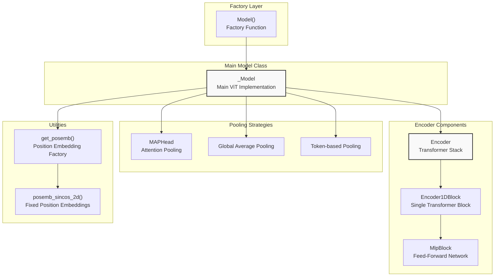
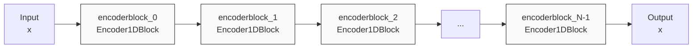
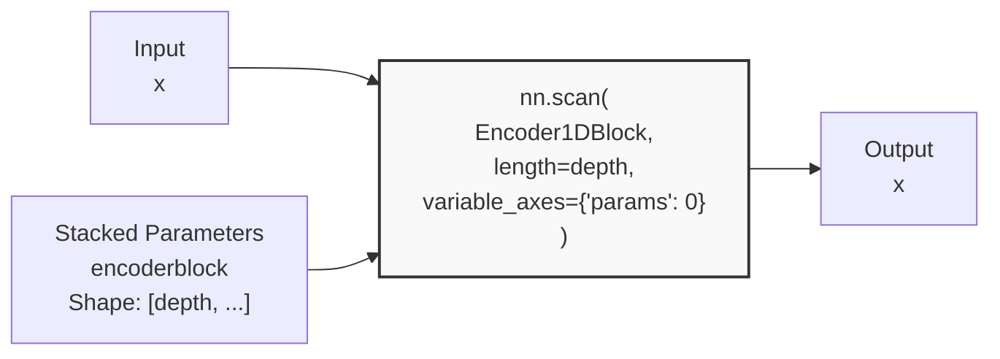
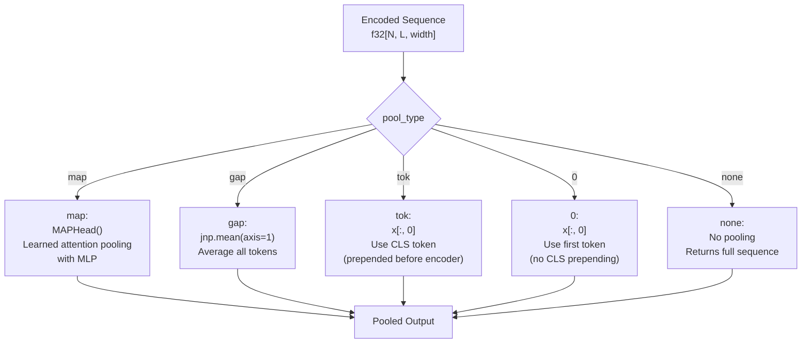
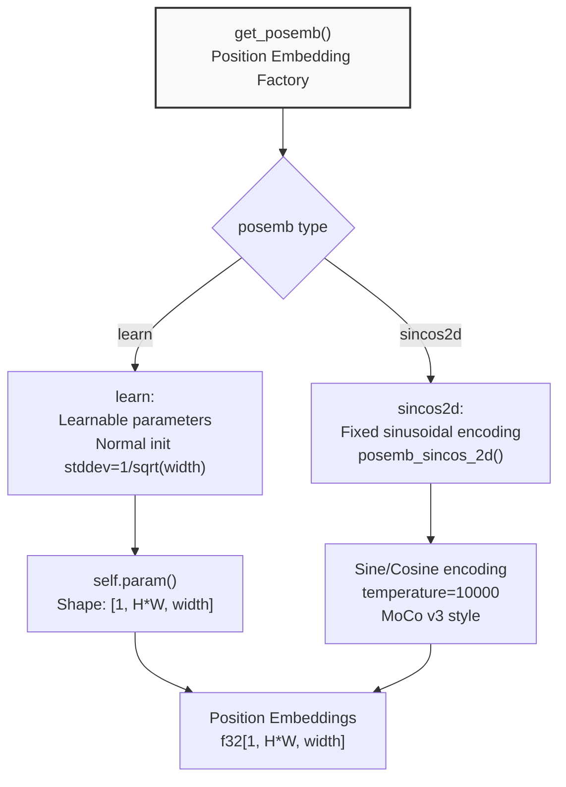

<!-- source: DeepWiki mcp.deepwiki.com · repo google-deepmind/alignet · page 4.1 Vision Transformer Implementation · fetched 2026-10-26 -->

# Vision Transformer Implementation

<details>
<summary>Relevant source files</summary>

The following files were used as context for generating this wiki page:

- [README.md](README.md)
- [bv_vit.py](bv_vit.py)

</details>


## Purpose and Scope

This page documents the core Vision Transformer (ViT) implementation in [bv_vit.py](), which provides a flexible and efficient transformer-based architecture for image classification and representation learning. The implementation is forked from Big Vision's ViT and adapted for the AligNet training framework.

For documentation on individual model components (MlpBlock, Encoder1DBlock, etc.), see [Model Components](#4.2). For information on configuring different ViT variants (B/16, L/16, etc.), see [Model Variants and Configuration](#4.3). For details on integrating these models with the Kauldron training framework, see [Kauldron Integration Wrappers](#4.4). For checkpoint loading utilities, see [Checkpoint Management](#5).

**Sources:** [bv_vit.py:1-21]()

---

## Class Hierarchy and Architecture

The ViT implementation is organized into a modular hierarchy of classes that compose to form the complete model.

### Core Class Structure



**Sources:** [bv_vit.py:66-314]()

---

## The _Model Class

The `_Model` class is the main ViT implementation, containing all core functionality for image processing through a transformer architecture.

### Class Definition

```python
class _Model(nn.Module):
  """ViT model."""
  num_classes: Optional[int] = None
  patch_size: Sequence[int] = (16, 16)
  width: int = 768
  depth: int = 12
  mlp_dim: Optional[int] = None  # Defaults to 4x input dim
  num_heads: int = 12
  posemb: str = "learn"  # Can also be "sincos2d"
  rep_size: Union[int, bool] = False
  dropout: float = 0.0
  pool_type: str = "gap"  # Can also be "map" or "tok"
  head_zeroinit: bool = True
  scan: bool = False
  remat_policy: str = "nothing_saveable"
  dtype_mm: str = "float32"
```

**Sources:** [bv_vit.py:212-229]()

### Configuration Parameters

| Parameter | Type | Default | Description |
|-----------|------|---------|-------------|
| `num_classes` | `Optional[int]` | `None` | Number of output classes. If `None`, no classification head is added |
| `patch_size` | `Sequence[int]` | `(16, 16)` | Size of image patches (height, width) |
| `width` | `int` | 768 | Embedding dimension throughout the model |
| `depth` | `int` | 12 | Number of transformer encoder blocks |
| `mlp_dim` | `Optional[int]` | `None` | MLP hidden dimension (defaults to 4x width) |
| `num_heads` | `int` | 12 | Number of attention heads in each block |
| `posemb` | `str` | `"learn"` | Position embedding type: `"learn"` or `"sincos2d"` |
| `rep_size` | `Union[int, bool]` | `False` | Size of representation layer before head |
| `dropout` | `float` | 0.0 | Dropout rate applied throughout the model |
| `pool_type` | `str` | `"gap"` | Pooling strategy: `"gap"`, `"map"`, `"tok"`, `"0"`, or `"none"` |
| `head_zeroinit` | `bool` | `True` | Initialize classification head weights to zero |
| `scan` | `bool` | `False` | Use `lax.scan` for efficient encoder execution |
| `remat_policy` | `str` | `"nothing_saveable"` | Gradient checkpointing policy for scan mode |
| `dtype_mm` | `str` | `"float32"` | Data type for matrix multiplications |

**Sources:** [bv_vit.py:212-229]()

---

## Forward Pass Architecture

The forward pass processes images through several stages: patch embedding, positional encoding, transformer encoding, pooling, and optional classification.

### Forward Pass Flow

```mermaid
graph TB
    Input["Input Image<br/>f32[N, H, W, 3]"]
    
    PatchEmbed["Patch Embedding<br/>nn.Conv(width, patch_size)<br/>name='embedding'"]
    
    Reshape["Reshape to Sequence<br/>[N, H*W, width]"]
    
    AddPosemb["Add Position Embeddings<br/>get_posemb()"]
    
    AddCLS{"pool_type<br/>== 'tok'?"}
    
    ConcatCLS["Concatenate CLS Token<br/>[N, 1+H*W, width]"]
    
    Dropout1["Dropout"]
    
    Encoder["Encoder<br/>depth transformer blocks<br/>name='Transformer'"]
    
    EncoderNorm["encoder_norm<br/>LayerNorm"]
    
    Pooling{"Pooling Type"}
    
    MAP["MAPHead<br/>Attention Pooling"]
    GAP["Global Average<br/>jnp.mean(axis=1)"]
    TOK["Token 0<br/>x[:, 0]"]
    NONE["No Pooling"]
    
    RepSize{"rep_size<br/>!= False?"}
    
    DenseRep["Dense + Tanh<br/>name='pre_logits'"]
    
    PreLogits["pre_logits<br/>f32[N, width or rep_size]"]
    
    HasClasses{"num_classes<br/>!= None?"}
    
    Head["Classification Head<br/>Dense(num_classes)<br/>name='head'"]
    
    Output["Output Logits<br/>f32[N, num_classes]"]
    
    Input --> PatchEmbed
    PatchEmbed --> Reshape
    Reshape --> AddPosemb
    AddPosemb --> AddCLS
    
    AddCLS -->|Yes| ConcatCLS
    AddCLS -->|No| Dropout1
    ConcatCLS --> Dropout1
    
    Dropout1 --> Encoder
    Encoder --> EncoderNorm
    EncoderNorm --> Pooling
    
    Pooling -->|"map"| MAP
    Pooling -->|"gap"| GAP
    Pooling -->|"tok" or "0"| TOK
    Pooling -->|"none"| NONE
    
    MAP --> RepSize
    GAP --> RepSize
    TOK --> RepSize
    NONE --> RepSize
    
    RepSize -->|Yes| DenseRep
    RepSize -->|No| PreLogits
    DenseRep --> PreLogits
    
    PreLogits --> HasClasses
    HasClasses -->|Yes| Head
    HasClasses -->|No| Output
    Head --> Output
    
    style Encoder fill:#f9f9f9,stroke:#333,stroke-width:2px
    style Pooling fill:#f9f9f9,stroke:#333,stroke-width:1px
```

**Sources:** [bv_vit.py:232-309]()

### Output Dictionary

The forward pass returns a tuple `(x, out)` where `x` is the final output and `out` is a dictionary containing intermediate representations:

| Key | Shape | Description |
|-----|-------|-------------|
| `"stem"` | `[N, H', W', width]` | Patch embedding output |
| `"with_posemb"` | `[N, H'*W', width]` | After adding position embeddings |
| `"encoder"` | Dict | Nested dict with outputs from each encoder block |
| `"encoded"` | `[N, L, width]` | Final encoder output (L = H'*W' or 1+H'*W' for tok) |
| `"head_input"` | `[N, width]` | Input to classification head after pooling |
| `"pre_logits_2d"` | `[N, H', W', width or rep_size]` | 2D spatial representation |
| `"pre_logits"` | `[N, width or rep_size]` | Final representation before classification |
| `"logits"` | `[N, num_classes]` | Classification logits (if `num_classes` is set) |

**Sources:** [bv_vit.py:232-309]()

---

## Scan vs PyLoop Execution Modes

The encoder can operate in two modes: standard Python for-loop (`scan=False`) or JAX's `lax.scan` (`scan=True`). These modes produce functionally identical results but differ in memory efficiency and compilation.

### PyLoop Mode (scan=False)

In PyLoop mode, each encoder block is a separate module with independent parameters:



**Characteristics:**
- Each block has independent parameters stored separately
- Simpler compilation and debugging
- Higher memory overhead in XLA compilation
- Parameter structure: `Transformer/encoderblock_0/`, `Transformer/encoderblock_1/`, etc.

**Sources:** [bv_vit.py:170-182]()

### Scan Mode (scan=True)

In Scan mode, a single block definition is scanned over the depth dimension with stacked parameters:



**Characteristics:**
- All block parameters stacked in a single pytree
- More memory-efficient XLA compilation
- Supports gradient checkpointing via `remat_policy`
- Parameter structure: `Transformer/encoderblock/` with first dimension = depth
- Requires conversion when loading PyLoop checkpoints

**Sources:** [bv_vit.py:144-169]()

### Checkpoint Format Conversion

The implementation provides utilities to convert between checkpoint formats:

| Function | Purpose |
|----------|---------|
| `pyloop_to_scan()` | Converts PyLoop checkpoint to Scan format by stacking block parameters |
| `scan_to_pyloop()` | Converts Scan checkpoint to PyLoop format by unstacking block parameters |

These conversions are automatically applied during checkpoint loading when format mismatch is detected.

**Sources:** [bv_vit.py:458-502](), [bv_vit.py:511-521]()

---

## Factory Pattern and Model Instantiation

The `Model()` factory function provides a convenient interface for creating `_Model` instances with variant-specific configurations.

### Factory Function

```python
def Model(num_classes=None, *, variant=None, **kw):
  """Factory function for creating ViT models."""
  return _Model(num_classes, **{**decode_variant(variant), **kw})
```

**Usage:**
```python
# Create a ViT-B/16 model with 1000 classes
model = Model(num_classes=1000, variant="B/16")

# Create a ViT-L/16 model with custom width override
model = Model(variant="L/16", width=1280, num_heads=16)

# Create model from decoded variant config
model = Model(**decode_variant("B/16"))
```

The factory pattern allows:
1. **Variant shortcuts**: Use strings like `"B/16"` instead of full config dicts
2. **Parameter override**: Variant defaults can be overridden with keyword arguments
3. **Explicit configuration**: Bypass variant decoding by passing parameters directly

**Sources:** [bv_vit.py:312-314]()

---

## Pooling Strategies

The model supports five pooling strategies to aggregate spatial features into a single vector representation:

### Pooling Type Comparison



| Pool Type | Implementation | Use Case | Output Shape |
|-----------|----------------|----------|--------------|
| `"gap"` | `jnp.mean(x, axis=1)` | Default, simple averaging | `[N, width]` |
| `"map"` | `MAPHead()` with learned attention | High-capacity models (ViT-G) | `[N, width]` |
| `"tok"` | Use CLS token prepended before encoder | BERT-style classification | `[N, width]` |
| `"0"` | Use first spatial token | Alternative to CLS | `[N, width]` |
| `"none"` | No pooling | Keep spatial structure | `[N, L, width]` |

**Note:** When using `pool_type="tok"`, the model prepends a learnable CLS token before the encoder, increasing sequence length to `1 + H*W`.

**Sources:** [bv_vit.py:274-288]()

---

## Position Embedding Strategies

The model supports two strategies for position embeddings:

### Position Embedding Types



**Learned Position Embeddings (`posemb="learn"`):**
- Initialized with `Normal(stddev=1/√width)`
- Trainable parameters
- More flexible, can adapt to data
- Default for most models

**Sinusoidal Position Embeddings (`posemb="sincos2d"`):**
- Fixed 2D sinusoidal encoding following MoCo v3
- Not trainable
- Width must be divisible by 4
- Better for variable resolution inference

**Sources:** [bv_vit.py:39-63](), [bv_vit.py:251-253]()

---

## Key Design Features

### 1. Representation Size Control

The `rep_size` parameter adds an optional bottleneck layer before the classification head:

```python
if self.rep_size:
  rep_size = self.width if self.rep_size is True else self.rep_size
  hid = nn.Dense(rep_size, name="pre_logits")
  x = nn.tanh(hid(x))
```

This is useful for:
- Reducing embedding dimension for downstream tasks
- Creating compact representations for few-shot learning
- Separating representation learning from classification

**Sources:** [bv_vit.py:292-298]()

### 2. Logical Constraints

The implementation includes `nn.with_logical_constraint()` calls for distributed training:

```python
x = nn.with_logical_constraint(x, ("act_batch", "act_len", "act_emb"))
```

These constraints guide JAX's GSPMD sharding decisions for efficient multi-device execution.

**Sources:** [bv_vit.py:84](), [bv_vit.py:103]()

### 3. Head Zero Initialization

When `head_zeroinit=True`, the classification head is initialized with zeros:

```python
kw = {"kernel_init": nn.initializers.zeros} if self.head_zeroinit else {}
head = nn.Dense(self.num_classes, name="head", **kw)
```

This prevents the model from making strong predictions at initialization, which is beneficial when fine-tuning from pre-trained weights.

**Sources:** [bv_vit.py:304-307]()

### 4. Mixed Precision Support

The `dtype_mm` parameter controls the data type for matrix multiplications throughout the model, enabling mixed-precision training for faster computation and reduced memory usage.

**Sources:** [bv_vit.py:71](), [bv_vit.py:98]()

---

## Integration with Checkpoint Loading

The `load()` function in [bv_vit.py:504-535]() integrates the model with checkpoint management:

```python
def load(init_params, init_file, model_cfg, dont_load=()):
  """Load init from checkpoint, both old model and this one. +Hi-res posemb."""
```

This function:
1. Resolves vanity names to checkpoint paths
2. Applies backward compatibility fixes via `fix_old_checkpoints()`
3. Automatically converts between scan/pyloop formats
4. Merges checkpoints with selective parameter loading
5. Resamples position embeddings for different resolutions

For detailed documentation on checkpoint loading, see [Checkpoint Management](#5).

**Sources:** [bv_vit.py:504-535]()

---

## Summary

The Vision Transformer implementation in `bv_vit.py` provides:

- **Flexible Architecture**: Configurable depth, width, heads, and pooling strategies
- **Execution Modes**: PyLoop for simplicity or Scan for memory efficiency
- **Multiple Pooling**: GAP, MAP, token-based, or no pooling
- **Position Embeddings**: Learned or fixed sinusoidal
- **Factory Pattern**: Easy instantiation via variant strings
- **Backward Compatibility**: Automatic checkpoint format detection and conversion
- **Production-Ready**: Logical constraints, mixed precision, and gradient checkpointing support

The modular design separates concerns clearly: the `_Model` class handles the overall architecture, the `Encoder` manages the transformer stack, and individual components (documented in [Model Components](#4.2)) implement specific operations. This separation enables flexible experimentation while maintaining clean abstractions.

**Sources:** [bv_vit.py:1-605]()

---

