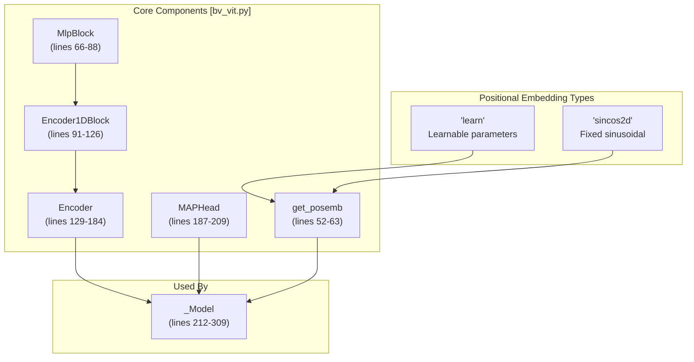
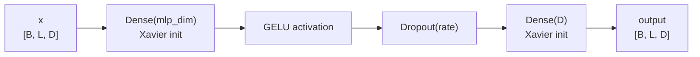
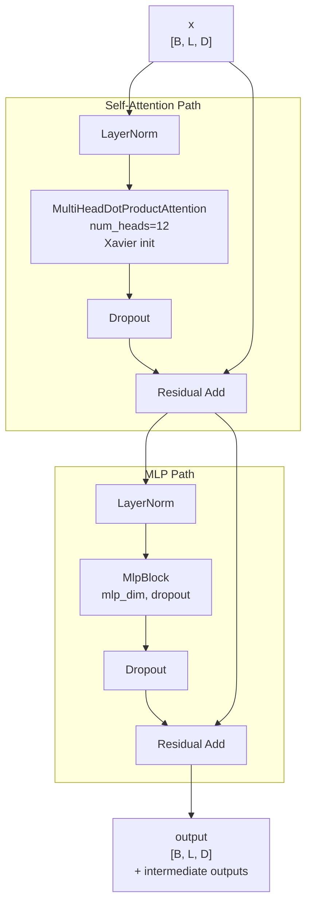
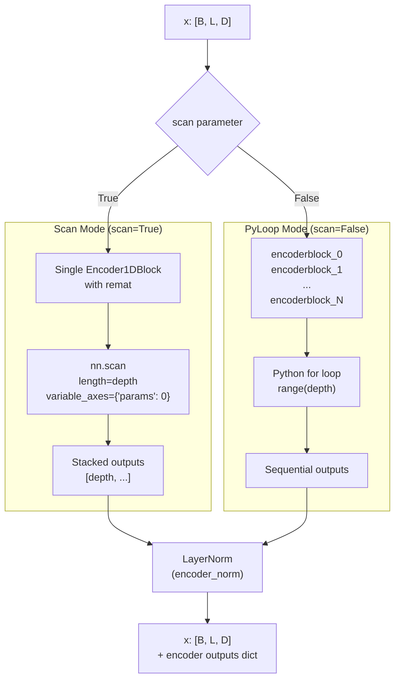
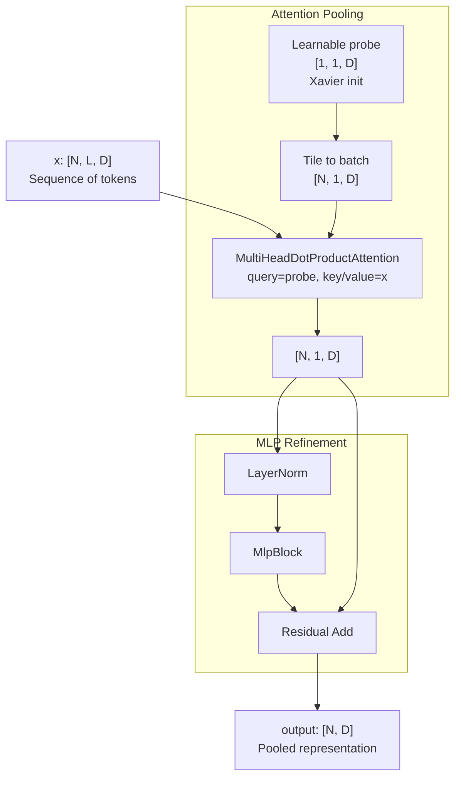
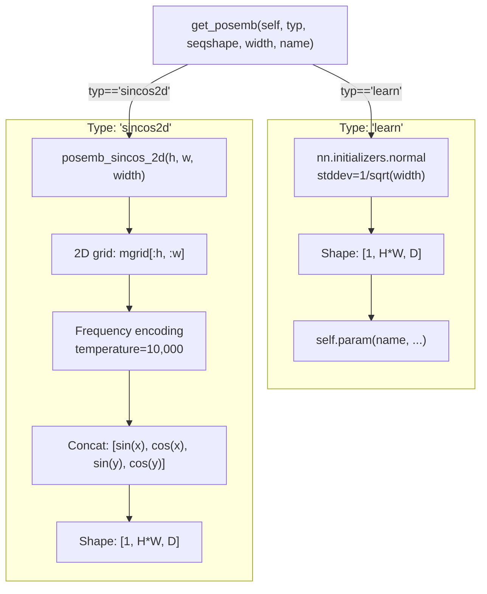
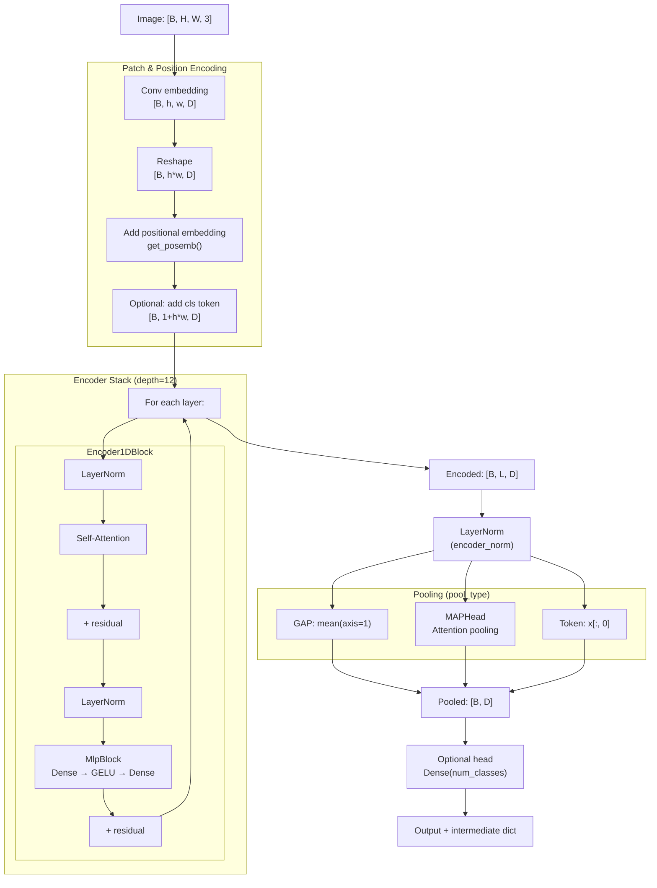

<!-- source: DeepWiki mcp.deepwiki.com · repo google-deepmind/alignet · page 4.2 Model Components · fetched 2026-10-26 -->

# Model Components

<details>
<summary>Relevant source files</summary>

The following files were used as context for generating this wiki page:

- [bv_vit.py](bv_vit.py)

</details>


This page documents the core building blocks of the Vision Transformer implementation in `bv_vit.py`. These components combine to form the complete ViT architecture described in [Vision Transformer Implementation](#4.1). For information about how these components are initialized and wrapped for training, see [Kauldron Integration Wrappers](#4.4).

## Component Architecture Overview

The Vision Transformer is composed of several modular components that can be combined and configured. The following diagram shows the relationships between these components:



**Purpose**: This diagram maps the key component classes in `bv_vit.py` to their hierarchical composition structure. Each component is self-contained and testable.

Sources:
- [bv_vit.py:66-309]()

---

## MlpBlock: Feed-Forward Layer

The `MlpBlock` class implements the feed-forward network used in transformer blocks. This is a standard two-layer MLP with GELU activation.

### Class Definition

```
class MlpBlock(nn.Module):
  mlp_dim: Optional[int] = None  # Defaults to 4x input dim
  dropout: float = 0.0
  dtype_mm: str = "float32"
```

### Architecture



### Parameters

| Parameter | Type | Default | Description |
|-----------|------|---------|-------------|
| `mlp_dim` | `Optional[int]` | `None` | Hidden dimension size. If `None`, uses `4 * input_dim` |
| `dropout` | `float` | `0.0` | Dropout rate applied after activation |
| `dtype_mm` | `str` | `"float32"` | Data type for matrix multiplication operations |

### Key Implementation Details

1. **Default expansion ratio**: When `mlp_dim` is not specified, the hidden dimension is set to 4× the input dimension [bv_vit.py:82]()
2. **Xavier initialization**: Both Dense layers use `xavier_uniform()` for kernels and small normal distribution for biases [bv_vit.py:77-78]()
3. **Logical constraints**: Uses `nn.with_logical_constraint` for batch/length/embedding dimensions to support model parallelism [bv_vit.py:84]()

Sources:
- [bv_vit.py:66-88]()

---

## Encoder1DBlock: Transformer Block

The `Encoder1DBlock` implements a single transformer encoder layer consisting of multi-head self-attention (MHSA) followed by the MLP block, with residual connections and layer normalization.

### Class Definition

```
class Encoder1DBlock(nn.Module):
  mlp_dim: Optional[int] = None  # Defaults to 4x input dim
  num_heads: int = 12
  dropout: float = 0.0
  attention_fn: Callable[..., Array] = nn.dot_product_attention
  dtype_mm: str = "float32"
```

### Architecture Flow



### Output Dictionary

The `__call__` method returns a tuple `(x, out)` where `out` is a dictionary containing intermediate values:

| Key | Shape | Description |
|-----|-------|-------------|
| `"sa"` | `[B, L, D]` | Output of self-attention layer (before residual) |
| `"+sa"` | `[B, L, D]` | After adding self-attention residual |
| `"mlp"` | `[B, L, D]` | Output of MLP block (before residual) |
| `"+mlp"` | `[B, L, D]` | Final output after adding MLP residual |

### Pre-Normalization Architecture

The implementation uses **pre-normalization** (LayerNorm before the sub-layer) rather than post-normalization. This is the standard modern transformer architecture that improves training stability [bv_vit.py:104, 116]().

### Logical Constraints

Multiple `nn.with_logical_constraint` calls are used throughout to annotate activation dimensions for model parallelism support [bv_vit.py:103, 112, 122, 125]().

Sources:
- [bv_vit.py:91-126]()

---

## Encoder: Stacked Transformer Blocks

The `Encoder` class stacks multiple `Encoder1DBlock` instances to create the full transformer encoder. It supports two execution modes: **scan mode** (memory efficient) and **PyLoop mode** (more flexible).

### Class Definition

```
class Encoder(nn.Module):
  depth: int
  mlp_dim: Optional[int] = None  # Defaults to 4x input dim
  num_heads: int = 12
  dropout: float = 0.0
  attention_fn: Callable[..., Array] = nn.dot_product_attention
  scan: bool = False
  remat_policy: str = "nothing_saveable"
  dtype_mm: str = "float32"
```

### Execution Modes



### Configuration Parameters

| Parameter | Type | Default | Description |
|-----------|------|---------|-------------|
| `depth` | `int` | Required | Number of transformer blocks |
| `scan` | `bool` | `False` | Use `lax.scan` for memory efficiency vs Python loop |
| `remat_policy` | `str` | `"nothing_saveable"` | Gradient checkpointing policy (only used in scan mode) |

### Scan Mode Details

When `scan=True` [bv_vit.py:145-169]():

1. **Remat wrapping**: The block is wrapped with `nn.remat` for gradient checkpointing
2. **Parameter stacking**: All blocks share the same parameter structure, but with different values concatenated along axis 0
3. **RNG splitting**: Random number generators for params and dropout are split across blocks
4. **Static arguments**: The `deterministic` flag (argument 2) is marked static

**Remat policies** control memory-compute tradeoffs:
- `"nothing_saveable"`: Minimal memory use, maximum recomputation
- `"dots_with_no_batch_dims_saveable"`: Saves attention computations but uses more memory

### PyLoop Mode Details

When `scan=False` [bv_vit.py:172-182]():

1. **Independent blocks**: Each block has its own parameter subtree (`encoderblock_0`, `encoderblock_1`, etc.)
2. **Sequential execution**: Blocks are executed in a Python for-loop
3. **Named outputs**: Each block's outputs are stored with keys like `"block00"`, `"block01"`, etc.
4. **Pre-LayerNorm alias**: The output includes `"pre_ln"` as an alias for the last block output [bv_vit.py:182]()

### Output Structure

The encoder returns a tuple `(x, out)` where:
- `x`: Final layer-normalized activations `[B, L, D]`
- `out`: Dictionary with keys `"block00"`, `"block01"`, ..., `"block{depth-1:02d}"`, each containing the sub-dictionary from `Encoder1DBlock`

Sources:
- [bv_vit.py:129-184]()

---

## MAPHead: Attention Pooling

The `MAPHead` (Multihead Attention Pooling) class implements an attention-based pooling mechanism as an alternative to global average pooling or class token pooling.

### Class Definition

```
class MAPHead(nn.Module):
  mlp_dim: Optional[int] = None  # Defaults to 4x input dim
  num_heads: int = 12
```

### Architecture



### Key Implementation Details

1. **Learnable probe**: A single learned query vector is used to aggregate information from all sequence positions [bv_vit.py:197-198]()
2. **Cross-attention**: The probe attends to the input sequence via multi-head dot-product attention [bv_vit.py:202-204]()
3. **MLP refinement**: The attended output is passed through LayerNorm → MLP → Residual connection [bv_vit.py:207-208]()
4. **Dimension reduction**: The output is squeezed from `[N, 1, D]` to `[N, D]` by taking the first (and only) token [bv_vit.py:209]()

### Usage Context

`MAPHead` is used when the model's `pool_type` parameter is set to `"map"`. This pooling strategy:
- Learns to attend to relevant spatial locations
- More flexible than fixed pooling strategies (GAP or class token)
- Adds trainable parameters (probe + MLP weights)

Sources:
- [bv_vit.py:187-209]()

---

## Positional Embeddings

Positional embeddings provide the transformer with spatial position information since the attention mechanism itself is permutation-invariant. The codebase supports two types: learnable and sinusoidal.

### Positional Embedding Types



### Learnable Positional Embeddings (`"learn"`)

When `posemb="learn"` [bv_vit.py:53-59]():

| Property | Value |
|----------|-------|
| **Initialization** | Normal distribution with `stddev=1/√width` |
| **Shape** | `[1, num_patches, width]` where `num_patches = H × W` |
| **Parameters** | Trainable |
| **Usage** | Standard for most vision transformers |

### Sinusoidal Positional Embeddings (`"sincos2d"`)

When `posemb="sincos2d"` [bv_vit.py:39-49, 60-61]():

1. **2D Grid Generation**: Creates a meshgrid of coordinates `[H, W]` [bv_vit.py:41]()
2. **Frequency Encoding**: Applies positional encoding with frequencies determined by `temperature=10,000` [bv_vit.py:44-45]()
3. **Sinusoidal Functions**: Computes `[sin(x), cos(x), sin(y), cos(y)]` for each position [bv_vit.py:46-48]()
4. **Dimension Requirements**: Width must be divisible by 4 [bv_vit.py:43]()

The sinusoidal approach:
- Requires no learned parameters
- Follows the MoCo v3 design [bv_vit.py:40]()
- Can generalize to different spatial resolutions

### Usage in Model

Positional embeddings are added after patch embedding but before adding the optional class token [bv_vit.py:251-253]():

```
x = out["with_posemb"] = x + get_posemb(
    self, self.posemb, (h, w), c, "pos_embedding", x.dtype
)
```

### Resampling for High-Resolution

The `resample_posemb` function [bv_vit.py:395-410]() enables using a model trained at one resolution on images at a different resolution:

1. **Grid extraction**: Reshapes `[1, N, D]` → `[√N, √N, D]`
2. **Interpolation**: Uses `scipy.ndimage.zoom` with order=1 (bilinear)
3. **Grid reconstruction**: Reshapes back to `[1, new_N, D]`

This is a key technique for "high-resolution finetuning."

Sources:
- [bv_vit.py:39-63]()
- [bv_vit.py:251-253]()
- [bv_vit.py:395-410]()

---

## Component Interaction Flow

The following diagram shows how components interact during a forward pass through the Vision Transformer:



**Key Flow Points**:

1. **Patch Embedding** [bv_vit.py:238-248](): Convolutional layer projects image patches to embedding dimension
2. **Position Encoding** [bv_vit.py:251-253](): Adds spatial information via learnable or sinusoidal embeddings
3. **Token Addition** [bv_vit.py:255-257](): Optional class token prepended when `pool_type="tok"`
4. **Encoder Iteration** [bv_vit.py:262-271](): Each block applies self-attention and MLP with residuals
5. **Pooling** [bv_vit.py:274-288](): Reduces sequence to single vector via GAP, MAP, or token extraction
6. **Head** [bv_vit.py:303-307](): Optional classification layer for supervised tasks

Sources:
- [bv_vit.py:232-309]()

---

## Component Parameter Summary

The following table summarizes the configurable parameters across all major components:

| Component | Key Parameters | Default Values | Notes |
|-----------|----------------|----------------|-------|
| `MlpBlock` | `mlp_dim`, `dropout`, `dtype_mm` | `None` (4×), `0.0`, `"float32"` | Used in transformer blocks and MAP head |
| `Encoder1DBlock` | `mlp_dim`, `num_heads`, `dropout`, `attention_fn`, `dtype_mm` | `None`, `12`, `0.0`, `dot_product_attention`, `"float32"` | Single transformer layer |
| `Encoder` | `depth`, `scan`, `remat_policy` | Required, `False`, `"nothing_saveable"` | Stacks multiple blocks |
| `MAPHead` | `mlp_dim`, `num_heads` | `None`, `12` | Attention-based pooling |
| Positional Embedding | `posemb` | `"learn"` | Can be `"learn"` or `"sincos2d"` |

**Common dtype_mm values**:
- `"float32"`: Standard precision
- `"bfloat16"`: Mixed precision training (not shown in defaults)

Sources:
- [bv_vit.py:66-309]()

---

