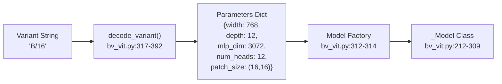
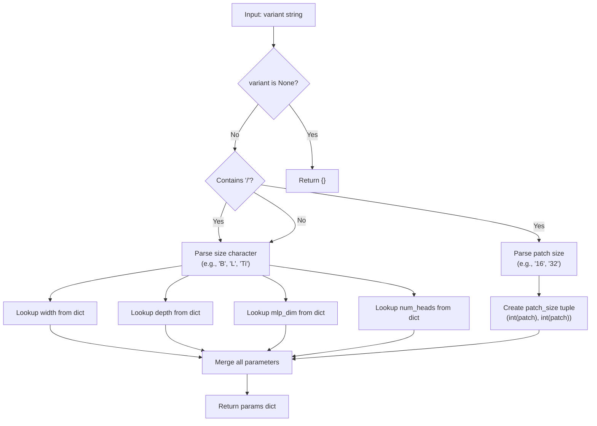
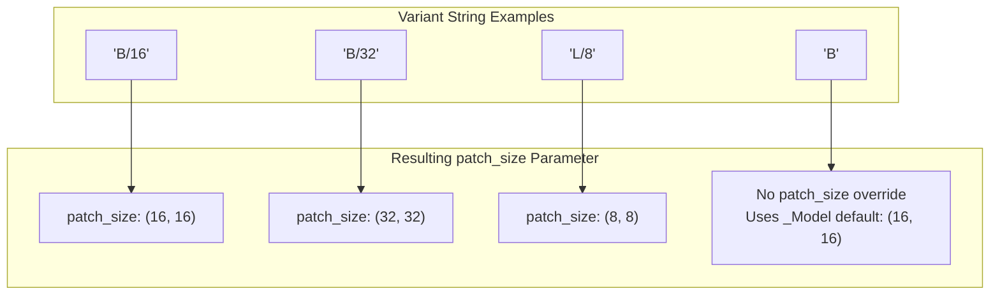
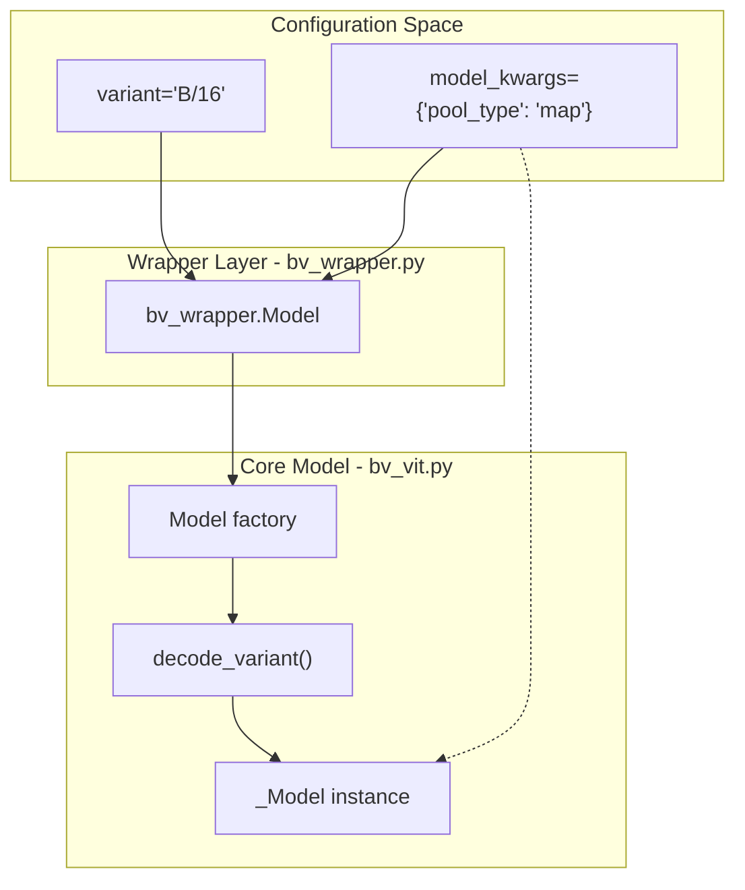

<!-- source: DeepWiki mcp.deepwiki.com · repo google-deepmind/alignet · page 4.3 Model Variants and Configuration · fetched 2026-10-26 -->

# Model Variants and Configuration

<details>
<summary>Relevant source files</summary>

The following files were used as context for generating this wiki page:

- [bv_vit.py](bv_vit.py)
- [configs/siglip.py](configs/siglip.py)

</details>


This document describes the Vision Transformer (ViT) model variant system in AligNet, which provides a simple string-based interface for configuring different model architectures. The variant system enables easy experimentation with different model sizes (Ti, S, M, B, L, etc.) and patch sizes (8, 16, 32) through a compact configuration string.

For details on the internal components that make up these models (MlpBlock, Encoder, etc.), see [Model Components](#4.2). For information on how these models are wrapped for training, see [Kauldron Integration Wrappers](#4.4).

## Overview of the Variant System

The variant system uses a simple string format to specify model architecture: `{SIZE}/{PATCH_SIZE}`. For example, `"B/16"` specifies a Base-sized model with 16×16 patches, while `"L/32"` specifies a Large model with 32×32 patches. If no patch size is specified (e.g., `"B"`), the model uses default parameters without overriding the patch size.



Sources: [bv_vit.py:312-392]()

## The decode_variant Function

The `decode_variant` function [bv_vit.py:317-392]() is the core of the variant system. It parses a variant string and returns a dictionary of model parameters.

### Parsing Logic



Sources: [bv_vit.py:317-392]()

### Implementation Details

The function operates in two steps:

1. **Split variant string**: Separates the size identifier from the optional patch size (e.g., `"B/16"` → `"B"` and `"16"`)
2. **Lookup parameters**: Uses the size identifier to look up `width`, `depth`, `mlp_dim`, and `num_heads` from predefined dictionaries

```python
# Example from bv_vit.py:317-326
def decode_variant(variant):
  """Converts a string like "B" or "B/32" into a params dict."""
  if variant is None:
    return {}

  v, patch = variant, {}
  if "/" in variant:
    v, patch = variant.split("/")
    patch = {"patch_size": (int(patch), int(patch))}
```

Sources: [bv_vit.py:317-326]()

## Available Model Variants

The following table lists all supported model variants and their architectural parameters. These are defined in the lookup dictionaries within `decode_variant` [bv_vit.py:327-392]().

| Variant | Width | Depth | MLP Dim | Num Heads | Description |
|---------|-------|-------|---------|-----------|-------------|
| `mu` | 32 | 1 | 128 | 2 | Micro (minimal for testing) |
| `Ti` | 192 | 12 | 768 | 3 | Tiny |
| `S` | 384 | 12 | 1536 | 6 | Small |
| `M` | 512 | 12 | 2048 | 8 | Medium |
| `B` | 768 | 12 | 3072 | 12 | Base |
| `L` | 1024 | 24 | 4096 | 16 | Large |
| `So400m` | 1152 | 27 | 4304 | 16 | SigLIP So400m |
| `H` | 1280 | 32 | 5120 | 16 | Huge |
| `g` | 1408 | 40 | 6144 | 16 | Giant |
| `g-opt` | 1536 | 40 | 6144 | 16 | Giant (optimized) |
| `G` | 1664 | 48 | 8192 | 16 | Giant+ |
| `G-opt` | 1536 | 48 | 8192 | 16 | Giant+ (optimized) |
| `e` | 1792 | 56 | 15360 | 16 | Enormous |

**Notes:**
- **Width**: Embedding dimension (also called `d_model` or hidden size)
- **Depth**: Number of transformer encoder blocks
- **MLP Dim**: Dimension of the feed-forward network in each block
- **Num Heads**: Number of attention heads in multi-head self-attention

Sources: [bv_vit.py:327-392]()

## Patch Size Configuration

Patch sizes are specified after a slash in the variant string. Common patch sizes are `8`, `16`, and `32`, which determine how the input image is divided into patches.



### Patch Size Impact

The patch size determines:
- **Sequence length**: For a 224×224 image with 16×16 patches: `(224/16)² = 196` tokens
- **Computational cost**: Smaller patches → longer sequences → higher computation
- **Spatial resolution**: Smaller patches capture finer spatial details

| Image Size | Patch Size | Sequence Length |
|------------|------------|-----------------|
| 224×224 | 8×8 | 784 |
| 224×224 | 16×16 | 196 |
| 224×224 | 32×32 | 49 |
| 384×384 | 16×16 | 576 |

Sources: [bv_vit.py:317-326](), [bv_vit.py:216]()

## Using Variants in Configuration

The variant system is used through the `Model` factory function [bv_vit.py:312-314](), which internally calls `decode_variant` and merges the results with additional keyword arguments.

```mermaid
graph LR
    CONFIG["Training Config<br/>configs/siglip.py"]
    WRAPPER["TripletWrapper<br/>line 53-57"]
    MODEL_FACTORY["Model factory<br/>variant='B/16'<br/>model_kwargs"]
    DECODE["decode_variant('B/16')"]
    MODEL_CLASS["_Model class<br/>with merged params"]
    
    CONFIG --> WRAPPER
    WRAPPER --> MODEL_FACTORY
    MODEL_FACTORY --> DECODE
    DECODE --> MODEL_CLASS
    MODEL_FACTORY -.."model_kwargs<br/>(e.g., pool_type)".-> MODEL_CLASS
```

Sources: [configs/siglip.py:53-57](), [bv_vit.py:312-314]()

### Example: SigLIP Training Configuration

The default SigLIP configuration [configs/siglip.py:53-57]() demonstrates typical variant usage:

```python
cfg.model = bv_wrapper.TripletWrapper(
    image="batch.image_triplet",
    model=bv_wrapper.Model(
        variant="B/16",                    # Base model, 16x16 patches
        model_kwargs={"pool_type": "map"}  # Use MAP pooling
    ),
    out_features=1024,
)
```

This configuration:
1. Sets the model variant to `"B/16"` (Base with 16×16 patches)
2. Overrides the default pooling type to `"map"` (Multihead Attention Pooling)
3. Specifies 1024 output features for the triplet head

Sources: [configs/siglip.py:53-57]()

## Model Factory Function

The `Model` factory function [bv_vit.py:312-314]() provides a clean interface for constructing `_Model` instances:

```python
def Model(num_classes=None, *, variant=None, **kw):
  """Factory function, because linen really don't like what I'm doing!"""
  return _Model(num_classes, **{**decode_variant(variant), **kw})
```

This function:
1. Accepts a `variant` string
2. Decodes it into a parameter dictionary
3. Merges with additional keyword arguments (`**kw`)
4. Constructs the `_Model` instance

### Parameter Priority

When parameters are specified both in the variant and as keyword arguments, the keyword arguments take precedence:

```python
# The width will be 768 (from "B"), but pool_type will be "map" (from kwargs)
model = Model(variant="B/16", pool_type="map")

# The width will be 512 (overriding "B")
model = Model(variant="B/16", width=512)
```

Sources: [bv_vit.py:312-314]()

## Variant Usage in Kauldron Wrapper

The variant system integrates with Kauldron through the `bv_wrapper.Model` wrapper [configs/siglip.py:55](). This wrapper:

1. Accepts the same `variant` parameter
2. Passes it to the `Model` factory
3. Handles checkpoint loading and initialization



Sources: [configs/siglip.py:53-57](), [bv_vit.py:312-314]()

## Common Variant Combinations

Here are typical variant configurations used in AligNet:

| Configuration | Variant | Patch Size | Use Case |
|---------------|---------|------------|----------|
| Base 16 | `B/16` | 16×16 | Standard training, good balance |
| Base 32 | `B/32` | 32×32 | Faster training, lower memory |
| Base 8 | `B/8` | 8×8 | High resolution tasks |
| Large 16 | `L/16` | 16×16 | Better accuracy, more compute |
| So400m 14 | `So400m/14` | 14×14 | SigLIP pre-trained models |

### Variant Selection Guidelines

1. **Start with B/16**: Good default for most tasks
2. **Use larger models (L, H, G)** for:
   - Higher capacity requirements
   - More training data available
   - Better final performance needed
3. **Adjust patch size** based on:
   - Input image resolution (larger images → smaller patches)
   - Computational budget (larger patches → faster)
   - Detail requirements (smaller patches → finer details)

Sources: [bv_vit.py:317-392](), [configs/siglip.py:53-57]()

## Complete Configuration Example

Here is a complete example showing how variant configuration flows through the system:

```python
# From configs/siglip.py
cfg.model = bv_wrapper.TripletWrapper(
    image="batch.image_triplet",
    model=bv_wrapper.Model(
        variant="B/16",                    # → width=768, depth=12, mlp_dim=3072,
                                           #   num_heads=12, patch_size=(16,16)
        model_kwargs={
            "pool_type": "map",            # Override default pooling
            "rep_size": False,             # No projection layer
            "head_zeroinit": True,         # Zero-init classification head
        }
    ),
    out_features=1024,                     # Triplet head output dimension
)
```

This configuration produces a Vision Transformer with:
- 768-dimensional embeddings (Base size)
- 12 transformer layers
- 12 attention heads
- 16×16 patch size
- Multihead Attention Pooling (MAP)
- 1024-dimensional triplet head output

Sources: [configs/siglip.py:53-57](), [bv_vit.py:312-314](), [bv_vit.py:317-392]()

---

